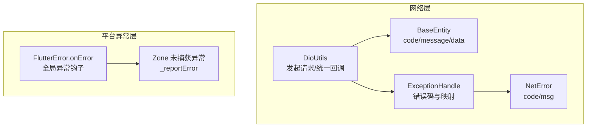
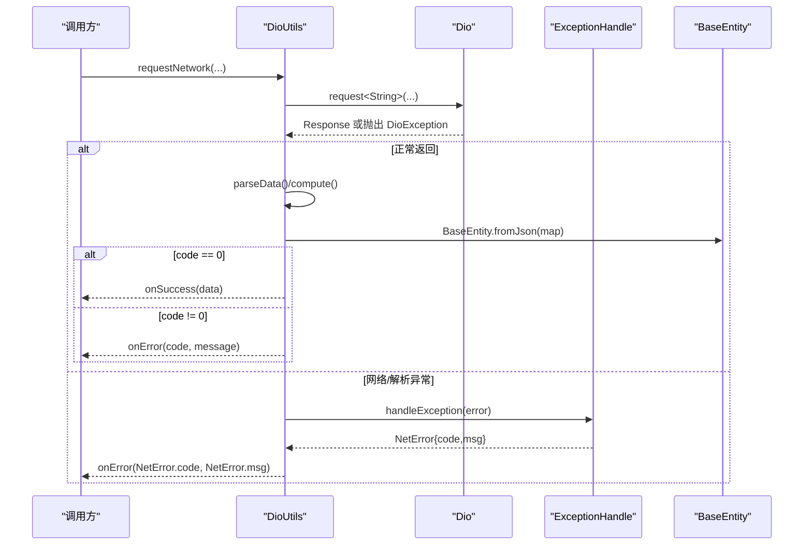
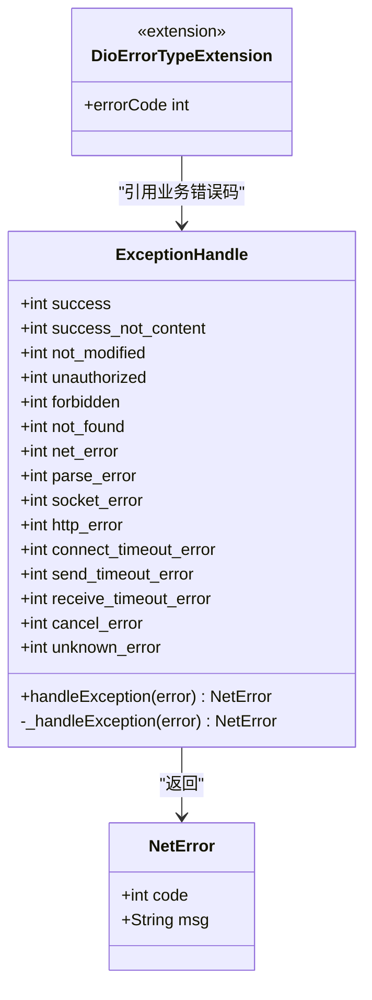
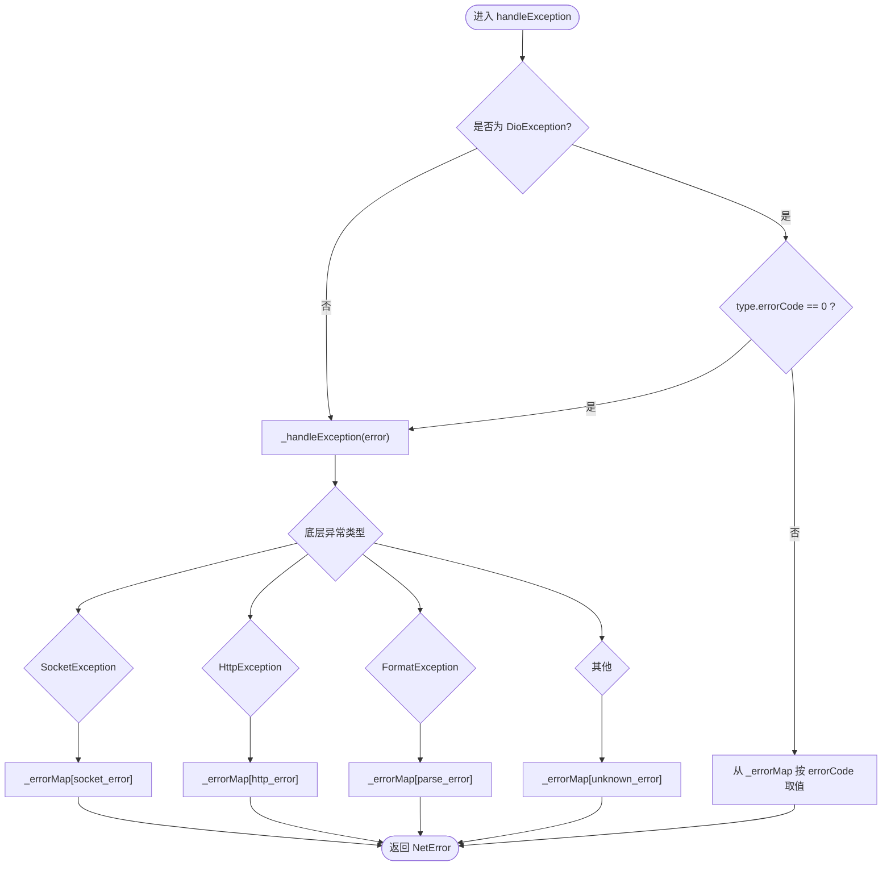
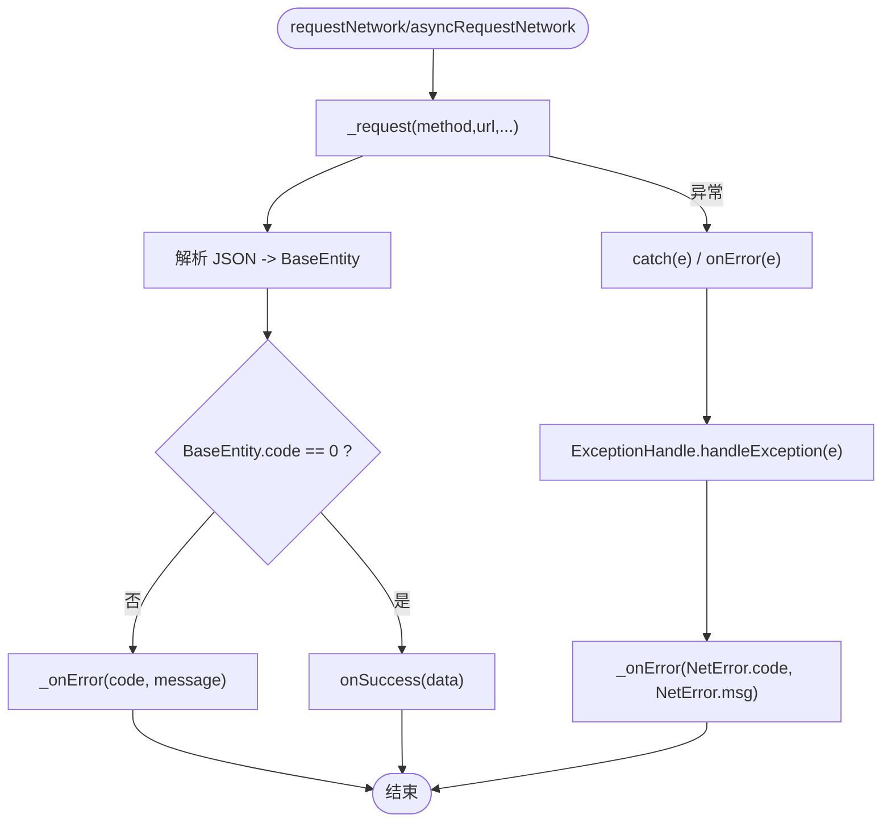
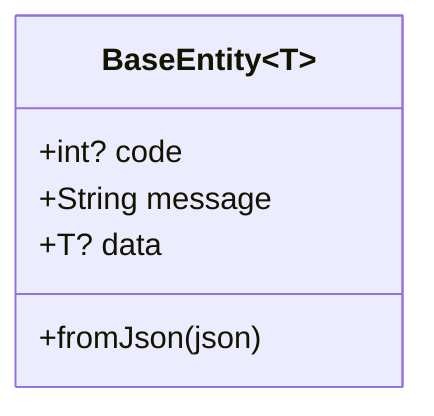
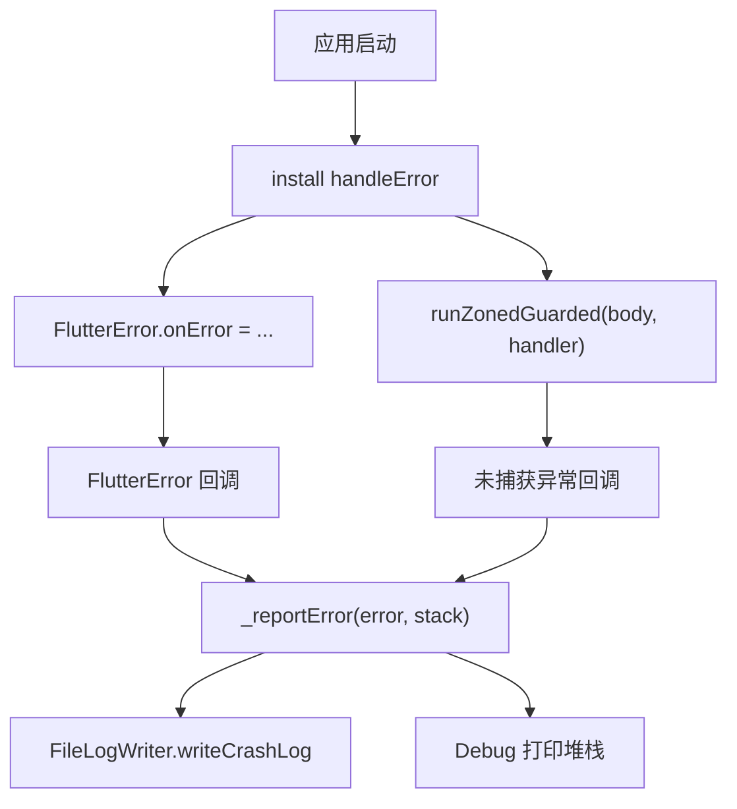
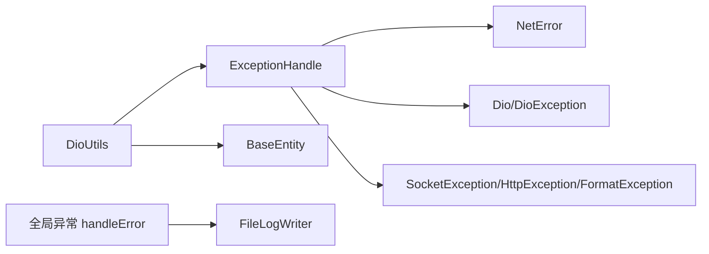

# 统一错误处理

<cite>
**本文引用的文件**   
- [error_handle.dart](file://lib/net/error_handle.dart)
- [dio_utils.dart](file://lib/net/dio_utils.dart)
- [base_entity.dart](file://lib/net/base_entity.dart)
- [handle_error_utils.dart](file://lib/util/handle_error_utils.dart)
</cite>

## 目录
1. [引言](#引言)
2. [项目结构中的错误处理位置](#项目结构中的错误处理位置)
3. [核心组件总览](#核心组件总览)
4. [架构总览](#架构总览)
5. [详细组件分析](#详细组件分析)
6. [依赖关系分析](#依赖关系分析)
7. [性能与可靠性考量](#性能与可靠性考量)
8. [常见错误与用户提示示例](#常见错误与用户提示示例)
9. [错误监控与上报最佳实践](#错误监控与上报最佳实践)
10. [结论](#结论)

## 引言
本技术文档围绕项目的“统一错误处理系统”展开，重点解释以下目标：
- ExceptionHandle 类的错误码定义、HTTP 状态码映射和业务错误码分类。
- handleException 方法的异常处理逻辑，包括 DioException 类型判断、底层异常类型的捕获与映射规则。
- NetError 模型的设计意图与字段语义。
- DioErrorTypeExtension 扩展如何将 DioExceptionType 映射到业务错误码。
- 网络层异常与业务层异常的统一处理流程、优先级与降级策略。
- 常见错误的用户友好提示示例。
- 错误监控与上报的最佳实践建议。

## 项目结构中的错误处理位置
本项目将网络请求、数据解析、异常处理等能力集中在 lib/net 目录下，同时提供全局异常捕获工具 lib/util/handle_error_utils.dart。关键文件职责如下：
- lib/net/error_handle.dart：定义统一错误码、Dio 异常映射、NetError 模型及扩展。
- lib/net/dio_utils.dart：封装 Dio 请求、响应解析、统一回调和错误入口。
- lib/net/base_entity.dart：统一接口返回体 BaseEntity，承载 code/message/data。
- lib/util/handle_error_utils.dart：全局 Flutter 异常捕获与崩溃日志落盘。

**图表来源**
- [dio_utils.dart:1-222](file://lib/net/dio_utils.dart#L1-L222)
- [base_entity.dart:1-33](file://lib/net/base_entity.dart#L1-L33)
- [error_handle.dart:1-82](file://lib/net/error_handle.dart#L1-L82)
- [handle_error_utils.dart:1-44](file://lib/util/handle_error_utils.dart#L1-L44)

**章节来源**
- [dio_utils.dart:1-222](file://lib/net/dio_utils.dart#L1-L222)
- [base_entity.dart:1-33](file://lib/net/base_entity.dart#L1-L33)
- [error_handle.dart:1-82](file://lib/net/error_handle.dart#L1-L82)
- [handle_error_utils.dart:1-44](file://lib/util/handle_error_utils.dart#L1-L44)

## 核心组件总览
- ExceptionHandle：集中管理 HTTP 成功/失败状态常量、业务错误码常量、错误码到 NetError 的映射表，以及 handleException 主调度方法。
- NetError：统一的错误载体，包含 code 与 msg。
- DioErrorTypeExtension：对 DioExceptionType 进行扩展，把 Dio 内置的错误类型索引映射为业务错误码。
- DioUtils：封装 Dio 请求、JSON 解析、统一 onSuccess/onError 回调，并在 onError 分支调用 ExceptionHandle.handleException。
- BaseEntity：统一接口返回体，code=0 表示成功，非 0 表示业务失败。
- handleError（全局）：统一捕获 Flutter 未处理异常并写入本地崩溃日志。

**章节来源**
- [error_handle.dart:1-82](file://lib/net/error_handle.dart#L1-L82)
- [dio_utils.dart:1-222](file://lib/net/dio_utils.dart#L1-L222)
- [base_entity.dart:1-33](file://lib/net/base_entity.dart#L1-L33)
- [handle_error_utils.dart:1-44](file://lib/util/handle_error_utils.dart#L1-L44)

## 架构总览
下图展示一次典型网络请求在出现异常时的完整处理链路。

**图表来源**
- [dio_utils.dart:1-222](file://lib/net/dio_utils.dart#L1-L222)
- [error_handle.dart:1-82](file://lib/net/error_handle.dart#L1-L82)
- [base_entity.dart:1-33](file://lib/net/base_entity.dart#L1-L33)

## 详细组件分析

### ExceptionHandle：错误码与映射中心
- HTTP 状态码常量：success、success_not_content、not_modified、unauthorized、forbidden、not_found。这些常量用于上层或拦截器识别 HTTP 层面的成功与失败语义。
- 业务错误码常量：
  - net_error：通用网络异常。
  - parse_error：数据解析异常。
  - socket_error：Socket 层异常。
  - http_error：HTTP 层异常。
  - connect_timeout_error：连接超时。
  - send_timeout_error：发送超时。
  - receive_timeout_error：接收超时。
  - cancel_error：取消请求。
  - unknown_error：未知异常兜底。
- _errorMap：将业务错误码映射为 NetError，msg 即面向用户的提示文案。
- handleException：统一入口，优先识别 DioException；若 type.errorCode==0，则下钻到底层异常再次分类；否则直接取 _errorMap。
- _handleException：根据 Dart 标准库异常类型（SocketException、HttpException、FormatException）映射为对应业务错误码，再查表返回 NetError。
- NetError：code 为业务错误码，msg 为用户可读消息。

**图表来源**
- [error_handle.dart:1-82](file://lib/net/error_handle.dart#L1-L82)

**章节来源**
- [error_handle.dart:1-82](file://lib/net/error_handle.dart#L1-L82)

### handleException 方法与 DioErrorTypeExtension
- 优先级与降级策略：
  1) 如果 error 是 DioException：
     - 若 type.errorCode 不为 0：直接从 _errorMap 取出对应 NetError。
     - 若 type.errorCode 为 0：说明 Dio 未能明确分类，继续交由 _handleException 判断底层异常。
  2) 如果不是 DioException：直接进入 _handleException 进行分类。
- _handleException 的分类顺序：
  - SocketException → socket_error
  - HttpException → http_error
  - FormatException → parse_error
  - 其他 → unknown_error
- DioErrorTypeExtension：通过 DioExceptionType 的 index 与一个固定数组映射，得到业务错误码。该扩展被 ExceptionHandle 使用以完成 Dio 异常到业务错误码的转换。

**图表来源**
- [error_handle.dart:1-82](file://lib/net/error_handle.dart#L1-L82)

**章节来源**
- [error_handle.dart:1-82](file://lib/net/error_handle.dart#L1-L82)

### DioUtils：统一请求与错误入口
- 初始化配置：
  - 设置 connectTimeout、receiveTimeout、sendTimeout。
  - responseType 设置为 plain，由 DioUtils 自行解析 JSON，便于统一异常路径。
  - validateStatus 始终返回 true，HTTP 状态码不在 Dio 层拦截，改由业务层 BaseEntity.code 判断。
- 请求流程：
  - _request 执行 Dio.request，然后解析 response.data。
  - 大体积响应（>10KB）且非集成测试时使用 compute 进行隔离解析，降低 UI 卡顿风险。
  - 将解析结果转为 BaseEntity<T>，再由外层区分 code==0 或 code!=0。
- 回调与错误处理：
  - requestNetwork 与 asyncRequestNetwork 最终都会调用 _onError。
  - 正常返回但 code!=0：直接使用 BaseEntity.message 作为错误消息。
  - 网络异常分支：调用 ExceptionHandle.handleException 获取 NetError，再通过 _onError 上报。
  - _cancelLogPrint：识别 DioException.isCancel，打印取消日志。
  - _onError：当 code 为空时，降级为 unknown_error 与“未知异常”，并记录日志。

**图表来源**
- [dio_utils.dart:1-222](file://lib/net/dio_utils.dart#L1-L222)
- [error_handle.dart:1-82](file://lib/net/error_handle.dart#L1-L82)

**章节来源**
- [dio_utils.dart:1-222](file://lib/net/dio_utils.dart#L1-L222)

### BaseEntity：统一接口返回体
- 字段含义：
  - code：业务状态码。0 表示成功，非 0 表示业务失败。
  - message：业务错误信息。
  - data：泛型数据载荷。
- 解析逻辑：
  - 从 JSON 中读取 code、message、data。
  - data 为 String 或 Map 时直接赋值；否则使用 JsonConvert 反序列化为 T。
- 与错误处理的关系：
  - 当 code!=0 时，DioUtils 会将 message 作为错误消息传递给 _onError，形成业务层错误通道。
  - 当解析 JSON 失败时，DioUtils 会返回 code=parse_error 的 BaseEntity，走业务失败通道。

**图表来源**
- [base_entity.dart:1-33](file://lib/net/base_entity.dart#L1-L33)

**章节来源**
- [base_entity.dart:1-33](file://lib/net/base_entity.dart#L1-L33)

### 全局异常捕获：handleError
- 重写 FlutterError.onError：
  - Debug 模式仍输出控制台。
  - 所有环境都将异常交给 Zone.current.handleUncaughtError，确保 Release 也能落盘。
- runZonedGuarded：
  - 捕获未处理异常并调用 _reportError。
  - 写本地崩溃日志 FileLogWriter.instance.writeCrashLog。
  - Debug 模式打印堆栈；Release 模式预留上报服务端能力。

**图表来源**
- [handle_error_utils.dart:1-44](file://lib/util/handle_error_utils.dart#L1-L44)

**章节来源**
- [handle_error_utils.dart:1-44](file://lib/util/handle_error_utils.dart#L1-L44)

## 依赖关系分析
- DioUtils 依赖：
  - Dio（网络请求）
  - ExceptionHandle（网络异常转 NetError）
  - BaseEntity（统一返回体）
  - UserHelper、Constant、Log（环境与日志）
- ExceptionHandle 依赖：
  - DioException、DioExceptionType（来自 dio 包）
  - SocketException、HttpException、FormatException（dart:io 与 dart:convert）
  - NetError（自身模块内）
- 全局异常捕获独立于网络层，负责 Flutter 运行时未处理异常的收集与落盘。

**图表来源**
- [dio_utils.dart:1-222](file://lib/net/dio_utils.dart#L1-L222)
- [error_handle.dart:1-82](file://lib/net/error_handle.dart#L1-L82)
- [base_entity.dart:1-33](file://lib/net/base_entity.dart#L1-L33)
- [handle_error_utils.dart:1-44](file://lib/util/handle_error_utils.dart#L1-L44)

**章节来源**
- [dio_utils.dart:1-222](file://lib/net/dio_utils.dart#L1-L222)
- [error_handle.dart:1-82](file://lib/net/error_handle.dart#L1-L82)
- [base_entity.dart:1-33](file://lib/net/base_entity.dart#L1-L33)
- [handle_error_utils.dart:1-44](file://lib/util/handle_error_utils.dart#L1-L44)

## 性能与可靠性考量
- 大响应解析隔离：当响应长度大于 10KB 且非集成测试时，使用 compute 在 isolate 中解析 JSON，避免阻塞 UI 线程。
- 统一响应类型：responseType 设为 plain，由 DioUtils 统一解析，保证异常路径一致，减少重复 try/catch。
- 不依赖 HTTP 状态码做业务判断：validateStatus 恒返回 true，业务逻辑以 BaseEntity.code 为准，更贴合 REST 业务语义。
- 取消请求可观测：通过 _cancelLogPrint 识别 DioException.isCancel，便于定位主动取消场景。
- 全局异常落盘：Release 环境下也保留崩溃日志，提高问题复现率。

**章节来源**
- [dio_utils.dart:1-222](file://lib/net/dio_utils.dart#L1-L222)
- [handle_error_utils.dart:1-44](file://lib/util/handle_error_utils.dart#L1-L44)

## 常见错误与用户提示示例
以下为常见错误场景的用户友好提示建议，对应代码中的错误码与消息映射：

- 网络不可用或 DNS/路由失败
  - 业务错误码：net_error 或 socket_error
  - 用户提示：检查网络连接后重试
- 数据格式错误或服务端返回非法 JSON
  - 业务错误码：parse_error
  - 用户提示：数据解析失败，请稍后再试
- Socket 层异常（如连接重置）
  - 业务错误码：socket_error
  - 用户提示：网络异常，请检查你的网络
- HTTP 层异常（协议/证书/代理相关）
  - 业务错误码：http_error
  - 用户提示：服务器异常，请稍后重试
- 连接超时
  - 业务错误码：connect_timeout_error
  - 用户提示：连接超时，请检查网络后重试
- 发送超时
  - 业务错误码：send_timeout_error
  - 用户提示：请求超时，请稍后再试
- 接收超时
  - 业务错误码：receive_timeout_error
  - 用户提示：响应超时，请稍后再试
- 主动取消请求
  - 业务错误码：cancel_error
  - 用户提示：取消请求
- 未知异常
  - 业务错误码：unknown_error
  - 用户提示：未知异常，请稍后再试

注意：认证失败、权限不足等通常由后端通过 BaseEntity.code/message 表达，前端应直接透传 message 给消费者，并结合 UI 做跳转或引导登录。

**章节来源**
- [error_handle.dart:1-82](file://lib/net/error_handle.dart#L1-L82)
- [dio_utils.dart:1-222](file://lib/net/dio_utils.dart#L1-L222)
- [base_entity.dart:1-33](file://lib/net/base_entity.dart#L1-L33)

## 错误监控与上报最佳实践
- 网络层错误上报
  - 建议在 DioUtils._onError 处统一收集 code、msg、url、method、params 摘要（脱敏），异步上报至监控系统。
  - 对 DioException.isCancel 单独统计，避免污染真实错误指标。
- 业务层错误上报
  - 当 BaseEntity.code != 0 时，记录 code、message、traceId（如有）、时间戳，便于关联排查。
- 全局异常上报
  - 利用 handleError 的 _reportError，在 Release 环境中接入第三方崩溃上报 SDK（如 flutter_bugly），将本地 crash_log 同步上传。
- 分级与降噪
  - 将同一类错误合并去重（例如相同 code+url 短时间内多次出现）。
  - 对高频可预期错误（如网络切换导致的短暂失败）进行采样上报。
- 可观测性增强
  - 对关键接口增加耗时、重试次数、错误码分布埋点。
  - 结合日志采集（FileLogWriter）与线上监控，形成闭环。

**章节来源**
- [dio_utils.dart:1-222](file://lib/net/dio_utils.dart#L1-L222)
- [handle_error_utils.dart:1-44](file://lib/util/handle_error_utils.dart#L1-L44)

## 结论
本项目的统一错误处理体系通过 ExceptionHandle 收敛了 Dio 异常与底层异常，并以 NetError 为载体向 DioUtils 暴露一致的 code/msg；DioUtils 再以 BaseEntity 统一业务成功/失败通道，最终由 _onError 汇聚并供上层消费。配合全局 handleError 的崩溃落盘机制，形成了“网络层—业务层—全局层”的分层治理。实践中建议在此基础上补充线上错误上报、降噪与可观测性建设，进一步提升问题发现与修复效率。