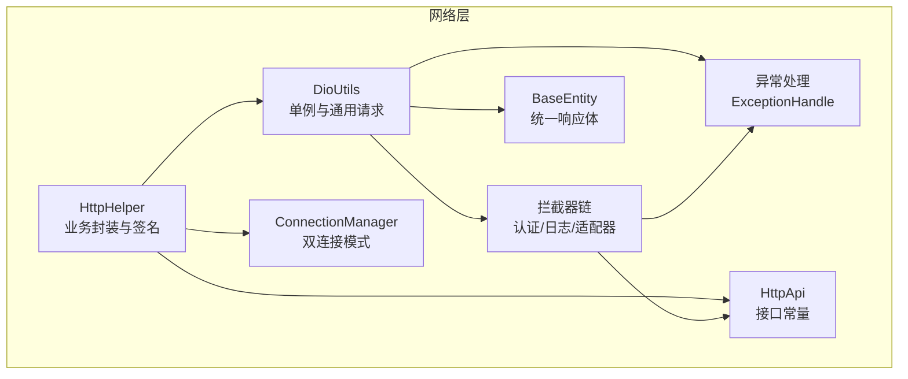
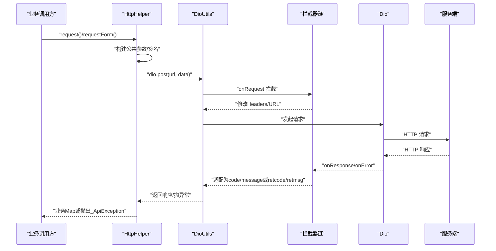
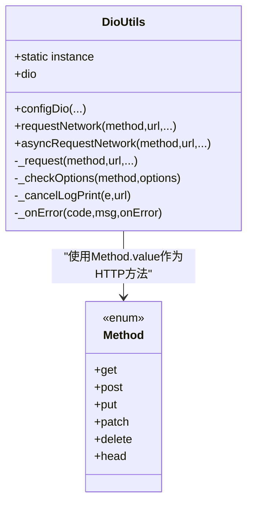
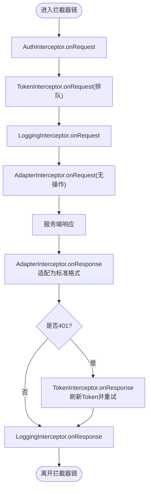
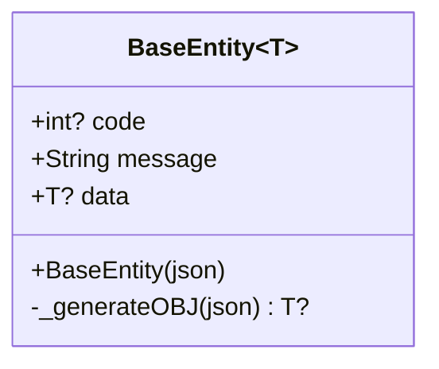
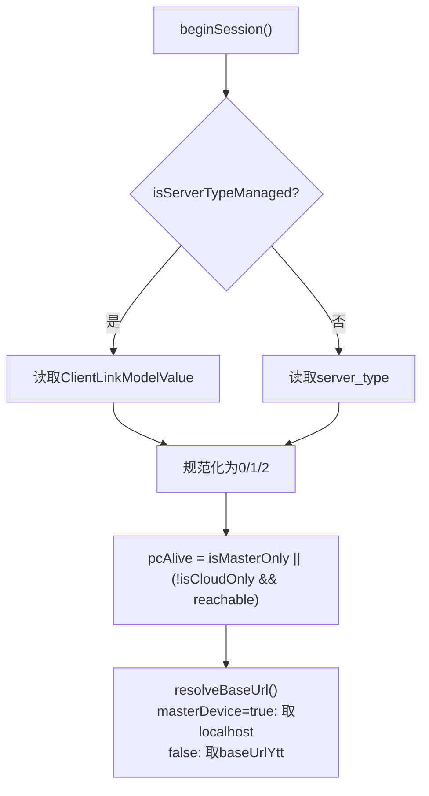
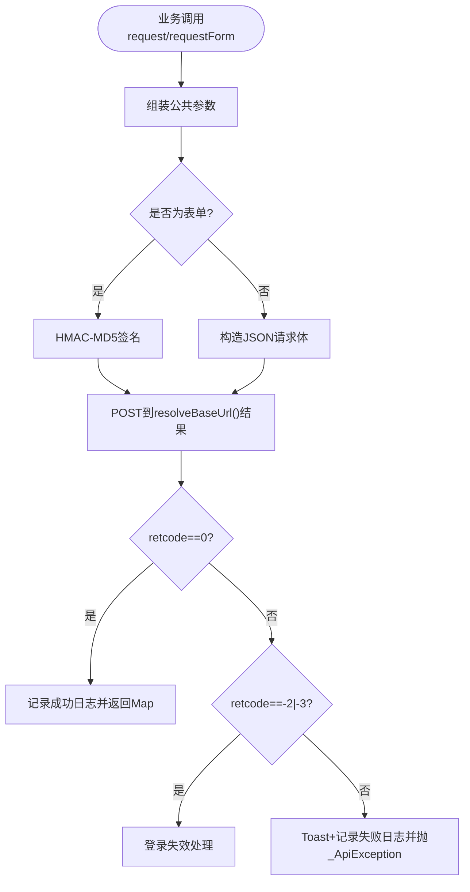
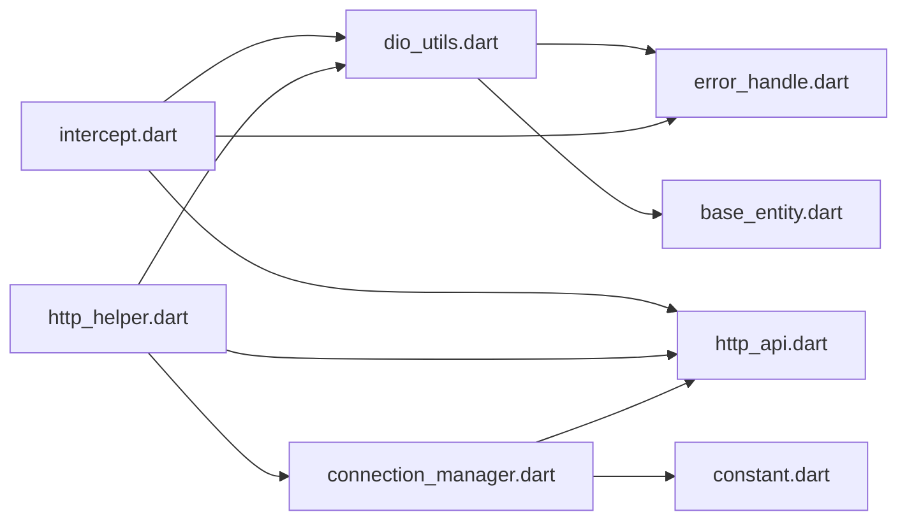
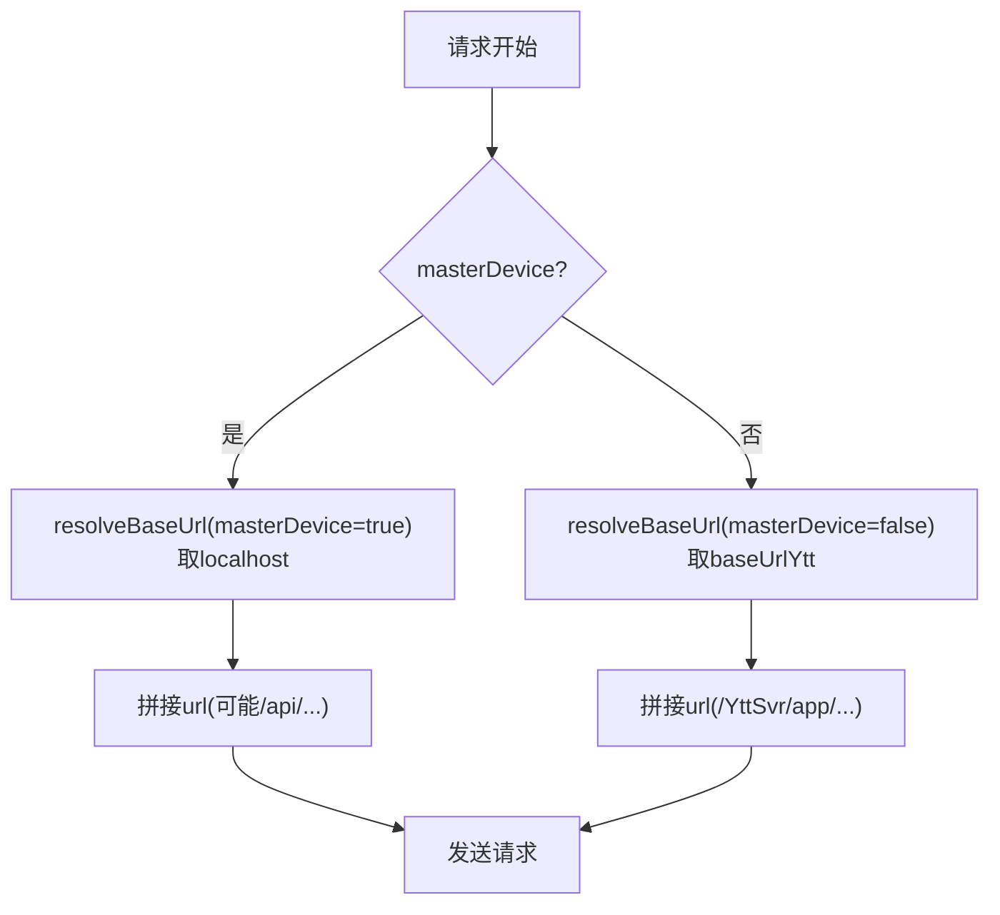

# 网络层设计

<cite>
**本文引用的文件**   
- [dio_utils.dart](file://lib/net/dio_utils.dart)
- [base_entity.dart](file://lib/net/base_entity.dart)
- [intercept.dart](file://lib/net/intercept.dart)
- [connection_manager.dart](file://lib/net/connection_manager.dart)
- [http_helper.dart](file://lib/net/http_helper.dart)
- [error_handle.dart](file://lib/net/error_handle.dart)
- [http_api.dart](file://lib/net/http_api.dart)
- [net.dart](file://lib/net/net.dart)
- [constant.dart](file://lib/res/constant.dart)
</cite>

## 目录
1. [引言](#引言)
2. [项目结构](#项目结构)
3. [核心组件](#核心组件)
4. [架构总览](#架构总览)
5. [详细组件分析](#详细组件分析)
6. [依赖关系分析](#依赖关系分析)
7. [性能与并发特性](#性能与并发特性)
8. [错误处理与重试策略](#错误处理与重试策略)
9. [双连接模式与请求路径选择](#双连接模式与请求路径选择)
10. [网络请求最佳实践](#网络请求最佳实践)
11. [故障排查指南](#故障排查指南)
12. [结论](#结论)

## 引言
本文面向聚客美滋滋应用的网络层，系统化梳理 DioUtils 单例、拦截器链、双连接模式、错误处理、统一响应体 BaseEntity，以及 http_helper 中的业务封装。目标是帮助开发者快速理解：如何发起网络请求、如何在云服务与主设备直连之间切换、如何统一处理异常与登录失效、以及如何编写稳定且可观测的网络调用。

## 项目结构
网络层代码集中在 lib/net 下，采用“基础设施 + 业务封装”的分层方式：
- 基础设施：Dio 客户端初始化、拦截器、错误码映射、基础响应体
- 连接管理：云服务与主设备地址解析、连接模式判定
- 业务封装：统一 POST 包装、表单签名、登录失效处理、API 常量

图表来源
- [dio_utils.dart:1-222](file://lib/net/dio_utils.dart#L1-L222)
- [intercept.dart:1-219](file://lib/net/intercept.dart#L1-L219)
- [error_handle.dart:1-82](file://lib/net/error_handle.dart#L1-L82)
- [base_entity.dart:1-33](file://lib/net/base_entity.dart#L1-L33)
- [connection_manager.dart:1-114](file://lib/net/connection_manager.dart#L1-L114)
- [http_helper.dart:1-692](file://lib/net/http_helper.dart#L1-L692)
- [http_api.dart:1-200](file://lib/net/http_api.dart#L1-L200)

章节来源
- [dio_utils.dart:1-222](file://lib/net/dio_utils.dart#L1-L222)
- [http_helper.dart:1-692](file://lib/net/http_helper.dart#L1-L692)
- [connection_manager.dart:1-114](file://lib/net/connection_manager.dart#L1-L114)

## 核心组件
- DioUtils：基于 Dio 的单例 HTTP 客户端，负责超时、代理、拦截器注册、统一请求入口、成功/失败回调分发、取消请求日志。
- Intercept：包含认证、Token 刷新、日志、响应适配等拦截器，决定请求头、自动重试与返回格式标准化。
- ConnectionManager：根据配置与运行态判断走云服务还是主设备直连，提供 BaseUrl 解析与主设备可达性广播。
- HttpHelper：业务级 request/requestForm，构造公共参数、计算 HMAC-MD5 签名、处理 retcode/-2/-3 登录失效、记录 API 日志。
- ExceptionHandle：HTTP 状态码、网络异常类型到业务错误码的统一映射。
- BaseEntity：统一响应体 code/message/data，支持泛型数据解析。
- HttpApi：云服务与主设备的接口路径常量，区分 /YttSvr/app 与 /api/ 前缀。

章节来源
- [dio_utils.dart:1-222](file://lib/net/dio_utils.dart#L1-L222)
- [intercept.dart:1-219](file://lib/net/intercept.dart#L1-L219)
- [connection_manager.dart:1-114](file://lib/net/connection_manager.dart#L1-L114)
- [http_helper.dart:1-692](file://lib/net/http_helper.dart#L1-L692)
- [error_handle.dart:1-82](file://lib/net/error_handle.dart#L1-L82)
- [base_entity.dart:1-33](file://lib/net/base_entity.dart#L1-L33)
- [http_api.dart:1-200](file://lib/net/http_api.dart#L1-L200)

## 架构总览
整体调用链路分为两条主线：
- 通用 JSON 请求：业务调用 DioUtils.requestNetwork/asyncRequestNetwork → 拦截器链 → Dio → 服务端
- 业务封装请求：业务调用 HttpHelper.request/requestForm → 构造参数与签名 → DioUtils.dio.post → 业务异常处理与日志

图表来源
- [http_helper.dart:1-692](file://lib/net/http_helper.dart#L1-L692)
- [dio_utils.dart:1-222](file://lib/net/dio_utils.dart#L1-L222)
- [intercept.dart:1-219](file://lib/net/intercept.dart#L1-L219)

## 详细组件分析

### DioUtils：单例、客户端初始化与通用请求
- 单例实现：通过 Dart factory + 私有构造函数 + static instance 暴露唯一实例；内部持有 Dio 对象。
- 基础配置：
  - 可配置的 connect/receive/send 超时。
  - baseUrl 由 configDio 注入。
  - responseType 设置为 plain，避免 Dio 默认 JSON 解析干扰自定义解析。
  - validateStatus 恒返回 true，将 HTTP 状态判断下沉到 AdapterInterceptor。
- 代理抓包：非 Web 平台使用 IOHttpClientAdapter，按 debug 模式与特定 spid 条件启用 Fiddler 代理；证书校验放行以兼容自签环境。
- 拦截器装配：在构造函数中遍历 _interceptors 列表逐一 addInterceptor。
- 统一请求入口：
  - _request：统一走 dio.request<String>，按大小决定是否用 compute 异步解析，最终反序列化为 BaseEntity。
  - requestNetwork/asyncRequestNetwork：封装 onSuccess/onError 回调，内部统一处理 code==0 分支与异常分支。
  - 取消请求：CancelToken.isCancel 时打印取消日志。

图表来源
- [dio_utils.dart:1-222](file://lib/net/dio_utils.dart#L1-L222)

章节来源
- [dio_utils.dart:1-222](file://lib/net/dio_utils.dart#L1-L222)

### 拦截器链设计与执行顺序
当前注册的拦截器职责如下（按添加顺序）：
1. AuthInterceptor：对云服务请求追加 Authorization=token xxx，并对非 Web 设置 User-Agent。
2. TokenInterceptor：QueuedInterceptor，针对 401 自动刷新 token 并重试原请求。
3. LoggingInterceptor：记录请求 URL/Headers/Data 与响应耗时，JSON 输出。
4. AdapterInterceptor：将 HTTP 状态 200/204 透传原始 body，其他状态尝试解析 message/msg 字段并统一为 {code,message} 格式；同时保留 401 原状以便 TokenInterceptor 识别。

注意：
- AdapterInterceptor 会改写 statusCode 为 success 或 401，因此后续拦截器看到的 HTTP 状态不再代表真实服务器状态。
- TokenInterceptor 使用独立 Dio 实例 _tokenDio 以避免重复触发拦截器链。
- LoggingInterceptor 不感知业务 code，仅看 HTTP 状态码。

图表来源
- [intercept.dart:1-219](file://lib/net/intercept.dart#L1-L219)

章节来源
- [intercept.dart:1-219](file://lib/net/intercept.dart#L1-L219)

### BaseEntity：统一响应体
- 字段：code/message/data。
- 解析逻辑：
  - 从 JSON 读取 Constant.code 与 Constant.message。
  - data 为空时返回 null；String 类型直接 toString；Map 类型直接强转；其余类型使用 JsonConvert.fromJsonAsT。
- 用途：DioUtils._request 统一将 JSON Map 转为 BaseEntity，再由上层根据 code==0 判断成功。

图表来源
- [base_entity.dart:1-33](file://lib/net/base_entity.dart#L1-L33)

章节来源
- [base_entity.dart:1-33](file://lib/net/base_entity.dart#L1-L33)

### 连接管理器：双连接模式
- 模式定义：
  - serverType：0=不限，1=仅主设备，2=仅云服务。
  - pcAlive：综合 isMasterOnly/isCloudOnly 与主设备可达性判定。
- 关键能力：
  - beginSession：初始化 session，清空主设备可达性。
  - onMasterDeviceLost：广播主设备丢失事件，供 UI 展示提示。
  - getNetMode：pcAlive ? 1 : 2。
  - resolveBaseUrl(masterDevice=false)：主设备模式下获取 localhost，否则返回 HttpApi.baseUrlYtt。
  - getLocalhost/saveLocalhost：存取主设备地址，支持调试覆盖。

图表来源
- [connection_manager.dart:1-114](file://lib/net/connection_manager.dart#L1-L114)

章节来源
- [connection_manager.dart:1-114](file://lib/net/connection_manager.dart#L1-L114)

### HttpHelper：业务封装与签名
- request：默认 POST，自动合并 sid/spid/userid/clientflag，并附加 client/token/sign/requestId；返回完整 Map。
- requestForm：表单编码 POST，用于登录等接口；自动追加公共参数与 HMAC-MD5 签名。
- 登录失效处理：
  - retcode=-2/-3 触发 _handleLoginExpired/_handleForceLogout，清除缓存并跳转登录页。
- 主设备断线处理：当 masterDevice=true 且 DioException.response==null 时，调用 ConnectionManager.notifyMasterDeviceLost。
- API 日志：所有成功/失败均写入 api_log；失败额外写 crash_log；大体积接口成功时跳过逐条记录。

图表来源
- [http_helper.dart:1-692](file://lib/net/http_helper.dart#L1-L692)
- [connection_manager.dart:1-114](file://lib/net/connection_manager.dart#L1-L114)

章节来源
- [http_helper.dart:1-692](file://lib/net/http_helper.dart#L1-L692)

### 错误处理：ExceptionHandle
- 内置 HTTP 状态码常量：success/success_not_content/unauthorized/forbidden/not_found。
- 业务错误码：net_error/parse_error/socket_error/http_error/connect_timeout_error/send_timeout_error/receive_timeout_error/cancel_error/unknown_error。
- handleException：优先处理 DioException.type，再回退到底层 error 类型（SocketException/HttpException/FormatException），映射到 NetError(code,msg)。
- DioErrorTypeExtension：将 DioExceptionType 映射到上述业务错误码。

章节来源
- [error_handle.dart:1-82](file://lib/net/error_handle.dart#L1-L82)

## 依赖关系分析

图表来源
- [dio_utils.dart:1-222](file://lib/net/dio_utils.dart#L1-L222)
- [intercept.dart:1-219](file://lib/net/intercept.dart#L1-L219)
- [http_helper.dart:1-692](file://lib/net/http_helper.dart#L1-L692)
- [connection_manager.dart:1-114](file://lib/net/connection_manager.dart#L1-L114)
- [http_api.dart:1-200](file://lib/net/http_api.dart#L1-L200)
- [constant.dart:1-93](file://lib/res/constant.dart#L1-L93)

章节来源
- [net.dart:1-3](file://lib/net/net.dart#L1-L3)

## 性能与并发特性
- 大数据解析优化：DioUtils._request 对大于约 10KB 的响应使用 compute 在 isolate 中解析，降低主线程阻塞风险。
- 日志裁剪：HttpHelper 对大体积或高频接口成功时不逐条记录，避免日志膨胀；失败仍记录。
- 拦截器开销：LoggingInterceptor 每次请求都会序列化 Headers/Data，建议在高频场景按需关闭或降级日志级别。
- 代理抓包：仅在 debug 模式与特定 spid 生效，不影响生产流量。
- 并发控制：网络层未内置全局限流；建议在上层 Repository 使用表级锁或信号量进行并发控制。

[本节为通用指导，无需源码引用]

## 错误处理与重试策略
- 网络层异常：
  - DioUtils._request 捕获解析异常，返回 BaseEntity(parse_error, ...)。
  - requestNetwork/asyncRequestNetwork 在 onError 分支调用 ExceptionHandle.handleException 转换为 NetError，再通过 _onError 回调给调用方。
- 业务异常：
  - HttpHelper 将 retcode!=0 或 retcode=-2/-3 等情况封装为 _ApiException 并抛出，外层 catch 统一 Toast 与日志。
  - retcode=-2/-3 触发登录失效流程，清理缓存并跳转登录页。
- Token 自动刷新：
  - TokenInterceptor 检测到 401 后调用 refreshToken 接口，成功后替换 Authorization 并重新发起原请求。
  - 该重试由拦截器内部完成，不属于通用重试策略；若刷新失败，原请求会被 reject。
- 重试建议：
  - 对于幂等 GET/HEAD 请求，可在上层实现指数退避重试。
  - 对于写操作（POST/PUT/DELETE）不建议盲目重试，应结合业务幂等键与去重机制。

章节来源
- [dio_utils.dart:1-222](file://lib/net/dio_utils.dart#L1-L222)
- [intercept.dart:1-219](file://lib/net/intercept.dart#L1-L219)
- [http_helper.dart:1-692](file://lib/net/http_helper.dart#L1-L692)
- [error_handle.dart:1-82](file://lib/net/error_handle.dart#L1-L82)

## 双连接模式与请求路径选择
- 云服务模式：
  - BaseUrl：HttpApi.baseUrlYtt（/YttSvr/app）。
  - 认证：Authorization=token xxx（AuthInterceptor）。
  - 典型路径：/table/area/getAreaList、/sale/upSaleMasterTmp 等。
- 主设备直连模式：
  - BaseUrl：ConnectionManager.getLocalhost()，通常为登录返回的 localhost。
  - 路径前缀：/api/...（如 /api/host/GetHostSyncTime、/api/table/TableCancel）。
  - 认证：不携带 Authorization（对齐 smdcapp PCTableHttpUtil）。
- 路由规则：
  - ConnectionManager.resolveBaseUrl(masterDevice=true/false) 决定目标地址。
  - HttpHelper.requestForm 通过 masterDevice 参数选择走主设备或服务端。
  - HttpHelper.request 固定走 baseUrlYtt，适用于纯云端 JSON 接口。

图表来源
- [connection_manager.dart:1-114](file://lib/net/connection_manager.dart#L1-L114)
- [http_helper.dart:1-692](file://lib/net/http_helper.dart#L1-L692)
- [http_api.dart:1-200](file://lib/net/http_api.dart#L1-L200)

章节来源
- [connection_manager.dart:1-114](file://lib/net/connection_manager.dart#L1-L114)
- [http_helper.dart:1-692](file://lib/net/http_helper.dart#L1-L692)
- [http_api.dart:1-200](file://lib/net/http_api.dart#L1-L200)

## 网络请求最佳实践
- 并发控制
  - 使用 table_concurrency_guard 等工具类限制同一桌台的并发写操作，避免脏写与重复提交。
  - 对批量查询，考虑分页与防抖，避免一次性拉取超大数据集。
- 缓存策略
  - 静态数据（分类、商品、区域）结合本地数据库与版本号对比更新。
  - 热点列表短周期缓存，过期时间依据业务变更频率设定。
- 断网重连
  - 订阅 ConnectionManager.onMasterDeviceLost，UI 层弹出连接失败提示。
  - 对关键探活接口（如 /api/host/GetHostSyncTime）周期性探测，动态调整 pcAlive。
- 请求取消
  - 页面销毁时释放 CancelToken，避免后台继续请求导致内存泄漏。
- 日志与可观测性
  - 利用 HttpHelper 的 api_log/crash_log 定位问题，必要时开启 LoggingInterceptor 全量日志。
- 安全与合规
  - 生产环境关闭代理抓包；仅 debug 模式与特定 spid 启用。
  - 表单签名 HMAC-MD5 与 url_info 参与签名，保证参数完整性。

[本节为通用指导，无需源码引用]

## 故障排查指南
- 常见问题
  - 登录后立即被踢：检查 retcode=-2/-3 的处理流程，确认 _handleLoginExpired 已触发并跳转登录页。
  - 主设备不可达：观察 ConnectionManager.onMasterDeviceLost 是否被触发；检查主设备 IP 是否正确保存。
  - Token 401 无法刷新：确认 TokenInterceptor 的 refresh_token 是否存在，服务端是否返回 access_token。
  - 日志过多：确认大体积接口是否在 _ignoredLogPaths 中，避免成功时逐条记录。
- 定位步骤
  - 先查 api_log 中对应接口的成功/失败结论与耗时。
  - 失败时查看 crash_log 中异常堆栈与响应体片段。
  - 开启 LoggingInterceptor 复现问题，核对请求头与参数。
  - 使用代理抓包（debug+spid=154）验证请求/响应报文。

章节来源
- [http_helper.dart:1-692](file://lib/net/http_helper.dart#L1-L692)
- [connection_manager.dart:1-114](file://lib/net/connection_manager.dart#L1-L114)
- [intercept.dart:1-219](file://lib/net/intercept.dart#L1-L219)

## 结论
本项目的网络层以 DioUtils 为中心，配合拦截器链、连接管理与业务封装，实现了云服务与主设备直连的双模式架构。通过 ExceptionHandle 与 AdapterInterceptor 统一了网络与业务异常的表示，BaseEntity 规范了通用响应结构，HttpHelper 则承担了签名、公共参数与登录失效等横切关注点。在实际使用中，建议结合上层并发控制、缓存与断线恢复机制，确保在高并发与弱网环境下保持稳定与可观测。