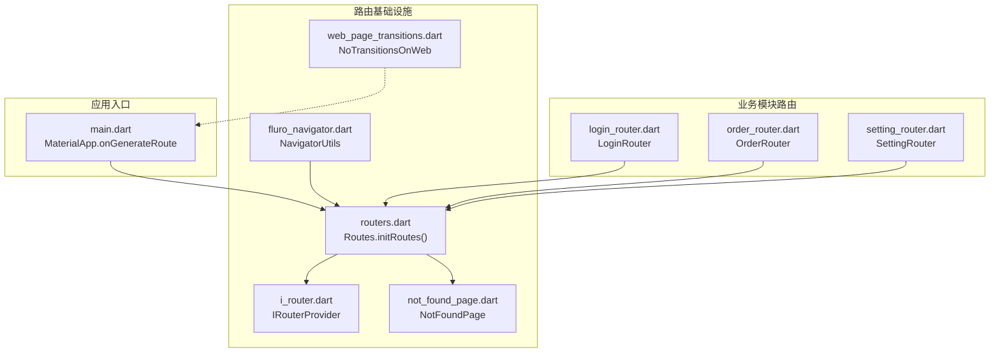
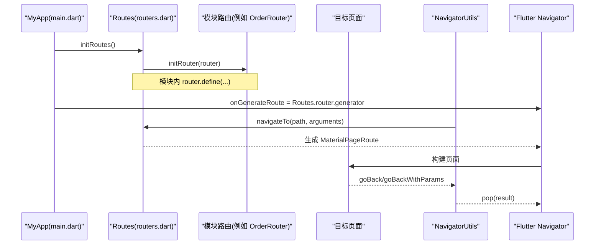
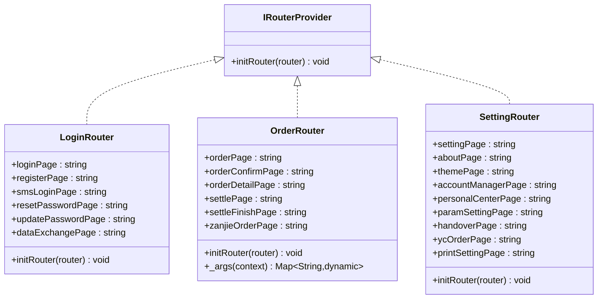
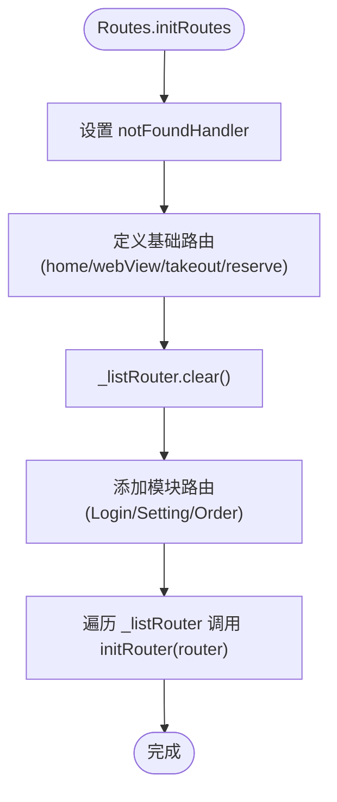
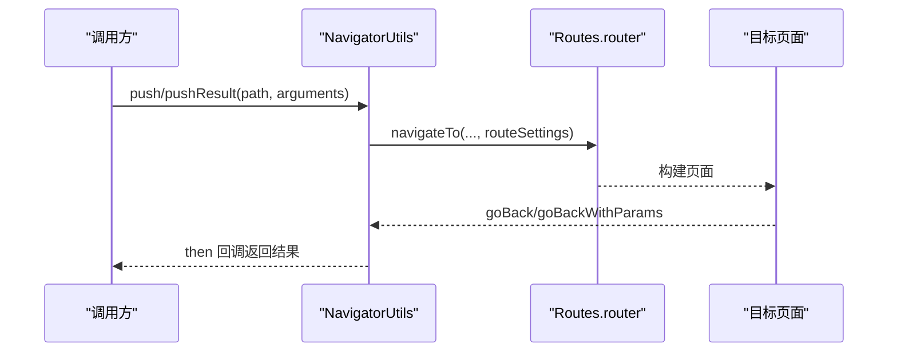
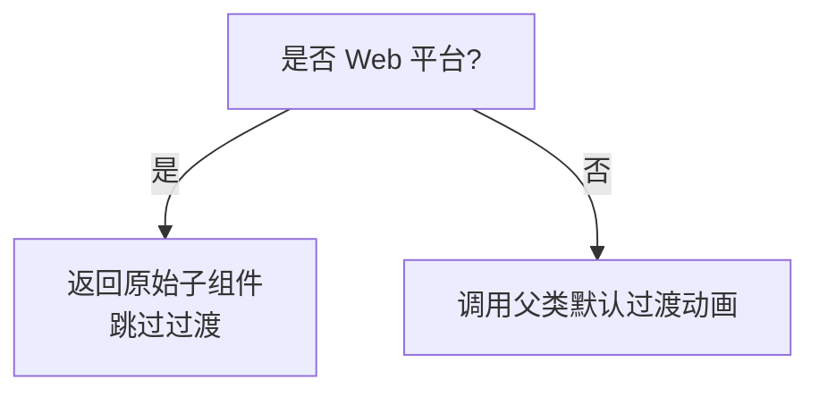
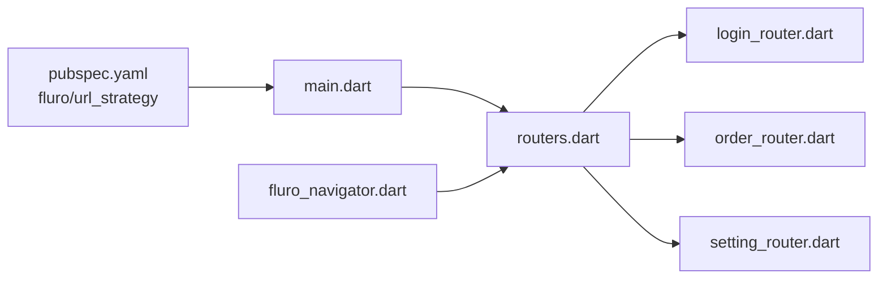

# 路由系统

<cite>
**本文引用的文件**   
- [lib/routers/fluro_navigator.dart](file://lib/routers/fluro_navigator.dart)
- [lib/routers/i_router.dart](file://lib/routers/i_router.dart)
- [lib/routers/routers.dart](file://lib/routers/routers.dart)
- [lib/routers/web_page_transitions.dart](file://lib/routers/web_page_transitions.dart)
- [lib/routers/not_found_page.dart](file://lib/routers/not_found_page.dart)
- [lib/main.dart](file://lib/main.dart)
- [lib/util/app_navigator.dart](file://lib/util/app_navigator.dart)
- [lib/pages/login/login_router.dart](file://lib/pages/login/login_router.dart)
- [lib/pages/order/order_router.dart](file://lib/pages/order/order_router.dart)
- [lib/setting/setting_router.dart](file://lib/setting/setting_router.dart)
- [pubspec.yaml](file://pubspec.yaml)
</cite>

## 目录
1. [引言](#引言)
2. [项目结构](#项目结构)
3. [核心组件](#核心组件)
4. [架构总览](#架构总览)
5. [详细组件分析](#详细组件分析)
6. [依赖关系分析](#依赖关系分析)
7. [性能与优化](#性能与优化)
8. [排错指南](#排错指南)
9. [结论](#结论)
10. [附录：开发与最佳实践](#附录开发与最佳实践)

## 引言
本文面向聚客美滋滋应用，系统性梳理基于 Fluro 的路由系统设计与实现。文档围绕以下目标展开：
- 解释路由配置、参数传递、页面跳转机制；
- 说明 IRouterProvider 接口的设计思想与模块化注册方式；
- 解析 NavigatorUtils 封装类（项目中实际命名为 NavigatorUtils）在页面栈管理、参数序列化与导航辅助方面的作用；
- 描述页面过渡动画配置及 Web 平台适配；
- 总结大型应用中路由的性能优化策略与开发规范；
- 给出添加新页面与处理复杂场景的实践路径。

本项目的路由采用“集中入口 + 模块自治”的模式：应用启动时统一初始化 FluroRouter，各业务模块通过实现 IRouterProvider 接口独立维护自身路由表，最终由 Routes 聚合注册。

**章节来源**
- [lib/routers/routers.dart:1-71](file://lib/routers/routers.dart#L1-L71)
- [lib/routers/i_router.dart:1-7](file://lib/routers/i_router.dart#L1-L7)
- [lib/main.dart:1-159](file://lib/main.dart#L1-L159)

## 项目结构
路由相关代码集中在 lib/routers 目录下，并配合各业务模块的 *_router.dart 文件进行分模块注册。整体组织如下：
- 路由基础设施：IRouterProvider 接口、Routes 路由器容器、NavigatorUtils 跳转工具、NotFoundPage 未找到页、Web 过渡主题。
- 模块路由：登录模块、订单模块、设置模块各自定义静态路由常量与 initRouter 注册逻辑。
- 应用入口：main.dart 中通过 MaterialApp.onGenerateRoute 接入 FluroRouter.generator，完成全局路由挂载。

**图表来源**
- [lib/main.dart:108-159](file://lib/main.dart#L108-L159)
- [lib/routers/routers.dart:1-71](file://lib/routers/routers.dart#L1-L71)
- [lib/routers/i_router.dart:1-7](file://lib/routers/i_router.dart#L1-L7)
- [lib/routers/fluro_navigator.dart:1-72](file://lib/routers/fluro_navigator.dart#L1-L72)
- [lib/routers/not_found_page.dart:1-21](file://lib/routers/not_found_page.dart#L1-L21)
- [lib/routers/web_page_transitions.dart:1-26](file://lib/routers/web_page_transitions.dart#L1-L26)
- [lib/pages/login/login_router.dart:1-40](file://lib/pages/login/login_router.dart#L1-L40)
- [lib/pages/order/order_router.dart:1-148](file://lib/pages/order/order_router.dart#L1-L148)
- [lib/setting/setting_router.dart:1-39](file://lib/setting/setting_router.dart#L1-L39)

**章节来源**
- [lib/routers/routers.dart:1-71](file://lib/routers/routers.dart#L1-L71)
- [lib/main.dart:108-159](file://lib/main.dart#L108-L159)

## 核心组件
- IRouterProvider：抽象路由提供者接口，强制每个模块提供 initRouter(FluroRouter) 方法，以实现路由解耦与模块化注册。
- Routes：全局路由容器，负责：
  - 声明公共路由常量；
  - 配置 FluroRouter 全局行为（如 notFoundHandler）；
  - 定义基础页面路由；
  - 收集所有 IRouterProvider 实例并调用其 initRouter 完成模块路由注入。
- NavigatorUtils：Fluro 跳转工具类，封装 push、pushResult、goBack、goBackWithParams 等常用操作，统一焦点处理、参数传递、返回结果回调与 WebView 快捷跳转。
- Navigator（原生）：lib/util/app_navigator.dart 提供了基于 Flutter 原生 Navigator 的封装，作为备选方案，但官方推荐使用 fluro_navigator.dart。
- NotFoundPage：当路由不存在时显示的占位页面。
- NoTransitionsOnWeb：针对 Web 平台禁用页面过渡动画以提升感知性能。

**章节来源**
- [lib/routers/i_router.dart:1-7](file://lib/routers/i_router.dart#L1-L7)
- [lib/routers/routers.dart:1-71](file://lib/routers/routers.dart#L1-L71)
- [lib/routers/fluro_navigator.dart:1-72](file://lib/routers/fluro_navigator.dart#L1-L72)
- [lib/util/app_navigator.dart:1-61](file://lib/util/app_navigator.dart#L1-L61)
- [lib/routers/not_found_page.dart:1-21](file://lib/routers/not_found_page.dart#L1-L21)
- [lib/routers/web_page_transitions.dart:1-26](file://lib/routers/web_page_transitions.dart#L1-L26)

## 架构总览
路由系统的运行时流程如下：
1. 应用启动时，main.dart 创建 MyApp，并在构造中调用 Routes.initRoutes() 完成路由初始化。
2. Routes.initRoutes() 设置 notFoundHandler，定义基础路由，然后遍历 _listRouter 中已注册的 IRouterProvider 实例，依次调用其 initRouter(router) 注入模块路由。
3. MaterialApp 使用 Routes.router.generator 作为 onGenerateRoute，将 Fluro 路由与 Flutter Navigator 桥接。
4. 业务代码通过 NavigatorUtils.push/pushResult 等方法发起跳转，内部调用 Routes.router.navigateTo，携带 RouteSettings.arguments 传递参数。
5. 目标页面的 Handler 从 ModalRoute.of(context).settings.arguments 中读取参数，构造具体页面 Widget。
6. 返回数据通过 then 链式回调或 goBackWithParams 返回给调用方。

**图表来源**
- [lib/main.dart:108-159](file://lib/main.dart#L108-L159)
- [lib/routers/routers.dart:1-71](file://lib/routers/routers.dart#L1-L71)
- [lib/routers/fluro_navigator.dart:1-72](file://lib/routers/fluro_navigator.dart#L1-L72)
- [lib/pages/order/order_router.dart:1-148](file://lib/pages/order/order_router.dart#L1-L148)

**章节来源**
- [lib/main.dart:108-159](file://lib/main.dart#L108-L159)
- [lib/routers/routers.dart:1-71](file://lib/routers/routers.dart#L1-L71)

## 详细组件分析

### IRouterProvider 接口设计
IRouterProvider 仅暴露一个方法 initRouter(FluroRouter)，其设计要点包括：
- 低耦合：模块只关心自身路由，不感知全局注册过程；
- 可扩展：新增模块只需实现该接口并加入 Routes._listRouter；
- 可测试：每个模块可独立构造 FluroRouter 进行路由单元测试；
- 约定优于配置：模块内部以静态字符串常量维护路由名，避免硬编码分散。

**图表来源**
- [lib/routers/i_router.dart:1-7](file://lib/routers/i_router.dart#L1-L7)
- [lib/pages/login/login_router.dart:1-40](file://lib/pages/login/login_router.dart#L1-L40)
- [lib/pages/order/order_router.dart:1-148](file://lib/pages/order/order_router.dart#L1-L148)
- [lib/setting/setting_router.dart:1-39](file://lib/setting/setting_router.dart#L1-L39)

**章节来源**
- [lib/routers/i_router.dart:1-7](file://lib/routers/i_router.dart#L1-L7)
- [lib/pages/login/login_router.dart:1-40](file://lib/pages/login/login_router.dart#L1-L40)
- [lib/pages/order/order_router.dart:1-148](file://lib/pages/order/order_router.dart#L1-L148)
- [lib/setting/setting_router.dart:1-39](file://lib/setting/setting_router.dart#L1-L39)

### Routes 路由器容器
Routes 承担以下职责：
- 集中声明公共路由常量（home、webViewPage、takeoutPage、reservePage），并委托业务模块提供订单相关路由常量；
- 设置全局未找到处理器 notFoundHandler，返回 NotFoundPage；
- 定义基础页面路由，包括首页、WebView 页、外卖点餐页、预约页；
- 管理 IRouterProvider 列表，并在 initRoutes 中批量执行模块路由初始化；
- 持有 FluroRouter 单例 router，供外部跳转与生成器使用。

参数传递模式：
- 对于简单查询参数，如 WebView 页，Handler 直接解析 params['title']、params['url']、params['isAsset']；
- 对于复杂对象参数，统一通过 RouteSettings.arguments 传递 Map<String, dynamic>，在目标 Handler 中安全解析。

**图表来源**
- [lib/routers/routers.dart:1-71](file://lib/routers/routers.dart#L1-L71)

**章节来源**
- [lib/routers/routers.dart:1-71](file://lib/routers/routers.dart#L1-L71)

### NavigatorUtils 跳转工具类
NavigatorUtils 是对 Fluro 跳转的轻量封装，主要能力：
- push：无返回值跳转，支持 replace、clearStack、arguments；
- pushResult：带返回值的跳转，通过 then 回调接收返回结果；
- goBack / goBackWithParams：返回上层页面并可携带返回数据；
- goWebViewPage / goAssetHtmlPage：便捷打开远程或本地资源 WebView 页面，自动对中文和特殊字符进行 URL 编码；
- unfocus：在跳转前主动失焦，避免键盘状态影响。

注意事项：
- 当前实现统一使用 TransitionType.native 转场；
- 参数通过 RouteSettings.arguments 传递，目标页面需从 ModalRoute.of(context).settings.arguments 中读取；
- 如需自定义转场效果，可在 push 处传入 transition 参数或在 MaterialApp 层配置 PageTransitionsTheme。

**图表来源**
- [lib/routers/fluro_navigator.dart:1-72](file://lib/routers/fluro_navigator.dart#L1-L72)

**章节来源**
- [lib/routers/fluro_navigator.dart:1-72](file://lib/routers/fluro_navigator.dart#L1-L72)

### 模块路由示例

#### 登录模块路由
- 路由常量：login、login/register、login/smsLogin、login/resetPassword、login/updatePassword、login/dataExchange；
- dataExchange 页面演示了从 RouteSettings.arguments 中读取 type 参数的典型用法；
- 其他页面为无参或默认参数页面。

**章节来源**
- [lib/pages/login/login_router.dart:1-40](file://lib/pages/login/login_router.dart#L1-L40)

#### 订单模块路由
- 路由常量：order、order/confirm、order/detail、order/settle、order/settleFinish、order/zanjie；
- 统一的 _args(context) 助手方法用于安全获取 arguments，并对常见类型进行默认值回退；
- 多个页面接收复杂的业务参数，如桌台信息、服务器信息、购物车项、金额字段、会员信息等；
- 参数类型包含 String、int、bool、Map、List，体现了富参数场景下的处理模式。

**章节来源**
- [lib/pages/order/order_router.dart:1-148](file://lib/pages/order/order_router.dart#L1-L148)

#### 设置模块路由
- 路由常量：setting、setting/about、setting/theme、setting/accountManager、setting/personalCenter、setting/paramSetting、setting/handover、setting/ycOrder、setting/printSetting；
- 均为无参或简单参数页面，适合展示型与配置型页面。

**章节来源**
- [lib/setting/setting_router.dart:1-39](file://lib/setting/setting_router.dart#L1-L39)

### 未找到页面与错误处理
- Routes.notFoundHandler：当 Fluro 找不到匹配路由时返回 NotFoundPage；
- main.dart 中还设置了 MaterialApp.onUnknownRoute，进一步兜底未知路由，同样返回 NotFoundPage；
- NavigatorUtils.pushResult 中对异常使用 catchError 打印日志，便于排查。

**章节来源**
- [lib/routers/routers.dart:1-71](file://lib/routers/routers.dart#L1-L71)
- [lib/main.dart:108-159](file://lib/main.dart#L108-L159)
- [lib/routers/fluro_navigator.dart:1-72](file://lib/routers/fluro_navigator.dart#L1-L72)
- [lib/routers/not_found_page.dart:1-21](file://lib/routers/not_found_page.dart#L1-L21)

### 页面过渡动画与平台适配
- 当前 NavigatorUtils 统一使用 native 转场；
- web_page_transitions.dart 定义了 NoTransitionsOnWeb，在 Web 平台跳过过渡动画以提升感知性能；
- 若需要自定义转场，可在 MaterialApp 中配置 theme.pageTransitionsTheme，或在 NavigatorUtils.push 时指定 transition。

**图表来源**
- [lib/routers/web_page_transitions.dart:1-26](file://lib/routers/web_page_transitions.dart#L1-L26)

**章节来源**
- [lib/routers/web_page_transitions.dart:1-26](file://lib/routers/web_page_transitions.dart#L1-L26)

## 依赖关系分析
- 框架依赖：项目通过 pubspec.yaml 引入 fluro ^2.0.5，并使用 url_strategy 去除 Web URL 中的 hash。
- 模块耦合：Routes 聚合 LoginRouter、SettingRouter、OrderRouter，三者互不依赖，符合单一职责原则。
- 跳转耦合：业务代码通过 NavigatorUtils 与 Routes.router 交互，屏蔽底层 Fluro 细节，降低耦合度。

**图表来源**
- [pubspec.yaml:1-111](file://pubspec.yaml#L1-L111)
- [lib/main.dart:1-159](file://lib/main.dart#L1-L159)
- [lib/routers/routers.dart:1-71](file://lib/routers/routers.dart#L1-L71)
- [lib/routers/fluro_navigator.dart:1-72](file://lib/routers/fluro_navigator.dart#L1-L72)
- [lib/pages/login/login_router.dart:1-40](file://lib/pages/login/login_router.dart#L1-L40)
- [lib/pages/order/order_router.dart:1-148](file://lib/pages/order/order_router.dart#L1-L148)
- [lib/setting/setting_router.dart:1-39](file://lib/setting/setting_router.dart#L1-L39)

**章节来源**
- [pubspec.yaml:1-111](file://pubspec.yaml#L1-L111)
- [lib/routers/routers.dart:1-71](file://lib/routers/routers.dart#L1-L71)

## 性能与优化
- Web 平台禁用过渡动画：NoTransitionsOnWeb 在 Web 上跳过过渡动画，减少不必要的渲染开销，提升首屏与页面切换的感知速度。
- 预加载与懒加载：
  - 现有实现多为即时加载；可在复杂页面中使用延迟初始化、按需加载数据的方式减少首屏压力；
  - 对于重型页面，考虑在进入前预加载必要资源，进入后复用。
- 内存管理：
  - 合理使用 replace/clearStack 控制页面栈规模；
  - 避免在 arguments 中传递过大对象，必要时改为 ID 或 Key，在页面内再拉取详情。
- 路由层优化：
  - 将不常用的模块路由推迟到首次访问时再注册；
  - 对频繁跳转的短链路使用 replace 而非 push，减少栈深度。

[本节为通用建议，不涉及具体文件分析]

## 排错指南
常见问题与定位思路：
- 路由未找到：检查 Routes.initRoutes 是否正确调用，确认模块是否在 _listRouter 中注册；查看 notFoundHandler 输出日志。
- 参数为空或类型错误：确保调用方使用 RouteSettings.arguments 传递 Map，并在目标 Handler 中进行类型校验与默认值回退。
- WebView 中文乱码：NavigatorUtils.goWebViewPage 已做 URL 编码；若手动拼接，请保证使用 Uri.encodeComponent。
- 返回结果为空：pushResult 的 then 回调中判断 null，避免空引用；必要时在 goBackWithParams 中显式返回有效值。
- 页面栈问题：根据需要选择 replace 或 clearStack，避免冗余页面导致状态混乱。

**章节来源**
- [lib/routers/routers.dart:1-71](file://lib/routers/routers.dart#L1-L71)
- [lib/routers/fluro_navigator.dart:1-72](file://lib/routers/fluro_navigator.dart#L1-L72)

## 结论
本项目采用 Fluro 结合模块化 IRouterProvider 的路由架构，实现了清晰的职责分离与良好的扩展性。Routes 作为统一入口，集中管理全局行为与基础路由；各业务模块以 IRouterProvider 的形式自管路由定义；NavigatorUtils 统一封装常用跳转操作，降低业务侧复杂度。通过合理的参数传递、错误处理与 Web 平台过渡优化，系统在功能完备性与用户体验之间取得平衡。未来可在懒加载、预加载与页面栈治理方面继续演进，以支撑更大规模的应用场景。

[本节为总结性内容，不涉及具体文件分析]

## 附录：开发与最佳实践

### 添加新页面路由的步骤
- 在对应模块文件中新增静态路由常量；
- 在该模块的 initRouter 中调用 router.define 注册路由；
- 在目标页面 Handler 中从 ModalRoute.of(context).settings.arguments 读取参数并进行类型校验；
- 在调用方通过 NavigatorUtils.push/pushResult 跳转，并传递 RouteSettings.arguments。

参考实现位置：
- 模块路由常量与注册：[lib/pages/order/order_router.dart:1-148](file://lib/pages/order/order_router.dart#L1-L148)、[lib/pages/login/login_router.dart:1-40](file://lib/pages/login/login_router.dart#L1-L40)、[lib/setting/setting_router.dart:1-39](file://lib/setting/setting_router.dart#L1-L39)
- 跳转工具：[lib/routers/fluro_navigator.dart:1-72](file://lib/routers/fluro_navigator.dart#L1-L72)

### 复杂路由场景处理建议
- 多参数传参：统一使用 Map<String, dynamic>，在目标 Handler 中按字段解析并提供默认值；
- 跨模块共享数据：建议使用全局状态或服务层，而不是通过路由参数传递大对象；
- 条件跳转与权限控制：在调用方统一判断，或在中间层拦截后再决定跳转目标；
- 深度链接支持：结合 url_strategy 的 setPathUrlStrategy，将外部链接映射为 Fluro 路由；注意保持 URL 可读性与幂等性。

[本节为实践指导，不涉及具体文件分析]