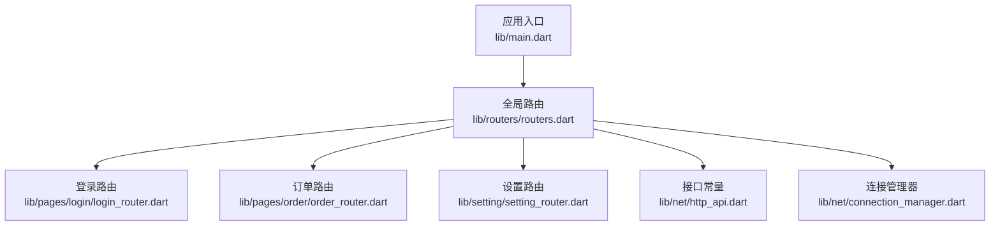
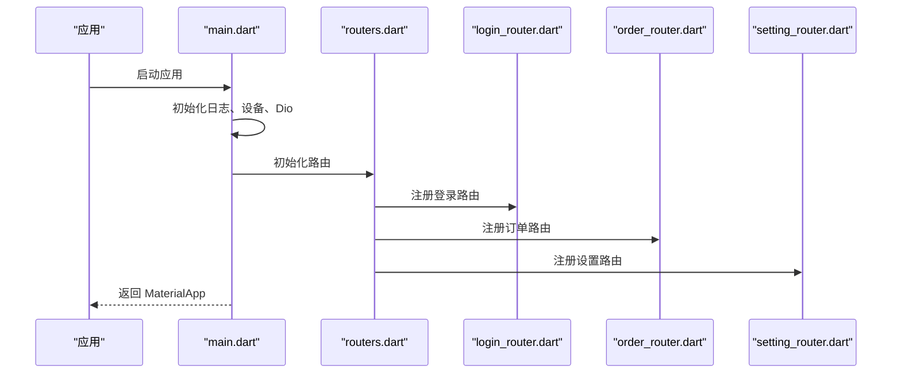
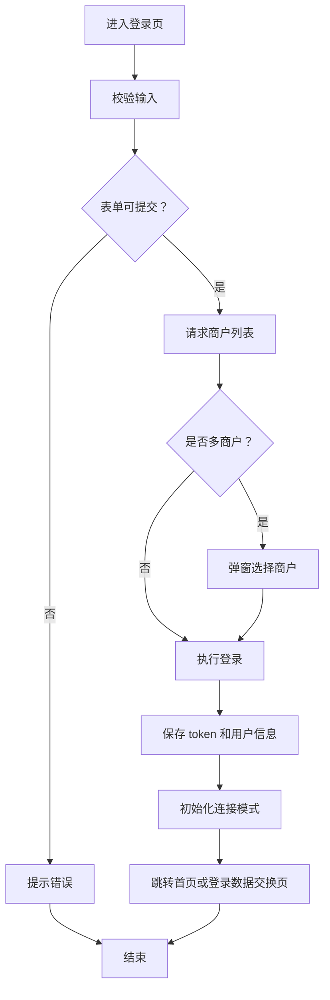
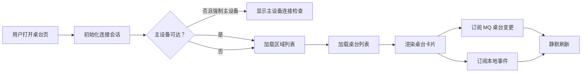
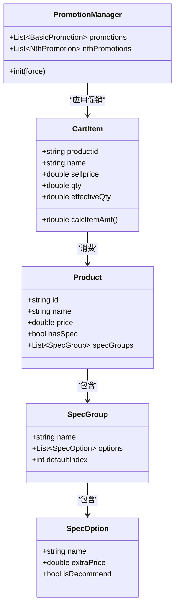
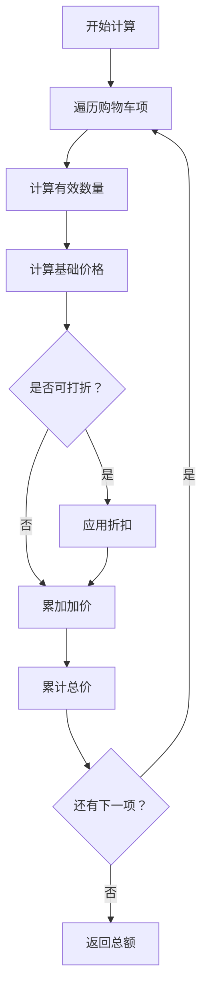
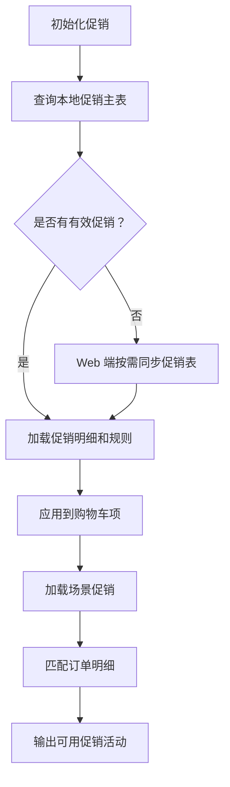
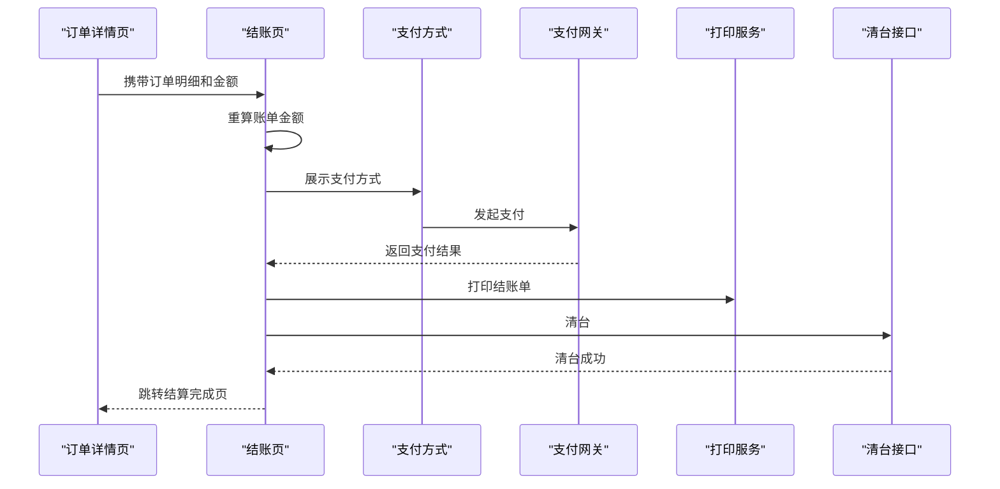
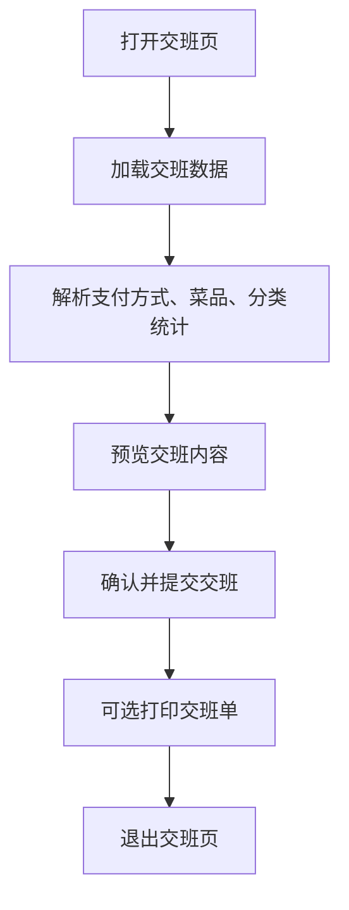
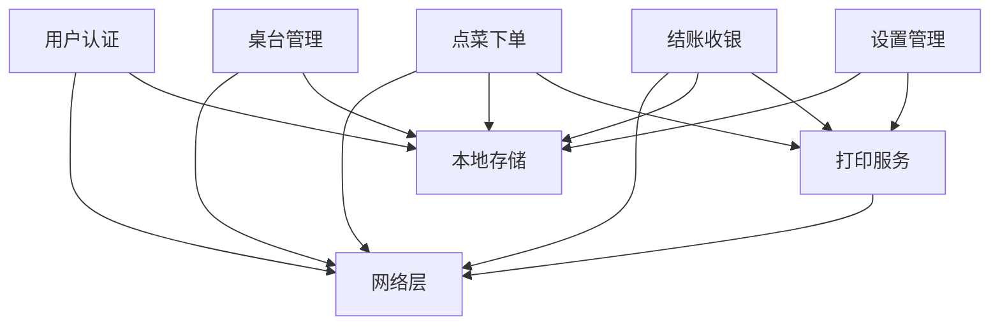

# 核心业务模块

<cite>
**本文引用的文件**   
- [lib/main.dart](file://lib/main.dart)
- [README.md](file://README.md)
- [lib/routers/routers.dart](file://lib/routers/routers.dart)
- [lib/pages/login/login_router.dart](file://lib/pages/login/login_router.dart)
- [lib/pages/login/page/login_page.dart](file://lib/pages/login/page/login_page.dart)
- [lib/pages/login/page/register_page.dart](file://lib/pages/login/page/register_page.dart)
- [lib/pages/home/table/table_repository.dart](file://lib/pages/home/table/table_repository.dart)
- [lib/pages/home/table/table_page.dart](file://lib/pages/home/table/table_page.dart)
- [lib/pages/order/order_models.dart](file://lib/pages/order/order_models.dart)
- [lib/pages/order/order_repository.dart](file://lib/pages/order/order_repository.dart)
- [lib/pages/order/promotion_manager.dart](file://lib/pages/order/promotion_manager.dart)
- [lib/pages/order/settle_page.dart](file://lib/pages/order/settle_page.dart)
- [lib/util/cart_calc_service.dart](file://lib/util/cart_calc_service.dart)
- [lib/util/promotion_helper.dart](file://lib/util/promotion_helper.dart)
- [lib/setting/page/handover_page.dart](file://lib/setting/page/handover_page.dart)
- [lib/setting/page/theme_page.dart](file://lib/setting/page/theme_page.dart)
- [lib/net/http_api.dart](file://lib/net/http_api.dart)
- [lib/net/connection_manager.dart](file://lib/net/connection_manager.dart)
- [lib/util/print_service.dart](file://lib/util/print_service.dart)
</cite>

## 目录

1. [引言](#引言)
2. [项目结构](#项目结构)
3. [核心模块总览](#核心模块总览)
4. [架构总览](#架构总览)
5. [用户认证模块](#用户认证模块)
6. [桌台管理模块](#桌台管理模块)
7. [点菜下单模块](#点菜下单模块)
8. [结账收银模块](#结账收银模块)
9. [设置管理模块](#设置管理模块)
10. [依赖关系分析](#依赖关系分析)
11. [性能与可靠性](#性能与可靠性)
12. [故障排查指南](#故障排查指南)
13. [结论](#结论)

## 引言

聚客美滋滋应用是一个基于 Flutter 的点餐终端系统。从仓库 README 可以看出，项目以 Provider 作为状态管理、Dio 作为网络层、Fluro 作为路由、sp_util 做本地存储；业务侧围绕登录认证、桌台管理、点菜下单、结账收银和设置交班展开，并通过“云服务 + 主设备”双连接模式适配不同门店部署场景。

本文聚焦五个核心业务模块：

- **用户认证模块**：手机号快捷登录、商户号普通登录、多商户选择、权限与服务器地址写入。
- **桌台管理模块**：区域与桌台列表、主设备直连与云服务切换、实时刷新策略。
- **点菜下单模块**：商品分类与商品数据、购物车计算、规格做法、套餐与促销。
- **结账收银模块**：账单金额重算、支付方式、会员与优惠券、打印服务与清台。
- **设置管理模块**：主题、参数配置、打印设置、交接班对账。

## 项目结构

仓库采用“页面 + 工具 + 网络 + 数据库 + 设置”的分层组织方式：

- `lib/main.dart` 负责全局初始化、Dio 拦截器注册、主题 Provider 注入和初始路由选择。
- `lib/routers/routers.dart` 是全局路由入口，统一注册登录、订单、设置等子模块路由。
- `lib/pages` 按业务划分页面；`lib/util` 提供购物车、促销、打印、金额计算等通用逻辑；`lib/net` 封装 Dio、API 常量、连接模式和事件通道；`lib/setting` 承载主题、账号、打印、交班等设置能力。

**图表来源**
- [lib/main.dart:1-159](file://lib/main.dart#L1-L159)
- [lib/routers/routers.dart:1-71](file://lib/routers/routers.dart#L1-L71)
- [lib/pages/login/login_router.dart:1-40](file://lib/pages/login/login_router.dart#L1-L40)
- [lib/pages/order/order_router.dart:1-148](file://lib/pages/order/order_router.dart#L1-L148)
- [lib/setting/setting_router.dart:1-39](file://lib/setting/setting_router.dart#L1-L39)
- [lib/net/http_api.dart:1-200](file://lib/net/http_api.dart#L1-L200)
- [lib/net/connection_manager.dart:1-114](file://lib/net/connection_manager.dart#L1-L114)

**章节来源**
- [lib/main.dart:1-159](file://lib/main.dart#L1-L159)
- [README.md:1-50](file://README.md#L1-L50)
- [lib/routers/routers.dart:1-71](file://lib/routers/routers.dart#L1-L71)

## 核心模块总览

| 模块 | 主要职责 | 关键类或文件 | 主要外部依赖 |
|---|---|---|---|
| 用户认证 | 登录表单、多商户选择、登录结果持久化、服务器地址初始化 | LoginPage、LoginRouter | HttpApi、Constant、ConnectionManager、sp_util |
| 桌台管理 | 区域与桌台查询、主设备探活、MQ 与事件刷新 | TableRepository、TablePage | ConnectionManager、HttpApi、MqService、TableEventBus |
| 点菜下单 | 分类与商品数据、购物车模型、促销规则、下单数据准备 | OrderModels、OrderRepository、CartCalcService、PromotionManager | HttpApi、TableDownloadManager、Dao 表 |
| 结账收银 | 账单重算、支付集成、会员与优惠券、打印与清台 | SettlePage、PrintService、PayGateway | HttpApi、SaleDao、VipDao、PrintService |
| 设置管理 | 主题、参数、打印、交班对账 | ThemePage、HandoverPage、CashReconService | Constant、PrintService、HttpApi |

**章节来源**
- [lib/pages/login/page/login_page.dart:1-200](file://lib/pages/login/page/login_page.dart#L1-L200)
- [lib/pages/home/table/table_repository.dart:1-137](file://lib/pages/home/table/table_repository.dart#L1-L137)
- [lib/pages/order/order_repository.dart:1-200](file://lib/pages/order/order_repository.dart#L1-L200)
- [lib/pages/order/settle_page.dart:1-200](file://lib/pages/order/settle_page.dart#L1-L200)
- [lib/setting/page/handover_page.dart:1-200](file://lib/setting/page/handover_page.dart#L1-L200)

## 架构总览

应用启动后，`main.dart` 初始化日志、设备信息、Dio 拦截器和路由，并根据本地 token 决定首页是登录页还是首页。全局路由通过 Fluro 管理，每个业务模块实现自己的路由器并集中注册。

**图表来源**
- [lib/main.dart:1-159](file://lib/main.dart#L1-L159)
- [lib/routers/routers.dart:1-71](file://lib/routers/routers.dart#L1-L71)
- [lib/pages/login/login_router.dart:1-40](file://lib/pages/login/login_router.dart#L1-L40)
- [lib/pages/order/order_router.dart:1-148](file://lib/pages/order/order_router.dart#L1-L148)
- [lib/setting/setting_router.dart:1-39](file://lib/setting/setting_router.dart#L1-L39)

## 用户认证模块

### 功能边界

用户认证模块承担以下职责：

- 支持手机号快捷登录和商户号普通登录。
- 登录后获取商户列表，判断是否绑定多个商户。
- 将登录态、商户信息、角色权限、服务器地址、RabbitMQ 地址等写入本地缓存。
- 根据登录返回的主设备地址初始化连接模式。
- 为后续桌台、点菜、结账、交班等业务提供身份上下文。

该模块的核心文件是 `LoginPage` 和 `LoginRouter`，同时依赖 `HttpApi` 中的登录接口、`Constant` 中的存储键、以及 `ConnectionManager` 的服务器类型解析。

### 登录流程

登录流程分为两步：先获取商户列表，再执行正式登录。

**图表来源**
- [lib/pages/login/page/login_page.dart:1-200](file://lib/pages/login/page/login_page.dart#L1-L200)
- [lib/pages/login/login_router.dart:1-40](file://lib/pages/login/login_router.dart#L1-L40)
- [lib/net/http_api.dart:1-200](file://lib/net/http_api.dart#L1-L200)
- [lib/res/constant.dart:1-93](file://lib/res/constant.dart#L1-L93)
- [lib/net/connection_manager.dart:1-114](file://lib/net/connection_manager.dart#L1-L114)

### 多商户支持机制

登录接口返回商户列表后，如果列表包含多个商户，则弹出选择对话框；如果只有一个或为空，则直接继续登录。多商户选择完成后，会保存当前选择的商户 ID 和 SPID，并再次调用登录逻辑。

关键行为包括：

- 普通登录使用商户号、员工工号和密码。
- 快捷登录使用手机号和密码。
- 单商户时不传额外 userid，保持与旧版 smdcapp 一致。
- 多商户时由交互决定最终登录上下文。

**章节来源**
- [lib/pages/login/page/login_page.dart:1-200](file://lib/pages/login/page/login_page.dart#L1-L200)
- [lib/pages/login/login_router.dart:1-40](file://lib/pages/login/login_router.dart#L1-L40)

### 权限控制

权限相关的数据在登录流程和权限接口中协同：

- `Constant` 定义了 token、user、store、rolemap、月折扣上限、单次打折上限等键。
- `HttpApi` 暴露了 `/role/getRoleInfo` 权限接口。
- `main.dart` 中 Dio 拦截器链包含身份验证、Token 刷新、日志和适配器拦截器。
- 结账页等敏感页面还会结合业务开关（如整单暂结）和权限标志进行展示控制。

扩展建议：

- 新增权限判断时，优先复用已有存储键和拦截器逻辑，避免重复解析 token。
- 对需要服务端鉴权的接口，确保 TokenInterceptor 能正确附加凭证。
- 对前端展示型权限，应结合后端返回的角色或菜单字段，而不是仅靠本地开关。

**章节来源**
- [lib/res/constant.dart:1-93](file://lib/res/constant.dart#L1-L93)
- [lib/net/http_api.dart:1-200](file://lib/net/http_api.dart#L1-L200)
- [lib/main.dart:1-159](file://lib/main.dart#L1-L159)

## 桌台管理模块

### 功能边界

桌台管理模块负责：

- 拉取桌台区域列表。
- 拉取指定区域的桌台信息。
- 根据连接模式选择云服务或主设备接口。
- 处理开台、锁台、消台等操作的后续刷新。
- 订阅 MQ 推送和本地事件总线，实现桌台状态实时同步。
- 在主设备不可用时弹出连接检查对话框。

核心文件包括 `TableRepository` 和 `TablePage`。

### 数据流向

**图表来源**
- [lib/pages/home/table/table_page.dart:1-250](file://lib/pages/home/table/table_page.dart#L1-L250)
- [lib/pages/home/table/table_repository.dart:1-137](file://lib/pages/home/table/table_repository.dart#L1-L137)
- [lib/net/connection_manager.dart:1-114](file://lib/net/connection_manager.dart#L1-L114)

### 主设备连接策略

`ConnectionManager` 是连接模式的核心：

- `pcAlive` 表示业务是否走主设备。
- `isMasterOnly` 表示仅主设备模式。
- `isCloudOnly` 表示仅云服务模式。
- `getServerType()` 读取配置，默认 0 不限，1 仅主设备，2 仅云服务。
- `resolveBaseUrl()` 根据 `masterDevice` 参数返回主设备地址或云服务地址。
- `onMasterDeviceLost` 广播主设备连接丢失事件。

`TablePage` 在初始化时：

1. 如果没有已建立会话，则调用 `beginSession()`。
2. 非云服务模式下尝试探测主设备。
3. 如果是仅主设备模式且主设备不可达，则弹出连接检查对话框。
4. 连接就绪后加载区域和桌台数据。
5. 连接成功后连接 MQ。

**章节来源**
- [lib/net/connection_manager.dart:1-114](file://lib/net/connection_manager.dart#L1-L114)
- [lib/pages/home/table/table_page.dart:1-250](file://lib/pages/home/table/table_page.dart#L1-L250)

### 实时同步机制

桌台页支持两种同步方式：

- **MQ 推送**：当 MQ 收到桌台变更消息时触发静默刷新。
- **本地事件总线**：开台、锁台、消台等操作后主动通知 UI 刷新。
- **定时轮询**：代码中保留了轮询开关和定时器逻辑，但当前注释说明轮询被暂时屏蔽，等待 MQ 稳定后再恢复。

这种设计兼顾了实时性和容错性：MQ 正常时优先推送，异常时可回退到轮询或手动刷新。

**章节来源**
- [lib/pages/home/table/table_page.dart:1-250](file://lib/pages/home/table/table_page.dart#L1-L250)

### 核心类与方法

| 类 | 职责 | 关键方法 |
|---|---|---|
| TableRepository | 根据主设备或云服务拉取区域和桌台数据 | fetchAreaList、fetchTableInfoList |
| TablePage | 桌台页 UI、连接检测、刷新策略 | _initPage、_silentRefresh、_showMasterDeviceCheckDialog |
| ConnectionManager | 连接模式、主设备地址、连接丢失事件 | beginSession、getServerType、onMasterDeviceLost |

**章节来源**
- [lib/pages/home/table/table_repository.dart:1-137](file://lib/pages/home/table/table_repository.dart#L1-L137)
- [lib/pages/home/table/table_page.dart:1-250](file://lib/pages/home/table/table_page.dart#L1-L250)
- [lib/net/connection_manager.dart:1-114](file://lib/net/connection_manager.dart#L1-L114)

## 点菜下单模块

### 功能边界

点菜下单模块负责：

- 加载菜品分类和商品列表。
- 管理购物车商品项、数量、赠送、改价、称重、做法和规格。
- 计算单品价格和购物车总金额。
- 加载基础促销规则，对购物车商品应用折扣、特价和第 N 份促销。
- 生成下单所需的主单和明细数据。
- 区分云服务与主设备的下单接口。

核心文件包括 `OrderModels`、`OrderRepository`、`CartCalcService`、`PromotionManager` 和 `PromotionHelper`。

### 数据模型

**图表来源**
- [lib/pages/order/order_models.dart:1-200](file://lib/pages/order/order_models.dart#L1-L200)
- [lib/util/cart_calc_service.dart:1-200](file://lib/util/cart_calc_service.dart#L1-L200)
- [lib/pages/order/promotion_manager.dart:1-200](file://lib/pages/order/promotion_manager.dart#L1-L200)

### 购物车计算逻辑

购物车计算集中在 `CartCalcService`，核心规则如下：

1. 计算有效数量：称重商品使用重量，赠送商品使用赠送数量，普通商品使用数量。
2. 计算售价、会员价和原价。
3. 对可打折商品应用折扣。
4. 累加做法加价、规格加价和套餐加价。
5. 汇总购物车总额和总数量。

**图表来源**
- [lib/util/cart_calc_service.dart:1-200](file://lib/util/cart_calc_service.dart#L1-L200)

**章节来源**
- [lib/util/cart_calc_service.dart:1-200](file://lib/util/cart_calc_service.dart#L1-L200)

### 促销体系

促销分为两类：

- **基础促销**：分类折扣、菜品折扣、特价菜、第 N 份促销，数据来自本地数据库表。
- **场景促销**：买赠、满量、满减、满赠、满折，通常通过订单级促销接口获取。

`PromotionManager` 负责从本地表加载基础促销，并在 Web 端缓存缺失时按需拉取促销表；`PromotionHelper` 负责解析服务端返回的场景促销，并判断当前订单明细是否匹配活动。

**图表来源**
- [lib/pages/order/promotion_manager.dart:1-200](file://lib/pages/order/promotion_manager.dart#L1-L200)
- [lib/util/promotion_helper.dart:1-200](file://lib/util/promotion_helper.dart#L1-L200)

**章节来源**
- [lib/pages/order/promotion_manager.dart:1-200](file://lib/pages/order/promotion_manager.dart#L1-L200)
- [lib/util/promotion_helper.dart:1-200](file://lib/util/promotion_helper.dart#L1-L200)

### 下单数据准备

`OrderRepository` 中定义了 DishCategory、KitchenItem、DishProduct 等数据模型，并将服务端返回的商品字段映射到客户端实体。下单时需要把购物车中的商品转换为订单明细，同时考虑：

- 商品是否支持做法、规格、套餐。
- 会员价、打折标记、厨打标记、标签标记。
- 沽清库存、最大购买数量、最小销售数量。
- 云服务与主设备分别使用不同下单接口。

**章节来源**
- [lib/pages/order/order_repository.dart:1-200](file://lib/pages/order/order_repository.dart#L1-L200)

## 结账收银模块

### 功能边界

结账收银模块负责：

- 接收订单详情页传入的明细和金额。
- 重新计算菜品金额、服务费、低消、折扣和应付金额。
- 加载支付方式列表。
- 支持会员同步、会员余额校验和会员优惠。
- 支持优惠券核销。
- 调用支付网关完成收款。
- 打印结账单、客单或厨单。
- 清台并更新桌台状态。

核心文件是 `SettlePage`，并与 `PrintService`、`PayGateway`、`SaleDao`、`VipDao` 协作。

### 结账流程

**图表来源**
- [lib/pages/order/settle_page.dart:1-200](file://lib/pages/order/settle_page.dart#L1-L200)
- [lib/util/print_service.dart:1-200](file://lib/util/print_service.dart#L1-L200)
- [lib/net/http_api.dart:1-200](file://lib/net/http_api.dart#L1-L200)

### 账单计算与促销重算

结账页维护基准金额和当前金额两套状态：

- `_baseDishAmt`、`_baseDisAmt`、`_basePayAmt` 用于恢复基准值。
- `_dishAmt`、`_disAmt`、`_payAmt` 是当前促销或会员调整后的值。
- 同一时间只允许一个场景促销生效，避免多次叠加。
- 会员同步时会对金额重新计算，并记录最近一次桌台状态校验时间，防止频繁刷新。

**章节来源**
- [lib/pages/order/settle_page.dart:1-200](file://lib/pages/order/settle_page.dart#L1-L200)

### 支付集成与打印服务

`PrintService` 支持 PC 打印和云打印：

- PC 打印通过主设备接口触发。
- 云打印通过服务端 REST 打印接口重建票据。
- 下单后可触发出品单、客单、杯贴。
- 结账后可触发结账单打印。
- 支持客单补打。

结账成功后，`SettlePage` 会根据打印配置决定是否自动打印，并调用对应打印方法。

**章节来源**
- [lib/util/print_service.dart:1-200](file://lib/util/print_service.dart#L1-L200)

## 设置管理模块

### 功能边界

设置管理模块涵盖：

- 主题设置：跟随系统、亮色、暗色。
- 参数设置：服务端参数配置。
- 打印设置：打印机类型、纸宽、份数、自动打印开关。
- 账号管理与个人中心。
- 交接班对账：查询营业统计、提交交班、打印交班单。

核心文件包括 `ThemePage`、`HandoverPage`、`PrintService` 和相关路由。

### 主题系统

主题由 `ThemeProvider` 管理，`ThemePage` 提供选项：

- 跟随系统。
- 开启夜间模式。
- 关闭夜间模式。

选择后会更新 Provider 中的主题模式，并持久化到本地存储。`main.dart` 中通过 `MultiProvider` 注入 `ThemeProvider`，并使用 `Consumer` 包裹 Material App，使主题变化能影响全局界面。

**章节来源**
- [lib/setting/page/theme_page.dart:1-72](file://lib/setting/page/theme_page.dart#L1-L72)
- [lib/main.dart:1-159](file://lib/main.dart#L1-L159)

### 交班对账功能

`HandoverPage` 对齐交班业务流程：

1. 获取最后交班时间和当前时间。
2. 加载交班统计数据。
3. 展示支付方式明细、押金统计、菜品统计、分类统计。
4. 提交交班数据。
5. 根据配置打印交班单。

平台分流方面：

- Web 端走云端接口获取和提交交班数据。
- Android/iOS 端可写本地统计表后再云端双写。

**图表来源**
- [lib/setting/page/handover_page.dart:1-200](file://lib/setting/page/handover_page.dart#L1-L200)
- [lib/net/http_api.dart:1-200](file://lib/net/http_api.dart#L1-L200)

**章节来源**
- [lib/setting/page/handover_page.dart:1-200](file://lib/setting/page/handover_page.dart#L1-L200)

## 依赖关系分析

### 模块间依赖

**图表来源**
- [lib/pages/login/page/login_page.dart:1-200](file://lib/pages/login/page/login_page.dart#L1-L200)
- [lib/pages/home/table/table_repository.dart:1-137](file://lib/pages/home/table/table_repository.dart#L1-L137)
- [lib/pages/order/order_repository.dart:1-200](file://lib/pages/order/order_repository.dart#L1-L200)
- [lib/pages/order/settle_page.dart:1-200](file://lib/pages/order/settle_page.dart#L1-L200)
- [lib/setting/page/handover_page.dart:1-200](file://lib/setting/page/handover_page.dart#L1-L200)
- [lib/util/print_service.dart:1-200](file://lib/util/print_service.dart#L1-L200)
- [lib/net/http_api.dart:1-200](file://lib/net/http_api.dart#L1-L200)

### 耦合与内聚

- **高内聚**：购物车计算、促销解析、打印服务都集中在独立文件中，便于测试和替换。
- **适度耦合**：页面通过路由跳转传递参数，通过 Repository 或 Service 访问网络和本地数据，降低 UI 与数据层的直接耦合。
- **共享依赖**：`Constant`、`HttpApi`、`ConnectionManager` 是多个模块共享的基础设施，应避免在业务模块中重复定义相同常量。

### 潜在风险

- 过多业务逻辑集中在页面类中，例如 `SettlePage` 非常长，可能混入大量金额计算、UI 状态和网络请求。
- 主设备和云服务响应结构差异较大，需要在 Repository 或 Helper 层做好统一解析。
- 促销逻辑分散在本地表和服务端接口两侧，需要注意 Web 端缓存缺失时的降级行为。

**章节来源**
- [lib/pages/order/settle_page.dart:1-200](file://lib/pages/order/settle_page.dart#L1-L200)
- [lib/pages/home/table/table_repository.dart:1-137](file://lib/pages/home/table/table_repository.dart#L1-L137)
- [lib/pages/order/promotion_manager.dart:1-200](file://lib/pages/order/promotion_manager.dart#L1-L200)

## 性能与可靠性

### 性能建议

- 购物车金额计算应尽量避免在每次 UI 帧中重复全量计算；可缓存基准结果，仅在数量、做法、规格或促销变化时增量重算。
- 桌台列表加载应根据筛选条件缓存区域和桌台数据，避免无意义重复请求。
- 促销初始化在 Web 端已做缓存缺失检测，但仍应避免每次进入页面都强制全量同步。
- 打印任务应避免阻塞主线程，必要时可异步重试失败任务。

### 可靠性建议

- 登录失败时应保留用户已输入的部分信息，并提供明确错误提示。
- 主设备断线时应提示用户，但不应该静默降级到云服务，除非配置允许。
- 结账失败时应保留订单明细和临时桌台数据，避免重复落单。
- 交班数据加载失败时应允许重试，并提示用户检查网络或服务端状态。

[本节为通用指导，不直接分析具体文件]

## 故障排查指南

### 登录问题

常见问题：

- 无法获取商户列表：检查 `mobileStoreList` 接口和网络环境。
- 多商户未弹出选择：检查登录返回的 stores 是否为数组，以及长度判断逻辑。
- 登录后仍进入登录页：检查本地 token 是否写入成功，以及 `main.dart` 初始页面逻辑。

定位路径：

- [lib/pages/login/page/login_page.dart:1-200](file://lib/pages/login/page/login_page.dart#L1-L200)
- [lib/net/http_api.dart:1-200](file://lib/net/http_api.dart#L1-L200)
- [lib/res/constant.dart:1-93](file://lib/res/constant.dart#L1-L93)

### 桌台不刷新

常见问题：

- MQ 未连接或推送失效。
- 主设备断线但未弹出连接检查对话框。
- 仅主设备模式下主设备地址为空。

定位路径：

- [lib/pages/home/table/table_page.dart:1-250](file://lib/pages/home/table/table_page.dart#L1-L250)
- [lib/net/connection_manager.dart:1-114](file://lib/net/connection_manager.dart#L1-L114)

### 促销不生效

常见问题：

- Web 端促销表未同步。
- spid/sid 未正确读取。
- 促销适用商品或分类不匹配。

定位路径：

- [lib/pages/order/promotion_manager.dart:1-200](file://lib/pages/order/promotion_manager.dart#L1-L200)
- [lib/util/promotion_helper.dart:1-200](file://lib/util/promotion_helper.dart#L1-L200)

### 打印失败

常见问题：

- 打印机类型配置错误。
- PC 打印时主设备不可达。
- 云打印缺少打印机配置。

定位路径：

- [lib/util/print_service.dart:1-200](file://lib/util/print_service.dart#L1-L200)
- [lib/net/connection_manager.dart:1-114](file://lib/net/connection_manager.dart#L1-L114)

### 交班提交失败

常见问题：

- 未获取到交班时间。
- 交班数据为空。
- 服务端接口返回错误。

定位路径：

- [lib/setting/page/handover_page.dart:1-200](file://lib/setting/page/handover_page.dart#L1-L200)
- [lib/net/http_api.dart:1-200](file://lib/net/http_api.dart#L1-L200)

**章节来源**
- [lib/pages/login/page/login_page.dart:1-200](file://lib/pages/login/page/login_page.dart#L1-L200)
- [lib/pages/home/table/table_page.dart:1-250](file://lib/pages/home/table/table_page.dart#L1-L250)
- [lib/pages/order/promotion_manager.dart:1-200](file://lib/pages/order/promotion_manager.dart#L1-L200)
- [lib/util/print_service.dart:1-200](file://lib/util/print_service.dart#L1-L200)
- [lib/setting/page/handover_page.dart:1-200](file://lib/setting/page/handover_page.dart#L1-L200)

## 结论

聚客美滋滋应用的核心业务模块围绕“认证 → 桌台 → 点菜 → 结账 → 设置”这条主线展开。其架构特点是：

- 以 `main.dart` 和全局路由为入口，各模块通过独立路由器注册。
- 通过 `ConnectionManager` 统一区分云服务与主设备连接模式。
- 通过 `HttpApi` 统一管理接口路径，避免硬编码分散在各页面。
- 通过 `CartCalcService`、`PromotionManager`、`PrintService` 等工具类收敛核心计算和外部依赖。
- 通过本地存储和 Provider 管理登录态、主题、连接模式等全局状态。

对于后续扩展，建议：

- 将超长页面中的复杂业务逻辑逐步拆分为 Service 或 Presenter。
- 对主设备与云服务的响应结构进一步抽象，减少分支判断。
- 为购物车、促销、结账金额计算补充单元测试。
- 在权限控制处增加统一的权限校验入口，方便新增业务权限。