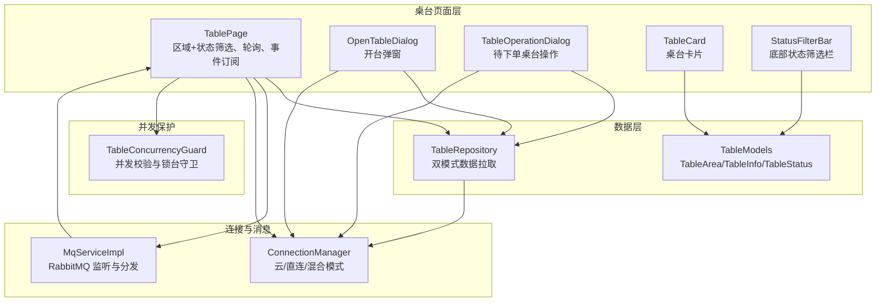
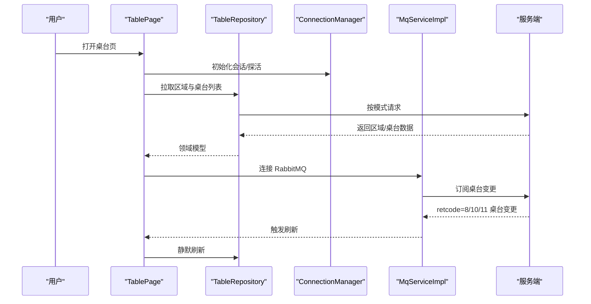
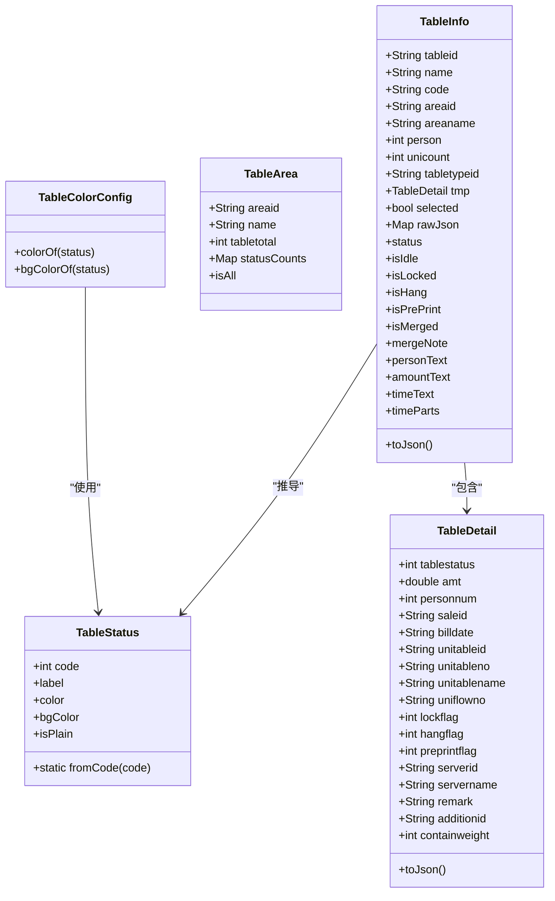
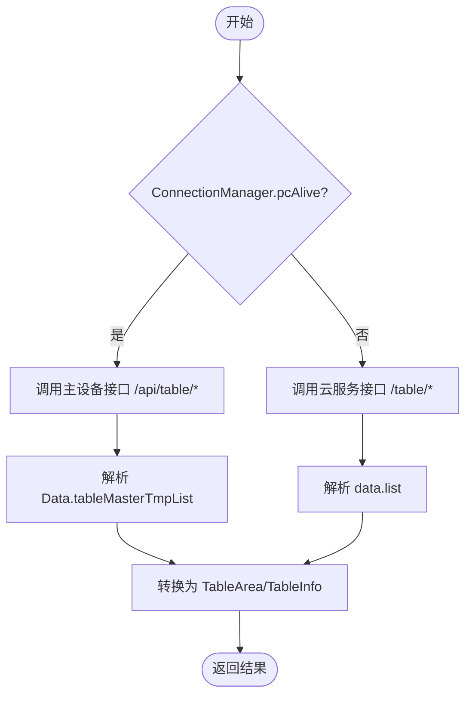
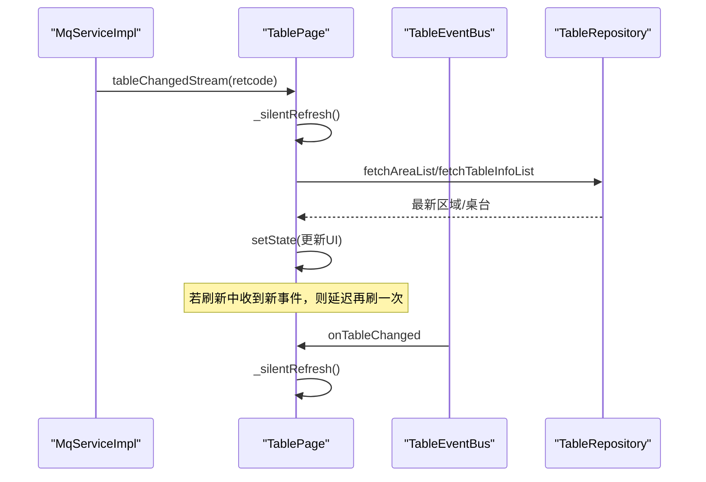
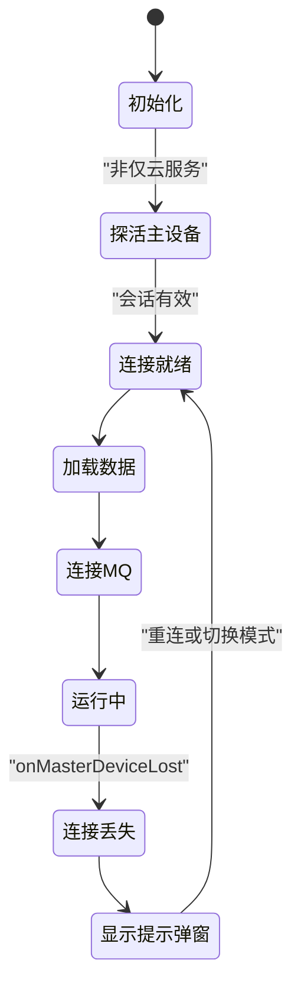
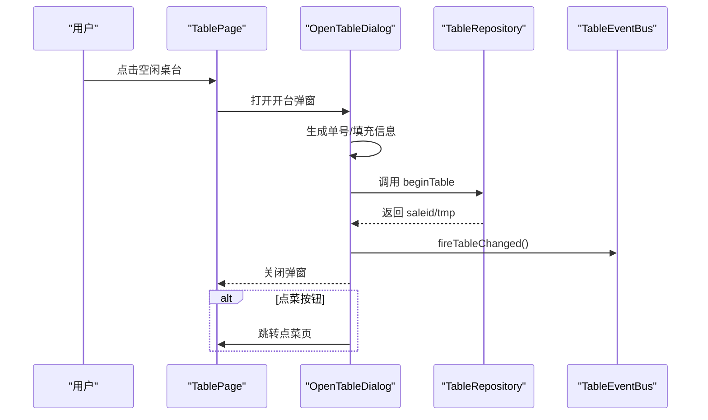
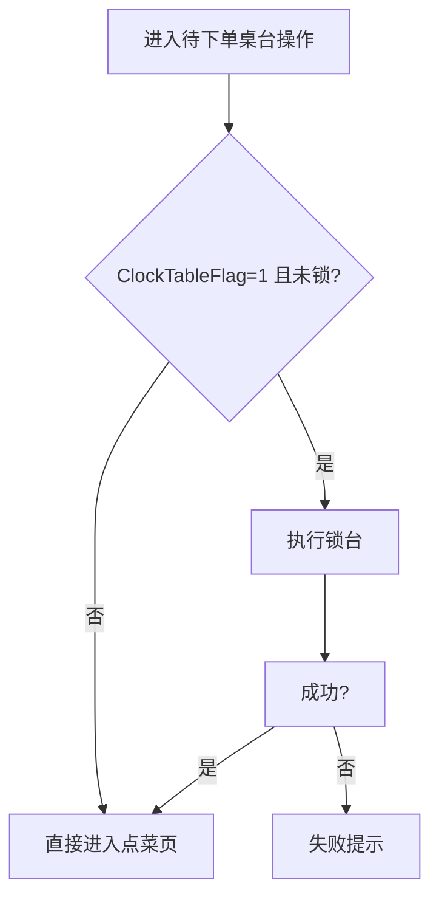
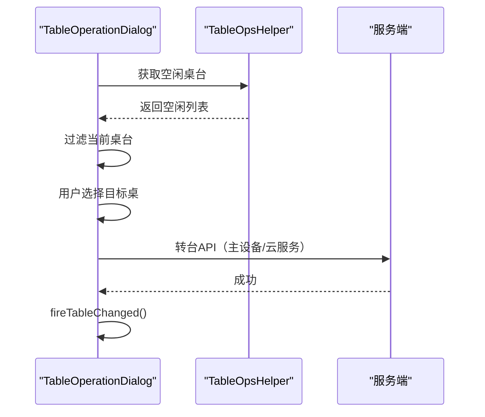
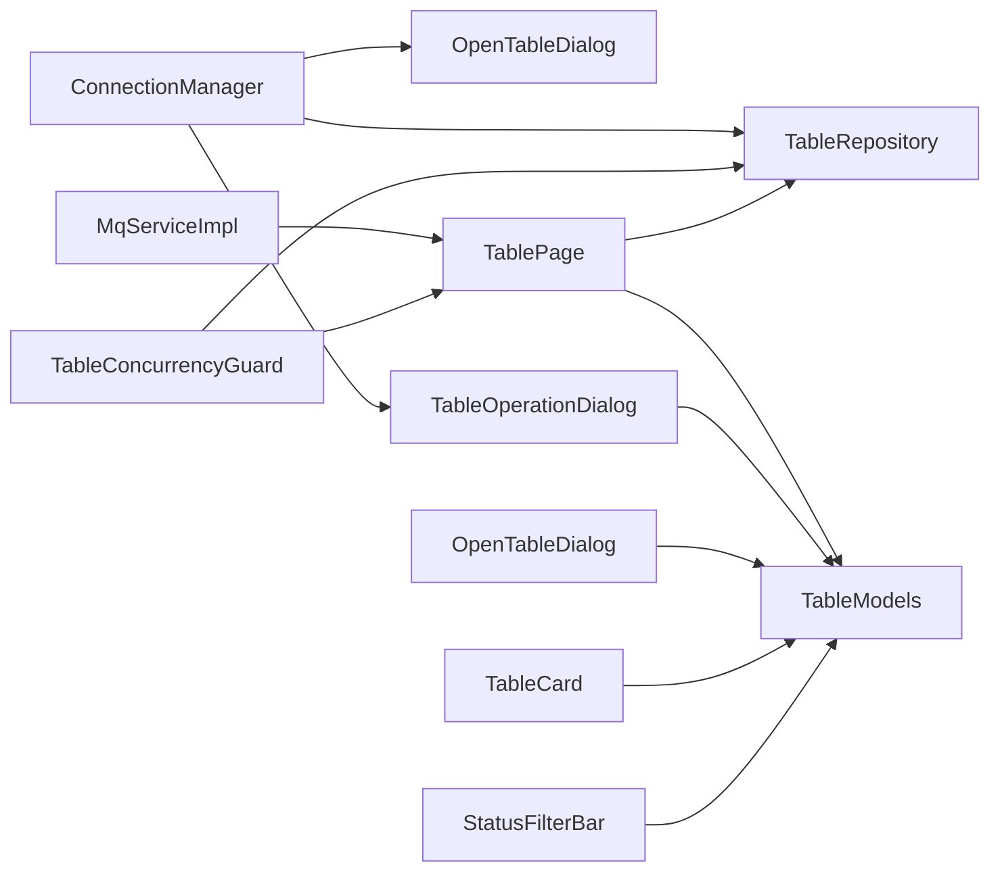

# 桌台管理模块

<cite>
**本文引用的文件**   
- [table_page.dart](file://lib/pages/home/table/table_page.dart)
- [table_repository.dart](file://lib/pages/home/table/table_repository.dart)
- [table_models.dart](file://lib/pages/home/table/table_models.dart)
- [table_card.dart](file://lib/pages/home/table/widgets/table_card.dart)
- [status_filter_bar.dart](file://lib/pages/home/table/widgets/status_filter_bar.dart)
- [open_table_dialog.dart](file://lib/pages/home/table/widgets/open_table_dialog.dart)
- [table_operation_dialog.dart](file://lib/pages/home/table/widgets/table_operation_dialog.dart)
- [mq_service_impl.dart](file://lib/net/mq_service_impl.dart)
- [connection_manager.dart](file://lib/net/connection_manager.dart)
- [table_concurrency_guard.dart](file://lib/util/table_concurrency_guard.dart)
</cite>

## 目录
1. [引言](#引言)
2. [项目结构](#项目结构)
3. [核心组件](#核心组件)
4. [架构总览](#架构总览)
5. [详细组件分析](#详细组件分析)
6. [依赖关系分析](#依赖关系分析)
7. [性能与并发特性](#性能与并发特性)
8. [故障排查指南](#故障排查指南)
9. [结论](#结论)

## 引言
本文件面向“桌台管理模块”，系统性说明桌台状态模型、状态转换规则、持久化策略、实时同步机制、主设备连接模式切换、完整业务操作流（开台、锁台、消台、转台等）、卡片组件用法与样式配置，以及搜索、筛选、排序和并发冲突处理方案。文档既适合一线开发者进行二次开发，也便于产品与测试人员理解端到端流程。

## 项目结构
桌台管理相关代码集中在以下位置：
- 页面与交互：`lib/pages/home/table/`
- 数据仓库与模型：`table_repository.dart`、`table_models.dart`
- UI 组件：`widgets/table_card.dart`、`widgets/status_filter_bar.dart`、`widgets/open_table_dialog.dart`、`widgets/table_operation_dialog.dart`
- 网络与消息：`lib/net/mq_service_impl.dart`、`lib/net/connection_manager.dart`
- 并发保护：`lib/util/table_concurrency_guard.dart`

图表来源
- [table_page.dart:1-120](file://lib/pages/home/table/table_page.dart#L1-L120)
- [table_repository.dart:1-137](file://lib/pages/home/table/table_repository.dart#L1-L137)
- [table_models.dart:1-471](file://lib/pages/home/table/table_models.dart#L1-L471)
- [table_card.dart:1-406](file://lib/pages/home/table/widgets/table_card.dart#L1-L406)
- [status_filter_bar.dart:1-186](file://lib/pages/home/table/widgets/status_filter_bar.dart#L1-L186)
- [open_table_dialog.dart:1-696](file://lib/pages/home/table/widgets/open_table_dialog.dart#L1-L696)
- [table_operation_dialog.dart:1-1010](file://lib/pages/home/table/widgets/table_operation_dialog.dart#L1-L1010)
- [mq_service_impl.dart:1-315](file://lib/net/mq_service_impl.dart#L1-L315)
- [connection_manager.dart:1-114](file://lib/net/connection_manager.dart#L1-L114)
- [table_concurrency_guard.dart:1-235](file://lib/util/table_concurrency_guard.dart#L1-L235)

章节来源
- [table_page.dart:1-120](file://lib/pages/home/table/table_page.dart#L1-L120)
- [table_repository.dart:1-137](file://lib/pages/home/table/table_repository.dart#L1-L137)
- [table_models.dart:1-471](file://lib/pages/home/table/table_models.dart#L1-L471)

## 核心组件
- TablePage：桌台首页，负责区域与状态筛选、搜索、定时轮询、MQ 事件订阅、主设备连接检查与模式切换入口。
- TableRepository：数据仓库，根据 ConnectionManager 的模式选择云服务或主设备接口，统一解析响应并返回领域模型。
- TableModels：定义 TableStatus、TableArea、TableDetail、TableInfo 等实体及展示计算逻辑。
- TableCard：桌台卡片 UI，按状态渲染背景、标签、金额、时长、锁台覆盖层等。
- StatusFilterBar：底部状态筛选栏，支持“全部”、各状态、预打筛选。
- OpenTableDialog：开台弹窗，支持人数、服务员、附加费、备注，调用 beginTable。
- TableOperationDialog：待下单桌台操作弹窗，实现锁台、消台、转台、并台/拆台、押金、修改台信息等。
- MqServiceImpl：RabbitMQ 客户端，声明队列、绑定路由键、消费消息并按 retcode 分发。
- ConnectionManager：连接模式管理器，决定请求走云服务还是主设备，维护 pcAlive 与连接丢失事件。
- TableConcurrencyGuard：并发守卫，提供最新状态获取、锁台封装、其他设备锁台提示。

章节来源
- [table_page.dart:1-120](file://lib/pages/home/table/table_page.dart#L1-L120)
- [table_repository.dart:1-137](file://lib/pages/home/table/table_repository.dart#L1-L137)
- [table_models.dart:1-471](file://lib/pages/home/table/table_models.dart#L1-L471)
- [table_card.dart:1-406](file://lib/pages/home/table/widgets/table_card.dart#L1-L406)
- [status_filter_bar.dart:1-186](file://lib/pages/home/table/widgets/status_filter_bar.dart#L1-L186)
- [open_table_dialog.dart:1-696](file://lib/pages/home/table/widgets/open_table_dialog.dart#L1-L696)
- [table_operation_dialog.dart:1-1010](file://lib/pages/home/table/widgets/table_operation_dialog.dart#L1-L1010)
- [mq_service_impl.dart:1-315](file://lib/net/mq_service_impl.dart#L1-L315)
- [connection_manager.dart:1-114](file://lib/net/connection_manager.dart#L1-L114)
- [table_concurrency_guard.dart:1-235](file://lib/util/table_concurrency_guard.dart#L1-L235)

## 架构总览
桌台管理采用“页面 + 仓库 + 模型 + 连接/消息 + 并发守卫”的分层架构：
- 页面层：TablePage 聚合 UI、筛选、轮询、事件订阅；具体操作由 OpenTableDialog 与 TableOperationDialog 承载。
- 数据层：TableRepository 屏蔽云服务与主设备的差异，TableModels 表达领域概念。
- 基础设施层：ConnectionManager 控制请求路径；MqServiceImpl 提供实时推送；TableConcurrencyGuard 保证并发安全。

图表来源
- [table_page.dart:1-120](file://lib/pages/home/table/table_page.dart#L1-L120)
- [table_repository.dart:1-137](file://lib/pages/home/table/table_repository.dart#L1-L137)
- [mq_service_impl.dart:1-315](file://lib/net/mq_service_impl.dart#L1-L315)
- [connection_manager.dart:1-114](file://lib/net/connection_manager.dart#L1-L114)

## 详细组件分析

### 桌台状态模型与颜色配置
- TableStatus 枚举对应后端 tablestatus 字段：空闲、待下单、待结算、已预结、待清台。
- TableStatusExtension 提供 label、color、bgColor、isPlain 等展示属性。
- TableColorConfig 从本地存储读取各状态主题色，未配置时回退到默认色；同时计算浅色背景用于卡片渐变。
- TableArea 表示区域，包含 statusCounts，供“全部”汇总统计。
- TableDetail 描述开台详情（人数、金额、服务员、备注、挂单、预打印等）。
- TableInfo 是核心展示对象，封装 isIdle、isLocked、isHang、isPrePrint、isMerged、amountText、timeParts 等展示逻辑，并提供 toJson() 用于主设备模式回传。

图表来源
- [table_models.dart:1-471](file://lib/pages/home/table/table_models.dart#L1-L471)

章节来源
- [table_models.dart:1-471](file://lib/pages/home/table/table_models.dart#L1-L471)

### 数据仓库与双模式请求
TableRepository 根据 ConnectionManager.pcAlive 选择：
- 云服务：/table/* 接口，返回 data.list。
- 主设备：/api/table/* 接口，返回 Data.tableMasterTmpList。
统一封装 fetchAreaList 与 fetchTableInfoList，内部解析不同响应结构，避免上层耦合。

图表来源
- [table_repository.dart:1-137](file://lib/pages/home/table/table_repository.dart#L1-L137)
- [connection_manager.dart:1-114](file://lib/net/connection_manager.dart#L1-L114)

章节来源
- [table_repository.dart:1-137](file://lib/pages/home/table/table_repository.dart#L1-L137)

### 实时同步机制：RabbitMQ 与本地更新
MqServiceImpl 负责：
- 连接 RabbitMQ，声明 queue={account}-{storeCode}-{machNo}，绑定 ytt.{account}/{storeCode}/{machNo} 三级路由键。
- 消费消息，按 retcode 分发：
  - 8/10/11：桌台变更，触发 _handleTableChange，广播 tableChangedStream 与可能的 lockTableStream。
  - 6：强制下线。
  - 9：扫码点餐接单。
  - 13：叫号刷新。
  - 66：打印通知。
- 失败自动重连（10 秒间隔），连接日志落 mq_log 文件。

TablePage 订阅 onTableChanged 与本地 TableEventBus.onTableChanged，触发 _silentRefresh 静默刷新；若刷新期间有新事件，标记 _pendingRefresh 并在完成后再次刷新一次，确保消台等操作后最终一致。

图表来源
- [mq_service_impl.dart:1-315](file://lib/net/mq_service_impl.dart#L1-L315)
- [table_page.dart:1-120](file://lib/pages/home/table/table_page.dart#L1-L120)
- [table_page.dart:201-350](file://lib/pages/home/table/table_page.dart#L201-L350)

章节来源
- [mq_service_impl.dart:1-315](file://lib/net/mq_service_impl.dart#L1-L315)
- [table_page.dart:201-350](file://lib/pages/home/table/table_page.dart#L201-L350)

### 主设备连接管理模式
ConnectionManager 维护：
- isMasterOnly/isCloudOnly/serverType：连接模式。
- pcAlive/masterDeviceReachable：是否可达主设备。
- onMasterDeviceLost：连接丢失事件流。
- resolveBaseUrl/getLocalhost/saveLocalhost：地址解析与持久化。
- isServerTypeManaged：是否受远程配置管理。

TablePage 在 init 时：
- 先初始化会话，若非仅云服务则探活主设备。
- 连接成功后连接 RabbitMQ。
- 若 localhost 非 http 且主设备不可达，弹出 MasterDeviceCheckDialog。
- 通过 ConnectionStatusSheet/CutModelSheet 支持模式切换与模式提示。

图表来源
- [connection_manager.dart:1-114](file://lib/net/connection_manager.dart#L1-L114)
- [table_page.dart:1-120](file://lib/pages/home/table/table_page.dart#L1-L120)

章节来源
- [connection_manager.dart:1-114](file://lib/net/connection_manager.dart#L1-L114)
- [table_page.dart:1-120](file://lib/pages/home/table/table_page.dart#L1-L120)

### 桌台操作完整流程

#### 开台流程
点击空闲桌台 → 弹出 OpenTableDialog → 填写人数/服务员/附加费/备注 → 调用 beginTable（主设备传 tablemaster JSON，云服务传扁平参数）→ 成功后关闭弹窗并可选择跳转点菜页 → 触发 TableEventBus.fireTableChanged。

图表来源
- [open_table_dialog.dart:1-696](file://lib/pages/home/table/widgets/open_table_dialog.dart#L1-L696)
- [table_page.dart:350-600](file://lib/pages/home/table/table_page.dart#L350-L600)

章节来源
- [open_table_dialog.dart:1-696](file://lib/pages/home/table/widgets/open_table_dialog.dart#L1-L696)
- [table_page.dart:350-600](file://lib/pages/home/table/table_page.dart#L350-L600)

#### 锁台流程
- 入口：TableOperationDialog._onLockTable/_doLockTable。
- 主设备：构造 tableMasterTmpDto/flag/autoflag，调用 pcTableLock。
- 云服务：调用 lockFlagTable，传入 tableid、lockflag、autoflag。
- 成功：Toast 提示、关闭弹窗、fireTableChanged。
- 点菜前可选：若 ClockTableFlag=1 且未锁，先执行锁台再进入点菜页。

图表来源
- [table_operation_dialog.dart:201-350](file://lib/pages/home/table/widgets/table_operation_dialog.dart#L201-L350)

章节来源
- [table_operation_dialog.dart:201-350](file://lib/pages/home/table/widgets/table_operation_dialog.dart#L201-L350)

#### 消台流程
- 入口：TableOperationDialog._onCancelTable。
- 主设备：构建完整 tableBean，调用 pcCancelTable。
- 云服务：调用 cancelTable。
- 成功：Toast、关闭弹窗、fireTableChanged。

章节来源
- [table_operation_dialog.dart:1-200](file://lib/pages/home/table/widgets/table_operation_dialog.dart#L1-L200)

#### 转台流程
- 入口：TableOperationDialog._onChangeTable。
- 步骤：
  1) 权限校验（appTransferTable）。
  2) 拉取空闲桌台（复用 TableOpsHelper.fetchFreeTables），排除当前桌台。
  3) 选择目标桌台。
  4) 主设备：pcTableChange，传 masterTmpDto/inTableDto（tmp.lastbilltype=7）。
  5) 云服务：updateMasterTmp，转移订单到新桌。
  6) 成功：Toast、关闭弹窗、fireTableChanged。

图表来源
- [table_operation_dialog.dart:609-1010](file://lib/pages/home/table/widgets/table_operation_dialog.dart#L609-L1010)

章节来源
- [table_operation_dialog.dart:609-1010](file://lib/pages/home/table/widgets/table_operation_dialog.dart#L609-L1010)

#### 并台/拆台流程
- 入口：TableOperationDialog._onUniTable。
- 步骤：
  1) 查询可并台桌台（主设备/云服务不同接口）。
  2) 多选弹窗选择目标桌。
  3) 区分 unionList/cancelList（unitableid 非空为拆台）。
  4) 主设备：pcUniTable；云服务：uniTable（逗号分隔 id/code）。
  5) 成功：Toast、关闭弹窗、fireTableChanged。

章节来源
- [table_operation_dialog.dart:350-609](file://lib/pages/home/table/widgets/table_operation_dialog.dart#L350-L609)

### 桌台卡片组件使用方法与自定义样式
- 使用方式：在网格中传入 TableInfo 与 onTap 回调即可；支持入场动画。
- 样式要点：
  - 非空闲状态带状态色柔和渐变背景；空闲为纯白。
  - 状态徽章胶囊形；空闲为浅绿底+绿字。
  - 锁台覆盖层：中央红色大锁图标。
  - 角标小标签：锁、挂单、预打。
  - 金额与时长行；时长单位以 h/m 小徽章区分。
  - 二次称重标识：仅在开启二次称重且 tmp.containweight 有值时显示。
  - 主题色与背景色来自 TableColorConfig，可从本地参数配置。
- 自定义建议：
  - 通过 TableColorConfig 的本地 key 调整各状态颜色。
  - 如需调整圆角、阴影、字号等，可在 TableCard 内相应 Widget 层级修改。

章节来源
- [table_card.dart:1-406](file://lib/pages/home/table/widgets/table_card.dart#L1-L406)
- [table_models.dart:1-200](file://lib/pages/home/table/table_models.dart#L1-L200)

### 搜索、筛选与排序
- 搜索：_searchKeyword 本地过滤表名（不区分大小写），_filteredTables 提供过滤结果。
- 区域筛选：_areaIndex 映射 _rawAreas，“全部”为合成项。
- 状态筛选：_statusFilter 对应 TableStatus，null 表示全部；与“预打”互斥。
- 预打筛选：R25 能力，只展示 isPrePrint=true 的桌台。
- 排序：云服务模式下通过 field=isort/type=asc 传递；主设备侧由后端排序。

章节来源
- [table_page.dart:350-600](file://lib/pages/home/table/table_page.dart#L350-L600)
- [table_repository.dart:1-137](file://lib/pages/home/table/table_repository.dart#L1-L137)

## 依赖关系分析

图表来源
- [table_page.dart:1-120](file://lib/pages/home/table/table_page.dart#L1-L120)
- [table_repository.dart:1-137](file://lib/pages/home/table/table_repository.dart#L1-L137)
- [table_models.dart:1-471](file://lib/pages/home/table/table_models.dart#L1-L471)
- [connection_manager.dart:1-114](file://lib/net/connection_manager.dart#L1-L114)
- [mq_service_impl.dart:1-315](file://lib/net/mq_service_impl.dart#L1-L315)
- [table_concurrency_guard.dart:1-235](file://lib/util/table_concurrency_guard.dart#L1-L235)

## 性能与并发特性
- 定时轮询：默认 5 秒一次（已预留开关），后台暂停轮询，前台恢复；当前代码注释掉默认启动，等待 MQ 稳定后再启用。
- 静默刷新：_silentRefresh 防重复并发，使用 _silentRefreshing 与 _pendingRefresh 标记，避免频繁 setState 与重复请求。
- 点击防抖：_checkingTableTap 防止连点导致重复拉取最新状态。
- 并发守卫：TableConcurrencyGuard.fetchLatest 在点击桌台前拉取最新状态；postTableLock 统一封装锁台；listenLockEvent 订阅其他设备锁台并弹窗提示。
- MQ 重连：connectMq 失败 10 秒后重试，断开时取消定时器。
- 错误处理：requestForm 统一处理错误提示，仓库方法 showError=false 避免干扰静默刷新。

章节来源
- [table_page.dart:201-350](file://lib/pages/home/table/table_page.dart#L201-L350)
- [table_concurrency_guard.dart:1-235](file://lib/util/table_concurrency_guard.dart#L1-L235)
- [mq_service_impl.dart:1-315](file://lib/net/mq_service_impl.dart#L1-L315)

## 故障排查指南
- 主设备不可达：
  - 现象：桌面右上角图标异常，弹窗提示主设备连接失败。
  - 处理：检查 ConnectionManager.getLocalhost 是否为 http 开头；必要时通过 ConnectionStatusSheet 切换模式或重连。
- MQ 连接失败：
  - 现象：桌台状态不实时更新。
  - 处理：查看 mq_log 文件；确认账号/门店/机器码是否正确；检查 exchange=ytt 是否存在；确认 routing keys 绑定。
- 状态不同步：
  - 现象：操作后 UI 未及时更新。
  - 处理：确认 MQ retcode=8/10/11 正常到达；检查 _silentRefresh 是否被 _pendingRefresh 触发第二次刷新。
- 并发冲突：
  - 现象：点菜/结账页被其他设备解锁。
  - 处理：启用 ClockTableFlag=1；使用 TableConcurrencyGuard.listenLockEvent；出现提示后自动返回桌台页。

章节来源
- [table_page.dart:1-120](file://lib/pages/home/table/table_page.dart#L1-L120)
- [mq_service_impl.dart:1-315](file://lib/net/mq_service_impl.dart#L1-L315)
- [table_concurrency_guard.dart:1-235](file://lib/util/table_concurrency_guard.dart#L1-L235)

## 结论
该模块通过清晰的职责分层、稳定的双模式请求封装、可靠的 RabbitMQ 实时同步与完善的并发保护，实现了桌台状态的准确展示与业务操作的闭环。TablePage 作为入口协调各方组件，TableRepository 屏蔽接口差异，TableModels 统一领域语义，MqServiceImpl 保障实时性，ConnectionManager 决定请求路径，TableConcurrencyGuard 提升多设备协作体验。后续可按需扩展更多筛选维度、优化轮询策略，并持续完善错误诊断与可观测性。