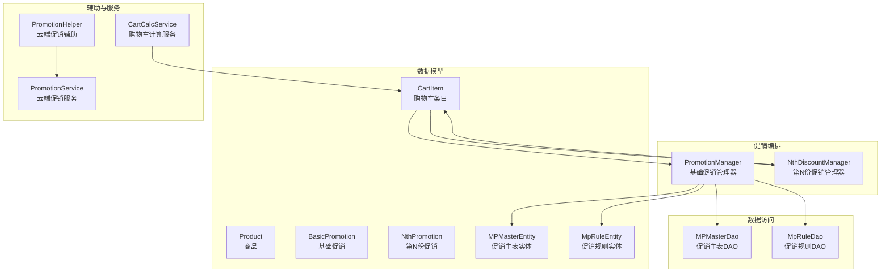
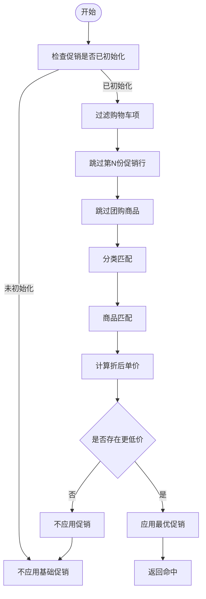
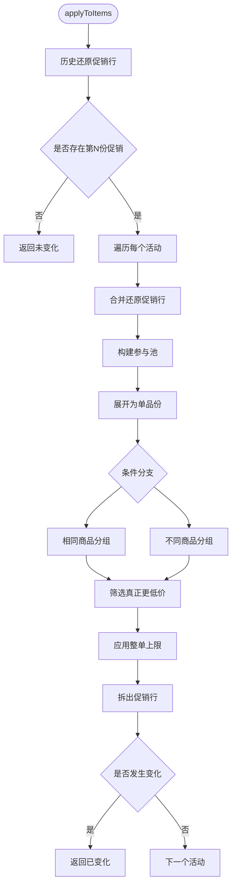
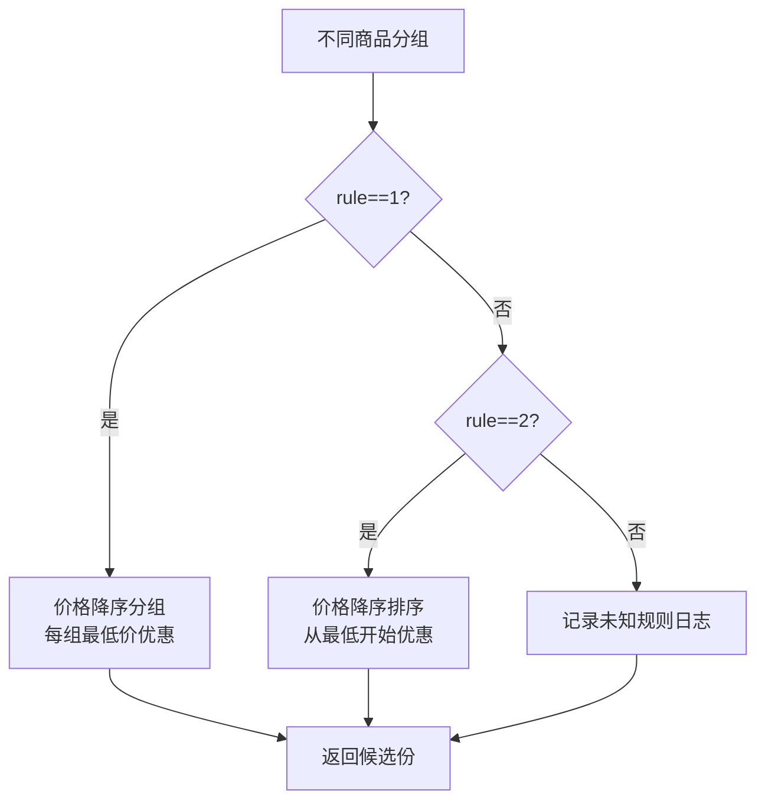
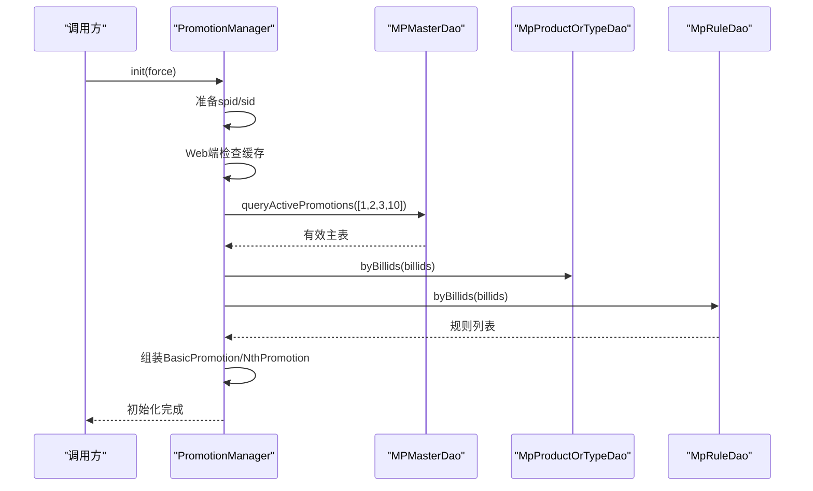
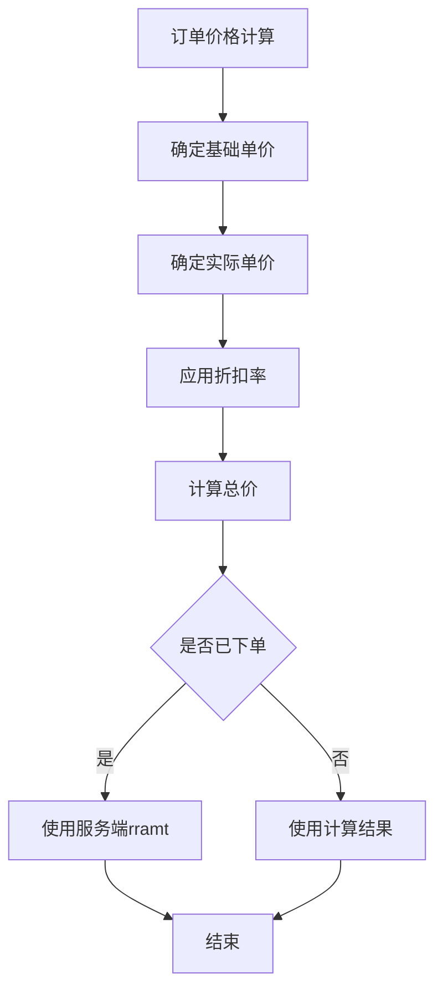
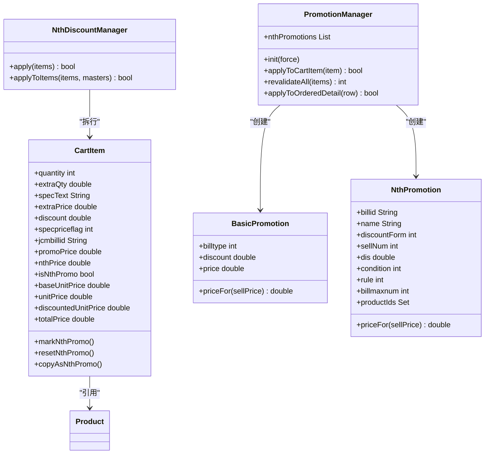

# 促销计算引擎

<cite>
**本文引用的文件**   
- [nth_discount_manager.dart](file://lib/pages/order/nth_discount_manager.dart)
- [promotion_manager.dart](file://lib/pages/order/promotion_manager.dart)
- [mp_master_dao.dart](file://lib/db/dao/mp_master_dao.dart)
- [mp_rule_dao.dart](file://lib/db/dao/mp_rule_dao.dart)
- [mp_master_entity.dart](file://lib/db/entity/mp_master_entity.dart)
- [mp_rule_entity.dart](file://lib/db/entity/mp_rule_entity.dart)
- [order_models.dart](file://lib/pages/order/order_models.dart)
- [cart_calc_service.dart](file://lib/util/cart_calc_service.dart)
- [promotion_helper.dart](file://lib/util/promotion_helper.dart)
- [promotion_service.dart](file://lib/util/promotion_service.dart)
</cite>

## 目录
1. [引言](#引言)
2. [项目结构与职责划分](#项目结构与职责划分)
3. [核心组件总览](#核心组件总览)
4. [基础促销类型 BasicPromotion](#基础促销类型-basicpromotion)
5. [第N份促销 NthDiscountManager](#第n份促销-nthdiscountmanager)
6. [促销规则加载与解析流程](#促销规则加载与解析流程)
7. [促销计算执行流程](#促销计算执行流程)
8. [依赖关系分析](#依赖关系分析)
9. [性能优化与缓存策略](#性能优化与缓存策略)
10. [扩展指南：新增促销类型](#扩展指南新增促销类型)
11. [故障排查](#故障排查)
12. [结论](#结论)

## 引言
本文件面向订单与促销相关开发者，系统化说明当前 Flutter 客户端中“促销计算引擎”的实现。文档聚焦以下目标：
- 解释基础促销类型（分类折扣、菜品折扣、特价菜）的计算逻辑；
- 深入说明第N份促销的条件判断、分组算法和优惠分配策略；
- 文档化促销规则的数据库查询、规则匹配与优先级排序过程；
- 梳理多规则叠加、冲突解决与最终价格确定流程；
- 提供扩展新促销类型的指导；
- 给出性能优化建议与现有缓存策略说明。

该引擎由本地促销数据模型、DAO 层、购物车模型、基础促销管理器与第N份促销管理器共同组成，并在必要时通过云端促销服务完成买赠、满减等场景促销校验。

## 项目结构与职责划分
促销计算相关代码主要分布在以下层次：
- 数据模型层：订单商品项、购物车项、基础促销、第N份促销、促销主表实体、促销规则实体；
- 数据访问层：促销主表 DAO、促销规则 DAO；
- 促销编排层：基础促销管理器、第N份促销管理器；
- 辅助与服务层：促销辅助类、促销服务、购物车计算服务。

**图表来源**
- [promotion_manager.dart:1-120](file://lib/pages/order/promotion_manager.dart#L1-L120)
- [nth_discount_manager.dart:1-80](file://lib/pages/order/nth_discount_manager.dart#L1-L80)
- [mp_master_dao.dart:1-60](file://lib/db/dao/mp_master_dao.dart#L1-L60)
- [mp_rule_dao.dart:1-40](file://lib/db/dao/mp_rule_dao.dart#L1-L40)
- [order_models.dart:240-669](file://lib/pages/order/order_models.dart#L240-L669)
- [cart_calc_service.dart:1-60](file://lib/util/cart_calc_service.dart#L1-L60)
- [promotion_helper.dart:1-60](file://lib/util/promotion_helper.dart#L1-L60)
- [promotion_service.dart:1-60](file://lib/util/promotion_service.dart#L1-L60)

**章节来源**
- [promotion_manager.dart:1-120](file://lib/pages/order/promotion_manager.dart#L1-L120)
- [nth_discount_manager.dart:1-80](file://lib/pages/order/nth_discount_manager.dart#L1-L80)
- [order_models.dart:240-669](file://lib/pages/order/order_models.dart#L240-L669)
- [cart_calc_service.dart:1-60](file://lib/util/cart_calc_service.dart#L1-L60)
- [mp_master_dao.dart:1-60](file://lib/db/dao/mp_master_dao.dart#L1-L60)
- [mp_rule_dao.dart:1-40](file://lib/db/dao/mp_rule_dao.dart#L1-L40)

## 核心组件总览
- `BasicPromotion`：表示分类折扣、菜品折扣、特价菜三种基础促销类型及其单价换算。
- `NthPromotion`：表示第N份促销，包括优惠形式、购买门槛、条件、分组规则、单笔上限及参与商品集合。
- `PromotionManager`：负责从本地数据库加载有效促销、组装基础促销与第N份促销、为购物车或已下单明细套用最优基础促销。
- `NthDiscountManager`：负责将购物车展开为单品份，按相同商品或不同商品条件进行分组与选择，最终拆出促销行。
- `MPMasterDao` 与 `MpRuleDao`：封装促销主表与规则表的数据库查询。
- `CartItem`：购物车条目，承载基础促销标记、第N份促销标记、会员价、改价、打包费等字段。
- `CartCalcService`：购物车金额计算、会员价应用、整单折扣计算。
- `PromotionHelper` 与 `PromotionService`：调用云端接口获取活动列表、计算优惠金额，用于买赠、满减等场景促销的辅助与兜底。

**章节来源**
- [promotion_manager.dart:1-120](file://lib/pages/order/promotion_manager.dart#L1-L120)
- [nth_discount_manager.dart:1-80](file://lib/pages/order/nth_discount_manager.dart#L1-L80)
- [order_models.dart:240-669](file://lib/pages/order/order_models.dart#L240-L669)
- [cart_calc_service.dart:1-60](file://lib/util/cart_calc_service.dart#L1-L60)
- [promotion_helper.dart:1-60](file://lib/util/promotion_helper.dart#L1-L60)
- [promotion_service.dart:1-60](file://lib/util/promotion_service.dart#L1-L60)

## 基础促销类型 BasicPromotion
### 支持的基础促销类型
- 分类折扣：根据商品分类命中促销，按折扣率计算折后单价。
- 菜品折扣：根据具体菜品命中促销，折扣值取自规则表最小折扣。
- 特价菜：直接以特价作为单价，不受商品是否可打折限制。

### 价格计算方式
- 分类折扣与菜品折扣：折后单价等于原价乘以折扣率。
- 特价菜：折后单价直接取特价值。
- 基础促销管理器在匹配时选择能产生更低折后单价的规则。

### 规则匹配与优先级
- 分类匹配：促销分类与商品分类相等，或存在前缀包含关系。
- 商品匹配：促销商品ID与商品ID一致；若促销限定规格而客户端无法比对规格ID，则跳过该促销。
- 特价菜优先覆盖普通折扣，但仅当特价低于当前价格时才采用。
- 非特价的分类/菜品折扣要求商品允许打折。

**图表来源**
- [promotion_manager.dart:250-455](file://lib/pages/order/promotion_manager.dart#L250-L455)

**章节来源**
- [promotion_manager.dart:1-120](file://lib/pages/order/promotion_manager.dart#L1-L120)
- [promotion_manager.dart:250-455](file://lib/pages/order/promotion_manager.dart#L250-L455)

## 第N份促销 NthDiscountManager
### 设计目标
第N份促销不修改原始购物车行的折扣率，而是通过“拆行”机制生成独立的促销行：
- 普通价行继续保留原数量；
- 促销行标记为 specpriceflag=7，并绑定活动ID；
- 促销行单价写入 CartItem.nthPrice；
- 对整行享受优惠的情况，原地转为促销行；
- 对部分数量享受优惠的情况，复制出促销行并从原行扣除对应数量。

### 输入参数
- 购物车项列表；
- 第N份促销活动列表；
- 已下单占用次数映射，用于整单最大享受次数扣减。

### 核心处理步骤
1. **历史还原**：清理无活动ID的旧促销标记，重新计算基础促销，确保重算口径一致。
2. **逐活动应用**：对每个第N份促销活动独立应用，记录是否发生拆行变化。
3. **合并还原促销行**：将此前拆出的促销行合并回父行，找不到父行时就地还原。
4. **构建参与池**：过滤掉赠送、团购、称重菜、已有手工价、已退款、已促销的行。
5. **展开为单品份**：将购物车项按数量展开为多个单元，便于按N份分组。
6. **条件分组与选择**：
   - 相同商品：按商品ID与规格分组，组内每N份选择最低价一份；
   - 不同商品：按价格降序分组或从最低价开始优惠。
7. **有效性校验**：只有促销后单价确实更低才计入候选。
8. **整单上限控制**：考虑已下单占用次数，限制本轮最多生效次数。
9. **拆行输出**：统计每个原始行需要拆出的促销份数，执行原地转换或复制促销行。

**图表来源**
- [nth_discount_manager.dart:1-200](file://lib/pages/order/nth_discount_manager.dart#L1-L200)
- [nth_discount_manager.dart:201-267](file://lib/pages/order/nth_discount_manager.dart#L201-L267)

### 分组算法细节
- **相同商品 condition=1**：
  - 使用商品ID与规格名作为分组键；
  - 每组内部按价格降序排序；
  - 每N份取最后一份作为优惠份；
  - 稳定排序保证上一轮已优惠份被优先保护。
- **不同商品 condition=2**：
  - rule=1：整体价格降序分组，每组最低价优惠；
  - rule=2：整体价格降序排序，从最低开始优惠，数量为总份数除以N；
  - 未知规则记录日志降级。

**图表来源**
- [nth_discount_manager.dart:201-267](file://lib/pages/order/nth_discount_manager.dart#L201-L267)

**章节来源**
- [nth_discount_manager.dart:1-200](file://lib/pages/order/nth_discount_manager.dart#L1-L200)
- [nth_discount_manager.dart:201-267](file://lib/pages/order/nth_discount_manager.dart#L201-L267)
- [order_models.dart:240-669](file://lib/pages/order/order_models.dart#L240-L669)

## 促销规则加载与解析流程
### 数据来源
- 促销主表：t_mp_pt_master；
- 促销商品或分类明细：t_mp_pt_product_or_type；
- 促销规则表：t_mp_pt_rule；
- Web 端通过 tabledown 内存缓存读取；
- 非 Web 端通过 SQLite 查询。

### 加载流程
1. **初始化入口**：`PromotionManager.init` 在登录、跨天、切换会员后触发；强制模式用于订单确认页刷新。
2. **环境准备**：
   - 读取门店SPID/SID；
   - Web 端若缓存为空则按需同步促销表；
   - 非 Web 端直接使用 SQLite。
3. **查询有效促销主表**：
   - 过滤促销类型[1,2,3,10]；
   - 同时考虑门店、时间段、星期、有效期、排除日期、VIP标志；
   - Web 端用内存过滤实现等价语义。
4. **查询明细与规则**：
   - 按主表 billid 批量查询商品或分类明细；
   - 按 billid 批量查询规则；
   - 菜品折扣取规则表中最小折扣；
   - 第N份促销单独解析 nDiscountform、nSellnum、nCondition、nRule、billmaxnum、productIds。
5. **组装促销对象**：
   - 基础促销：分类折扣、菜品折扣、特价菜；
   - 第N份促销：不参与基础促销，进入 NthDiscountManager 处理。

**图表来源**
- [promotion_manager.dart:120-300](file://lib/pages/order/promotion_manager.dart#L120-L300)
- [mp_master_dao.dart:60-200](file://lib/db/dao/mp_master_dao.dart#L60-L200)
- [mp_rule_dao.dart:40-118](file://lib/db/dao/mp_rule_dao.dart#L40-L118)

**章节来源**
- [promotion_manager.dart:120-300](file://lib/pages/order/promotion_manager.dart#L120-L300)
- [mp_master_dao.dart:60-200](file://lib/db/dao/mp_master_dao.dart#L60-L200)
- [mp_rule_dao.dart:40-118](file://lib/db/dao/mp_rule_dao.dart#L40-L118)
- [mp_master_entity.dart:1-133](file://lib/db/entity/mp_master_entity.dart#L1-L133)
- [mp_rule_entity.dart:1-54](file://lib/db/entity/mp_rule_entity.dart#L1-L54)

## 促销计算执行流程
### 购物车层面
- 基础促销：`PromotionManager.applyToCartItem` 为单个购物车项套用最优基础促销，写回 discount/specpriceflag/jcmbillid/promoPrice。
- 第N份促销：`NthDiscountManager.apply` 对整体购物车重算所有第N份促销，可能触发拆行变化。

### 已下单明细层面
- 基础促销补套：`PromotionManager.applyToOrderedDetail` 为服务端返回的已下单明细补套基础促销，避免重复覆盖服务端定价。
- 第N份促销：已下单明细暂不在此处拆分，通常由订单确认或服务端统一处理。

### 最终价格确定
- 基础价：第N份促销价 > 特价菜价 > 原价；
- 实际单价：改价 > 会员价 > 基础价 + 规格加价；
- 折扣后单价：仅在折扣率小于100时应用；
- 总价：折扣后单价 × 计价数量 + 打包费；
- 已下单商品优先使用服务端 rramt。

**图表来源**
- [order_models.dart:240-669](file://lib/pages/order/order_models.dart#L240-L669)
- [cart_calc_service.dart:1-60](file://lib/util/cart_calc_service.dart#L1-L60)

**章节来源**
- [promotion_manager.dart:300-455](file://lib/pages/order/promotion_manager.dart#L300-L455)
- [nth_discount_manager.dart:1-200](file://lib/pages/order/nth_discount_manager.dart#L1-L200)
- [order_models.dart:240-669](file://lib/pages/order/order_models.dart#L240-L669)
- [cart_calc_service.dart:1-60](file://lib/util/cart_calc_service.dart#L1-L60)

## 依赖关系分析
- `PromotionManager` 依赖 `MPMasterDao`、`MpProductOrTypeDao`、`MpRuleDao` 获取促销主表、明细与规则；
- `PromotionManager` 维护 `BasicPromotion` 与 `NthPromotion` 列表，并暴露给 `NthDiscountManager`；
- `NthDiscountManager` 依赖 `CartItem` 的状态字段完成拆行；
- `CartItem` 聚合 `Product` 并提供基础价、实际价、折扣价、总价等计算能力；
- `CartCalcService` 提供购物车总金额、会员价、整单折扣等通用计算；
- `PromotionHelper` 与 `PromotionService` 负责云端促销接口，与本地基础促销解耦。

**图表来源**
- [promotion_manager.dart:1-120](file://lib/pages/order/promotion_manager.dart#L1-L120)
- [nth_discount_manager.dart:1-80](file://lib/pages/order/nth_discount_manager.dart#L1-L80)
- [order_models.dart:240-669](file://lib/pages/order/order_models.dart#L240-L669)

**章节来源**
- [promotion_manager.dart:1-120](file://lib/pages/order/promotion_manager.dart#L1-L120)
- [nth_discount_manager.dart:1-80](file://lib/pages/order/nth_discount_manager.dart#L1-L80)
- [order_models.dart:240-669](file://lib/pages/order/order_models.dart#L240-L669)

## 性能优化与缓存策略
### 现有优化
- **Web 端促销表按需同步**：首次发现缓存为空时拉取促销表，后续不再重复下载。
- **促销初始化状态位**：`_inited` 防止重复初始化；`force` 模式用于订单确认页刷新。
- **批量查询**：主表、明细、规则均按 billid 批量查询，减少数据库往返。
- **过滤前置**：参与池提前过滤赠送、团购、称重菜、手工价等无效行，降低展开成本。
- **稳定排序保护**：相同商品规则下优先保留上一轮已优惠份，减少不稳定波动导致的重复计算。

### 建议优化
- **规则索引**：为促销主表、明细、规则表建立 spid/sid/billid 联合索引，提升批量查询效率。
- **缓存分层**：对基础促销结果增加短期缓存键（spid+sid+vipTypeid），避免频繁重建。
- **增量重算**：购物车变动时仅重算受影响商品的促销，而非全量 applyToItems。
- **并行加载**：在非关键路径上并行加载主表、明细、规则，缩短初始化耗时。
- **第N份促销粒度缓存**：对高频活动的候选集与拆行结果做轻量级缓存，结合购物车版本号失效。

[本节为通用优化建议，不涉及具体文件分析]

## 扩展指南：新增促销类型
### 新增基础促销类型
1. 在 `BasicPromotion` 中扩展 billtype 与 priceFor 计算逻辑；
2. 在 `PromotionManager.init` 中解析新类型主表字段；
3. 在 `PromotionManager.applyToCartItem` 中添加匹配与优先级逻辑；
4. 在 `PromotionManager.applyToOrderedDetail` 中补套逻辑保持一致；
5. 更新日志与注释，说明新规则行为。

### 新增第N份促销变体
1. 在 `NthPromotion` 中扩展必要字段；
2. 在 `PromotionManager.init` 中解析新字段并构建活动对象；
3. 在 `NthDiscountManager._applyToMaster` 中扩展条件判断与分组算法；
4. 在 `_sameProduct` 或 `_differentProduct` 中实现新的分组策略；
5. 添加单元测试与日志，验证拆行与价格正确性。

### 示例路径参考
- 基础促销模型与价格计算：[promotion_manager.dart:1-120](file://lib/pages/order/promotion_manager.dart#L1-L120)
- 基础促销匹配与套用：[promotion_manager.dart:250-455](file://lib/pages/order/promotion_manager.dart#L250-L455)
- 第N份促销模型与价格计算：[promotion_manager.dart:1-120](file://lib/pages/order/promotion_manager.dart#L1-L120)
- 第N份促销应用与拆行：[nth_discount_manager.dart:1-200](file://lib/pages/order/nth_discount_manager.dart#L1-L200)
- 购物车价格计算与字段：[order_models.dart:240-669](file://lib/pages/order/order_models.dart#L240-L669)

**章节来源**
- [promotion_manager.dart:1-120](file://lib/pages/order/promotion_manager.dart#L1-L120)
- [promotion_manager.dart:250-455](file://lib/pages/order/promotion_manager.dart#L250-L455)
- [nth_discount_manager.dart:1-200](file://lib/pages/order/nth_discount_manager.dart#L1-L200)
- [order_models.dart:240-669](file://lib/pages/order/order_models.dart#L240-L669)

## 故障排查
### 常见现象
- 基础促销不生效：
  - 检查促销初始化是否成功，spid/sid 是否正确；
  - 检查 Web 端 tabledown 缓存是否同步；
  - 检查分类/商品匹配条件是否满足；
  - 检查商品是否不可打折或规格受限。
- 第N份促销不拆行：
  - 检查购物车项是否被过滤（赠送、团购、称重菜、手工价）；
  - 检查 sellNum 与 discountForm 是否合法；
  - 检查 condition/rule 是否符合预期；
  - 检查整单上限 lockedByBill 是否已占满。
- 价格异常：
  - 检查基础价、实际价、折扣价、打包费的叠加顺序；
  - 检查已下单商品是否优先使用服务端 rramt；
  - 检查第N份促销 nthPrice 是否正确写入。

### 定位手段
- 查看促销日志标签“促销”，关注初始化失败、促销未采用、促销命中、未知规则等记录；
- 检查 CartItem.specpriceflag 与 cxmbillid 是否正确设置；
- 检查 CartItem.discount 与 promoPrice/nthPrice 是否与预期一致；
- 对 Web 端检查 TableDownloadManager 缓存数据是否完整。

**章节来源**
- [promotion_manager.dart:120-300](file://lib/pages/order/promotion_manager.dart#L120-L300)
- [promotion_manager.dart:300-455](file://lib/pages/order/promotion_manager.dart#L300-L455)
- [nth_discount_manager.dart:1-200](file://lib/pages/order/nth_discount_manager.dart#L1-L200)
- [nth_discount_manager.dart:201-267](file://lib/pages/order/nth_discount_manager.dart#L201-L267)
- [order_models.dart:240-669](file://lib/pages/order/order_models.dart#L240-L669)

## 结论
促销计算引擎通过基础促销与第N份促销两条主线，分别处理分类折扣、菜品折扣、特价菜与按N份优惠的场景。基础促销由 PromotionManager 负责加载与匹配，第N份促销由 NthDiscountManager 负责分组与拆行。数据层通过 DAO 与实体模型连接数据库，CartCalcService 与 CartItem 提供稳定的价格计算能力。对于买赠、满减等复杂场景，系统通过 PromotionHelper 与 PromotionService 对接云端接口，避免在本地复刻完整规则引擎。

在实际开发中，应优先保证促销规则加载的正确性与稳定性，再在此基础上扩展促销类型与分组策略。性能方面可通过索引、缓存、增量重算与并行加载进一步优化。故障排查应以日志为核心，围绕促销初始化、匹配条件、拆行逻辑与价格叠加顺序逐步定位。