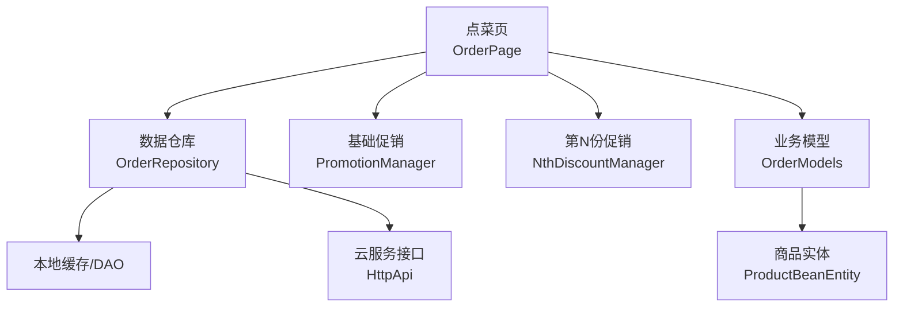
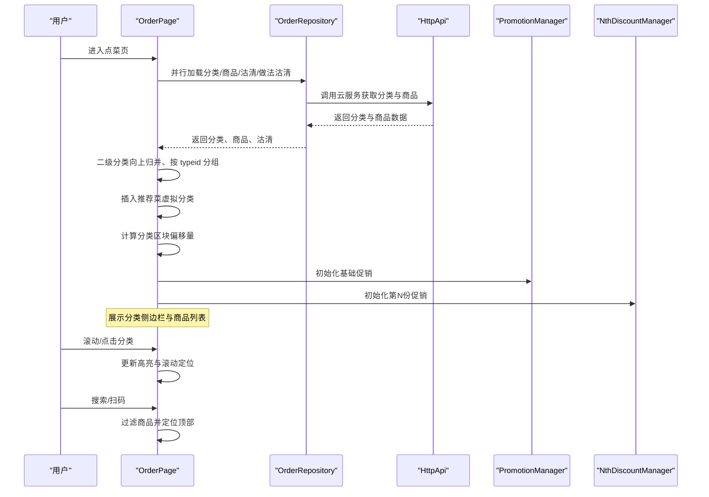
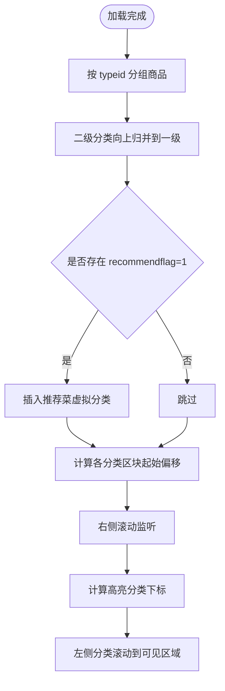
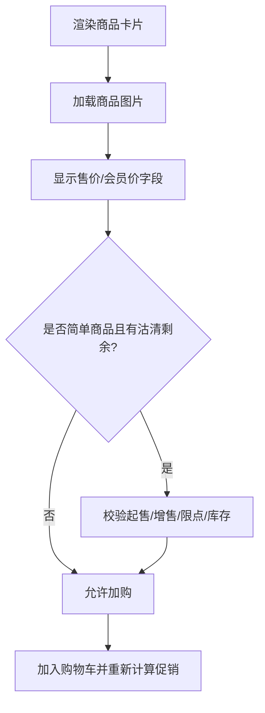
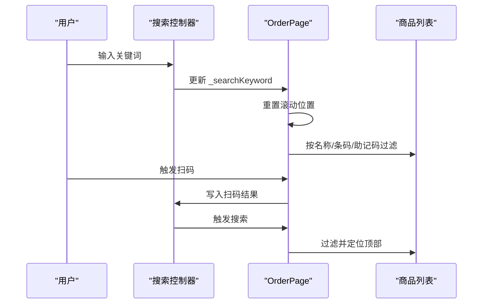
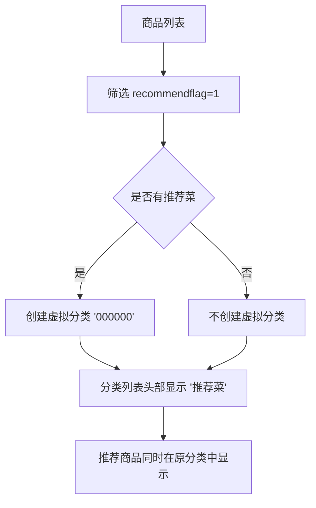
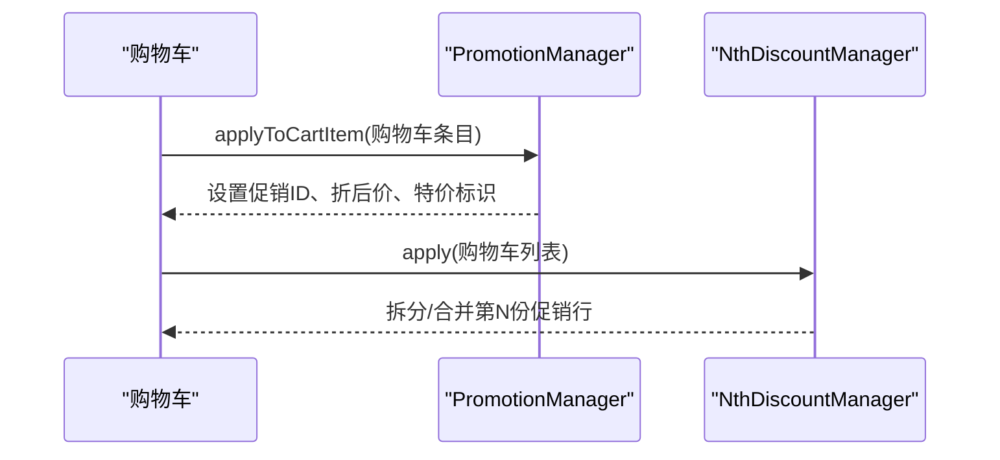
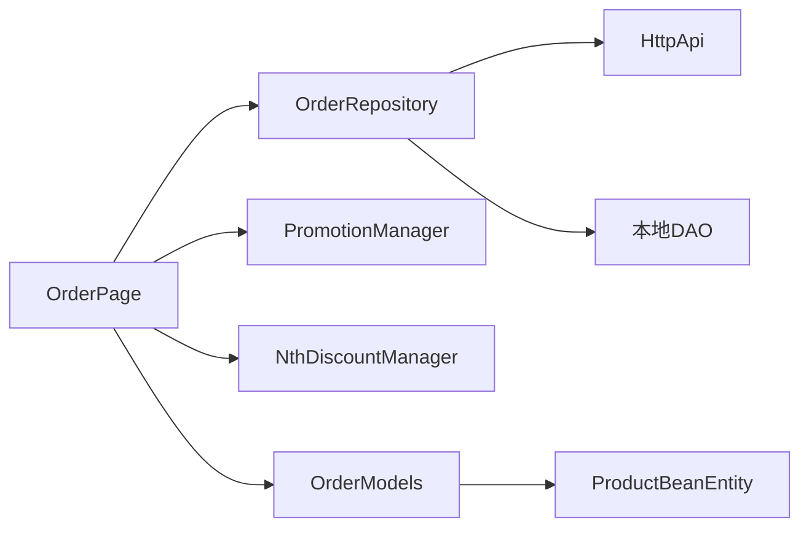

# 商品浏览系统

<cite>
**本文引用的文件**   
- [lib/pages/order/order_page.dart](file://lib/pages/order/order_page.dart)
- [lib/pages/order/order_repository.dart](file://lib/pages/order/order_repository.dart)
- [lib/pages/order/order_models.dart](file://lib/pages/order/order_models.dart)
- [lib/pages/order/promotion_manager.dart](file://lib/pages/order/promotion_manager.dart)
- [lib/pages/order/nth_discount_manager.dart](file://lib/pages/order/nth_discount_manager.dart)
- [lib/net/http_api.dart](file://lib/net/http_api.dart)
- [lib/db/entity/product_bean_entity.dart](file://lib/db/entity/product_bean_entity.dart)
</cite>

## 目录
1. [简介](#简介)
2. [项目结构](#项目结构)
3. [核心组件](#核心组件)
4. [架构总览](#架构总览)
5. [详细组件分析](#详细组件分析)
6. [依赖关系分析](#依赖关系分析)
7. [性能与内存优化](#性能与内存优化)
8. [故障排查指南](#故障排查指南)
9. [结论](#结论)

## 简介
本文件面向“商品浏览系统”，重点说明点菜/点餐场景中的商品分类侧边栏、商品列表渲染、搜索过滤、推荐菜虚拟分类、购物车与促销联动，以及滚动性能与内存管理策略。该系统以 Flutter 实现，核心入口为订单点菜页面，数据层通过仓库从本地数据库或云服务加载商品与分类，UI 层负责分类高亮、滚动联动、图片展示与库存校验。

## 项目结构
围绕商品浏览能力的相关代码主要分布在以下位置：
- 页面与交互：`lib/pages/order/order_page.dart`
- 数据仓库与模型：`lib/pages/order/order_repository.dart`、`lib/pages/order/order_models.dart`
- 促销与第N份优惠：`lib/pages/order/promotion_manager.dart`、`lib/pages/order/nth_discount_manager.dart`
- 网络接口定义：`lib/net/http_api.dart`
- 商品实体字段（含推荐菜标识）：`lib/db/entity/product_bean_entity.dart`

图表来源
- [lib/pages/order/order_page.dart:1-200](file://lib/pages/order/order_page.dart#L1-L200)
- [lib/pages/order/order_repository.dart:1088-1190](file://lib/pages/order/order_repository.dart#L1088-L1190)
- [lib/pages/order/order_models.dart:167-170](file://lib/pages/order/order_models.dart#L167-L170)
- [lib/net/http_api.dart:81-91](file://lib/net/http_api.dart#L81-L91)
- [lib/db/entity/product_bean_entity.dart:1-59](file://lib/db/entity/product_bean_entity.dart#L1-L59)

章节来源
- [lib/pages/order/order_page.dart:1-200](file://lib/pages/order/order_page.dart#L1-L200)
- [lib/pages/order/order_repository.dart:1088-1190](file://lib/pages/order/order_repository.dart#L1088-L1190)
- [lib/net/http_api.dart:81-91](file://lib/net/http_api.dart#L81-L91)
- [lib/db/entity/product_bean_entity.dart:1-59](file://lib/db/entity/product_bean_entity.dart#L1-L59)

## 核心组件
- 点菜页面 `OrderPage`：负责分类与商品数据加载、分类高亮与滚动联动、购物车增删改、搜索过滤、扫码加购、必点菜与已保存菜品恢复、推荐菜虚拟分类处理。
- 数据仓库 `OrderRepository`：封装分类、商品、做法规格、套餐、沽清等数据的获取逻辑，提供本地优先、云端兜底的双数据源策略。
- 业务模型 `OrderModels`：定义购物车项、商品分类、标签等前端显示所需数据结构。
- 促销管理器 `PromotionManager`：计算分类折扣、菜品折扣、特价菜等基础促销。
- 第N份促销 `NthDiscountManager`：对购物车执行“买N送”“第N份打折”等规则拆分与合并。
- 网络接口 `HttpApi`：声明菜品分类、商品列表、规格做法、条码生成等接口路径。
- 商品实体 `ProductBeanEntity`：描述商品主档字段，包括价格、图片、分类、推荐菜标识、售卖时间等。

章节来源
- [lib/pages/order/order_page.dart:1-200](file://lib/pages/order/order_page.dart#L1-L200)
- [lib/pages/order/order_repository.dart:1088-1190](file://lib/pages/order/order_repository.dart#L1088-L1190)
- [lib/pages/order/order_models.dart:167-170](file://lib/pages/order/order_models.dart#L167-L170)
- [lib/pages/order/promotion_manager.dart:102-120](file://lib/pages/order/promotion_manager.dart#L102-L120)
- [lib/pages/order/nth_discount_manager.dart:10-15](file://lib/pages/order/nth_discount_manager.dart#L10-L15)
- [lib/net/http_api.dart:81-91](file://lib/net/http_api.dart#L81-L91)
- [lib/db/entity/product_bean_entity.dart:1-59](file://lib/db/entity/product_bean_entity.dart#L1-L59)

## 架构总览
商品浏览系统的核心流程是：页面初始化时并行加载分类、商品、沽清数据；将二级分类归并到一级分类；按分类分组构建右侧商品列表；同时根据推荐菜标识在分类头部插入“推荐菜”虚拟分类；左侧分类高亮与右侧滚动联动；购物车变更时应用基础促销和第N份促销；搜索框支持名称、条码、助记码匹配并可触发扫码加购。

图表来源
- [lib/pages/order/order_page.dart:201-360](file://lib/pages/order/order_page.dart#L201-L360)
- [lib/pages/order/order_repository.dart:1088-1190](file://lib/pages/order/order_repository.dart#L1088-L1190)
- [lib/net/http_api.dart:81-91](file://lib/net/http_api.dart#L81-L91)

## 详细组件分析

### 分类侧边栏导航机制
分类侧边栏导航由三部分构成：分类数据加载、高亮状态管理、点击与滚动联动。

- 分类数据加载
  - 分类优先读本地缓存，若本地为空则走云服务接口，最终返回一级分类列表并过滤停用分类。
  - 二级分类会向上归并到一级父分类，确保挂在二级分类下的商品能出现在左侧一级分类下。
  - 推荐菜虚拟分类：当存在 `recommendflag=1` 的商品时，在分类列表头部插入一个固定 ID 的“推荐菜”分类，该分类仅用于展示和滚动定位，实际商品仍保留在原分类中，形成“推荐菜 + 原分类”双份展示。

- 高亮状态管理
  - 使用 `ValueNotifier<int>` 保存当前高亮分类下标，避免整页重建，只重建侧边栏。
  - 右侧滚动监听时按预计算的分类区块起始偏移量确定当前高亮分类，节流约每帧一次，防止高频计算。
  - 当高亮变化时，左侧分类滚动到可见区域。

- 点击滚动联动
  - 点击左侧分类时，右侧列表平滑滚动到对应分类区块的起始偏移处，并通过 `_isProgrammaticScroll` 标志防止滚动回调再次触发联动。

图表来源
- [lib/pages/order/order_page.dart:201-360](file://lib/pages/order/order_page.dart#L201-L360)
- [lib/pages/order/order_repository.dart:858-909](file://lib/pages/order/order_repository.dart#L858-L909)
- [lib/pages/order/order_repository.dart:1088-1123](file://lib/pages/order/order_repository.dart#L1088-L1123)

章节来源
- [lib/pages/order/order_page.dart:201-360](file://lib/pages/order/order_page.dart#L201-L360)
- [lib/pages/order/order_repository.dart:858-909](file://lib/pages/order/order_repository.dart#L858-L909)
- [lib/pages/order/order_repository.dart:1088-1123](file://lib/pages/order/order_repository.dart#L1088-L1123)

### 商品列表渲染逻辑
商品列表渲染关注图片缓存、价格显示与库存状态处理。

- 图片缓存
  - 商品卡片使用网络图片组件进行加载，结合全局 OSS 前缀拼接图片地址。
  - 图片缓存由底层网络图片库负责，页面不自行维护图片内存，避免重复下载与内存膨胀。

- 价格显示
  - 商品价格来自商品实体的售价字段；对于简单商品，加购前会拉取该分类的最新快照，如果价格发生变化则同步购物车行价格并提示。
  - 会员价相关字段也随商品档案传入购物车模型，供后续结算与促销计算使用。

- 库存状态处理
  - 沽清剩余数量由服务端返回的 `warnqty` 与 `saleqty` 计算得到，页面在加购前进行实时校验，超出剩余数量时阻止加购并提示。
  - 多规格商品的库存校验在规格弹窗内处理，普通商品直接按商品维度校验。
  - 起售数量与增售数量决定首次加购步长与后续增减步长；限点数量限制单品种类可点上限。

图表来源
- [lib/pages/order/order_page.dart:1-200](file://lib/pages/order/order_page.dart#L1-L200)
- [lib/pages/order/order_page.dart:992-1140](file://lib/pages/order/order_page.dart#L992-L1140)
- [lib/db/entity/product_bean_entity.dart:1-59](file://lib/db/entity/product_bean_entity.dart#L1-L59)

章节来源
- [lib/pages/order/order_page.dart:1-200](file://lib/pages/order/order_page.dart#L1-L200)
- [lib/pages/order/order_page.dart:992-1140](file://lib/pages/order/order_page.dart#L992-L1140)
- [lib/db/entity/product_bean_entity.dart:1-59](file://lib/db/entity/product_bean_entity.dart#L1-L59)

### 搜索过滤功能
搜索过滤支持关键词匹配、结果筛选与实时搜索体验。

- 关键词匹配
  - 支持商品名称、条码、助记码三字段匹配，大小写无关。
  - 搜索框输入后即时刷新搜索结果，并将列表滚动回顶部，便于用户快速定位。

- 结果筛选
  - 搜索关键词为空时显示全量商品；非空时对每个商品执行匹配判断，仅匹配成功的商品参与渲染。

- 实时搜索体验
  - 搜索与扫码联动：扫码成功后自动填入搜索框并触发搜索；支持连续扫码模式，扫码后延迟再次打开扫描界面。

图表来源
- [lib/pages/order/order_page.dart:1500-1700](file://lib/pages/order/order_page.dart#L1500-L1700)

章节来源
- [lib/pages/order/order_page.dart:1500-1700](file://lib/pages/order/order_page.dart#L1500-L1700)

### 推荐菜虚拟分类的处理逻辑和数据展示
推荐菜虚拟分类不是后台分类数据，而是基于商品属性动态生成的展示分类。

- 数据条件
  - 当商品列表中至少有一个商品的 `recommendflag=1` 时，创建虚拟分类，固定 ID 用于区分真实分类。
  - 推荐商品仍保留在其原始分类分组中，因此同一商品可在“推荐菜”和“原分类”两处出现。

- 展示逻辑
  - 分类列表头部插入“推荐菜”分类，点击该分类会滚动到推荐商品区域。
  - 推荐菜分类不参与商品归属变更，仅作为视图层的快捷入口。

图表来源
- [lib/pages/order/order_page.dart:201-360](file://lib/pages/order/order_page.dart#L201-L360)
- [lib/db/entity/product_bean_entity.dart:1-59](file://lib/db/entity/product_bean_entity.dart#L1-L59)

章节来源
- [lib/pages/order/order_page.dart:201-360](file://lib/pages/order/order_page.dart#L201-L360)
- [lib/db/entity/product_bean_entity.dart:1-59](file://lib/db/entity/product_bean_entity.dart#L1-L59)

### 商品卡片组件的使用示例与自定义方法
商品卡片在点菜页中以列表形式渲染，其交互行为包括加购、减购、规格做法选择、套餐选择、时价/称重菜输入、购物车数量编辑等。

- 使用方式
  - 页面内部通过商品分类分组后的商品列表构建卡片。
  - 每个卡片绑定加购与减购回调，回调由页面缓存以避免频繁重建闭包。
  - 复杂商品（规格、做法、套餐、时价、称重）会弹出对应弹窗收集信息后再加购。

- 自定义方法
  - 加购入口：`_addToCart`、`_addSpecToCart`、`_addComboToCart`、`_addTimePriceToCart`、`_addWeighToCart`、`_addTimePriceWeighToCart`。
  - 减少入口：`_removeFromCart`。
  - 数量编辑：`_editCartQty`。
  - 商品转购物车模型：`_toProduct`。
  - 购物车数量缓存重建：`_rebuildCountMap`。

章节来源
- [lib/pages/order/order_page.dart:992-1500](file://lib/pages/order/order_page.dart#L992-L1500)
- [lib/pages/order/order_page.dart:1500-1700](file://lib/pages/order/order_page.dart#L1500-L1700)

### 购物车与促销联动
购物车在每次增删改后都会重新应用基础促销与第N份促销。

- 基础促销
  - 分类折扣、菜品折扣、特价菜在购物车条目上标记促销信息与折后价。
  - 商品是否可打折受商品档案字段控制，不可打折商品会跳过促销计算。

- 第N份促销
  - 购物车变更后统一重算，拆分行与普通行分开处理，避免合并错误。
  - 支持相同商品与不同商品混合条件的促销规则。

图表来源
- [lib/pages/order/order_page.dart:360-450](file://lib/pages/order/order_page.dart#L360-L450)
- [lib/pages/order/promotion_manager.dart:102-120](file://lib/pages/order/promotion_manager.dart#L102-L120)
- [lib/pages/order/nth_discount_manager.dart:10-15](file://lib/pages/order/nth_discount_manager.dart#L10-L15)

章节来源
- [lib/pages/order/order_page.dart:360-450](file://lib/pages/order/order_page.dart#L360-L450)
- [lib/pages/order/promotion_manager.dart:102-120](file://lib/pages/order/promotion_manager.dart#L102-L120)
- [lib/pages/order/nth_discount_manager.dart:10-15](file://lib/pages/order/nth_discount_manager.dart#L10-L15)

## 依赖关系分析
- 页面依赖仓库获取分类与商品数据，仓库再依赖本地 DAO 与网络接口。
- 页面依赖促销管理器与第N份促销管理器对购物车进行价格与规则计算。
- 商品实体字段驱动价格、图片、推荐菜、售卖时间等业务逻辑。

图表来源
- [lib/pages/order/order_page.dart:1-200](file://lib/pages/order/order_page.dart#L1-L200)
- [lib/pages/order/order_repository.dart:1088-1190](file://lib/pages/order/order_repository.dart#L1088-L1190)
- [lib/net/http_api.dart:81-91](file://lib/net/http_api.dart#L81-L91)
- [lib/pages/order/order_models.dart:167-170](file://lib/pages/order/order_models.dart#L167-L170)
- [lib/db/entity/product_bean_entity.dart:1-59](file://lib/db/entity/product_bean_entity.dart#L1-L59)

章节来源
- [lib/pages/order/order_page.dart:1-200](file://lib/pages/order/order_page.dart#L1-L200)
- [lib/pages/order/order_repository.dart:1088-1190](file://lib/pages/order/order_repository.dart#L1088-L1190)
- [lib/net/http_api.dart:81-91](file://lib/net/http_api.dart#L81-L91)
- [lib/pages/order/order_models.dart:167-170](file://lib/pages/order/order_models.dart#L167-L170)
- [lib/db/entity/product_bean_entity.dart:1-59](file://lib/db/entity/product_bean_entity.dart#L1-L59)

## 性能与内存优化
- 滚动节流
  - 右侧滚动监听增加约 16ms 的节流，确保每帧最多处理一次，避免频繁计算高亮分类与左侧滚动。
  - 程序化滚动时使用标志位防止滚动回调死循环。

- 分类区块偏移预计算
  - 分类区块起始偏移在数据加载完成后一次性计算，滚动时直接比较偏移值，避免运行时反复测量。

- 闭包缓存
  - 加购与减购回调按商品 ID 缓存，避免列表重建时重复创建闭包，降低 GC 压力。

- 购物车数量缓存
  - 使用商品 ID 到数量的映射 Map 进行 O(1) 查询，替代遍历购物车列表统计数量。
  - 分类角标数量同样通过分类 ID 映射缓存。

- 实时快照缓存
  - 分类商品与沽清数据按分类维度缓存，2 秒内复用同一快照，减少重复网络请求与解析开销。

- 图片缓存
  - 使用网络图片组件缓存图片，避免重复下载；页面不持有大图对象，降低内存占用。

- 分类与商品分组
  - 分类数据与商品数据分离，商品按分类分组存储，减少渲染时的数据查找成本。

[本节为通用性能建议，未直接分析具体代码片段]

## 故障排查指南
- 分类无商品显示
  - 检查二级分类是否正确向上归并到一级分类。
  - 确认分类未被停用过滤。
  - 确认商品 `typeid` 与分类一致或可被归并。

- 推荐菜不显示
  - 检查商品是否包含 `recommendflag=1`。
  - 确认虚拟分类插入逻辑被执行。

- 滚动联动异常
  - 检查分类区块偏移是否计算完成。
  - 检查滚动监听是否被移除或重复添加。
  - 检查程序化滚动标志是否导致联动失效。

- 加购失败或提示库存不足
  - 检查沽清剩余数量是否正确计算。
  - 检查起售/增售数量与限点数量配置。
  - 检查 Web 端改价后实时快照是否生效。

- 促销价格不正确
  - 检查基础促销是否初始化成功。
  - 检查商品是否可打折。
  - 检查第N份促销是否在购物车变更后重算。

章节来源
- [lib/pages/order/order_page.dart:201-360](file://lib/pages/order/order_page.dart#L201-L360)
- [lib/pages/order/order_page.dart:992-1140](file://lib/pages/order/order_page.dart#L992-L1140)
- [lib/pages/order/order_repository.dart:858-909](file://lib/pages/order/order_repository.dart#L858-L909)
- [lib/pages/order/order_repository.dart:1088-1190](file://lib/pages/order/order_repository.dart#L1088-L1190)

## 结论
商品浏览系统以清晰的层次划分实现分类导航、商品渲染、搜索过滤与购物车促销联动。通过本地优先的数据策略、分类区块偏移预计算、滚动节流、闭包与数量缓存、实时快照缓存等手段，系统在交互流畅性与内存管理方面具备良好表现。推荐菜虚拟分类为展示层增强，不影响商品归属逻辑；搜索与扫码提升操作效率；购物车与促销管理器协同保证价格与规则的正确性。整体设计兼顾可读性与可扩展性，适合餐饮点餐场景的快速迭代与维护。