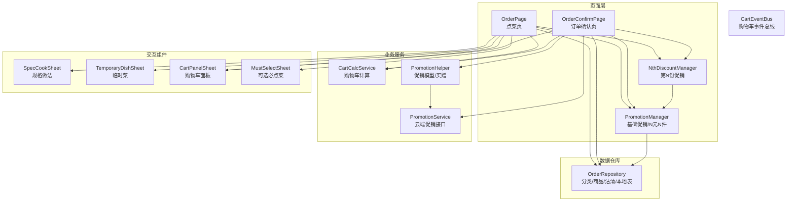
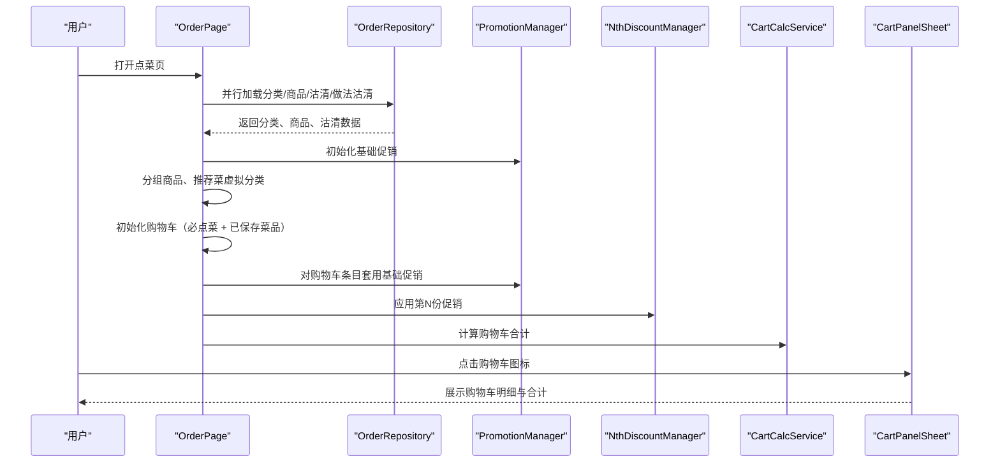
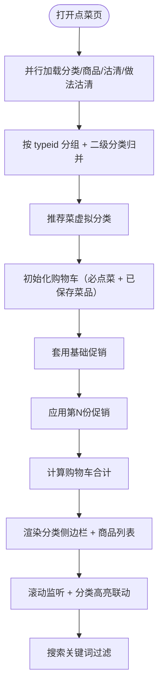
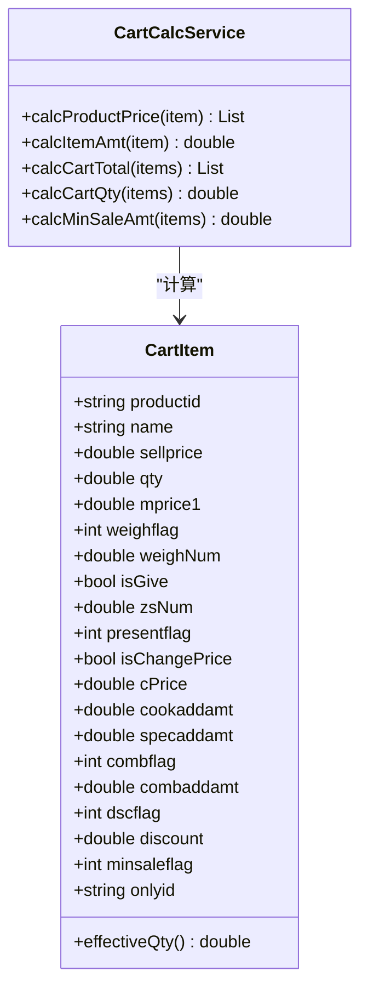
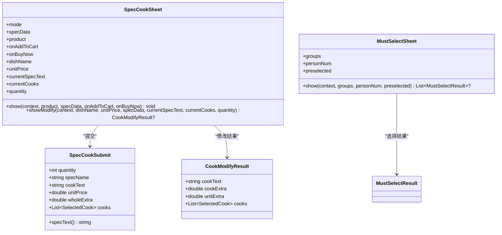
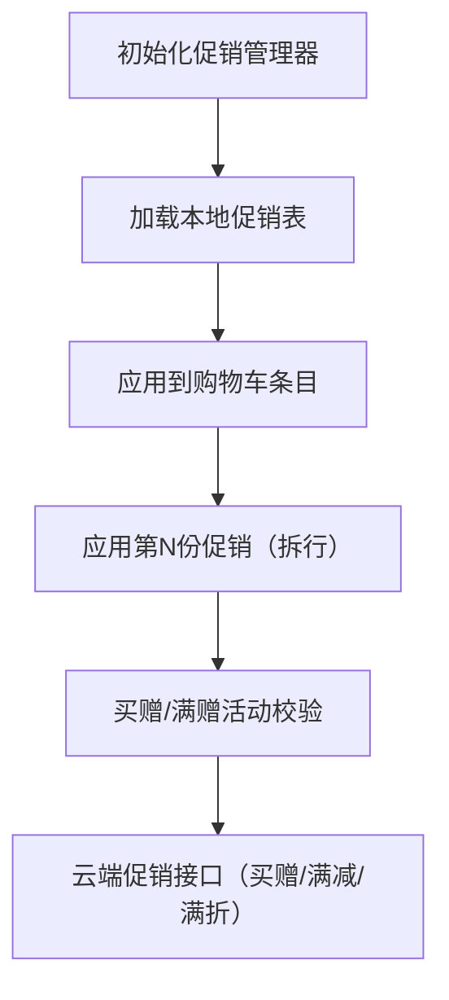
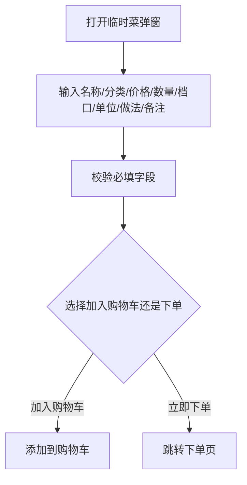
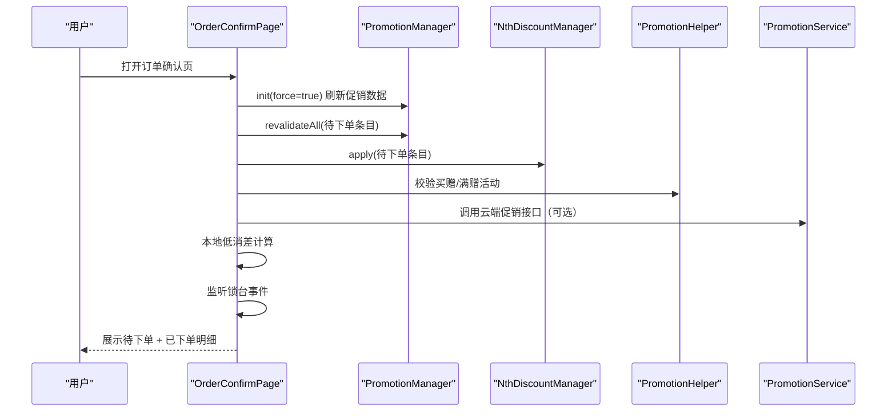
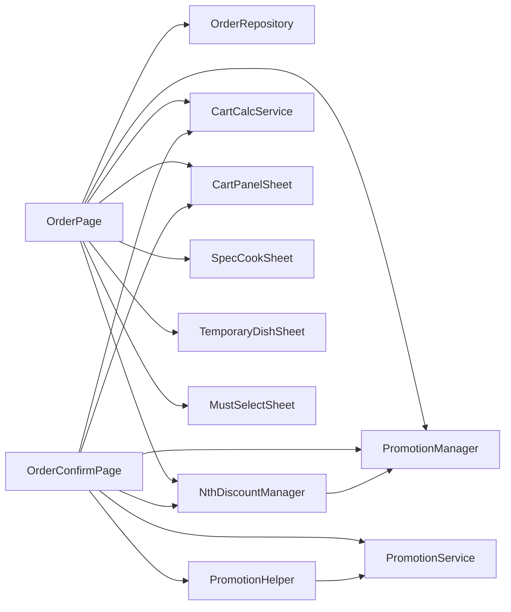

# 点菜下单模块

<cite>
**本文引用的文件 **
- [lib/pages/order/order_page.dart](file://lib/pages/order/order_page.dart)
- [lib/pages/order/order_confirm_page.dart](file://lib/pages/order/order_confirm_page.dart)
- [lib/pages/order/order_repository.dart](file://lib/pages/order/order_repository.dart)
- [lib/pages/order/promotion_manager.dart](file://lib/pages/order/promotion_manager.dart)
- [lib/pages/order/nth_discount_manager.dart](file://lib/pages/order/nth_discount_manager.dart)
- [lib/util/cart_calc_service.dart](file://lib/util/cart_calc_service.dart)
- [lib/util/promotion_helper.dart](file://lib/util/promotion_helper.dart)
- [lib/util/promotion_service.dart](file://lib/util/promotion_service.dart)
- [lib/net/cart_event_bus.dart](file://lib/net/cart_event_bus.dart)
- [lib/pages/order/widgets/cart_panel_sheet.dart](file://lib/pages/order/widgets/cart_panel_sheet.dart)
- [lib/components/spec_cook_sheet.dart](file://lib/components/spec_cook_sheet.dart)
- [lib/components/temporary_dish_sheet.dart](file://lib/components/temporary_dish_sheet.dart)
- [lib/pages/order/widgets/must_select_sheet.dart](file://lib/pages/order/widgets/must_select_sheet.dart)
</cite>

## 目录
1. [引言](#引言)
2. [项目结构](#项目结构)
3. [核心组件](#核心组件)
4. [架构总览](#架构总览)
5. [详细组件分析](#详细组件分析)
6. [依赖关系分析](#依赖关系分析)
7. [性能与可扩展性](#性能与可扩展性)
8. [故障排查指南](#故障排查指南)
9. [结论](#结论)
10. [附录：扩展示例](#附录扩展示例)

## 引言
本模块面向正餐/快餐场景的点菜、购物车、促销计算和订单确认流程，核心目标包括：
- 商品浏览：分类侧边栏导航、右侧商品列表滚动联动、搜索过滤。
- 购物车：商品增删改查、数量管理、价格计算、库存与沽清检查。
- 规格与做法：多级规格选择、做法组合、必选项验证。
- 促销引擎：基础折扣/特价、买赠/满赠/满减/满折/N元N件等。
- 临时菜与必点菜：录入机制与自动加购校验。
- 订单确认：数据组装、提交流程与状态同步。

## 项目结构
点菜下单相关代码主要分布在以下区域：
- 页面层：`lib/pages/order/*`，包括点菜页、订单确认页、促销管理器、第N份促销管理器。
- 业务服务：`lib/util/cart_calc_service.dart`（购物车计算）、`lib/util/promotion_*`（促销模型与服务）。
- 数据仓库：`lib/pages/order/order_repository.dart`（分类、商品、沽清、本地表读取）。
- 交互组件：`lib/components/spec_cook_sheet.dart`（规格做法弹窗）、`lib/components/temporary_dish_sheet.dart`（临时菜弹窗）、`lib/pages/order/widgets/cart_panel_sheet.dart`（购物车面板）、`lib/pages/order/widgets/must_select_sheet.dart`（可选必点菜）。
- 跨页事件：`lib/net/cart_event_bus.dart`（购物车变更事件总线）。

**图表来源**
- [lib/pages/order/order_page.dart:1-200](file://lib/pages/order/order_page.dart#L1-L200)
- [lib/pages/order/order_confirm_page.dart:1-200](file://lib/pages/order/order_confirm_page.dart#L1-L200)
- [lib/pages/order/promotion_manager.dart:1-200](file://lib/pages/order/promotion_manager.dart#L1-L200)
- [lib/pages/order/nth_discount_manager.dart:1-200](file://lib/pages/order/nth_discount_manager.dart#L1-L200)
- [lib/util/cart_calc_service.dart:1-200](file://lib/util/cart_calc_service.dart#L1-L200)
- [lib/util/promotion_helper.dart:1-200](file://lib/util/promotion_helper.dart#L1-L200)
- [lib/util/promotion_service.dart:1-200](file://lib/util/promotion_service.dart#L1-L200)
- [lib/pages/order/widgets/cart_panel_sheet.dart:1-200](file://lib/pages/order/widgets/cart_panel_sheet.dart#L1-L200)
- [lib/components/spec_cook_sheet.dart:1-200](file://lib/components/spec_cook_sheet.dart#L1-L200)
- [lib/components/temporary_dish_sheet.dart:1-200](file://lib/components/temporary_dish_sheet.dart#L1-L200)
- [lib/pages/order/widgets/must_select_sheet.dart:1-200](file://lib/pages/order/widgets/must_select_sheet.dart#L1-L200)

**章节来源**
- [lib/pages/order/order_page.dart:1-200](file://lib/pages/order/order_page.dart#L1-L200)
- [lib/pages/order/order_confirm_page.dart:1-200](file://lib/pages/order/order_confirm_page.dart#L1-L200)

## 核心组件
- `OrderPage`：点菜主界面，负责分类加载、商品分组、滚动联动、搜索过滤、购物车初始化（必点菜+已保存菜品）、促销套用和第N份促销应用。
- `OrderConfirmPage`：订单确认页，负责待下单数据组装、已下单明细合并、促销重算、低消校验、锁台并发控制、下单提交。
- `PromotionManager`：基础促销管理器，维护分类折扣/菜品折扣/特价菜及第N份促销规则，提供应用到购物车条目的方法。
- `NthDiscountManager`：第N份促销计算器，按“同商品/不同商品”条件拆行并标记促销行。
- `CartCalcService`：购物车金额计算，支持赠送、改价、称重、折扣、加价累加和低消金额统计。
- `PromotionHelper` 与 `PromotionService`：促销数据模型、买赠活动模型以及云端促销查询与折扣计算。
- `SpecCookSheet`：规格与做法统一弹窗，支持加购模式和修改模式。
- `TemporaryDishSheet`：临时菜录入弹窗，支持分类/单位/档口/做法/可折/备注等字段。
- `CartPanelSheet`：购物车底部抽屉，支持加减数量、清空、合计显示。
- `MustSelectSheet`：可选必点菜选择弹窗，支持每人必点/每单必点校验。
- `CartEventBus`：购物车变更广播，用于点菜页与订单确认页之间的状态同步。

**章节来源**
- [lib/pages/order/order_page.dart:1-200](file://lib/pages/order/order_page.dart#L1-L200)
- [lib/pages/order/order_confirm_page.dart:1-200](file://lib/pages/order/order_confirm_page.dart#L1-L200)
- [lib/pages/order/promotion_manager.dart:1-200](file://lib/pages/order/promotion_manager.dart#L1-L200)
- [lib/pages/order/nth_discount_manager.dart:1-200](file://lib/pages/order/nth_discount_manager.dart#L1-L200)
- [lib/util/cart_calc_service.dart:1-200](file://lib/util/cart_calc_service.dart#L1-L200)
- [lib/util/promotion_helper.dart:1-200](file://lib/util/promotion_helper.dart#L1-L200)
- [lib/util/promotion_service.dart:1-200](file://lib/util/promotion_service.dart#L1-L200)
- [lib/components/spec_cook_sheet.dart:1-200](file://lib/components/spec_cook_sheet.dart#L1-L200)
- [lib/components/temporary_dish_sheet.dart:1-200](file://lib/components/temporary_dish_sheet.dart#L1-L200)
- [lib/pages/order/widgets/cart_panel_sheet.dart:1-200](file://lib/pages/order/widgets/cart_panel_sheet.dart#L1-L200)
- [lib/pages/order/widgets/must_select_sheet.dart:1-200](file://lib/pages/order/widgets/must_select_sheet.dart#L1-L200)
- [lib/net/cart_event_bus.dart:1-22](file://lib/net/cart_event_bus.dart#L1-L22)

## 架构总览
点菜下单流程采用分层设计：
- 页面层：OrderPage、OrderConfirmPage 作为用户入口，协调数据加载、交互和状态更新。
- 服务层：PromotionManager、NthDiscountManager、CartCalcService 封装促销与价格计算逻辑。
- 数据层：OrderRepository 统一访问分类、商品、沽清和本地促销表；PromotionService 调用云端促销接口。
- 组件层：SpecCookSheet、TemporaryDishSheet、CartPanelSheet、MustSelectSheet 处理复杂交互。
- 事件层：CartEventBus 提供购物车变更广播，保证多页面一致性。

**图表来源**
- [lib/pages/order/order_page.dart:201-561](file://lib/pages/order/order_page.dart#L201-L561)
- [lib/pages/order/promotion_manager.dart:1-200](file://lib/pages/order/promotion_manager.dart#L1-L200)
- [lib/pages/order/nth_discount_manager.dart:1-200](file://lib/pages/order/nth_discount_manager.dart#L1-L200)
- [lib/util/cart_calc_service.dart:1-200](file://lib/util/cart_calc_service.dart#L1-L200)
- [lib/pages/order/widgets/cart_panel_sheet.dart:1-200](file://lib/pages/order/widgets/cart_panel_sheet.dart#L1-L200)

## 详细组件分析

### 商品浏览系统：分类侧边栏、滚动联动与搜索过滤
- 分类侧边栏：
  - 分类数据通过 `OrderRepository.fetchCategories()` 获取；二级分类向上归并到一级，确保左侧仅展示一级分类。
  - 存在推荐菜时插入虚拟分类“推荐菜”，实现“推荐菜 + 原分类”双份展示。
- 商品列表滚动联动：
  - 使用右侧 `ScrollController` 监听滚动，结合 `_sectionOffsets` 计算每个分类区块起始偏移，实现高亮联动。
  - 程序化滚动时使用 `_isProgrammaticScroll` 防止死循环。
- 搜索过滤：
  - 使用 `_searchController` 与 `_searchKeyword` 进行关键词匹配；搜索结果影响右侧商品列表渲染。
- 实时快照与沽清：
  - 按分类缓存商品实时快照，2秒内复用；沽清剩余基数按 `warnqty - saleqty` 计算。
- 权限与锁台：
  - 进入点菜页前检查点菜权限；自动锁台并在退出时释放锁。

**图表来源**
- [lib/pages/order/order_page.dart:201-561](file://lib/pages/order/order_page.dart#L201-L561)

**章节来源**
- [lib/pages/order/order_page.dart:201-561](file://lib/pages/order/order_page.dart#L201-L561)
- [lib/pages/order/order_repository.dart:1-200](file://lib/pages/order/order_repository.dart#L1-L200)

### 购物车核心逻辑：增删改查、数量管理、价格计算与库存检查
- 数据结构：
  - `CartItem` 表示购物车项，包含产品ID、名称、单价、数量、会员价、称重标志、赠送标志、改价、做法/规格/套餐加价、折扣标志、低消标志等。
- 价格计算：
  - `CartCalcService.calcProductPrice` 计算单个商品的售价、会员价、原价；支持赠送、改价、称重、折扣和加价累加。
  - `calcCartTotal` 汇总购物车总金额；`calcCartQty` 统计数量（赠送不计）；`calcMinSaleAmt` 统计计入低消的金额。
- 数量管理：
  - 通过 `CartPanelSheet` 的 `onAdd`/`onRemove`/`onEditQty` 回调操作购物车条目；第N份促销拆分行禁止直接加数量。
- 库存与沽清：
  - 商品模型 `DishProduct` 包含 `stockflag`、`sellclearflag`、`stockqty`、`stopflag`、`status` 等字段，用于判断是否可用、是否沽清、是否停用。
- 购物车事件同步：
  - 通过 `CartEventBus.fireCartChanged()` 触发购物车变更事件，点菜页订阅后刷新角标与合计金额。

**图表来源**
- [lib/util/cart_calc_service.dart:1-200](file://lib/util/cart_calc_service.dart#L1-L200)

**章节来源**
- [lib/util/cart_calc_service.dart:1-200](file://lib/util/cart_calc_service.dart#L1-L200)
- [lib/pages/order/widgets/cart_panel_sheet.dart:1-200](file://lib/pages/order/widgets/cart_panel_sheet.dart#L1-L200)
- [lib/pages/order/order_repository.dart:1-200](file://lib/pages/order/order_repository.dart#L1-L200)
- [lib/net/cart_event_bus.dart:1-22](file://lib/net/cart_event_bus.dart#L1-L22)

### 规格与做法管理系统：多级规格、做法组合与必选项验证
- 规格做法弹窗：
  - `SpecCookSheet` 统一支持加购模式与修改模式；加购模式支持规格网格、做法选择、数量输入、加入购物车或立即下单；修改模式支持私有/全局Tab和回显。
  - 提交数据通过 `SpecCookSubmit` 封装，区分 `specName` 与 `cookText`，合并展示用 `specText`。
- 做法结果：
  - `CookModifyResult` 封装做法描述文本、整份加价、数量加价合计和做法明细，用于下单上传。
- 必选项验证：
  - `MustSelectSheet` 处理可选必点菜选择，支持每人必点（取人数）与每单必点（取1），校验失败时提示并阻止提交。
- 与购物车集成：
  - 规格与做法变更后，由点菜页或订单确认页重新计算价格并更新购物车条目。

**图表来源**
- [lib/components/spec_cook_sheet.dart:1-200](file://lib/components/spec_cook_sheet.dart#L1-L200)
- [lib/pages/order/widgets/must_select_sheet.dart:1-200](file://lib/pages/order/widgets/must_select_sheet.dart#L1-L200)

**章节来源**
- [lib/components/spec_cook_sheet.dart:1-200](file://lib/components/spec_cook_sheet.dart#L1-L200)
- [lib/pages/order/widgets/must_select_sheet.dart:1-200](file://lib/pages/order/widgets/must_select_sheet.dart#L1-L200)

### 促销计算引擎：基础折扣、买赠、满减、满折、N元N件
- 基础促销：
  - `PromotionManager` 从本地促销表加载分类折扣、菜品折扣、特价菜（billtype=1/2/3）以及第N份促销（billtype=10）。
  - 提供 `applyToCartItem` 将分类折扣/菜品折扣/特价菜应用到购物车条目。
- 第N份促销：
  - `NthDiscountManager` 按“相同商品/不同商品”条件展开整数份，选出享受优惠的份，物理拆行生成促销行（`specpriceflag=7/cxmbillid`），并限制单笔订单最大次数。
- 买赠/满赠：
  - `PromotionHelper.PromotionGiftActivity` 封装买赠/满赠活动，支持赠品选择与数量上限；客户端统计已赠数量。
- 云端促销：
  - `PromotionService` 提供获取促销活动列表与折扣计算的云端接口，适用于买赠/满量/满减/满折等场景促销。

**图表来源**
- [lib/pages/order/promotion_manager.dart:1-200](file://lib/pages/order/promotion_manager.dart#L1-L200)
- [lib/pages/order/nth_discount_manager.dart:1-200](file://lib/pages/order/nth_discount_manager.dart#L1-L200)
- [lib/util/promotion_helper.dart:1-200](file://lib/util/promotion_helper.dart#L1-L200)
- [lib/util/promotion_service.dart:1-200](file://lib/util/promotion_service.dart#L1-L200)

**章节来源**
- [lib/pages/order/promotion_manager.dart:1-200](file://lib/pages/order/promotion_manager.dart#L1-L200)
- [lib/pages/order/nth_discount_manager.dart:1-200](file://lib/pages/order/nth_discount_manager.dart#L1-L200)
- [lib/util/promotion_helper.dart:1-200](file://lib/util/promotion_helper.dart#L1-L200)
- [lib/util/promotion_service.dart:1-200](file://lib/util/promotion_service.dart#L1-L200)

### 临时菜与必点菜处理机制
- 临时菜：
  - `TemporaryDishSheet` 提供临时菜录入弹窗，支持名称、分类、价格、数量、出品档口、单位、做法、可折、备注等字段；确认后返回 `TemporaryDishResult`，可选择加入购物车或立即下单。
- 必点菜：
  - 固定必点菜在点菜页初始化时自动加购，数量按每人必点或每单必点规则计算，并扣除购物车已有数量。
  - 可选必点菜在下单时通过 `MustSelectSheet` 校验，不满足要求时拦截下单并提示。

**图表来源**
- [lib/components/temporary_dish_sheet.dart:1-200](file://lib/components/temporary_dish_sheet.dart#L1-L200)
- [lib/pages/order/widgets/must_select_sheet.dart:1-200](file://lib/pages/order/widgets/must_select_sheet.dart#L1-L200)
- [lib/pages/order/order_page.dart:201-561](file://lib/pages/order/order_page.dart#L201-L561)

**章节来源**
- [lib/components/temporary_dish_sheet.dart:1-200](file://lib/components/temporary_dish_sheet.dart#L1-L200)
- [lib/pages/order/widgets/must_select_sheet.dart:1-200](file://lib/pages/order/widgets/must_select_sheet.dart#L1-L200)
- [lib/pages/order/order_page.dart:201-561](file://lib/pages/order/order_page.dart#L201-L561)

### 订单确认页数据组装与提交流程
- 待下单数据：
  - 来自购物车全量（含必点菜），进入订单确认页即重新校验基础促销并补充分类信息。
- 已下单数据：
  - 非快餐模式下加载已下单菜品，维护 `_orderedRawRows` 作为下单前促销校验接口的原始行。
- 促销重算：
  - 进入确认页调用 `PromotionManager.init(force: true)` 强制刷新促销数据，再调用 `revalidateAll` 重新应用基础促销，最后应用第N份促销。
- 低消校验：
  - 本地计算低消差，服务端配置变更后立即可用。
- 锁台并发：
  - 监听锁台事件，若被其他设备锁定则退出至首页并触发桌台变化事件。

**图表来源**
- [lib/pages/order/order_confirm_page.dart:1-200](file://lib/pages/order/order_confirm_page.dart#L1-L200)
- [lib/pages/order/promotion_manager.dart:1-200](file://lib/pages/order/promotion_manager.dart#L1-L200)
- [lib/pages/order/nth_discount_manager.dart:1-200](file://lib/pages/order/nth_discount_manager.dart#L1-L200)
- [lib/util/promotion_helper.dart:1-200](file://lib/util/promotion_helper.dart#L1-L200)
- [lib/util/promotion_service.dart:1-200](file://lib/util/promotion_service.dart#L1-L200)

**章节来源**
- [lib/pages/order/order_confirm_page.dart:1-200](file://lib/pages/order/order_confirm_page.dart#L1-L200)

### 购物车状态管理与数据同步策略
- 本地事件总线：
  - `CartEventBus` 提供广播流 `onCartChanged`，点菜页订阅后在购物车变更后刷新角标与合计金额。
- 购物车条目引用共享：
  - 点菜页与订单确认页共用同一批 `CartItem` 引用，修改一处另一处自动反映最新数据。
- 防重复与并发：
  - 订单确认页使用 `_isOrdering` 防止重复点击；锁台事件避免多人同时编辑同一桌台。

**章节来源**
- [lib/net/cart_event_bus.dart:1-22](file://lib/net/cart_event_bus.dart#L1-L22)
- [lib/pages/order/order_confirm_page.dart:1-200](file://lib/pages/order/order_confirm_page.dart#L1-L200)

## 依赖关系分析
- 页面依赖服务：
  - `OrderPage` 依赖 `OrderRepository`、`PromotionManager`、`NthDiscountManager`、`CartCalcService`。
  - `OrderConfirmPage` 依赖 `PromotionManager`、`NthDiscountManager`、`PromotionHelper`、`PromotionService`。
- 服务间依赖：
  - `NthDiscountManager` 依赖 `PromotionManager` 提供的第N份促销规则。
  - `PromotionHelper` 与 `PromotionService` 协作完成买赠/满减等云端促销逻辑。
- 组件依赖：
  - `SpecCookSheet` 与 `TemporaryDishSheet` 独立于购物车，但提交结果会回写到购物车或订单确认页。
  - `CartPanelSheet` 依赖购物车条目集合，并通过回调与父页面交互。

**图表来源**
- [lib/pages/order/order_page.dart:1-200](file://lib/pages/order/order_page.dart#L1-L200)
- [lib/pages/order/order_confirm_page.dart:1-200](file://lib/pages/order/order_confirm_page.dart#L1-L200)
- [lib/pages/order/promotion_manager.dart:1-200](file://lib/pages/order/promotion_manager.dart#L1-L200)
- [lib/pages/order/nth_discount_manager.dart:1-200](file://lib/pages/order/nth_discount_manager.dart#L1-L200)
- [lib/util/promotion_helper.dart:1-200](file://lib/util/promotion_helper.dart#L1-L200)
- [lib/util/promotion_service.dart:1-200](file://lib/util/promotion_service.dart#L1-L200)

**章节来源**
- [lib/pages/order/order_page.dart:1-200](file://lib/pages/order/order_page.dart#L1-L200)
- [lib/pages/order/order_confirm_page.dart:1-200](file://lib/pages/order/order_confirm_page.dart#L1-L200)

## 性能与可扩展性
- 性能优化：
  - 商品列表滚动联动使用节流和时间戳避免频繁重建。
  - 分类区块偏移预计算，减少滚动时的重复计算。
  - 购物车数量查询使用 Map 缓存，O(1) 查找替代 O(n) 遍历。
  - 实时快照按分类缓存，2秒内复用，减少网络请求。
- 可扩展性建议：
  - 新增促销类型可在 `PromotionManager` 中扩展规则解析与应用逻辑，并在 `NthDiscountManager` 中补充拆行规则。
  - 新增规格类型可在 `SpecCookSheet` 中增加新的规格选择器，并在 `SpecCookSubmit` 中扩展提交字段。
  - 新增必点菜规则可在 `MustSelectSheet` 中扩展校验逻辑，并在 `OrderPage` 的必点菜初始化中适配新规则。

[本节为通用指导，不涉及具体文件分析]

## 故障排查指南
- 促销未生效：
  - 检查 `PromotionManager.init` 是否正确加载本地促销表；Web 端需确保 tabledown 同步促销表。
  - 检查 `spid/sid` 是否正确，避免促销整体跳过。
- 购物车金额异常：
  - 检查 `CartCalcService.calcProductPrice` 的赠送、改价、称重、折扣和加价累加逻辑。
  - 确认购物车条目是否被错误标记为第N份促销拆分行，导致无法直接加数量。
- 必点菜数量不正确：
  - 检查 `OrderPage._initMustDishes` 中的每人必点/每单必点规则，以及购物车已有数量的扣除逻辑。
- 临时菜分类为空：
  - 检查 `TemporaryDishSheet._loadData` 中分类本地缓存是否为空，必要时回退到点菜页同源接口。

**章节来源**
- [lib/pages/order/promotion_manager.dart:1-200](file://lib/pages/order/promotion_manager.dart#L1-L200)
- [lib/util/cart_calc_service.dart:1-200](file://lib/util/cart_calc_service.dart#L1-L200)
- [lib/pages/order/order_page.dart:201-561](file://lib/pages/order/order_page.dart#L201-L561)
- [lib/components/temporary_dish_sheet.dart:1-200](file://lib/components/temporary_dish_sheet.dart#L1-L200)

## 结论
点菜下单模块以清晰的层次结构和职责分离为基础，实现了商品浏览、购物车管理、规格做法选择、促销计算和订单确认的完整闭环。通过本地促销表与云端促销接口结合，确保了促销规则的灵活性与准确性；通过事件总线和共享购物车引用，保证了多页面状态的一致性。未来扩展可在促销引擎、规格类型和必点菜规则上平滑增强。

[本节为总结性内容，不涉及具体文件分析]

## 附录：扩展示例

### 添加新的促销规则
- 步骤：
  1. 在 `PromotionManager` 中扩展规则解析逻辑，例如新增一种促销类型的 billtype 映射。
  2. 在 `applyToCartItem` 中添加该类型的价格应用逻辑。
  3. 如需第N份促销拆行，在 `NthDiscountManager` 中补充拆行条件和优先级逻辑。
- 参考路径：
  - [lib/pages/order/promotion_manager.dart:1-200](file://lib/pages/order/promotion_manager.dart#L1-L200)
  - [lib/pages/order/nth_discount_manager.dart:1-200](file://lib/pages/order/nth_discount_manager.dart#L1-L200)

### 扩展商品规格类型
- 步骤：
  1. 在 `SpecCookSheet` 中新增规格选择器组件，并绑定到 `specData`。
  2. 在 `SpecCookSubmit` 中新增字段以承载新规格的数据。
  3. 在点菜页或订单确认页中，根据新规格重新计算价格和购物车条目。
- 参考路径：
  - [lib/components/spec_cook_sheet.dart:1-200](file://lib/components/spec_cook_sheet.dart#L1-L200)