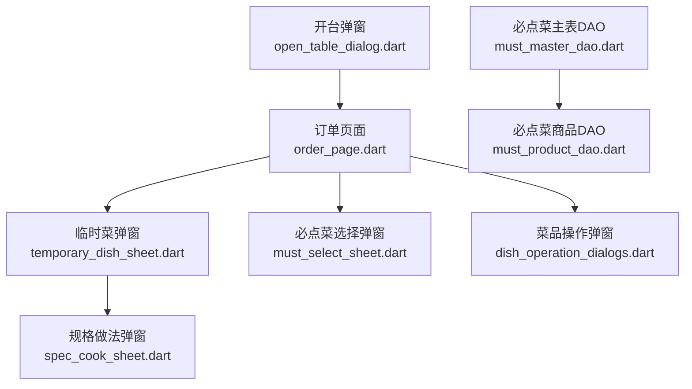
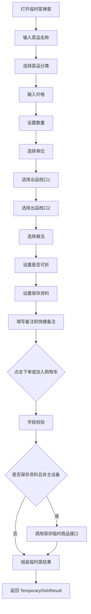
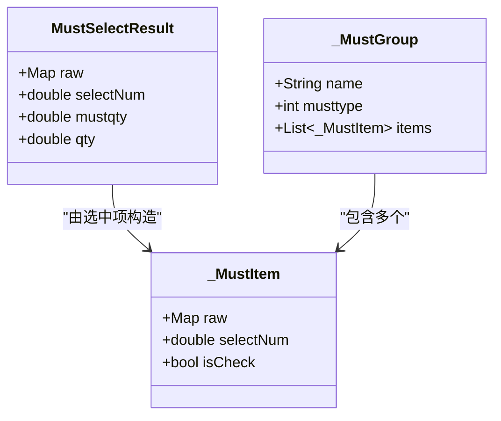
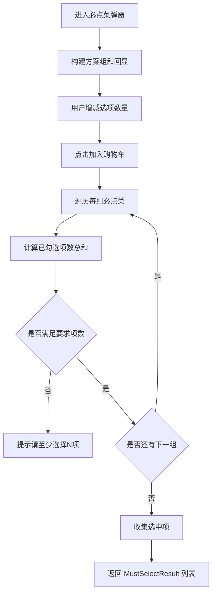
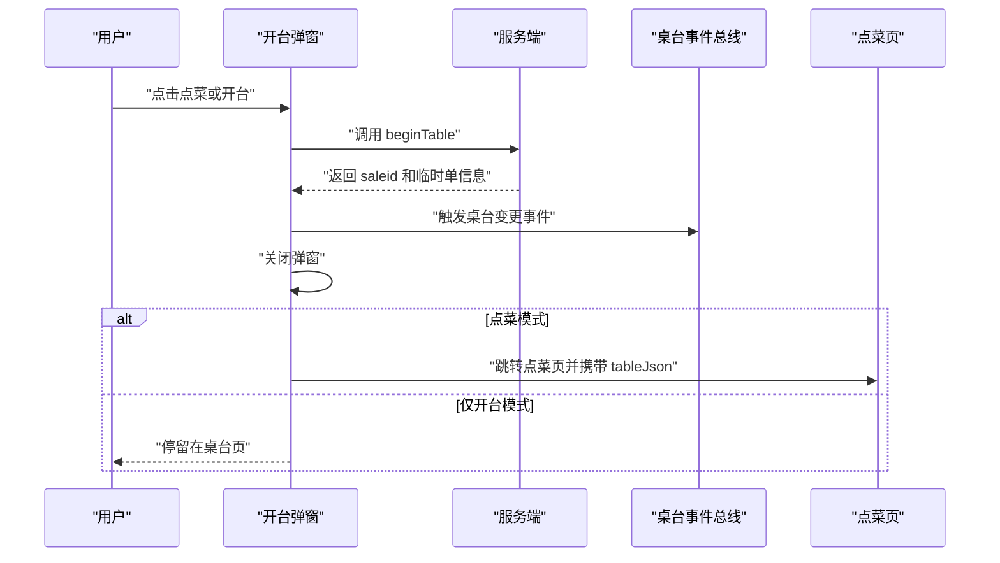
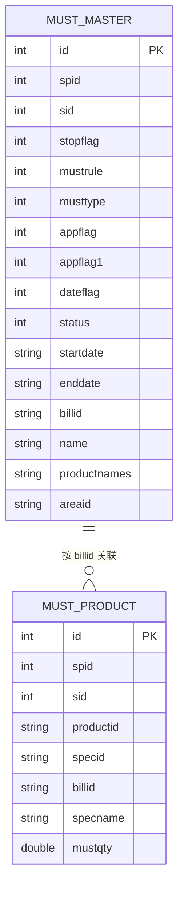
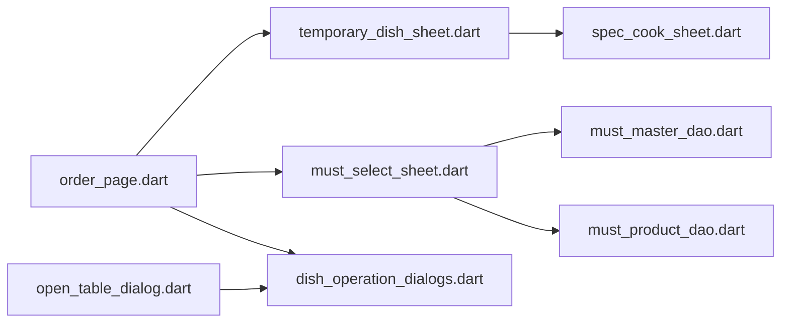

# 特殊菜品处理

<cite>
**本文引用的文件**   
- [lib/components/temporary_dish_sheet.dart](file://lib/components/temporary_dish_sheet.dart)
- [lib/components/spec_cook_sheet.dart](file://lib/components/spec_cook_sheet.dart)
- [lib/pages/order/widgets/must_select_sheet.dart](file://lib/pages/order/widgets/must_select_sheet.dart)
- [lib/db/dao/must_master_dao.dart](file://lib/db/dao/must_master_dao.dart)
- [lib/db/dao/must_product_dao.dart](file://lib/db/dao/must_product_dao.dart)
- [lib/db/entity/must_master_entity.dart](file://lib/db/entity/must_master_entity.dart)
- [lib/db/entity/must_product_entity.dart](file://lib/db/entity/must_product_entity.dart)
- [lib/components/dish_operation_dialogs.dart](file://lib/components/dish_operation_dialogs.dart)
- [lib/pages/home/table/widgets/open_table_dialog.dart](file://lib/pages/home/table/widgets/open_table_dialog.dart)
- [lib/pages/order/order_page.dart](file://lib/pages/order/order_page.dart)
</cite>

## 目录

1. [引言](#引言)
2. [项目结构与定位](#项目结构与定位)
3. [核心概念与业务边界](#核心概念与业务边界)
4. [临时菜机制](#临时菜机制)
5. [必点菜选择机制](#必点菜选择机制)
6. [桌台与菜品操作对话框](#桌台与菜品操作对话框)
7. [特殊菜品与普通菜品的差异](#特殊菜品与普通菜品的差异)
8. [数据存储结构与同步机制](#数据存储结构与同步机制)
9. [业务规则与约束条件](#业务规则与约束条件)
10. [依赖关系分析](#依赖关系分析)
11. [性能与健壮性考虑](#性能与健壮性考虑)
12. [故障排查指南](#故障排查指南)
13. [结论](#结论)

## 引言

本文围绕“特殊菜品处理”展开，重点说明三类能力：

- **临时菜**：在菜单之外快速录入名称、分类、价格、数量、做法、备注等字段，支持加入购物车或立即下单。
- **必点菜**：按区域和订单规则校验必选商品，支持每人必点和每笔订单必点两种模式，并限制每组最少选择项数。
- **桌台与菜品操作对话框**：包括开台、锁台、消台等桌台操作流程，以及打折、改价、备注、赠送等菜品操作弹窗。

这些能力共同构成点餐系统中“非标准菜单 + 强制规则 + 桌台生命周期”的特殊业务闭环。

## 项目结构与定位

特殊菜品相关代码主要分布在以下层次：

| 层次 | 主要职责 | 对应文件 |
|---|---|---|
| 交互层 | 临时菜输入、必点菜选择、桌台开台、菜品折扣/改价/备注/赠送 | `temporary_dish_sheet.dart`、`must_select_sheet.dart`、`dish_operation_dialogs.dart`、`open_table_dialog.dart` |
| 规格做法复用层 | 规格选择、做法选择、做法修改、做法加价计算 | `spec_cook_sheet.dart` |
| 数据访问层 | 必点菜主表与明细查询 | `must_master_dao.dart`、`must_product_dao.dart` |
| 数据模型层 | 必点菜主表与明细实体 | `must_master_entity.dart`、`must_product_entity.dart` |
| 业务调用层 | 点菜页触发临时菜、必点菜、开台等流程 | `order_page.dart` |

**图表来源**
- [lib/pages/order/order_page.dart](file://lib/pages/order/order_page.dart)
- [lib/components/temporary_dish_sheet.dart](file://lib/components/temporary_dish_sheet.dart)
- [lib/pages/order/widgets/must_select_sheet.dart](file://lib/pages/order/widgets/must_select_sheet.dart)
- [lib/components/dish_operation_dialogs.dart](file://lib/components/dish_operation_dialogs.dart)
- [lib/pages/home/table/widgets/open_table_dialog.dart](file://lib/pages/home/table/widgets/open_table_dialog.dart)
- [lib/components/spec_cook_sheet.dart](file://lib/components/spec_cook_sheet.dart)
- [lib/db/dao/must_master_dao.dart](file://lib/db/dao/must_master_dao.dart)
- [lib/db/dao/must_product_dao.dart](file://lib/db/dao/must_product_dao.dart)

**章节来源**
- [lib/pages/order/order_page.dart:1669-1933](file://lib/pages/order/order_page.dart#L1669-L1933)
- [lib/pages/home/table/widgets/open_table_dialog.dart:1-280](file://lib/pages/home/table/widgets/open_table_dialog.dart#L1-L280)

## 核心概念与业务边界

### 临时菜

临时菜是“不在常规菜单中、由服务员现场录入”的菜品。它不是普通商品库中的产品，而是以临时记录形式参与购物车和下单。其关键字段包括：

| 字段 | 含义 | 业务说明 |
|---|---|---|
| 名称 | 临时菜名 | 必填，默认值为“临时菜”，可修改 |
| 分类ID与名称 | 所属分类 | 必填，用于归类 |
| 价格 | 售价 | 必填，需为数值 |
| 数量 | 购买份数 | 必填，最小为1，最大999.99 |
| 单位 | 计量单位 | 必填 |
| 出品档口1、2 | 厨打方案 | 必填，首项固定“不打印” |
| 是否可折 | 打折标记 | 影响结算折扣逻辑 |
| 做法描述 | 做法文本 | 可选，复用规格做法弹窗 |
| 做法整份加价 | ptype=1 的做法加价 | 不乘商品数量 |
| 做法数量加价合计 | ptype=2 的做法加价 | 单份口径，已乘做法数量 |
| 备注 | 自定义备注 + 快捷备注拼接 | 支持多选快捷备注 |
| 是否去下单页 | 加入购物车或立即下单 | 控制确认按钮行为 |

### 必点菜

必点菜是后台配置的业务规则，要求某些商品必须在点餐时选择。系统区分两类：

| 类型 | musttype | 含义 |
|---|---:|---|
| 每人必点一份 | 0 | 每组至少选择的人数等于桌台人数 |
| 每笔订单必点一份 | 1 | 每组至少选择1项 |

每个必点商品还包含 `mustqty`，表示“每份必点数量”。购物车最终数量为“选项数 × 每份必点数量”。

### 特殊菜品与普通菜品的区别

| 维度 | 普通菜品 | 特殊菜品（临时菜） |
|---|---|---|
| 数据来源 | 商品库 / 分类 / 规格 | 用户手动录入 |
| 是否需要选择规格 | 通常需要 | 不需要，但支持附加做法 |
| 是否需要选择分类 | 通常已有分类 | 必须选择分类 |
| 价格来源 | 商品价格 | 用户输入 |
| 库存与售罄状态 | 可能受库存和售罄控制 | 不受普通商品库存控制 |
| 保存资料 | 一般不需要 | 可选择保存到商品资料 |
| 厨打方案 | 通常跟随商品 | 需要显式选择两个出品档口 |
| 备注 | 通常走通用备注 | 支持快捷备注标签拼接 |

**章节来源**
- [lib/components/temporary_dish_sheet.dart:21-120](file://lib/components/temporary_dish_sheet.dart#L21-L120)
- [lib/pages/order/widgets/must_select_sheet.dart:1-60](file://lib/pages/order/widgets/must_select_sheet.dart#L1-L60)
- [lib/db/entity/must_master_entity.dart:1-111](file://lib/db/entity/must_master_entity.dart#L1-L111)
- [lib/db/entity/must_product_entity.dart:1-35](file://lib/db/entity/must_product_entity.dart#L1-L35)

## 临时菜机制

### 界面结构

临时菜弹窗是一个底部弹出表单，包含：

- 标题栏：添加临时菜、关闭按钮
- 输入区：名称、分类、价格、数量、单位、做法、是否可折、保存资料
- 备注区：自定义备注 + 快捷备注标签
- 底部按钮：下单、加入购物车

**图表来源**
- [lib/components/temporary_dish_sheet.dart:451-750](file://lib/components/temporary_dish_sheet.dart#L451-L750)
- [lib/components/temporary_dish_sheet.dart:751-1147](file://lib/components/temporary_dish_sheet.dart#L751-L1147)

### 名称、价格和备注输入

临时菜名称默认为“临时菜”，最多允许20个字符。价格通过数字输入框接收，数量通过加减按钮和输入框共同维护。备注分为两部分：

- 自定义备注：用户手动输入的文本
- 快捷备注：从本地原因表中加载 typeid 为 “06” 的备注项，支持多选，确认后以逗号拼接

注意：快捷备注在临时菜弹窗中是从本地缓存读取，而不是通过 `DishRemarkSheet`；后者是通用备注弹窗，适用于购物车中普通菜品的备注编辑。

### 分类、单位和做法

- 分类优先从本地数据表读取，若为空则回退到点菜页同源接口。
- 单位从本地数据表过滤出启用状态的记录。
- 做法复用 `SpecCookSheet.showModify`，使用全局做法列表，支持做法加价和做法数量加价。

### 保存资料逻辑

当用户勾选“保存资料”且当前不是主设备模式时，系统会：

1. 获取分类对应的条码。
2. 调用保存临时商品接口。
3. 根据返回码提示保存成功或失败。
4. 成功后继续完成临时菜提交。

该逻辑使临时菜有机会沉淀为长期商品资料，但不会阻断正常点餐流程。

### 确认流程

确认前执行以下校验：

| 校验项 | 规则 |
|---|---|
| 名称 | 不能为空 |
| 分类 | 必须选择 |
| 价格 | 必须是有效数值 |
| 数量 | 必须大于0 |
| 出品档口1 | 必须选择 |
| 出品档口2 | 必须选择 |
| 单位 | 必须选择 |
| 保存资料 | 仅非主设备模式可保存 |

校验通过后，系统组装 `TemporaryDishResult` 并返回给调用方。

**章节来源**
- [lib/components/temporary_dish_sheet.dart:21-120](file://lib/components/temporary_dish_sheet.dart#L21-L120)
- [lib/components/temporary_dish_sheet.dart:201-450](file://lib/components/temporary_dish_sheet.dart#L201-L450)
- [lib/components/temporary_dish_sheet.dart:451-750](file://lib/components/temporary_dish_sheet.dart#L451-L750)
- [lib/components/temporary_dish_sheet.dart:751-1147](file://lib/components/temporary_dish_sheet.dart#L751-L1147)

## 必点菜选择机制

### 数据结构

必点菜选择弹窗接收一组方案组，每组包含：

- 方案名称
- 必点类型：每人必点一份或每笔订单必点一份
- 商品明细列表：包含商品ID、名称、售价、必点数量等

**图表来源**
- [lib/pages/order/widgets/must_select_sheet.dart:1-60](file://lib/pages/order/widgets/must_select_sheet.dart#L1-L60)
- [lib/pages/order/widgets/must_select_sheet.dart:120-200](file://lib/pages/order/widgets/must_select_sheet.dart#L120-L200)

### 选择验证逻辑

每组必点菜都会计算“已选中项数总和”，并与“要求项数”比较：

- 如果 `musttype == 0`，要求项数为桌台人数，最少为1。
- 如果 `musttype == 1`，要求项数为1。
- 任一组的已选总数小于要求项数，则阻止提交并提示。

**图表来源**
- [lib/pages/order/widgets/must_select_sheet.dart:120-200](file://lib/pages/order/widgets/must_select_sheet.dart#L120-L200)
- [lib/pages/order/widgets/must_select_sheet.dart:201-460](file://lib/pages/order/widgets/must_select_sheet.dart#L201-L460)

### 数量限制与关联关系

- 每个必点商品有 `selectNum`，表示用户在弹窗内选择的份数。
- 每个必点商品有 `mustqty`，表示每份对应的必点数量，最小为1。
- 购物车实际数量 = `selectNum × mustqty`。
- 已选的必点菜会在弹窗初始化时按商品ID回显，避免重复选择。
- 必点菜属于“可选必点菜”，即不满足要求时弹窗拦截下单；但用户仍可通过右上角关闭取消，此时调用方应提示“可选必点菜未选择”。

**章节来源**
- [lib/pages/order/widgets/must_select_sheet.dart:1-60](file://lib/pages/order/widgets/must_select_sheet.dart#L1-L60)
- [lib/pages/order/widgets/must_select_sheet.dart:120-200](file://lib/pages/order/widgets/must_select_sheet.dart#L120-L200)
- [lib/pages/order/widgets/must_select_sheet.dart:201-460](file://lib/pages/order/widgets/must_select_sheet.dart#L201-L460)

## 桌台与菜品操作对话框

### 开台弹窗

开台弹窗负责桌台生命周期的起点。它包含：

- 人数输入
- 服务员信息
- 附加费选项
- 备注
- 点菜按钮
- 开台按钮

开台流程的核心是先调用 `beginTable`，成功后关闭弹窗；如果是“点菜”按钮，再跳转到点菜页。

**图表来源**
- [lib/pages/home/table/widgets/open_table_dialog.dart:1-280](file://lib/pages/home/table/widgets/open_table_dialog.dart#L1-L280)

### 菜品操作对话框

`dish_operation_dialogs.dart` 提供多种菜品级操作弹窗：

| 弹窗 | 主要功能 | 关键约束 |
|---|---|---|
| 打折弹窗 | 快捷折扣、折扣输入、原因选择 | 折扣范围1~100，后台要求必填时需选择或输入原因 |
| 改价弹窗 | 输入新价格 | 价格必须大于0 |
| 备注弹窗 | 快捷备注标签 + 手动备注 | 多标签拼接 |
| 赠送弹窗 | 赠送数量和原因 | 赠送数量不超过上限，后台要求必填时需选择或输入原因 |

这些弹窗都采用底部弹出样式，与临时菜、规格做法弹窗保持一致的视觉语言。

**章节来源**
- [lib/components/dish_operation_dialogs.dart:1-200](file://lib/components/dish_operation_dialogs.dart#L1-L200)
- [lib/components/dish_operation_dialogs.dart:635-1105](file://lib/components/dish_operation_dialogs.dart#L635-L1105)

## 特殊菜品与普通菜品的差异

| 对比维度 | 普通菜品 | 临时菜 | 必点菜 |
|---|---|---|---|
| 来源 | 商品库 | 用户输入 | 后台规则 + 商品库 |
| 是否可折 | 通常由商品属性决定 | 用户可设置 | 由商品自身属性决定 |
| 是否需要分类 | 通常已有 | 必须选择 | 通过商品ID关联 |
| 是否需要做法 | 通过规格做法弹窗 | 可选做法 | 不适用 |
| 是否需要厨打方案 | 通常跟随商品 | 必须选择两个档口 | 不适用 |
| 是否影响库存 | 可能影响 | 不影响 | 不影响 |
| 是否可保存资料 | 不需要 | 可选择保存 | 不需要 |
| 校验方式 | 购物车校验 | 临时菜弹窗校验 | 必点菜弹窗校验 |
| 存储位置 | 商品表 | 临时商品接口或购物车 | 必点菜主表和商品表 |

**章节来源**
- [lib/components/temporary_dish_sheet.dart:451-750](file://lib/components/temporary_dish_sheet.dart#L451-L750)
- [lib/pages/order/widgets/must_select_sheet.dart:1-60](file://lib/pages/order/widgets/must_select_sheet.dart#L1-L60)

## 数据存储结构与同步机制

### 必点菜数据模型

必点菜数据分为两层：

1. **必点菜主表**：定义规则、区域、时间、开关等元信息。
2. **必点菜商品表**：定义具体商品、规格、必点数量等明细。

**图表来源**
- [lib/db/entity/must_master_entity.dart:1-111](file://lib/db/entity/must_master_entity.dart#L1-L111)
- [lib/db/entity/must_product_entity.dart:1-35](file://lib/db/entity/must_product_entity.dart#L1-L35)

### DAO 查询语义

| DAO | 主要方法 | 查询语义 |
|---|---|---|
| `MustMasterDao` | `queryAreaZC` | 查询指定区域的正餐必点菜 |
| `MustMasterDao` | `queryAreaKC` | 查询指定区域的快餐必点菜 |
| `MustMasterDao` | `queryAreaZCALL` | 查询所有启用的必点菜 |
| `MustProductDao` | `queryAllBySpidSid` | 按商户和服务员查询全部必点菜商品 |
| `MustProductDao` | `queryByBillid` | 按必点菜单号联查商品详情 |

### 同步机制

- 必点菜主表和商品表通过 `billid` 建立关联。
- 主表查询支持日期范围和启用标志过滤。
- 商品表查询通过联表 `t_bi_product` 过滤已启用且移动端展示的商品。
- 前端必点菜选择弹窗接收的是后端已解析的方案组数据，而不是直接执行 SQL。

**章节来源**
- [lib/db/dao/must_master_dao.dart:1-78](file://lib/db/dao/must_master_dao.dart#L1-L78)
- [lib/db/dao/must_product_dao.dart:1-43](file://lib/db/dao/must_product_dao.dart#L1-L43)
- [lib/db/entity/must_master_entity.dart:1-111](file://lib/db/entity/must_master_entity.dart#L1-L111)
- [lib/db/entity/must_product_entity.dart:1-35](file://lib/db/entity/must_product_entity.dart#L1-L35)

## 业务规则与约束条件

### 临时菜规则

| 规则 | 说明 |
|---|---|
| 名称必填 | 空值时提示“请输入菜品名称” |
| 分类必填 | 空值时提示“请选择菜品分类” |
| 价格必填 | 非数值时提示“价格格式错误” |
| 数量必填且为正数 | 空值或非正数时提示“请输入菜品数量” |
| 出品档口必填 | 两个档口都必须选择 |
| 单位必填 | 空值时提示“请选择菜品单位” |
| 数量上限 | 最大999.99 |
| 主设备模式 | 不可保存资料 |
| 保存资料失败 | 不阻断临时菜提交，但会提示错误 |
| 快捷备注 | 多选后以逗号拼接，并与自定义备注合并 |

### 必点菜规则

| 规则 | 说明 |
|---|---|
| 每组至少满足要求项数 | 否则提示“请至少选择N项商品” |
| 每人必点 | 要求项数等于人数 |
| 每笔订单必点 | 要求项数为1 |
| 已选数量最小为0 | 减到0时取消勾选 |
| 购物车数量 | 选项数乘以每份必点数量 |
| 弹窗不可外部关闭 | 只能点击右上角关闭 |
| 取消关闭 | 返回 null，调用方拦截下单 |

### 桌台规则

| 规则 | 说明 |
|---|---|
| 点菜前先校验权限 | 无权限时不执行开台 |
| 开台先调 beginTable | 成功后才关闭弹窗 |
| 主设备模式 | 传递完整桌台对象 JSON |
| 云服务模式 | 传递扁平参数 |
| 开台成功后刷新桌台状态 | 触发桌台事件总线 |
| 点菜模式 | 跳转点菜页 |
| 仅开台模式 | 不跳转点菜页 |

**章节来源**
- [lib/components/temporary_dish_sheet.dart:451-750](file://lib/components/temporary_dish_sheet.dart#L451-L750)
- [lib/pages/order/widgets/must_select_sheet.dart:120-200](file://lib/pages/order/widgets/must_select_sheet.dart#L120-L200)
- [lib/pages/home/table/widgets/open_table_dialog.dart:1-280](file://lib/pages/home/table/widgets/open_table_dialog.dart#L1-L280)

## 依赖关系分析

**图表来源**
- [lib/pages/order/order_page.dart:1669-1933](file://lib/pages/order/order_page.dart#L1669-L1933)
- [lib/components/temporary_dish_sheet.dart:1-20](file://lib/components/temporary_dish_sheet.dart#L1-L20)
- [lib/pages/order/widgets/must_select_sheet.dart:1-10](file://lib/pages/order/widgets/must_select_sheet.dart#L1-L10)
- [lib/pages/home/table/widgets/open_table_dialog.dart:1-10](file://lib/pages/home/table/widgets/open_table_dialog.dart#L1-L10)

### 耦合关系说明

- `order_page.dart` 是特殊菜品能力的集中调用入口。
- `temporary_dish_sheet.dart` 复用 `spec_cook_sheet.dart` 的做法选择逻辑，避免重复实现。
- `must_select_sheet.dart` 是纯交互组件，必点菜数据由上层传入，降低与数据库层的直接耦合。
- `open_table_dialog.dart` 与 `dish_operation_dialogs.dart` 共用统一的弹窗风格和业务校验模式。

**章节来源**
- [lib/pages/order/order_page.dart:1669-1933](file://lib/pages/order/order_page.dart#L1669-L1933)
- [lib/components/temporary_dish_sheet.dart:1-20](file://lib/components/temporary_dish_sheet.dart#L1-L20)
- [lib/pages/order/widgets/must_select_sheet.dart:1-10](file://lib/pages/order/widgets/must_select_sheet.dart#L1-L10)
- [lib/pages/home/table/widgets/open_table_dialog.dart:1-10](file://lib/pages/home/table/widgets/open_table_dialog.dart#L1-L10)

## 性能与健壮性考虑

### 临时菜数据加载

临时菜弹窗在加载分类、单位、快捷备注时，统一通过 `TableDownloadManager.readTableData` 读取本地数据。这样做的原因是：

- Web 平台不支持 SQLite，直连 DAO 会抛出异常。
- 数据加载失败时采用静默处理，保证 UI 仍可显示。
- 分类为空时回退到点菜页同源接口，提高可用性。

### 做法选择复用

临时菜复用规格做法弹窗的修改模式，避免为临时菜单独实现一套做法选择逻辑。这降低了代码重复，也保证了做法加价计算的一致性。

### 必点菜弹窗不可拖拽关闭

必点菜弹窗禁用外部点击和拖拽关闭，确保用户必须显式点击右上角关闭或提交。这样可以明确表达“可选必点菜未选择”的用户意图。

### 开台防重复提交

开台弹窗在提交期间设置 `_submitting` 标志，防止重复调用 `beginTable`。

**章节来源**
- [lib/components/temporary_dish_sheet.dart:201-260](file://lib/components/temporary_dish_sheet.dart#L201-L260)
- [lib/components/spec_cook_sheet.dart:201-500](file://lib/components/spec_cook_sheet.dart#L201-L500)
- [lib/pages/order/widgets/must_select_sheet.dart:60-120](file://lib/pages/order/widgets/must_select_sheet.dart#L60-L120)
- [lib/pages/home/table/widgets/open_table_dialog.dart:180-280](file://lib/pages/home/table/widgets/open_table_dialog.dart#L180-L280)

## 故障排查指南

### 临时菜弹窗分类为空

**现象**：分类下拉没有数据。  
**可能原因**：

- 本地分类缓存为空。
- 回退接口也未返回数据。
- 分类数据被过滤掉（停止、状态、移动端展示标志）。

**排查建议**：

1. 检查本地分类数据表是否加载成功。
2. 检查点菜页分类接口是否正常。
3. 检查分类筛选条件是否正确。

**章节来源**
- [lib/components/temporary_dish_sheet.dart:201-260](file://lib/components/temporary_dish_sheet.dart#L201-L260)

### 保存临时菜资料失败

**现象**：勾选保存资料后提示保存失败，但临时菜仍可提交。  
**可能原因**：

- 获取条码失败。
- 后端返回非成功码。
- 网络请求异常。

**排查建议**：

1. 检查分类条码是否能正确获取。
2. 检查保存临时商品接口的返回码和消息。
3. 确认当前不是主设备模式。

**章节来源**
- [lib/components/temporary_dish_sheet.dart:451-750](file://lib/components/temporary_dish_sheet.dart#L451-L750)

### 必点菜无法提交

**现象**：点击“加入购物车”后提示某组未满足要求。  
**可能原因**：

- 某组已选总数小于要求项数。
- 每人必点模式下人数为0或未正确传入。
- 用户取消了弹窗但未正确处理返回结果。

**排查建议**：

1. 检查每组已选总数和 requiredNum。
2. 检查桌台人数是否为正数。
3. 检查调用方对 null 返回的处理逻辑。

**章节来源**
- [lib/pages/order/widgets/must_select_sheet.dart:120-200](file://lib/pages/order/widgets/must_select_sheet.dart#L120-L200)

### 开台后未跳转点菜页

**现象**：点击“点菜”后只开台，没有进入点菜页。  
**可能原因**：

- beginTable 调用失败。
- goOrder 参数未正确传递。
- 桌面状态未更新。

**排查建议**：

1. 检查 beginTable 返回结果。
2. 检查 open_table_dialog.dart 中 goOrder 分支。
3. 检查桌台事件总线是否触发。

**章节来源**
- [lib/pages/home/table/widgets/open_table_dialog.dart:180-280](file://lib/pages/home/table/widgets/open_table_dialog.dart#L180-L280)

## 结论

特殊菜品处理在该项目中由三个相对独立但相互协作的模块组成：

- **临时菜**解决“菜单之外也能点菜”的问题，强调快速录入、灵活备注和可保存资料。
- **必点菜**解决“业务规则强制消费”的问题，强调分组校验、人数关联和购物车数量换算。
- **桌台与菜品操作对话框**解决“桌台生命周期和菜品附加值”的问题，强调开台前置校验、折扣改价、备注和赠送的统一交互体验。

这三者共同服务于餐厅点餐场景中的“非标准订单元素”，既保留灵活性，又通过明确的校验规则和数据结构保证业务一致性。