# 规格与做法管理

<cite>
**本文引用的文件**   
- [spec_cook_sheet.dart](file://lib/components/spec_cook_sheet.dart)
- [cut_model_sheet.dart](file://lib/components/cut_model_sheet.dart)
- [store_mode_utils.dart](file://lib/util/store_mode_utils.dart)
- [spec_bottom_sheet.dart](file://lib/pages/order/widgets/spec_bottom_sheet.dart)
- [order_models.dart](file://lib/pages/order/order_models.dart)
- [order_repository.dart](file://lib/pages/order/order_repository.dart)
- [product_spec_entity.dart](file://lib/db/entity/product_spec_entity.dart)
- [cook_info_entity.dart](file://lib/db/entity/cook_info_entity.dart)
- [cook_group_entity.dart](file://lib/db/entity/cook_group_entity.dart)
- [product_spec_dao.dart](file://lib/db/dao/product_spec_dao.dart)
- [cook_info_dao.dart](file://lib/db/dao/cook_info_dao.dart)
- [local_cache_service.dart](file://lib/util/local_cache_service.dart)
</cite>

## 目录

1. [引言](#引言)
2. [项目结构定位](#项目结构定位)
3. [核心组件总览](#核心组件总览)
4. [架构与数据流](#架构与数据流)
5. [多级规格选择器](#多级规格选择器)
6. [做法选择器与做法组合](#做法选择器与做法组合)
7. [切配模式处理机制](#切配模式处理机制)
8. [规格数据加载与本地缓存](#规格数据加载与本地缓存)
9. [UI 交互示例](#ui-交互示例)
10. [规格验证规则与错误提示](#规格验证规则与错误提示)
11. [依赖关系分析](#依赖关系分析)
12. [性能与可维护性建议](#性能与可维护性建议)
13. [常见问题排查](#常见问题排查)
14. [结论](#结论)

## 引言

本文件面向“规格与做法管理系统”，聚焦以下目标：

- 说明多级规格选择器的展示、默认选中、选项切换与售罄处理。
- 解释做法选择器的分组、单选、多选、可重复数量、必选校验和价格累加。
- 文档化切配模式（正餐/快餐）的弹窗选择与模式持久化。
- 说明规格与做法数据的数据库实体、DAO 查询方式，以及轻量级本地缓存策略。
- 给出规格选择的 UI 交互示例，包括底部弹窗、手势操作、库存限制与键盘避让场景。
- 整理规格与做法的验证规则、错误提示来源及提交数据结构。

需要特别说明的是：当前仓库中“切配模式”的业务含义是门店商业模式的切换（正餐/快餐），而不是物理意义上的重量切配或克重计算。因此，“重量计算、单位转换和价格调整”在本实现中主要通过商品单价、规格加价、做法加价和商品数量来体现，而非专门的重量换算模块。

## 项目结构定位

规格与做法相关代码分布在 Flutter 应用的三个层次：

| 层次 | 职责 | 关键文件 |
|---|---|---|
| UI 层 | 规格弹窗、做法弹窗、切配模式弹窗、简单规格抽屉 | `spec_cook_sheet.dart`、`cut_model_sheet.dart`、`spec_bottom_sheet.dart` |
| 模型与业务层 | 已选做法快照、规格组、商品模型、下单提交数据 | `order_models.dart`、`order_repository.dart` |
| 数据层 | 规格实体、做法实体、做法分组实体、DAO 查询、本地缓存 | `product_spec_entity.dart`、`cook_info_entity.dart`、`cook_group_entity.dart`、`product_spec_dao.dart`、`cook_info_dao.dart`、`local_cache_service.dart` |

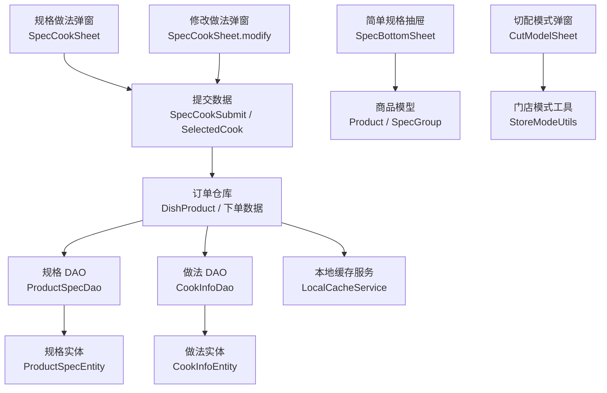

**图表来源**
- [spec_cook_sheet.dart:1-120](file://lib/components/spec_cook_sheet.dart#L1-L120)
- [spec_bottom_sheet.dart:1-60](file://lib/pages/order/widgets/spec_bottom_sheet.dart#L1-L60)
- [cut_model_sheet.dart:1-30](file://lib/components/cut_model_sheet.dart#L1-L30)
- [order_models.dart:1-120](file://lib/pages/order/order_models.dart#L1-L120)
- [order_repository.dart:1-120](file://lib/pages/order/order_repository.dart#L1-L120)
- [product_spec_dao.dart:1-30](file://lib/db/dao/product_spec_dao.dart#L1-L30)
- [cook_info_dao.dart:1-20](file://lib/db/dao/cook_info_dao.dart#L1-L20)
- [local_cache_service.dart:1-40](file://lib/util/local_cache_service.dart#L1-L40)

**章节来源**
- [spec_cook_sheet.dart:1-120](file://lib/components/spec_cook_sheet.dart#L1-L120)
- [spec_bottom_sheet.dart:1-60](file://lib/pages/order/widgets/spec_bottom_sheet.dart#L1-L60)
- [cut_model_sheet.dart:1-30](file://lib/components/cut_model_sheet.dart#L1-L30)
- [order_models.dart:1-120](file://lib/pages/order/order_models.dart#L1-L120)
- [order_repository.dart:1-120](file://lib/pages/order/order_repository.dart#L1-L120)
- [product_spec_dao.dart:1-30](file://lib/db/dao/product_spec_dao.dart#L1-L30)
- [cook_info_dao.dart:1-20](file://lib/db/dao/cook_info_dao.dart#L1-L20)
- [local_cache_service.dart:1-40](file://lib/util/local_cache_service.dart#L1-L40)

## 核心组件总览

### 规格与做法统一弹窗

`SpecCookSheet` 是规格与做法的核心 UI 组件，支持两种模式：

| 模式 | 入口 | 主要能力 |
|---|---|---|
| 加购模式 | 点菜页点击“选规格” | 显示商品图、规格网格、做法分组、数量、立即下单、加入购物车 |
| 修改模式 | 购物车条目“修改做法” | 仅做法选择，支持私有做法和全局做法 Tab、回显已选做法、确认修改 |

该组件对外暴露两个静态方法：

- `show`：用于加购模式，回调返回 `SpecCookSubmit`。
- `showModify`：用于修改模式，返回 `CookModifyResult` 或空值。

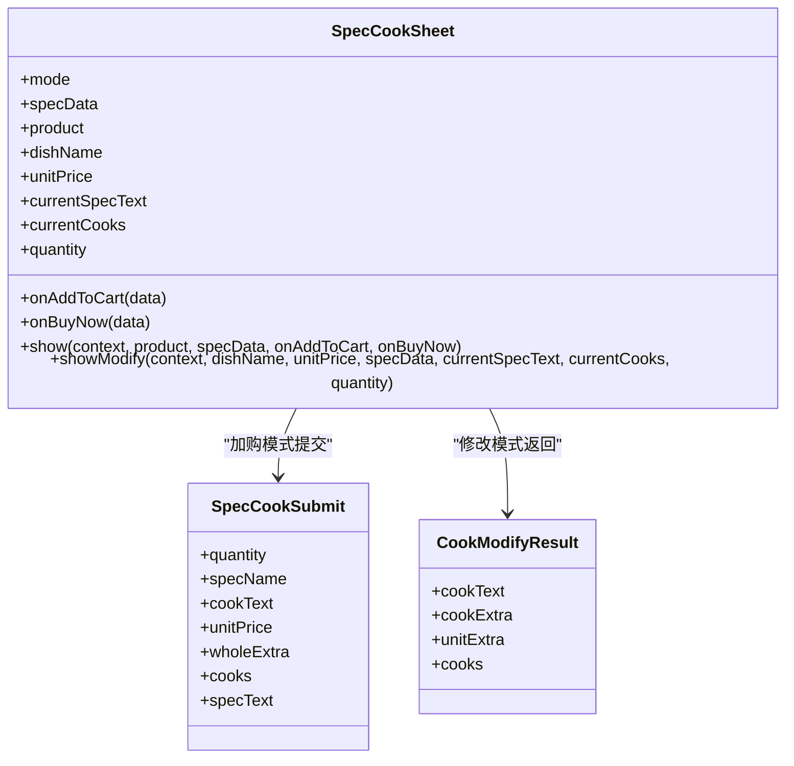

**图表来源**
- [spec_cook_sheet.dart:1-120](file://lib/components/spec_cook_sheet.dart#L1-L120)

**章节来源**
- [spec_cook_sheet.dart:1-120](file://lib/components/spec_cook_sheet.dart#L1-L120)

### 简单规格选择抽屉

`SpecBottomSheet` 是一个更轻量的规格选择组件，适用于已有 `Product` 模型、规格以 `SpecGroup` 列表呈现的场景。它负责：

- 初始化每组规格的默认选中项。
- 渲染规格组与选项 Chip。
- 计算当前规格加价合计、当前单价、划线原价。
- 提供数量加减。
- 提交时调用 `onAddToCart` 或 `onBuyNow`。

**章节来源**
- [spec_bottom_sheet.dart:1-120](file://lib/pages/order/widgets/spec_bottom_sheet.dart#L1-L120)
- [spec_bottom_sheet.dart:201-497](file://lib/pages/order/widgets/spec_bottom_sheet.dart#L201-L497)

### 切配模式弹窗

`CutModelSheet` 负责切换门店商业模式，对应“切配模式”这一业务术语。其选项为：

| 模式 | 值 | 含义 |
|---|---:|---|
| 快餐模式 | 1 | 快捷点餐 |
| 正餐模式 | 2 | 桌台点餐、正餐场景 |
| 配送模式 | 3 | 目前隐藏入口，暂不开放 |

该弹窗打开时会读取当前模式，用户选择后先关闭弹窗，再调用 `onSelected` 回调，避免回调中跳转路由导致页面栈异常。

**章节来源**
- [cut_model_sheet.dart:1-162](file://lib/components/cut_model_sheet.dart#L1-L162)
- [store_mode_utils.dart:1-65](file://lib/util/store_mode_utils.dart#L1-L65)

## 架构与数据流

### 规格做法选择流程

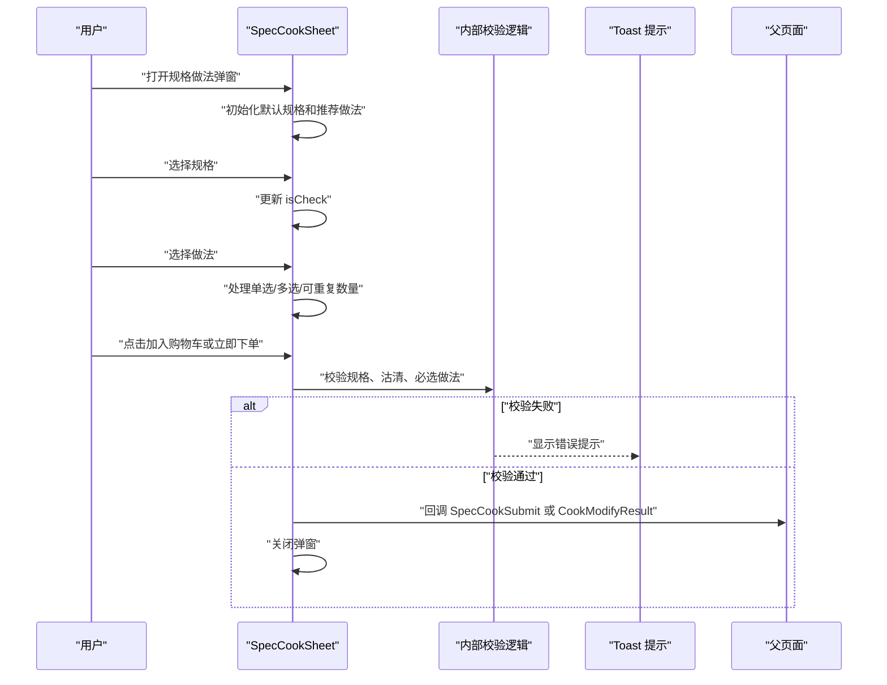

**图表来源**
- [spec_cook_sheet.dart:201-300](file://lib/components/spec_cook_sheet.dart#L201-L300)
- [spec_cook_sheet.dart:551-620](file://lib/components/spec_cook_sheet.dart#L551-L620)
- [spec_cook_sheet.dart:1251-1584](file://lib/components/spec_cook_sheet.dart#L1251-L1584)

### 规格数据加载流程

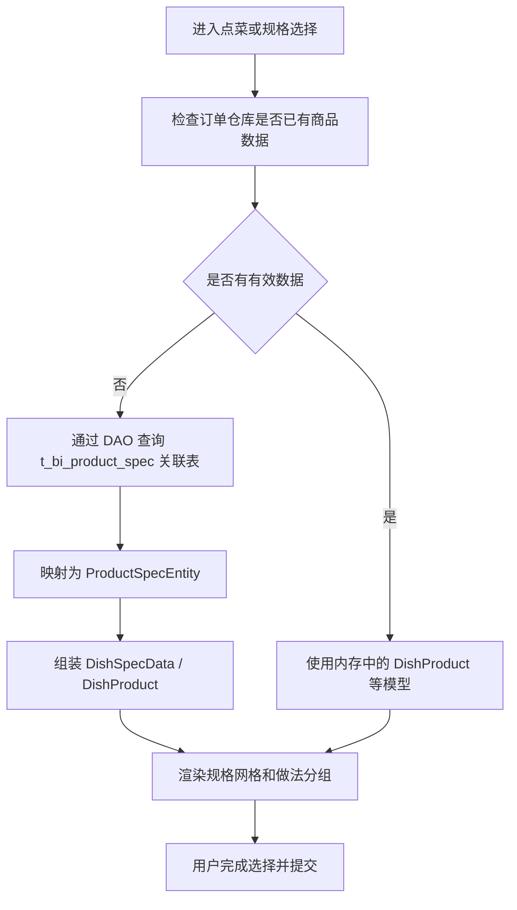

**图表来源**
- [product_spec_dao.dart:1-69](file://lib/db/dao/product_spec_dao.dart#L1-L69)
- [product_spec_entity.dart:1-83](file://lib/db/entity/product_spec_entity.dart#L1-L83)
- [order_repository.dart:1-120](file://lib/pages/order/order_repository.dart#L1-L120)

**章节来源**
- [spec_cook_sheet.dart:201-300](file://lib/components/spec_cook_sheet.dart#L201-L300)
- [product_spec_dao.dart:1-69](file://lib/db/dao/product_spec_dao.dart#L1-L69)
- [product_spec_entity.dart:1-83](file://lib/db/entity/product_spec_entity.dart#L1-L83)
- [order_repository.dart:1-120](file://lib/pages/order/order_repository.dart#L1-L120)

## 多级规格选择器

### 规格数据结构

在简单规格场景中，规格以 `SpecGroup` 列表表示，每个组包含多个 `SpecOption`：

| 字段 | 含义 |
|---|---|
| `name` | 规格组名称 |
| `options` | 规格选项列表 |
| `defaultIndex` | 默认选中下标 |
| `extraPrice` | 选项加价 |
| `isRecommend` | 是否显示“推荐”角标 |

在完整的规格做法场景中，规格来自后端数据，封装为 `DishSpec`，并由 `SpecCookSheet` 控制选中状态 `isCheck`、售罄状态 `isSoldOut`、默认规格 `defsizeflag`、沽清标识 `sellclearflag`、库存 `stockqty` 等。

**章节来源**
- [order_models.dart:1-120](file://lib/pages/order/order_models.dart#L1-L120)
- [spec_cook_sheet.dart:201-300](file://lib/components/spec_cook_sheet.dart#L201-L300)

### 默认选择逻辑

加购模式下，`SpecCookSheet` 会按以下顺序确定默认规格：

1. 如果已有 `isCheck=true` 的规格，则保持默认选中。
2. 否则优先选择 `defsizeflag=1` 且未售罄的规格。
3. 若没有符合规则的默认规格，则选择第一个可用的非售罄规格。

对于做法，默认选择推荐且未售罄的做法项，并设置数量为 1。

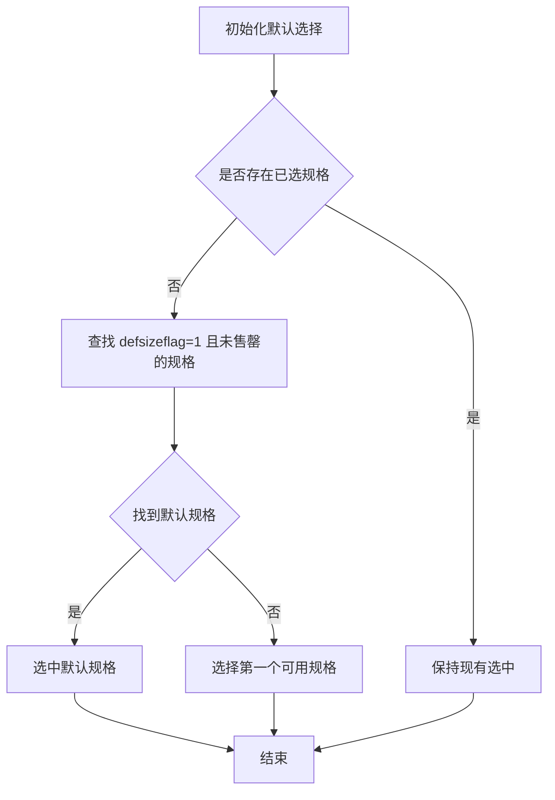

**图表来源**
- [spec_cook_sheet.dart:201-280](file://lib/components/spec_cook_sheet.dart#L201-L280)

**章节来源**
- [spec_cook_sheet.dart:201-280](file://lib/components/spec_cook_sheet.dart#L201-L280)

### 规格选项交互

- 规格为单选。
- 已售罄规格不可选中，点击后会提示“已售罄”。
- 已售罄规格在网格中以灰底或暗色背景显示，并标注剩余数量或“已售罄”。
- 规格选择后立即刷新界面状态。

**章节来源**
- [spec_cook_sheet.dart:280-360](file://lib/components/spec_cook_sheet.dart#L280-L360)
- [spec_cook_sheet.dart:980-1080](file://lib/components/spec_cook_sheet.dart#L980-L1080)

## 做法选择器与做法组合

### 做法数据结构

做法数据由以下实体组成：

| 实体 | 关键字段 | 作用 |
|---|---|---|
| `CookInfoEntity` | `ptype`、`maximum`、`maximumflag`、`mandatoryflag`、`mandatoryqty`、`editqtyflag`、`price`、`code`、`cookname`、`cupstickercode` | 单个做法的加价类型、可选数量限制、必选规则、编码、杯贴码等 |
| `CookGroupEntity` | `groupid`、`name`、`editqtyflag`、`gisort` | 做法分组名称、排序、是否允许修改做法数量 |
| `ProductSpecEntity` | `specid`、`specname`、`sellprice`、`defsizeflag`、`sellclearflag`、`stockqty` | 规格与销售价、默认规格、沽清、库存 |

**章节来源**
- [cook_info_entity.dart:1-96](file://lib/db/entity/cook_info_entity.dart#L1-L96)
- [cook_group_entity.dart:1-47](file://lib/db/entity/cook_group_entity.dart#L1-L47)
- [product_spec_entity.dart:1-83](file://lib/db/entity/product_spec_entity.dart#L1-L83)

### 做法分组与 Tab

在修改模式下，`SpecCookSheet` 支持：

- 私有做法 Tab。
- 全局做法 Tab。
- 当私有做法为空、全局做法有效时，自动固定显示全局做法。
- 只有当私有做法和全局做法都存在时才显示 Tab。

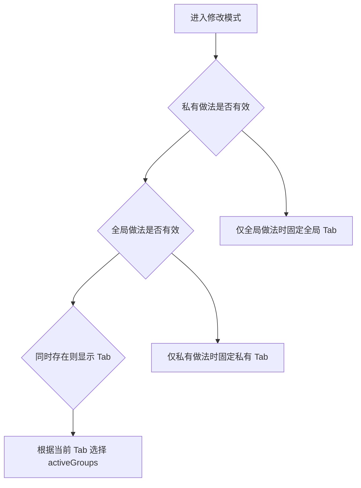

**图表来源**
- [spec_cook_sheet.dart:430-520](file://lib/components/spec_cook_sheet.dart#L430-L520)

**章节来源**
- [spec_cook_sheet.dart:430-520](file://lib/components/spec_cook_sheet.dart#L430-L520)

### 做法选择规则

做法选择分为三种主要情况：

| 场景 | 行为 |
|---|---|
| 售罄做法 | 不可选，点击提示“已售罄” |
| 单选模式 | 取消其他选项，选中当前；如开启数量编辑，则最多只能有一个选项被选中并可增加数量 |
| 多选模式 | 可多次点击自增数量；超过最大数量时可触发上限提示或取消最早选中项 |

具体逻辑如下：

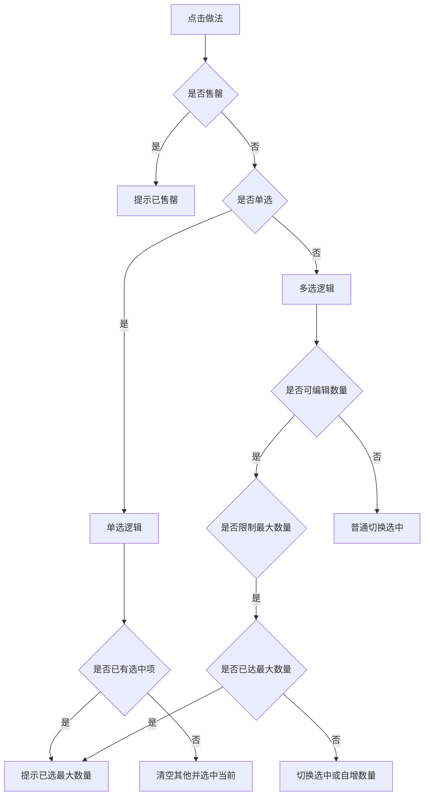

**图表来源**
- [spec_cook_sheet.dart:360-460](file://lib/components/spec_cook_sheet.dart#L360-L460)

**章节来源**
- [spec_cook_sheet.dart:360-460](file://lib/components/spec_cook_sheet.dart#L360-L460)

### 做法组合与价格累加

做法加价类型 `ptype` 决定价格计算方式：

| ptype | 含义 | 价格计算影响 |
|---:|---|---|
| 0 | 不加价 | 不影响单价 |
| 1 | 整份加价 | 直接累加到整份加价，不乘商品数量 |
| 2 | 数量加价 | 按单份口径累加，最终总价乘以商品数量 |

`SpecCookSheet` 提供两类加价属性：

- `_wholeExtraPrice`：整份加价合计。
- `_unitExtraPrice`：数量加价合计。

在加购模式中：

- 单份实际价格 = 规格价 + 数量加价。
- 总价 = 单份价格 × 数量 + 整份加价。
- 划线原价用于对比折扣。

在修改模式中：

- 底部“做法加价”显示整份加价与数量加价之和，其中数量加价部分会乘以当前商品数量。

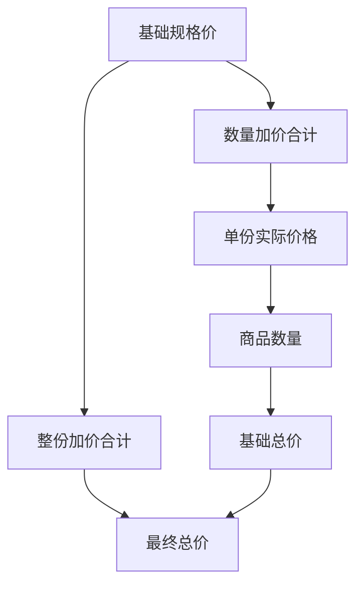

**图表来源**
- [spec_cook_sheet.dart:300-430](file://lib/components/spec_cook_sheet.dart#L300-L430)
- [spec_cook_sheet.dart:1500-1584](file://lib/components/spec_cook_sheet.dart#L1500-L1584)

**章节来源**
- [spec_cook_sheet.dart:300-430](file://lib/components/spec_cook_sheet.dart#L300-L430)
- [spec_cook_sheet.dart:1500-1584](file://lib/components/spec_cook_sheet.dart#L1500-L1584)

### 已选做法明细

已选做法会被封装为 `SelectedCook`，用于下单上传 `cooklist`。关键字段包括：

- `name`：做法名称。
- `code`：做法编码。
- `cupstickercode`：杯贴码。
- `price`：做法加价金额。
- `ptype`：加价类型。
- `qty`：做法数量。

**章节来源**
- [order_models.dart:1-120](file://lib/pages/order/order_models.dart#L1-L120)
- [spec_cook_sheet.dart:360-430](file://lib/components/spec_cook_sheet.dart#L360-L430)

## 切配模式处理机制

### 切配模式定义

当前代码中的“切配模式”实际上是门店商业模式，由 `StoreModeUtils` 管理：

| 常量 | 值 | 含义 |
|---:|---|---|
| `storeModelFast` | 1 | 快餐模式 |
| `storeModelNormal` | 2 | 正餐模式 |

### 切配模式弹窗

`CutModelSheet` 打开时：

1. 从 `StoreModeUtils.getCurrentStoreModel()` 读取当前模式。
2. 在 UI 中高亮当前选中模式。
3. 用户点击选项后先关闭弹窗。
4. 调用 `onSelected(mode)` 回调，由上层保存新模式和触发后续业务变化。

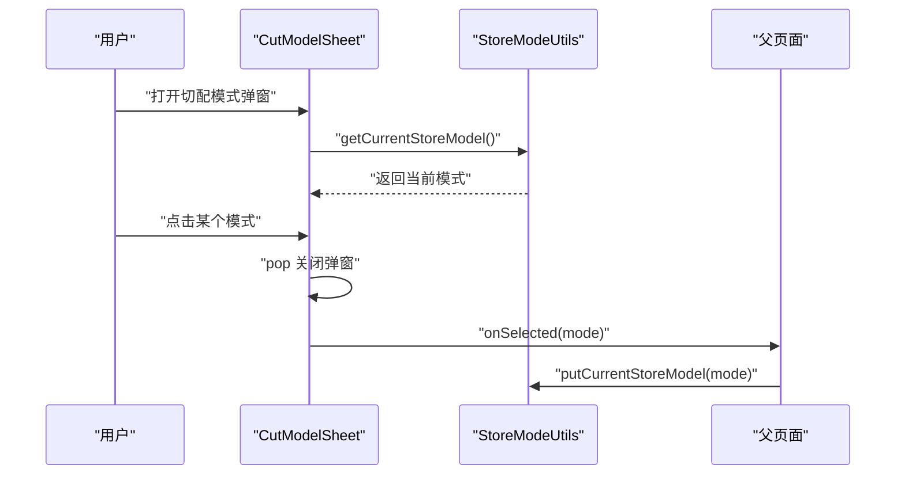

**图表来源**
- [cut_model_sheet.dart:1-162](file://lib/components/cut_model_sheet.dart#L1-L162)
- [store_mode_utils.dart:1-65](file://lib/util/store_mode_utils.dart#L1-L65)

**章节来源**
- [cut_model_sheet.dart:1-162](file://lib/components/cut_model_sheet.dart#L1-L162)
- [store_mode_utils.dart:1-65](file://lib/util/store_mode_utils.dart#L1-L65)

### 重量、单位与价格调整

仓库中没有专门的重量换算模块。重量和单位的业务语义体现在商品模型和规格模型中：

- `DishProduct.unit`：商品单位，例如“份”。
- `DishProduct.weighflag`：称重菜标识。
- `ProductSpecEntity.sellprice`：规格销售价。
- `SpecOption.extraPrice`：简单规格选项加价。
- `CookInfoEntity.price`：做法加价。
- `SpecCookSubmit.unitPrice`：加购时的单份价格。
- `SpecCookSubmit.wholeExtra`：整份加价。
- `CookModifyResult.cookExtra`：修改模式整份加价。
- `CookModifyResult.unitExtra`：修改模式数量加价。

因此，“重量计算、单位转换和价格调整”在当前实现中表现为：

- 单位来自商品或规格数据。
- 价格由基础售价、规格加价、做法加价、商品数量共同构成。
- 如需真正的重量换算，应扩展商品模型和定价逻辑，而不是复用现有的规格/做法价格字段。

**章节来源**
- [order_repository.dart:1-120](file://lib/pages/order/order_repository.dart#L1-L120)
- [product_spec_entity.dart:1-83](file://lib/db/entity/product_spec_entity.dart#L1-L83)
- [order_models.dart:1-120](file://lib/pages/order/order_models.dart#L1-L120)
- [spec_cook_sheet.dart:300-430](file://lib/components/spec_cook_sheet.dart#L300-L430)

## 规格数据加载与本地缓存

### 规格数据加载

规格数据通过 `ProductSpecDao` 查询，核心 SQL 联表 `t_bi_product_spec` 与 `t_bi_spec`，并按分店 `spid`、门店 `sid`、商品 `productid` 过滤。

| 查询方法 | 用途 |
|---|---|
| `querySpecInfo` | 按 `spid`、`sid`、`productid` 查询规格详情 |
| `querySpecInfoSpid` | 按 `spid`、`productid` 查询，不过滤 `sid` |
| `queryBySpecid` | 按 `productid`、`specid`、`spid`、`sid` 查询单个规格 |

DAO 会过滤规格状态和停用状态，保证只返回有效的规格数据。

**章节来源**
- [product_spec_dao.dart:1-69](file://lib/db/dao/product_spec_dao.dart#L1-L69)
- [product_spec_entity.dart:1-83](file://lib/db/entity/product_spec_entity.dart#L1-L83)

### 做法数据加载

`CookInfoDao` 提供：

- 按 code 查询单个做法。
- 批量查询做法。
- 重置所有记录状态。

查询条件会过滤 `stopflag=0` 且 `status=1`，确保只返回有效做法。

**章节来源**
- [cook_info_dao.dart:1-41](file://lib/db/dao/cook_info_dao.dart#L1-L41)
- [cook_info_entity.dart:1-96](file://lib/db/entity/cook_info_entity.dart#L1-L96)

### 本地缓存机制

`LocalCacheService` 使用 `SharedPreferences` 实现轻量级缓存，支持弱网或离线场景读取关键数据。当前支持的缓存类型包括：

| 数据类型 | 缓存键前缀或键名 | 用途 |
|---|---|---|
| 商品列表 | `cache_product_list` | 缓存商品 JSON 列表 |
| 分类列表 | `cache_category_list` | 缓存分类 JSON 列表 |
| 桌台列表 | `cache_table_list` | 缓存桌台 JSON 列表 |
| 支付方式列表 | `cache_payway_list` | 缓存支付方式 JSON 列表 |

注意：当前本地缓存服务没有专门针对“规格”和“做法”的独立缓存键，但商品列表缓存可作为规格与做法数据的基础数据来源。

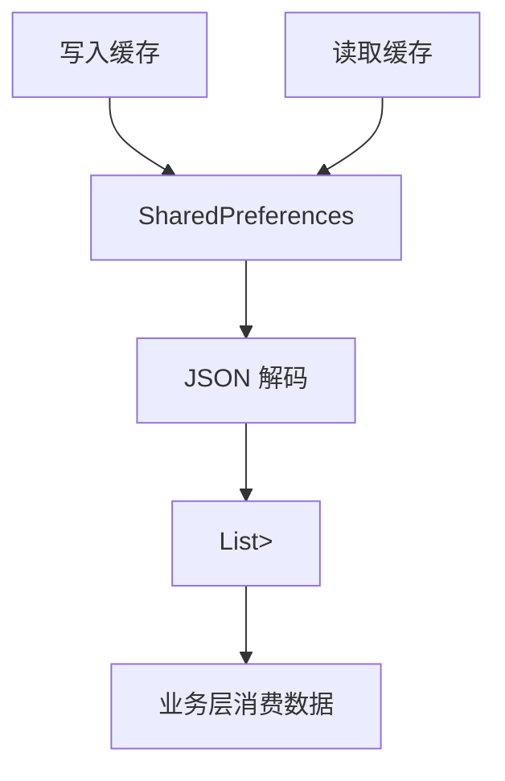

**图表来源**
- [local_cache_service.dart:1-137](file://lib/util/local_cache_service.dart#L1-L137)

**章节来源**
- [local_cache_service.dart:1-137](file://lib/util/local_cache_service.dart#L1-L137)

## UI 交互示例

### 规格选择弹窗

#### 加购模式

1. 顶部显示商品图片、名称、单位、价格。
2. 中间显示规格网格和做法分组。
3. 底部显示数量控制器、总价、立即下单和加入购物车按钮。
4. 规格网格按三列布局，已售罄规格禁用。
5. 做法分组支持单选、多选和可重复数量。
6. 支持深色主题。

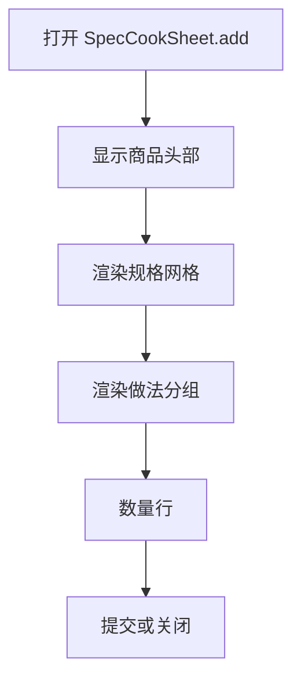

**图表来源**
- [spec_cook_sheet.dart:620-900](file://lib/components/spec_cook_sheet.dart#L620-L900)
- [spec_cook_sheet.dart:901-1250](file://lib/components/spec_cook_sheet.dart#L901-L1250)
- [spec_cook_sheet.dart:1251-1584](file://lib/components/spec_cook_sheet.dart#L1251-L1584)

#### 修改模式

1. 顶部显示“做法--菜品名称”和当前单价。
2. 如果有私有做法和全局做法，则显示 Tab。
3. 内容区只显示当前 Tab 对应的做法分组。
4. 底部显示做法加价合计和“确认修改”按钮。
5. 支持按 `code` 精确回显已选做法。

**章节来源**
- [spec_cook_sheet.dart:201-280](file://lib/components/spec_cook_sheet.dart#L201-L280)
- [spec_cook_sheet.dart:430-520](file://lib/components/spec_cook_sheet.dart#L430-L520)
- [spec_cook_sheet.dart:901-1000](file://lib/components/spec_cook_sheet.dart#L901-L1000)
- [spec_cook_sheet.dart:1500-1584](file://lib/components/spec_cook_sheet.dart#L1500-L1584)

### 简单规格抽屉

`SpecBottomSheet` 更适合没有复杂做法、只需要基础规格选择的场景：

1. 顶部显示商品名称、描述、价格和图片。
2. 滚动区域显示规格组和选项 Chip。
3. 底部显示数量加减、规格描述、总价和原价。
4. 提供“下单”和“加入购物车”两个操作。

**章节来源**
- [spec_bottom_sheet.dart:1-200](file://lib/pages/order/widgets/spec_bottom_sheet.dart#L1-L200)
- [spec_bottom_sheet.dart:201-497](file://lib/pages/order/widgets/spec_bottom_sheet.dart#L201-L497)

### 手势与键盘适配

| 交互 | 实现方式 |
|---|---|
| 点击规格 | `GestureDetector` 触发 `_onSpecTap` |
| 点击做法 | `GestureDetector` 触发 `_onCookTap` |
| 做法减号 | `_onCookMinus` 减少数量或取消选中 |
| 数量加减 | 底部数量控制器，带库存限制 |
| 关闭弹窗 | 右上角关闭按钮或 `Navigator.pop` |
| 弹窗动画 | 加购模式使用滑入动画，修改模式无滑入动画 |
| 键盘避让 | 弹窗使用 `SafeArea` 和 `MediaQuery.padding.bottom`，避免输入法遮挡底部按钮 |

**章节来源**
- [spec_cook_sheet.dart:620-900](file://lib/components/spec_cook_sheet.dart#L620-L900)
- [spec_cook_sheet.dart:1251-1584](file://lib/components/spec_cook_sheet.dart#L1251-L1584)
- [spec_bottom_sheet.dart:201-497](file://lib/pages/order/widgets/spec_bottom_sheet.dart#L201-L497)

## 规格验证规则与错误提示

### 规格验证

| 规则 | 条件 | 提示 |
|---|---|---|
| 必须选择规格 | 有规格数据但未选中任何规格 | “请选择规格” |
| 沽清数量不足 | 启用沽清且选择数量大于库存 | “沽清数量不足” |
| 规格数量超限 | 点击加号时超过规格或商品库存 | “最大数量X” |

**章节来源**
- [spec_cook_sheet.dart:551-620](file://lib/components/spec_cook_sheet.dart#L551-L620)
- [spec_cook_sheet.dart:1251-1350](file://lib/components/spec_cook_sheet.dart#L1251-L1350)

### 做法验证

| 规则 | 条件 | 提示 |
|---|---|---|
| 必选做法组未满足 | 做法组 `mandatoryflag=1` 且选中数量小于 `mandatoryqty` | “做法组X至少选择Y项” |
| 已售罄做法 | 做法 `sellclearflag=1` | “已售罄” |
| 已达最大数量 | 多选模式达到 `maximum` 且不允许继续增加 | “已选最大数量” |

**章节来源**
- [spec_cook_sheet.dart:360-460](file://lib/components/spec_cook_sheet.dart#L360-L460)
- [spec_cook_sheet.dart:551-620](file://lib/components/spec_cook_sheet.dart#L551-L620)

### 提交数据结构

#### 加购模式

提交对象为 `SpecCookSubmit`，包含：

- `quantity`：商品数量。
- `specName`：已选规格名。
- `cookText`：做法描述文本。
- `unitPrice`：单份价格。
- `wholeExtra`：整份加价。
- `cooks`：已选做法明细。

#### 修改模式

返回对象为 `CookModifyResult`，包含：

- `cookText`：做法描述文本。
- `cookExtra`：整份加价。
- `unitExtra`：数量加价。
- `cooks`：已选做法明细。

**章节来源**
- [spec_cook_sheet.dart:1-120](file://lib/components/spec_cook_sheet.dart#L1-L120)
- [spec_cook_sheet.dart:551-620](file://lib/components/spec_cook_sheet.dart#L551-L620)
- [order_models.dart:1-120](file://lib/pages/order/order_models.dart#L1-L120)

## 依赖关系分析

### 组件耦合关系

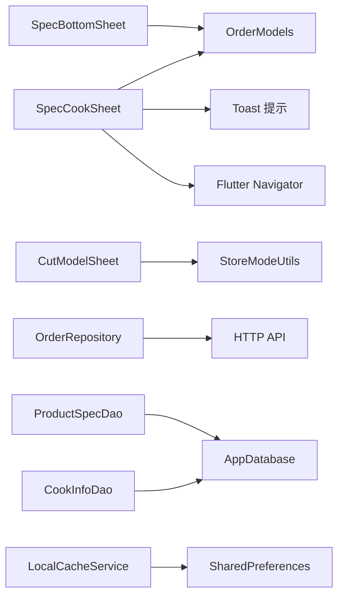

**图表来源**
- [spec_cook_sheet.dart:1-120](file://lib/components/spec_cook_sheet.dart#L1-L120)
- [spec_bottom_sheet.dart:1-60](file://lib/pages/order/widgets/spec_bottom_sheet.dart#L1-L60)
- [cut_model_sheet.dart:1-30](file://lib/components/cut_model_sheet.dart#L1-L30)
- [order_repository.dart:1-60](file://lib/pages/order/order_repository.dart#L1-L60)
- [product_spec_dao.dart:1-20](file://lib/db/dao/product_spec_dao.dart#L1-L20)
- [cook_info_dao.dart:1-20](file://lib/db/dao/cook_info_dao.dart#L1-L20)
- [local_cache_service.dart:1-40](file://lib/util/local_cache_service.dart#L1-L40)

**章节来源**
- [spec_cook_sheet.dart:1-120](file://lib/components/spec_cook_sheet.dart#L1-L120)
- [spec_bottom_sheet.dart:1-60](file://lib/pages/order/widgets/spec_bottom_sheet.dart#L1-L60)
- [cut_model_sheet.dart:1-30](file://lib/components/cut_model_sheet.dart#L1-L30)
- [order_repository.dart:1-60](file://lib/pages/order/order_repository.dart#L1-L60)
- [product_spec_dao.dart:1-20](file://lib/db/dao/product_spec_dao.dart#L1-L20)
- [cook_info_dao.dart:1-20](file://lib/db/dao/cook_info_dao.dart#L1-L20)
- [local_cache_service.dart:1-40](file://lib/util/local_cache_service.dart#L1-L40)

### 外部依赖

| 依赖 | 用途 |
|---|---|
| `flutter/material.dart` | Flutter UI 组件 |
| `cached_network_image` | 规格商品图片缓存 |
| `sp_util` | 本地偏好存储，用于缓存和模式持久化 |
| `toast_utils` | 用户提示 |
| `app_database` | 底层数据库访问 |

**章节来源**
- [spec_cook_sheet.dart:1-20](file://lib/components/spec_cook_sheet.dart#L1-L20)
- [local_cache_service.dart:1-20](file://lib/util/local_cache_service.dart#L1-L20)
- [store_mode_utils.dart:1-20](file://lib/util/store_mode_utils.dart#L1-L20)

## 性能与可维护性建议

### 性能建议

1. **规格网格渲染**：规格网格使用 `Wrap`，适合少量规格；如果规格数量很大，应考虑分页或虚拟列表。
2. **做法分组渲染**：做法分组使用 `GridView.builder`，可避免一次性构建大量控件。
3. **图片加载**：规格商品图使用 `CachedNetworkImage`，避免重复网络请求。
4. **弹窗动画**：加购模式使用滑入动画，修改模式省略动画以减少开销。
5. **本地缓存**：当前缓存基于 `SharedPreferences`，适合轻量数据；如果规格和做法数据量增长，建议引入 `sqflite` 或 `drift` 做结构化缓存。

### 可维护性建议

1. **规格与做法逻辑集中**：当前 `SpecCookSheet` 承担较多职责，未来可拆分为规格选择器、做法选择器和价格计算器。
2. **验证规则抽象**：可将规格验证、做法验证、库存验证提取为独立服务。
3. **错误提示统一**：当前错误提示使用 `Toast.show`，可考虑统一错误消息枚举。
4. **数据模型分层**：当前既有 `Product`/`SpecGroup` 也有 `DishProduct`/`DishSpec`/`DishCook`，建议明确业务模型与 UI 模型的边界。

[本节为通用建议，不直接分析具体代码片段]

## 常见问题排查

| 问题 | 可能原因 | 排查方向 |
|---|---|---|
| 规格无法选中 | 规格已售罄或状态无效 | 检查 `isSoldOut`、`sellclearflag`、`status` |
| 必选做法未提示 | 做法组未配置 `mandatoryflag` 或 `mandatoryqty` | 检查 `CookInfoEntity.mandatoryflag`、`mandatoryqty` |
| 做法数量无法增加 | 已达到最大数量或已售罄 | 检查 `maximum`、`maximumflag`、`sellclearflag` |
| 总价不对 | 整份加价与数量加价混淆 | 检查 `ptype=1` 和 `ptype=2` 的累加逻辑 |
| 切配模式未生效 | 未调用 `StoreModeUtils.putCurrentStoreModel` | 检查 `CutModelSheet.onSelected` 回调 |
| 规格数据为空 | DAO 查询参数错误或数据停用 | 检查 `spid`、`sid`、`productid`、`status`、`stopflag` |
| 本地缓存读取失败 | JSON 格式损坏或 key 不一致 | 检查 `LocalCacheService._readList` 日志 |

**章节来源**
- [spec_cook_sheet.dart:360-460](file://lib/components/spec_cook_sheet.dart#L360-L460)
- [spec_cook_sheet.dart:551-620](file://lib/components/spec_cook_sheet.dart#L551-L620)
- [cook_info_entity.dart:1-96](file://lib/db/entity/cook_info_entity.dart#L1-L96)
- [product_spec_dao.dart:1-69](file://lib/db/dao/product_spec_dao.dart#L1-L69)
- [local_cache_service.dart:1-137](file://lib/util/local_cache_service.dart#L1-L137)

## 结论

本项目的规格与做法管理系统围绕 `SpecCookSheet` 展开，将规格选择、做法选择、数量控制和价格计算集中在一个弹窗组件中，并通过 `SpecCookSubmit` 和 `CookModifyResult` 区分加购与修改两种业务路径。

核心特性包括：

- 多级规格默认选择与售罄保护。
- 做法分组、单选、多选、可重复数量和必选校验。
- 整份加价与数量加价分离的价格体系。
- 切配模式作为门店商业模式切换，而非重量换算。
- 基于 DAO 的规格与做法数据加载。
- 基于 `SharedPreferences` 的轻量级本地缓存。

未来可在数据模型分层、验证规则抽象、缓存结构化和重量换算方面进一步增强，以提升可维护性和扩展性。