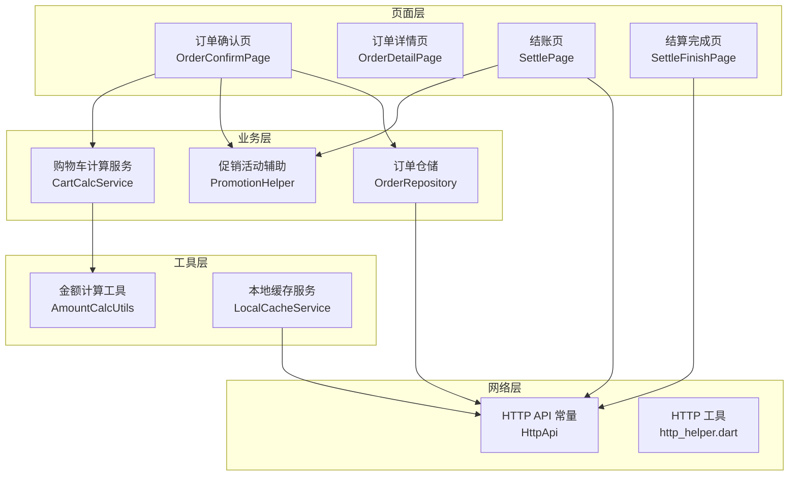
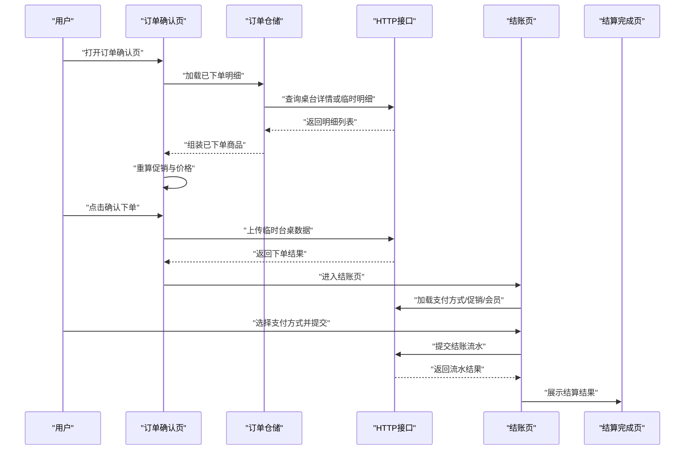
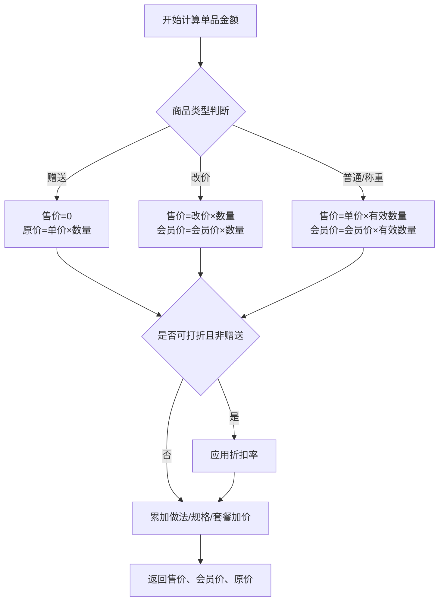
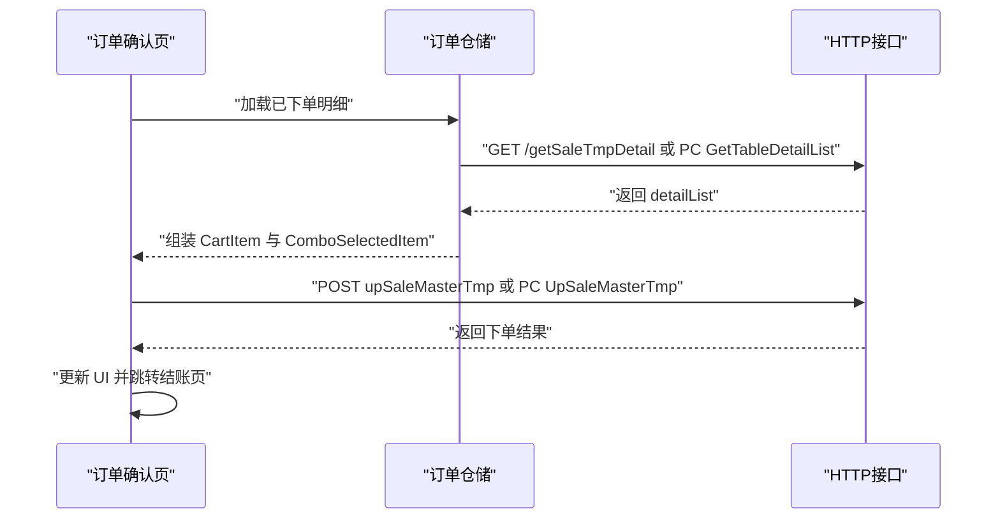
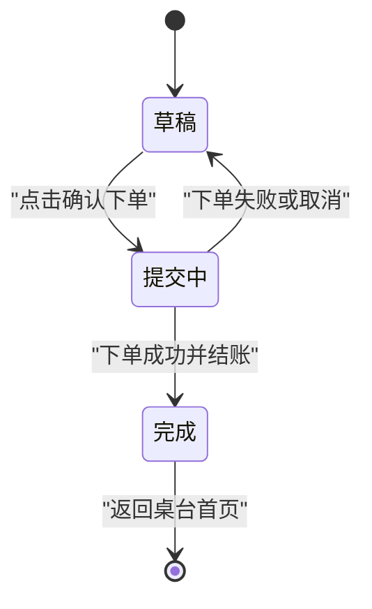
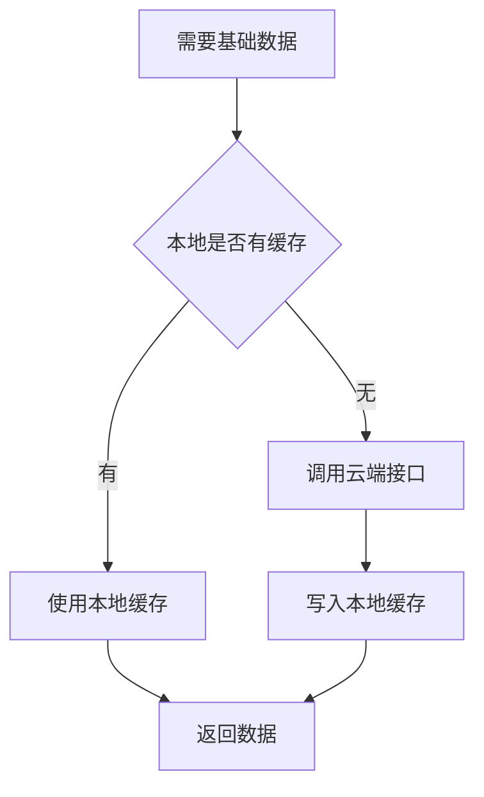
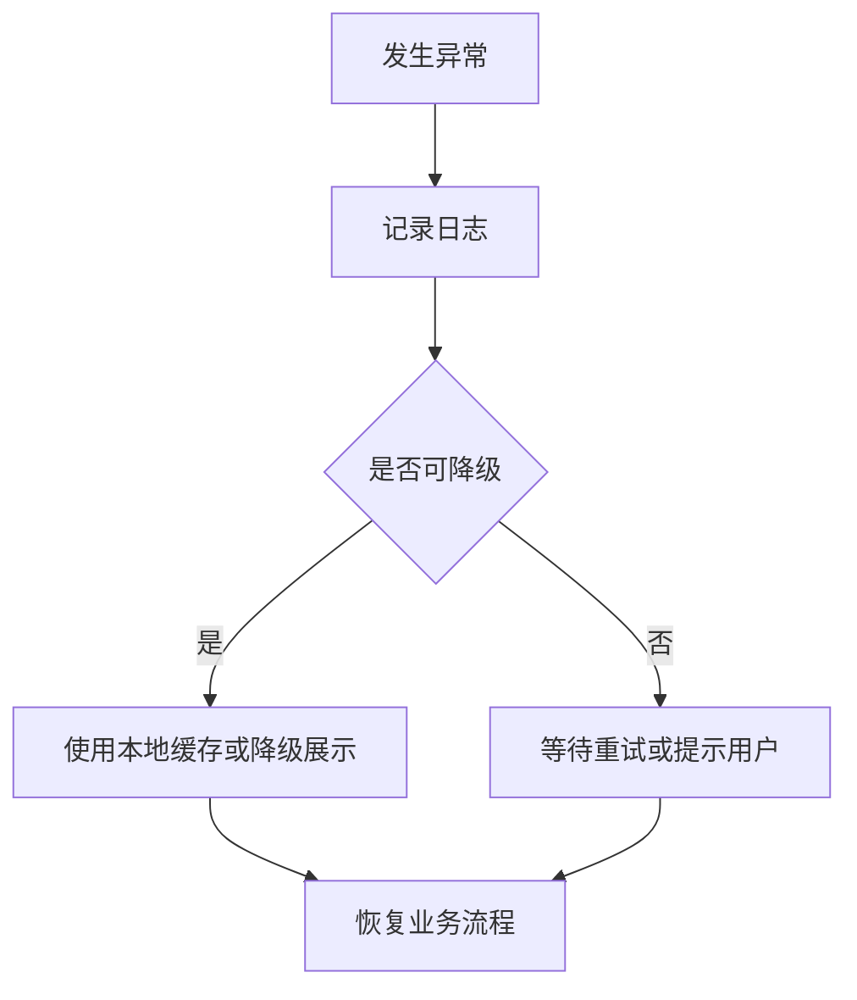

# 订单确认流程

<cite>
**本文引用的文件**   
- [lib/pages/order/order_confirm_page.dart](file://lib/pages/order/order_confirm_page.dart)
- [lib/pages/order/order_models.dart](file://lib/pages/order/order_models.dart)
- [lib/pages/order/order_repository.dart](file://lib/pages/order/order_repository.dart)
- [lib/pages/order/settle_page.dart](file://lib/pages/order/settle_page.dart)
- [lib/pages/order/settle_finish_page.dart](file://lib/pages/order/settle_finish_page.dart)
- [lib/util/cart_calc_service.dart](file://lib/util/cart_calc_service.dart)
- [lib/util/promotion_helper.dart](file://lib/util/promotion_helper.dart)
- [lib/util/local_cache_service.dart](file://lib/util/local_cache_service.dart)
- [lib/net/http_api.dart](file://lib/net/http_api.dart)
- [lib/util/amount_calc_utils.dart](file://lib/util/amount_calc_utils.dart)
</cite>

## 目录
1. [引言](#引言)
2. [项目结构与职责边界](#项目结构与职责边界)
3. [核心组件总览](#核心组件总览)
4. [架构总览](#架构总览)
5. [订单确认页数据组装与价格计算](#订单确认页数据组装与价格计算)
6. [订单提交流程：校验、接口与响应处理](#订单提交流程校验接口与响应处理)
7. [订单状态管理：草稿、提交中、完成](#订单状态管理草稿提交中完成)
8. [数据持久化策略：本地存储与云端同步](#数据持久化策略本地存储与云端同步)
9. [UI交互设计：表单验证、错误提示与用户反馈](#ui交互设计表单验证错误提示与用户反馈)
10. [异常场景与重试机制](#异常场景与重试机制)
11. [性能与健壮性建议](#性能与健壮性建议)
12. [结论](#结论)

## 引言
本文面向餐饮点单收银系统的“订单确认”环节，围绕以下目标展开：
- 解释订单确认页面的数据组装逻辑，包括商品信息汇总、优惠计算和最终价格确认。
- 说明订单从确认到结账的完整提交流程，包括数据校验、API调用与响应处理。
- 文档化订单状态管理，覆盖草稿保存、提交中和完成状态切换。
- 说明订单相关数据的本地缓存与云端同步策略。
- 梳理订单确认相关的UI交互设计，包括表单校验、错误提示和用户反馈。
- 分析异常场景与重试机制，给出可操作的排障建议。

本说明尽量使用仓库中的实际代码结构、模型字段与接口路径进行映射，帮助开发者与测试人员理解现有实现，并为后续扩展提供依据。

## 项目结构与职责边界
订单确认相关代码主要分布在 `lib/pages/order`、`lib/util` 和 `lib/net` 三个层次：
- 页面层：负责用户界面、交互、状态展示和页面间跳转。
- 业务逻辑层：负责促销计算、购物车金额计算、会员与优惠券处理等。
- 网络与仓储层：负责 API 常量定义、请求封装、桌台与订单数据获取。
- 工具层：金额计算、本地缓存、权限与打印等服务。

**图表来源**
- [lib/pages/order/order_confirm_page.dart:1-200](file://lib/pages/order/order_confirm_page.dart#L1-L200)
- [lib/pages/order/settle_page.dart:1-200](file://lib/pages/order/settle_page.dart#L1-L200)
- [lib/util/cart_calc_service.dart:1-120](file://lib/util/cart_calc_service.dart#L1-L120)
- [lib/util/promotion_helper.dart:1-120](file://lib/util/promotion_helper.dart#L1-L120)
- [lib/pages/order/order_repository.dart:1800-2111](file://lib/pages/order/order_repository.dart#L1800-L2111)
- [lib/net/http_api.dart:1-200](file://lib/net/http_api.dart#L1-L200)
- [lib/util/local_cache_service.dart:1-137](file://lib/util/local_cache_service.dart#L1-L137)

**章节来源**
- [lib/pages/order/order_confirm_page.dart:1-200](file://lib/pages/order/order_confirm_page.dart#L1-L200)
- [lib/pages/order/settle_page.dart:1-200](file://lib/pages/order/settle_page.dart#L1-L200)
- [lib/net/http_api.dart:1-200](file://lib/net/http_api.dart#L1-L200)

## 核心组件总览
| 组件 | 职责 | 关键行为 | 相关入口 |
|---|---|---|---|
| `OrderConfirmPage` | 订单确认页 UI 与下单前数据处理 | 加载待下单与已下单商品、重算促销、生成明细、发起下单 | `order_confirm_page.dart` |
| `OrderRepository` | 订单与菜品数据仓储 | 获取桌台详情、必点菜、做法沽清、临时未落单菜 | `order_repository.dart` |
| `SettlePage` | 结账页 UI 与支付准备 | 加载支付方式、应用促销与会员价、选择支付方式、提交流水 | `settle_page.dart` |
| `SettleFinishPage` | 结算完成页 UI | 展示订单号、实收、找零、支付方式、取餐号 | `settle_finish_page.dart` |
| `CartCalcService` | 购物车金额计算 | 单品计价、购物车总价、低消金额计算 | `cart_calc_service.dart` |
| `PromotionHelper` | 促销活动解析与应用 | 活动匹配、买赠满赠、满减满折、整单优惠 | `promotion_helper.dart` |
| `AmountCalcUtils` | 金额精度与低消服务费计算 | 抹零、低消差、服务费、四则运算 | `amount_calc_utils.dart` |
| `LocalCacheService` | 本地缓存 | 商品、分类、桌台、支付方式缓存 | `local_cache_service.dart` |
| `HttpApi` | 接口路径常量 | 桌台、下单、结账、会员、支付、参数等接口 | `http_api.dart` |

**章节来源**
- [lib/pages/order/order_confirm_page.dart:1-200](file://lib/pages/order/order_confirm_page.dart#L1-L200)
- [lib/pages/order/order_repository.dart:1-200](file://lib/pages/order/order_repository.dart#L1-L200)
- [lib/pages/order/settle_page.dart:1-200](file://lib/pages/order/settle_page.dart#L1-L200)
- [lib/util/cart_calc_service.dart:1-120](file://lib/util/cart_calc_service.dart#L1-L120)
- [lib/util/promotion_helper.dart:1-120](file://lib/util/promotion_helper.dart#L1-L120)
- [lib/util/local_cache_service.dart:1-137](file://lib/util/local_cache_service.dart#L1-L137)
- [lib/net/http_api.dart:1-200](file://lib/net/http_api.dart#L1-L200)

## 架构总览
订单确认流程涉及多个页面协作：
1. 订单确认页汇总购物车与已下单商品，执行基础促销校验与第N份拆行。
2. 点击确认后，进入订单详情页或根据快餐模式直接跳转到结账页。
3. 结账页加载支付方式，支持会员录入、促销活动、抹零、暂结等业务。
4. 提交结账流水后，进入结算完成页展示结果并返回桌台首页。

**图表来源**
- [lib/pages/order/order_confirm_page.dart:200-524](file://lib/pages/order/order_confirm_page.dart#L200-L524)
- [lib/pages/order/order_repository.dart:1800-2111](file://lib/pages/order/order_repository.dart#L1800-L2111)
- [lib/pages/order/settle_page.dart:200-611](file://lib/pages/order/settle_page.dart#L200-L611)
- [lib/net/http_api.dart:1-200](file://lib/net/http_api.dart#L1-L200)

## 订单确认页数据组装与价格计算
### 数据组成
订单确认页维护两类商品集合：
- 待下单商品：来自购物车，支持编辑数量、规格、做法、套餐子项。
- 已下单商品：从桌台已有订单加载，包含主行与套餐子行，支持划菜、挂起、打包、团购核销等状态展示。

核心数据结构包括：
- `CartItem`：购物车商品项，含售价、数量、会员价、赠送标志、称重数量、折扣率、最低消费标志等。
- `Product`：商品基础信息，含名称、单价、规格组、会员价、厨打标记、标签标记等。
- `ComboSelectedItem`：套餐子项快照，含商品ID、名称、数量、加价、规格名、厨打标记等。

这些结构在订单确认页用于展示与计算，同时作为上传订单时的明细基础。

**章节来源**
- [lib/pages/order/order_models.dart:1-200](file://lib/pages/order/order_models.dart#L1-L200)
- [lib/util/cart_calc_service.dart:1-120](file://lib/util/cart_calc_service.dart#L1-L120)

### 价格计算逻辑
购物车金额由 `CartCalcService` 统一计算，规则如下：
- 赠送商品：售价为0，原价按单价乘以赠送数量记录。
- 改价商品：售价按改价乘以数量，会员价按会员价乘以数量。
- 普通或称重商品：售价按单价乘以有效数量；会员价按会员价乘以数量。
- 折扣：仅对可打折且非赠送商品生效，按折扣率计算折后价。
- 加价：做法、规格、套餐加价单独累加到售价与原价。
- 总金额：遍历购物车逐项累加售价、会员价与原价。
- 低消金额：排除赠送、数量为0、不计入低消的商品以及套餐子商品。

**图表来源**
- [lib/util/cart_calc_service.dart:1-120](file://lib/util/cart_calc_service.dart#L1-L120)

**章节来源**
- [lib/util/cart_calc_service.dart:1-200](file://lib/util/cart_calc_service.dart#L1-L200)
- [lib/util/amount_calc_utils.dart:1-200](file://lib/util/amount_calc_utils.dart#L1-L200)

### 促销校验与第N份拆行
订单确认页进入时会重新校验基础促销：
- 初始化促销管理器，强制刷新促销数据。
- 若商品缺少分类ID，从本地商品库回填。
- 对每个待下单商品重新套用基础促销，确保“促/折扣”标签与折后价一致。
- 针对第N份促销，根据已下单商品占用整单上限的情况，重新计算拆行。

该流程保证加购时可能漏套促销的场景在确认页得到修复。

**章节来源**
- [lib/pages/order/order_confirm_page.dart:1-200](file://lib/pages/order/order_confirm_page.dart#L1-L200)

## 订单提交流程：校验、接口与响应处理
### 数据校验
订单确认页在提交前会进行多项校验：
- 防重复点击：通过 `_isOrdering` 防止用户重复确认。
- 促销校验失败：记录日志并回退，不中断其他流程。
- 已下单明细缺失：按产品ID从本地商品库回填组合标志，避免套餐主行识别失败。
- 锁台事件：当其他设备锁台或退出时，自动返回桌台首页并刷新桌台状态。

### API调用
订单确认页与仓储层协同调用接口：
- 加载已下单明细：
  - 主设备模式：`/api/table/GetTableDetailList`，参数为 `tablemaster` JSON。
  - 云服务模式：`/YttSvr/app/sale/getSaleTmpDetail`，参数为 `saleid`。
- 上传临时台桌数据（下单）：
  - 主设备模式：`/api/table/UpSaleMasterTmp`。
  - 云服务模式：`/YttSvr/app/sale/upSaleMasterTmp`。

接口路径常量由 `HttpApi` 统一管理，便于环境切换与联调。

### 响应处理
- 已下单明细解析：
  - 主设备响应使用 `Data`，云服务响应使用 `data`。
  - 将明细行转换为 `CartItem`，恢复规格、做法、备注、划菜、挂起、打包、团购核销等状态。
  - 套餐主行与子行归组，无法关联的子行降级为普通行展示，避免静默丢失。
- 下单响应：
  - 成功时进入结账页；失败时记录日志并提示用户。
  - 若服务端返回结构异常，仓储层记录日志以便排查。

**图表来源**
- [lib/pages/order/order_confirm_page.dart:200-524](file://lib/pages/order/order_confirm_page.dart#L200-L524)
- [lib/pages/order/order_repository.dart:1800-2111](file://lib/pages/order/order_repository.dart#L1800-L2111)
- [lib/net/http_api.dart:1-200](file://lib/net/http_api.dart#L1-L200)

**章节来源**
- [lib/pages/order/order_confirm_page.dart:200-524](file://lib/pages/order/order_confirm_page.dart#L200-L524)
- [lib/pages/order/order_repository.dart:1800-2111](file://lib/pages/order/order_repository.dart#L1800-L2111)
- [lib/net/http_api.dart:1-200](file://lib/net/http_api.dart#L1-L200)

## 订单状态管理：草稿、提交中、完成
### 草稿保存
- 订单确认页维护 `_pendingItems` 与 `_orderedItems`，分别代表待下单与已下单商品。
- 主设备模式下，可通过 `/api/Table/SaveProduct` 保存桌台未落单菜品，作为草稿缓冲。
- 仓储层提供 `fetchSaveProductList`，在主设备模式下读取已保存的未落单菜品。

### 提交中
- 订单确认页通过 `_isOrdering` 控制“是否正在下单”，防止重复点击。
- 结账页通过 `_submitting` 控制“是否正在提交结账”，并在提交前校验桌台状态。
- 结账页在提交前调用桌台并发守卫检查桌台是否仍为待结算状态，避免其他设备清台或换单导致虚假流水。

### 完成
- 结账成功后进入 `SettleFinishPage`，展示订单号、实收、找零、支付方式、取餐号等信息。
- 完成后返回桌台首页，并通过 `TableEventBus.fireTableChanged()` 刷新桌台状态。

**图表来源**
- [lib/pages/order/order_confirm_page.dart:1-200](file://lib/pages/order/order_confirm_page.dart#L1-L200)
- [lib/pages/order/settle_page.dart:200-611](file://lib/pages/order/settle_page.dart#L200-L611)
- [lib/pages/order/settle_finish_page.dart:1-200](file://lib/pages/order/settle_finish_page.dart#L1-L200)

**章节来源**
- [lib/pages/order/order_repository.dart:1800-2111](file://lib/pages/order/order_repository.dart#L1800-L2111)
- [lib/pages/order/settle_page.dart:200-611](file://lib/pages/order/settle_page.dart#L200-L611)
- [lib/pages/order/settle_finish_page.dart:1-200](file://lib/pages/order/settle_finish_page.dart#L1-L200)

## 数据持久化策略：本地存储与云端同步
### 本地缓存
`LocalCacheService` 使用 SharedPreferences 实现轻量级缓存，覆盖以下数据：
- 商品列表：对应 `t_bi_product`。
- 分类列表：对应 `t_bi_type`。
- 桌台列表：对应 `t_table_info`。
- 支付方式列表：对应 `t_bi_payway`。

缓存读写采用 JSON 序列化，失败时记录日志并返回空列表，保证弱网或离线场景下仍可读取基础数据。

### 云端同步
- 商品、分类、桌台、支付方式等基础数据优先从本地缓存读取，必要时从云端拉取并更新缓存。
- 订单相关数据（如订单详情、结账流水）走云端接口，确保交易一致性。
- 必点菜数据优先从 tabledown 本地表读取，失败时再尝试云端接口。

**图表来源**
- [lib/util/local_cache_service.dart:1-137](file://lib/util/local_cache_service.dart#L1-L137)
- [lib/pages/order/order_repository.dart:1800-2111](file://lib/pages/order/order_repository.dart#L1800-L2111)

**章节来源**
- [lib/util/local_cache_service.dart:1-137](file://lib/util/local_cache_service.dart#L1-L137)
- [lib/pages/order/order_repository.dart:1800-2111](file://lib/pages/order/order_repository.dart#L1800-L2111)

## UI交互设计：表单验证、错误提示与用户反馈
### 表单验证
- 购物车商品数量、规格、做法、套餐子项在进入确认页时已由点菜页完成基本校验。
- 确认页进一步校验促销有效性、第N份拆行、必点菜与最低消费。
- 结账页校验会员录入、支付方式选择、促销适用性与抹零金额。

### 错误提示
- 促销校验失败：记录日志并提示用户，不影响其他功能。
- 已下单明细加载失败：记录日志并显示空列表，避免崩溃。
- 桌台状态变化：弹窗提示并返回桌台首页。
- 促销未计算出优惠：Toast 提示“该活动未计算出优惠”。

### 用户反馈
- 加载状态：已下单明细加载、支付方式加载、促销加载均有独立 loading 标志。
- 成功反馈：促销应用成功、会员登录成功、结账成功均有明确提示。
- 取消与返回：锁台冲突、权限不足、桌台被清台时自动返回桌台首页。

**章节来源**
- [lib/pages/order/order_confirm_page.dart:1-200](file://lib/pages/order/order_confirm_page.dart#L1-L200)
- [lib/pages/order/settle_page.dart:200-611](file://lib/pages/order/settle_page.dart#L200-L611)
- [lib/pages/order/settle_finish_page.dart:1-200](file://lib/pages/order/settle_finish_page.dart#L1-L200)

## 异常场景与重试机制
### 常见异常
- 接口返回结构异常：仓储层记录原始响应，便于定位字段差异。
- 促销数据未就绪：确认页强制刷新促销管理器，并按本地商品库回填分类。
- 套餐主行缺失：子行无法归组时降级为普通行展示，避免整条丢失。
- 桌台状态变化：结账前校验桌台是否仍为待结算状态，防止生成虚假流水。
- 做法沽清：做法编码命中沽清列表时标记为售罄，阻止下单。

### 重试机制
- 做法沽清列表缓存：接口失败时保留旧缓存，下次打开弹窗时重试。
- 必点菜本地优先：tabledown 本地表为空时才尝试云端接口。
- 购物车金额计算：纯本地计算，不依赖网络，失败概率低。
- 促销计算：客户端先计算，服务端可覆盖价格，若未计算则提示用户。

**图表来源**
- [lib/pages/order/order_repository.dart:1800-2111](file://lib/pages/order/order_repository.dart#L1800-L2111)
- [lib/pages/order/order_confirm_page.dart:200-524](file://lib/pages/order/order_confirm_page.dart#L200-L524)
- [lib/pages/order/settle_page.dart:200-611](file://lib/pages/order/settle_page.dart#L200-L611)

**章节来源**
- [lib/pages/order/order_repository.dart:1800-2111](file://lib/pages/order/order_repository.dart#L1800-L2111)
- [lib/pages/order/order_confirm_page.dart:200-524](file://lib/pages/order/order_confirm_page.dart#L200-L524)
- [lib/pages/order/settle_page.dart:200-611](file://lib/pages/order/settle_page.dart#L200-L611)

## 性能与健壮性建议
- 购物车金额计算应批量更新，避免频繁 setState 导致 UI 抖动。
- 促销计算应在后台线程执行，避免阻塞主线程。
- 本地缓存应设置过期策略，避免长期无效数据影响用户体验。
- 接口调用应增加超时与重试策略，提升弱网环境下的成功率。
- 套餐主行与子行归组逻辑应增加单元测试，确保复杂套餐场景稳定。
- 结账页桌台状态校验应增加幂等保护，避免重复提交流水。

[本节为通用建议，不直接分析具体文件]

## 结论
订单确认流程以 `OrderConfirmPage` 为核心，结合 `CartCalcService`、`PromotionHelper` 与 `OrderRepository` 完成商品汇总、促销校验与价格计算；通过 `HttpApi` 与云端或主设备接口完成订单数据同步；`SettlePage` 与 `SettleFinishPage` 负责结账与结果展示。整体架构清晰，本地缓存与云端同步策略保障弱网场景可用性，异常处理与降级逻辑提升系统健壮性。后续可重点优化促销计算性能、接口重试策略与套餐归组测试覆盖率。