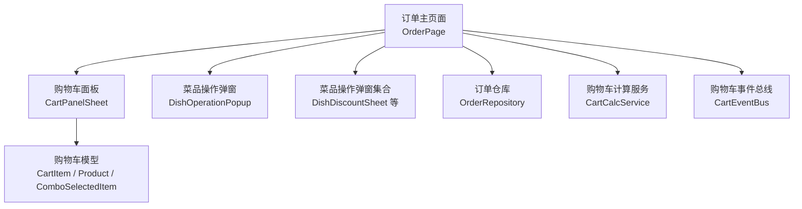
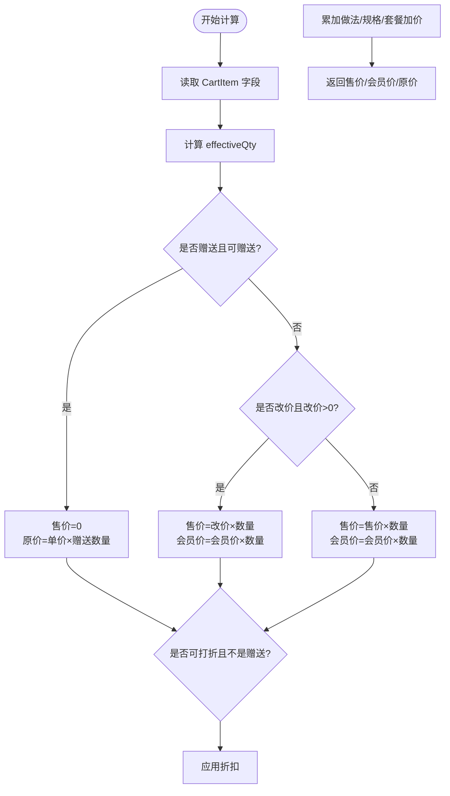
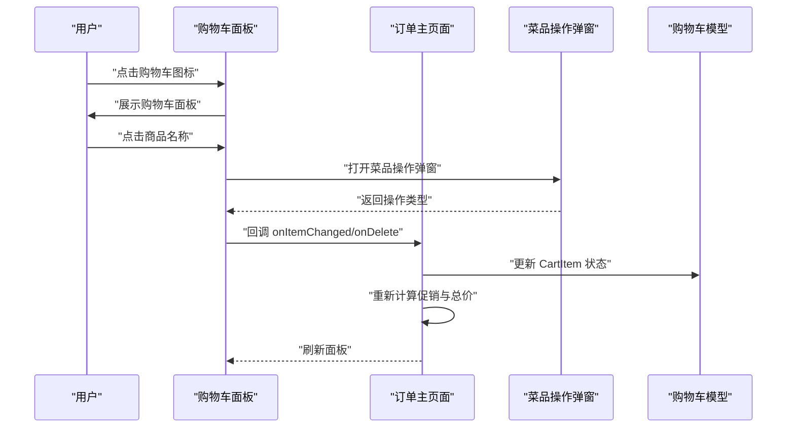
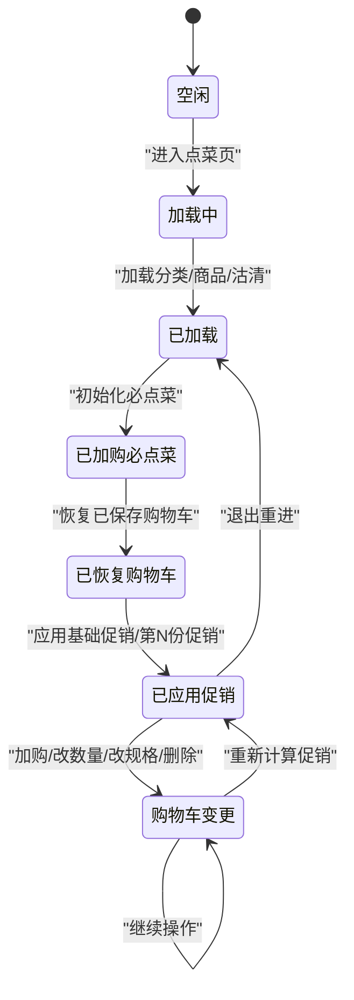
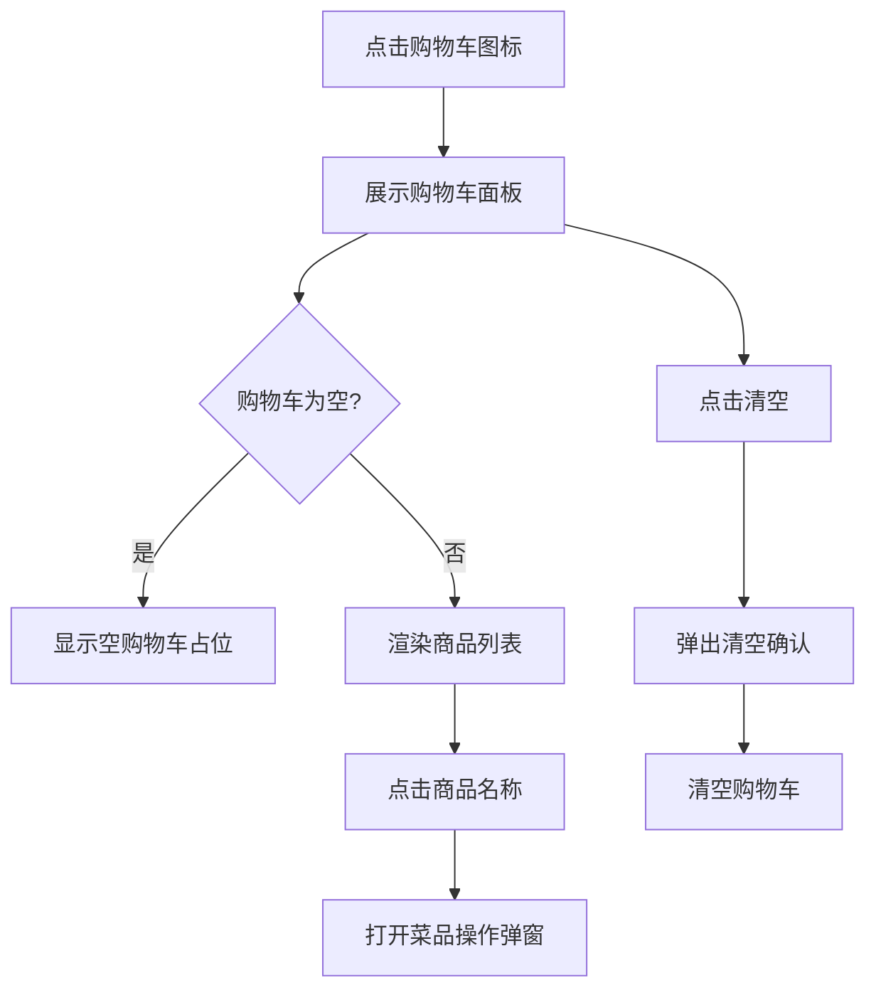
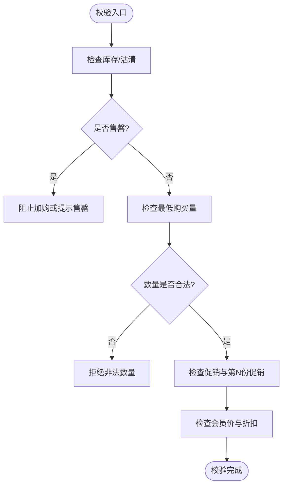
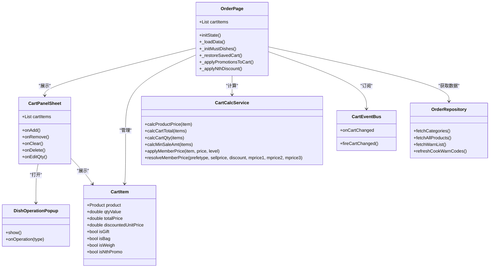

# 购物车管理

<cite>
**本文引用的文件**   
- [cart_calc_service.dart](file://lib/util/cart_calc_service.dart)
- [cart_panel_sheet.dart](file://lib/pages/order/widgets/cart_panel_sheet.dart)
- [cart_event_bus.dart](file://lib/net/cart_event_bus.dart)
- [order_page.dart](file://lib/pages/order/order_page.dart)
- [order_repository.dart](file://lib/pages/order/order_repository.dart)
- [order_models.dart](file://lib/pages/order/order_models.dart)
- [dish_operation_dialogs.dart](file://lib/components/dish_operation_dialogs.dart)
- [dish_operation_popup.dart](file://lib/components/dish_operation_popup.dart)
</cite>

## 目录
1. [引言](#引言)
2. [项目结构与职责划分](#项目结构与职责划分)
3. [核心数据模型与业务规则](#核心数据模型与业务规则)
4. [购物车金额计算引擎](#购物车金额计算引擎)
5. [购物车增删改查与数量调整流程](#购物车增删改查与数量调整流程)
6. [购物车状态管理机制](#购物车状态管理机制)
7. [购物车面板交互设计](#购物车面板交互设计)
8. [购物车校验规则](#购物车校验规则)
9. [依赖关系分析](#依赖关系分析)
10. [性能与扩展建议](#性能与扩展建议)
11. [常见问题排查](#常见问题排查)
12. [总结](#总结)

## 引言
本文件面向购物车管理模块，目标是把“购物车数据结构、操作逻辑、金额计算、状态同步、UI交互和校验规则”串联成一份可维护、可演进的业务文档。该模块以 Flutter 点菜页为中心，围绕购物车条目、菜品操作弹窗、购物车底部面板、购物车事件总线以及购物车金额计算服务展开，并与商品模型、规格做法模型、促销与第N份促销共同协作。

## 项目结构与职责划分
购物车相关代码主要分布在以下位置：
- 购物车金额计算服务：`lib/util/cart_calc_service.dart`
- 购物车底部面板：`lib/pages/order/widgets/cart_panel_sheet.dart`
- 购物车本地事件总线：`lib/net/cart_event_bus.dart`
- 点菜主页面与购物车生命周期：`lib/pages/order/order_page.dart`
- 订单仓库与商品/规格/做法/服务员/套餐模型：`lib/pages/order/order_repository.dart`
- 购物车条目、套餐明细、做法快照等模型：`lib/pages/order/order_models.dart`
- 菜品打折/改名/赠送等操作弹窗：`lib/components/dish_operation_dialogs.dart`
- 菜品操作网格弹窗（打包/挂起/备注/删除/服务员/做法/套餐/改名）：`lib/components/dish_operation_popup.dart`

**图表来源**
- [order_page.dart:1-200](file://lib/pages/order/order_page.dart#L1-L200)
- [cart_panel_sheet.dart:1-120](file://lib/pages/order/widgets/cart_panel_sheet.dart#L1-L120)
- [dish_operation_popup.dart:1-80](file://lib/components/dish_operation_popup.dart#L1-L80)
- [dish_operation_dialogs.dart:1-80](file://lib/components/dish_operation_dialogs.dart#L1-L80)
- [cart_calc_service.dart:1-60](file://lib/util/cart_calc_service.dart#L1-L60)
- [cart_event_bus.dart:1-22](file://lib/net/cart_event_bus.dart#L1-L22)
- [order_repository.dart:1-120](file://lib/pages/order/order_repository.dart#L1-L120)
- [order_models.dart:201-669](file://lib/pages/order/order_models.dart#L201-L669)

**章节来源**
- [order_page.dart:1-200](file://lib/pages/order/order_page.dart#L1-L200)
- [cart_panel_sheet.dart:1-120](file://lib/pages/order/widgets/cart_panel_sheet.dart#L1-L120)
- [dish_operation_popup.dart:1-80](file://lib/components/dish_operation_popup.dart#L1-L80)
- [dish_operation_dialogs.dart:1-80](file://lib/components/dish_operation_dialogs.dart#L1-L80)
- [cart_calc_service.dart:1-60](file://lib/util/cart_calc_service.dart#L1-L60)
- [cart_event_bus.dart:1-22](file://lib/net/cart_event_bus.dart#L1-L22)
- [order_repository.dart:1-120](file://lib/pages/order/order_repository.dart#L1-L120)
- [order_models.dart:201-669](file://lib/pages/order/order_models.dart#L201-L669)

## 核心数据模型与业务规则
购物车模块涉及两类关键模型：
- 面向服务端结算的 `lib/util/cart_calc_service.dart` 中的 `CartItem`，用于对齐后端购物车结算字段；
- 面向前端点菜交互的 `lib/pages/order/order_models.dart` 中的 `CartItem`，用于承载 UI 展示、促销、做法、规格、打包、挂起、赠送、称重等状态。

### 结算型购物车项字段与规则
`lib/util/cart_calc_service.dart` 中定义了与服务端结算对齐的商品项，关键字段如下：

| 字段 | 类型 | 含义 | 业务规则 |
|---|---|---|---|
| `productid` | String | 商品ID | 唯一标识商品 |
| `name` | String | 商品名称 | 用于显示 |
| `sellprice` | double | 售价单价 | 基础计价单价 |
| `qty` | double | 普通数量 | 非称重时参与计价 |
| `mprice1` | double | 会员价1 | 可能作为会员折扣后价格 |
| `weighflag` | int | 称重标志 | 1表示称重菜 |
| `weighNum` | double | 称重数量 | 称重菜按重量计价 |
| `isGive` | bool | 是否赠送 | 赠送行为标记 |
| `zsNum` | double | 赠送数量 | 赠送商品的计价数量 |
| `presentflag` | int | 可赠送标志 | 1表示可赠送 |
| `isChangePrice` | bool | 是否改价 | 改价后使用自定义价格 |
| `cPrice` | double | 改价后单价 | 改价生效时使用 |
| `cookaddamt` | double | 做法加价总额 | 累加到售价和原价 |
| `specaddamt` | double | 规格加价总额 | 累加到售价和原价 |
| `combflag` | int | 套餐标志 | 1表示套餐 |
| `combaddamt` | double | 套餐子商品加价总额 | 累加到售价和原价 |
| `dscflag` | int | 折扣标志 | 1表示可打折 |
| `discount` | double | 折扣率 | 100表示不打折，小于100且大于0表示打折 |
| `minsaleflag` | int | 计入低消标志 | 1表示计入低消 |
| `onlyid` | String | 唯一标识 | 行级唯一键 |
| `effectiveQty` | double | 实际计价数量 | 称重取重量、赠送取赠送数、否则取数量 |

核心规则包括：
- 赠送商品售价为0，但记录原价；
- 改价商品使用改价后的单价；
- 称重商品按重量计价；
- 可打折商品应用折扣；
- 做法、规格、套餐加价分别累加；
- 低消金额排除赠送、数量为0、不计低消、套餐子商品。

**章节来源**
- [cart_calc_service.dart:1-120](file://lib/util/cart_calc_service.dart#L1-L120)
- [cart_calc_service.dart:201-278](file://lib/util/cart_calc_service.dart#L201-L278)

### 前端购物车项字段与规则
`lib/pages/order/order_models.dart` 中的 `CartItem` 是点菜界面购物车的核心载体，关键字段如下：

| 字段或属性 | 类型 | 含义 | 业务规则 |
|---|---|---|---|
| `product` | Product | 商品对象 | 包含名称、价格、会员价、折扣标志等 |
| `quantity` | int | 整数数量 | 整份数量 |
| `extraQty` | double | 小数数量 | 支持小数份 |
| `qtyValue` | double | 实际数量 | 整数+小数 |
| `weighNum` | double | 称重重量 | 称重菜按重量计价 |
| `specText` | String | 规格做法描述 | 如“中份、微辣、加肉” |
| `specName` | String | 仅规格名 | 下单上传 spec |
| `cookText` | String | 仅做法描述 | 下单上传 cooktext |
| `cooks` | List\<SelectedCook\> | 已选做法明细 | 打包做法除外 |
| `combItems` | List\<ComboSelectedItem\> | 套餐明细 | 仅套餐商品非空 |
| `customName` | String? | 改名 | 优先显示自定义名称 |
| `discount` | double | 单品折扣率 | 100=不打折 |
| `discountRemark` | String | 打折原因 | 后台要求必填时需记录 |
| `isGift` | bool | 是否赠送 | 赠送商品合计不计入总价 |
| `giftRemark` | String | 赠送备注 | 可选 |
| `customPrice` | double? | 改价 | null表示未改价 |
| `isSuspended` | bool | 是否挂起 | 显示划线名称 |
| `bagPrice` | double | 打包费 | 按行整份计入 |
| `isBag` | bool | 是否打包 | 保留打包状态 |
| `remark` | String | 备注 | 单行备注 |
| `waiterName` | String | 服务员名 | 可指定服务员 |
| `memberUnitPrice` | double? | 会员优惠单价 | 覆盖基础价+规格加价 |
| `orderedAmt` | double? | 已下单行总额 | 直接使用服务端 rramt |
| `subqty` | double | 已退数量 | 显示“退N” |
| `isRefunded` | bool | 是否退菜 | presentflag=2 |
| `isCut` | bool | 是否划菜 | 操作态 |
| `confirmQty` | double | 二次称重确认重量 | 0=未称 |
| `jcmbillid` | String | 基础促销活动ID | 分类折扣/菜品折扣/特价菜 |
| `specpriceflag` | int | 特价标识 | 1/2/3/6/7 表示不同促销 |
| `promoPrice` | double | 特价菜单价 | 优先于原价 |
| `nthPrice` | double | 第N份促销单价 | 拆分行时生效 |
| `isNthPromo` | bool | 是否第N份促销行 | 禁止直接加减数量 |
| `cxmbillid` | String | 场景促销赠品活动ID | 买赠/满赠 |
| `bxxpxxflag` | int | 赠品标记 | 1=买赠，4=满赠 |
| `tpdishflag` | int | 临时菜标志 | 临时录入菜 |
| `mustflag` | int | 必点菜标志 | 1=必点菜 |
| `mustType` | int | 必点菜类型 | 0=固定必点，1=可选必点 |
| `unit` | String | 单位 | 临时菜录入 |
| `typeid` | String | 分类ID | 临时菜录入 |
| `typename` | String | 分类名称 | 临时菜录入 |

关键计算属性：
- `displayName`：优先显示改名后的名称；
- `isWeigh`：称重菜判断；
- `priceQty`：称重按重量，普通按数量；
- `baseUnitPrice`：第N份促销 > 特价菜 > 原价；
- `unitPrice`：改价 > 会员价 > 基础价+规格加价；
- `discountedUnitPrice`：折扣后单价；
- `isDiscounted`：是否打折；
- `totalPrice`：已下单行用服务端金额，否则为折扣单价×计价数量+打包费，赠送商品只计打包费；
- `uniqueKey`：商品ID+规格组合的唯一键。

**章节来源**
- [order_models.dart:201-669](file://lib/pages/order/order_models.dart#L201-L669)

### 商品、规格、做法与套餐模型
`lib/pages/order/order_repository.dart` 提供了点菜所需的基础数据模型：

| 模型 | 关键字段 | 作用 |
|---|---|---|
| `DishProduct` | productid、name、sellprice、cookflag、specflag、combflag、curflag、weighflag、stockqty、stopflag、status、mprice1、dscflag、maxsellqty、minsaleflag、presentflag | 商品目录核心字段 |
| `DishSpec` | specid、specname、sellprice、rrprice、specpriceflag、stockqty、sellclearflag | 规格选项与特价 |
| `DishCook` | cookname、price、ptype、mandatoryflag、maximumflag、code、cupstickercode、sellclearflag | 做法、加价类型、杯贴码 |
| `DishCookGroup` | groupname、cooklist | 做法分组 |
| `DishSpecData` | specdata、cookdata、publiccook | 规格做法数据聚合 |
| `Waiter` | userid、name、code | 服务员信息 |
| `ComboItem` | productid、price、qty、selectqty、repeatflag、addprice、cutprice、group | 套餐子商品配置 |

这些模型为购物车加购、规格做法选择、套餐选择、沽清与库存校验提供基础数据。

**章节来源**
- [order_repository.dart:1-200](file://lib/pages/order/order_repository.dart#L1-L200)
- [order_repository.dart:201-600](file://lib/pages/order/order_repository.dart#L201-L600)

## 购物车金额计算引擎
购物车金额计算由 `CartCalcService` 承担，核心能力包括：

### 单项金额计算
计算单个商品的售价金额、会员价金额、原价金额，并返回三元数组。计算顺序为：
1. 根据 `effectiveQty` 确定计价数量；
2. 区分赠送、改价、普通/称重三类计价路径；
3. 对可打折商品应用折扣；
4. 累加做法、规格、套餐加价；
5. 返回 `[售价金额, 会员价金额, 原价金额]`。

### 购物车总额计算
遍历所有购物车项，逐项调用单项计算，再汇总得到总售价、总会员价、总原价。

### 购物车数量计算
赠送商品不计入数量统计，其他商品按数量累加。

### 低消金额计算
排除赠送商品、数量为0、不计低消标志、套餐子商品，累加有效商品金额。

### 会员价应用
- `applyMemberPrice`：赠送或改价商品不应用会员价；会员价为0或不低于售价时不应用；
- `resolveMemberPrice`：根据会员优惠类型解析最终会员单价；
- `calcOrderDiscount`：对整单总金额应用折扣，返回折扣后金额与折扣金额。

**图表来源**
- [cart_calc_service.dart:60-160](file://lib/util/cart_calc_service.dart#L60-L160)
- [cart_calc_service.dart:201-278](file://lib/util/cart_calc_service.dart#L201-L278)

**章节来源**
- [cart_calc_service.dart:1-278](file://lib/util/cart_calc_service.dart#L1-L278)

## 购物车增删改查与数量调整流程
购物车操作主要由 `OrderPage` 管理购物车状态，`CartPanelSheet` 负责用户交互入口，`DishOperationPopup` 与 `DishDiscountSheet` 负责具体菜品操作。

### 加购流程
1. 用户在点菜页选择商品；
2. 若商品需要规格或做法，先弹出规格做法选择；
3. 生成 `CartItem`，设置数量、规格文本、做法文本、会员价、促销信息等；
4. 加入 `_cartItems`，重建计数映射；
5. 应用基础促销和第N份促销；
6. 触发购物车角标刷新。

### 数量调整流程
- 增加数量：
  - 若为第N份促销拆分行，提示促销商品不能直接操作；
  - 否则调用 `onAdd` 回调，由上层修改数量并刷新；
- 减少数量：
  - 调用 `onRemove` 回调，由上层处理数量归零或移除；
- 称重商品：
  - 在购物车面板中不显示加减按钮，只显示重量；
  - 重量通过称重流程设置 `weighNum` 与 `confirmQty`。

### 规格变更流程
1. 点击商品名称弹出 `DishOperationPopup`；
2. 选择“规格/做法”或“套餐”；
3. 更新 `specText`、`specName`、`cookText`、`cooks`；
4. 调用 `applyCookModify` 重新计算单价；
5. 重新计算促销与总价。

### 删除确认流程
购物车面板清空操作前弹出确认对话框，确认后调用 `onClear` 清空购物车；单项删除通过 `onDelete` 回调实现。

**图表来源**
- [cart_panel_sheet.dart:1-200](file://lib/pages/order/widgets/cart_panel_sheet.dart#L1-L200)
- [dish_operation_popup.dart:1-200](file://lib/components/dish_operation_popup.dart#L1-L200)
- [order_page.dart:201-561](file://lib/pages/order/order_page.dart#L201-L561)
- [order_models.dart:201-669](file://lib/pages/order/order_models.dart#L201-L669)

**章节来源**
- [cart_panel_sheet.dart:1-400](file://lib/pages/order/widgets/cart_panel_sheet.dart#L1-L400)
- [dish_operation_popup.dart:1-200](file://lib/components/dish_operation_popup.dart#L1-L200)
- [order_page.dart:201-561](file://lib/pages/order/order_page.dart#L201-L561)
- [order_models.dart:201-669](file://lib/pages/order/order_models.dart#L201-L669)

## 购物车状态管理机制
购物车状态由多个层面共同维护：

### 内存状态
- `OrderPage._cartItems` 保存当前桌台购物车；
- `_productCountMap`、`_categoryCountMap`、`_productTypeIdMap` 加速角标与分类统计；
- 促销状态由 `PromotionManager` 与 `NthDiscountManager` 共同应用。

### 必点菜自动加购
进入点菜页后：
1. 初始化促销；
2. 并行加载分类、商品、沽清、做法沽清；
3. 计算必点菜需求；
4. 静默自动加购固定必点菜；
5. 恢复已保存购物车；
6. 应用基础促销与第N份促销。

### 数据持久化与回显
购物车初始化时会恢复已保存菜品，确保退出重进后仍能看到之前加购内容。恢复过程会复用已加载商品目录的价格与展示信息。

### 同步策略
- 购物车变更后，调用 `CartEventBus.fireCartChanged()` 广播事件；
- 点菜页订阅购物车变更流，刷新角标与合计金额；
- 订单确认页等页面改动待下单购物车后，同样通过事件通知点菜页刷新。

### 冲突解决
- 锁台事件监听：进入点菜页自动锁台，退出自动解锁；
- 被其他设备锁台时，提示并返回首页；
- 购物车数量、必点菜数量在人数变化时重新校验与补足。

**图表来源**
- [order_page.dart:201-561](file://lib/pages/order/order_page.dart#L201-L561)
- [cart_event_bus.dart:1-22](file://lib/net/cart_event_bus.dart#L1-L22)

**章节来源**
- [order_page.dart:201-561](file://lib/pages/order/order_page.dart#L201-L561)
- [cart_event_bus.dart:1-22](file://lib/net/cart_event_bus.dart#L1-L22)

## 购物车面板交互设计
`CartPanelSheet` 是点击购物车图标弹出的底部抽屉，主要交互包括：

### 展开收起动画
- 使用 `showModalBottomSheet` 展示；
- `isScrollControlled=true` 支持键盘避让；
- 透明背景配合圆角容器，形成从底部滑出的视觉效果；
- 最大高度限制为屏幕高度的60%。

### 列表展示
- 空购物车显示占位图标与文案；
- 有购物车时展示商品列表，每项包含名称、规格、备注、服务员、价格、数量；
- 称重商品不显示加减按钮，只显示重量；
- 打折时显示划线原价；
- 第N份促销行也展示原价对比。

### 快捷操作
- 点击商品名称弹出 `DishOperationPopup`；
- 清空购物车前弹出确认框；
- 支持删除单项、编辑数量；
- 支持折扣、赠送、改价、打包、挂起、备注、服务员、做法/套餐、改名等操作。

### 标签体系
购物车项支持多种标签：
- 二次称重：未称红、已称绿；
- 挂起：橙色；
- 赠送：绿色；
- 打折：品牌红；
- 促销：品牌红；
- 打包：蓝色；
- 必点菜：红色“必”。

**图表来源**
- [cart_panel_sheet.dart:1-200](file://lib/pages/order/widgets/cart_panel_sheet.dart#L1-L200)
- [dish_operation_popup.dart:1-200](file://lib/components/dish_operation_popup.dart#L1-L200)

**章节来源**
- [cart_panel_sheet.dart:1-400](file://lib/pages/order/widgets/cart_panel_sheet.dart#L1-L400)
- [dish_operation_popup.dart:1-200](file://lib/components/dish_operation_popup.dart#L1-L200)

## 购物车校验规则
购物车校验贯穿加购、数量调整、规格变更、下单前准备等环节：

### 库存检查
- 商品售罄：`sellclearflag==1` 且 `stockqty<=0`；
- 规格售罄：规格模型也有 `sellclearflag` 与 `stockqty`；
- 沽清剩余：点菜页加载沽清数据，计算 `warnqty - saleqty` 作为剩余基数；
- 商品停用：`stopflag==1` 或 `status==0`。

### 最低购买量验证
- 起售数量：`startsellqty` 小于等于0时按1处理；
- 增售卖数量：`addsellqty` 小于等于0时按1处理；
- 每单限量：`maxsellqty` 控制每单最多点几份；
- 必点菜：固定必点菜按人数或每单规则自动补足差额。

### 数量合法性
- 第N份促销拆分行禁止直接加减数量；
- 称重商品不可直接修改数量，需通过称重流程；
- 赠送商品合计金额不计入购物车总价；
- 已退菜行显示“退N”，并可标记 `isRefunded`。

### 会员价与折扣校验
- 会员价必须小于售价才生效；
- 折扣必须在1~100之间；
- 后台要求打折原因必填时必须选择或输入原因；
- 赠送或改价商品不应用会员价。

**图表来源**
- [order_repository.dart:201-600](file://lib/pages/order/order_repository.dart#L201-L600)
- [order_page.dart:201-561](file://lib/pages/order/order_page.dart#L201-L561)
- [dish_operation_dialogs.dart:1-200](file://lib/components/dish_operation_dialogs.dart#L1-L200)
- [order_models.dart:201-669](file://lib/pages/order/order_models.dart#L201-L669)

**章节来源**
- [order_repository.dart:201-600](file://lib/pages/order/order_repository.dart#L201-L600)
- [order_page.dart:201-561](file://lib/pages/order/order_page.dart#L201-L561)
- [dish_operation_dialogs.dart:1-200](file://lib/components/dish_operation_dialogs.dart#L1-L200)
- [order_models.dart:201-669](file://lib/pages/order/order_models.dart#L201-L669)

## 依赖关系分析
购物车模块依赖关系如下：

**图表来源**
- [order_page.dart:1-200](file://lib/pages/order/order_page.dart#L1-L200)
- [cart_panel_sheet.dart:1-120](file://lib/pages/order/widgets/cart_panel_sheet.dart#L1-L120)
- [order_models.dart:201-669](file://lib/pages/order/order_models.dart#L201-L669)
- [cart_calc_service.dart:1-120](file://lib/util/cart_calc_service.dart#L1-L120)
- [cart_event_bus.dart:1-22](file://lib/net/cart_event_bus.dart#L1-L22)
- [dish_operation_popup.dart:1-200](file://lib/components/dish_operation_popup.dart#L1-L200)
- [order_repository.dart:1-200](file://lib/pages/order/order_repository.dart#L1-L200)

**章节来源**
- [order_page.dart:1-200](file://lib/pages/order/order_page.dart#L1-L200)
- [cart_panel_sheet.dart:1-120](file://lib/pages/order/widgets/cart_panel_sheet.dart#L1-L120)
- [order_models.dart:201-669](file://lib/pages/order/order_models.dart#L201-L669)
- [cart_calc_service.dart:1-120](file://lib/util/cart_calc_service.dart#L1-L120)
- [cart_event_bus.dart:1-22](file://lib/net/cart_event_bus.dart#L1-L22)
- [dish_operation_popup.dart:1-200](file://lib/components/dish_operation_popup.dart#L1-L200)
- [order_repository.dart:1-200](file://lib/pages/order/order_repository.dart#L1-L200)

## 性能与扩展建议
- 购物车总额计算应缓存中间结果，避免频繁重复遍历；
- 促销计算应结合 `PromotionManager` 与 `NthDiscountManager` 做增量更新；
- 购物车变更事件应避免高频抖动，必要时做节流；
- 购物车面板渲染大量商品时应使用虚拟列表或分页；
- 称重商品数量修改应统一走称重流程，避免绕过校验；
- 会员价与折扣计算应集中到 `CartCalcService`，保证前后端一致；
- 购物车持久化建议引入本地数据库或安全共享存储，并增加版本迁移；
- 冲突解决可扩展乐观锁或版本号机制，避免多人同时操作购物车导致数据不一致。

## 常见问题排查
- 购物车总价异常：
  - 检查是否错误将赠送商品计入总价；
  - 检查打包费是否随数量翻倍；
  - 检查第N份促销行是否使用了正确单价；
- 会员价不生效：
  - 检查会员价是否为0或不小于售价；
  - 检查是否赠送或改价商品；
- 折扣原因必填校验失败：
  - 检查后台是否开启必填；
  - 检查是否选择了原因或输入了原因；
- 购物车角标不刷新：
  - 检查是否调用 `CartEventBus.fireCartChanged()`；
  - 检查点菜页是否正确订阅 `onCartChanged`；
- 购物车被误清空：
  - 检查清空确认逻辑是否被绕过；
  - 检查 `onClear` 回调是否正确执行；
- 购物车状态不同步：
  - 检查锁台逻辑是否正常；
  - 检查人数变化时必点菜是否重新计算；
  - 检查已保存购物车是否恢复成功。

**章节来源**
- [cart_calc_service.dart:1-278](file://lib/util/cart_calc_service.dart#L1-L278)
- [cart_panel_sheet.dart:1-400](file://lib/pages/order/widgets/cart_panel_sheet.dart#L1-L400)
- [cart_event_bus.dart:1-22](file://lib/net/cart_event_bus.dart#L1-L22)
- [order_page.dart:201-561](file://lib/pages/order/order_page.dart#L201-L561)
- [dish_operation_dialogs.dart:1-200](file://lib/components/dish_operation_dialogs.dart#L1-L200)
- [order_models.dart:201-669](file://lib/pages/order/order_models.dart#L201-L669)

## 总结
购物车管理模块以 `OrderPage` 为中枢，以 `CartItem` 为核心数据载体，以 `CartCalcService` 为金额计算引擎，以 `CartPanelSheet` 为交互入口，以 `CartEventBus` 为跨页面同步通道，以 `DishOperationPopup` 与 `DishDiscountSheet` 为具体操作载体。其业务规则覆盖了赠送、改价、称重、打包、挂起、折扣、会员价、促销、第N份促销、必点菜、沽清、库存、低消、服务员、规格做法、套餐等多个维度。文档所描述的模型、流程与校验规则可作为后续功能扩展、重构和测试用例设计的依据。