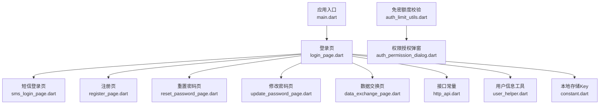
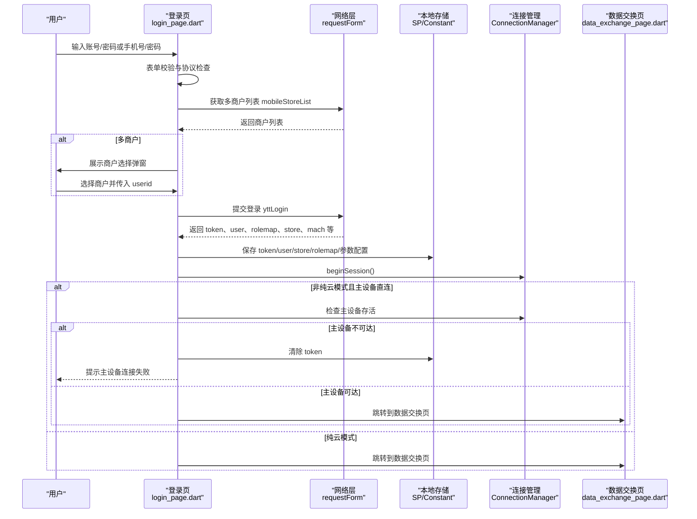
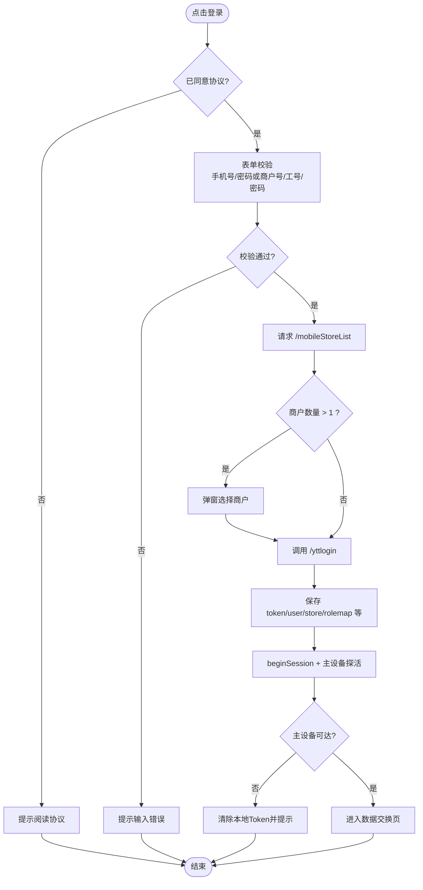
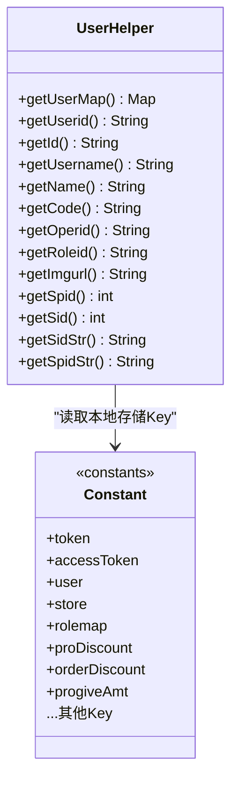
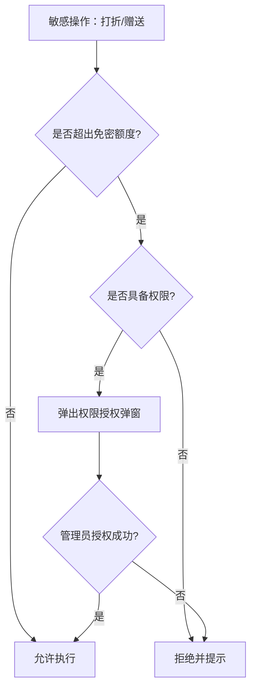
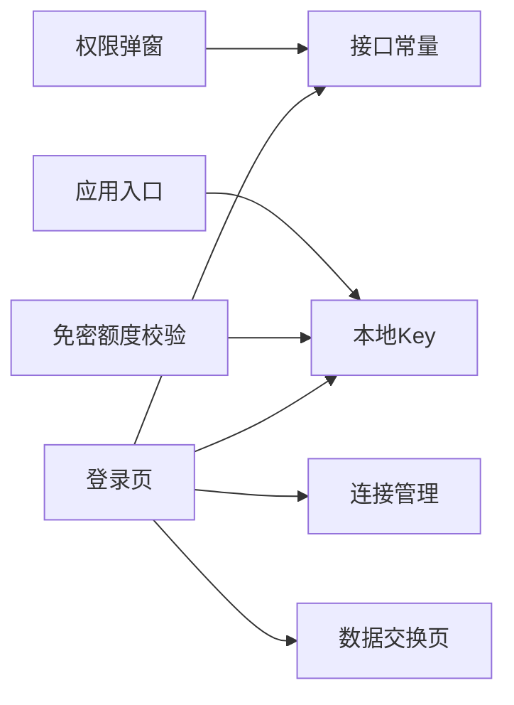

# 用户认证模块

<cite>
**本文引用的文件**   
- [lib/main.dart](file://lib/main.dart)
- [lib/pages/login/page/login_page.dart](file://lib/pages/login/page/login_page.dart)
- [lib/pages/login/page/sms_login_page.dart](file://lib/pages/login/page/sms_login_page.dart)
- [lib/pages/login/page/reset_password_page.dart](file://lib/pages/login/page/reset_password_page.dart)
- [lib/pages/login/page/update_password_page.dart](file://lib/pages/login/page/update_password_page.dart)
- [lib/pages/login/page/register_page.dart](file://lib/pages/login/page/register_page.dart)
- [lib/pages/login/page/data_exchange_page.dart](file://lib/pages/login/page/data_exchange_page.dart)
- [lib/net/http_api.dart](file://lib/net/http_api.dart)
- [lib/util/user_helper.dart](file://lib/util/user_helper.dart)
- [lib/res/constant.dart](file://lib/res/constant.dart)
- [lib/util/auth_limit_utils.dart](file://lib/util/auth_limit_utils.dart)
- [lib/components/auth_permission_dialog.dart](file://lib/components/auth_permission_dialog.dart)
</cite>

## 目录
1. [引言](#引言)
2. [项目结构](#项目结构)
3. [核心组件](#核心组件)
4. [架构总览](#架构总览)
5. [详细组件分析](#详细组件分析)
6. [依赖关系分析](#依赖关系分析)
7. [性能与可靠性](#性能与可靠性)
8. [故障排查指南](#故障排查指南)
9. [结论](#结论)
10. [附录：扩展新登录方式与安全最佳实践](#附录扩展新登录方式与安全最佳实践)

## 引言
本文件面向“聚客美滋滋”Flutter 应用的用户认证模块，覆盖账号密码登录、手机号快捷登录、短信验证码登录界面、密码重置与修改、多商户选择、认证状态与 Token 存储、会话管理、自动登录、权限校验与授权弹窗，以及与网络层的交互。文档既适合初学者理解整体流程，也便于高级开发者定位实现细节并进行二次扩展。

## 项目结构
认证相关代码主要分布在以下区域：
- 页面层：登录、短信登录、注册、忘记密码、修改密码、登录后数据交换
- 工具层：用户信息读取、免密额度校验、权限弹窗
- 常量层：本地持久化 Key 定义
- 接口层：登录与权限相关接口地址
- 入口层：根据 Token 决定启动页

**图表来源**
- [lib/main.dart:100-159](file://lib/main.dart#L100-L159)
- [lib/pages/login/page/login_page.dart:1-1023](file://lib/pages/login/page/login_page.dart#L1-L1023)
- [lib/net/http_api.dart:1-120](file://lib/net/http_api.dart#L1-L120)
- [lib/util/user_helper.dart:1-81](file://lib/util/user_helper.dart#L1-L81)
- [lib/res/constant.dart:1-93](file://lib/res/constant.dart#L1-L93)

**章节来源**
- [lib/main.dart:100-159](file://lib/main.dart#L100-L159)
- [lib/pages/login/page/login_page.dart:1-1023](file://lib/pages/login/page/login_page.dart#L1-L1023)
- [lib/net/http_api.dart:1-120](file://lib/net/http_api.dart#L1-L120)

## 核心组件
- 登录页：支持“快捷登录（手机号+密码）”和“普通登录（商户号+员工工号+密码）”，包含表单校验、记住密码、协议勾选、多商户选择、登录成功后保存 Token 和用户信息、进入数据交换页。
- 短信验证码登录页：当前为占位页面，仅做 UI 与输入校验，未调用真实登录接口。
- 注册页、重置密码页、修改密码页：均为 UI 占位实现，提供输入校验与跳转逻辑，尚未对接后端。
- 用户信息工具：统一从本地 SP 中解析当前登录用户 JSON，并提供常用字段便捷方法。
- 接口常量：集中定义登录、权限等 HTTP 接口路径及基础域名。
- 本地常量：定义 Token、用户、门店、记住密码等所有本地存储 Key。
- 免密额度校验与权限弹窗：基于登录返回的 role 折扣上限控制打折、赠送等敏感操作，必要时弹出管理员授权对话框。

**章节来源**
- [lib/pages/login/page/login_page.dart:1-1023](file://lib/pages/login/page/login_page.dart#L1-L1023)
- [lib/pages/login/page/sms_login_page.dart:1-141](file://lib/pages/login/page/sms_login_page.dart#L1-L141)
- [lib/pages/login/page/register_page.dart:1-135](file://lib/pages/login/page/register_page.dart#L1-L135)
- [lib/pages/login/page/reset_password_page.dart:1-123](file://lib/pages/login/page/reset_password_page.dart#L1-L123)
- [lib/pages/login/page/update_password_page.dart:1-108](file://lib/pages/login/page/update_password_page.dart#L1-L108)
- [lib/util/user_helper.dart:1-81](file://lib/util/user_helper.dart#L1-L81)
- [lib/net/http_api.dart:1-120](file://lib/net/http_api.dart#L1-L120)
- [lib/res/constant.dart:1-93](file://lib/res/constant.dart#L1-L93)
- [lib/util/auth_limit_utils.dart:1-98](file://lib/util/auth_limit_utils.dart#L1-L98)
- [lib/components/auth_permission_dialog.dart:1-200](file://lib/components/auth_permission_dialog.dart#L1-L200)

## 架构总览
认证流程以登录页为核心，串联网络请求、本地持久化、会话初始化与数据同步。

**图表来源**
- [lib/pages/login/page/login_page.dart:1-1023](file://lib/pages/login/page/login_page.dart#L1-L1023)
- [lib/pages/login/page/data_exchange_page.dart:1-200](file://lib/pages/login/page/data_exchange_page.dart#L1-L200)
- [lib/net/http_api.dart:1-120](file://lib/net/http_api.dart#L1-L120)
- [lib/res/constant.dart:1-93](file://lib/res/constant.dart#L1-L93)

**章节来源**
- [lib/pages/login/page/login_page.dart:1-1023](file://lib/pages/login/page/login_page.dart#L1-L1023)
- [lib/pages/login/page/data_exchange_page.dart:1-200](file://lib/pages/login/page/data_exchange_page.dart#L1-L200)

## 详细组件分析

### 登录流程与多商户机制
登录页承担两大职责：
- 业务入口：处理两种登录方式的表单校验、协议确认、记住密码恢复。
- 认证编排：先拉取商户列表，再执行登录；登录成功后持久化凭证、初始化连接、进入数据交换页。

关键实现要点：
- 快捷登录使用手机号和密码；普通登录使用商户号、员工工号和密码。
- 先调用 `/mobileStoreList` 判断是否绑定多个商户：若超过一个则弹出选择框；否则直接登录。
- 登录接口为 `/yttlogin`，成功时保存 token、user、rolemap、store、sysStoreAccount、verservicelist、主设备地址、RabbitMQ 配置、设备信息等。
- 单商户场景下不传 userid；多商户选择后将所选 store 的 userid 传给登录接口。
- 登录成功后调用 `ConnectionManager.beginSession()`，并根据连接模式检查主设备存活；主设备不可达时清除本地 Token 并提示错误。
- 最后进入数据交换页进行全量或增量基础数据下载。

**图表来源**
- [lib/pages/login/page/login_page.dart:1-1023](file://lib/pages/login/page/login_page.dart#L1-L1023)
- [lib/net/http_api.dart:1-120](file://lib/net/http_api.dart#L1-L120)

**章节来源**
- [lib/pages/login/page/login_page.dart:1-1023](file://lib/pages/login/page/login_page.dart#L1-L1023)
- [lib/net/http_api.dart:1-120](file://lib/net/http_api.dart#L1-L120)

### 账号密码登录
- 普通登录字段：商户号、员工工号、密码。
- 参数映射：account=商户号、code=员工工号、pwd=密码，vcode=应用构建号，newclient=平台标识。
- 校验规则：必填校验由登录页完成，具体业务校验在后端完成。
- 多商户场景：当返回多个商户时，弹窗显示商户名、用户名、账户、工号等信息，用户选择后携带 userid 再次登录。

扩展建议：
- 如需新增“扫码登录”，可在登录页增加 Tab 或按钮，复用 `_doLogin` 的参数构造逻辑，将扫码结果作为 userid 或其他字段传入。

**章节来源**
- [lib/pages/login/page/login_page.dart:1-1023](file://lib/pages/login/page/login_page.dart#L1-L1023)

### 手机号快捷登录
- 快捷登录字段：手机号、密码。
- 参数映射：mobile=手机号、userid=可选的多商户选择值、pwd=密码，vcode=newclient。
- 与账号密码登录共用同一套登录持久化和会话初始化逻辑。

扩展建议：
- 可结合第三方账号体系（如企业微信、钉钉），在快捷登录分支中拼接额外字段，例如 enterpriseId、unionId 等。

**章节来源**
- [lib/pages/login/page/login_page.dart:1-1023](file://lib/pages/login/page/login_page.dart#L1-L1023)

### 短信验证码登录
当前短信验证码登录页面仅实现 UI 与输入校验，未调用登录接口：
- 输入手机号与验证码，校验通过后点击登录仅提示“去登录”。
- 提供跳转到注册页与忘记密码页的能力。

后续对接建议：
- 在 `_login` 中调用验证码发送接口，并在登录接口中将验证码作为参数传递。
- 复用登录页的 `_doLogin` 逻辑，保持 Token 与用户信息存储一致。

**章节来源**
- [lib/pages/login/page/sms_login_page.dart:1-141](file://lib/pages/login/page/sms_login_page.dart#L1-L141)

### 密码重置与修改
- 重置密码页：收集手机号、验证码、新密码，当前仅做前端校验与“确认”提示，未调用后端接口。
- 修改密码页：收集旧密码与新密码，当前仅做前端校验与“修改成功”提示，未调用后端接口。
- 两者均可扩展为真实 API 调用，复用现有表单校验模式。

安全建议：
- 重置密码建议使用短信验证码 + 一次性令牌（OTP）策略。
- 修改密码需验证旧密码，并建议加入密码强度校验与重复密码一致性校验。

**章节来源**
- [lib/pages/login/page/reset_password_page.dart:1-123](file://lib/pages/login/page/reset_password_page.dart#L1-L123)
- [lib/pages/login/page/update_password_page.dart:1-108](file://lib/pages/login/page/update_password_page.dart#L1-L108)

### 认证状态管理与自动登录
- 自动登录：应用入口根据本地 `token` 是否为空决定首页是登录页还是首页。
- Token 存储：登录成功后写入 `Constant.token` 与 `Constant.accessToken`，二者均保存后端返回的 token。
- 用户信息：登录返回的 user 对象以 JSON 字符串形式保存在 `Constant.user`，并通过 `UserHelper` 统一读取。
- 门店信息：登录返回的 store 以及 sid/spid 会分别保存到 `Constant.store` 与独立 key。
- 角色与权限：rolemap 保存于 `Constant.rolemap`；role 中的折扣上限保存到对应 Key，供免密额度校验使用。

**图表来源**
- [lib/util/user_helper.dart:1-81](file://lib/util/user_helper.dart#L1-L81)
- [lib/res/constant.dart:1-93](file://lib/res/constant.dart#L1-L93)

**章节来源**
- [lib/main.dart:100-159](file://lib/main.dart#L100-L159)
- [lib/util/user_helper.dart:1-81](file://lib/util/user_helper.dart#L1-L81)
- [lib/res/constant.dart:1-93](file://lib/res/constant.dart#L1-L93)

### 会话管理与主设备连通性
- 登录成功后调用 `ConnectionManager.beginSession()` 开启会话。
- 非纯云模式下，尝试检测主设备存活；若为主设备直连模式且主设备不可达，则删除本地 Token 并提示错误，阻止进入业务页面。
- 该机制确保在无主设备的情况下不会误入需要主设备能力的业务流程。

**章节来源**
- [lib/pages/login/page/login_page.dart:1-1023](file://lib/pages/login/page/login_page.dart#L1-L1023)

### 登录后数据交换与自动登录衔接
- 登录成功后直接进入数据交换页，用于并发下载全部注册表数据。
- 数据交换页订阅进度事件，支持部分失败重试；完成后根据商业模式进入快餐点菜页或桌台首页。
- 该流程与自动登录衔接：冷启动时若存在有效 Token，直接进入首页；首次登录或 Token 失效时进入登录页。

**章节来源**
- [lib/pages/login/page/data_exchange_page.dart:1-200](file://lib/pages/login/page/data_exchange_page.dart#L1-L200)
- [lib/main.dart:100-159](file://lib/main.dart#L100-L159)

### 权限检查与免密额度控制
- 登录返回的 role 中包含单品折扣、整单折扣、赠送金额等免密额度上限。
- `AuthLimitUtils` 提供单项/整单折扣与赠送金额的超限判断与授权流程。
- 超限且无权限时，先通过 `PermissionUtils.check` 拦截，再弹出 `AuthPermissionDialog` 进行管理员授权。
- 授权弹窗支持“授权码模式”和“用户名+密码模式”。

**图表来源**
- [lib/util/auth_limit_utils.dart:1-98](file://lib/util/auth_limit_utils.dart#L1-L98)
- [lib/components/auth_permission_dialog.dart:1-200](file://lib/components/auth_permission_dialog.dart#L1-L200)

**章节来源**
- [lib/util/auth_limit_utils.dart:1-98](file://lib/util/auth_limit_utils.dart#L1-L98)
- [lib/components/auth_permission_dialog.dart:1-200](file://lib/components/auth_permission_dialog.dart#L1-L200)

## 依赖关系分析
- 登录页依赖：
  - 网络接口：`HttpApi.yttLogin`、`HttpApi.mobileStoreList`
  - 本地存储：`Constant` 中定义的 token、user、store、rolemap 等 Key
  - 连接管理：`ConnectionManager` 负责会话与主设备探活
  - 数据交换：`Data Exchange Page` 用于登录后的数据同步
- 权限模块依赖：
  - `AuthLimitUtils` 依赖 `Constant` 中的折扣上限 Key
  - `AuthPermissionDialog` 依赖网络层与 Toast 工具
- 入口依赖：
  - `main.dart` 根据 `Constant.token` 决定初始页面

**图表来源**
- [lib/pages/login/page/login_page.dart:1-1023](file://lib/pages/login/page/login_page.dart#L1-L1023)
- [lib/net/http_api.dart:1-120](file://lib/net/http_api.dart#L1-L120)
- [lib/res/constant.dart:1-93](file://lib/res/constant.dart#L1-L93)
- [lib/util/auth_limit_utils.dart:1-98](file://lib/util/auth_limit_utils.dart#L1-L98)
- [lib/components/auth_permission_dialog.dart:1-200](file://lib/components/auth_permission_dialog.dart#L1-L200)
- [lib/pages/login/page/data_exchange_page.dart:1-200](file://lib/pages/login/page/data_exchange_page.dart#L1-L200)
- [lib/main.dart:100-159](file://lib/main.dart#L100-L159)

**章节来源**
- [lib/pages/login/page/login_page.dart:1-1023](file://lib/pages/login/page/login_page.dart#L1-L1023)
- [lib/net/http_api.dart:1-120](file://lib/net/http_api.dart#L1-L120)
- [lib/res/constant.dart:1-93](file://lib/res/constant.dart#L1-L93)
- [lib/util/auth_limit_utils.dart:1-98](file://lib/util/auth_limit_utils.dart#L1-L98)
- [lib/components/auth_permission_dialog.dart:1-200](file://lib/components/auth_permission_dialog.dart#L1-L200)
- [lib/pages/login/page/data_exchange_page.dart:1-200](file://lib/pages/login/page/data_exchange_page.dart#L1-L200)
- [lib/main.dart:100-159](file://lib/main.dart#L100-L159)

## 性能与可靠性
- 登录流程采用两步法：先拉取商户列表，再执行登录，减少无效登录请求。
- 登录成功后立即进入数据交换页，使用并发下载提升基础数据同步效率。
- 主设备连通性检查避免在直连模式下进入不可用状态。
- 权限校验前置拦截，减少不必要网络请求。

优化建议：
- 对登录接口增加超时与重试策略，避免弱网导致体验问题。
- 对数据交换页增加断点续传与失败重试上限，防止无限重试。
- 对 Token 刷新与过期处理增加统一拦截器逻辑，保证全局一致性。

[本节为通用性能讨论，不直接分析具体文件]

## 故障排查指南
- 登录成功但无法进入业务页：
  - 检查主设备连通性：若为主设备直连模式且主设备不可达，会清除本地 Token 并提示错误。
  - 检查 Token 是否存在：应用入口依据 `Constant.token` 决定是否进入首页。
- 多商户登录后数据异常：
  - 检查选择的 store 是否正确持久化到 `Constant.store`。
  - 检查 sid/spid 是否以正确类型保存，并使用 `UserHelper.getSidStr()/getSpidStr()` 获取字符串形式。
- 权限操作被拒绝：
  - 检查 role 折扣上限是否设置正确。
  - 检查权限弹窗是否成功调用管理员授权接口。

**章节来源**
- [lib/pages/login/page/login_page.dart:1-1023](file://lib/pages/login/page/login_page.dart#L1-L1023)
- [lib/main.dart:100-159](file://lib/main.dart#L100-L159)
- [lib/util/user_helper.dart:1-81](file://lib/util/user_helper.dart#L1-L81)
- [lib/util/auth_limit_utils.dart:1-98](file://lib/util/auth_limit_utils.dart#L1-L98)
- [lib/components/auth_permission_dialog.dart:1-200](file://lib/components/auth_permission_dialog.dart#L1-L200)

## 结论
认证模块以登录页为中心，实现了账号密码登录与手机号快捷登录，支持多商户选择与登录后数据同步。Token 与用户信息通过本地 SP 持久化，应用入口据此实现自动登录。权限控制通过免密额度与管理员授权弹窗协同完成。短信验证码登录、注册、重置密码与修改密码目前为 UI 占位实现，可按现有模式快速扩展为完整功能。

[本节为总结性内容，不直接分析具体文件]

## 附录：扩展新登录方式与安全最佳实践

### 扩展新登录方式的步骤
- 在登录页增加新的登录入口（Tab 或按钮），复用现有表单校验框架。
- 在 `_getStoreList` 或 `_doLogin` 中构造新登录参数，例如添加企业 ID、UnionID、设备指纹等字段。
- 复用登录成功后保存 Token、用户信息、门店信息的逻辑，确保与现有流程一致。
- 若新登录方式需要短信验证码，参考短信登录页的 UI 模式，接入验证码发送与校验接口。

参考位置：
- 登录入口与参数构造：[lib/pages/login/page/login_page.dart:1-1023](file://lib/pages/login/page/login_page.dart#L1-L1023)
- 短信登录 UI 参考：[lib/pages/login/page/sms_login_page.dart:1-141](file://lib/pages/login/page/sms_login_page.dart#L1-L141)

### 安全最佳实践
- Token 安全：
  - 仅在登录成功后写入 `Constant.token` 与 `Constant.accessToken`。
  - 主设备不可达时及时清理本地 Token，避免残留凭证。
- 密码安全：
  - “记住密码”仅存储必要字段，取消勾选时只清除密码，不清空账号。
  - 修改密码必须校验旧密码，建议加入密码强度与复杂度校验。
- 权限安全：
  - 敏感操作（打折、赠送、退菜等）必须经过 `AuthLimitUtils` 与 `AuthPermissionDialog` 校验。
  - 管理员授权应记录审计日志，避免滥用。
- 网络通信：
  - 登录接口使用 HTTPS，避免明文传输。
  - 建议增加请求签名与防重放机制。

参考位置：
- 本地存储 Key 定义：[lib/res/constant.dart:1-93](file://lib/res/constant.dart#L1-L93)
- 用户信息读取工具：[lib/util/user_helper.dart:1-81](file://lib/util/user_helper.dart#L1-L81)
- 免密额度与权限弹窗：[lib/util/auth_limit_utils.dart:1-98](file://lib/util/auth_limit_utils.dart#L1-L98), [lib/components/auth_permission_dialog.dart:1-200](file://lib/components/auth_permission_dialog.dart#L1-L200)