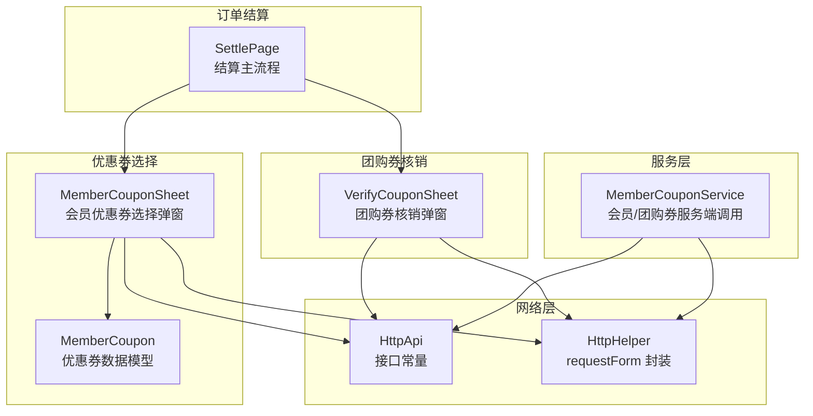
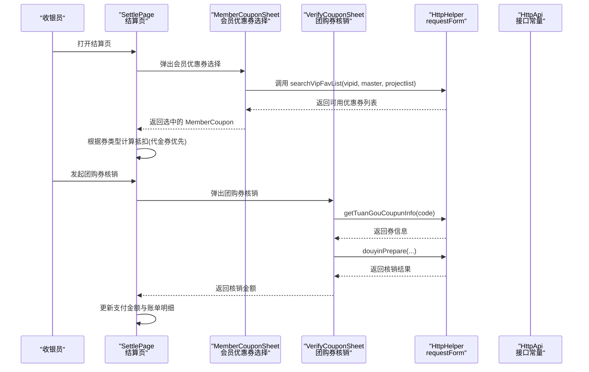
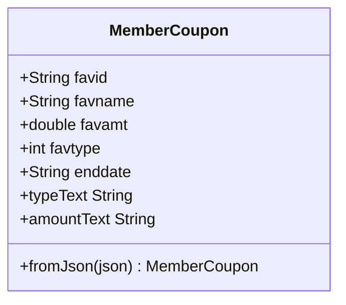
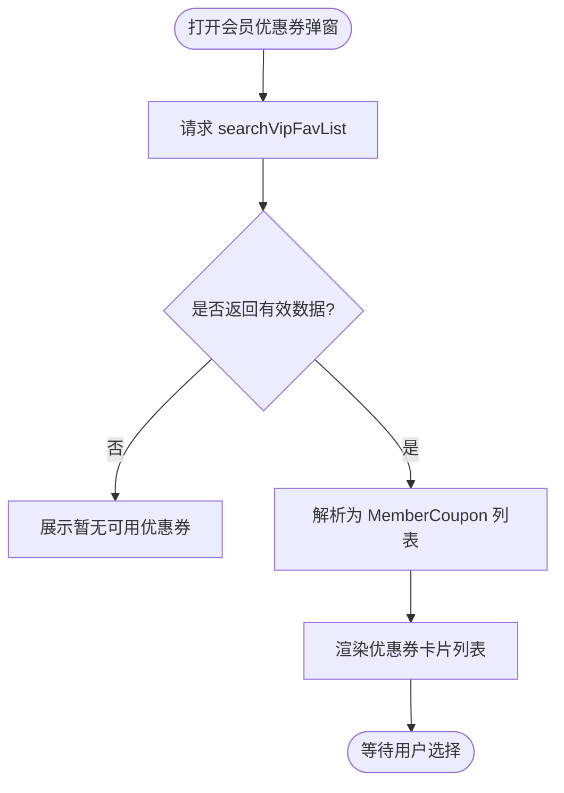
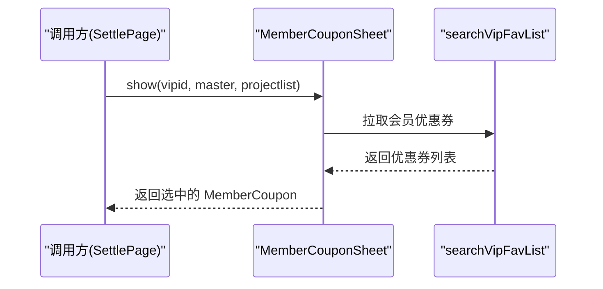
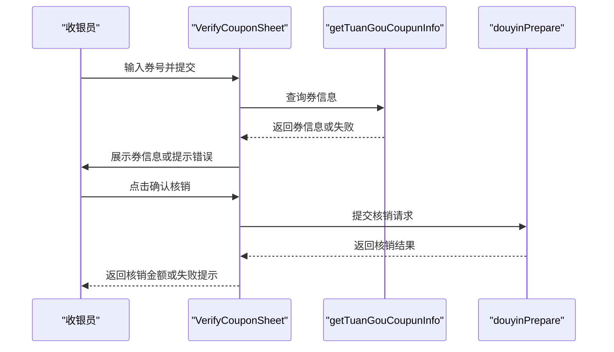
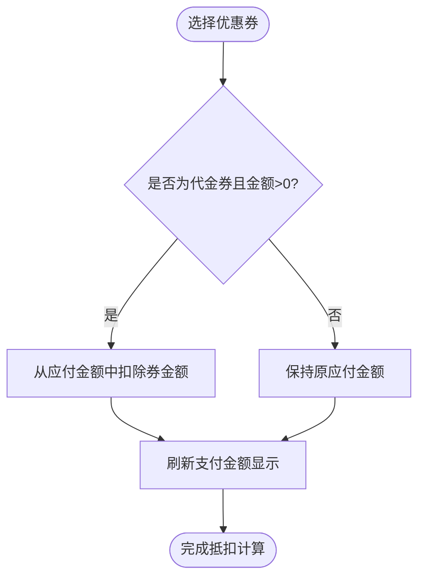
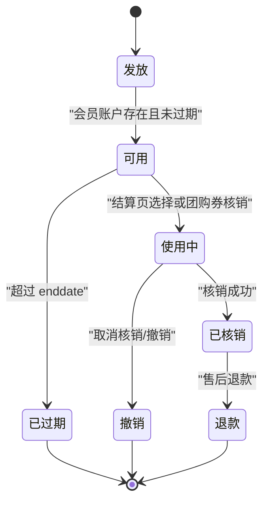
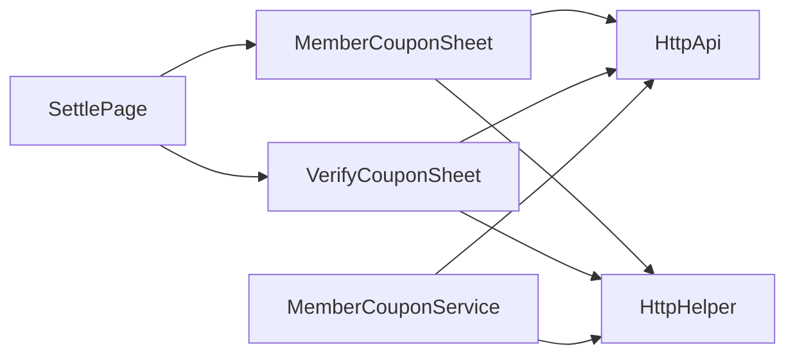

# 优惠券核销系统

<cite>
**本文引用的文件**
- [member_coupon_service.dart](file://lib/util/member_coupon_service.dart)
- [member_coupon_sheet.dart](file://lib/components/member_coupon_sheet.dart)
- [verify_coupon_sheet.dart](file://lib/components/verify_coupon_sheet.dart)
- [settle_page.dart](file://lib/pages/order/settle_page.dart)
</cite>

## 目录
1. [引言](#引言)
2. [项目结构](#项目结构)
3. [核心组件](#核心组件)
4. [架构总览](#架构总览)
5. [详细组件分析](#详细组件分析)
6. [依赖关系分析](#依赖关系分析)
7. [性能与可用性考虑](#性能与可用性考虑)
8. [故障排查指南](#故障排查指南)
9. [结论](#结论)
10. [附录：扩展指南](#附录扩展指南)

## 引言
本文件围绕“优惠券核销系统”展开，面向订单结算流程中的会员优惠券与团购券核销能力。文档重点包括：
- MemberCoupon 数据模型设计：优惠券类型、属性与展示文本。
- 优惠券查询机制：按会员关联查询、有效期字段与前端使用限制。
- 优惠券选择界面：列表展示、筛选逻辑、用户交互与返回选中结果。
- VerifyCouponSheet 核销流程：扫码/输入券号、查询券信息、确认核销与金额回传。
- 优惠券与订单金额的绑定关系：代金券抵扣逻辑、与其他优惠的叠加顺序。
- 生命周期管理：发放、使用、过期、作废等状态在前后端的体现。
- 扩展建议：新增优惠券类型或自定义核销规则的实现思路。

## 项目结构
本项目中，优惠券相关功能主要由以下文件组成：
- 领域服务层：会员与优惠券网络请求封装。
- 页面组件层：会员优惠券选择弹窗、团购券核销弹窗。
- 业务入口层：订单结算页，负责调用选择与核销、计算最终应付金额。

**图表来源**
- [settle_page.dart:686-702](file://lib/pages/order/settle_page.dart#L686-L702)
- [settle_page.dart:2552-2562](file://lib/pages/order/settle_page.dart#L2552-L2562)
- [member_coupon_sheet.dart:1-46](file://lib/components/member_coupon_sheet.dart#L1-L46)
- [verify_coupon_sheet.dart:1-45](file://lib/components/verify_coupon_sheet.dart#L1-L45)
- [member_coupon_service.dart:1-20](file://lib/util/member_coupon_service.dart#L1-L20)

**章节来源**
- [settle_page.dart:686-702](file://lib/pages/order/settle_page.dart#L686-L702)
- [settle_page.dart:2552-2562](file://lib/pages/order/settle_page.dart#L2552-L2562)
- [member_coupon_sheet.dart:1-46](file://lib/components/member_coupon_sheet.dart#L1-L46)
- [verify_coupon_sheet.dart:1-45](file://lib/components/verify_coupon_sheet.dart#L1-L45)
- [member_coupon_service.dart:1-20](file://lib/util/member_coupon_service.dart#L1-L20)

## 核心组件
本节对三大关键组件进行概要说明：
- MemberCoupon：描述会员优惠券的数据结构与展示文本，包含类型与金额字段。
- MemberCouponSheet：加载并展示会员可用优惠券列表，支持点击选择并返回选中的优惠券对象。
- VerifyCouponSheet：团购券核销弹窗，支持输入券号、查询券信息、确认核销并返回核销金额。
- MemberCouponService：封装会员挂账、优惠券撤销、团购券撤销与支付核销等后端接口。

**章节来源**
- [member_coupon_sheet.dart:1-46](file://lib/components/member_coupon_sheet.dart#L1-L46)
- [member_coupon_sheet.dart:48-120](file://lib/components/member_coupon_sheet.dart#L48-L120)
- [verify_coupon_sheet.dart:1-45](file://lib/components/verify_coupon_sheet.dart#L1-L45)
- [member_coupon_service.dart:1-20](file://lib/util/member_coupon_service.dart#L1-L20)

## 架构总览
优惠券核销的整体流程分为两条主线：
- 会员优惠券选择与抵扣：在结算页触发 MemberCouponSheet，选择后根据券类型（尤其是代金券）直接参与金额抵扣。
- 团购券核销：通过 VerifyCouponSheet 完成券号查询与平台侧核销，成功后将金额回传至结算页用于支付汇总。

**图表来源**
- [settle_page.dart:686-702](file://lib/pages/order/settle_page.dart#L686-L702)
- [settle_page.dart:2552-2562](file://lib/pages/order/settle_page.dart#L2552-L2562)
- [member_coupon_sheet.dart:84-120](file://lib/components/member_coupon_sheet.dart#L84-L120)
- [verify_coupon_sheet.dart:226-310](file://lib/components/verify_coupon_sheet.dart#L226-L310)

## 详细组件分析

### MemberCoupon 数据模型
MemberCoupon 是会员优惠券的核心数据载体，包含以下关键字段：
- favid：优惠券唯一标识。
- favname：优惠券名称。
- favamt：优惠金额或折扣值。
- favtype：券类型，取值语义为：
  - 1：代金券（直接抵扣现金）。
  - 2：折扣券（显示为折扣值）。
  - 3：礼品券（用于礼品类场景）。
- enddate：有效期截止时间，用于前端展示与基础校验。

此外，该模型提供两个便捷属性：
- typeText：根据 favtype 返回中文类型文案。
- amountText：根据 favtype 决定显示“X折”还是“¥金额”。

复杂度分析：
- 构造与解析均为 O(1)。
- 文本属性生成不涉及复杂计算，时间复杂度 O(1)。

**图表来源**
- [member_coupon_sheet.dart:1-46](file://lib/components/member_coupon_sheet.dart#L1-L46)

**章节来源**
- [member_coupon_sheet.dart:1-46](file://lib/components/member_coupon_sheet.dart#L1-L46)

### 优惠券查询机制
MemberCouponSheet 通过调用 searchVipFavList 获取会员可用优惠券列表，请求参数包括：
- vipid：会员ID。
- master：订单主单 JSON。
- projectlist：订单明细 JSON。
- clienttype：客户端类型，固定为 APP。

响应数据结构兼容 data/Data 两种键名，且 list/favlist 均可作为子列表；空数据时展示“暂无可用优惠券”。

有效性检查与状态：
- 当前实现未在后端返回的结构化字段中进行严格的状态码判断，而是基于是否存在有效数据判定成功。
- 有效期 enddate 由前端展示；如需强校验可在 _loadCoupons 后增加过滤逻辑，剔除已过期券。
- 使用状态检查依赖于后端返回数据；如后端返回了 status 等字段，可进一步在前端隐藏不可用券。

**图表来源**
- [member_coupon_sheet.dart:84-120](file://lib/components/member_coupon_sheet.dart#L84-L120)

**章节来源**
- [member_coupon_sheet.dart:84-120](file://lib/components/member_coupon_sheet.dart#L84-L120)

### 优惠券选择界面
MemberCouponSheet 是一个底部弹窗，主要职责：
- 列表展示：每个优惠券以卡片形式呈现，包含面值/折扣、类型、有效期。
- 用户交互：点击任意一张优惠券即返回该券对象给调用方。
- 加载状态：加载中显示进度条；无数据时显示提示文案。

可选筛选条件：
- 当前实现未内置筛选控件；可通过外部传入 master/projectlist 让后端按订单范围返回可用券。
- 如需前端筛选，可增加按类型（代金券/折扣券/礼品券）或有效期过滤。

**图表来源**
- [member_coupon_sheet.dart:48-120](file://lib/components/member_coupon_sheet.dart#L48-L120)
- [member_coupon_sheet.dart:201-258](file://lib/components/member_coupon_sheet.dart#L201-L258)

**章节来源**
- [member_coupon_sheet.dart:48-120](file://lib/components/member_coupon_sheet.dart#L48-L120)
- [member_coupon_sheet.dart:201-258](file://lib/components/member_coupon_sheet.dart#L201-L258)

### VerifyCouponSheet 核销流程
VerifyCouponSheet 负责团购券核销，步骤如下：
1. 输入或扫描券号。
2. 调用 getTuanGouCoupunInfo 查询券信息，失败时提示“未查询到券信息”。
3. 展示券的平台（抖音/美团/快手）、类型（代金券/团购券）、名称与面值。
4. 点击“确认核销”，调用 douyinPrepare 完成平台侧核销。
5. 成功后返回核销金额，供结算页汇总支付。

错误处理：
- 查询失败、网络异常均会 Toast 提示。
- 核销失败时提示“核销失败”，不会回传金额。

**图表来源**
- [verify_coupon_sheet.dart:226-310](file://lib/components/verify_coupon_sheet.dart#L226-L310)

**章节来源**
- [verify_coupon_sheet.dart:226-310](file://lib/components/verify_coupon_sheet.dart#L226-L310)

### 优惠券与订单金额的绑定关系
在结算页中，当用户选择了会员优惠券时，系统会根据券类型执行抵扣：
- 若为代金券（favtype=1）且金额大于 0，则从应付金额中直接扣除该券金额。
- 扣减顺序为：先减去已有支付金额、促销优惠金额，再减去代金券金额。
- 折扣券与礼品券在当前结算逻辑中不直接参与金额扣减，主要用于展示与记录。

**图表来源**
- [settle_page.dart:686-702](file://lib/pages/order/settle_page.dart#L686-L702)

**章节来源**
- [settle_page.dart:686-702](file://lib/pages/order/settle_page.dart#L686-L702)

### 生命周期管理
优惠券的生命周期涉及多个环节：
- 发放：由后端在会员账户下发放优惠券，前端通过 searchVipFavList 获取可用列表。
- 使用：
  - 会员代金券在结算页被选择并抵扣金额。
  - 团购券通过 VerifyCouponSheet 完成平台侧核销。
- 过期：前端展示 enddate；建议在 _loadCoupons 之后增加本地过期过滤，避免展示已过期券。
- 作废/撤销：
  - 会员优惠券撤销通过 MemberCouponService.unVerifyCoupon 调用。
  - 团购券撤销通过 MemberCouponService.cancelPrepare 调用。
  - 支付核销通过 MemberCouponService.verifyCouponPay 调用。

**图表来源**
- [member_coupon_service.dart:22-126](file://lib/util/member_coupon_service.dart#L22-L126)
- [member_coupon_sheet.dart:1-46](file://lib/components/member_coupon_sheet.dart#L1-L46)

**章节来源**
- [member_coupon_service.dart:22-126](file://lib/util/member_coupon_service.dart#L22-L126)
- [member_coupon_sheet.dart:1-46](file://lib/components/member_coupon_sheet.dart#L1-L46)

## 依赖关系分析
优惠券相关模块之间的依赖关系如下：
- SettlePage 依赖 MemberCouponSheet 和 VerifyCouponSheet。
- MemberCouponSheet 依赖 HttpApi 与 HttpHelper 进行网络请求。
- VerifyCouponSheet 同样依赖 HttpApi 与 HttpHelper。
- MemberCouponService 独立封装会员服务，不直接耦合 UI。

**图表来源**
- [settle_page.dart:686-702](file://lib/pages/order/settle_page.dart#L686-L702)
- [settle_page.dart:2552-2562](file://lib/pages/order/settle_page.dart#L2552-L2562)
- [member_coupon_sheet.dart:84-120](file://lib/components/member_coupon_sheet.dart#L84-L120)
- [verify_coupon_sheet.dart:226-310](file://lib/components/verify_coupon_sheet.dart#L226-L310)
- [member_coupon_service.dart:1-20](file://lib/util/member_coupon_service.dart#L1-L20)

**章节来源**
- [settle_page.dart:686-702](file://lib/pages/order/settle_page.dart#L686-L702)
- [settle_page.dart:2552-2562](file://lib/pages/order/settle_page.dart#L2552-L2562)
- [member_coupon_sheet.dart:84-120](file://lib/components/member_coupon_sheet.dart#L84-L120)
- [verify_coupon_sheet.dart:226-310](file://lib/components/verify_coupon_sheet.dart#L226-L310)
- [member_coupon_service.dart:1-20](file://lib/util/member_coupon_service.dart#L1-L20)

## 性能与可用性考虑
- 列表加载：MemberCouponSheet 在初始化时一次性加载优惠券列表，适合会员常用券数量有限的场景；若券量较大，建议分页或懒加载。
- 网络重试：当前 requestForm 失败时抛出异常，上层捕获后设置空列表或提示；可考虑增加重试策略与退避算法。
- 用户体验：
  - 团购券核销输入框自动聚焦，提升扫码体验。
  - 优惠券选择弹窗高度自适应屏幕，提高可读性。
- 可扩展性：
  - MemberCoupon.typeText/amountText 便于新增券类型的展示文案。
  - CouponVerifyHelper 提供了统一的券号核销入口，方便复用。

[本节为通用性能与可用性建议，不直接分析具体文件]

## 故障排查指南
常见问题及定位方法：
- 优惠券列表为空：
  - 检查 vipid 是否正确，master/projectlist 是否与当前订单一致。
  - 查看后端返回 data/Data 与 list/favlist 字段是否符合预期。
- 团购券查询失败：
  - 确认券号格式正确，网络请求是否返回有效 data/Data。
  - 检查 getTuanGouCoupunInfo 接口权限与商户配置。
- 团购券核销失败：
  - 检查 douyinPrepare 参数是否完整（verify_token、order_id、certificates、saleid、billno 等）。
  - 关注 businesstype、dytype、productprice 等字段是否与平台要求一致。
- 代金券未抵扣：
  - 确认所选券 favtype 是否为 1，且 favamt > 0。
  - 核对结算页扣减逻辑是否被执行。

**章节来源**
- [member_coupon_sheet.dart:84-120](file://lib/components/member_coupon_sheet.dart#L84-L120)
- [verify_coupon_sheet.dart:226-310](file://lib/components/verify_coupon_sheet.dart#L226-L310)
- [settle_page.dart:686-702](file://lib/pages/order/settle_page.dart#L686-L702)

## 结论
本系统的优惠券核销能力由清晰的组件分层构成：
- 数据模型明确区分券类型，便于扩展。
- 查询与核销流程分别封装于选择弹窗与核销弹窗，职责单一。
- 结算页负责整合会员优惠券与团购券核销金额，形成完整的支付闭环。
- 服务层提供统一的后端接口封装，降低 UI 层的网络细节耦合。

在实际落地中，建议增强有效期校验、状态码解析与异常重试，以提升系统稳定性与用户体验。

[本节为总结性内容，不直接分析具体文件]

## 附录：扩展指南

### 新增优惠券类型
目标：在不破坏现有逻辑的前提下，新增一种优惠券类型（例如“满减券”），并在结算页参与抵扣。

实施步骤：
1. 在 MemberCoupon 的 favtype 枚举中新增类型编号，并完善 typeText 与 amountText 的分支逻辑。
   - 参考路径：[member_coupon_sheet.dart:1-46](file://lib/components/member_coupon_sheet.dart#L1-L46)
2. 在结算页的优惠券选择回调中，新增对该新类型的抵扣规则。
   - 参考路径：[settle_page.dart:686-702](file://lib/pages/order/settle_page.dart#L686-L702)
3. 如需前端展示特殊文案或样式，可在 MemberCouponSheet 的卡片构建处增加对应分支。
   - 参考路径：[member_coupon_sheet.dart:201-258](file://lib/components/member_coupon_sheet.dart#L201-L258)

注意事项：
- 确保后端返回的新类型券字段与前端解析一致。
- 对于非代金券类型，谨慎修改扣减顺序，避免影响既有促销逻辑。

### 自定义核销规则
目标：在团购券核销前增加自定义校验（例如门店限制、商品类目限制）。

实施步骤：
1. 在 VerifyCouponSheet 的 _queryCoupon 成功后，插入自定义校验逻辑。
   - 参考路径：[verify_coupon_sheet.dart:226-310](file://lib/components/verify_coupon_sheet.dart#L226-L310)
2. 若校验失败，提示用户并阻止进入“确认核销”阶段。
3. 如需持久化核销规则，可将其放入 MemberCouponService 或新建专用服务类。
   - 参考路径：[member_coupon_service.dart:22-126](file://lib/util/member_coupon_service.dart#L22-L126)

### 强化有效期与使用状态检查
目标：在前端对优惠券的有效期与使用状态做更强控制。

实施步骤：
1. 在 MemberCouponSheet 的 _loadCoupons 返回数据后，对 enddate 进行本地过滤，移除已过期券。
   - 参考路径：[member_coupon_sheet.dart:84-120](file://lib/components/member_coupon_sheet.dart#L84-L120)
2. 如果后端返回使用状态字段（如 status），则在渲染前过滤掉不可用券。
3. 对无法使用的券，提供提示文案而非直接隐藏，提升用户体验。