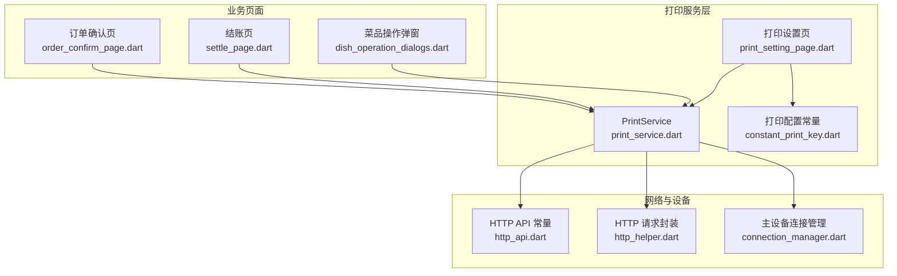
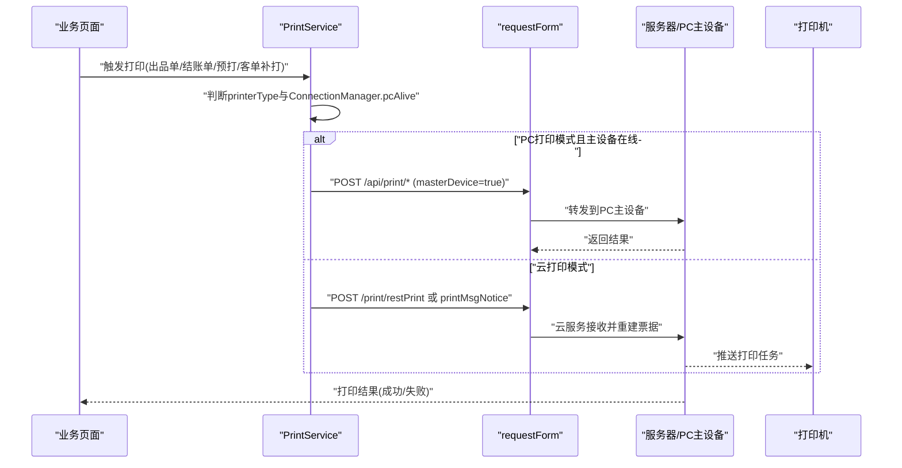
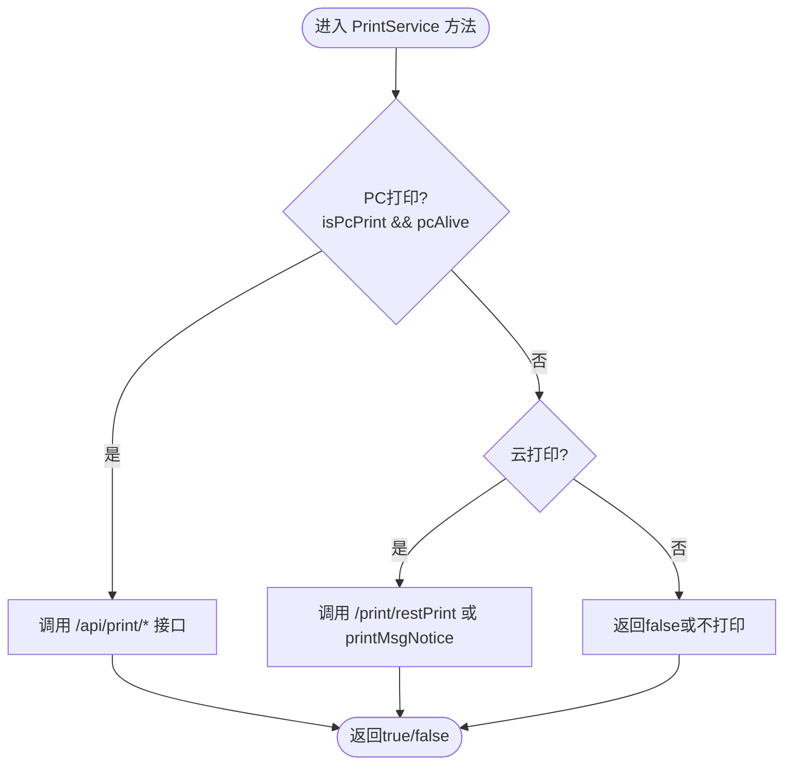
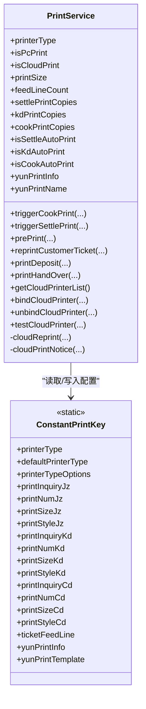
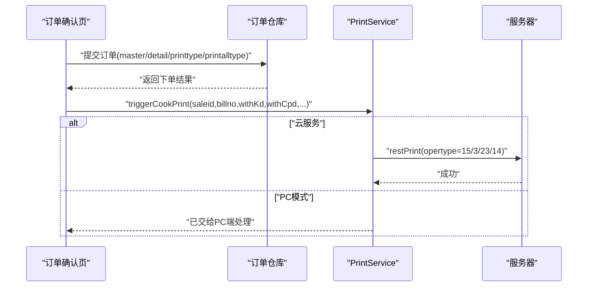
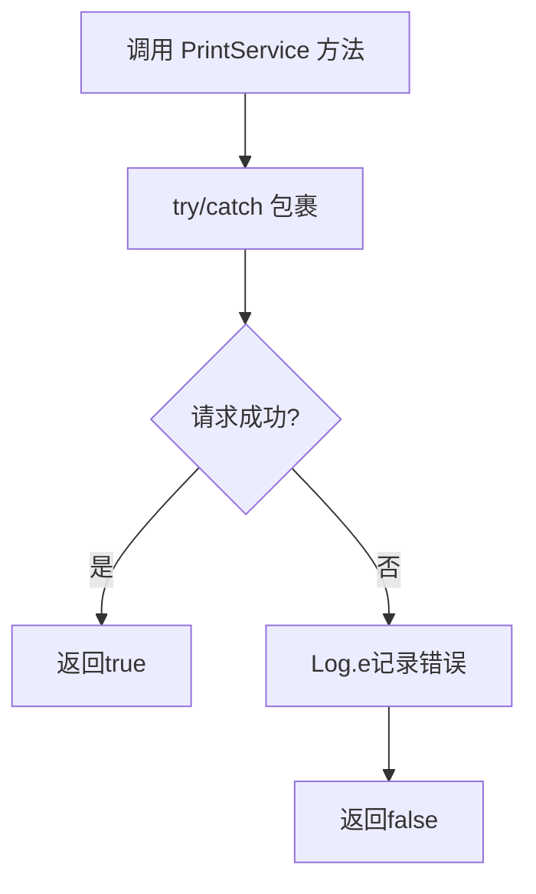
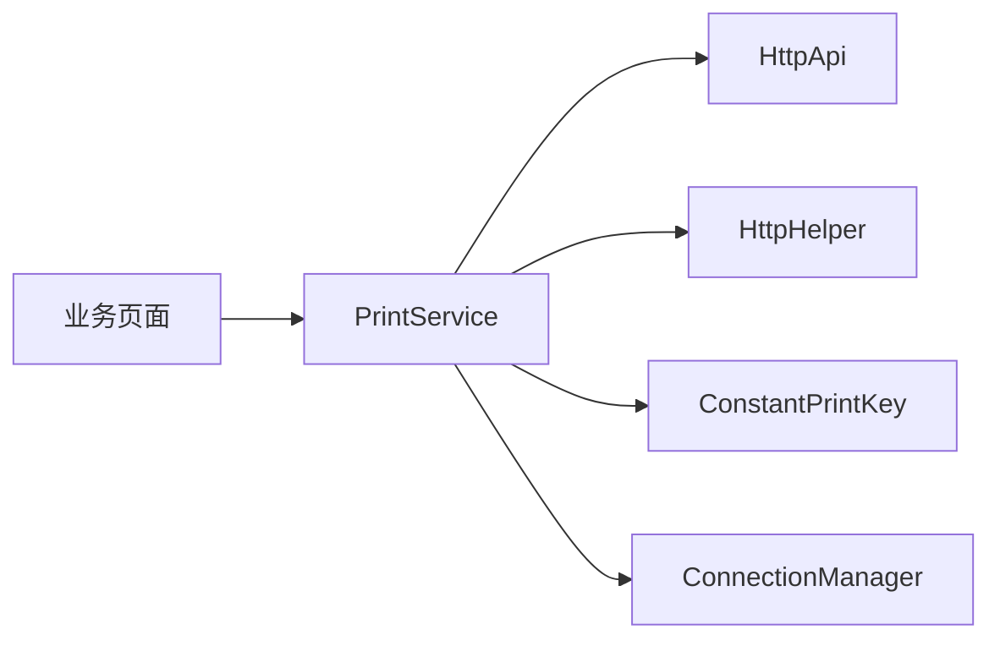

# 打印服务集成

<cite>
**本文引用的文件**
- [print_service.dart](file://lib/util/print_service.dart)
- [constant_print_key.dart](file://lib/res/constant_print_key.dart)
- [print_setting_page.dart](file://lib/setting/page/print_setting_page.dart)
- [order_confirm_page.dart](file://lib/pages/order/order_confirm_page.dart)
- [settle_page.dart](file://lib/pages/order/settle_page.dart)
- [http_api.dart](file://lib/net/http_api.dart)
- [http_helper.dart](file://lib/net/http_helper.dart)
- [dish_operation_dialogs.dart](file://lib/components/dish_operation_dialogs.dart)
- [connection_manager.dart](file://lib/net/connection_manager.dart)
</cite>

## 目录
1. [简介](#简介)
2. [项目结构](#项目结构)
3. [核心组件](#核心组件)
4. [架构总览](#架构总览)
5. [详细组件分析](#详细组件分析)
6. [依赖关系分析](#依赖关系分析)
7. [性能与可靠性](#性能与可靠性)
8. [故障排查指南](#故障排查指南)
9. [结论](#结论)
10. [附录：扩展与示例](#附录扩展与示例)

## 简介
本文件面向“打印服务集成”的技术与产品读者，系统性梳理 Flutter 端打印能力的设计与实现。文档围绕 PrintService 展开，说明 PC 打印与云打印两种模式的切换机制、打印配置管理、业务打印场景处理逻辑、模板与样式控制思路、任务调度与错误处理策略，以及硬件设备对接方式，并提供扩展新模板或自定义打印行为的实践指引。

## 项目结构
打印相关代码主要分布在以下位置：
- 打印服务核心：lib/util/print_service.dart
- 打印配置常量：lib/res/constant_print_key.dart
- 打印设置界面：lib/setting/page/print_setting_page.dart
- 下单与结账流程：lib/pages/order/order_confirm_page.dart、lib/pages/order/settle_page.dart
- HTTP API 定义：lib/net/http_api.dart
- HTTP 请求封装：lib/net/http_helper.dart
- 菜品操作弹窗（退菜单等）：lib/components/dish_operation_dialogs.dart
- 主设备连接状态：lib/net/connection_manager.dart

**图表来源**
- [print_service.dart:1-200](file://lib/util/print_service.dart#L1-L200)
- [constant_print_key.dart:1-147](file://lib/res/constant_print_key.dart#L1-L147)
- [print_setting_page.dart:1-200](file://lib/setting/page/print_setting_page.dart#L1-L200)
- [order_confirm_page.dart:590-666](file://lib/pages/order/order_confirm_page.dart#L590-L666)
- [settle_page.dart:1360-1412](file://lib/pages/order/settle_page.dart#L1360-L1412)
- [http_api.dart:257-500](file://lib/net/http_api.dart#L257-L500)
- [http_helper.dart:475-578](file://lib/net/http_helper.dart#L475-L578)

**章节来源**
- [print_service.dart:1-200](file://lib/util/print_service.dart#L1-L200)
- [constant_print_key.dart:1-147](file://lib/res/constant_print_key.dart#L1-L147)
- [print_setting_page.dart:1-200](file://lib/setting/page/print_setting_page.dart#L1-L200)
- [http_api.dart:257-500](file://lib/net/http_api.dart#L257-L500)
- [http_helper.dart:475-578](file://lib/net/http_helper.dart#L475-L578)

## 核心组件
- PrintService：统一的打印入口，封装 PC 打印、云打印、预打、客单补打、押金单、交班打印等能力，并维护本地打印配置读取。
- ConstantPrintKey：集中声明所有打印相关持久化 Key、打印机类型选项、打印单据枚举值。
- PrintSettingPage：打印方式选择、纸规格设置、票尾走纸行数调整、云打印机选择与管理入口。
- HTTP API 与请求封装：提供 restPrint、pcRePrint、pcPrintKDInfo、printGetList、bindPrint 等接口地址；统一通过 requestForm 发起请求，自动区分主设备与云服务路径。
- 业务页面集成：下单确认后触发出品单、结账单；菜品操作中触发退菜单等。

**章节来源**
- [print_service.dart:1-200](file://lib/util/print_service.dart#L1-L200)
- [constant_print_key.dart:1-147](file://lib/res/constant_print_key.dart#L1-L147)
- [print_setting_page.dart:1-200](file://lib/setting/page/print_setting_page.dart#L1-L200)
- [http_api.dart:257-500](file://lib/net/http_api.dart#L257-L500)

## 架构总览
系统采用“业务调用 → 打印服务 → 网络与设备”的分层结构。PrintService 屏蔽底层差异，对外暴露 triggerCookPrint、triggerSettlePrint、prePrint、reprintCustomerTicket、printDeposit、printHandOver 等方法。根据当前 printerType 与 ConnectionManager.pcAlive 决定走 PC 直连或云服务路径。

**图表来源**
- [print_service.dart:201-416](file://lib/util/print_service.dart#L201-L416)
- [http_helper.dart:475-578](file://lib/net/http_helper.dart#L475-L578)
- [http_api.dart:257-500](file://lib/net/http_api.dart#L257-L500)

## 详细组件分析

### PrintService 实现与模式切换
- 模式判定
  - printerType 从本地存储读取，默认值为“PC打印”。
  - isPcPrint 与 isCloudPrint 快捷判断是否使用 PC 或云打印。
  - ConnectionManager.pcAlive 决定 PC 直连是否可用。
- 关键方法
  - triggerCookPrint：下单成功后按 withKd/withCpd/withCpdBranch/withLabel 决定是否补发客单、出品单、出品分单、杯贴。
  - triggerSettlePrint：结账后走 PC PrintPayInfo 或云服务 restPrint opertype=2。
  - prePrint：预打单走 PC RePrint 或云服务 restPrint opertype=8。
  - reprintCustomerTicket：客单补打，PC 模式调 PrintKDInfo，云服务模式调 restPrint opertype=15。
  - printDeposit/printHandOver：押金单、交班打印，优先 PC，回退云服务。
  - cloudReprint/cloudPrintNotice：统一封装云服务重打与通知接口。
- 内部策略
  - 所有云服务调用均通过 requestForm 发送，携带 jobcontent/opertype/billno。
  - 异常统一记录日志，失败返回 false，保证上层可感知失败。

**图表来源**
- [print_service.dart:1-200](file://lib/util/print_service.dart#L1-L200)
- [print_service.dart:201-416](file://lib/util/print_service.dart#L201-L416)

**章节来源**
- [print_service.dart:1-200](file://lib/util/print_service.dart#L1-L200)
- [print_service.dart:201-416](file://lib/util/print_service.dart#L201-L416)

### 打印配置管理
- 打印机类型
  - 支持“PC打印/云打印/蓝牙打印/接口打印”，默认“PC打印”。
  - 通过 ConstantPrintKey.printerType 持久化，PrintSettingPage 提供选择器并在切换时清空蓝牙缓存。
- 纸张规格与样式
  - 结账、客单、厨打分别有 printSizeJz/Kd/Cd 与 printStyleJz/Kd/Cd。
  - 打印设置页在切换 58mm/80mm 时同步更新三类单据的 size 与 style。
- 打印份数与自动打印开关
  - settlePrintCopies、kdPrintCopies、cookPrintCopies 对应结账、客单、厨打份数。
  - isSettleAutoPrint、isKdAutoPrint、isCookAutoPrint 控制是否自动打印。
- 票尾走纸行数
  - ticketFeedLine 用于小票结束后额外走纸行数，支持 UI 加减调节。
- 云打印机管理
  - yunPrintInfo/yunPrintName 保存选中云打印机信息，支持列表获取、绑定、解绑、测试。

**图表来源**
- [print_service.dart:1-200](file://lib/util/print_service.dart#L1-L200)
- [constant_print_key.dart:1-147](file://lib/res/constant_print_key.dart#L1-L147)

**章节来源**
- [print_service.dart:1-200](file://lib/util/print_service.dart#L1-L200)
- [constant_print_key.dart:1-147](file://lib/res/constant_print_key.dart#L1-L147)
- [print_setting_page.dart:1-200](file://lib/setting/page/print_setting_page.dart#L1-L200)
- [print_setting_page.dart:201-319](file://lib/setting/page/print_setting_page.dart#L201-L319)

### 业务打印场景处理逻辑
- 出品单（厨打）
  - 下单确认页组装 printtype/printalltype，若含挂起菜品则追加挂起单类型；含杯贴商品时追加杯贴类型；云服务模式下将客单、出品单、出品分单并入 printtype 交由服务端重建。
  - 成功后若为云服务模式，不再重复调用 restPrint，避免重复出票。
- 结账单
  - 结账完成后调用 triggerSettlePrint；PC 模式走 /api/print/PrintPayInfo，云服务模式走 /print/restPrint opertype=2。
- 退菜单
  - 退菜弹窗提供“打印退菜单”开关，打印类型为 4（退菜单）。
- 催菜单
  - 由业务侧调用 PrintService 相关方法（与出品单一致，opertype=5），结合 printalltype 与服务端重建票据。
- 起菜单
  - 通过云服务 restPrint opertype=7 触发，或在下单/改单时随 printtype 包含起菜单类型。
- 预打单
  - prePrint 方法：PC 模式 POST /api/print/RePrint；云服务模式 REST opertype=8。
- 客单补打
  - reprintCustomerTicket：PC 模式 POST /api/print/PrintKDInfo；云服务模式 /print/restPrint opertype=15。

**图表来源**
- [order_confirm_page.dart:590-666](file://lib/pages/order/order_confirm_page.dart#L590-L666)
- [print_service.dart:1-200](file://lib/util/print_service.dart#L1-L200)
- [http_api.dart:257-500](file://lib/net/http_api.dart#L257-L500)

**章节来源**
- [order_confirm_page.dart:590-666](file://lib/pages/order/order_confirm_page.dart#L590-L666)
- [settle_page.dart:1360-1412](file://lib/pages/order/settle_page.dart#L1360-L1412)
- [dish_operation_dialogs.dart:1937-2160](file://lib/components/dish_operation_dialogs.dart#L1937-L2160)
- [print_service.dart:1-200](file://lib/util/print_service.dart#L1-L200)

### 打印模板系统与样式定制
- 模板类型与尺寸
  - 结账、客单、厨打分别有 printStyleJz/Kd/Cd 与 printSizeJz/Kd/Cd。
  - 打印设置页在切换 58mm/80mm 时同步更新这三类单据的样式与规格。
- 模板加载与渲染
  - 云打印模板类型由 ConstantPrintKey.yunPrintTemplate 管理；实际模板内容与渲染逻辑由后端或打印设备驱动承担，Flutter 端通过云服务重建票据。
- 动态内容填充
  - 通过 saleid/billno/jobcontent/opertype 让服务端重建票据内容，前端无需硬编码票据布局。
- 样式定制建议
  - 在前端仅维护“尺寸+样式编号”的映射，具体视觉由后端模板或设备指令集决定。
  - 如需新增模板，建议在后端增加模板 ID，并在前端常量中补充样式编号映射。

**章节来源**
- [constant_print_key.dart:1-147](file://lib/res/constant_print_key.dart#L1-L147)
- [print_setting_page.dart:201-319](file://lib/setting/page/print_setting_page.dart#L201-L319)

### 打印任务队列管理与监控
- 任务调度
  - PrintService 的方法均为异步调用，按业务顺序串行执行；同一时间无全局并发队列，适合轻量级点餐场景。
- 错误重试
  - 当前实现未内置自动重试；所有异常均捕获并记录日志，返回 false 供上层提示。
  - 建议在上层对关键打印（如结账单）进行最多一次重试，并给出用户反馈。
- 状态监控
  - 通过 ConnectionManager.pcAlive 监控 PC 主设备连通性；requestForm 在网络层失败时会广播主设备丢失事件。
  - 云打印机状态通过 getCloudPrinterList/bind/unbind/test 等接口反馈。

**图表来源**
- [print_service.dart:201-416](file://lib/util/print_service.dart#L201-L416)
- [http_helper.dart:475-578](file://lib/net/http_helper.dart#L475-L578)

**章节来源**
- [print_service.dart:201-416](file://lib/util/print_service.dart#L201-L416)
- [http_helper.dart:475-578](file://lib/net/http_helper.dart#L475-L578)

### 硬件设备对接细节
- PC 打印（主设备）
  - 通过 /api/print/* 系列接口直连 PC 主设备；当 ConnectionManager.pcAlive 为真时，PrintService 会优先走该路径。
  - 典型接口：pcPrintPayInfo、pcPrintKDInfo、pcRePrint、pcPrintDepositInfo、pcPrintHandOver。
- 云打印
  - 通过 /print/restPrint 重建票据并下发至云打印机；支持客单、出品单、出品分单、杯贴、预打单、押金单等类型。
  - 云打印机管理：getList/bind/unbind/test。
- 蓝牙打印机与 USB 网络打印机
  - 常量中包含蓝牙地址、名称、IP、端口等键；当前 PrintSettingPage 对非 PC/云打印显示“暂仅支持PC打印和云打印”，蓝牙/USB 作为预留扩展点。
  - 扩展建议：在 PrintService 中新增蓝牙/USB 通道，根据 printerType 分发到对应硬件 SDK；保持与现有 PC/云打印一致的 API 风格。

**章节来源**
- [print_service.dart:1-200](file://lib/util/print_service.dart#L1-L200)
- [print_service.dart:201-416](file://lib/util/print_service.dart#L201-L416)
- [constant_print_key.dart:1-147](file://lib/res/constant_print_key.dart#L1-L147)
- [print_setting_page.dart:201-319](file://lib/setting/page/print_setting_page.dart#L201-L319)
- [http_api.dart:257-500](file://lib/net/http_api.dart#L257-L500)

## 依赖关系分析
- 模块耦合
  - PrintService 依赖 http_api.dart（接口地址）、http_helper.dart（请求封装）、constant_print_key.dart（配置键）、connection_manager.dart（主设备状态）。
  - 业务页面通过 PrintService 间接依赖网络层与设备层，降低耦合。
- 外部依赖
  - sp_util 用于本地持久化打印配置。
  - Dio/DioException 用于网络请求与异常处理。

**图表来源**
- [print_service.dart:1-200](file://lib/util/print_service.dart#L1-L200)
- [http_api.dart:257-500](file://lib/net/http_api.dart#L257-L500)
- [http_helper.dart:475-578](file://lib/net/http_helper.dart#L475-L578)

**章节来源**
- [print_service.dart:1-200](file://lib/util/print_service.dart#L1-L200)
- [http_api.dart:257-500](file://lib/net/http_api.dart#L257-L500)
- [http_helper.dart:475-578](file://lib/net/http_helper.dart#L475-L578)

## 性能与可靠性
- 性能
  - 打印调用为轻量网络请求，不引入重型队列；建议对高频打印（如出品单）合并调用或使用幂等键避免重复。
- 可靠性
  - 主设备离线时自动回退云服务；云服务失败记录日志并返回失败，便于上层重试或提示。
  - 建议增加重试上限与指数退避策略，防止雪崩式重试。
- 可扩展性
  - 新增打印类型仅需在 ConstantPrintKey 补充枚举与 Key，并在 PrintService 中新增方法或分支处理。

[本节为通用指导，不涉及具体文件分析]

## 故障排查指南
- PC 打印不可用
  - 检查 ConnectionManager.pcAlive 是否为真；查看 requestForm 是否因网络层失败触发主设备丢失事件。
  - 核对 /api/print/* 接口路径与参数是否与业务期望一致。
- 云打印无效
  - 确认 yunPrintInfo 是否已选择有效云打印机；调用 getCloudPrinterList 验证列表可用性。
  - 校验 opertype 是否正确（客单15、出品单3、预打8、押金13 等）。
- 重复打印
  - 云服务下单成功后不再额外调用 restPrint；确保业务侧未在 order_confirm_page 外重复触发。
- 打印份数或自动打印不符合预期
  - 检查本地持久化的 printNumJz/Kd/Cd 与 printInquiryJz/Kd/Cd 值；可在打印设置页重新配置。

**章节来源**
- [print_service.dart:201-416](file://lib/util/print_service.dart#L201-L416)
- [http_helper.dart:475-578](file://lib/net/http_helper.dart#L475-L578)
- [print_setting_page.dart:201-319](file://lib/setting/page/print_setting_page.dart#L201-L319)

## 结论
PrintService 以清晰的职责边界整合了 PC 打印与云打印两条链路，并通过 ConstantPrintKey 与 PrintSettingPage 提供了完整的打印配置管理能力。业务侧通过统一的触发方法即可适配多种打印场景，同时借助 HTTP 层与主设备连接状态实现可靠的任务下发与错误处理。未来可在保留现有 API 的基础上，逐步接入蓝牙与 USB 打印通道，并完善任务队列与重试策略，以提升系统的可观测性与鲁棒性。

[本节为总结性内容，不涉及具体文件分析]

## 附录：扩展与示例
- 添加新的打印模板
  - 在 ConstantPrintKey 中新增样式 Key 与默认值，例如 printStyleXxx/printSizeXxx。
  - 在 PrintSettingPage 中为新模板维度提供 UI 选择，并在切换时同步持久化。
  - 在后端新增模板 ID，并确保云服务重建票据时能根据 opertype/saleid 正确输出新模板。
- 自定义打印行为
  - 在 PrintService 中新增方法，例如 triggerCustomPrint，内部按 printerType 分流到 PC 或云服务。
  - 在业务页面调用新方法，并根据返回值进行提示或重试。
- 新增打印类型枚举
  - 在 ConstantPrintKey.printType* 中补充枚举值，并在业务侧按 printalltype 规则组合。

[本节为概念性示例，不涉及具体文件分析]