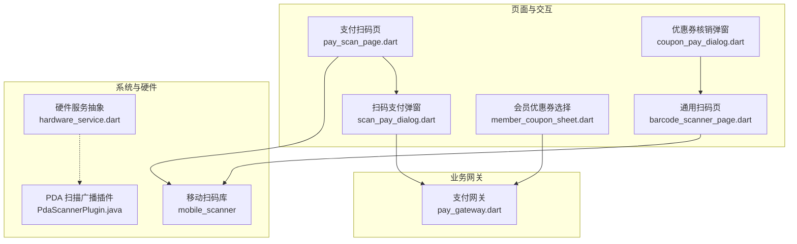
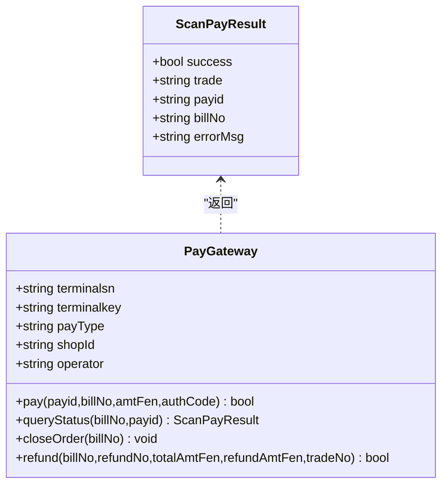
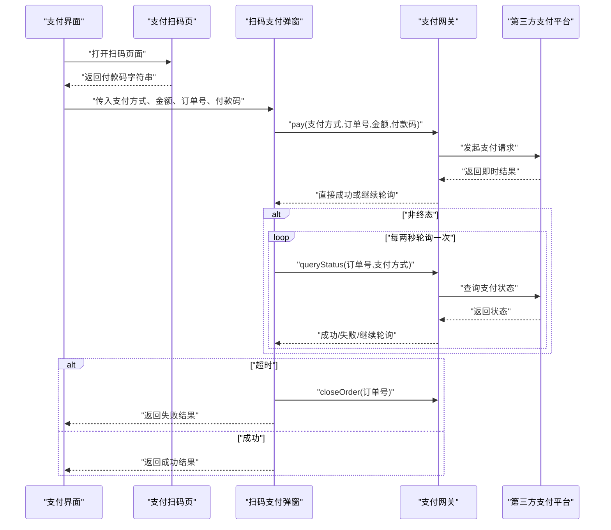
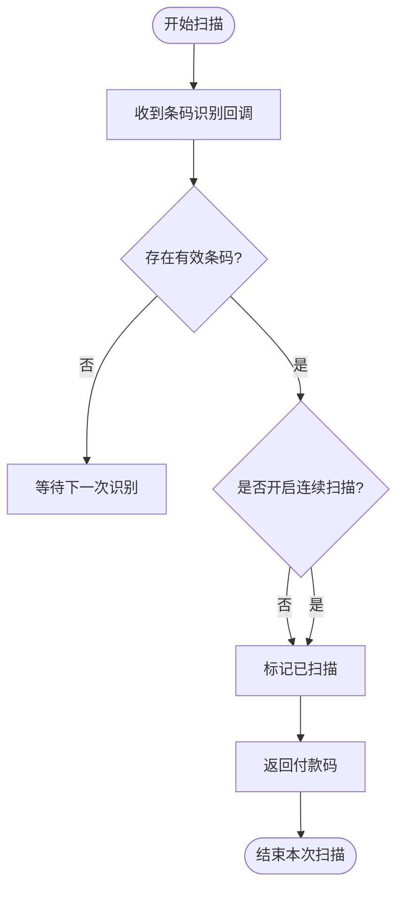
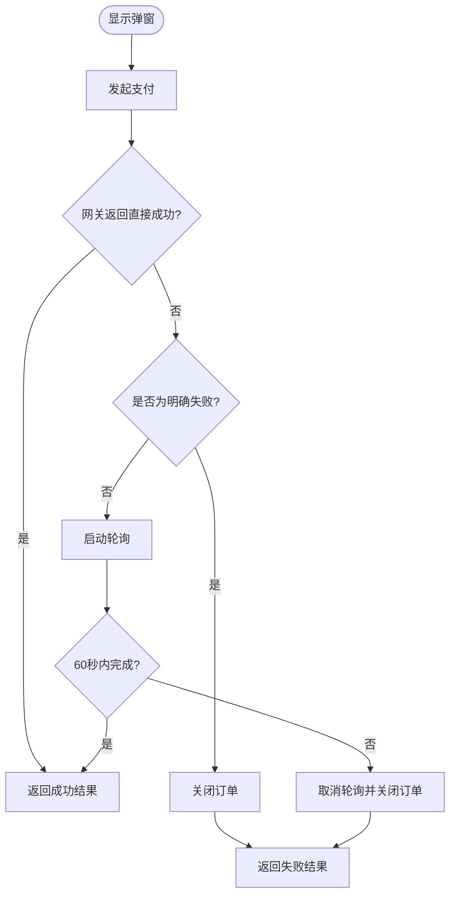
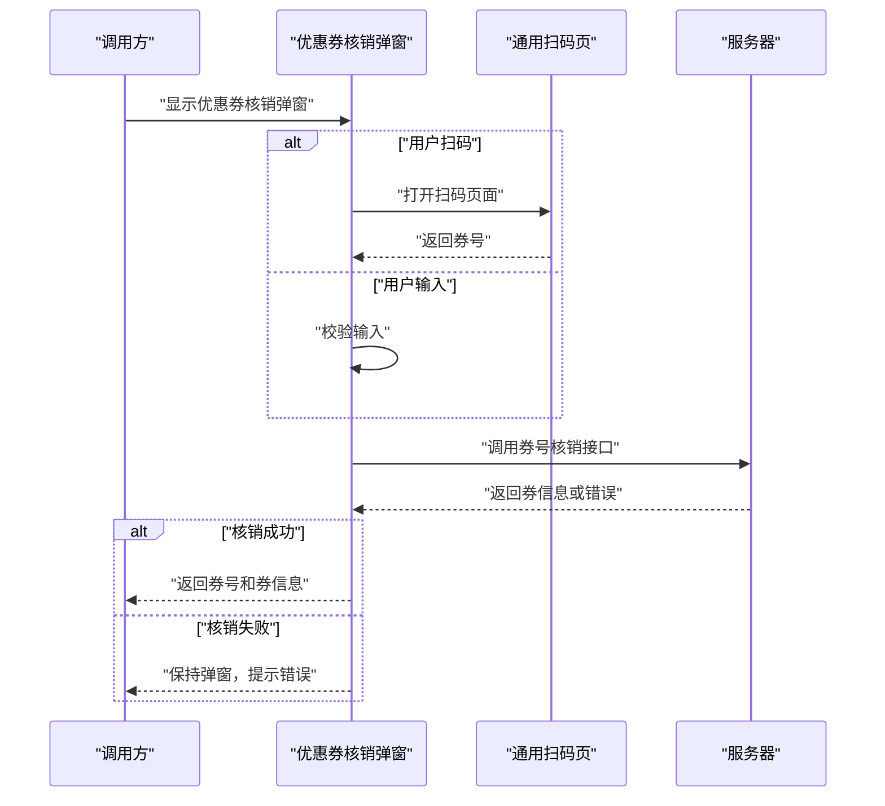
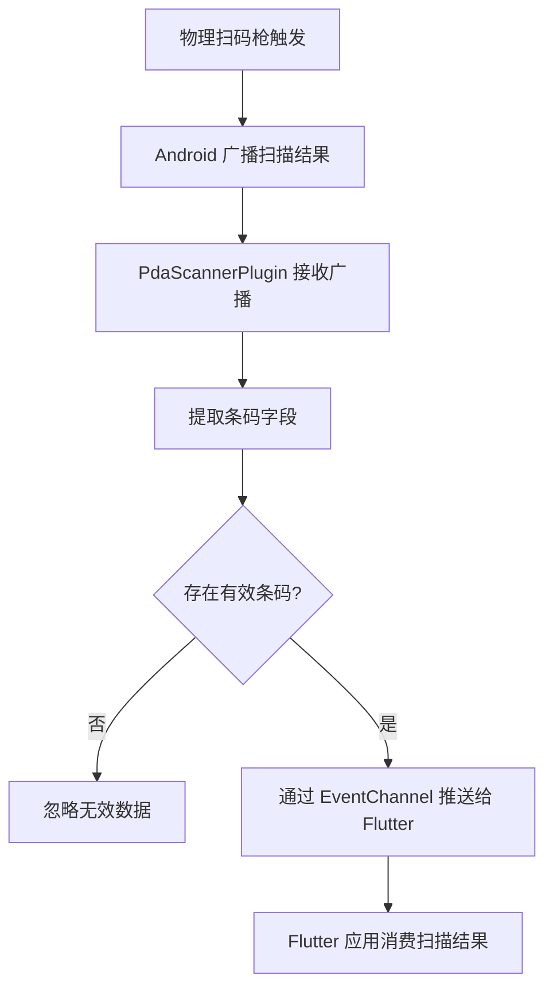
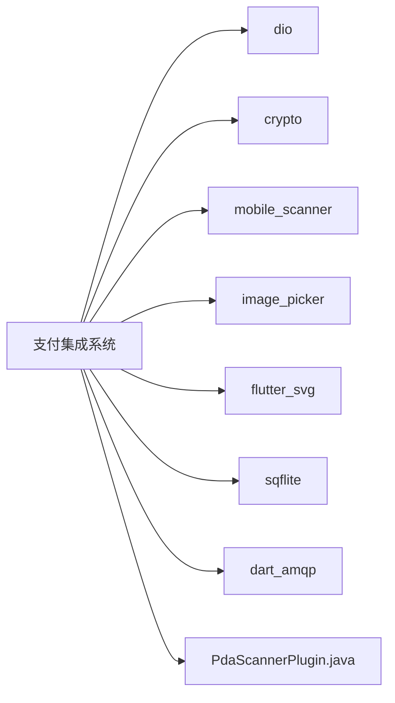
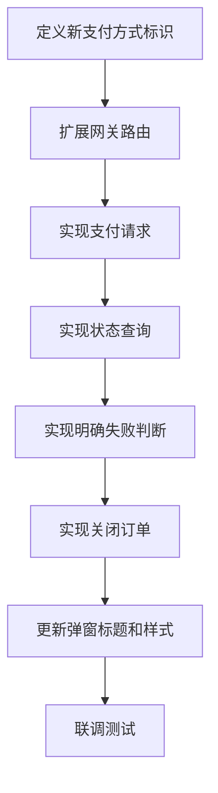

# 支付集成系统

<cite>
**本文引用的文件**   
- [lib/net/pay_gateway.dart](file://lib/net/pay_gateway.dart)
- [lib/pages/order/pay_scan_page.dart](file://lib/pages/order/pay_scan_page.dart)
- [lib/pages/order/scan_pay_dialog.dart](file://lib/pages/order/scan_pay_dialog.dart)
- [lib/widgets/barcode_scanner_page.dart](file://lib/widgets/barcode_scanner_page.dart)
- [lib/components/member_coupon_sheet.dart](file://lib/components/member_coupon_sheet.dart)
- [lib/pages/order/widgets/coupon_pay_dialog.dart](file://lib/pages/order/widgets/coupon_pay_dialog.dart)
- [lib/util/hardware_service.dart](file://lib/util/hardware_service.dart)
- [android/app/src/main/java/com/bycloud/smdc/PdaScannerPlugin.java](file://android/app/src/main/java/com/bycloud/smdc/PdaScannerPlugin.java)
- [pubspec.yaml](file://pubspec.yaml)
</cite>

## 目录

1. [引言](#引言)
2. [项目结构](#项目结构)
3. [核心组件](#核心组件)
4. [架构总览](#架构总览)
5. [详细组件分析](#详细组件分析)
6. [依赖关系分析](#依赖关系分析)
7. [性能与稳定性](#性能与稳定性)
8. [故障排查指南](#故障排查指南)
9. [安全考虑](#安全考虑)
10. [扩展指南：新增支付方式或自定义流程](#扩展指南新增支付方式或自定义流程)
11. [结论](#结论)

## 引言

本文件为支付集成系统的综合技术文档，面向收银点餐场景中的扫码收款、优惠券核销、会员抵扣以及多渠道支付网关接入。系统围绕以下目标展开：

- 提供统一的扫码能力：相机扫描、连续扫描模式、相册图片选择。
- 抽象并统一支付网关：支持收钱吧、优支付、乐刷等第三方平台，屏蔽底层差异。
- 规范支付对话框交互：金额展示、倒计时超时、轮询查询、失败重试与交易号返回。
- 支持会员优惠券与通用条码/二维码扫描。
- 明确支付状态同步机制：异步结果监听、超时处理、失败重试与订单关闭。
- 给出支付安全实践：金额校验、防重复提交、敏感参数签名和错误信息保护。
- 提供扩展路径：如何添加新的支付方式或自定义支付流程。

## 项目结构

支付相关代码主要分布在以下模块：

| 层级 | 职责 | 关键文件 |
|---|---|---|
| 支付网关层 | 抽象支付入口、统一请求封装、多平台实现、状态查询与退款 | `lib/net/pay_gateway.dart` |
| 扫码采集层 | 摄像头扫码、连续扫描、相册图片、PDA 硬件广播 | `lib/pages/order/pay_scan_page.dart`、`lib/widgets/barcode_scanner_page.dart`、`android/.../PdaScannerPlugin.java` |
| 支付交互层 | 扫码支付弹窗、金额展示、倒计时、轮询、失败重试 | `lib/pages/order/scan_pay_dialog.dart` |
| 优惠券层 | 会员优惠券列表、优惠券输入与核销弹窗 | `lib/components/member_coupon_sheet.dart`、`lib/pages/order/widgets/coupon_pay_dialog.dart` |
| 硬件抽象层 | NFC、扫码枪、电子秤、钱箱的统一接口定义 | `lib/util/hardware_service.dart` |
| 依赖声明 | Flutter 插件、网络库、加密库、扫码库 | `pubspec.yaml` |

**图示来源**
- [lib/pages/order/pay_scan_page.dart:1-200](file://lib/pages/order/pay_scan_page.dart#L1-L200)
- [lib/pages/order/scan_pay_dialog.dart:1-200](file://lib/pages/order/scan_pay_dialog.dart#L1-L200)
- [lib/net/pay_gateway.dart:1-200](file://lib/net/pay_gateway.dart#L1-L200)
- [lib/widgets/barcode_scanner_page.dart:1-177](file://lib/widgets/barcode_scanner_page.dart#L1-L177)
- [android/app/src/main/java/com/bycloud/smdc/PdaScannerPlugin.java:1-165](file://android/app/src/main/java/com/bycloud/smdc/PdaScannerPlugin.java#L1-L165)

**章节来源**
- [lib/pages/order/pay_scan_page.dart:1-200](file://lib/pages/order/pay_scan_page.dart#L1-L200)
- [lib/pages/order/scan_pay_dialog.dart:1-200](file://lib/pages/order/scan_pay_dialog.dart#L1-L200)
- [lib/net/pay_gateway.dart:1-200](file://lib/net/pay_gateway.dart#L1-L200)
- [lib/widgets/barcode_scanner_page.dart:1-177](file://lib/widgets/barcode_scanner_page.dart#L1-L177)
- [android/app/src/main/java/com/bycloud/smdc/PdaScannerPlugin.java:1-165](file://android/app/src/main/java/com/bycloud/smdc/PdaScannerPlugin.java#L1-L165)

## 核心组件

### 支付结果模型

支付系统使用统一的支付结果对象描述扫码支付的结果。该对象包含是否成功、第三方交易号、支付方式标识、商户订单号和可选错误信息。其设计目标是让上层调用方无需关心底层是收钱吧、优支付还是乐刷，只根据 `success`、`trade` 和 `errorMsg` 判断最终状态。

| 字段 | 含义 | 典型值说明 |
|---|---|---|
| `success` | 是否支付成功 | `true` 表示成功；`false` 可能表示失败或非终态 |
| `trade` | 第三方交易号 | 例如收钱吧的 `sn`，优支付的 `leshua_order_id,third_order_id`，乐刷的交易号 |
| `payid` | 支付方式标识 | `08` 支付宝、`09` 微信、`10` 云闪付 |
| `billNo` | 商户订单号 | 已包含后缀的完整单号 |
| `errorMsg` | 错误信息 | 明确失败时携带用户可读或后端返回的错误文本 |

**章节来源**
- [lib/net/pay_gateway.dart:1-40](file://lib/net/pay_gateway.dart#L1-L40)

### 支付网关抽象

`PayGateway` 是支付集成的核心类，承担以下职责：

1. **支付方式路由**：根据 `payType` 选择收钱吧、乐刷或优支付。
2. **统一支付入口**：对外暴露 `pay` 方法，内部转发到具体平台。
3. **统一状态查询**：对外暴露 `queryStatus`，屏蔽各平台状态语义差异。
4. **订单关闭**：在超时或失败时调用对应平台的关闭接口。
5. **退款支持**：按 `payType` 分发到不同退款实现。
6. **独立网络配置**：使用专用 Dio 实例，避免普通请求拦截器干扰支付请求。

**图示来源**
- [lib/net/pay_gateway.dart:1-120](file://lib/net/pay_gateway.dart#L1-L120)

**章节来源**
- [lib/net/pay_gateway.dart:1-200](file://lib/net/pay_gateway.dart#L1-L200)

## 架构总览

支付流程的整体链路如下：

1. 用户在订单确认或结账流程中选择支付方式。
2. 如果是扫码支付，进入扫码页面获取付款码。
3. 将付款码、订单号、金额和支付方式交给 `ScanPayDialog`。
4. `ScanPayDialog` 调用 `PayGateway.pay` 发起支付。
5. 若未直接成功，则启动轮询 `queryStatus`。
6. 60 秒倒计时结束仍未成功，则关闭订单并标记超时。
7. 成功时返回 `ScanPayResult`，失败时显示错误并提供手动查询按钮。

**图示来源**
- [lib/pages/order/pay_scan_page.dart:1-200](file://lib/pages/order/pay_scan_page.dart#L1-L200)
- [lib/pages/order/scan_pay_dialog.dart:1-200](file://lib/pages/order/scan_pay_dialog.dart#L1-L200)
- [lib/net/pay_gateway.dart:1-200](file://lib/net/pay_gateway.dart#L1-L200)

## 详细组件分析

### 支付扫码页

`PayScanPage` 是移动端扫码支付的主要采集入口，对应传统收银应用中的扫码捕获活动。它负责：

- 初始化相机控制器，设置检测速度、后置摄像头、闪光灯开关。
- 接收条形码识别回调，提取原始条码字符串。
- 控制单次扫描与连续扫描两种模式。
- 提供红色标题栏、扫描框遮罩、扫描线动画和底部操作栏。
- 支持闪光灯切换。
- 通过导航返回付款码结果。

#### 连续扫描模式逻辑

**图示来源**
- [lib/pages/order/pay_scan_page.dart:1-120](file://lib/pages/order/pay_scan_page.dart#L1-L120)

#### 相册图片选择

扫码页面引入相册选择能力，用于从图片中解析付款码。虽然当前截图片段以相机为主，但依赖中包含 `image_picker`，表明扫码流程可结合相册图片进行二次识别。实际使用时，应由调用方触发相册选择后，将图片传给扫码解析逻辑，再返回付款码。

**章节来源**
- [lib/pages/order/pay_scan_page.dart:1-200](file://lib/pages/order/pay_scan_page.dart#L1-L200)
- [pubspec.yaml:1-111](file://pubspec.yaml#L1-L111)

### 通用扫码页

`BarcodeScannerPage` 是更通用的条码/二维码扫描页面，适用于优惠券扫码、商品扫码等非支付场景。它与支付扫码页的区别在于：

- 不强调红色标题栏和支付相关提示。
- 使用自定义扫描框遮罩绘制。
- 扫描成功后直接返回字符串。
- 不提供连续扫描开关。

该页面被优惠券核销弹窗复用，作为“扫码输入券号”的能力来源。

**章节来源**
- [lib/widgets/barcode_scanner_page.dart:1-177](file://lib/widgets/barcode_scanner_page.dart#L1-L177)

### 扫码支付弹窗

`ScanPayDialog` 是支付交互的核心弹窗，承担支付流程控制和状态管理。其关键行为包括：

- 弹出时立即发起支付。
- 维护 60 秒倒计时。
- 金额转换为分后调用网关。
- 区分直接成功、明确失败和非终态。
- 对非终态启动每两秒一次的轮询。
- 超时后关闭订单并返回失败。
- 失败时提供手动交易查询按钮。
- 禁止在支付进行中误触返回。

**图示来源**
- [lib/pages/order/scan_pay_dialog.dart:1-200](file://lib/pages/order/scan_pay_dialog.dart#L1-L200)
- [lib/pages/order/scan_pay_dialog.dart:201-378](file://lib/pages/order/scan_pay_dialog.dart#L201-L378)

**章节来源**
- [lib/pages/order/scan_pay_dialog.dart:1-200](file://lib/pages/order/scan_pay_dialog.dart#L1-L200)
- [lib/pages/order/scan_pay_dialog.dart:201-378](file://lib/pages/order/scan_pay_dialog.dart#L201-L378)

### 会员优惠券选择

`MemberCouponSheet` 是会员优惠券选择弹窗，用于结算阶段选择可用优惠券。它加载会员可用优惠券列表，并按类型显示代金券、折扣券或礼品券。用户点击某张券后返回选中券对象。

该组件与支付网关解耦，主要用于结算金额计算和优惠信息展示；真正支付仍由扫码支付或现金/会员卡支付流程完成。

**章节来源**
- [lib/components/member_coupon_sheet.dart:1-200](file://lib/components/member_coupon_sheet.dart#L1-L200)

### 优惠券核销弹窗

`CouponPayDialog` 是优惠券核销弹窗，支持两种输入方式：

1. 手动输入券号。
2. 调用通用扫码页扫码。

核销成功后返回券号与服务器返回的券信息。如果核销失败，弹窗保持打开，允许重新输入或重新扫码，符合传统收银应用中“核销失败不自动关闭”的体验。

**图示来源**
- [lib/pages/order/widgets/coupon_pay_dialog.dart:1-200](file://lib/pages/order/widgets/coupon_pay_dialog.dart#L1-L200)
- [lib/widgets/barcode_scanner_page.dart:1-177](file://lib/widgets/barcode_scanner_page.dart#L1-L177)

**章节来源**
- [lib/pages/order/widgets/coupon_pay_dialog.dart:1-200](file://lib/pages/order/widgets/coupon_pay_dialog.dart#L1-L200)

### PDA 硬件扫描插件

`PdaScannerPlugin` 是 Android 原生插件，用于监听主流 PDA 手持设备的扫描广播。它通过 `EventChannel` 将扫描结果推送到 Flutter 层，覆盖商米、优博音、新大陆、iData、霍尼韦尔等多个品牌。

该插件适合线下 POS 设备环境：当物理扫码枪按下扳机时，系统广播扫描结果，Flutter 层可直接消费，而不必打开相机预览。

**图示来源**
- [android/app/src/main/java/com/bycloud/smdc/PdaScannerPlugin.java:1-165](file://android/app/src/main/java/com/bycloud/smdc/PdaScannerPlugin.java#L1-L165)

**章节来源**
- [android/app/src/main/java/com/bycloud/smdc/PdaScannerPlugin.java:1-165](file://android/app/src/main/java/com/bycloud/smdc/PdaScannerPlugin.java#L1-L165)
- [lib/util/hardware_service.dart:1-79](file://lib/util/hardware_service.dart#L1-L79)

## 依赖关系分析

支付相关依赖主要来自 Flutter 包管理和 Android 原生插件：

| 依赖 | 用途 | 影响范围 |
|---|---|---|
| `dio` | HTTP 请求 | 支付网关网络通信 |
| `crypto` | MD5 加密 | 收钱吧、优支付、乐刷签名 |
| `mobile_scanner` | 相机扫码 | 支付扫码页、通用扫码页 |
| `image_picker` | 相册选择 | 扫码图片解析扩展 |
| `flutter_svg` | SVG 图标 | 优惠券弹窗等 UI |
| `sqflite` | 本地数据库 | 订单、会员、门店等本地数据 |
| `dart_amqp` | RabbitMQ | 桌台状态消息（与支付间接相关） |
| `PdaScannerPlugin` | PDA 硬件扫描 | 线下扫码枪广播 |

**图示来源**
- [pubspec.yaml:1-111](file://pubspec.yaml#L1-L111)
- [android/app/src/main/java/com/bycloud/smdc/PdaScannerPlugin.java:1-165](file://android/app/src/main/java/com/bycloud/smdc/PdaScannerPlugin.java#L1-L165)

**章节来源**
- [pubspec.yaml:1-111](file://pubspec.yaml#L1-L111)

## 性能与稳定性

### 扫码性能

- 使用 `MobileScannerController` 控制相机检测频率，默认使用正常检测速度，平衡功耗与识别延迟。
- 连续扫描模式下应谨慎使用，避免短时间内多次返回相同或相似条码。
- 扫描回调中做了空值和重复扫描保护，减少无效计算。

### 支付轮询成本

- 轮询间隔为 2 秒，避免频繁请求第三方接口。
- 轮询在弹窗销毁或支付结束时取消，防止后台定时器泄漏。
- 60 秒超时后主动关闭订单，降低长时间挂起订单的资源占用。

### 网络异常处理

- 支付网关使用独立 Dio 实例，避免全局拦截器影响支付请求。
- 网络异常时优先尝试查询状态，而不是直接判定失败。
- 关闭订单失败时不中断主流程，保证用户体验。

[本节为通用性能讨论，不直接分析具体代码行]

## 故障排查指南

### 扫码无结果

常见原因：

1. 光线不足，未开启闪光灯。
2. 条码类型不被识别。
3. 连续扫描模式导致快速返回后状态未重置。
4. PDA 设备未正确注册广播。

排查建议：

- 检查扫码页面是否成功回调条码识别事件。
- 检查 `rawValue` 是否为空。
- 在 PDA 设备上检查系统是否发出扫描广播。
- 使用通用扫码页验证是否能识别目标条码。

**章节来源**
- [lib/pages/order/pay_scan_page.dart:1-200](file://lib/pages/order/pay_scan_page.dart#L1-L200)
- [lib/widgets/barcode_scanner_page.dart:1-177](file://lib/widgets/barcode_scanner_page.dart#L1-L177)
- [android/app/src/main/java/com/bycloud/smdc/PdaScannerPlugin.java:1-165](file://android/app/src/main/java/com/bycloud/smdc/PdaScannerPlugin.java#L1-L165)

### 支付一直轮询

常见原因：

1. 第三方平台尚未返回终态。
2. 网络请求失败导致查询异常。
3. 商户订单号或支付方式不正确。
4. 第三方订单已关闭但未及时通知。

排查建议：

- 检查 `queryStatus` 返回的 `trade` 是否为空。
- 检查网关日志中的响应结构和状态码。
- 确认 60 秒后是否执行了关闭订单。
- 核对 `payType`、`terminalsn`、`terminalkey` 配置。

**章节来源**
- [lib/pages/order/scan_pay_dialog.dart:1-200](file://lib/pages/order/scan_pay_dialog.dart#L1-L200)
- [lib/net/pay_gateway.dart:201-621](file://lib/net/pay_gateway.dart#L201-L621)

### 支付明确失败

常见原因：

1. 付款方式不支持。
2. 余额不足。
3. 订单金额异常。
4. 第三方返回明确失败状态。

排查建议：

- 读取网关暴露的错误信息字段。
- 区分“网络异常”和“明确失败”。
- 对明确失败调用关闭订单。
- 向用户展示可读错误信息，并提供手动查询按钮。

**章节来源**
- [lib/pages/order/scan_pay_dialog.dart:201-378](file://lib/pages/order/scan_pay_dialog.dart#L201-L378)
- [lib/net/pay_gateway.dart:201-621](file://lib/net/pay_gateway.dart#L201-L621)

### 优惠券核销失败

常见原因：

1. 券号无效。
2. 券面额为 0。
3. 订单上下文不完整。
4. 服务器返回错误消息。

排查建议：

- 检查输入券号是否为空。
- 检查核销接口返回的数据结构。
- 注意核销失败时弹窗应保持打开，便于重试。
- 记录服务端返回的提示信息。

**章节来源**
- [lib/pages/order/widgets/coupon_pay_dialog.dart:1-200](file://lib/pages/order/widgets/coupon_pay_dialog.dart#L1-L200)

## 安全考虑

### 金额验证

- 前端展示金额为元，发送给网关前必须转换为分。
- 金额转换应四舍五入，避免浮点误差。
- 不建议仅依赖前端金额校验，服务端仍需复核。

**章节来源**
- [lib/pages/order/scan_pay_dialog.dart:1-200](file://lib/pages/order/scan_pay_dialog.dart#L1-L200)
- [lib/net/pay_gateway.dart:1-200](file://lib/net/pay_gateway.dart#L1-L200)

### 防重复提交

- 扫码页面在单次扫描模式下使用已扫描标志位，防止重复触发。
- 支付弹窗在发起支付时使用 `isPaying` 标志位，防止重复调用网关。
- 支付结果使用 `_payFinished` 确保只处理一次成功或失败分支。

**章节来源**
- [lib/pages/order/pay_scan_page.dart:1-120](file://lib/pages/order/pay_scan_page.dart#L1-L120)
- [lib/pages/order/scan_pay_dialog.dart:1-200](file://lib/pages/order/scan_pay_dialog.dart#L1-L200)

### 敏感信息保护

- 终端密钥、终端号等敏感参数不应硬编码在页面中。
- 支付请求应使用签名机制，避免明文传输易被篡改的参数。
- 错误信息应谨慎展示，避免泄露内部调试信息。

**章节来源**
- [lib/net/pay_gateway.dart:1-200](file://lib/net/pay_gateway.dart#L1-L200)

## 扩展指南：新增支付方式或自定义流程

### 新增支付方式的步骤

假设要新增一种名为 `NewPay` 的支付方式，可按以下思路扩展：

1. **确定支付方式标识**  
   在 `payid` 中分配新值，例如 `11`。

2. **扩展网关路由**  
   在 `PayGateway.pay` 和 `queryStatus` 中增加对新 `payType` 或新支付方式的处理分支。

3. **实现支付请求**  
   新建类似 `_boyouPay` 或 `leshuaPay` 的方法，负责构造参数、签名、发送请求、解析响应。

4. **实现状态查询**  
   新建类似 `_boyouQuery` 或 `leshuaQuery` 的方法，将第三方状态映射为 `ScanPayResult`。

5. **处理明确失败**  
   提供类似 `boyouPayDefinitelyFailed` 的判断逻辑，帮助弹窗快速结束轮询。

6. **支持关闭订单**  
   在 `closeOrder` 中为新支付方式增加关闭逻辑。

7. **更新弹窗标题和样式**  
   在 `ScanPayDialog` 中为新 `payid` 增加标题和颜色映射。

**图示来源**
- [lib/net/pay_gateway.dart:1-200](file://lib/net/pay_gateway.dart#L1-L200)
- [lib/net/pay_gateway.dart:201-621](file://lib/net/pay_gateway.dart#L201-L621)
- [lib/pages/order/scan_pay_dialog.dart:201-378](file://lib/pages/order/scan_pay_dialog.dart#L201-L378)

### 自定义支付流程的建议

- 如果新支付方式需要复杂交互，例如跳转 H5、唤起 App 或展示动态二维码，可在 `ScanPayDialog` 外层包装自定义流程控件。
- 如果新支付方式不需要轮询，可复用现有直接成功分支。
- 如果新支付方式需要额外参数，应在 `PayGateway` 中显式传递，不要隐式依赖全局状态。
- 所有第三方响应结构都应做容错解析，避免 JSON 或 XML 格式变化导致崩溃。

[本节为概念性扩展指导，不直接引用具体代码行]

## 结论

支付集成系统通过 `PayGateway` 抽象了多种第三方支付平台，通过 `ScanPayDialog` 统一了支付交互流程，通过 `PayScanPage` 和 `BarcodeScannerPage` 提供了扫码能力，并通过 `PdaScannerPlugin` 兼容线下 PDA 硬件。系统在金额转换、轮询超时、失败重试、订单关闭等方面具备较完整的容错能力。

对于后续扩展，推荐遵循以下原则：

- 新增支付方式优先扩展网关，而不是修改弹窗逻辑。
- 所有第三方状态必须映射为统一的 `ScanPayResult`。
- 扫码能力应与支付流程解耦，便于复用。
- 安全方面坚持最小权限、签名校验和敏感参数保护。
- 用户体验方面保留明确的加载状态、超时提醒和失败重试路径。