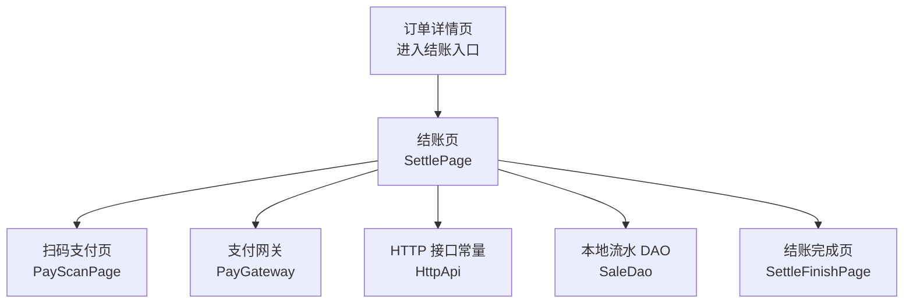
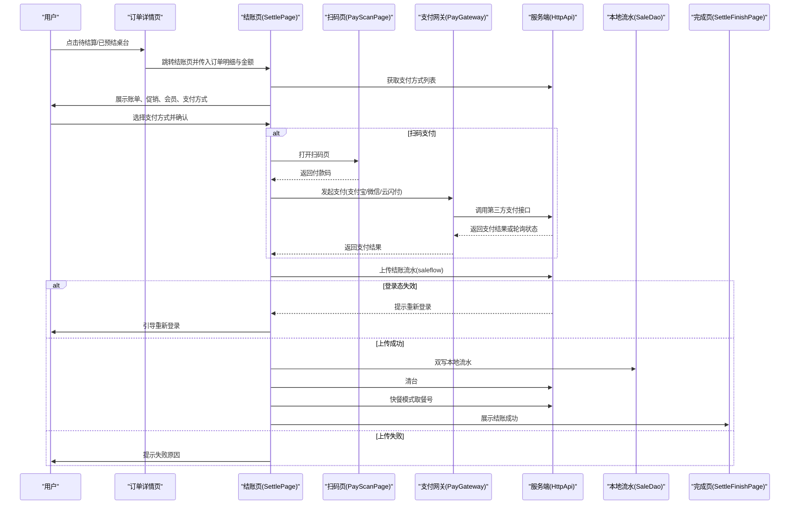
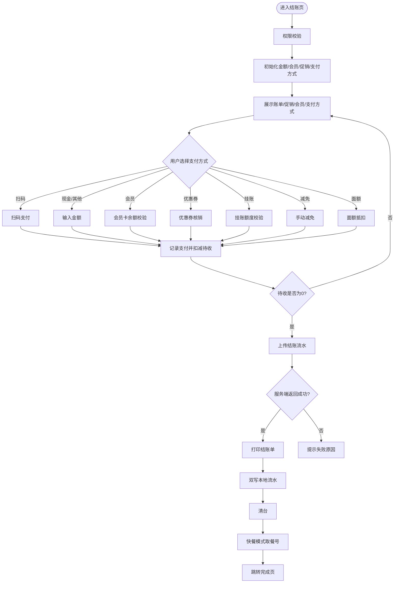
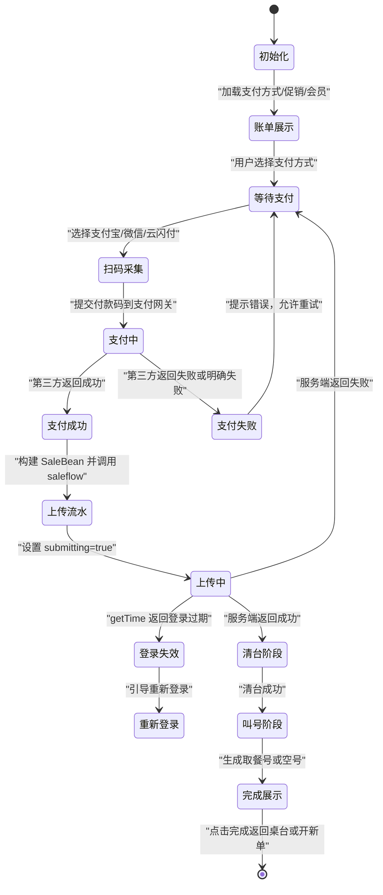
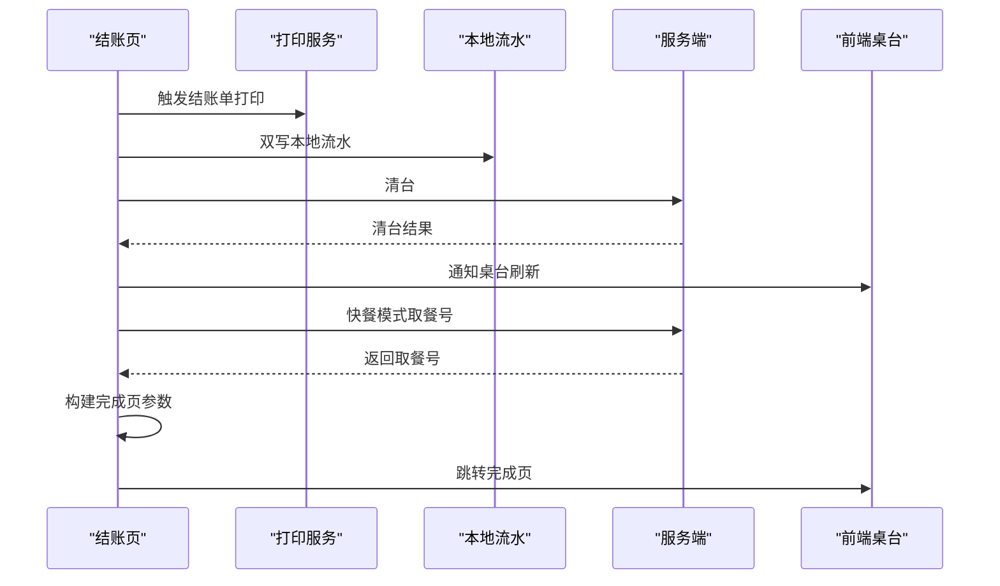

# 结账工作流

<cite>
**本文引用的文件**   
- [settle_page.dart](file://lib/pages/order/settle_page.dart)
- [pay_scan_page.dart](file://lib/pages/order/pay_scan_page.dart)
- [settle_finish_page.dart](file://lib/pages/order/settle_finish_page.dart)
- [order_detail_page.dart](file://lib/pages/order/order_detail_page.dart)
- [sale_dao.dart](file://lib/db/sale_dao.dart)
- [http_api.dart](file://lib/net/http_api.dart)
- [pay_gateway.dart](file://lib/net/pay_gateway.dart)
- [local_cache_service.dart](file://lib/util/local_cache_service.dart)
</cite>

## 目录
1. [引言](#引言)
2. [项目结构中与结账相关的代码位置](#项目结构中与结账相关的代码位置)
3. [核心组件](#核心组件)
4. [架构总览](#架构总览)
5. [详细组件分析](#详细组件分析)
6. [结账状态流转机制](#结账状态流转机制)
7. [结账数据持久化](#结账数据持久化)
8. [结账完成后的后续处理](#结账完成后的后续处理)
9. [异常处理与恢复策略](#异常处理与恢复策略)
10. [性能考虑与优化建议](#性能考虑与优化建议)
11. [扩展结账流程的实践指南](#扩展结账流程的实践指南)
12. [故障排查清单](#故障排查清单)
13. [结论](#结论)

## 引言
本文围绕 `SettlePage`（结账页）展开，系统梳理从订单详情进入结账、账单展示、支付方式选择、扫码或输入支付、会员/优惠券/挂账等特殊支付、上传结账流水、清台、叫号、跳转完成页的完整业务流程。同时文档化结账状态机、数据持久化模型、桌台状态更新、库存与统计联动点、异常恢复机制，以及面向扩展的推荐实践。

## 项目结构中与结账相关的代码位置
结账相关逻辑主要分布在以下模块：
- 页面层：订单详情页、结账页、扫码支付页、结账完成页。
- 网络层：统一接口常量、移动支付网关。
- 数据层：本地结账流水写入 DAO、支付方式等基础缓存服务。
- 工具层：金额计算、权限校验、并发锁、打印服务等辅助能力。

**图表来源** 
- [order_detail_page.dart:1-120](file://lib/pages/order/order_detail_page.dart#L1-L120)
- [settle_page.dart:1-120](file://lib/pages/order/settle_page.dart#L1-L120)
- [pay_scan_page.dart:1-80](file://lib/pages/order/pay_scan_page.dart#L1-L80)
- [pay_gateway.dart:1-80](file://lib/net/pay_gateway.dart#L1-L80)
- [http_api.dart:1-120](file://lib/net/http_api.dart#L1-L120)
- [sale_dao.dart:1-49](file://lib/db/sale_dao.dart#L1-L49)
- [settle_finish_page.dart:1-60](file://lib/pages/order/settle_finish_page.dart#L1-L60)

**章节来源**
- [order_detail_page.dart:1-120](file://lib/pages/order/order_detail_page.dart#L1-L120)
- [settle_page.dart:1-120](file://lib/pages/order/settle_page.dart#L1-L120)

## 核心组件
- `SettlePage`：结账主控制器，负责账单展示、促销与会员优惠计算、支付方式管理、扫码支付调用、结账流水构建与上传、清台与叫号、暂结逻辑、UI 状态管理。
- `PayScanPage`：扫码收款码采集页，支持相机扫描与相册识别，返回付款码。
- `PayGateway`：第三方支付网关适配层，封装收钱吧、优支付、乐刷的统一支付、查询、关闭订单接口。
- `HttpApi`：服务端接口路径常量集合，覆盖桌台、下单、结账、会员、促销、打印、叫号等。
- `SaleDao`：本地 SQLite 批量写入结账流水，包含主表、明细表、支付方式表、做法表。
- `LocalCacheService`：商品、分类、桌台、支付方式等基础数据的轻量级本地缓存。
- `SettleFinishPage`：结账成功展示页，显示订单摘要并触发桌台刷新和路由回退。

**章节来源**
- [settle_page.dart:1-120](file://lib/pages/order/settle_page.dart#L1-L120)
- [pay_scan_page.dart:1-80](file://lib/pages/order/pay_scan_page.dart#L1-L80)
- [pay_gateway.dart:1-80](file://lib/net/pay_gateway.dart#L1-L80)
- [http_api.dart:1-120](file://lib/net/http_api.dart#L1-L120)
- [sale_dao.dart:1-49](file://lib/db/sale_dao.dart#L1-L49)
- [local_cache_service.dart:1-60](file://lib/util/local_cache_service.dart#L1-L60)
- [settle_finish_page.dart:1-60](file://lib/pages/order/settle_finish_page.dart#L1-L60)

## 架构总览
结账工作流由页面控制流、支付网关流、服务端结算流和本地持久化流组成。

**图表来源**
- [order_detail_page.dart:1-120](file://lib/pages/order/order_detail_page.dart#L1-L120)
- [settle_page.dart:1130-1400](file://lib/pages/order/settle_page.dart#L1130-L1400)
- [settle_page.dart:1401-1785](file://lib/pages/order/settle_page.dart#L1401-L1785)
- [settle_page.dart:1786-2100](file://lib/pages/order/settle_page.dart#L1786-L2100)
- [pay_scan_page.dart:1-200](file://lib/pages/order/pay_scan_page.dart#L1-L200)
- [pay_gateway.dart:1-200](file://lib/net/pay_gateway.dart#L1-L200)
- [http_api.dart:1-120](file://lib/net/http_api.dart#L1-L120)
- [sale_dao.dart:1-49](file://lib/db/sale_dao.dart#L1-L49)
- [settle_finish_page.dart:1-120](file://lib/pages/order/settle_finish_page.dart#L1-L120)

## 详细组件分析

### 结账页 SettlePage
`SettlePage` 是结账业务的核心控制器，承担以下职责：
- 初始化会员信息、权限校验、抹零、促销加载、支付方式加载。
- 维护“已收金额”“待收金额”“支付方式记录列表”。
- 提供多种支付方式分支：现金、会员卡、移动支付、减免、面额支付、优惠券、会员挂账、整单暂结。
- 构建销售主表、明细表、支付方式表、做法表，并上传服务端。
- 成功后打印结账单、双写本地流水、清台、叫号、跳转完成页。
- 失败时透出服务端逐条落库消息。

关键实现要点：
- 桌台锁定与防重入：通过并发锁监听事件，防止其他设备清台后继续收款。
- 桌台有效性校验：在支付前与上传流水前分别校验桌台是否仍处于可结账状态。
- 金额精度控制：统一使用两位小数四舍五入，避免 double 尾差导致服务端长度限制错误。
- 会员价最优保护：会员价更优时不被促销活动覆盖；满减整单优惠与活动明细折扣互斥叠加。
- 多支付方式累计：混合支付场景下按每条支付记录累加实收，并在全部支付完成后统一上传流水。
- 登录态校验：上传流水前请求服务器时间，若登录过期则中止并引导重新登录。
- 本地流水双写：非 Web 平台尝试写入 t_sale_master/t_sale_detail/t_sale_payway/t_sale_cook，失败不阻断正常结账。

**图表来源**
- [settle_page.dart:201-611](file://lib/pages/order/settle_page.dart#L201-L611)
- [settle_page.dart:701-1129](file://lib/pages/order/settle_page.dart#L701-L1129)
- [settle_page.dart:1130-1400](file://lib/pages/order/settle_page.dart#L1130-L1400)
- [settle_page.dart:1401-1785](file://lib/pages/order/settle_page.dart#L1401-L1785)
- [settle_page.dart:1786-2100](file://lib/pages/order/settle_page.dart#L1786-L2100)

**章节来源**
- [settle_page.dart:201-611](file://lib/pages/order/settle_page.dart#L201-L611)
- [settle_page.dart:701-1129](file://lib/pages/order/settle_page.dart#L701-L1129)
- [settle_page.dart:1130-1400](file://lib/pages/order/settle_page.dart#L1130-L1400)
- [settle_page.dart:1401-1785](file://lib/pages/order/settle_page.dart#L1401-L1785)
- [settle_page.dart:1786-2100](file://lib/pages/order/settle_page.dart#L1786-L2100)

### 扫码支付页 PayScanPage
扫码页负责捕获客户付款码，支持：
- 相机实时扫描条码。
- 连续扫描开关。
- 相册图片解析条码。
- 返回原始付款码字符串给结账页。

该页面不直接参与支付校验，只负责采集付款码，真正的支付与轮询逻辑由 `SettlePage` 与 `PayGateway` 协作完成。

**章节来源**
- [pay_scan_page.dart:1-200](file://lib/pages/order/pay_scan_page.dart#L1-L200)
- [pay_scan_page.dart:201-357](file://lib/pages/order/pay_scan_page.dart#L201-L357)

### 支付网关 PayGateway
支付网关屏蔽底层第三方支付差异，对外暴露统一方法：
- `pay`：付款码支付。
- `queryStatus`：查询支付状态。
- `closeOrder`：关闭订单。

内部根据配置选择：
- 收钱吧：JSON 接口，result_code=200 且 biz_response.result_code=PAY_SUCCESS 视为立即成功。
- 优支付：XML 参数，status=2 为成功，其他非终态需轮询。
- 乐刷：类似优支付的签名与查询流程。

返回类型 `ScanPayResult` 包含 success、trade、payid、billNo、errorMsg，便于上层区分“确定成功”“确定失败”“继续轮询”。

**章节来源**
- [pay_gateway.dart:1-80](file://lib/net/pay_gateway.dart#L1-L80)
- [pay_gateway.dart:201-500](file://lib/net/pay_gateway.dart#L201-L500)

### 接口常量 HttpApi
结账相关接口集中在 `/YttSvr/app` 路径下，包括：
- 支付方式列表：`getPayInfoList`
- 结账流水上传：`saleflow`
- 清台：`clearTable` / `pcClearTable`
- 服务器时间：`getTime`
- 会员支付：`vipPay`
- 会员挂账：`vipOverPay`
- 优惠券核销与撤销：`voucherVerify` / `vipUnVerify`
- 暂结相关：`upPayInfo` / `updatePayInfo` / `pcInsertPayawyFornow`
- 叫号：`getTakeSnackcode` / `getTakeSnackCodeBySet`

这些常量作为 `requestForm` 的请求路径，保证结账流程与服务端契约一致。

**章节来源**
- [http_api.dart:1-120](file://lib/net/http_api.dart#L1-L120)
- [http_api.dart:201-511](file://lib/net/http_api.dart#L201-L511)

### 本地流水 DAO SaleDao
`SaleDao` 提供统一的本地流水写入方法：
- 接收 saleBean，提取 t_sale_master、t_sale_detail、t_sale_payway、t_sale_cook。
- 对每个子表做批量插入。
- 对非 List 或元素非 Map 的数据做容错转换，避免脏数据导致崩溃。

注意：当前实现是新增流水记录，并未提供按 saleid 更新或删除的逻辑；因此它主要用于“结账成功后补录本地历史流水”，而不是用于“未上传前的草稿持久化”。

**章节来源**
- [sale_dao.dart:1-49](file://lib/db/sale_dao.dart#L1-L49)

### 基础缓存 LocalCacheService
该类提供商品、分类、桌台、支付方式等基础数据的 SharedPreferences 缓存，用于弱网或离线读取。结账流程中支付方式列表通常走服务端接口，但门店配置、商品、桌台等数据可能依赖本地缓存提升体验。

**章节来源**
- [local_cache_service.dart:1-137](file://lib/util/local_cache_service.dart#L1-L137)

## 结账状态流转机制
结账过程不是单一“支付成功即结束”，而是由多个中间状态组成。可以把 `SettlePage` 的业务状态理解为如下状态机：

具体含义：
- **初始化**：权限检查、抹零、促销加载、支付方式加载。
- **账单展示**：展示订单明细、价格汇总、促销活动、会员优惠券、支付方式。
- **等待支付**：记录多条支付方式，累计已收金额，动态计算待收金额。
- **扫码采集**：打开扫码页，获取付款码。
- **支付中**：调用支付网关，可能立即成功，也可能需要轮询。
- **支付成功**：记录支付方式，补齐交易号等信息，待收金额为 0 时进入上传流水。
- **支付失败**：透传第三方错误信息，允许用户更换方式或重试。
- **上传流水**：构建主表、明细表、支付方式表、做法表，调用服务端 saleflow。
- **上传中**：防止重复提交，并处理登录过期。
- **登录失效**：中断结账，引导重新登录。
- **清台阶段**：调用清台接口，失败不阻断已完成结账。
- **叫号阶段**：快餐模式且无桌台时生成取餐号。
- **完成展示**：跳转到完成页，刷新桌台，正餐模式回到首页，快餐模式新开订单。

**图表来源**
- [settle_page.dart:201-611](file://lib/pages/order/settle_page.dart#L201-L611)
- [settle_page.dart:1130-1400](file://lib/pages/order/settle_page.dart#L1130-L1400)
- [settle_page.dart:1786-2100](file://lib/pages/order/settle_page.dart#L1786-L2100)
- [settle_finish_page.dart:201-274](file://lib/pages/order/settle_finish_page.dart#L201-L274)

## 结账数据持久化
结账数据涉及三层：内存中的临时状态、本地数据库流水、服务端订单主表与明细表。

### 内存状态
`SettlePage` 维护以下关键字段：
- `_dishAmt`、`_serviceAmt`、`_lowAmt`、`_disAmt`、`_payAmt`：账单价格维度。
- `_hasMoney`、`_dsMoney`：已收金额与待收金额。
- `_salePayWayList`：已选择的支付方式记录列表。
- `_member`、`_selectedCoupon`、`_promotions`、`_appliedPromoBillid`：会员、优惠券、促销相关状态。
- `_roundAmt`：抹零金额。
- `_isZanjie`、`_isPrint`：整单暂结与打印开关。

这些字段在每次选择支付方式、应用促销、录入会员、抹零、优惠券核销后更新，并通过 `setState` 触发 UI 刷新。

### 本地数据库持久化
`SaleDao.saveSaleFlow` 在结账成功后尝试将服务端返回的 saleBean 写入本地：
- `t_sale_master`：订单主表。
- `t_sale_detail`：订单明细表。
- `t_sale_payway`：支付方式表。
- `t_sale_cook`：做法表。

写入采用批量插入，并对非 List 或非 Map 元素进行过滤。本地写入失败仅打印调试日志，不阻断结账流程。

### 本地缓存持久化
`LocalCacheService` 提供商品、分类、桌台、支付方式等基础数据的缓存，键名以 `cache_product_list`、`cache_table_list`、`cache_payway_list` 等形式存储。退出登录时可清空所有缓存。

### 数据一致性建议
当前 `SaleDao` 只提供新增流水，不提供按 saleid 更新或回滚。若未来需要支持“先本地保存、再异步上传”的重试机制，建议补充：
- 按 saleid 或 billno 的唯一索引。
- 待上传流水表，记录 upload_status、retry_count、last_retry_time。
- 后台定时任务重试上传失败流水。
- 幂等键：以 billno 或服务端 id 作为去重依据。

**章节来源**
- [settle_page.dart:201-611](file://lib/pages/order/settle_page.dart#L201-L611)
- [settle_page.dart:1401-1785](file://lib/pages/order/settle_page.dart#L1401-L1785)
- [sale_dao.dart:1-49](file://lib/db/sale_dao.dart#L1-L49)
- [local_cache_service.dart:1-137](file://lib/util/local_cache_service.dart#L1-L137)

## 结账完成后的后续处理
结账成功后，`SettlePage` 依次执行以下后续处理：

1. **打印结账单**：调用打印服务，传入 saleid、billno、主表数据。
2. **双写本地流水**：非 Web 平台调用 `SaleDao.saveSaleFlow`。
3. **清台**：
   - 主设备模式：调用 `pcClearTable`。
   - 云服务模式：调用 `clearTable`。
   - 清台失败不阻断结账成功流程。
4. **通知桌台刷新**：通过 `TableEventBus.fireTableChanged()` 通知桌台页刷新。
5. **快餐模式取餐号**：满足条件时调用 `getTakeSnackCodeBySet` 获取取餐号。
6. **跳转完成页**：传入应收、实收、找零、支付方式名称拼接、取餐号、订单号、支付时间、明细份数、收银员。
7. **完成页行为**：刷新桌台、取消焦点、弹出至首页；快餐模式自动重新进入点菜页并生成新 saleid。

**图表来源**
- [settle_page.dart:1401-1785](file://lib/pages/order/settle_page.dart#L1401-L1785)
- [settle_page.dart:1786-2100](file://lib/pages/order/settle_page.dart#L1786-L2100)
- [settle_finish_page.dart:201-274](file://lib/pages/order/settle_finish_page.dart#L201-L274)

**章节来源**
- [settle_page.dart:1401-1785](file://lib/pages/order/settle_page.dart#L1401-L1785)
- [settle_page.dart:1786-2100](file://lib/pages/order/settle_page.dart#L1786-L2100)
- [settle_finish_page.dart:201-274](file://lib/pages/order/settle_finish_page.dart#L201-L274)

## 异常处理与恢复策略

### 网络中断
- 扫码支付调用第三方网关时，网络异常不会直接判定为支付失败，而是返回“非终态”，由上层或网关查询逻辑决定继续轮询或提示失败。
- 结账流水上传失败时，会透出服务端逐条 retmsg，便于定位落库失败原因。
- 清台失败被 try-catch 包裹，不阻断已成功结账的流程。

### 支付失败
- 第三方支付明确失败时，`ScanPayResult.errorMsg` 会被展示给用户。
- 收钱吧与优支付均提供“明确失败”判断，避免把网络异常误判为失败。
- 用户可以更换支付方式或重新扫码。

### 登录态失效
- 上传流水前调用服务器时间接口，若返回登录过期，则中断结账并提示重新登录。
- 重新登录后必须重新进入结账流程，不能复用旧流水。

### 桌台状态变化
- 结账前和上传流水前都校验桌台状态。
- 如果桌台已被清台、状态变为空闲、或 saleid 发生变化，则阻止继续结账并返回桌台刷新。

### 数据不一致恢复
- 本地流水写入失败不阻断结账，适合“最终一致性”场景。
- 如需更强恢复能力，应增加待上传流水队列、重试机制、幂等校验与对账任务。

**章节来源**
- [settle_page.dart:201-611](file://lib/pages/order/settle_page.dart#L201-L611)
- [settle_page.dart:1130-1400](file://lib/pages/order/settle_page.dart#L1130-L1400)
- [settle_page.dart:1786-2100](file://lib/pages/order/settle_page.dart#L1786-L2100)
- [pay_gateway.dart:201-500](file://lib/net/pay_gateway.dart#L201-L500)

## 性能考虑与优化建议

### 大数据量处理
- 订单明细较多时，结账页只显示前 15 行，其余用“共 N 项”省略展示，减少渲染压力。
- 套餐明细分组逻辑仅在展示层处理，不污染原始 detailList，避免上传 payload 过大。
- 促销计算优先基于基准金额增量，避免重复全量汇总带来的误差与开销。

### 并发控制
- 通过桌台并发锁监听事件，防止其他设备清台后继续收款。
- 上传流水时设置 `submitting=true`，防止重复提交。
- 会员同步、促销加载等操作均有权限与防重复点击保护。

### 内存管理
- 支付方式列表、促销活动、会员信息按需加载。
- 支付方式图标资源按 payid 映射，避免冗余对象。
- 扫码页在 dispose 中释放扫描控制器与动画控制器。

### I/O 与网络
- 支付网关使用独立 Dio 实例，避免公共拦截器干扰。
- 支付接口超时时间较短，轮询查询单独处理。
- 本地流水写入失败静默处理，避免阻塞主流程。

### 建议优化方向
- 对促销计算引入缓存，避免频繁重复计算。
- 对支付方式列表增加本地缓存与版本戳，减少无效刷新。
- 对本地流水增加重试队列与对账接口，提高最终一致性。
- 对大量明细进行分页展示或虚拟滚动，降低 Flutter 渲染压力。

[本节为通用性能指导，不直接分析特定文件]

## 扩展结账流程的实践指南

### 添加自定义结账后处理
如果需要在结账成功后执行额外逻辑，例如发送营销短信、上报埋点、推送企业微信通知，推荐在 `SettlePage` 上传流水成功后、清台前或清台后增加扩展点：

1. 在上传流水成功分支中增加扩展钩子方法，例如：
   - `Future<void> _onCheckoutSuccess(Map<String, dynamic> saleMaster)`
2. 在该方法中注入可选的后置处理器，例如：
   - 统计上报。
   - 外部系统通知。
   - 积分发放。
   - 会员等级变更。
3. 后置处理应使用 try-catch，失败不应影响结账主流程。
4. 如操作耗时较长，应放在后台任务或异步队列中执行。

参考位置：
- 上传流水成功分支位于结账页上传逻辑之后。
- 清台与叫号逻辑位于上传成功后。

**章节来源**
- [settle_page.dart:1401-1785](file://lib/pages/order/settle_page.dart#L1401-L1785)
- [settle_page.dart:1786-2100](file://lib/pages/order/settle_page.dart#L1786-L2100)

### 添加新的支付方式
如果要新增一种支付方式，例如储值卡、积分抵扣、企业账户支付，推荐步骤：

1. 在服务端接口中新增支付方式配置，确保 `getPayInfoList` 能返回该方式。
2. 在 `SettlePage._onPay` 中增加对应 payid 分支。
3. 在该分支中：
   - 校验必要前置条件（如是否录入会员、是否启用功能）。
   - 调用相应接口完成扣款或记账。
   - 向 `_salePayWayList` 追加支付方式记录。
   - 更新 `_hasMoney` 与 `_dsMoney`。
   - 若待收金额为 0，调用 `_submitSaleFlow`。
4. 如需撤销，实现 `_cancelPayRecord` 中的反向逻辑。
5. 如需支付凭证，记录交易号、券号、订单号等字段。

参考位置：
- 支付方式选择与处理分支。
- 支付方式记录结构与金额更新。
- 撤销支付记录逻辑。

**章节来源**
- [settle_page.dart:701-1129](file://lib/pages/order/settle_page.dart#L701-L1129)
- [settle_page.dart:1130-1400](file://lib/pages/order/settle_page.dart#L1130-L1400)

### 扩展促销规则
如果需要新增促销类型，例如阶梯折扣、指定品类满减：

1. 在服务端促销接口中支持新规则。
2. 在 `PromotionHelper` 或结算页促销计算逻辑中增加新规则分支。
3. 注意与会员价最优保护的冲突：会员价更优时不得被促销覆盖。
4. 注意与满赠活动的互斥：已参加满赠不可再享受整单优惠。
5. 更新促销卡片展示文案与应用按钮状态。

**章节来源**
- [settle_page.dart:201-611](file://lib/pages/order/settle_page.dart#L201-L611)

## 故障排查清单

| 现象 | 可能原因 | 排查建议 |
|---|---|---|
| 扫码后一直显示支付中 | 第三方网关未返回终态 | 检查 `PayGateway.queryStatus` 轮询逻辑与返回的 status/result_code |
| 支付成功但无法结账 | 登录态失效或 saleflow 返回失败 | 查看 getTime 返回值与 saleflow 响应 data[0].retcode |
| 结账成功但桌台未刷新 | 清台失败或事件未广播 | 检查清台接口与 `TableEventBus.fireTableChanged()` |
| 本地查不到结账流水 | 本地写入失败或未双写 | 检查 SaleDao 写入日志与数据库表是否存在 |
| 会员支付未扣款 | 会员支付未遍历或金额不对 | 检查 `_salePayWayList` 中 payid==02 的记录与 vipPay 调用 |
| 优惠券核销后撤销失败 | 反核销接口参数错误或未携带 billno | 检查优惠券记录中 billno 与 vipUnVerify 参数 |
| 移动端显示金额异常 | double 精度问题 | 检查 `_rd2` 金额四舍五入与支付方式金额字段格式化 |
| 快餐模式没有取餐号 | 叫号开关未开启或桌台存在 | 检查 StoreModeUtils、ParamsSpUtils 与 tableJson/tableId |

**章节来源**
- [settle_page.dart:701-1129](file://lib/pages/order/settle_page.dart#L701-L1129)
- [settle_page.dart:1130-1400](file://lib/pages/order/settle_page.dart#L1130-L1400)
- [settle_page.dart:1786-2100](file://lib/pages/order/settle_page.dart#L1786-L2100)
- [pay_gateway.dart:201-500](file://lib/net/pay_gateway.dart#L201-L500)
- [sale_dao.dart:1-49](file://lib/db/sale_dao.dart#L1-L49)

## 结论
`SettlePage` 将订单详情、账单计算、支付方式、促销与会员优惠、扫码支付、会员挂账、优惠券核销、结账流水上传、清台、叫号、完成展示串联为一个完整的结账闭环。其设计强调：
- 以桌台并发锁和桌台状态校验保障结账安全性。
- 以支付方式记录列表支持混合支付。
- 以会员价最优保护与促销互斥规则保障价格正确性。
- 以登录态校验、服务端逐条结果判断、清台失败容忍、本地流水双写保障结账鲁棒性。

若需要进一步扩展，推荐在上传成功后增加可扩展的后置处理钩子，并完善本地流水的幂等、重试与对账能力，使结账流程从“可用”走向“可观测、可恢复、可审计”。