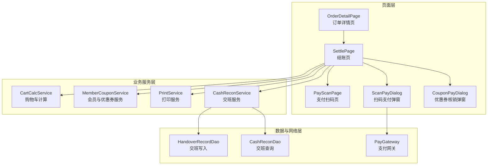
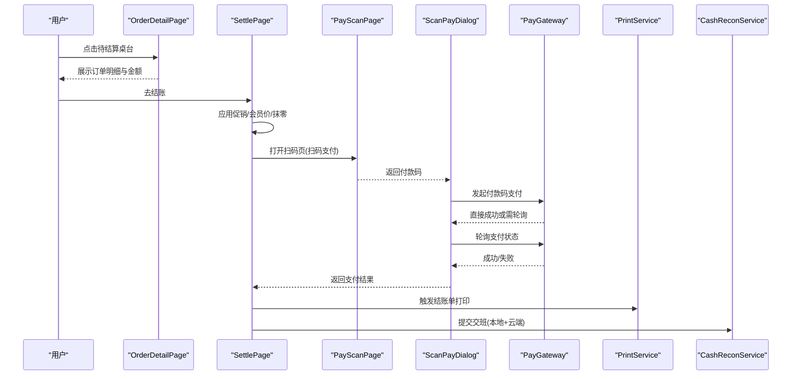
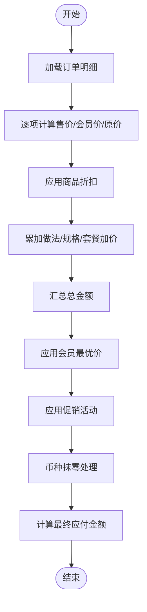
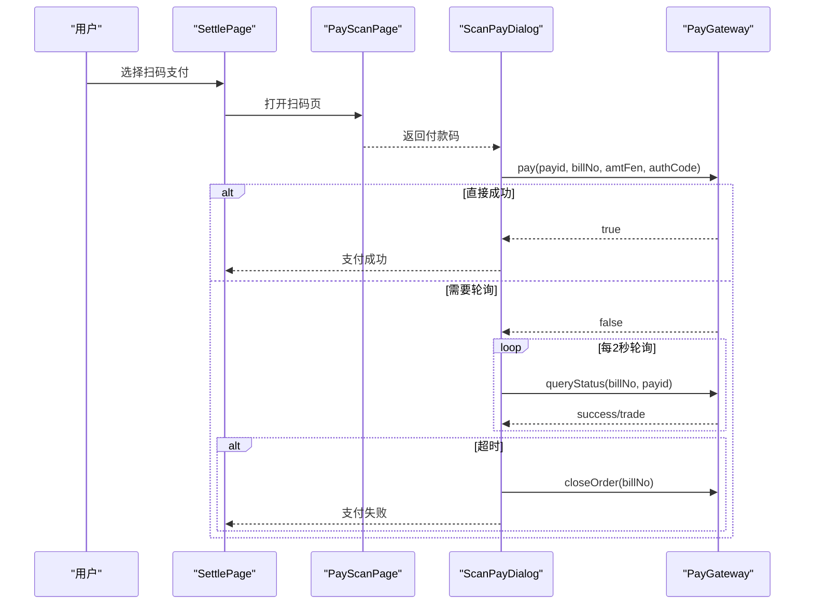
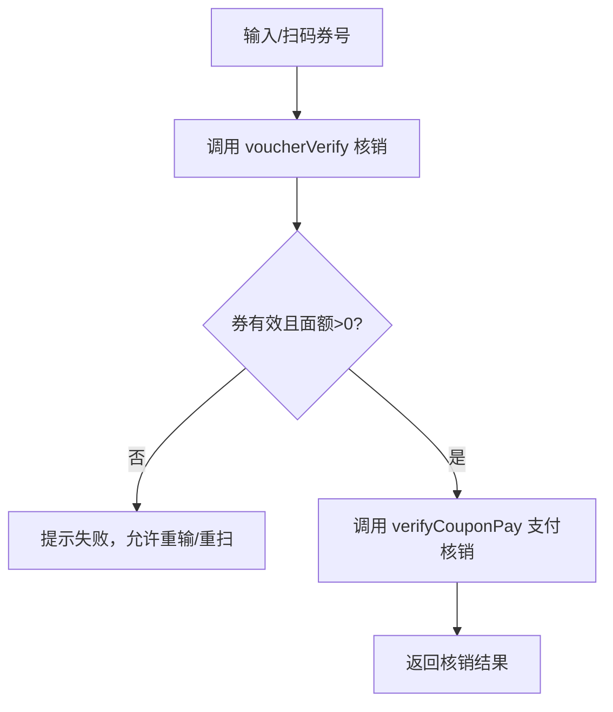
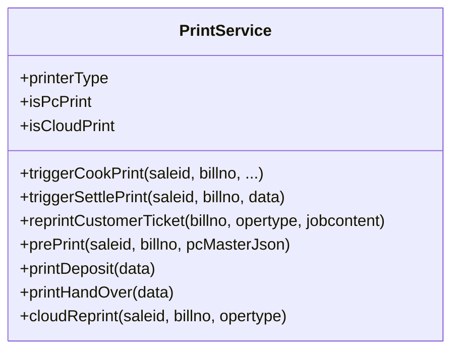
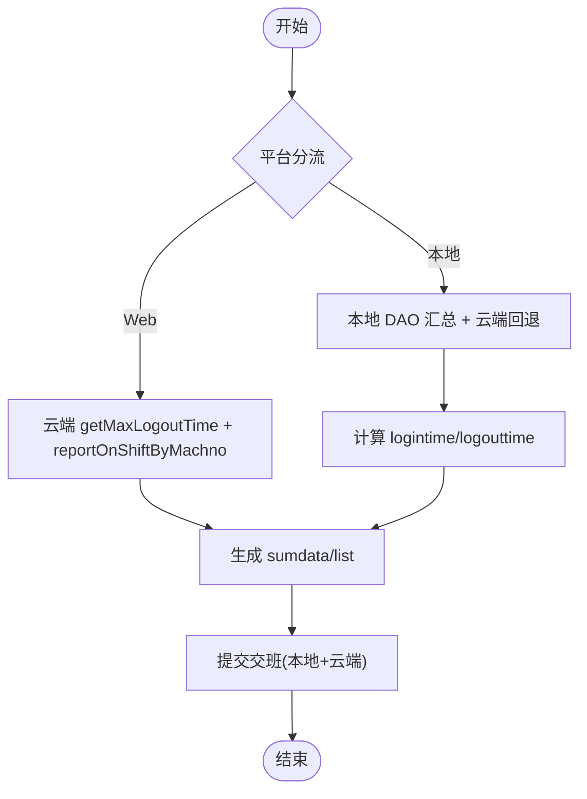
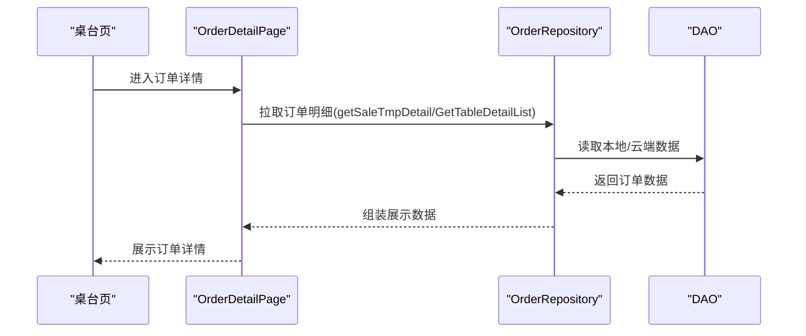
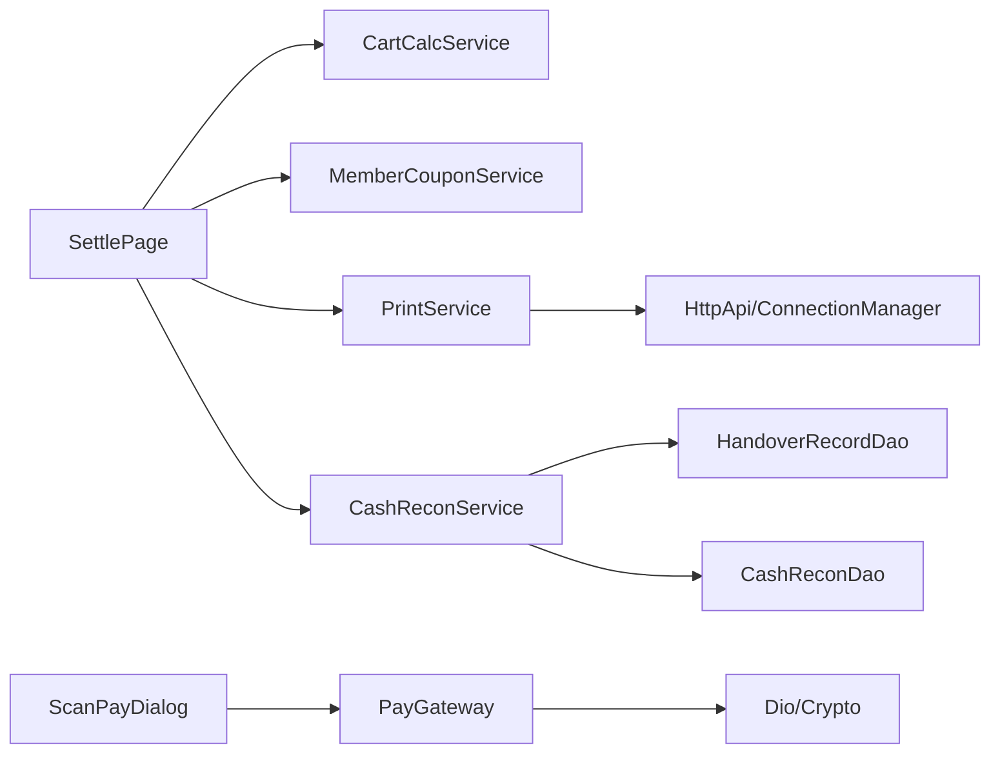

# 结账收银模块

<cite>
**本文引用的文件**   
- [lib/pages/order/settle_page.dart](file://lib/pages/order/settle_page.dart)
- [lib/pages/order/pay_scan_page.dart](file://lib/pages/order/pay_scan_page.dart)
- [lib/pages/order/scan_pay_dialog.dart](file://lib/pages/order/scan_pay_dialog.dart)
- [lib/pages/order/widgets/coupon_pay_dialog.dart](file://lib/pages/order/widgets/coupon_pay_dialog.dart)
- [lib/util/cart_calc_service.dart](file://lib/util/cart_calc_service.dart)
- [lib/util/member_coupon_service.dart](file://lib/util/member_coupon_service.dart)
- [lib/util/print_service.dart](file://lib/util/print_service.dart)
- [lib/service/cash_recon_service.dart](file://lib/service/cash_recon_service.dart)
- [lib/db/handover_record_dao.dart](file://lib/db/handover_record_dao.dart)
- [lib/db/cash_recon_dao.dart](file://lib/db/cash_recon_dao.dart)
- [lib/net/pay_gateway.dart](file://lib/net/pay_gateway.dart)
- [lib/pages/order/order_detail_page.dart](file://lib/pages/order/order_detail_page.dart)
</cite>

## 目录
1. [引言](#引言)
2. [项目结构](#项目结构)
3. [核心组件](#核心组件)
4. [架构总览](#架构总览)
5. [详细组件分析](#详细组件分析)
6. [依赖关系分析](#依赖关系分析)
7. [性能与可靠性](#性能与可靠性)
8. [故障排查指南](#故障排查指南)
9. [结论](#结论)
10. [附录：扩展示例](#附录扩展示例)

## 引言
本模块聚焦餐厅结账收银全链路，涵盖订单金额汇总、促销与会员优惠、优惠券核销、多支付方式集成（扫码、现金、会员挂账等）、打印服务对接、交接班对账、订单详情查看与历史管理、支付状态同步与失败重试。文档从代码实现出发，给出端到端流程图、类图和数据流说明，帮助开发者快速定位关键逻辑并安全扩展新能力。

## 项目结构
结账收银相关代码主要分布在以下层次：
- 页面层：结账页、支付扫码页、扫码支付弹窗、优惠券核销弹窗、订单详情页
- 计算与服务层：购物车计算、会员与优惠券服务、打印服务、交班服务
- 数据层：交班记录 DAO、交班查询 DAO
- 网络层：支付网关、HTTP API 封装

**图表来源**
- [lib/pages/order/settle_page.dart:201-600](file://lib/pages/order/settle_page.dart#L201-L600)
- [lib/pages/order/pay_scan_page.dart:1-200](file://lib/pages/order/pay_scan_page.dart#L1-L200)
- [lib/pages/order/scan_pay_dialog.dart:1-200](file://lib/pages/order/scan_pay_dialog.dart#L1-L200)
- [lib/pages/order/widgets/coupon_pay_dialog.dart:1-200](file://lib/pages/order/widgets/coupon_pay_dialog.dart#L1-L200)
- [lib/util/cart_calc_service.dart:1-200](file://lib/util/cart_calc_service.dart#L1-L200)
- [lib/util/member_coupon_service.dart:1-126](file://lib/util/member_coupon_service.dart#L1-L126)
- [lib/util/print_service.dart:1-200](file://lib/util/print_service.dart#L1-L200)
- [lib/service/cash_recon_service.dart:1-200](file://lib/service/cash_recon_service.dart#L1-L200)
- [lib/db/handover_record_dao.dart:1-163](file://lib/db/handover_record_dao.dart#L1-L163)
- [lib/db/cash_recon_dao.dart:1-200](file://lib/db/cash_recon_dao.dart#L1-L200)
- [lib/net/pay_gateway.dart:1-200](file://lib/net/pay_gateway.dart#L1-L200)
- [lib/pages/order/order_detail_page.dart:1-200](file://lib/pages/order/order_detail_page.dart#L1-L200)

**章节来源**
- [lib/pages/order/settle_page.dart:201-600](file://lib/pages/order/settle_page.dart#L201-L600)
- [lib/pages/order/order_detail_page.dart:1-200](file://lib/pages/order/order_detail_page.dart#L1-L200)

## 核心组件
- 结账页：负责账单预览、促销活动应用、会员价最优选择、抹零处理、支付方式选择、提交结算流水、触发打印和交班。
- 支付扫码页：调用设备摄像头扫描付款码，支持连续扫描与相册导入。
- 扫码支付弹窗：统一发起支付、倒计时超时控制、轮询查询结果、失败重试与交易查询。
- 优惠券核销弹窗：输入或扫码券号，调用核销接口返回券信息，支持失败不关闭弹窗重试。
- 购物车计算服务：单品价格、会员价、折扣、低消、整单折扣计算。
- 会员与优惠券服务：优惠券撤销、团购券撤销、优惠券支付核销、会员挂账。
- 打印服务：PC打印与云打印双通道，客单、出品单、押金单、预打单、交班打印。
- 交班服务：云端和本地双写策略，按时间段聚合销售、会员储值、预订金、押金等报表，生成交班记录。
- 支付网关：收钱吧、优支付等多平台适配，付款码支付、状态查询、订单关闭。

**章节来源**
- [lib/pages/order/settle_page.dart:201-600](file://lib/pages/order/settle_page.dart#L201-L600)
- [lib/pages/order/pay_scan_page.dart:1-200](file://lib/pages/order/pay_scan_page.dart#L1-L200)
- [lib/pages/order/scan_pay_dialog.dart:1-200](file://lib/pages/order/scan_pay_dialog.dart#L1-L200)
- [lib/pages/order/widgets/coupon_pay_dialog.dart:1-200](file://lib/pages/order/widgets/coupon_pay_dialog.dart#L1-L200)
- [lib/util/cart_calc_service.dart:1-200](file://lib/util/cart_calc_service.dart#L1-L200)
- [lib/util/member_coupon_service.dart:1-126](file://lib/util/member_coupon_service.dart#L1-L126)
- [lib/util/print_service.dart:1-200](file://lib/util/print_service.dart#L1-L200)
- [lib/service/cash_recon_service.dart:1-200](file://lib/service/cash_recon_service.dart#L1-L200)
- [lib/net/pay_gateway.dart:1-200](file://lib/net/pay_gateway.dart#L1-L200)

## 架构总览
结账流程从订单详情页进入结账页，完成促销与会员优惠后选择支付方式；扫码支付通过扫码页获取付款码，再由弹窗统一发起支付并轮询结果；支付成功后触发打印与交班；优惠券核销在结账前独立弹窗完成。

**图表来源**
- [lib/pages/order/order_detail_page.dart:1-200](file://lib/pages/order/order_detail_page.dart#L1-L200)
- [lib/pages/order/settle_page.dart:201-600](file://lib/pages/order/settle_page.dart#L201-L600)
- [lib/pages/order/pay_scan_page.dart:1-200](file://lib/pages/order/pay_scan_page.dart#L1-L200)
- [lib/pages/order/scan_pay_dialog.dart:1-200](file://lib/pages/order/scan_pay_dialog.dart#L1-L200)
- [lib/net/pay_gateway.dart:1-200](file://lib/net/pay_gateway.dart#L1-L200)
- [lib/util/print_service.dart:1-200](file://lib/util/print_service.dart#L1-L200)
- [lib/service/cash_recon_service.dart:1-200](file://lib/service/cash_recon_service.dart#L1-L200)

## 详细组件分析

### 账单计算与优惠流程
- 菜品价格汇总：购物车计算服务根据商品是否赠送、改价、称重、套餐加价等规则计算售价、会员价、原价，并累加得到总金额。
- 折扣计算：商品级折扣仅对可打折商品生效；整单折扣通过服务方法计算折扣后金额与折扣金额。
- 会员价最优：结账页将会员价与当前价比较，若会员价更优则更新明细行价格与折扣率。
- 促销活动：结账页加载可用活动，按活动规则计算明细行或整单优惠，避免重复叠加。
- 抹零处理：当开启币种抹零时，自动以“06”减免支付方式抵扣差额，减少顾客应付金额。
- 最终金额确定：结合服务费、低消、促销、抹零与已收金额，计算待收金额。

**图表来源**
- [lib/util/cart_calc_service.dart:1-200](file://lib/util/cart_calc_service.dart#L1-L200)
- [lib/util/cart_calc_service.dart:201-278](file://lib/util/cart_calc_service.dart#L201-L278)
- [lib/pages/order/settle_page.dart:201-600](file://lib/pages/order/settle_page.dart#L201-L600)

**章节来源**
- [lib/util/cart_calc_service.dart:1-200](file://lib/util/cart_calc_service.dart#L1-L200)
- [lib/util/cart_calc_service.dart:201-278](file://lib/util/cart_calc_service.dart#L201-L278)
- [lib/pages/order/settle_page.dart:201-600](file://lib/pages/order/settle_page.dart#L201-L600)

### 支付集成机制
- 扫码支付：扫码页使用移动相机捕获条形码，支持连续扫描模式；扫描结果回传至扫码支付弹窗。
- 统一支付入口：支付网关根据门店配置选择收钱吧或优支付；付款码支付返回是否直接成功，否则需要轮询。
- 轮询与超时：弹窗启动60秒倒计时，每2秒轮询一次；超时自动关闭订单；明确失败时提示错误并可手动查询。
- 支付方式：
  - 扫码支付：08=支付宝，09=微信，10=云闪付。
  - 现金支付：由结账页选择现金方式，录入实收金额，系统自动计算找零。
  - 会员支付：支持会员余额支付、会员挂账；挂账通过会员服务调用后台接口。
  - 优惠券支付：先核销券号，再参与支付分摊。

**图表来源**
- [lib/pages/order/pay_scan_page.dart:1-200](file://lib/pages/order/pay_scan_page.dart#L1-L200)
- [lib/pages/order/scan_pay_dialog.dart:1-200](file://lib/pages/order/scan_pay_dialog.dart#L1-L200)
- [lib/net/pay_gateway.dart:1-200](file://lib/net/pay_gateway.dart#L1-L200)

**章节来源**
- [lib/pages/order/pay_scan_page.dart:1-200](file://lib/pages/order/pay_scan_page.dart#L1-L200)
- [lib/pages/order/scan_pay_dialog.dart:1-200](file://lib/pages/order/scan_pay_dialog.dart#L1-L200)
- [lib/net/pay_gateway.dart:1-200](file://lib/net/pay_gateway.dart#L1-L200)

### 优惠券核销系统
- 券号输入与扫码：弹窗支持手动输入或扫码回填券号。
- 券号核销：调用核销接口，参数包含主单JSON、明细JSON、客户端类型和券号；返回券信息（面额、编号等）。
- 校验与限制：面额为0或无效券号会提示失败；失败不关闭弹窗，允许重新输入或扫码。
- 核销记录保存：核销成功后，通过会员服务进行支付核销，并可选撤销已核销券。

**图表来源**
- [lib/pages/order/widgets/coupon_pay_dialog.dart:1-200](file://lib/pages/order/widgets/coupon_pay_dialog.dart#L1-L200)
- [lib/util/member_coupon_service.dart:1-126](file://lib/util/member_coupon_service.dart#L1-L126)

**章节来源**
- [lib/pages/order/widgets/coupon_pay_dialog.dart:1-200](file://lib/pages/order/widgets/coupon_pay_dialog.dart#L1-L200)
- [lib/util/member_coupon_service.dart:1-126](file://lib/util/member_coupon_service.dart#L1-L126)

### 打印服务集成
- 打印模式：PC打印（主设备）与云打印（YttSvr）双通道；设置项决定默认模式与份数。
- 触发时机：
  - 下单确认：出品单（厨打），可选杯贴。
  - 结账完成：结账单。
  - 退菜/催菜/起菜/预打/客单补打：对应操作类型。
- 设备对接：
  - PC打印：POST /api/print/* 到主设备。
  - 云打印：POST /print/restPrint 或 printMsgNotice，按 saleid + opertype 重建票据。
- 其他打印：押金单、预打单、交班打印。

**图表来源**
- [lib/util/print_service.dart:1-200](file://lib/util/print_service.dart#L1-L200)
- [lib/util/print_service.dart:201-416](file://lib/util/print_service.dart#L201-L416)

**章节来源**
- [lib/util/print_service.dart:1-200](file://lib/util/print_service.dart#L1-L200)
- [lib/util/print_service.dart:201-416](file://lib/util/print_service.dart#L201-L416)

### 交接班对账功能
- 数据加载策略：
  - Web：走云端接口 getMaxLogoutTime 与 reportOnShiftByMachno。
  - iOS/Android：优先取云端交班报表；若无数据或失败回退本地 DAO 汇总。
- 时间范围计算：依据上次交班时间与各类交易最早时间取交集，生成本班次 logintime/logouttime。
- 报表生成：
  - 销售汇总：账单数、金额、人数、人均消费、低消、服务费。
  - 支付方式明细：销售、退款、充值、预订、会员消费等 UNION 汇总。
  - 菜品统计与分类统计：按产品名或分类聚合数量与金额。
  - 退菜统计：退菜产品汇总。
  - 预订金汇总与列表。
  - 押金汇总：桌台押金、剩余押金、本班次剩余押金、抵扣押金。
- 交班记录写入：本地表 t_sale_jkd/t_sale_jkd_detail，分批插入；云端双写 addShifthandover。

**图表来源**
- [lib/service/cash_recon_service.dart:1-200](file://lib/service/cash_recon_service.dart#L1-L200)
- [lib/service/cash_recon_service.dart:201-602](file://lib/service/cash_recon_service.dart#L201-L602)
- [lib/db/handover_record_dao.dart:1-163](file://lib/db/handover_record_dao.dart#L1-L163)
- [lib/db/cash_recon_dao.dart:1-200](file://lib/db/cash_recon_dao.dart#L1-L200)
- [lib/db/cash_recon_dao.dart:201-526](file://lib/db/cash_recon_dao.dart#L201-L526)

**章节来源**
- [lib/service/cash_recon_service.dart:1-200](file://lib/service/cash_recon_service.dart#L1-L200)
- [lib/service/cash_recon_service.dart:201-602](file://lib/service/cash_recon_service.dart#L201-L602)
- [lib/db/handover_record_dao.dart:1-163](file://lib/db/handover_record_dao.dart#L1-L163)
- [lib/db/cash_recon_dao.dart:1-200](file://lib/db/cash_recon_dao.dart#L1-L200)
- [lib/db/cash_recon_dao.dart:201-526](file://lib/db/cash_recon_dao.dart#L201-L526)

### 订单详情查看与历史订单管理
- 订单详情：从桌台进入，拉取已下单数据，展示明细、套餐子行、价格信息（菜品费、服务费、低消、优惠合计、待支付）、开台时间、服务员、备注、操作人等。
- 会员信息：若桌台已有会员ID，则拉取完整会员信息用于会员价计算。
- 锁台事件：订阅锁台变化，防止多人同时操作导致数据不一致。
- 历史订单：通过订单仓库与数据库 DAO 查询历史订单（此处为概念性描述，具体查询实现位于订单相关仓库与DAO中）。

**图表来源**
- [lib/pages/order/order_detail_page.dart:1-200](file://lib/pages/order/order_detail_page.dart#L1-L200)

**章节来源**
- [lib/pages/order/order_detail_page.dart:1-200](file://lib/pages/order/order_detail_page.dart#L1-L200)

## 依赖关系分析
- 页面依赖服务：结账页依赖购物车计算、会员与优惠券服务、打印服务、交班服务；扫码支付弹窗依赖支付网关。
- 服务依赖DAO：交班服务依赖交班写入DAO与查询DAO。
- 打印服务依赖连接管理器与HTTP API：区分PC打印与云打印路径。
- 支付网关依赖Dio与加密库：对不同支付平台进行签名与请求。

**图表来源**
- [lib/pages/order/settle_page.dart:201-600](file://lib/pages/order/settle_page.dart#L201-L600)
- [lib/pages/order/scan_pay_dialog.dart:1-200](file://lib/pages/order/scan_pay_dialog.dart#L1-L200)
- [lib/service/cash_recon_service.dart:1-200](file://lib/service/cash_recon_service.dart#L1-L200)
- [lib/util/print_service.dart:1-200](file://lib/util/print_service.dart#L1-L200)
- [lib/net/pay_gateway.dart:1-200](file://lib/net/pay_gateway.dart#L1-L200)

**章节来源**
- [lib/pages/order/settle_page.dart:201-600](file://lib/pages/order/settle_page.dart#L201-L600)
- [lib/pages/order/scan_pay_dialog.dart:1-200](file://lib/pages/order/scan_pay_dialog.dart#L1-L200)
- [lib/service/cash_recon_service.dart:1-200](file://lib/service/cash_recon_service.dart#L1-L200)
- [lib/util/print_service.dart:1-200](file://lib/util/print_service.dart#L1-L200)
- [lib/net/pay_gateway.dart:1-200](file://lib/net/pay_gateway.dart#L1-L200)

## 性能与可靠性
- 金额计算精度：所有金额计算使用专用工具类，避免浮点误差；对小数位进行向下取整保证一致性。
- 并发保护：结账页监听锁台事件，支付/上传流水前校验桌台状态，防止其他设备清台或换单导致虚假单号。
- 支付可靠性：支付弹窗具备超时关闭、轮询查询、失败重试与手动交易查询；不同支付平台有明确的终态判断。
- 打印可靠性：PC打印与云打印双通道，异常日志记录；云服务按 saleid 重建票据，确保单据内容一致。
- 交班可靠性：本地与云端双写，失败静默但保留本地数据；基础数据为空时自动重试同步。

[本节为通用指导，无需特定文件引用]

## 故障排查指南
- 支付超时：检查倒计时与轮询逻辑，确认支付网关返回的 trade 是否为空；必要时手动触发交易查询。
- 券号无效：核对券号输入与扫码结果，确认核销接口返回的 retmsg；失败时保持弹窗以便重试。
- 打印失败：确认打印模式配置与设备连接状态；检查PC打印接口或云服务接口返回；查看日志中的错误信息。
- 交班数据为空：检查云端接口返回与本地DAO数据；确认基础数据同步是否成功；查看时间范围计算是否正确。

**章节来源**
- [lib/pages/order/scan_pay_dialog.dart:201-378](file://lib/pages/order/scan_pay_dialog.dart#L201-L378)
- [lib/pages/order/widgets/coupon_pay_dialog.dart:1-200](file://lib/pages/order/widgets/coupon_pay_dialog.dart#L1-L200)
- [lib/util/print_service.dart:201-416](file://lib/util/print_service.dart#L201-L416)
- [lib/service/cash_recon_service.dart:201-602](file://lib/service/cash_recon_service.dart#L201-L602)

## 结论
结账收银模块通过清晰的职责划分与稳健的错误处理，实现了从订单金额计算、优惠核销、多支付集成到打印与交班的全链路闭环。开发者可在现有基础上扩展新的支付方式或自定义打印模板，同时保持系统的一致性与可靠性。

[本节为总结性内容，无需特定文件引用]

## 附录：扩展示例

### 添加新的支付方式
- 步骤概述：
  - 在结账页新增支付方式选项（如新增 payid 与名称）。
  - 在支付网关中添加对应平台的支付、查询与关闭订单实现。
  - 在扫码支付弹窗中支持新方式的标题与颜色展示。
- 参考位置：
  - 结账页支付方式列表与选择逻辑。
  - 支付网关统一入口与各平台实现。
  - 扫码支付弹窗标题与状态展示。

**章节来源**
- [lib/pages/order/settle_page.dart:201-600](file://lib/pages/order/settle_page.dart#L201-L600)
- [lib/net/pay_gateway.dart:1-200](file://lib/net/pay_gateway.dart#L1-L200)
- [lib/pages/order/scan_pay_dialog.dart:201-378](file://lib/pages/order/scan_pay_dialog.dart#L201-L378)

### 自定义打印模板
- 步骤概述：
  - 在打印服务中新增模板渲染逻辑（如客单、出品单、押金单）。
  - 根据打印模式（PC/云）调用对应接口，传入模板参数。
  - 在设置页增加模板选择与预览功能。
- 参考位置：
  - 打印服务触发方法与云打印通知。
  - PC打印与云打印接口调用。

**章节来源**
- [lib/util/print_service.dart:1-200](file://lib/util/print_service.dart#L1-L200)
- [lib/util/print_service.dart:201-416](file://lib/util/print_service.dart#L201-L416)