# 账单计算引擎

<cite>
**本文引用的文件**   
- [amount_calc_utils.dart](file://lib/util/amount_calc_utils.dart)
- [math_utils.dart](file://lib/util/math_utils.dart)
- [cart_calc_service.dart](file://lib/util/cart_calc_service.dart)
- [promotion_helper.dart](file://lib/util/promotion_helper.dart)
- [promotion_service.dart](file://lib/util/promotion_service.dart)
- [nth_discount_manager.dart](file://lib/pages/order/nth_discount_manager.dart)
- [promotion_manager.dart](file://lib/pages/order/promotion_manager.dart)
- [member_coupon_service.dart](file://lib/util/member_coupon_service.dart)
- [settle_page.dart](file://lib/pages/order/settle_page.dart)
- [order_repository.dart](file://lib/pages/order/order_repository.dart)
</cite>

## 目录
1. [引言](#引言)
2. [项目结构与职责边界](#项目结构与职责边界)
3. [核心组件总览](#核心组件总览)
4. [架构与数据流](#架构与数据流)
5. [金额计算实现](#金额计算实现)
6. [促销规则与优先级](#促销规则与优先级)
7. [优惠券抵扣机制](#优惠券抵扣机制)
8. [会员挂账处理](#会员挂账处理)
9. [扩展新计算规则与自定义促销策略](#扩展新计算规则与自定义促销策略)
10. [精度、误差与性能优化](#精度误差与性能优化)
11. [故障排查指南](#故障排查指南)
12. [结论](#结论)

## 引言
本文件面向“账单计算引擎”，聚焦餐厅点餐结账场景中的金额计算、促销规则、优惠券抵扣和会员挂账逻辑。代码库采用 Flutter/Dart 编写，将底层精确数学运算封装在工具类中，购物车金额由购物车服务聚合，基础促销与第 N 份促销分别由本地促销管理器和服务端促销服务协同处理，优惠券核销与会员挂账则通过会员优惠券服务和结算页面完成。

该文档的目标是：
- 解释精确四则运算、抹零、低消差和服务费的实现方式；
- 梳理满减、买赠、N元N件等促销的匹配、优先级和叠加行为；
- 说明代金券、折扣券、礼品券的核销流程和限制条件；
- 展示会员挂账的额度校验、欠款扣减和透支控制；
- 提供扩展计算规则和促销策略的实践建议；
- 给出金额精度处理和性能优化方案。

## 项目结构与职责边界
账单计算相关代码主要分布在 `lib/util` 工具层与 `lib/pages/order` 订单页层：

| 模块 | 路径 | 职责 |
|---|---|---|
| 金额计算工具 | `lib/util/amount_calc_utils.dart` | 精确四则运算、抹零、低消差、服务费、折扣计算 |
| 通用精确数学工具 | `lib/util/math_utils.dart` | 避免浮点误差的加减乘除与舍入工具 |
| 购物车计算服务 | `lib/util/cart_calc_service.dart` | 单商品金额、购物车总额、会员价应用、低消金额汇总 |
| 基础促销模型与服务 | `lib/util/promotion_helper.dart`、`lib/util/promotion_service.dart` | 服务端促销模型、活动列表、折扣结果解析 |
| 本地基础促销管理 | `lib/pages/order/promotion_manager.dart` | 分类折扣、菜品折扣、特价菜、第 N 份促销初始化与应用 |
| 第 N 份促销引擎 | `lib/pages/order/nth_discount_manager.dart` | 相同商品或不同商品的 N 份优惠拆行与价格计算 |
| 会员与优惠券服务 | `lib/util/member_coupon_service.dart` | 优惠券撤销、团购券撤销、支付核销、会员挂账接口 |
| 结算与挂账流程 | `lib/pages/order/settle_page.dart` | 支付方式选择、挂账额度校验、反向记账 |
| 会员详情数据模型 | `lib/pages/order/order_repository.dart` | 挂账标志、额度、已欠款和可用挂账余额 |

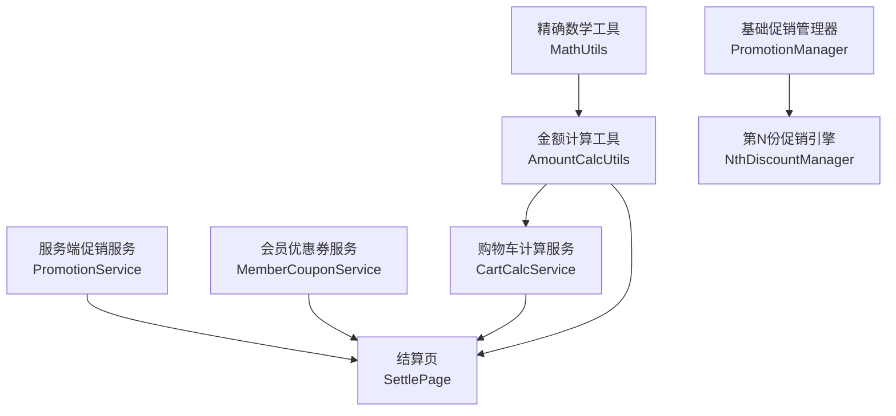

**图表来源**
- [amount_calc_utils.dart:1-371](file://lib/util/amount_calc_utils.dart#L1-L371)
- [math_utils.dart:1-163](file://lib/util/math_utils.dart#L1-L163)
- [cart_calc_service.dart:1-278](file://lib/util/cart_calc_service.dart#L1-L278)
- [promotion_manager.dart:1-455](file://lib/pages/order/promotion_manager.dart#L1-L455)
- [nth_discount_manager.dart:1-267](file://lib/pages/order/nth_discount_manager.dart#L1-L267)
- [promotion_service.dart:1-242](file://lib/util/promotion_service.dart#L1-L242)
- [member_coupon_service.dart:1-126](file://lib/util/member_coupon_service.dart#L1-L126)
- [settle_page.dart:900-1025](file://lib/pages/order/settle_page.dart#L900-L1025)

**章节来源**
- [amount_calc_utils.dart:1-371](file://lib/util/amount_calc_utils.dart#L1-L371)
- [cart_calc_service.dart:1-278](file://lib/util/cart_calc_service.dart#L1-L278)
- [promotion_manager.dart:1-455](file://lib/pages/order/promotion_manager.dart#L1-L455)
- [nth_discount_manager.dart:1-267](file://lib/pages/order/nth_discount_manager.dart#L1-L267)
- [member_coupon_service.dart:1-126](file://lib/util/member_coupon_service.dart#L1-L126)

## 核心组件总览
- **金额计算工具**：提供加法、减法、乘法、除法、抹零、低消差、服务费、折扣后价格和折扣金额计算。所有金额保留两位小数，使用内部四舍五入方法 `_round2`。
- **精确数学工具**：以字符串精度和小数位数为基础，将数值放大为整数进行运算，再还原为普通小数形式，避免原生浮点误差。
- **购物车计算服务**：按赠送、改价、称重、普通商品区分单价与原价，支持折扣累加做法/规格/套餐加价，汇总购物车总额、数量、低消金额，并应用会员价。
- **促销管理器**：从本地数据库加载分类折扣、菜品折扣、特价菜和第 N 份促销，对购物车条目选取最优促销，并对已下单明细补套促销。
- **第 N 份促销引擎**：对购物车展开单品份，按相同商品或不同商品规则选出享受优惠的份，执行整行转促销行或物理拆行。
- **促销服务**：调用服务端接口获取促销活动列表和折扣结果，客户端解析返回的明细折扣金额。
- **会员优惠券服务**：提供优惠券撤销、团购券撤销、支付核销和会员挂账的网络请求封装。
- **结算页与会员详情**：实现挂账额度校验、确认提示、挂账提交和撤销时的反向记账。

**章节来源**
- [amount_calc_utils.dart:1-371](file://lib/util/amount_calc_utils.dart#L1-L371)
- [math_utils.dart:1-163](file://lib/util/math_utils.dart#L1-L163)
- [cart_calc_service.dart:1-278](file://lib/util/cart_calc_service.dart#L1-L278)
- [promotion_manager.dart:1-455](file://lib/pages/order/promotion_manager.dart#L1-L455)
- [nth_discount_manager.dart:1-267](file://lib/pages/order/nth_discount_manager.dart#L1-L267)
- [promotion_service.dart:1-242](file://lib/util/promotion_service.dart#L1-L242)
- [member_coupon_service.dart:1-126](file://lib/util/member_coupon_service.dart#L1-L126)
- [settle_page.dart:900-1025](file://lib/pages/order/settle_page.dart#L900-L1025)
- [order_repository.dart:766-838](file://lib/pages/order/order_repository.dart#L766-L838)

## 架构与数据流
账单计算的数据流大致分为以下阶段：
1. 购物车商品项构建时，根据售价、数量、会员价、折扣、做法/规格/套餐加价计算单项应收金额。
2. 购物车总额汇总后，基础促销管理器尝试为每个商品套用分类折扣、菜品折扣或特价菜，得到最优单价。
3. 第 N 份促销引擎对购物车整体重算，按相同商品或不同商品规则拆分出促销行。
4. 服务端促销服务可用于获取更复杂的促销活动（满量、满减、满赠、满折）及折扣明细。
5. 结算阶段，系统计算低消差、服务费、优惠券抵扣和支付方式，包括会员挂账。
6. 挂账成功后调用会员挂账接口；撤销支付时调用反向记账接口恢复待收金额。

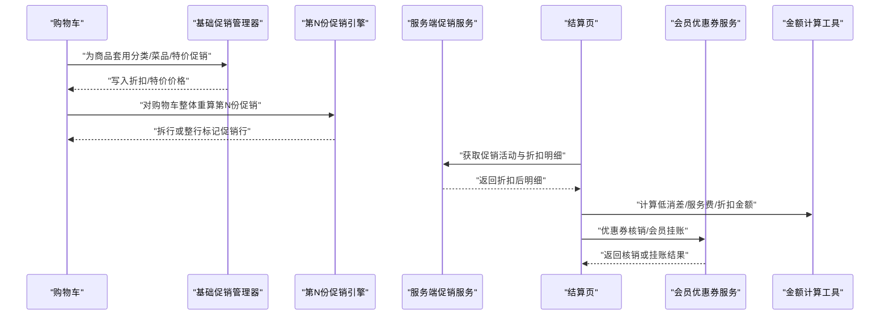

**图表来源**
- [promotion_manager.dart:201-455](file://lib/pages/order/promotion_manager.dart#L201-L455)
- [nth_discount_manager.dart:1-267](file://lib/pages/order/nth_discount_manager.dart#L1-L267)
- [promotion_service.dart:1-242](file://lib/util/promotion_service.dart#L1-L242)
- [settle_page.dart:900-1025](file://lib/pages/order/settle_page.dart#L900-L1025)
- [amount_calc_utils.dart:150-371](file://lib/util/amount_calc_utils.dart#L150-L371)

## 金额计算实现

### 精确四则运算
金额计算的核心是避免浮点数误差。`AmountCalcUtils` 提供 `add`、`sub`、`mul`、`div`，统一保留两位小数并使用四舍五入；`MathUtils` 提供更通用的精确加减乘除、求和、舍入，通过将操作数按小数位数放大为整数后再缩小，从而消除科学计数法和浮点表示带来的误差。

关键要点：
- `AmountCalcUtils.add/sub/mul/div` 直接对业务金额做两位小数四舍五入。
- `MathUtils.add/subtract/multiply/divide` 先判断小数位数，再乘以 10 的幂次方转为整数运算，最后用 `transferToNumber` 去除科学计数法残留。
- `MathUtils.sum` 用于列表金额累加，避免多次原生 `double` 相加导致的累积误差。
- `MathUtils.roundTo` 提供任意小数位数的四舍五入。

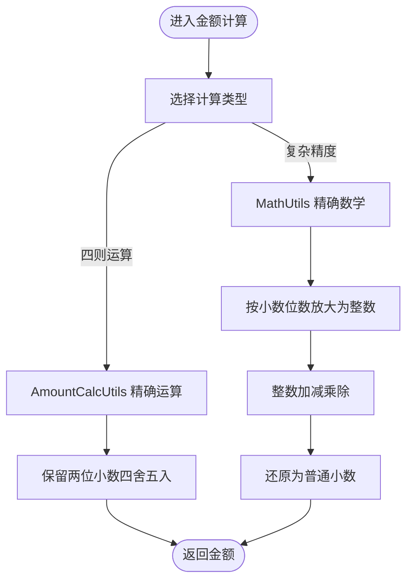

**图表来源**
- [amount_calc_utils.dart:12-49](file://lib/util/amount_calc_utils.dart#L12-L49)
- [math_utils.dart:15-163](file://lib/util/math_utils.dart#L15-L163)

**章节来源**
- [amount_calc_utils.dart:12-49](file://lib/util/amount_calc_utils.dart#L12-L49)
- [math_utils.dart:15-163](file://lib/util/math_utils.dart#L15-L163)

### 抹零计算
`AmountCalcUtils.eraseAmount` 支持 9 种抹零方式，对应配置标识：
- 1：四舍五入到角
- 2：四舍五入到元
- 3：四舍五入到十元
- 4：去分（截断到角）
- 5：去角（取整到元）
- 6：抹零到五角（小于 5 角的分去掉）
- 7：四舍五入到五角
- 8：进角（向上取整到角）
- 9：进元（向上取整到元）

若未配置抹零方式，则返回原金额。抹零金额可通过 `getEraseAmt` 计算，即 `应收金额 - 抹零后金额`。

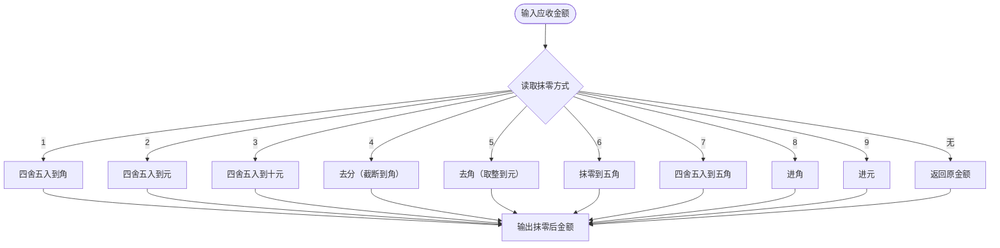

**图表来源**
- [amount_calc_utils.dart:51-148](file://lib/util/amount_calc_utils.dart#L51-L148)

**章节来源**
- [amount_calc_utils.dart:51-148](file://lib/util/amount_calc_utils.dart#L51-L148)

### 低消差计算
低消标准金额根据低消方式计算：
- 餐桌低消：直接使用低消标准单价；
- 人均低消：低消标准单价 × 人数。

低消差计算考虑服务费是否计入低消：
- 若服务费计入低消，则以 `商品总金额 + 服务费` 与低消标准比较；
- 否则仅以商品总金额与低消标准比较；
- 未达到低消标准时返回差额，已达到则返回 0。

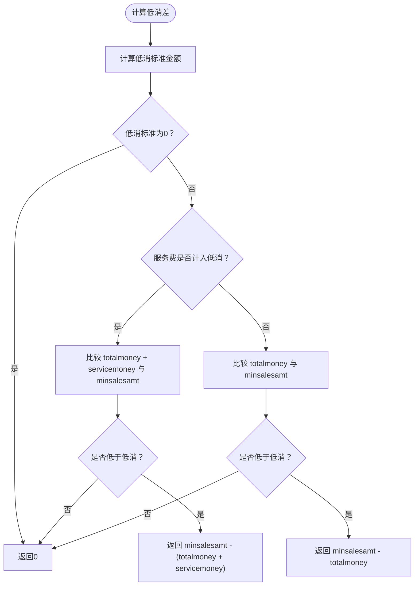

**图表来源**
- [amount_calc_utils.dart:150-195](file://lib/util/amount_calc_utils.dart#L150-L195)

**章节来源**
- [amount_calc_utils.dart:150-195](file://lib/util/amount_calc_utils.dart#L150-L195)

### 服务费计算
服务费包含两类实现：
1. **通用时间段服务费**：根据起步时长、超时单位、封顶时长、免费分钟数计算起步价与超时费。
2. **台桌服务费**：根据桌台类型的计费模式计算：
   - 按消费金额百分比；
   - 指定金额；
   - 按小时（手动模式需开始时间）；
   - 按人数；
   - 起步递增与时段区间由服务端兜底，本地返回 0。

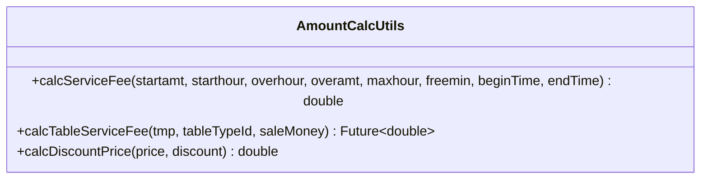

**图表来源**
- [amount_calc_utils.dart:196-371](file://lib/util/amount_calc_utils.dart#L196-L371)

**章节来源**
- [amount_calc_utils.dart:196-371](file://lib/util/amount_calc_utils.dart#L196-L371)

## 促销规则与优先级

### 基础促销：分类折扣、菜品折扣、特价菜
基础促销由 `PromotionManager` 从本地表加载，并应用到购物车条目：
- 分类折扣与菜品折扣：受商品是否可打折限制；
- 特价菜：不受 `dscflag` 限制，直接设置特价价格；
- 对于同一商品，选取能产生最低价格的促销作为最优解；
- 若促销限定规格但客户端无法比对规格 ID，则跳过该促销并记录日志。

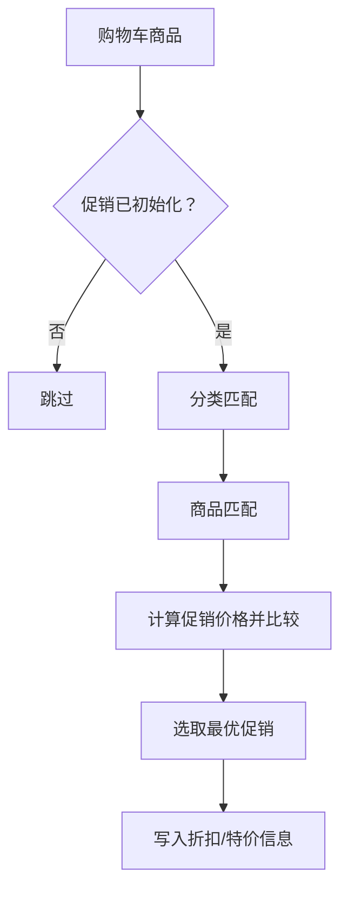

**图表来源**
- [promotion_manager.dart:201-455](file://lib/pages/order/promotion_manager.dart#L201-L455)

**章节来源**
- [promotion_manager.dart:201-455](file://lib/pages/order/promotion_manager.dart#L201-L455)

### 第 N 份促销：N元N件
第 N 份促销由 `NthDiscountManager` 处理，支持两种条件：
- 相同商品：按 `productid + 规格` 分组，每组内每 N 份取价格最低的一份优惠；
- 不同商品：
  - 规则 1：价格降序分组，每组最低价享受优惠；
  - 规则 2：价格降序排序后从最低价开始优惠，数量为总份数除以 N。

优惠形式包括折扣、特价、减价，且减价兜底不低于 0。参与池过滤掉赠送、团购、称重、改价、退菜等行。单笔订单最大享受次数会扣除已下单不可撤销行。

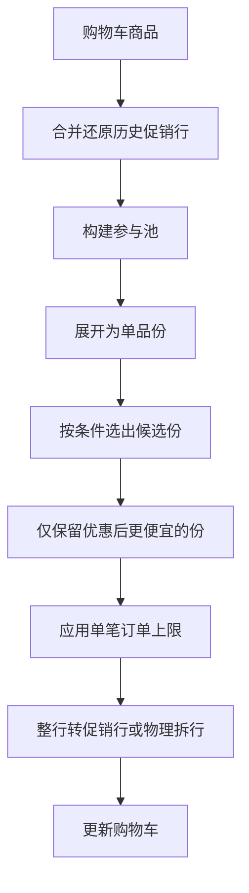

**图表来源**
- [nth_discount_manager.dart:1-267](file://lib/pages/order/nth_discount_manager.dart#L1-L267)

**章节来源**
- [nth_discount_manager.dart:1-267](file://lib/pages/order/nth_discount_manager.dart#L1-L267)

### 服务端促销：满减、买赠、满赠、满折
服务端促销由 `PromotionService` 获取活动列表和折扣结果：
- 活动类型包括分类折扣、菜品折扣、特价菜、买赠、满量折扣、满减、满赠、满折；
- 客户端传入当前订单明细 JSON 和会员 ID，服务端返回折扣后的明细数组；
- 客户端解析 `discountamt` 汇总总折扣金额。

`PromotionInfo` 也提供适用类型匹配逻辑，支持全部商品、按分类、按商品三种范围，并处理买赠/满赠赠品列表可用性。

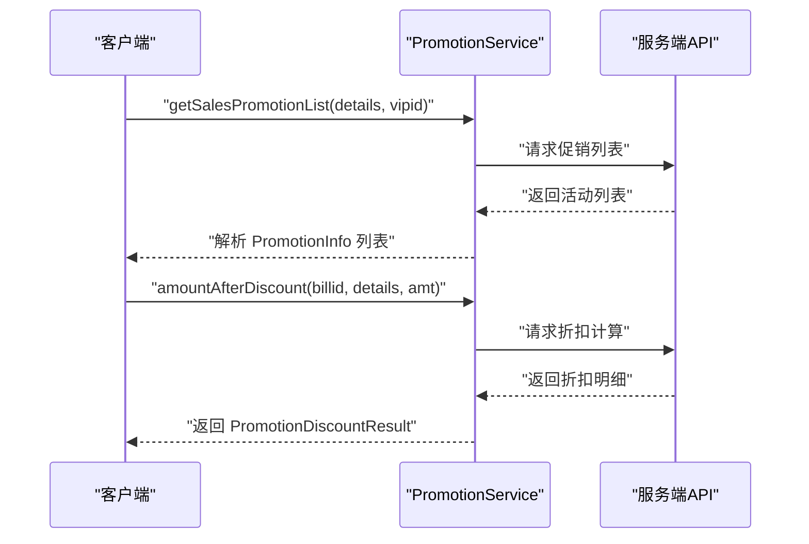

**图表来源**
- [promotion_service.dart:1-242](file://lib/util/promotion_service.dart#L1-L242)
- [promotion_helper.dart:1-200](file://lib/util/promotion_helper.dart#L1-L200)

**章节来源**
- [promotion_service.dart:1-242](file://lib/util/promotion_service.dart#L1-L242)
- [promotion_helper.dart:1-200](file://lib/util/promotion_helper.dart#L1-L200)

## 优惠券抵扣机制
会员与优惠券相关逻辑集中在 `MemberCouponService`，提供：
- 撤销已核销优惠券；
- 撤销团购券；
- 优惠券支付核销；
- 会员挂账接口。

这些方法均为网络请求封装，失败时记录日志并返回失败状态。优惠券的具体抵扣规则（代金券、折扣券、礼品券）通常由服务端根据优惠券类型、面额、门槛和订单金额计算，客户端负责传递主单信息和优惠券信息并完成核销。

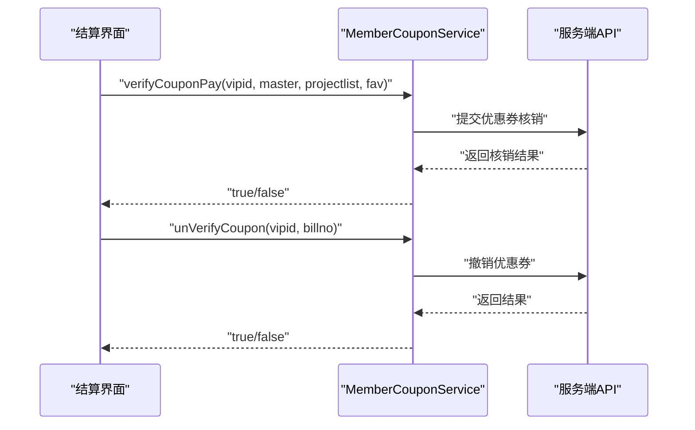

**图表来源**
- [member_coupon_service.dart:1-126](file://lib/util/member_coupon_service.dart#L1-L126)

**章节来源**
- [member_coupon_service.dart:1-126](file://lib/util/member_coupon_service.dart#L1-L126)

## 会员挂账处理
会员挂账在结算页中实现，核心流程如下：
1. 检查会员是否支持挂账；
2. 校验剩余额度是否足够：`可用挂账余额 = 挂账额度 - 已欠款金额`；
3. 弹出确认提示；
4. 调用挂账接口提交本次挂账金额；
5. 撤销支付时调用反向记账接口恢复待收金额。

会员详情数据模型提供 `overflag`、`overmoney`、`arrearages` 和 `availableOverMoney`，用于前端显示和校验。

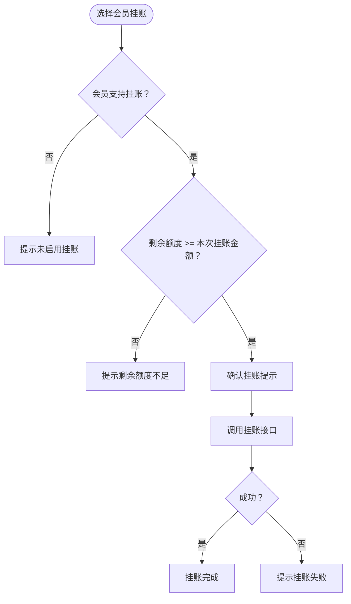

**图表来源**
- [settle_page.dart:900-1025](file://lib/pages/order/settle_page.dart#L900-L1025)
- [order_repository.dart:766-838](file://lib/pages/order/order_repository.dart#L766-L838)

**章节来源**
- [settle_page.dart:900-1025](file://lib/pages/order/settle_page.dart#L900-L1025)
- [order_repository.dart:766-838](file://lib/pages/order/order_repository.dart#L766-L838)

## 扩展新计算规则与自定义促销策略

### 新增精确计算规则
若需要新增一种金额计算规则（例如新的抹零方式或服务费算法），推荐在 `AmountCalcUtils` 中添加静态方法，并保持以下原则：
- 所有金额运算通过 `add/sub/mul/div` 进行，确保两位小数四舍五入；
- 如需更高精度中间过程，使用 `MathUtils` 的精确运算；
- 对外暴露的方法应明确输入参数、默认值和返回值含义；
- 对于异步或服务端依赖的计算（如台桌服务费），保持方法签名清晰，并在注释中说明哪些情况由服务端兜底。

示例参考路径：
- 新增抹零方式：[amount_calc_utils.dart:51-148](file://lib/util/amount_calc_utils.dart#L51-L148)
- 新增服务费计费模式：[amount_calc_utils.dart:196-371](file://lib/util/amount_calc_utils.dart#L196-L371)

### 新增基础促销类型
若要扩展基础促销类型（例如新增“时段折扣”），可在 `PromotionManager` 中：
- 扩展基础促销模型字段；
- 在初始化时从数据库或表下载器加载新规则；
- 在 `applyToCartItem` 中加入匹配逻辑与价格比较；
- 对已下单明细补套逻辑增加相应分支。

示例参考路径：
- 基础促销模型与初始化：[promotion_manager.dart:1-200](file://lib/pages/order/promotion_manager.dart#L1-L200)
- 购物车条目应用逻辑：[promotion_manager.dart:201-455](file://lib/pages/order/promotion_manager.dart#L201-L455)

### 新增第 N 份促销规则
若要扩展第 N 份促销规则，可在 `NthDiscountManager` 中：
- 扩展参与池过滤条件；
- 在候选份选择逻辑中加入新规则分支；
- 在拆行逻辑中处理新形式的促销价格；
- 记录日志便于现场排查。

示例参考路径：
- 第 N 份促销应用流程：[nth_discount_manager.dart:1-267](file://lib/pages/order/nth_discount_manager.dart#L1-L267)

### 新增优惠券类型
若要支持新的优惠券类型，应在 `MemberCouponService` 中：
- 扩展核销或撤销接口参数；
- 在服务端返回结构中增加新字段；
- 客户端解析并展示优惠券抵扣明细。

示例参考路径：
- 优惠券核销与撤销：[member_coupon_service.dart:1-126](file://lib/util/member_coupon_service.dart#L1-L126)

## 精度、误差与性能优化

### 金额精度处理
- 业务金额统一使用 `AmountCalcUtils.add/sub/mul/div`，保证两位小数四舍五入；
- 复杂中间计算使用 `MathUtils`，避免科学计数法和浮点误差；
- 格式化显示时使用 `toStringAsFixed(2)` 或 `formatAmount`；
- 对列表金额累加优先使用 `MathUtils.sum`。

### 浮点数误差避免
- 避免直接对原生 `double` 进行多次加减乘除；
- 使用 `MathUtils.transferToNumber` 处理科学计数法残留；
- 在比较金额时使用容差（例如第 N 份促销中使用 `-0.005` 容差）。

### 性能优化建议
- 购物车总额计算避免重复计算：缓存单项价格与总额；
- 促销初始化只在登录、跨天、切换会员或强制刷新时重新加载；
- 第 N 份促销仅在购物车变化时重算，避免每次渲染都执行；
- 服务端促销请求应批量处理，减少网络往返；
- 对频繁调用的金额计算方法，避免创建不必要的对象。

**章节来源**
- [amount_calc_utils.dart:12-371](file://lib/util/amount_calc_utils.dart#L12-L371)
- [math_utils.dart:15-163](file://lib/util/math_utils.dart#L15-L163)
- [cart_calc_service.dart:1-278](file://lib/util/cart_calc_service.dart#L1-L278)
- [promotion_manager.dart:1-455](file://lib/pages/order/promotion_manager.dart#L1-L455)
- [nth_discount_manager.dart:1-267](file://lib/pages/order/nth_discount_manager.dart#L1-L267)

## 故障排查指南
常见问题与定位建议：
- **促销不生效**：检查促销是否已初始化、商品是否可打折、是否命中分类或商品匹配、是否因规格限制被跳过；
- **第 N 份促销未拆行**：检查参与池过滤条件、是否称重/改价/赠送、是否已达单笔订单上限；
- **金额显示异常**：检查是否使用 `AmountCalcUtils` 或 `MathUtils`，避免原生浮点运算；
- **挂账失败**：检查会员是否支持挂账、剩余额度是否足够、接口调用是否成功；
- **优惠券核销失败**：检查优惠券信息是否完整、主单结构是否正确、网络请求是否抛异常。

**章节来源**
- [promotion_manager.dart:201-455](file://lib/pages/order/promotion_manager.dart#L201-L455)
- [nth_discount_manager.dart:1-267](file://lib/pages/order/nth_discount_manager.dart#L1-L267)
- [settle_page.dart:900-1025](file://lib/pages/order/settle_page.dart#L900-L1025)
- [member_coupon_service.dart:1-126](file://lib/util/member_coupon_service.dart#L1-L126)

## 结论
账单计算引擎通过分层设计实现了金额计算、促销规则、优惠券抵扣和会员挂账的完整闭环。金额计算工具与精确数学工具保障精度与一致性；购物车服务聚合商品金额与会员价；基础促销与第 N 份促销引擎分别处理不同粒度的优惠；服务端促销服务承担复杂规则匹配；会员优惠券服务与结算页完成核销与挂账流程。扩展新规则时应遵循现有方法命名与精度规范，并通过日志和单元测试验证正确性。