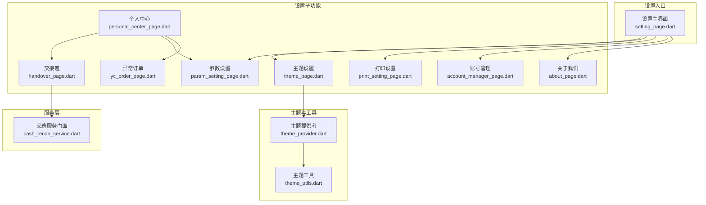
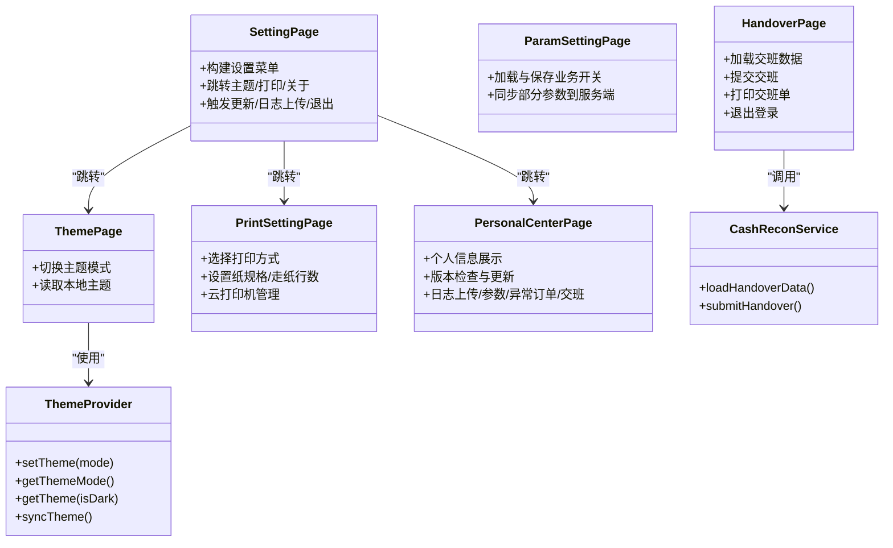
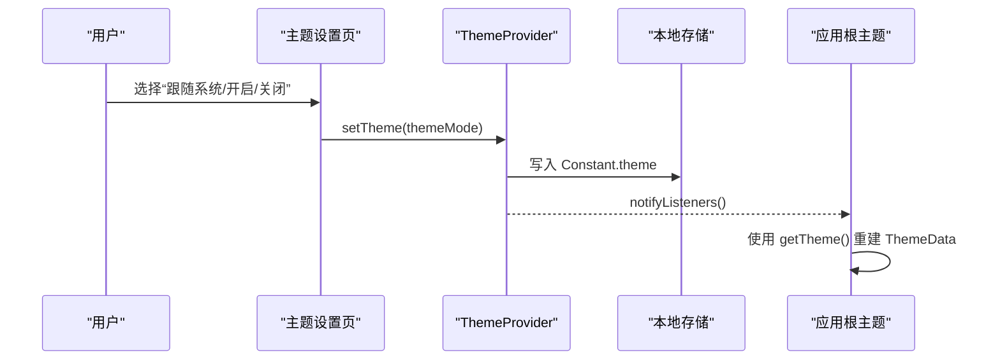
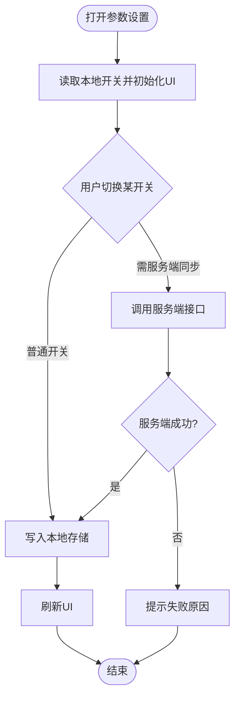
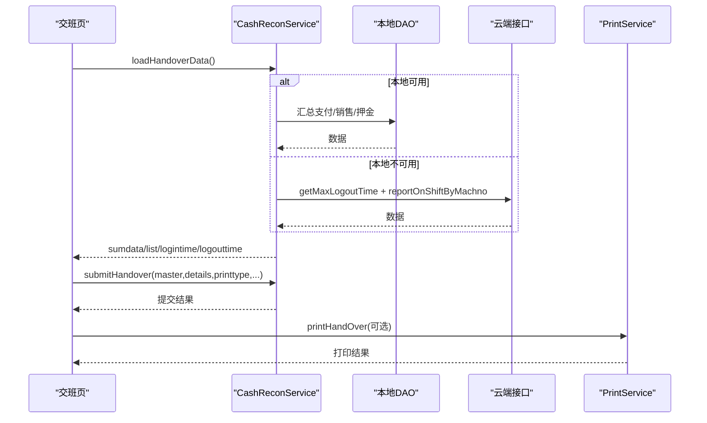
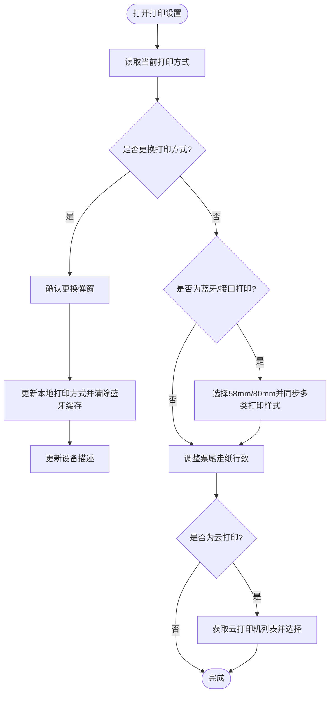
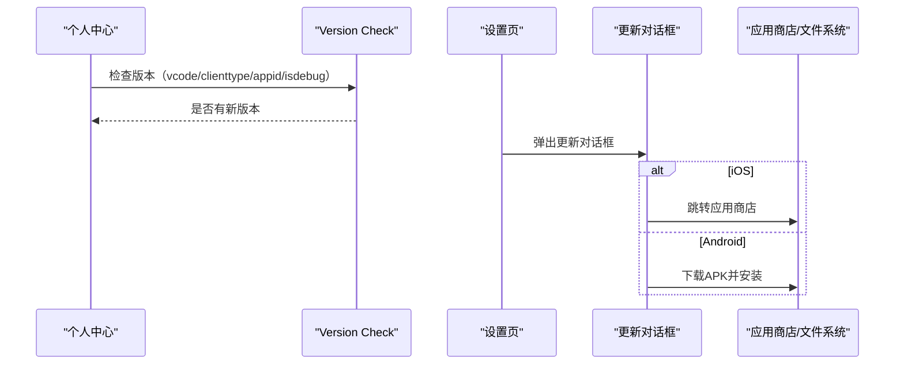
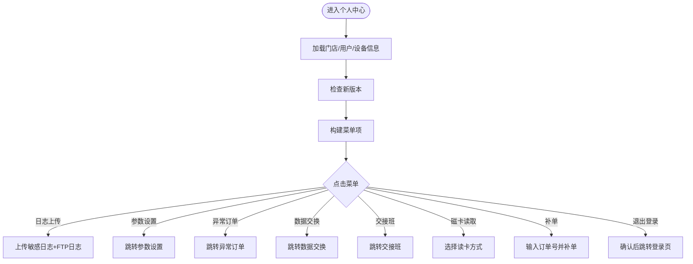
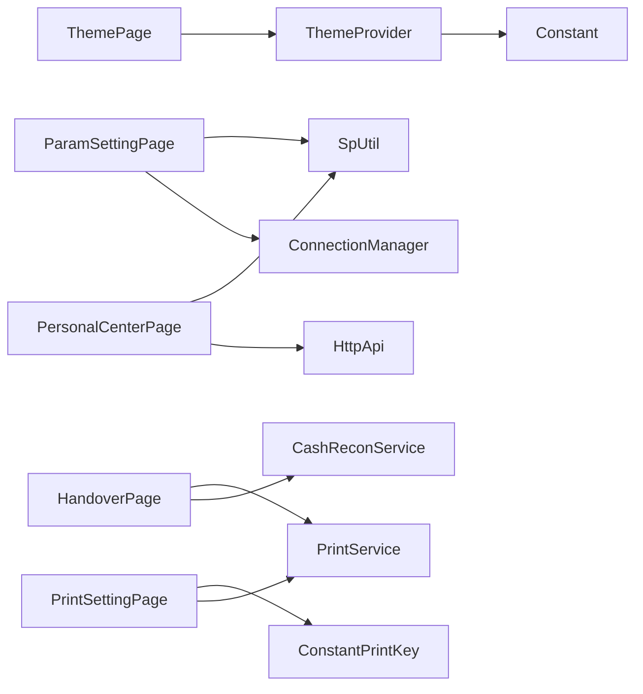

# 设置管理模块

<cite>
**本文引用的文件**   
- [setting_page.dart](file://lib/setting/page/setting_page.dart)
- [theme_page.dart](file://lib/setting/page/theme_page.dart)
- [theme_provider.dart](file://lib/setting/provider/theme_provider.dart)
- [param_setting_page.dart](file://lib/setting/page/param_setting_page.dart)
- [handover_page.dart](file://lib/setting/page/handover_page.dart)
- [cash_recon_service.dart](file://lib/service/cash_recon_service.dart)
- [account_manager_page.dart](file://lib/setting/page/account_manager_page.dart)
- [print_setting_page.dart](file://lib/setting/page/print_setting_page.dart)
- [about_page.dart](file://lib/setting/page/about_page.dart)
- [personal_center_page.dart](file://lib/setting/page/personal_center_page.dart)
- [yc_order_page.dart](file://lib/setting/page/yc_order_page.dart)
- [update_dialog.dart](file://lib/setting/widgets/update_dialog.dart)
- [exit_dialog.dart](file://lib/setting/widgets/exit_dialog.dart)
- [theme_utils.dart](file://lib/util/theme_utils.dart)
- [constant.dart](file://lib/res/constant.dart)
- [constant_print_key.dart](file://lib/res/constant_print_key.dart)
</cite>

## 目录
1. [简介](#简介)
2. [项目结构](#项目结构)
3. [核心组件](#核心组件)
4. [架构总览](#架构总览)
5. [详细组件分析](#详细组件分析)
6. [依赖关系分析](#依赖关系分析)
7. [性能与可靠性考虑](#性能与可靠性考虑)
8. [故障排查指南](#故障排查指南)
9. [结论](#结论)
10. [附录：扩展指南与示例路径](#附录扩展指南与示例路径)

## 简介
本模块是应用的“设置中心”，围绕主题系统、参数配置、交班对账、账户管理、打印设置、版本检查与更新、个人中心等能力组织。其设计目标是：
- 将用户偏好（主题、打印、业务开关）统一持久化，并在关键页面动态生效。
- 以平台分流的方式提供交班数据加载与上报能力，保证移动端和 Web 端行为一致。
- 为应用维护者提供清晰的扩展点，便于新增设置项、主题类型或打印设备类型。

## 项目结构
设置模块主要位于 `lib/setting` 下，采用“页面 + Provider + 通用控件”的组织方式：
- `page/`：设置相关页面（主题、参数、交班、账户、打印、关于、个人中心、异常订单）。
- `provider/theme_provider.dart`：主题状态与主题数据生成。
- `widgets/`：设置页内通用对话框（退出登录、更新下载）。
- 常量与资源：`lib/res/constant.dart`、`lib/res/constant_print_key.dart`；工具类：`lib/util/theme_utils.dart`。

**图表来源**
- [setting_page.dart:1-145](file://lib/setting/page/setting_page.dart#L1-L145)
- [theme_page.dart:1-72](file://lib/setting/page/theme_page.dart#L1-L72)
- [theme_provider.dart:1-92](file://lib/setting/provider/theme_provider.dart#L1-L92)
- [param_setting_page.dart:1-353](file://lib/setting/page/param_setting_page.dart#L1-L353)
- [print_setting_page.dart:1-319](file://lib/setting/page/print_setting_page.dart#L1-L319)
- [account_manager_page.dart:1-54](file://lib/setting/page/account_manager_page.dart#L1-L54)
- [handover_page.dart:1-450](file://lib/setting/page/handover_page.dart#L1-L450)
- [cash_recon_service.dart:1-200](file://lib/service/cash_recon_service.dart#L1-L200)
- [personal_center_page.dart:1-646](file://lib/setting/page/personal_center_page.dart#L1-L646)
- [about_page.dart:1-105](file://lib/setting/page/about_page.dart#L1-L105)
- [yc_order_page.dart:1-141](file://lib/setting/page/yc_order_page.dart#L1-L141)

**章节来源**
- [setting_page.dart:1-145](file://lib/setting/page/setting_page.dart#L1-L145)

## 核心组件
- 主题系统：通过 `ThemeProvider` 管理主题模式并生成全局 `ThemeData`，配合 `Constant.theme` 在本地持久化。
- 参数配置：集中管理结账、点菜、桌台、显示、其他等开关，部分开关同步服务端。
- 交班对账：封装从数据加载、统计展示到提交上报与打印的完整流程。
- 账户管理：查看店铺信息、跳转修改密码。
- 打印设置：选择打印方式、纸规格、票尾走纸行数、云打印机管理。
- 版本检查与更新：个人中心检查新版本，设置页弹出更新对话框进行下载与安装。
- 个人中心：聚合常用入口（版本、日志、参数、异常订单、数据交换、交班、磁卡读取方式、补单、退出登录）。

**章节来源**
- [theme_provider.dart:1-92](file://lib/setting/provider/theme_provider.dart#L1-L92)
- [param_setting_page.dart:1-353](file://lib/setting/page/param_setting_page.dart#L1-L353)
- [handover_page.dart:1-450](file://lib/setting/page/handover_page.dart#L1-L450)
- [cash_recon_service.dart:1-200](file://lib/service/cash_recon_service.dart#L1-L200)
- [print_setting_page.dart:1-319](file://lib/setting/page/print_setting_page.dart#L1-L319)
- [personal_center_page.dart:1-646](file://lib/setting/page/personal_center_page.dart#L1-L646)
- [update_dialog.dart:1-183](file://lib/setting/widgets/update_dialog.dart#L1-L183)

## 架构总览
设置模块整体遵循“页面驱动 + Provider 状态 + Service 服务 + 常量/工具”的分层结构：
- 页面层负责 UI 与交互，调用 Provider/Service 获取或写入数据。
- Provider 负责主题状态管理与主题数据生成。
- Service 层封装交班数据的跨平台加载与上报逻辑。
- 常量与工具提供键值、颜色、样式、系统覆盖风格等基础能力。

**图表来源**
- [setting_page.dart:1-145](file://lib/setting/page/setting_page.dart#L1-L145)
- [theme_page.dart:1-72](file://lib/setting/page/theme_page.dart#L1-L72)
- [theme_provider.dart:1-92](file://lib/setting/provider/theme_provider.dart#L1-L92)
- [param_setting_page.dart:1-353](file://lib/setting/page/param_setting_page.dart#L1-L353)
- [print_setting_page.dart:1-319](file://lib/setting/page/print_setting_page.dart#L1-L319)
- [personal_center_page.dart:1-646](file://lib/setting/page/personal_center_page.dart#L1-L646)
- [handover_page.dart:1-450](file://lib/setting/page/handover_page.dart#L1-L450)
- [cash_recon_service.dart:1-200](file://lib/service/cash_recon_service.dart#L1-L200)

## 详细组件分析

### 主题系统：亮色/暗色切换、存储与动态应用
主题系统由以下部分组成：
- 主题模式选择：`ThemePage` 提供“跟随系统/开启/关闭”三种选项，对应 Flutter 的 `ThemeMode.system/light/dark`。
- 主题状态与数据：`ThemeProvider` 负责将选择的模式持久化到本地，并提供 `getTheme()` 构造全局 `ThemeData`。
- 主题工具：`ThemeUtils` 提供当前是否为暗色、系统栏覆盖风格等工具方法。
- 设置页展示：`SettingPage` 读取本地主题值并以文字提示当前夜间模式状态。

**图表来源**
- [theme_page.dart:1-72](file://lib/setting/page/theme_page.dart#L1-L72)
- [theme_provider.dart:1-92](file://lib/setting/provider/theme_provider.dart#L1-L92)
- [theme_utils.dart:1-52](file://lib/util/theme_utils.dart#L1-L52)
- [constant.dart:1-93](file://lib/res/constant.dart#L1-L93)

实现要点：
- 主题模式与字符串映射：`ThemeProvider` 通过 `ThemeModeExtension` 将枚举转为稳定字符串，避免直接序列化枚举导致兼容问题。
- 动态刷新：`setTheme` 调用 `notifyListeners()`，使依赖 Provider 的页面重新构建，从而应用新主题。
- 主题数据生成：`getTheme` 根据是否暗色切换主色、背景、分割线、文本样式、AppBar 覆盖风格等。

**章节来源**
- [theme_page.dart:1-72](file://lib/setting/page/theme_page.dart#L1-L72)
- [theme_provider.dart:1-92](file://lib/setting/provider/theme_provider.dart#L1-L92)
- [setting_page.dart:1-145](file://lib/setting/page/setting_page.dart#L1-L145)
- [theme_utils.dart:1-52](file://lib/util/theme_utils.dart#L1-L52)
- [constant.dart:1-93](file://lib/res/constant.dart#L1-L93)

### 参数配置管理：存储、验证、默认值与同步
`ParamSettingPage` 集中管理多类业务开关，按分组展示：
- 连接设置：服务连接方式（后台统一管理时不可修改）。
- 结账设置：打印账单、结账打印小票、默认全款付、开启暂结。
- 点菜设置：数字角标、客单开关、称重二次确认、显示公共做法、下单确认、单品无需选规格、扫码点餐。
- 桌台设置：启用锁台。
- 显示设置：显示服务员、显示点菜人名称。
- 其他：开启 NFC、接单打印聚合码。

持久化策略：
- 多数开关使用 `sp_util` 直接存取布尔或字符串。
- 部分开关与服务端同步：例如“称重二次确认”先调用服务端接口成功后再写本地；“启用锁台”先写本地再调用服务端接口。
- 服务器类型由 `ConnectionManager` 控制，若后台统一管理则禁止修改。

**图表来源**
- [param_setting_page.dart:1-353](file://lib/setting/page/param_setting_page.dart#L1-L353)

关键点：
- 默认值处理：多处使用 `SpUtil.getBool(..., defValue: true)` 确保首次运行有合理默认值。
- 错误透传：服务端返回的异常信息被解析并展示，便于定位问题。
- 连接模式保护：当连接模式由后台统一管理时，禁用修改并给出提示。

**章节来源**
- [param_setting_page.dart:1-353](file://lib/setting/page/param_setting_page.dart#L1-L353)

### 交班对账：流程、统计、报表与上报
交班流程包含：
- 数据加载：根据平台分流，Web 走云端接口，iOS/Android 优先本地 DAO 汇总，必要时回退云端。
- 统计展示：支付方式明细、销售汇总、菜品与分类统计、押金统计等。
- 提交上报：校验数据后构造 master 与 details，调用服务层提交。
- 打印处理：PC 打印、云打印或兜底云端打印。
- 完成弹窗：提供退出应用、注销、退出登录三个选项。

**图表来源**
- [handover_page.dart:1-450](file://lib/setting/page/handover_page.dart#L1-L450)
- [cash_recon_service.dart:1-200](file://lib/service/cash_recon_service.dart#L1-L200)

重要逻辑：
- 过滤支付方式明细：仅统计参与交班的支付方式（特定字段过滤）。
- Master 构造：金额字段进行安全转换，并按规则计算总额。
- 打印分支：PC 在线则发送标题给主设备；否则由云端打印兜底。
- 退出登录：支持注销（清空记住账号密码）、退出登录（仅清密码）、退出应用。

**章节来源**
- [handover_page.dart:1-450](file://lib/setting/page/handover_page.dart#L1-L450)
- [cash_recon_service.dart:1-200](file://lib/service/cash_recon_service.dart#L1-L200)

### 账户管理：查看信息与修改密码
`AccountManagerPage` 提供：
- 店铺 Logo 展示区域（占位）。
- 修改密码：跳转至登录路由中的修改密码页面。
- 绑定账号：当前显示为固定内容，后续可扩展真实数据。

该页面简洁明了，重点在于路由跳转与占位展示。

**章节来源**
- [account_manager_page.dart:1-54](file://lib/setting/page/account_manager_page.dart#L1-L54)

### 打印设置：配置界面与打印机管理
`PrintSettingPage` 提供：
- 打印方式选择：PC打印、云打印、蓝牙打印、接口打印。
- 打印设备描述：根据当前类型显示“由主设备管理”“未配置”“未连接”等。
- 纸规格与样式：58mm/80mm，同时同步结账/客单/厨打的样式与规格。
- 票尾走纸行数：增减按钮，限制范围。
- 云打印机管理：拉取列表、选择并保存选中打印机信息。

**图表来源**
- [print_setting_page.dart:1-319](file://lib/setting/page/print_setting_page.dart#L1-L319)
- [constant_print_key.dart:1-147](file://lib/res/constant_print_key.dart#L1-L147)

注意事项：
- 切换打印方式会清除蓝牙地址与名称，避免旧设备残留。
- 云打印管理为空时提示“暂无可用云打印机”。
- PC打印由主设备自动管理，不在此页配置具体设备。

**章节来源**
- [print_setting_page.dart:1-319](file://lib/setting/page/print_setting_page.dart#L1-L319)
- [constant_print_key.dart:1-147](file://lib/res/constant_print_key.dart#L1-L147)

### 应用版本检查与自动更新
- 个人中心在启动时检查新版本：读取本地 buildNumber 并请求服务端接口，存在新版本则标记显示“NEW”。
- 设置页提供“检查更新”入口，弹出 `UpdateDialog`。
- `UpdateDialog` 支持 Android 下载 APK 并安装，iOS 跳转到应用商店。

**图表来源**
- [personal_center_page.dart:1-646](file://lib/setting/page/personal_center_page.dart#L1-L646)
- [setting_page.dart:1-145](file://lib/setting/page/setting_page.dart#L1-L145)
- [update_dialog.dart:1-183](file://lib/setting/widgets/update_dialog.dart#L1-L183)

注意：
- 版本检查失败静默处理，不影响正常使用。
- Android 下载失败会提示并恢复下载状态。

**章节来源**
- [personal_center_page.dart:1-646](file://lib/setting/page/personal_center_page.dart#L1-L646)
- [setting_page.dart:1-145](file://lib/setting/page/setting_page.dart#L1-L145)
- [update_dialog.dart:1-183](file://lib/setting/widgets/update_dialog.dart#L1-L183)

### 个性化设置与个人中心
`PersonalCenterPage` 聚合了：
- 个人信息展示：门店名称、商户号、头像、用户名（工号）。
- 版本更新、本机设备号、日志上传。
- 参数设置、异常订单查询、数据交换、交接班。
- 磁卡读取方式选择（无/联迪/NFC）。
- 补单：输入订单号，调用服务端接口逐条判断结果。
- 退出登录：确认后跳转登录页。

**图表来源**
- [personal_center_page.dart:1-646](file://lib/setting/page/personal_center_page.dart#L1-L646)

**章节来源**
- [personal_center_page.dart:1-646](file://lib/setting/page/personal_center_page.dart#L1-L646)

### 关于页面
`AboutPage` 主要用于展示品牌动画与外链入口（GitHub、作者博客），不涉及核心设置逻辑，但作为设置入口之一存在。

**章节来源**
- [about_page.dart:1-105](file://lib/setting/page/about_page.dart#L1-L105)

### 异常订单页面
`YcOrderPage` 预留了异常订单的结构与空态展示，当前无本地流水数据库，后续可对接 PayFlow 表。

**章节来源**
- [yc_order_page.dart:1-141](file://lib/setting/page/yc_order_page.dart#L1-L141)

## 依赖关系分析
设置模块内部依赖关系清晰，关键耦合点如下：
- `ThemePage` 依赖 `ThemeProvider` 与本地存储键 `Constant.theme`。
- `ParamSettingPage` 依赖 `ConnectionManager` 与 `sp_util`，部分开关依赖服务端接口。
- `PrintSettingPage` 依赖 `PrintService` 与 `ConstantPrintKey`。
- `HandoverPage` 依赖 `CashReconService`、`PrintService`、`ConstantPrintKey` 与本地存储。
- `PersonalCenterPage` 依赖网络接口、`sp_util`、路由与多个设置子模块。

**图表来源**
- [theme_page.dart:1-72](file://lib/setting/page/theme_page.dart#L1-L72)
- [theme_provider.dart:1-92](file://lib/setting/provider/theme_provider.dart#L1-L92)
- [param_setting_page.dart:1-353](file://lib/setting/page/param_setting_page.dart#L1-L353)
- [print_setting_page.dart:1-319](file://lib/setting/page/print_setting_page.dart#L1-L319)
- [handover_page.dart:1-450](file://lib/setting/page/handover_page.dart#L1-L450)
- [personal_center_page.dart:1-646](file://lib/setting/page/personal_center_page.dart#L1-L646)

**章节来源**
- [constant.dart:1-93](file://lib/res/constant.dart#L1-L93)
- [constant_print_key.dart:1-147](file://lib/res/constant_print_key.dart#L1-L147)

## 性能与可靠性考虑
- 主题切换即时生效：通过 `ChangeNotifier` 通知监听者重建，避免全量刷新影响。
- 参数同步容错：服务端失败时透出错误消息，避免模糊提示。
- 交班数据优先本地：本地不可用时回退云端，保障离线/主设备场景可用性。
- 打印流程兜底：PC 不在线或本地打印机未接入时，由云端打印兜底，减少失败面。
- 版本检查静默失败：不影响主流程，仅在发现新版本时提示。

[本节为通用指导，不直接分析具体文件]

## 故障排查指南
常见问题与定位建议：
- 主题未生效：
  - 检查 `ThemeProvider.setTheme` 是否调用成功，确认本地存储键 `Constant.theme` 是否写入。
  - 确认依赖 Provider 的页面是否正确重建。
- 参数同步失败：
  - 查看服务端返回的错误信息，确认字段名与值是否符合预期（如“称重二次确认”“启用锁台”）。
  - 若连接模式由后台统一管理，确认是否被禁止修改。
- 交班数据为 0：
  - 确认本地 DAO 是否已同步基础数据（支付方式等）。
  - 检查云端接口返回的 `sumdata` 与 `list` 是否为空。
- 打印失败：
  - 确认打印方式与实际设备匹配（云打印是否选择打印机、蓝牙是否连接）。
  - 检查云打印机列表是否为空，或 PC 是否在线。
- 版本检查无效：
  - 检查服务端接口返回的数据结构与版本号字段。
  - Android 下载失败时查看日志输出与权限配置。

**章节来源**
- [theme_provider.dart:1-92](file://lib/setting/provider/theme_provider.dart#L1-L92)
- [param_setting_page.dart:1-353](file://lib/setting/page/param_setting_page.dart#L1-L353)
- [handover_page.dart:1-450](file://lib/setting/page/handover_page.dart#L1-L450)
- [print_setting_page.dart:1-319](file://lib/setting/page/print_setting_page.dart#L1-L319)
- [personal_center_page.dart:1-646](file://lib/setting/page/personal_center_page.dart#L1-L646)

## 结论
设置管理模块以清晰的职责划分与稳定的数据流支撑起主题、参数、交班、打印、账户、版本与个人中心等能力。其设计强调：
- 本地持久化与动态应用的一致性。
- 服务端同步与本地回退的容错机制。
- 可扩展的常量与 Provider 模型，便于新增设置项与主题类型。

[本节为总结性内容，不直接分析具体文件]

## 附录：扩展指南与示例路径

### 添加新的设置项
推荐步骤：
1. 在 `param_setting_page.dart` 中新增开关字段、默认值与持久化读写。
2. 如需服务端同步，在 `_toggleXxx` 中调用 `_syncSetParams` 或相应接口。
3. 在 UI 中添加对应的 Switch 行与分组标题。

参考路径：
- [param_setting_page.dart:1-353](file://lib/setting/page/param_setting_page.dart#L1-L353)

### 扩展主题类型
推荐步骤：
1. 在 `theme_provider.dart` 中扩展 `ThemeModeExtension` 与 `getThemeMode` 的映射。
2. 在 `theme_page.dart` 中添加新的主题选项。
3. 在 `getTheme` 中为新类型提供配色与样式。

参考路径：
- [theme_provider.dart:1-92](file://lib/setting/provider/theme_provider.dart#L1-L92)
- [theme_page.dart:1-72](file://lib/setting/page/theme_page.dart#L1-L72)

### 新增打印设备类型
推荐步骤：
1. 在 `constant_print_key.dart` 中添加新的打印类型常量与默认值。
2. 在 `print_setting_page.dart` 中增加 UI 选项与设备描述逻辑。
3. 在 `PrintService`（外部）中补充对应类型的打印实现。

参考路径：
- [constant_print_key.dart:1-147](file://lib/res/constant_print_key.dart#L1-L147)
- [print_setting_page.dart:1-319](file://lib/setting/page/print_setting_page.dart#L1-L319)

### 扩展交班统计字段
推荐步骤：
1. 在 `cash_recon_service.dart` 的本地汇总或云端返回结构中增加字段。
2. 在 `handover_page.dart` 的 `_parseData` 与 UI 中消费新字段。
3. 在 Master 构造与打印标题中按需加入新数据。

参考路径：
- [cash_recon_service.dart:1-200](file://lib/service/cash_recon_service.dart#L1-L200)
- [handover_page.dart:1-450](file://lib/setting/page/handover_page.dart#L1-L450)