# Dio 封装与请求管理

<cite>
**本文引用的文件**   
- [dio_utils.dart](file://lib/net/dio_utils.dart)
- [intercept.dart](file://lib/net/intercept.dart)
- [error_handle.dart](file://lib/net/error_handle.dart)
- [base_entity.dart](file://lib/net/base_entity.dart)
- [connection_manager.dart](file://lib/net/connection_manager.dart)
- [http_helper.dart](file://lib/net/http_helper.dart)
- [main.dart](file://lib/main.dart)
</cite>

## 目录

1. [引言](#引言)
2. [项目结构定位](#项目结构定位)
3. [核心组件总览](#核心组件总览)
4. [架构概览](#架构概览)
5. [DioUtils 单例与网络请求封装详解](#dioutils-单例与网络请求封装详解)
6. [拦截器与统一响应适配](#拦截器与统一响应适配)
7. [异常与错误码体系](#异常与错误码体系)
8. [数据解析优化与 compute 策略](#数据解析优化与-compute-策略)
9. [代理抓包与 Fiddler 集成](#代理抓包与-fiddler-集成)
10. [业务层请求封装与签名流程](#业务层请求封装与签名流程)
11. [连接模式与基础地址选择](#连接模式与基础地址选择)
12. [依赖关系分析](#依赖关系分析)
13. [性能特性与优化建议](#性能特性与优化建议)
14. [最佳实践示例](#最佳实践示例)
15. [常见问题排查指南](#常见问题排查指南)
16. [结论](#结论)

## 引言

本技术文档聚焦于项目的网络层封装，尤其是 `DioUtils` 对 Dio 的统一封装、单例生命周期、超时配置、响应类型、状态码校验、统一请求方法、异步流式调用、数据解析优化、代理抓包以及业务层请求封装。目标是帮助开发者理解：

- 为什么使用单例封装 Dio；
- 如何安全地初始化网络栈；
- 如何区分同步回调风格与异步流式风格；
- 大对象 JSON 解析如何避免主线程阻塞；
- 如何通过拦截器统一鉴权、日志、Token 刷新和响应体适配；
- 如何在云服务与主设备两种模式下选择基础地址；
- 如何阅读和扩展现有网络代码。

## 项目结构定位

本项目是一个 Flutter 应用，网络相关代码集中在 `lib/net` 目录中：

| 模块 | 职责 | 对应文件 |
| --- | --- | --- |
| Dio 封装 | 提供单例 Dio 客户端、统一请求入口、超时、基础 URL、拦截器注入 | `dio_utils.dart` |
| 拦截器 | 鉴权头、Token 刷新、日志打印、响应体适配 | `intercept.dart` |
| 异常处理 | HTTP 状态码常量、Dio 异常映射、用户可读错误 | `error_handle.dart` |
| 通用响应模型 | 将服务端返回的 JSON 转为统一 `BaseEntity` | `base_entity.dart` |
| 连接模式 | 云服务与主设备地址选择、连接状态广播 | `connection_manager.dart` |
| 业务请求封装 | 公共参数合并、签名、登录失效处理、表单 POST | `http_helper.dart` |
| 应用初始化 | 启动时注册拦截器并调用 `configDio` | `main.dart` |

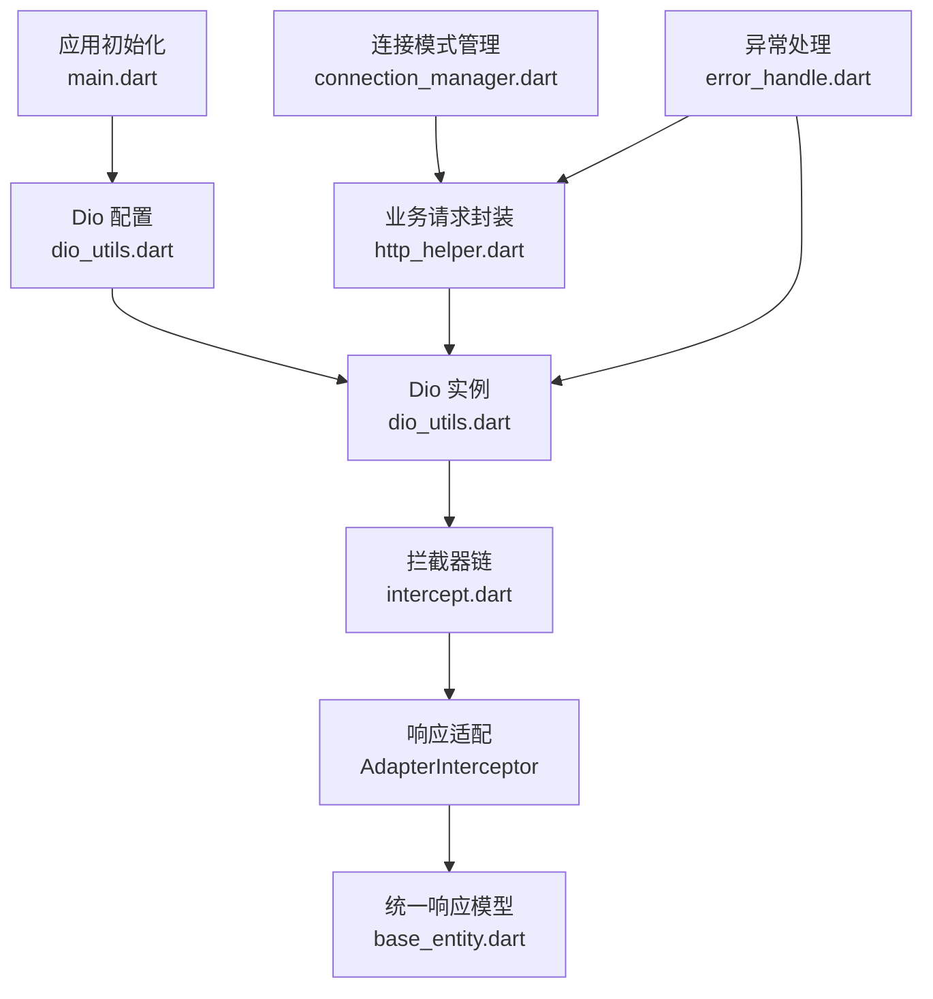

**图表来源**
- [main.dart:80-120](file://lib/main.dart#L80-L120)
- [dio_utils.dart:1-60](file://lib/net/dio_utils.dart#L1-L60)
- [intercept.dart:1-50](file://lib/net/intercept.dart#L1-L50)
- [base_entity.dart:1-33](file://lib/net/base_entity.dart#L1-L33)
- [http_helper.dart:1-120](file://lib/net/http_helper.dart#L1-L120)
- [connection_manager.dart:1-40](file://lib/net/connection_manager.dart#L1-L40)
- [error_handle.dart:1-40](file://lib/net/error_handle.dart#L1-L40)

**章节来源**
- [main.dart:1-159](file://lib/main.dart#L1-L159)
- [dio_utils.dart:1-222](file://lib/net/dio_utils.dart#L1-L222)
- [intercept.dart:1-219](file://lib/net/intercept.dart#L1-L219)
- [error_handle.dart:1-82](file://lib/net/error_handle.dart#L1-L82)
- [base_entity.dart:1-33](file://lib/net/base_entity.dart#L1-L33)
- [connection_manager.dart:1-114](file://lib/net/connection_manager.dart#L1-L114)
- [http_helper.dart:1-692](file://lib/net/http_helper.dart#L1-L692)

## 核心组件总览

### Dio 封装层

`DioUtils` 是网络层的核心门面类，负责：

- 提供全局单例实例；
- 管理 Dio 实例及其 BaseOptions；
- 暴露 `requestNetwork` 与 `asyncRequestNetwork`；
- 统一解析响应体为 `BaseEntity<T>`；
- 统一处理取消、业务错误和网络异常；
- 根据数据大小决定是否使用 isolate + compute 解析 JSON。

### 拦截器层

拦截器链按顺序完成以下任务：

1. `AuthInterceptor`：添加 Authorization、User-Agent 等请求头；
2. `TokenInterceptor`：401 时自动刷新 Token 并重试；
3. `LoggingInterceptor`：记录请求与响应日志（生产环境可关闭）；
4. `AdapterInterceptor`：把不同格式的服务端响应统一为标准结构。

### 异常处理层

`ExceptionHandle` 定义 HTTP 和业务错误码，并把 Dio 异常转换为统一的 `NetError`。

### 业务请求层

`http_helper.dart` 提供面向业务的 `request` 和 `requestForm`，负责：

- 组装公共参数；
- 计算签名；
- 处理 retcode、retmsg；
- 处理登录失效、强制下线；
- 记录 API 日志；
- 在主设备断网时广播连接丢失事件。

**章节来源**
- [dio_utils.dart:1-120](file://lib/net/dio_utils.dart#L1-L120)
- [intercept.dart:1-120](file://lib/net/intercept.dart#L1-L120)
- [error_handle.dart:1-82](file://lib/net/error_handle.dart#L1-L82)
- [http_helper.dart:1-200](file://lib/net/http_helper.dart#L1-L200)

## 架构概览

下图展示一次典型网络请求在代码中的完整路径：

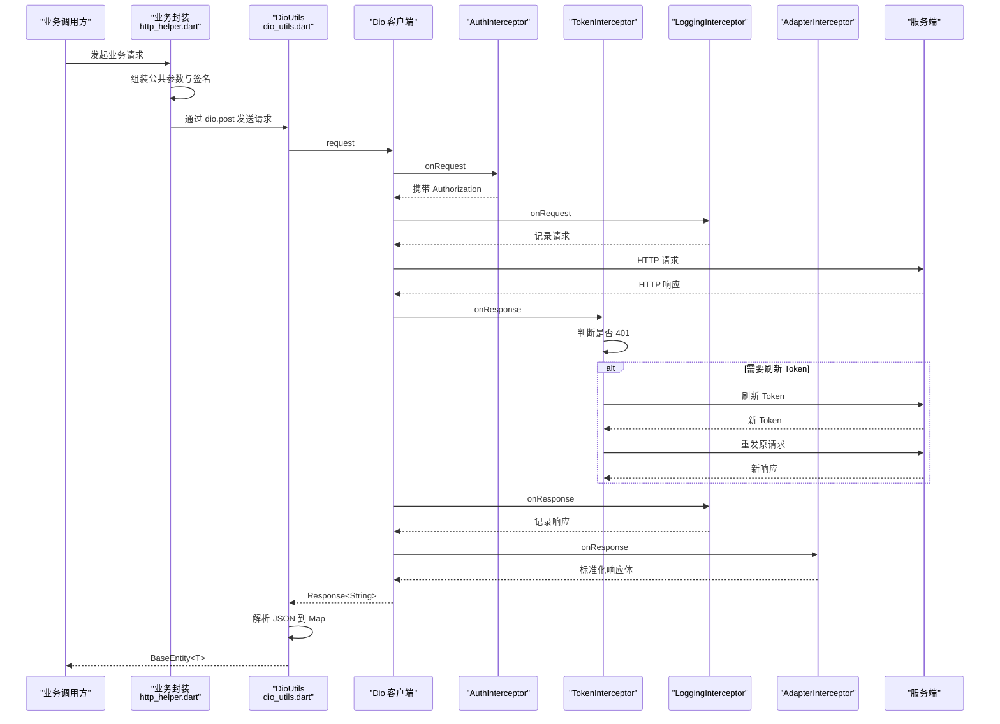

**图表来源**
- [http_helper.dart:120-250](file://lib/net/http_helper.dart#L120-L250)
- [dio_utils.dart:60-160](file://lib/net/dio_utils.dart#L60-L160)
- [intercept.dart:1-120](file://lib/net/intercept.dart#L1-L120)

**章节来源**
- [dio_utils.dart:60-160](file://lib/net/dio_utils.dart#L60-L160)
- [intercept.dart:1-219](file://lib/net/intercept.dart#L1-L219)
- [http_helper.dart:120-350](file://lib/net/http_helper.dart#L120-L350)

## DioUtils 单例与网络请求封装详解

### 单例模式实现机制

`DioUtils` 使用 Dart 工厂构造器与静态私有实例实现单例：

- 私有构造器 `DioUtils._()` 中创建 Dio 实例；
- 工厂构造器 `factory DioUtils() => _singleton;` 始终返回同一个实例；
- 静态字段 `_singleton` 在首次访问时初始化；
- 对外暴露 `instance` 属性，便于其他模块获取 Dio 客户端。

这种设计保证：

- 整个进程只有一个 Dio 实例；
- 避免重复创建连接池、拦截器和超时配置；
- 避免多处配置导致行为不一致；
- 方便统一注入拦截器。

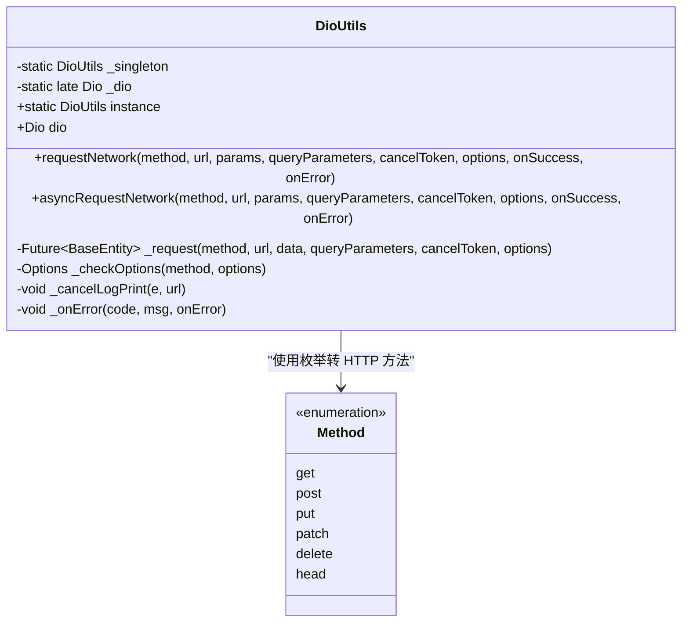

**图表来源**
- [dio_utils.dart:1-120](file://lib/net/dio_utils.dart#L1-L120)
- [dio_utils.dart:201-222](file://lib/net/dio_utils.dart#L201-L222)

### 工厂构造器与静态实例管理

关键行为如下：

| 名称 | 作用 | 说明 |
| --- | --- | --- |
| `factory DioUtils()` | 工厂构造器 | 返回静态单例 `_singleton` |
| `DioUtils._()` | 私有构造器 | 初始化 BaseOptions、Dio、拦截器、代理 |
| `_singleton` | 静态实例 | 保证全局唯一 |
| `instance` | 静态读取接口 | 外部获取 DioUtils |
| `_dio` | 静态 Dio 引用 | 延迟初始化，避免空引用 |

注意：`_dio` 使用 `late` 声明，但实际在私有构造器中赋值。若外部先访问 `dio` 再执行任何初始化逻辑，需要确保构造器已经运行。当前代码通过 `instance` 和构造函数触发初始化，通常由 `main.dart` 的 `initDio` 完成。

### 线程安全考虑

该实现没有显式锁或互斥量，其“线程安全”主要依赖 Dart 单例语义和运行时初始化时机：

- Dart 的 `static final` 字段在首次访问时初始化；
- 单例只创建一次；
- Dio 实例本身不是线程安全的网络库，因此应避免多线程并发修改其配置；
- 所有网络请求通过 `instance.dio` 共享同一连接池；
- 真正的并发控制应放在上层业务层，例如通过 `CancelToken`、防抖、队列或 `ConnectionManager` 的状态广播。

当前代码中需要注意的风险点：

- 若多个组件在不同阶段调用 `configDio`，可能覆盖已初始化的超时或拦截器；
- 最佳做法是在应用启动早期一次性调用 `configDio`，之后不再修改；
- 如果未来需要动态切换 baseUrl，应增加版本化或会话级配置，而不是直接覆盖全局变量。

**章节来源**
- [dio_utils.dart:1-80](file://lib/net/dio_utils.dart#L1-L80)
- [main.dart:80-120](file://lib/main.dart#L80-L120)

## 拦截器与统一响应适配

### 拦截器链顺序

应用启动时，`main.dart` 依次注册以下拦截器：

1. `AuthInterceptor`
2. `TokenInterceptor`
3. `LoggingInterceptor`
4. `AdapterInterceptor`

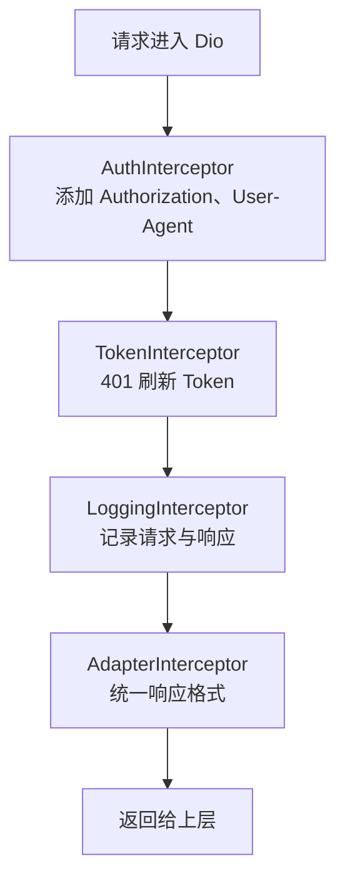

**图表来源**
- [main.dart:80-120](file://lib/main.dart#L80-L120)
- [intercept.dart:1-219](file://lib/net/intercept.dart#L1-L219)

### AuthInterceptor

职责：

- 从本地存储读取 accessToken；
- 仅对云服务请求添加 Authorization；
- 非 Web 平台设置 User-Agent；
- 不修改主设备直连请求头，以对齐旧版 Android 客户端行为。

关键点：

- 云服务请求判定基于路径前缀 `/api/` 和 `HttpApi.baseUrlYtt`；
- 主设备直连场景不需要 Authorization；
- 这是“请求头增强”拦截器，不改变响应。

### TokenInterceptor

职责：

- 监听响应状态码；
- 当收到 401 时尝试刷新 Token；
- 刷新成功后重新发起原请求；
- 使用独立的 `Dio` 实例 `_tokenDio` 避免递归进入 Token 刷新逻辑。

风险点：

- 刷新 Token 时使用独立 Dio 实例，未复用主 Dio 的连接池；
- 若刷新失败，会拒绝原始请求；
- 建议在刷新失败后通知上层统一处理登录失效。

### LoggingInterceptor

职责：

- 记录请求 URL、方法、Header、Body；
- 记录响应状态码、响应体、耗时；
- 记录错误链路。

注意：

- 日志仅在非生产环境添加；
- 大量频繁接口（如桌台列表）可在业务层进一步过滤。

### AdapterInterceptor

职责：

- 将不同服务端响应格式统一为 `{code, message, data}`；
- 成功响应保持原始 data；
- 404 转换为标准失败格式；
- 非 200 状态码提取 message；
- 透传含 `retcode` 的业务响应；
- 最终让上层 `BaseEntity` 统一消费。

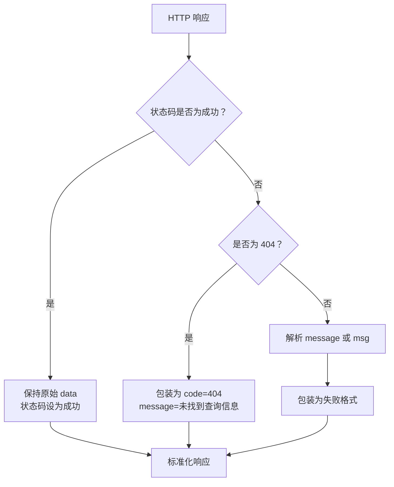

**图表来源**
- [intercept.dart:120-219](file://lib/net/intercept.dart#L120-L219)

**章节来源**
- [intercept.dart:1-219](file://lib/net/intercept.dart#L1-L219)
- [main.dart:80-120](file://lib/main.dart#L80-L120)

## 异常与错误码体系

### 错误码分类

`ExceptionHandle` 定义了以下几类错误：

| 类别 | 错误码 | 含义 |
| --- | ---: | --- |
| HTTP 成功 | 200 | 正常成功 |
| HTTP 成功无内容 | 204 | 成功但无响应体 |
| 未修改 | 304 | 缓存未修改 |
| 未授权 | 401 | Token 过期或未认证 |
| 禁止访问 | 403 | 权限不足 |
| 未找到 | 404 | 资源不存在 |
| 网络异常 | 1000 | 通用网络异常 |
| 解析异常 | 1001 | JSON 解析失败 |
| Socket 异常 | 1002 | 底层 Socket 错误 |
| HTTP 异常 | 1003 | HTTP 层异常 |
| 连接超时 | 1004 | 连接超时 |
| 发送超时 | 1005 | 请求发送超时 |
| 接收超时 | 1006 | 响应接收超时 |
| 取消请求 | 1007 | 主动取消 |
| 未知异常 | 9999 | 无法识别异常 |

### 异常转换流程

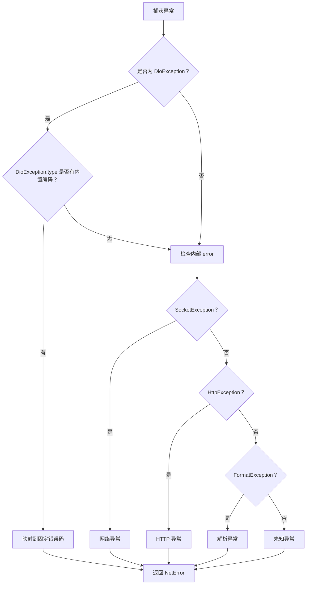

**图表来源**
- [error_handle.dart:1-82](file://lib/net/error_handle.dart#L1-L82)

**章节来源**
- [error_handle.dart:1-82](file://lib/net/error_handle.dart#L1-L82)

## 数据解析优化与 compute 策略

### BaseEntity 统一响应模型

`BaseEntity<T>` 负责把 JSON 转换为统一结构：

- `code`：业务状态码；
- `message`：提示信息；
- `data`：泛型数据，可能是 String、Map、List 或自定义对象。

解析逻辑：

- 如果 `T` 是 String，则直接返回字符串；
- 如果 `T` 是 Map，则直接返回 Map；
- 否则使用 `JsonConvert.fromJsonAsT<T>` 进行对象反序列化；
- 如果 data 为空，允许返回 null。

### isCompute 条件判断

`DioUtils._request` 中根据响应体长度决定是否使用 compute：

- 排除集成测试环境；
- 响应体超过 10KB 时启用 compute；
- 小于等于 10KB 时直接在主线程解析；
- 解析失败返回 `parse_error` 的 `BaseEntity`。

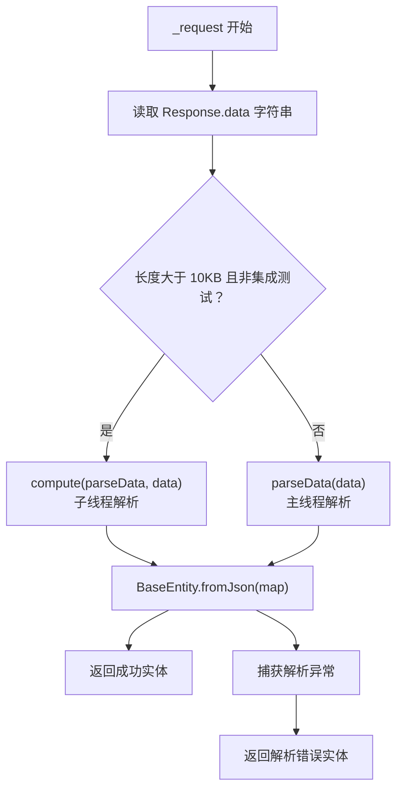

**图表来源**
- [dio_utils.dart:80-160](file://lib/net/dio_utils.dart#L80-L160)

### JSON 字符串处理流程

由于 Dio 的默认 responseType 被设置为 `plain`，所有响应都是字符串。后续处理流程：

1. `Response<String>` 拿到原始 JSON 字符串；
2. `parseData` 调用 `json.decode` 转为 `Map<String, dynamic>`；
3. `BaseEntity.fromJson` 根据泛型类型构造业务数据；
4. 上层通过 `result.code == 0` 判断业务成功；
5. 错误时走 `_onError` 统一处理。

**章节来源**
- [base_entity.dart:1-33](file://lib/net/base_entity.dart#L1-L33)
- [dio_utils.dart:60-120](file://lib/net/dio_utils.dart#L60-L120)
- [dio_utils.dart:201-222](file://lib/net/dio_utils.dart#L201-L222)

## 代理抓包与 Fiddler 集成

### 触发条件

Fiddler 代理仅在以下条件下生效：

- 非 Web 平台；
- 当前处于 debug 模式；
- spid 等于 154。

满足条件时，Dio 会使用自定义 `IOHttpClientAdapter`，并将所有请求转发到 `PROXY 192.168.8.175:8888`。

### 安全开关

代理配置包含两个关键保护：

1. `kDebugMode`：防止发布版本误开代理；
2. `spid == 154`：通过业务账号权限限制调试范围；
3. 证书回调放行：`badCertificateCallback` 返回 true，用于兼容自签名抓包证书。

### 日志输出

首次进入代理逻辑时会打印调试日志，包含：

- 当前是否 debug 模式；
- 当前 spid；
- 是否启用代理。

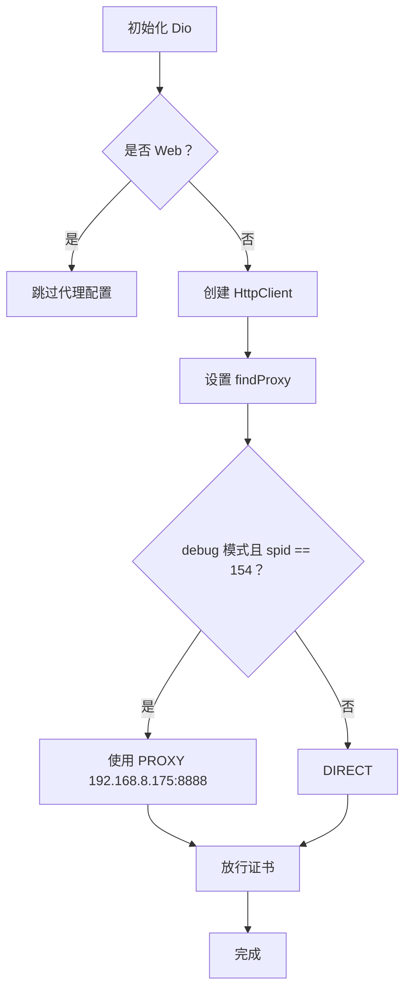

**图表来源**
- [dio_utils.dart:20-60](file://lib/net/dio_utils.dart#L20-L60)
- [dio_utils.dart:60-100](file://lib/net/dio_utils.dart#L60-L100)

**章节来源**
- [dio_utils.dart:20-100](file://lib/net/dio_utils.dart#L20-L100)

## 业务层请求封装与签名流程

### http_helper.dart 的定位

`http_helper.dart` 不是低层网络封装，而是面向业务的统一请求方法。它承担：

- 组装公共参数；
- 计算签名；
- 选择基础地址；
- 处理 retcode、retmsg；
- 处理登录失效；
- 记录 API 日志；
- 在主设备断网时广播连接丢失事件。

### request 方法

`request` 默认使用 POST，请求体结构包含外层公共参数和内层 params：

- 外层：sid、spid、client、token、sign、requestId、params；
- 内层：clientflag、userid、业务参数；
- 返回值是完整接口响应 Map。

成功时 Future 正常完成；业务失败或网络异常时抛出 `_ApiException`。

### requestForm 方法

`requestForm` 用于表单编码请求，常用于登录等接口：

- 使用 form-urlencoded；
- 追加公共参数并计算 HMAC-MD5 签名；
- 支持主设备与云服务两种地址；
- 区分主设备响应格式和服务端 retcode 格式；
- 主设备网络层失败时调用 `ConnectionManager.notifyMasterDeviceLost()`。

### 签名流程

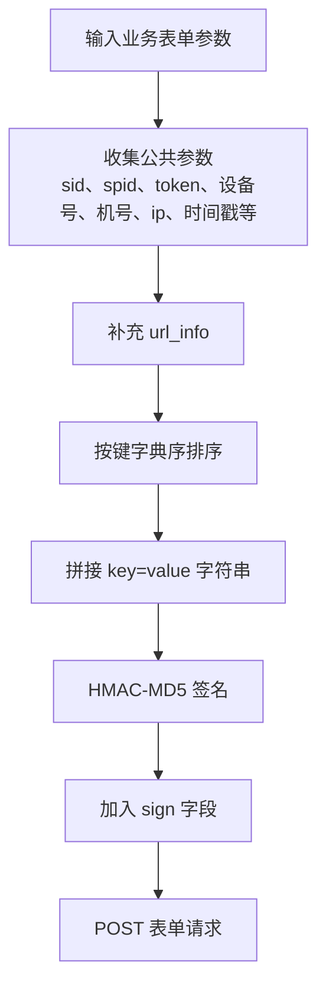

**图表来源**
- [http_helper.dart:350-550](file://lib/net/http_helper.dart#L350-L550)

**章节来源**
- [http_helper.dart:1-200](file://lib/net/http_helper.dart#L1-L200)
- [http_helper.dart:200-692](file://lib/net/http_helper.dart#L200-L692)
- [connection_manager.dart:1-114](file://lib/net/connection_manager.dart#L1-L114)

## 连接模式与基础地址选择

### 双模式架构

项目支持两种连接模式：

| 模式 | 基础地址 | 适用场景 |
| --- | --- | --- |
| 云服务模式 | `HttpApi.baseUrlYtt` | 云端部署或主设备不可用 |
| 主设备模式 | 登录后保存的 localhost 地址 | 主设备直连 PC |

### 连接判定

`ConnectionManager` 提供以下能力：

- `pcAlive`：综合连接策略与探活结果判断主设备是否可达；
- `isMasterOnly`：仅主设备模式；
- `isCloudOnly`：仅云服务模式；
- `getServerType`：读取当前服务器类型；
- `resolveBaseUrl`：根据是否主设备返回对应基础地址；
- `onMasterDeviceLost`：主设备断线事件流；
- `notifyMasterDeviceLost`：广播主设备断线。

### 主设备断网处理

当主设备请求发生网络层失败且无响应体时，`requestForm` 会调用 `ConnectionManager.notifyMasterDeviceLost()`，从而触发 UI 层弹出连接失败提示。

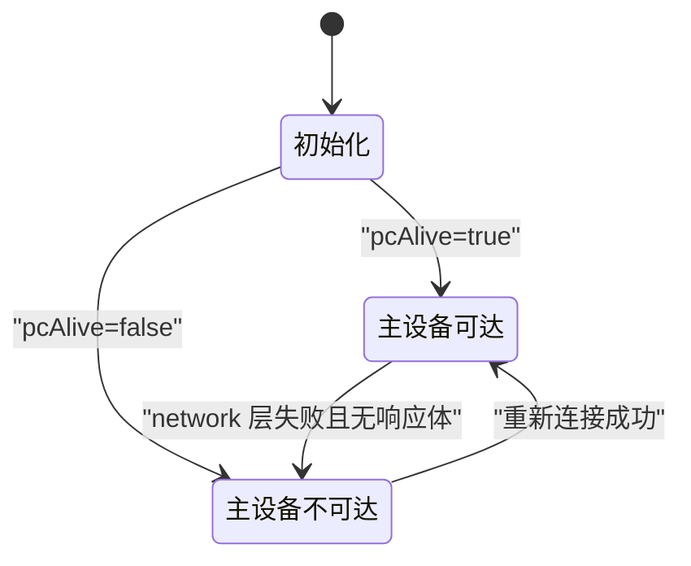

**图表来源**
- [connection_manager.dart:1-114](file://lib/net/connection_manager.dart#L1-L114)
- [http_helper.dart:550-692](file://lib/net/http_helper.dart#L550-L692)

**章节来源**
- [connection_manager.dart:1-114](file://lib/net/connection_manager.dart#L1-L114)
- [http_helper.dart:550-692](file://lib/net/http_helper.dart#L550-L692)

## 依赖关系分析

### 模块依赖图

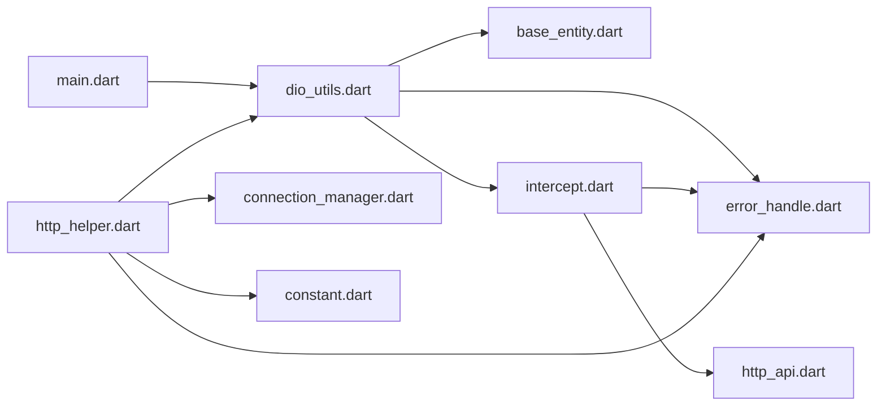

### 耦合分析

| 模块 | 耦合程度 | 说明 |
| --- | --- | --- |
| `main.dart` 与 `dio_utils.dart` | 中 | 启动时初始化 Dio |
| `dio_utils.dart` 与 `intercept.dart` | 中 | 通过 `configDio` 注入拦截器 |
| `dio_utils.dart` 与 `base_entity.dart` | 高 | 强依赖统一响应模型 |
| `dio_utils.dart` 与 `error_handle.dart` | 中 | 统一错误码和用户消息 |
| `http_helper.dart` 与 `connection_manager.dart` | 中 | 根据连接模式选择地址 |
| `http_helper.dart` 与 `dio_utils.dart` | 高 | 直接调用 `DioUtils.instance.dio` |

潜在问题：

- `http_helper.dart` 直接调用 Dio，绕过了 `requestNetwork` 与 `asyncRequestNetwork` 的错误统一处理；
- 业务层有自己的 Toast、日志和异常抛出逻辑；
- 如果希望完全统一错误处理，应将 `http_helper.dart` 的异常处理下沉到 `DioUtils`。

**章节来源**
- [dio_utils.dart:1-222](file://lib/net/dio_utils.dart#L1-L222)
- [intercept.dart:1-219](file://lib/net/intercept.dart#L1-L219)
- [http_helper.dart:1-692](file://lib/net/http_helper.dart#L1-L692)
- [connection_manager.dart:1-114](file://lib/net/connection_manager.dart#L1-L114)
- [main.dart:1-159](file://lib/main.dart#L1-L159)

## 性能特性与优化建议

### 当前性能特性

1. **响应类型为 plain**：避免 Dio 自动解析 JSON，降低重复解析开销。
2. **compute 异步解析大对象**：大于 10KB 的响应在 isolate 中解析。
3. **拦截器链可控**：生产环境关闭日志拦截器。
4. **单例 Dio**：复用连接池和配置。
5. **忽略高频大响应日志**：`http_helper.dart` 中对部分接口成功时不逐条记录日志。

### 优化建议

| 建议 | 理由 | 风险 |
| --- | --- | --- |
| 避免重复调用 `configDio` | 防止覆盖已初始化的超时、baseUrl、拦截器 | 低 |
| 将 `baseUrl` 改为运行时配置 | 当前全局变量可能被多次覆盖 | 中 |
| 为 Token 刷新增加幂等控制 | 避免并发刷新 Token | 中 |
| 将 `http_helper.dart` 的错误处理下沉到 `DioUtils` | 减少两套错误处理逻辑 | 高 |
| 为 compute 增加上限阈值 | 防止超大响应体占用 isolate 内存 | 低 |
| 为代理抓包增加更严格的环境校验 | 防止误开启抓包 | 低 |

[本节为通用性能建议，不直接分析具体代码行]

## 最佳实践示例

### 使用 requestNetwork

适合需要 Future 结果并在 then/catch 中处理的场景：

- 传入 Method 枚举；
- 传入 URL；
- 传入 params、queryParameters；
- 可选 CancelToken；
- 可选 Options；
- onSuccess 返回业务数据；
- onError 返回 code 和 message。

推荐用法：

- 小数据请求优先使用 `requestNetwork`；
- 需要在 Future 链上组合逻辑时使用该方法；
- 注意 onCancel 时打印取消日志。

### 使用 asyncRequestNetwork

适合流式监听或异步回调场景：

- 内部使用 `Stream.fromFuture` 包装 Future；
- 使用 `asBroadcastStream().listen` 消费结果；
- 适合需要订阅式更新 UI 的场景；
- 同样支持 onSuccess 和 onError。

### 使用业务层 request 或 requestForm

- `request`：适用于云平台 JSON POST；
- `requestForm`：适用于表单编码请求，如登录；
- 两者都会自动处理 retcode、retmsg、登录失效、Toast 和日志；
- 更适合业务仓库层直接调用。

[本节为使用指导，不直接分析具体代码行]

## 常见问题排查指南

### 问题一：Web 端代理导致所有请求失败

现象：

- Web 平台强转 `IOHttpClientAdapter` 会抛类型错误；
- 表现为登录即提示网络请求异常。

原因：

- 代理配置只在非 Web 平台生效；
- 如果未来误改平台判断，会导致 Web 端崩溃。

排查步骤：

1. 确认当前运行平台是否为 Web；
2. 检查代理配置是否受 `!kIsWeb` 保护；
3. 检查是否在发布环境误开代理。

**章节来源**
- [dio_utils.dart:40-100](file://lib/net/dio_utils.dart#L40-L100)

### 问题二：Token 刷新后仍 401

现象：

- 接口返回 401；
- 刷新 Token 后仍然失败。

排查步骤：

1. 检查 `TokenInterceptor` 是否成功获取新 Token；
2. 检查本地存储是否写入成功；
3. 检查重试请求是否正确携带新 Authorization；
4. 检查后端是否要求 Bearer token 还是其他格式。

**章节来源**
- [intercept.dart:1-120](file://lib/net/intercept.dart#L1-L120)

### 问题三：大对象解析慢或卡顿

现象：

- 加载菜品、桌台等大列表时出现卡顿。

排查步骤：

1. 检查响应体是否超过 10KB；
2. 检查是否命中 compute；
3. 检查是否处于集成测试环境；
4. 检查是否存在重复解析。

**章节来源**
- [dio_utils.dart:80-120](file://lib/net/dio_utils.dart#L80-L120)

### 问题四：主设备断网后未提示

现象：

- 主设备不可用时，UI 未弹出连接失败提示。

排查步骤：

1. 检查是否使用 `requestForm` 且 `masterDevice=true`；
2. 检查是否发生网络层异常且无响应体；
3. 检查 `ConnectionManager.onMasterDeviceLost` 是否被订阅；
4. 检查桌面端或桌台页是否正确处理断线事件。

**章节来源**
- [http_helper.dart:550-692](file://lib/net/http_helper.dart#L550-L692)
- [connection_manager.dart:1-114](file://lib/net/connection_manager.dart#L1-L114)

### 问题五：日志过多或过少

现象：

- 日志膨胀影响性能；
- 或排查问题时找不到请求日志。

排查步骤：

1. 检查是否在生产环境关闭了日志拦截器；
2. 检查高频接口是否被 `ignoredLogPaths` 忽略；
3. 检查 `_logApi` 是否记录成功或失败分支；
4. 检查 FileLogWriter 是否正常写入。

**章节来源**
- [http_helper.dart:1-120](file://lib/net/http_helper.dart#L1-L120)
- [intercept.dart:120-200](file://lib/net/intercept.dart#L120-L200)

## 结论

`DioUtils` 在本项目中承担了网络层基础设施的职责：它通过单例管理 Dio 实例，统一超时、基础 URL、响应类型和状态码策略，并提供 `requestNetwork` 与 `asyncRequestNetwork` 两种调用风格。配合拦截器链，项目实现了鉴权、Token 刷新、日志和响应适配的统一治理。

对于维护者而言，最需要关注的是：

- 不要在运行期随意重复调用 `configDio`；
- 不要绕过 `DioUtils` 直接使用 Dio 而忽略统一错误处理；
- 不要误开 Fiddler 代理；
- 在大对象解析时保留 compute 策略；
- 在主设备断网场景中正确订阅 `ConnectionManager.onMasterDeviceLost`；
- 如需统一业务层错误处理，应逐步收敛 `http_helper.dart` 的异常逻辑到 `DioUtils`。