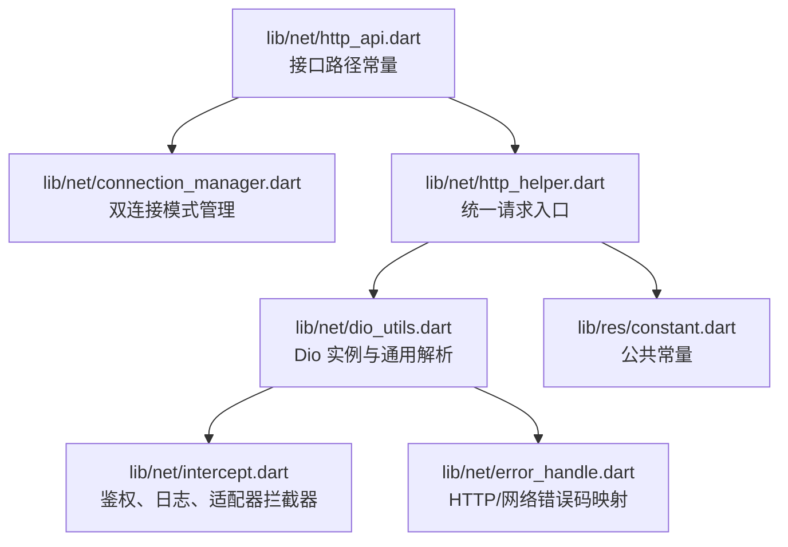
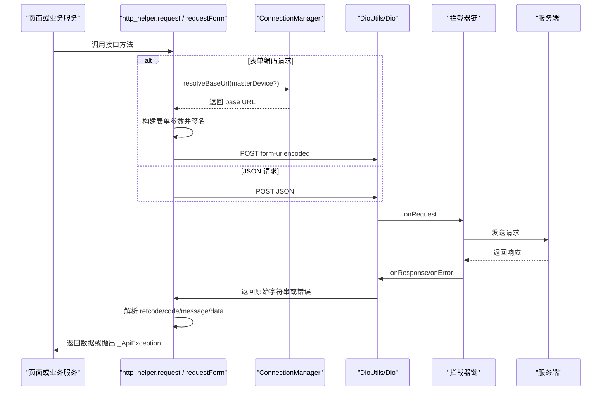
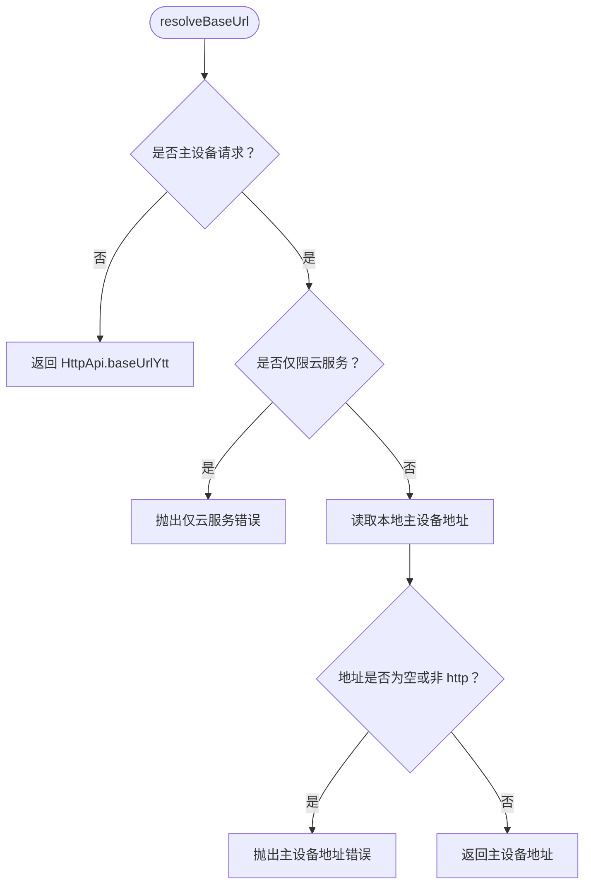
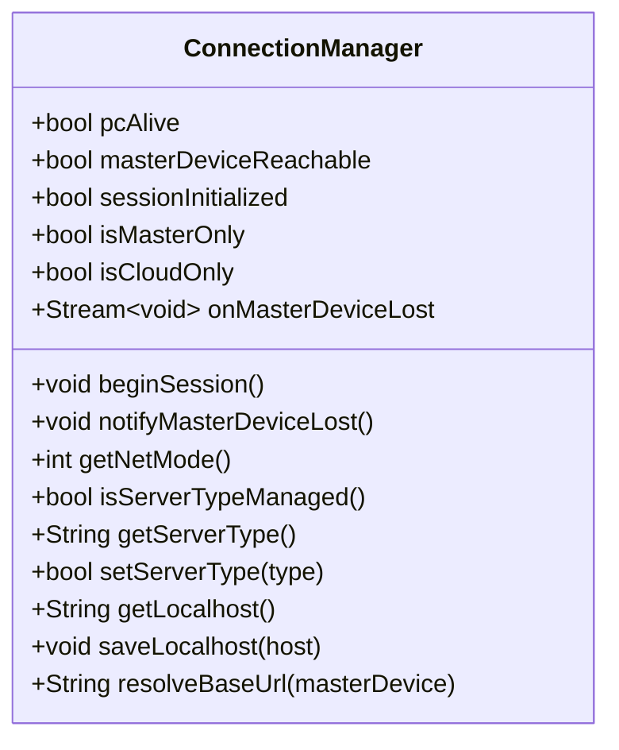
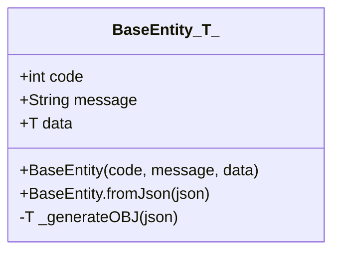
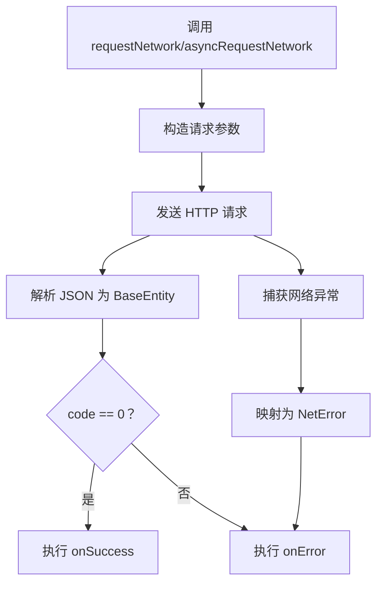
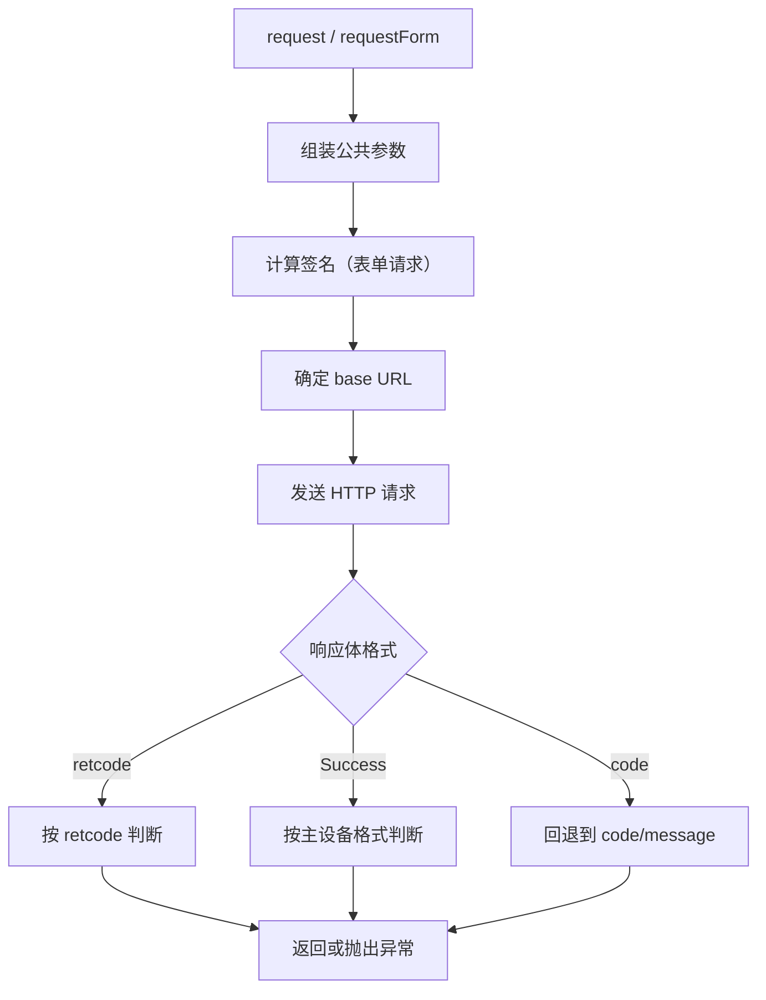
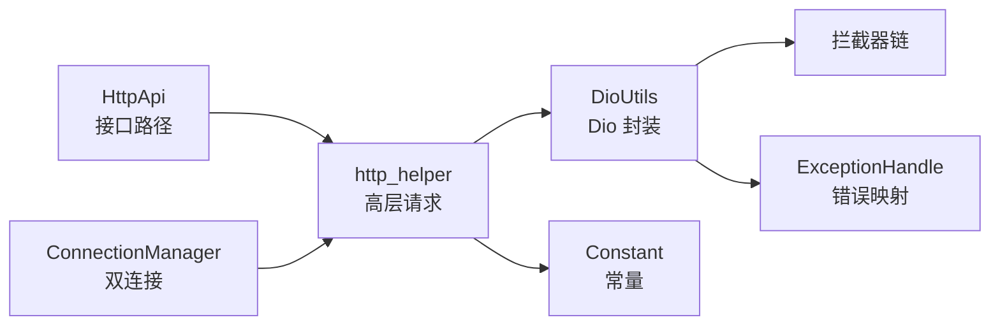

# HTTP API 接口规范

<cite>
**本文引用的文件**   
- [lib/net/http_api.dart](file://lib/net/http_api.dart)
- [lib/net/connection_manager.dart](file://lib/net/connection_manager.dart)
- [lib/net/base_entity.dart](file://lib/net/base_entity.dart)
- [lib/net/dio_utils.dart](file://lib/net/dio_utils.dart)
- [lib/net/http_helper.dart](file://lib/net/http_helper.dart)
- [lib/net/intercept.dart](file://lib/net/intercept.dart)
- [lib/net/error_handle.dart](file://lib/net/error_handle.dart)
- [lib/res/constant.dart](file://lib/res/constant.dart)
</cite>

## 目录

1. [简介](#简介)
2. [项目结构](#项目结构)
3. [核心组件](#核心组件)
4. [架构总览](#架构总览)
5. [接口路径与模块划分](#接口路径与模块划分)
6. [请求参数规范](#请求参数规范)
7. [响应体结构规范](#响应体结构规范)
8. [双连接模式与路由规则](#双连接模式与路由规则)
9. [详细组件分析](#详细组件分析)
10. [依赖关系分析](#依赖关系分析)
11. [性能优化建议](#性能优化建议)
12. [错误处理策略](#错误处理策略)
13. [版本兼容性与最佳实践](#版本兼容性与最佳实践)
14. [故障排查指南](#故障排查指南)
15. [结论](#结论)

## 简介

本文面向本项目的 HTTP API 调用方，从客户端代码实现出发，整理并解释以下能力：

- RESTful 风格在本项目中的落地方式。
- 云服务接口路径、主设备接口路径、根路径特殊接口的区别。
- 接口按业务模块的划分方式，包括用户认证、桌台管理、菜品查询、下单结账、会员管理、交班对账、系统设置等。
- 表单编码 POST、JSON 数据传输、Query 参数、文件上传等请求形态。
- `BaseEntity<T>` 统一响应格式以及 `retcode`/`retmsg` 等业务错误码约定。
- 双连接模式下，如何通过 `HttpApi.baseUrlYtt` 和 `ConnectionManager.resolveBaseUrl` 动态选择域名。
- 接口调用的最佳实践、错误处理策略、性能优化建议和版本兼容性注意事项。

该项目采用 Flutter 编写，网络层基于 Dio，封装了统一请求入口、拦截器、错误映射、双连接模式和签名机制，上层页面通过业务 Repository 或工具方法发起调用。

## 项目结构

与 HTTP API 直接相关的代码集中在 `lib/net` 目录下，同时配合 `lib/res/constant.dart` 提供常量定义。

**图表来源**
- [lib/net/http_api.dart:1-200](file://lib/net/http_api.dart#L1-L200)
- [lib/net/connection_manager.dart:1-114](file://lib/net/connection_manager.dart#L1-L114)
- [lib/net/http_helper.dart:1-200](file://lib/net/http_helper.dart#L1-L200)
- [lib/net/dio_utils.dart:1-200](file://lib/net/dio_utils.dart#L1-L200)
- [lib/net/intercept.dart:1-219](file://lib/net/intercept.dart#L1-L219)
- [lib/net/error_handle.dart:1-82](file://lib/net/error_handle.dart#L1-L82)
- [lib/res/constant.dart:1-93](file://lib/res/constant.dart#L1-L93)

本节为概览性说明，不直接分析具体代码片段，因此不附加“章节来源”。

## 核心组件

| 组件 | 职责 | 关键行为 |
|---|---|---|
| `HttpApi` | 集中声明所有接口路径与基础域名 | 定义云服务基础域名、主设备路径前缀、各业务接口常量；部分交班接口直接使用根路径拼接 |
| `ConnectionManager` | 管理双连接模式 | 判定当前是否走主设备或服务端，保存本地主设备地址，计算最终 base URL |
| `DioUtils` | 封装 Dio 单例与通用请求方法 | 配置超时、拦截器、统一返回 `BaseEntity<T>`，将成功结果回调到业务层 |
| `http_helper.request / requestForm` | 高层业务请求入口 | 组装公共参数、签名、URL、发送 JSON 或表单编码请求，处理登录失效跳转 |
| 拦截器 | 添加鉴权头、自动刷新 Token、统一日志、适配响应格式 | 区分云服务和主设备请求，把异常状态码转换为业务可理解的结构 |
| `ExceptionHandle` | 网络异常映射 | 将 Dio 异常、Socket 异常、HTTP 异常映射为统一错误码和用户提示 |
| `Constant` | 全局常量 | 定义 JSON 字段名、本地存储 key、连接模式 key、RabbitMQ 相关 key 等 |

**章节来源**
- [lib/net/http_api.dart:1-200](file://lib/net/http_api.dart#L1-L200)
- [lib/net/connection_manager.dart:1-114](file://lib/net/connection_manager.dart#L1-L114)
- [lib/net/dio_utils.dart:1-200](file://lib/net/dio_utils.dart#L1-L200)
- [lib/net/http_helper.dart:1-200](file://lib/net/http_helper.dart#L1-L200)
- [lib/net/intercept.dart:1-219](file://lib/net/intercept.dart#L1-L219)
- [lib/net/error_handle.dart:1-82](file://lib/net/error_handle.dart#L1-L82)
- [lib/res/constant.dart:1-93](file://lib/res/constant.dart#L1-L93)

## 架构总览

从 UI 层到服务器端的典型请求流程如下：

**图表来源**
- [lib/net/http_helper.dart:1-200](file://lib/net/http_helper.dart#L1-L200)
- [lib/net/http_helper.dart:201-622](file://lib/net/http_helper.dart#L201-L622)
- [lib/net/connection_manager.dart:1-114](file://lib/net/connection_manager.dart#L1-L114)
- [lib/net/dio_utils.dart:1-200](file://lib/net/dio_utils.dart#L1-L200)
- [lib/net/intercept.dart:1-219](file://lib/net/intercept.dart#L1-L219)

## 接口路径与模块划分

### 云服务接口路径规范

云服务基础域名为 `baseUrlYtt`，由 `baseUrlYttRoot` 拼接 `/app` 得到。注释中明确给出本地联调、生产环境和测试环境的示例值，但实际运行时应以代码中定义的常量为准。

| 分类 | 示例路径 | 说明 |
|---|---|---|
| 用户认证 | `/yttlogin` | 登录接口，使用表单编码 POST |
| 权限信息 | `/role/getRoleInfo` | 获取角色权限信息 |
| 版本检查 | `/version/getversion` | APP 版本检查更新 |
| 桌台区域 | `/table/area/getAreaList` | 查询桌台区域列表 |
| 桌台信息 | `/table/info/getTableInfoList` | 查询桌台信息列表 |
| 开台 | `/sale/beginTable` | 云服务开台 |
| 消台 | `/sale/cancelTable` | 云服务消台 |
| 锁台 | `/sale/lockFlagTable` | 云服务锁台/解锁 |
| 修改开台信息 | `/sale/updateMasterTmp` | 修改开台信息 |
| 下单 | `/sale/upSaleMasterTmp` | 上传临时台桌数据/下单 |
| 订单详情 | `/sale/getSaleTmpDetail` | 查询单个桌台临时点菜明细 |
| 支付方式 | `/payinfo/getPayInfoList` | 获取支付方式列表 |
| 结账流水 | `/sale/saleflow` | 单据上传/结账流水 |
| 清台 | `/sale/clearTable` | 云服务清台 |
| 会员列表 | `/vip/getList` | 查询会员列表 |
| 会员支付 | `/vip/pay` | 会员支付 |
| 菜品分类 | `/bi/type/getTypeListandCode` | 获取菜品分类 |
| 商品列表 | `/bi/product/getProductList` | 获取商品列表 |
| 规格做法 | `/bi/product/getProductCookSpec` | 获取商品规格和做法 |
| 套餐详情 | `/bi/comb/getInfo` | 获取套餐详情 |
| 厨打列表 | `/kitchen/getList` | 获取出品档口/厨打列表 |
| 条码生成 | `/bi/product/getBarcode` | 生成菜品条码 |
| 添加菜品 | `/bi/product/add` | 添加菜品资料 |
| 备注原因 | `/reason/getReasonList` | 获取系统备注/原因列表 |
| 催菜挂起 | `/sale/updateDetailSign`、`/sale/updateAllDetailSign` | 单品或整单催菜/起菜/挂起 |
| 表下载 | `/update/tabledown` | 统一表下载 |
| 系统参数 | `/set/setParams` | 设置参数 |
| 时间接口 | `/getTime` | 获取服务器时间 |

**章节来源**
- [lib/net/http_api.dart:1-200](file://lib/net/http_api.dart#L1-L200)

### 主设备接口路径规范

主设备直连 PC 时，路径以 `/api/` 开头。其 base URL 不是 `HttpApi.baseUrlYtt`，而是由 `ConnectionManager` 根据登录返回的主设备地址决定。

| 分类 | 示例路径 | 说明 |
|---|---|---|
| 探活 | `/api/host/GetHostSyncTime` | 探测主设备可达并同步时间 |
| 桌台区域 | `/api/table/QueryTableAreaList` | 查询桌台区域列表 |
| 桌台信息 | `/api/table/GetTableInfoList` | 查询桌台信息列表 |
| 开台 | `/api/table/TableOpeFull` | 主设备开台 |
| 消台 | `/api/table/TableCancel` | 主设备消台 |
| 锁台 | `/api/table/TableLock` | 主设备锁台/解锁 |
| 修改开台信息 | `/api/table/UpdateSaleMasterTmp` | 主设备修改开台信息 |
| 下单 | `/api/table/UpSaleMasterTmp` | 主设备上传临时台桌数据/下单 |
| 保存未落单菜品 | `/api/Table/SaveProduct` | 保存桌台未落单菜品 |
| 订单详情 | `/api/table/GetTableDetailList` | 查询单个桌台临时点菜明细 |
| 清台 | `/api/table/TableClear` | 主设备清台 |

**章节来源**
- [lib/net/http_api.dart:1-200](file://lib/net/http_api.dart#L1-L200)
- [lib/net/connection_manager.dart:1-114](file://lib/net/connection_manager.dart#L1-L114)

### 根路径特殊接口：交班对账

交班对账相关接口不使用 `/app` 前缀，而是直接拼接 `baseUrlYttRoot/cashrecon/*`。这是项目中明确的“根路径特殊接口”设计。

| 接口 | 完整路径形式 | 说明 |
|---|---|---|
| 获取最后交班时间 | `baseUrlYttRoot/cashrecon/getMaxLogoutTime` | 云服务获取最后交班时间 |
| 查询交班数据 | `baseUrlYttRoot/cashrecon/reportOnShiftByMachno` | 按机号查询交班数据 |
| 提交交班 | `baseUrlYttRoot/cashrecon/addShifthandover` | 提交交班记录 |

这些接口的路径在 `HttpApi` 中直接拼接 `baseUrlYttRoot`，而不是使用 `baseUrlYtt`，从而绕过 `/app` 前缀。

**章节来源**
- [lib/net/http_api.dart:1-200](file://lib/net/http_api.dart#L1-L200)

### 接口模块划分

| 模块 | 主要职责 | 典型接口 |
|---|---|---|
| 用户认证 | 登录、权限、版本检查 | `/yttlogin`、`/role/getRoleInfo`、`/version/getversion` |
| 桌台管理 | 区域、桌台信息、开台、消台、锁台、修改开台信息 | `/table/area/getAreaList`、`/table/info/getTableInfoList`、`/sale/beginTable`、`/sale/cancelTable`、`/sale/lockFlagTable` |
| 菜品查询 | 分类、商品、规格做法、套餐、厨打、条码、备注原因 | `/bi/type/getTypeListandCode`、`/bi/product/getProductList`、`/bi/product/getProductCookSpec`、`/bi/comb/getInfo`、`/kitchen/getList`、`/bi/product/getBarcode`、`/reason/getReasonList` |
| 下单结账 | 下单、订单详情、支付方式、结账流水、清台 | `/sale/upSaleMasterTmp`、`/sale/getSaleTmpDetail`、`/payinfo/getPayInfoList`、`/sale/saleflow`、`/sale/clearTable` |
| 会员管理 | 会员查询、会员支付 | `/vip/getList`、`/vip/pay` |
| 交班对账 | 获取最后交班时间、查询交班数据、提交交班 | `/cashrecon/getMaxLogoutTime`、`/cashrecon/reportOnShiftByMachno`、`/cashrecon/addShifthandover` |
| 系统设置 | 参数设置、系统时间 | `/set/setParams`、`/getTime` |
| 菜品操作 | 催菜、起菜、挂起、沽清等扩展操作 | `/sale/updateDetailSign`、`/sale/updateAllDetailSign` |
| 数据下载 | 全量表数据下载 | `/update/tabledown` |

**章节来源**
- [lib/net/http_api.dart:1-200](file://lib/net/http_api.dart#L1-L200)

## 请求参数规范

### 表单编码 POST

表单编码 POST 主要用于登录等需要与服务端严格对齐签名的场景。

- 调用入口：`requestForm(url, formData, {showError, masterDevice})`。
- Content-Type：`form-urlencoded`。
- 参数构造：先传入业务表单字段，再追加公共参数，最后计算 HMAC-MD5 签名。
- 公共参数包含：`url_info`、`sid`、`spid`、`operid`、`opername`、`machserial`、`machno`、`client`、`token`、`ip`、`app_v_name`、`newclient`、`uuid`、`temp_request_time`、`sign`。
- 主设备地址：当 `masterDevice=true` 时，base URL 来自 `ConnectionManager.resolveBaseUrl(masterDevice:true)`。
- 路径规范化：会去除重复斜杠，避免 base URL 尾部 `/` 与接口前导 `/` 重叠。

**章节来源**
- [lib/net/http_helper.dart:201-622](file://lib/net/http_helper.dart#L201-L622)
- [lib/net/connection_manager.dart:1-114](file://lib/net/connection_manager.dart#L1-L114)

### JSON 数据传输

JSON 请求用于大多数云服务业务接口。

- 调用入口：`request(url, data, showLoading, showError, rawParamsValue)`。
- 默认 HTTP 方法为 POST。
- 外层请求体包含：`sid`、`spid`、`client`、`token`、`sign`、`requestId`、`params`。
- 内层 `params` 包含：`clientflag`、`sid`、`spid`、可选 `userid`，以及业务传入的 `data`。
- `client` 固定为 `WEBAPP`。
- `sign` 固定为常量值，与旧版逻辑保持一致。
- base URL 固定为 `HttpApi.baseUrlYtt`，除非 URL 本身已经是完整 http 地址。

**章节来源**
- [lib/net/http_helper.dart:1-200](file://lib/net/http_helper.dart#L1-L200)

### Query 参数传递

Query 参数适用于 Dio 通用请求方法。

- 调用入口：`DioUtils.requestNetwork`、`DioUtils.asyncRequestNetwork`。
- 参数位置：`queryParameters`。
- 适用场景：适合分页、过滤、简单查询类接口。
- 注意：本项目高层 `request` 和 `requestForm` 主要使用 body 传参，Query 参数更贴近底层 `DioUtils` 用法。

**章节来源**
- [lib/net/dio_utils.dart:1-200](file://lib/net/dio_utils.dart#L1-L200)

### 文件上传机制

当前已分析的源码中没有独立的文件上传封装。Dio 支持多部分表单上传，但项目内部没有暴露专门的上传工具类。若未来新增文件上传功能，应遵循以下原则：

- 使用 Dio 的多部分表单能力。
- 保持与现有 `DioUtils` 统一的超时、拦截器和错误处理。
- 如果上传涉及云端鉴权，应在 `Authorization` 头中携带 token。
- 如果上传属于大体积数据，应考虑日志忽略策略，避免日志膨胀。

本节为通用指导，不直接分析具体上传实现，因此不附加“章节来源”。

## 响应体结构规范

### 统一响应模型 `BaseEntity<T>`

`BaseEntity<T>` 是 Dio 通用请求的响应包装类型，包含三个字段：

| 字段 | 类型 | 含义 |
|---|---|---|
| `code` | `int?` | 业务状态码 |
| `message` | `String` | 业务消息 |
| `data` | `T?` | 业务数据 |

解析规则：

- 若 JSON 中不存在 `data` 字段，则 `data` 为 `null`。
- 若泛型为 `String`，则直接把 JSON 值转为字符串。
- 若泛型类型为 `Map`，则直接透传 Map。
- 其他类型通过 JSON 转换工具反序列化为目标对象。

**章节来源**
- [lib/net/base_entity.dart:1-33](file://lib/net/base_entity.dart#L1-L33)

### 业务响应格式：`retcode`/`retmsg`/`data`

高层 `request` 和 `requestForm` 都优先识别服务端返回的 `retcode` 和 `retmsg`。

| 条件 | 行为 |
|---|---|
| `retcode == 0` | 视为成功，返回原始响应 Map |
| `retcode == -2` 或 `-3` | 触发登录失效处理，清除缓存并跳转登录页 |
| 其他非零 `retcode` | 显示 `retmsg`（可按开关控制），记录日志，抛出 `_ApiException` |
| 非 `retcode` 格式 | 回退到 `code == 0` 判断，否则取 `message` 作为错误消息 |

**章节来源**
- [lib/net/http_helper.dart:1-200](file://lib/net/http_helper.dart#L1-L200)
- [lib/net/http_helper.dart:201-622](file://lib/net/http_helper.dart#L201-L622)

### 主设备响应格式：`PCRootDataBean`

主设备接口的响应结构与云服务不同，源码中描述为 `Success/Message/Data` 结构。

- 若响应包含 `Success` 字段，则按主设备格式解析。
- `Success=true` 表示成功。
- `Message` 作为业务消息。
- 若 `Success=false`，则弹出错误提示并抛出 `_ApiException`。

**章节来源**
- [lib/net/http_helper.dart:201-622](file://lib/net/http_helper.dart#L201-L622)

### 错误码定义

| 类别 | 值 | 含义 |
|---|---:|---|
| HTTP 成功 | 200 | 正常响应 |
| HTTP 无内容 | 204 | 成功但无响应体 |
| 未修改 | 304 | 资源未修改 |
| 未授权 | 401 | Token 过期或无效 |
| 禁止访问 | 403 | 权限不足 |
| 未找到 | 404 | 资源不存在 |
| 网络异常 | 1000 | 通用网络异常 |
| 数据解析错误 | 1001 | JSON 解析失败 |
| Socket 异常 | 1002 | 底层 Socket 错误 |
| HTTP 异常 | 1003 | HTTP 层异常 |
| 连接超时 | 1004 | 连接建立超时 |
| 发送超时 | 1005 | 请求发送超时 |
| 接收超时 | 1006 | 响应接收超时 |
| 取消请求 | 1007 | 请求被主动取消 |
| 未知错误 | 9999 | 无法归类异常 |

**章节来源**
- [lib/net/error_handle.dart:1-82](file://lib/net/error_handle.dart#L1-L82)

## 双连接模式与路由规则

### 连接模式判定

连接模式由 `ConnectionManager` 管理，核心判断依据包括：

| 属性 | 含义 |
|---|---|
| `pcAlive` | 是否认为主设备可用；综合连接模式配置与探活结果 |
| `isMasterOnly` | 是否仅允许主设备模式 |
| `isCloudOnly` | 是否仅允许云服务模式 |
| `sessionInitialized` | 是否已完成会话初始化 |
| `getNetMode()` | 返回数值模式：主设备为 1，云服务为 2 |

会话初始化时，会从本地存储读取连接模式：

- 受服务端管理模式控制时，读取 `ClientLinkModelValue`。
- 否则读取 `server_type`。
- 只接受 `0`、`1`、`2`，非法值回退为 `0`。

**章节来源**
- [lib/net/connection_manager.dart:1-114](file://lib/net/connection_manager.dart#L1-L114)
- [lib/res/constant.dart:1-93](file://lib/res/constant.dart#L1-L93)

### Base URL 选择

| 场景 | base URL |
|---|---|
| 云服务接口 | `HttpApi.baseUrlYtt` |
| 主设备接口 | `ConnectionManager.getLocalhost()` |
| 调试覆盖 | 若 `debugLocalhostOverride` 非空，则强制使用该地址 |
| 仅云服务模式且请求主设备 | 抛出 `StateError` |
| 主设备地址为空或不是 http 开头 | 抛出 `StateError` |

`resolveBaseUrl` 是双连接路由的核心入口：

**图表来源**
- [lib/net/connection_manager.dart:1-114](file://lib/net/connection_manager.dart#L1-L114)

### 主设备丢失事件

当主设备网络层请求失败且无响应体时，`requestForm` 会调用 `ConnectionManager.notifyMasterDeviceLost()`，广播主设备丢失事件。桌面端或桌台页可以订阅该事件，弹出连接失败提示。

**章节来源**
- [lib/net/connection_manager.dart:1-114](file://lib/net/connection_manager.dart#L1-L114)
- [lib/net/http_helper.dart:201-622](file://lib/net/http_helper.dart#L201-L622)

## 详细组件分析

### 接口常量：`HttpApi`

`HttpApi` 是所有接口路径的唯一来源。它的作用不是发起请求，而是保证路径集中管理，减少硬编码分散造成的维护成本。

关键设计点：

- `baseUrlYttRoot` 是云服务根路径，不含 `/app`。
- `baseUrlYtt` 是最终云服务基础域名，含 `/app`。
- 云服务接口路径通常相对于 `baseUrlYtt`。
- 主设备接口路径以 `/api/` 开头。
- 交班对账接口直接使用 `baseUrlYttRoot/cashrecon/*`，不走 `/app`。

**章节来源**
- [lib/net/http_api.dart:1-200](file://lib/net/http_api.dart#L1-L200)

### 双连接管理器：`ConnectionManager`

`ConnectionManager` 是对接 smdcapp 双模式架构的客户端实现。它负责：

- 保存当前活跃连接模式。
- 检测主设备可达性。
- 提供主设备丢失事件流。
- 管理主设备地址的读取与写入。
- 根据业务参数决定最终 base URL。

**图表来源**
- [lib/net/connection_manager.dart:1-114](file://lib/net/connection_manager.dart#L1-L114)

**章节来源**
- [lib/net/connection_manager.dart:1-114](file://lib/net/connection_manager.dart#L1-L114)

### 统一响应模型：`BaseEntity<T>`

`BaseEntity<T>` 是 Dio 通用请求的返回值包装，使上层可以以强类型方式消费 `data`。

**图表来源**
- [lib/net/base_entity.dart:1-33](file://lib/net/base_entity.dart#L1-L33)

**章节来源**
- [lib/net/base_entity.dart:1-33](file://lib/net/base_entity.dart#L1-L33)

### Dio 工具类：`DioUtils`

`DioUtils` 是 Dio 的单例封装，负责：

- 配置连接超时、接收超时、发送超时。
- 设置 baseUrl。
- 注册拦截器。
- 统一解析响应为 `BaseEntity<T>`。
- 提供 `requestNetwork` 和 `asyncRequestNetwork` 两种异步调用方式。
- 对取消请求进行日志记录。
- 对网络异常进行统一映射。

**图表来源**
- [lib/net/dio_utils.dart:1-200](file://lib/net/dio_utils.dart#L1-L200)
- [lib/net/error_handle.dart:1-82](file://lib/net/error_handle.dart#L1-L82)

**章节来源**
- [lib/net/dio_utils.dart:1-200](file://lib/net/dio_utils.dart#L1-L200)
- [lib/net/error_handle.dart:1-82](file://lib/net/error_handle.dart#L1-L82)

### 高层请求入口：`http_helper`

`http_helper` 提供了两个高层入口：

1. `request`：JSON 请求，用于大多数云服务接口。
2. `requestForm`：表单编码请求，用于登录等需要签名的接口。

两者共同特点：

- 自动注入公共参数。
- 统一处理 `retcode`/`retmsg`。
- 对登录失效进行强制下线处理。
- 记录 API 日志。
- 失败时抛出 `_ApiException`。

**图表来源**
- [lib/net/http_helper.dart:1-200](file://lib/net/http_helper.dart#L1-L200)
- [lib/net/http_helper.dart:201-622](file://lib/net/http_helper.dart#L201-L622)

**章节来源**
- [lib/net/http_helper.dart:1-200](file://lib/net/http_helper.dart#L1-L200)
- [lib/net/http_helper.dart:201-622](file://lib/net/http_helper.dart#L201-L622)

### 拦截器链

拦截器链包含三类拦截器：

| 拦截器 | 作用 |
|---|---|
| `AuthInterceptor` | 为云服务请求添加 `Authorization` 头，为主设备请求跳过鉴权头 |
| `TokenInterceptor` | 401 时尝试刷新 Token 并重试请求 |
| `LoggingInterceptor` | 打印请求 URL、方法、头、数据、响应耗时 |
| `AdapterInterceptor` | 统一适配响应体，把非成功状态码转换为业务可读格式 |

鉴权头注入规则：

- 若路径以 `HttpApi.baseUrlYtt` 开头，或路径不包含 `/api/`，则视为云服务请求。
- 主设备请求路径通常以 `/api/` 开头，不会添加 `Authorization` 头。

**章节来源**
- [lib/net/intercept.dart:1-219](file://lib/net/intercept.dart#L1-L219)

## 依赖关系分析

**图表来源**
- [lib/net/http_api.dart:1-200](file://lib/net/http_api.dart#L1-L200)
- [lib/net/connection_manager.dart:1-114](file://lib/net/connection_manager.dart#L1-L114)
- [lib/net/http_helper.dart:1-200](file://lib/net/http_helper.dart#L1-L200)
- [lib/net/dio_utils.dart:1-200](file://lib/net/dio_utils.dart#L1-L200)
- [lib/net/intercept.dart:1-219](file://lib/net/intercept.dart#L1-L219)
- [lib/net/error_handle.dart:1-82](file://lib/net/error_handle.dart#L1-L82)
- [lib/res/constant.dart:1-93](file://lib/res/constant.dart#L1-L93)

耦合关系总结：

- `HttpApi` 与 `http_helper` 解耦：前者只提供路径，后者负责拼装 URL。
- `ConnectionManager` 与 `http_helper` 松耦合：表单请求通过 `masterDevice` 参数决定是否走主设备。
- `DioUtils` 与 `ExceptionHandle` 紧耦合：网络异常必须映射为统一错误码。
- `http_helper` 与 `Constant` 紧耦合：大量依赖本地存储 key 和公共字段名。
- 拦截器依赖 `HttpApi` 做云服务和主设备的路径区分。

**章节来源**
- [lib/net/http_api.dart:1-200](file://lib/net/http_api.dart#L1-L200)
- [lib/net/connection_manager.dart:1-114](file://lib/net/connection_manager.dart#L1-L114)
- [lib/net/http_helper.dart:1-200](file://lib/net/http_helper.dart#L1-L200)
- [lib/net/dio_utils.dart:1-200](file://lib/net/dio_utils.dart#L1-L200)
- [lib/net/intercept.dart:1-219](file://lib/net/intercept.dart#L1-L219)
- [lib/net/error_handle.dart:1-82](file://lib/net/error_handle.dart#L1-L82)
- [lib/res/constant.dart:1-93](file://lib/res/constant.dart#L1-L93)

## 性能优化建议

### 大响应体解析

`DioUtils` 对大于 10KB 的响应体使用 isolate 解析，以减少主线程阻塞。集成测试环境禁用该优化。

建议：

- 对大表下载、全量菜品列表等接口继续使用 `DioUtils` 的统一解析。
- 避免在 UI 层重复解析大型 JSON。
- 对频繁调用且响应大的接口，考虑本地缓存或分页。

**章节来源**
- [lib/net/dio_utils.dart:1-200](file://lib/net/dio_utils.dart#L1-L200)

### 日志控制

`http_helper` 对大响应体或高频接口设置了忽略成功日志的路径，例如：

- `/update/tabledown`
- `/bi/product/getProductList`
- `/bi/type/getTypeListandCode`
- `/table/info/getTableInfoList`
- `/table/area/getAreaList`
- `/api/table/GetTableInfoList`
- `/api/table/QueryTableAreaList`
- `/reserve/findList`
- `/api/host/GetHostSyncTime`

建议：

- 新增高频大响应接口时，评估是否需要加入忽略成功日志列表。
- 失败日志始终保留，便于问题定位。

**章节来源**
- [lib/net/http_helper.dart:1-200](file://lib/net/http_helper.dart#L1-L200)

### 超时配置

默认超时时间为：

- 连接超时：15 秒
- 接收超时：15 秒
- 发送超时：10 秒

建议：

- 对大文件上传或大数据下载，适当提高超时。
- 对高频短接口，保持较短超时以便快速失败。

**章节来源**
- [lib/net/dio_utils.dart:1-200](file://lib/net/dio_utils.dart#L1-L200)

## 错误处理策略

### 网络层错误

网络层错误由 `ExceptionHandle` 统一映射为数字错误码和中文提示。常见类型包括：

- 连接超时
- 发送超时
- 接收超时
- Socket 异常
- HTTP 异常
- 取消请求
- 未知异常

**章节来源**
- [lib/net/error_handle.dart:1-82](file://lib/net/error_handle.dart#L1-L82)

### 业务层错误

业务层错误主要由 `http_helper` 处理：

- `retcode == 0`：成功。
- `retcode == -2` 或 `-3`：登录失效，强制下线。
- 其他非零 `retcode`：提示 `retmsg`，抛出 `_ApiException`。
- 非 `retcode` 格式：回退到 `code/message`。
- 网络异常：提取服务端返回的错误信息，若无响应体则展示友好中文提示。

**章节来源**
- [lib/net/http_helper.dart:1-200](file://lib/net/http_helper.dart#L1-L200)
- [lib/net/http_helper.dart:201-622](file://lib/net/http_helper.dart#L201-L622)

### 主设备连接丢失

当主设备网络层请求失败且无响应体时，系统会：

1. 标记主设备不可达。
2. 广播 `onMasterDeviceLost` 事件。
3. 上层可据此弹出连接失败提示。

**章节来源**
- [lib/net/connection_manager.dart:1-114](file://lib/net/connection_manager.dart#L1-L114)
- [lib/net/http_helper.dart:201-622](file://lib/net/http_helper.dart#L201-L622)

## 版本兼容性与最佳实践

### 接口调用最佳实践

| 场景 | 推荐方式 |
|---|---|
| 普通云服务 JSON 接口 | 使用 `http_helper.request` |
| 需要表单编码和签名的接口 | 使用 `http_helper.requestForm` |
| 需要 Query 参数的轻量接口 | 使用 `DioUtils.requestNetwork` |
| 主设备接口 | 使用 `requestForm` 并设置 `masterDevice=true` |
| 云服务接口 | 使用 `HttpApi` 中的路径常量 |
| 大响应体接口 | 复用 `DioUtils` 的解析逻辑，避免 UI 层重复解析 |
| 登录失效场景 | 让 `http_helper` 统一处理，不要在上层重复实现跳转逻辑 |

**章节来源**
- [lib/net/http_helper.dart:1-200](file://lib/net/http_helper.dart#L1-L200)
- [lib/net/http_helper.dart:201-622](file://lib/net/http_helper.dart#L201-L622)
- [lib/net/dio_utils.dart:1-200](file://lib/net/dio_utils.dart#L1-L200)

### 版本兼容注意事项

- 云服务基础域名由 `HttpApi.baseUrlYttRoot` 和 `baseUrlYtt` 统一管理，切换环境时优先修改根路径常量。
- 主设备地址通过本地存储保存，调试时可覆盖，但上线前应清空覆盖值。
- 连接模式受 `server_type` 或 `ClientLinkModelValue` 控制，不应在业务层直接写死。
- 响应格式可能因服务端差异存在 `retcode`、`code/message`、`Success/Message/Data` 多种情况，调用方应避免假设单一结构。
- 交班对账接口使用根路径，不能误加 `/app`。
- 鉴权头只在云服务请求中添加，主设备请求不需要 `Authorization`。

**章节来源**
- [lib/net/http_api.dart:1-200](file://lib/net/http_api.dart#L1-L200)
- [lib/net/connection_manager.dart:1-114](file://lib/net/connection_manager.dart#L1-L114)
- [lib/net/intercept.dart:1-219](file://lib/net/intercept.dart#L1-L219)
- [lib/net/http_helper.dart:201-622](file://lib/net/http_helper.dart#L201-L622)

## 故障排查指南

### 常见问题

| 现象 | 可能原因 | 排查建议 |
|---|---|---|
| 登录后立即跳转登录页 | 服务端返回 `retcode=-2` 或 `-3` | 检查 token、store、user 本地缓存是否正确 |
| 主设备接口频繁失败 | 主设备不可达或未保存 localhost | 检查 `ConnectionManager.getLocalhost()` 和本地存储 |
| 云服务接口报 401 | Token 过期或鉴权头缺失 | 检查 `Authorization` 头和 `TokenInterceptor` 刷新逻辑 |
| 大接口日志过多 | 未命中忽略日志路径 | 检查路径是否在忽略列表中 |
| 表单接口签名失败 | 公共参数或签名算法不一致 | 核对 `url_info`、`machserial`、`machno`、`sign` |
| 双连接模式不生效 | 连接模式配置错误或会话未初始化 | 检查 `server_type`、`ClientLinkModelValue` 和 `beginSession` |

**章节来源**
- [lib/net/http_helper.dart:201-622](file://lib/net/http_helper.dart#L201-L622)
- [lib/net/connection_manager.dart:1-114](file://lib/net/connection_manager.dart#L1-L114)
- [lib/net/intercept.dart:1-219](file://lib/net/intercept.dart#L1-L219)

### 日志定位建议

- 优先查看 API 日志，确认接口路径、请求参数、成功/失败结论和耗时。
- 失败接口会额外写入错误日志，便于还原出问题时刻的请求上下文。
- 对于大响应体接口，成功日志可能被忽略，但失败日志仍会保留。
- 若需要抓包调试，可在 Dio 代理配置中启用代理，但注意仅调试环境生效。

**章节来源**
- [lib/net/http_helper.dart:1-200](file://lib/net/http_helper.dart#L1-L200)
- [lib/net/dio_utils.dart:1-200](file://lib/net/dio_utils.dart#L1-L200)

## 结论

本项目的 HTTP API 客户端围绕 `HttpApi`、`ConnectionManager`、`http_helper`、`DioUtils` 和拦截器形成清晰分层：

- `HttpApi` 负责接口路径集中管理。
- `ConnectionManager` 负责云服务与主设备的双连接路由。
- `http_helper` 负责高层业务请求、公共参数、签名、登录失效处理和日志。
- `DioUtils` 负责 Dio 实例、超时、拦截器、统一响应模型和错误映射。
- 拦截器负责鉴权、Token 刷新、日志和响应适配。

在实际使用中，应优先使用高层入口发起请求，避免在业务层重复处理签名、鉴权、错误提示和登录跳转。对于新接口，应遵循既有路径规范、请求格式和响应约定，并保持对双连接模式的兼容性。