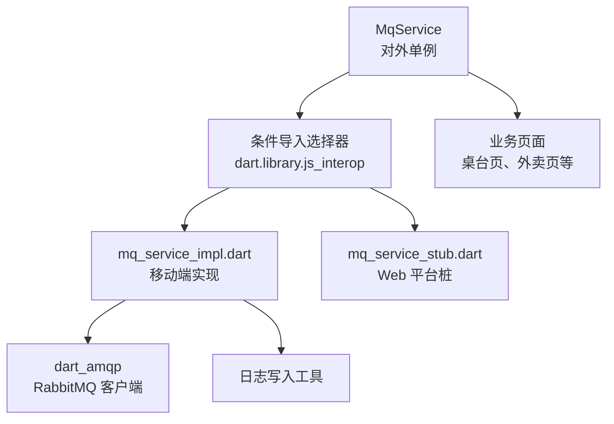
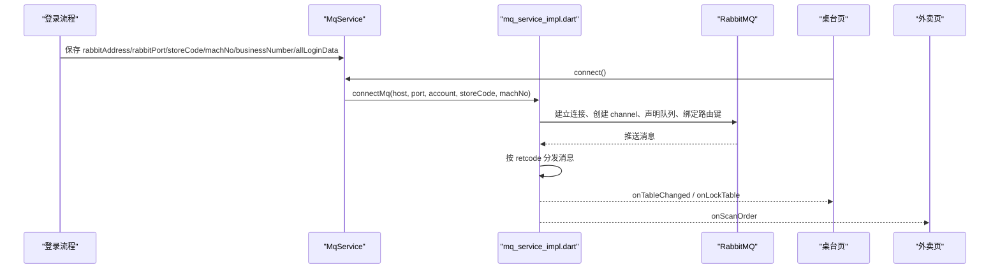
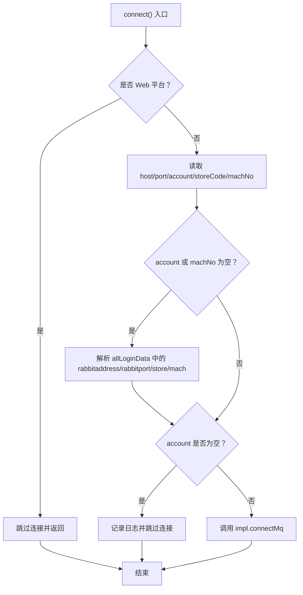
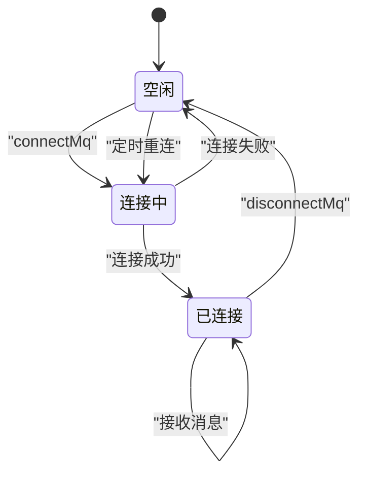
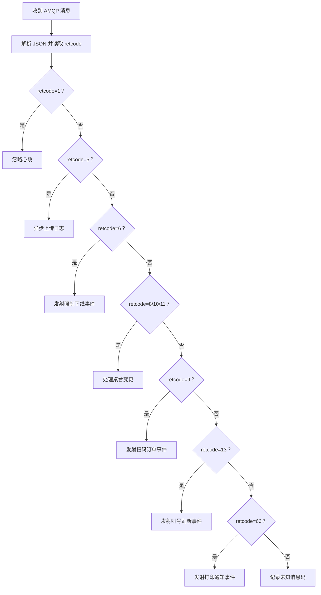
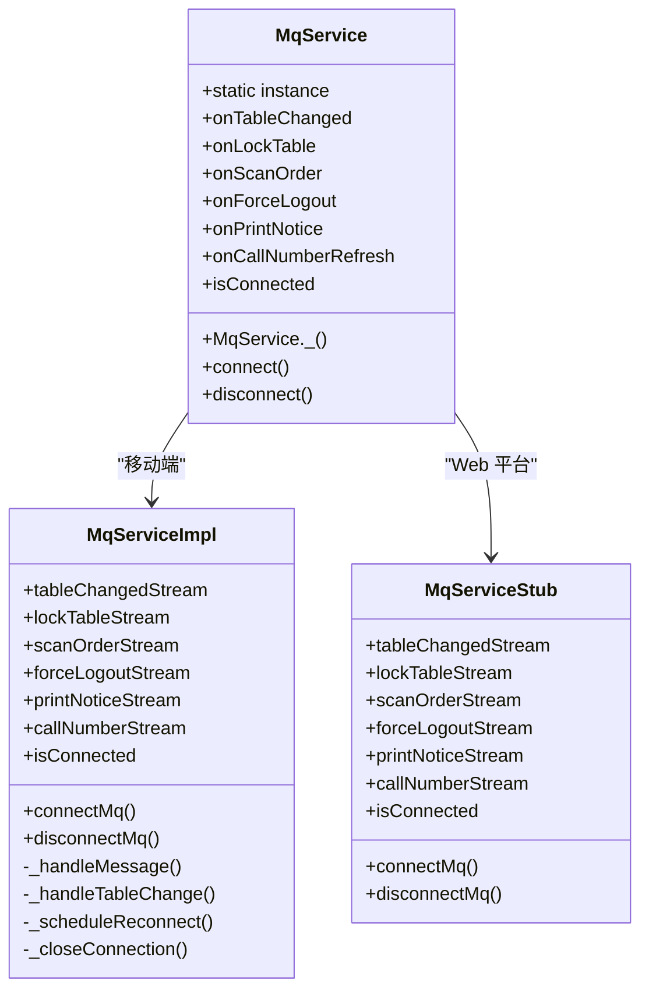
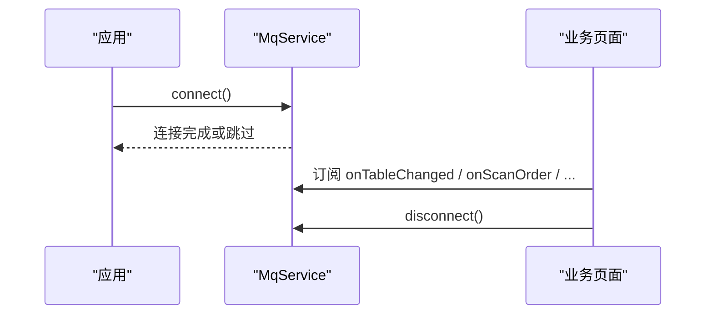

# RabbitMQ 消息推送服务

<cite>
**本文引用的文件**   
- [lib/net/mq_service.dart](file://lib/net/mq_service.dart)
- [lib/net/mq_service_impl.dart](file://lib/net/mq_service_impl.dart)
- [lib/net/mq_service_stub.dart](file://lib/net/mq_service_stub.dart)
- [lib/res/constant.dart](file://lib/res/constant.dart)
- [lib/pages/home/table/table_page.dart](file://lib/pages/home/table/table_page.dart)
- [lib/pages/home/takeout/takeout_page.dart](file://lib/pages/home/takeout/takeout_page.dart)
- [lib/util/table_concurrency_guard.dart](file://lib/util/table_concurrency_guard.dart)
- [lib/pages/login/page/login_page.dart](file://lib/pages/login/page/login_page.dart)
</cite>

## 目录
1. [引言](#引言)
2. [项目结构定位](#项目结构定位)
3. [核心组件总览](#核心组件总览)
4. [架构概览](#架构概览)
5. [详细组件分析](#详细组件分析)
6. [依赖关系分析](#依赖关系分析)
7. [性能与可靠性特征](#性能与可靠性特征)
8. [使用示例与最佳实践](#使用示例与最佳实践)
9. [故障排查指南](#故障排查指南)
10. [结论](#结论)

## 引言
RabbitMQ 消息推送服务用于在登录后通过 AMQP 协议连接远端消息队列，实时接收桌台变更、锁台、扫码订单、强制下线、打印通知和叫号刷新等事件。该服务采用 Dart 条件导入机制实现跨平台抽象：移动端使用 `dart_amqp` 直接连接 RabbitMQ，Web 平台则跳过真实连接，仅暴露空流与轮询兜底能力。对外统一暴露为 `MqService` 单例，业务页面只需订阅对应事件流即可接收实时通知。

## 项目结构定位
RabbitMQ 消息推送相关代码集中在网络层 `lib/net` 中，由三个文件组成职责清晰的组合：

| 文件 | 职责 |
|---|---|
| `mq_service.dart` | 对外暴露的 `MqService` 单例、事件流访问入口、连接参数解析与 Web 平台快速返回 |
| `mq_service_impl.dart` | 移动端实际实现：AMQP 连接、声明队列、绑定路由键、消费消息、事件分发、重连与断开 |
| `mq_service_stub.dart` | Web 平台桩实现：所有事件流为空广播流，`connectMq` 和 `disconnectMq` 为空操作 |

**图表来源**
- [lib/net/mq_service.dart:1-12](file://lib/net/mq_service.dart#L1-L12)
- [lib/net/mq_service_impl.dart:1-20](file://lib/net/mq_service_impl.dart#L1-L20)
- [lib/net/mq_service_stub.dart:1-10](file://lib/net/mq_service_stub.dart#L1-L10)

**章节来源**
- [lib/net/mq_service.dart:1-12](file://lib/net/mq_service.dart#L1-L12)
- [lib/net/mq_service_impl.dart:1-20](file://lib/net/mq_service_impl.dart#L1-L20)
- [lib/net/mq_service_stub.dart:1-10](file://lib/net/mq_service_stub.dart#L1-L10)

## 核心组件总览

### MqService 单例设计
`MqService` 是对外唯一入口，内部使用私有构造器和静态实例实现单例。它不直接持有底层连接对象，而是将事件流和连接方法委托给 `impl` 模块。这样既隐藏了平台差异，也避免业务代码感知 `dart_amqp` 或 Web 降级逻辑。

关键行为包括：
- 提供 `instance` 静态访问器。
- 将 `tableChangedStream`、`lockTableStream`、`scanOrderStream`、`forceLogoutStream`、`printNoticeStream`、`callNumberStream` 转发到具体实现。
- 在 Web 平台直接跳过连接。
- 从本地持久化配置读取 RabbitMQ 连接参数，并在字段缺失时回退到完整登录数据解析。
- 商户号为空时拒绝发起连接。

**章节来源**
- [lib/net/mq_service.dart:24-53](file://lib/net/mq_service.dart#L24-L53)
- [lib/net/mq_service.dart:54-112](file://lib/net/mq_service.dart#L54-L112)

### 跨平台抽象与条件导入
`mq_service.dart` 通过以下导入方式完成平台分流：

| 平台 | 实际加载实现 | 行为 |
|---|---|---|
| Android、iOS、桌面端 | `mq_service_impl.dart` | 使用 `dart_amqp` 建立 TCP 连接并消费消息 |
| Web（浏览器） | `mq_service_stub.dart` | 不连接 RabbitMQ，所有事件流为空广播流，`isConnected` 始终为 `false` |

条件导入语法的关键点是：当目标运行环境支持 `dart.library.js_interop` 时加载桩实现；否则加载移动端实现。这是 Flutter/Dart 在多运行时下隔离原生依赖的典型方案。

**章节来源**
- [lib/net/mq_service.dart:1-12](file://lib/net/mq_service.dart#L1-L12)
- [lib/net/mq_service_stub.dart:1-10](file://lib/net/mq_service_stub.dart#L1-L10)

### 事件流定义
服务对外暴露六种主要事件流：

| 事件流 | 类型 | 触发场景 | 业务用途 |
|---|---|---|---|
| `onTableChanged` | `Stream<int>` | retcode 为 8、10、11 | 桌台页刷新桌台状态 |
| `onLockTable` | `Stream<Map<String, dynamic>>` | retcode 8/10/11 且包含锁台标志 | 并发锁台提示、锁台冲突处理 |
| `onScanOrder` | `Stream<Map<String, dynamic>>` | retcode 为 9 | 外卖页收到扫码点餐新单 |
| `onForceLogout` | `Stream<String>` | retcode 为 6 | 清理会话、跳转登录页 |
| `onPrintNotice` | `Stream<String>` | retcode 为 66 | 打印任务通知 |
| `onCallNumberRefresh` | `Stream<void>` | retcode 为 13 | 刷新叫号列表 |

这些事件流在移动端实现中由 `broadcast StreamController` 发射，在 Web 桩中同样存在但不会主动发射。

**章节来源**
- [lib/net/mq_service.dart:31-46](file://lib/net/mq_service.dart#L31-L46)
- [lib/net/mq_service_impl.dart:19-55](file://lib/net/mq_service_impl.dart#L19-L55)
- [lib/net/mq_service_stub.dart:12-47](file://lib/net/mq_service_stub.dart#L12-L47)

## 架构概览

**图表来源**
- [lib/pages/login/page/login_page.dart:290-302](file://lib/pages/login/page/login_page.dart#L290-L302)
- [lib/net/mq_service.dart:54-108](file://lib/net/mq_service.dart#L54-L108)
- [lib/net/mq_service_impl.dart:95-180](file://lib/net/mq_service_impl.dart#L95-L180)
- [lib/pages/home/table/table_page.dart:114-119](file://lib/pages/home/table/table_page.dart#L114-L119)
- [lib/pages/home/takeout/takeout_page.dart:48-54](file://lib/pages/home/takeout/takeout_page.dart#L48-L54)

## 详细组件分析

### 连接参数获取与解析逻辑
`MqService.connect()` 负责准备连接参数，并按优先级解析：

1. **优先从独立字段读取：**
   - `host`：来自 `Constant.rabbitAddress`，默认值为 `ysp01.yun8609.net`。
   - `port`：来自 `Constant.rabbitPort`，默认值为 `5672`。
   - `account`：来自 `Constant.businessNumber`。
   - `storeCode`：来自 `Constant.storeCode`，默认值为 `'0'`。
   - `machNo`：来自 `Constant.machNo`。

2. **兜底解析 `allLoginData`：**
   如果 `account` 或 `machNo` 为空，则尝试从 `Constant.allLoginData` 中解析 JSON，并从中提取：
   - `rabbitaddress` 覆盖 `host`
   - `rabbitport` 覆盖 `port`
   - `store.account` 覆盖 `account`
   - `store.code` 覆盖 `storeCode`
   - `mach.code` 覆盖 `machNo`

3. **安全校验：**
   若最终 `account` 仍为空，则直接跳过连接。

4. **调用实现层连接：**
   成功组装参数后调用 `impl.connectMq`。

**图表来源**
- [lib/net/mq_service.dart:54-108](file://lib/net/mq_service.dart#L54-L108)

**章节来源**
- [lib/net/mq_service.dart:54-108](file://lib/net/mq_service.dart#L54-L108)
- [lib/res/constant.dart:59-63](file://lib/res/constant.dart#L59-L63)
- [lib/pages/login/page/login_page.dart:290-302](file://lib/pages/login/page/login_page.dart#L290-L302)

### RabbitMQ 连接生命周期
移动端实现在 `mq_service_impl.dart` 中管理完整连接生命周期：

| 阶段 | 行为 |
|---|---|
| 缓存参数 | 每次连接前缓存 `host`、`port`、`account`、`storeCode`、`machNo`，用于后续重连 |
| 防并发连接 | 使用 `_connecting` 标记防止重复连接 |
| 关闭旧连接 | 先执行 `_closeConnection` 释放已有 channel 和 client |
| 建立连接 | 使用 `ConnectionSettings` 设置主机、端口、用户名密码、最大连接尝试次数和重连等待时间 |
| 创建通道 | 创建 `Channel` |
| 声明队列 | 队列名为 `{account}-{storeCode}-{machNo}`，非持久化且自动删除 |
| 引用 Exchange | 引用已存在的 topic exchange `ytt`，不重新声明以避免 durable 不一致导致通道关闭 |
| 绑定路由键 | 绑定三级路由键：`ytt.{account}`、`ytt.{account}.{storeCode}`、`ytt.{account}.{storeCode}.{machNo}` |
| 启动消费 | 使用 `noAck: false` 手动确认消息 |
| 连接失败 | 记录日志、标记未连接、调度 10 秒后重连 |
| 断开连接 | 取消重连定时器、重置状态、关闭底层连接 |

**图表来源**
- [lib/net/mq_service_impl.dart:95-180](file://lib/net/mq_service_impl.dart#L95-L180)
- [lib/net/mq_service_impl.dart:280-315](file://lib/net/mq_service_impl.dart#L280-L315)

**章节来源**
- [lib/net/mq_service_impl.dart:95-180](file://lib/net/mq_service_impl.dart#L95-L180)
- [lib/net/mq_service_impl.dart:280-315](file://lib/net/mq_service_impl.dart#L280-L315)

### 消息分发与事件模型
消息处理器根据 `retcode` 分发事件：

| retcode | 含义 | 处理方式 |
|---|---|---|
| 1 | 心跳 | 忽略 |
| 5 | 上传日志指令 | 异步调用日志上传工具，不阻塞消息处理 |
| 6 | 数据清空或强制下线 | 向 `forceLogoutStream` 发送字符串提示 |
| 8、10、11 | 桌台变更 | 向 `tableChangedStream` 发送 retcode，并进一步解析锁台事件 |
| 9 | 扫码点餐接单 | 向 `scanOrderStream` 发送完整消息体 |
| 13 | 刷新叫号列表 | 向 `callNumberStream` 发送空值 |
| 66 | 打印通知 | 向 `printNoticeStream` 发送 data 字段 |
| 其他 | 未处理消息码 | 记录日志 |

桌台变更消息还会进入 `_handleTableChange`，解析 `data.lockflag`、`data.autoflag`、`data.machno`、`data.saleid`、`data.opername`。只有当存在锁台标志且当前设备机号不等于消息中的 `machno` 时，才发射 `lockTableStream`。这样可以避免本机操作触发的锁台事件再次影响本机界面。

**图表来源**
- [lib/net/mq_service_impl.dart:182-279](file://lib/net/mq_service_impl.dart#L182-L279)

**章节来源**
- [lib/net/mq_service_impl.dart:182-279](file://lib/net/mq_service_impl.dart#L182-L279)

### Web 平台降级与轮询兜底策略
Web 平台的限制在于 `dart_amqp` 依赖 `dart:io`，而浏览器环境不具备该能力。因此 `mq_service_stub.dart` 提供如下降级：

- 所有事件流均为空的广播流。
- `isConnected` 始终返回 `false`。
- `connectMq` 和 `disconnectMq` 为空操作。
- `MqService.connect()` 在检测到 Web 平台时直接返回，不尝试连接。

这意味着 Web 端不能依赖 RabbitMQ 推送获得实时性。项目中桌台页已经具备定时轮询能力，注释中明确保留“待 MQ 稳定后再恢复”的轮询开关。业务侧应同时关注本地事件总线、主设备连接状态以及后端轮询接口，以形成可靠兜底。

**章节来源**
- [lib/net/mq_service.dart:54-63](file://lib/net/mq_service.dart#L54-L63)
- [lib/net/mq_service_stub.dart:1-65](file://lib/net/mq_service_stub.dart#L1-L65)
- [lib/pages/home/table/table_page.dart:53-70](file://lib/pages/home/table/table_page.dart#L53-L70)
- [lib/pages/home/table/table_page.dart:101-120](file://lib/pages/home/table/table_page.dart#L101-L120)

## 依赖关系分析

**图表来源**
- [lib/net/mq_service.dart:24-112](file://lib/net/mq_service.dart#L24-L112)
- [lib/net/mq_service_impl.dart:1-200](file://lib/net/mq_service_impl.dart#L1-L200)
- [lib/net/mq_service_stub.dart:1-65](file://lib/net/mq_service_stub.dart#L1-L65)

**章节来源**
- [lib/net/mq_service.dart:24-112](file://lib/net/mq_service.dart#L24-L112)
- [lib/net/mq_service_impl.dart:1-200](file://lib/net/mq_service_impl.dart#L1-L200)
- [lib/net/mq_service_stub.dart:1-65](file://lib/net/mq_service_stub.dart#L1-L65)

## 性能与可靠性特征

### 性能特征
- 使用广播流监听多个事件，适合多订阅者场景。
- 消息处理使用 `noAck: false`，需要显式 `ack()`，有助于保证消息至少投递一次。
- 日志上传走异步回调，避免阻塞 MQ 消息处理线程。
- 队列为非持久化、自动删除，适合终端设备临时消费。
- Exchange 引用而不重新声明，避免因 durable 不一致导致通道被关闭。

### 可靠性特征
- 连接失败后通过定时器 10 秒重试一次。
- 重连使用之前缓存的连接参数，无需业务层再次传入。
- 断开连接时会取消重连定时器并重置状态，避免后台静默重连。
- 连接过程有 `_connecting` 防并发保护。
- Web 平台显式降级，避免抛出 IO 不可用异常。

### 优化建议
- 当前重连只调度一次定时器，未在成功连接后重置重连计划；若希望持续健康检查，可在成功连接后增加周期性探活或基于连接中断事件触发重连。
- 可考虑对 `connectMq` 暴露统一的 `Future<bool>` 状态，让上层更明确知道连接结果。
- 对 `allLoginData` 解析失败路径可增加结构化错误码，便于监控和诊断。

[本节为通用分析与改进建议，不直接分析具体代码片段]

## 使用示例与最佳实践

### 连接与断开
典型生命周期是：用户登录成功后保存 RabbitMQ 地址、端口、商户号、门店编码和设备机号；进入桌台页时调用 `MqService.instance.connect()`；退出登录或销毁资源时调用 `disconnect()`。

**图表来源**
- [lib/net/mq_service.dart:54-112](file://lib/net/mq_service.dart#L54-L112)
- [lib/pages/home/table/table_page.dart:177-179](file://lib/pages/home/table/table_page.dart#L177-L179)

**章节来源**
- [lib/net/mq_service.dart:54-112](file://lib/net/mq_service.dart#L54-L112)

### 订阅桌台变更事件
桌台页在初始化时订阅 `onTableChanged`，收到事件后触发静默刷新，并配合本地事件总线完成 UI 更新。

**章节来源**
- [lib/pages/home/table/table_page.dart:114-119](file://lib/pages/home/table/table_page.dart#L114-L119)

### 订阅扫码订单事件
外卖页在初始化时订阅 `onScanOrder`，收到新扫码订单后弹出提示并刷新订单列表。

**章节来源**
- [lib/pages/home/takeout/takeout_page.dart:48-54](file://lib/pages/home/takeout/takeout_page.dart#L48-L54)

### 订阅锁台事件
锁台并发控制工具订阅 `onLockTable`，用于检测其他设备的锁台行为，避免重复锁台或冲突操作。

**章节来源**
- [lib/util/table_concurrency_guard.dart:99](file://lib/util/table_concurrency_guard.dart#L99)

### 连接异常处理和重连机制
- 连接失败会记录日志并设置未连接状态。
- 10 秒后自动尝试重连。
- 断开会取消重连定时器。
- Web 平台不会抛出底层 IO 异常，而是直接跳过连接。

建议在业务层结合 `isConnected` 和日志文件进行状态展示与问题上报。

**章节来源**
- [lib/net/mq_service_impl.dart:160-180](file://lib/net/mq_service_impl.dart#L160-L180)
- [lib/net/mq_service_impl.dart:280-315](file://lib/net/mq_service_impl.dart#L280-L315)
- [lib/net/mq_service_stub.dart:49-65](file://lib/net/mq_service_stub.dart#L49-L65)

## 故障排查指南

| 现象 | 可能原因 | 排查步骤 |
|---|---|---|
| 登录后没有桌台变更 | 商户号为空、RabbitMQ 地址错误或网络不可达 | 检查 `businessNumber`、`rabbitAddress`、`rabbitPort`；查看 MQ 日志 |
| Web 端无实时事件 | 预期行为：Web 不支持 RabbitMQ | 确认运行环境，使用轮询或后端 HTTP 同步刷新 |
| 连接成功后很快断开 | Exchange 或队列声明异常、网络中断 | 检查 `ytt` exchange 是否存在；查看连接日志 |
| 锁台事件未触发 | 消息中无锁台标志，或 `machno` 等于本机机号 | 检查消息体 `lockflag`、`machno`、`saleid`、`opername` |
| 强制下线未生效 | retcode 不是 6，或控制器已关闭 | 检查服务端推送消息格式 |
| 扫码订单未刷新 | retcode 不是 9，或订阅已取消 | 检查外卖页订阅生命周期 |
| 打印通知丢失 | data 为空或控制器已关闭 | 检查 retcode 66 的消息 data 字段 |

日志位置建议：
- 控制台输出：带 `[MqService]` 前缀。
- 文件日志：使用 `FileLogWriter` 的 `MQ` 分类写入。

**章节来源**
- [lib/net/mq_service_impl.dart:79-94](file://lib/net/mq_service_impl.dart#L79-L94)
- [lib/net/mq_service_impl.dart:182-279](file://lib/net/mq_service_impl.dart#L182-L279)

## 结论
`MqService` 通过单例封装、条件导入和空桩实现了 RabbitMQ 消息推送的跨平台抽象。移动端使用 `dart_amqp` 直接连接 RabbitMQ，完成队列声明、路由绑定和消息分发；Web 平台则降级为空实现，由业务层通过轮询或其他同步机制兜底。连接参数优先从独立字段读取，并通过 `allLoginData` 做兜底解析，增强了旧登录数据的兼容性。事件流覆盖了桌台变更、锁台、扫码订单、强制下线、打印通知和叫号刷新等核心业务场景。在实际使用中，应结合页面生命周期正确订阅和取消订阅，并结合连接状态、日志和轮询机制提升整体可靠性。