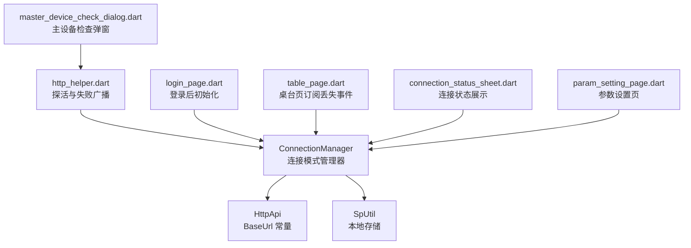
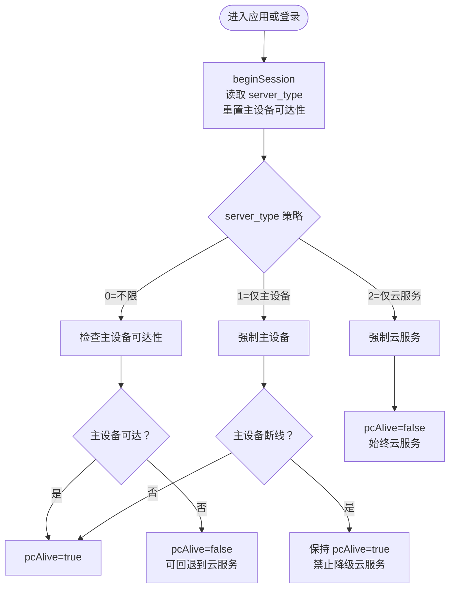
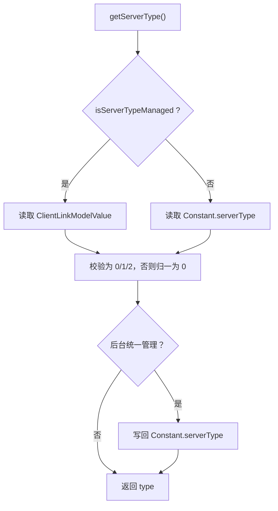
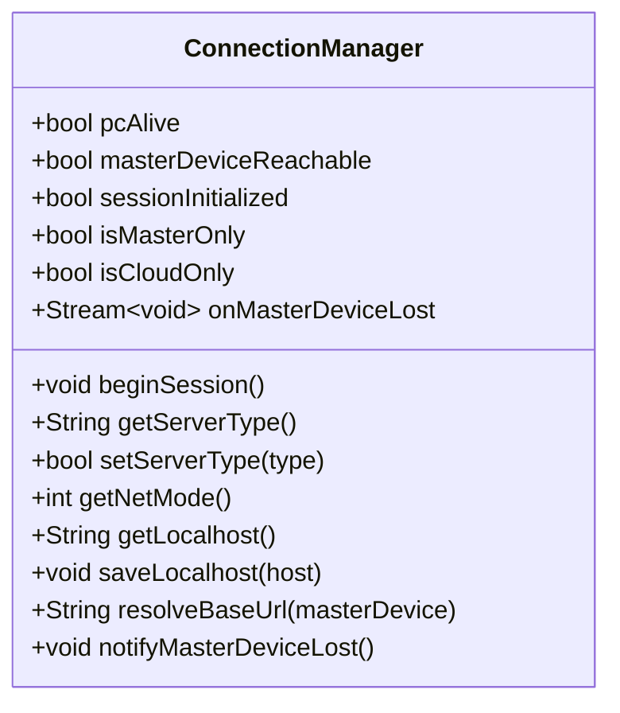
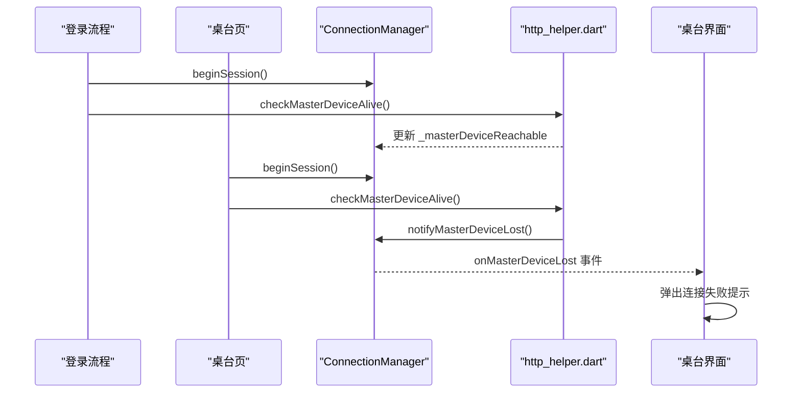
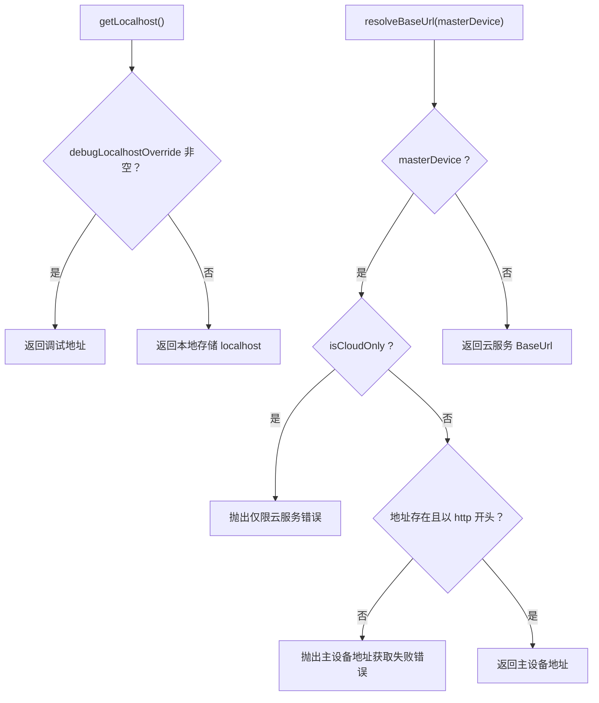
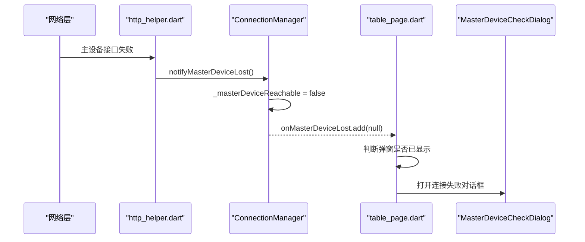
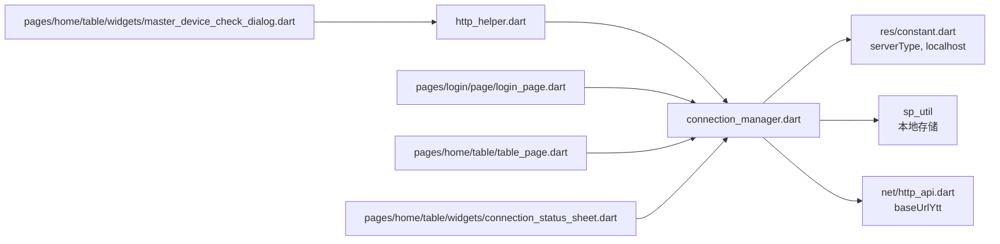

# 双连接模式管理

<cite>
**本文引用的文件**
- [connection_manager.dart](file://lib/net/connection_manager.dart)
- [http_helper.dart](file://lib/net/http_helper.dart)
- [login_page.dart](file://lib/pages/login/page/login_page.dart)
- [table_page.dart](file://lib/pages/home/table/table_page.dart)
- [connection_status_sheet.dart](file://lib/pages/home/table/widgets/connection_status_sheet.dart)
- [master_device_check_dialog.dart](file://lib/pages/home/table/widgets/master_device_check_dialog.dart)
- [param_setting_page.dart](file://lib/setting/page/param_setting_page.dart)
- [connection_mode_test.dart](file://test/connection_mode_test.dart)
</cite>

## 目录
1. [引言](#引言)
2. [项目结构定位](#项目结构定位)
3. [核心组件](#核心组件)
4. [架构总览](#架构总览)
5. [详细组件分析](#详细组件分析)
6. [依赖关系分析](#依赖关系分析)
7. [性能与健壮性考虑](#性能与健壮性考虑)
8. [故障排查指南](#故障排查指南)
9. [结论](#结论)
10. [附录：状态、策略与配置对照表](#附录状态策略与配置对照表)

## 引言
本文围绕 `ConnectionManager` 双连接模式管理器，系统梳理其策略选择、连接生命周期、主设备地址管理、连接状态事件传播，以及调用方如何正确切换连接模式和恢复异常。该组件用于在“云服务模式”和“主设备直连模式”之间做统一选路，并通过 `pcAlive` 把业务层对“是否走主设备”的判断与底层网络可达性解耦。

## 项目结构定位
`ConnectionManager` 位于网络基础设施层，是登录流程、桌台页面、参数设置页、状态展示组件等共同依赖的静态单例式管理器。它不直接发起 HTTP 请求，而是通过 `HttpApi` 常量与 `resolveBaseUrl` 暴露 BaseUrl；实际网络探测、失败广播由 `http_helper.dart` 中的辅助方法完成。

**图示来源**
- [connection_manager.dart:1-114](file://lib/net/connection_manager.dart#L1-L114)
- [http_helper.dart:485-630](file://lib/net/http_helper.dart#L485-L630)
- [login_page.dart:347-353](file://lib/pages/login/page/login_page.dart#L347-L353)
- [table_page.dart:123-158](file://lib/pages/home/table/table_page.dart#L123-L158)
- [connection_status_sheet.dart:46-80](file://lib/pages/home/table/widgets/connection_status_sheet.dart#L46-L80)
- [master_device_check_dialog.dart:223-229](file://lib/pages/home/table/widgets/master_device_check_dialog.dart#L223-L229)
- [param_setting_page.dart:287-293](file://lib/setting/page/param_setting_page.dart#L287-L293)

**章节来源**
- [connection_manager.dart:1-114](file://lib/net/connection_manager.dart#L1-L114)

## 核心组件
`ConnectionManager` 是一个以静态 API 暴露的无实例化入口类，职责包括：
- 维护当前会话的连接策略 `server_type`。
- 计算业务级连接选择 `pcAlive`。
- 提供主设备可达性状态和连接丢失事件流。
- 管理主设备地址 `localhost`。
- 根据策略解析最终 BaseUrl。

| 成员 | 类型 | 含义 |
|---|---|---|
| `_masterDeviceReachable` | 布尔值 | 内部主设备可达性状态 |
| `_activeServerType` | 字符串或空 | 当前会话已读取的策略值 |
| `pcAlive` | 布尔值 | 业务是否应优先使用主设备 |
| `sessionInitialized` | 布尔值 | 是否已完成一次 `beginSession` |
| `isMasterOnly` | 布尔值 | 是否仅允许主设备模式 |
| `isCloudOnly` | 布尔值 | 是否仅允许云服务模式 |
| `onMasterDeviceLost` | 流 | 主设备连接丢失事件流 |
| `getNetMode` | 整数 | 对外暴露的连接模式编号（1=主设备，2=云服务） |

**章节来源**
- [connection_manager.dart:16-63](file://lib/net/connection_manager.dart#L16-L63)

## 架构总览
双连接模式的决策分为两层：
1. **策略层**：由 `server_type` 决定允许的连接方式。
2. **运行时层**：由 `pcAlive` 结合策略与主设备可达性决定本次请求是否走主设备。

**图示来源**
- [connection_manager.dart:24-63](file://lib/net/connection_manager.dart#L24-L63)
- [connection_mode_test.dart:85-128](file://test/connection_mode_test.dart#L85-L128)

**章节来源**
- [connection_manager.dart:24-63](file://lib/net/connection_manager.dart#L24-L63)
- [connection_mode_test.dart:85-128](file://test/connection_mode_test.dart#L85-L128)

## 详细组件分析

### 策略模式与 server_type 三种状态
`server_type` 表示“允许的连接策略”，不是每次请求的动态选择器：
- `0`：不限。可以走主设备，也可回退到云服务。
- `1`：仅主设备。不允许云服务。
- `2`：仅云服务。不允许主设备。

读取逻辑优先级如下：
- 如果处于后台统一管理模式（`isServerTypeManaged`），则从 `ClientLinkModelValue` 读取。
- 否则从本地 `Constant.serverType` 读取。
- 非合法值会被归一化为 `0`。
- 在后台统一管理模式下，会把解析出的合法值同步写回 `Constant.serverType`，保证后续行为一致。

写入逻辑：
- 若后台统一管理，`setServerType` 返回失败，禁止用户修改。
- 否则写入本地存储并返回成功。

**图示来源**
- [connection_manager.dart:65-77](file://lib/net/connection_manager.dart#L65-L77)
- [connection_mode_test.dart:163-182](file://test/connection_mode_test.dart#L163-L182)

**章节来源**
- [connection_manager.dart:65-83](file://lib/net/connection_manager.dart#L65-L83)
- [connection_mode_test.dart:163-182](file://test/connection_mode_test.dart#L163-L182)

### pcAlive 属性与主设备可达性
`pcAlive` 的计算规则如下：
- 如果 `isMasterOnly` 为真，则 `pcAlive` 恒为真。
- 否则，当 `!isCloudOnly` 且 `_masterDeviceReachable` 为真时，`pcAlive` 为真。
- 否则 `pcAlive` 为假。

这意味着：
- “仅主设备”模式下，即使主设备断线，`pcAlive` 仍为真，不会自动降级到云服务。
- “仅云服务”模式下，`pcAlive` 永远为假。
- “不限”模式下，`pcAlive` 取决于主设备可达性。

`_masterDeviceReachable` 由外部探活逻辑更新，`notifyMasterDeviceLost` 会将其置为假并广播丢失事件。

**图示来源**
- [connection_manager.dart:16-114](file://lib/net/connection_manager.dart#L16-L114)

**章节来源**
- [connection_manager.dart:24-63](file://lib/net/connection_manager.dart#L24-L63)

### 连接模式生命周期
典型生命周期如下：

1. **会话开始**：`beginSession` 读取 `server_type`，并重置 `_masterDeviceReachable` 为假。
2. **登录流程**：登录成功后调用 `beginSession`；如果不是仅云服务，则执行主设备探活。
3. **桌面页初始化**：若未初始化，则先 `beginSession`，再在非仅云服务模式下执行探活。
4. **运行期间**：主设备网络失败时触发 `notifyMasterDeviceLost`，桌台页收到 `onMasterDeviceLost` 后弹出提示。
5. **连接结束**：退出或重新登录时应再次 `beginSession`，以清理旧会话状态。

**图示来源**
- [login_page.dart:347-353](file://lib/pages/login/page/login_page.dart#L347-L353)
- [table_page.dart:123-158](file://lib/pages/home/table/table_page.dart#L123-L158)
- [http_helper.dart:568-571](file://lib/net/http_helper.dart#L568-L571)
- [connection_manager.dart:32-63](file://lib/net/connection_manager.dart#L32-L63)

**章节来源**
- [connection_manager.dart:32-63](file://lib/net/connection_manager.dart#L32-L63)
- [login_page.dart:347-353](file://lib/pages/login/page/login_page.dart#L347-L353)
- [table_page.dart:123-158](file://lib/pages/home/table/table_page.dart#L123-L158)

### 主设备地址管理机制
主设备地址是直连 PC 的关键信息：
- `getLocalhost`：优先返回调试覆盖地址 `debugLocalhostOverride`；否则返回本地存储的主设备地址。
- `saveLocalhost`：将主设备地址写入本地存储。
- `resolveBaseUrl(masterDevice: true)`：若为云服务模式则抛错；若主设备地址为空或以非 `http` 开头也抛错；否则返回主设备地址。
- `resolveBaseUrl(masterDevice: false)`：总是返回云服务 BaseUrl。

调试覆盖字段 `debugLocalhostOverride` 默认空字符串，便于开发时强制指定主设备 IP。

**图示来源**
- [connection_manager.dart:86-114](file://lib/net/connection_manager.dart#L86-L114)
- [connection_mode_test.dart:91-120](file://test/connection_mode_test.dart#L91-L120)
- [connection_mode_test.dart:154-160](file://test/connection_mode_test.dart#L154-L160)

**章节来源**
- [connection_manager.dart:86-114](file://lib/net/connection_manager.dart#L86-L114)
- [connection_mode_test.dart:91-120](file://test/connection_mode_test.dart#L91-L120)
- [connection_mode_test.dart:154-160](file://test/connection_mode_test.dart#L154-L160)

### 连接状态事件系统
事件系统基于广播流实现：
- `_masterDeviceLostController` 是一个广播流控制器。
- `onMasterDeviceLost` 暴露只读流，供 UI 订阅。
- `notifyMasterDeviceLost` 仅在 `_masterDeviceReachable` 为真时广播，避免重复通知，同时把可达性置为假。
- 桌台页监听该流，在弹窗未显示时弹出连接失败提示。

**图示来源**
- [connection_manager.dart:43-63](file://lib/net/connection_manager.dart#L43-L63)
- [http_helper.dart:568-571](file://lib/net/http_helper.dart#L568-L571)
- [table_page.dart:123-129](file://lib/pages/home/table/table_page.dart#L123-L129)
- [master_device_check_dialog.dart:223-229](file://lib/pages/home/table/widgets/master_device_check_dialog.dart#L223-L229)

**章节来源**
- [connection_manager.dart:43-63](file://lib/net/connection_manager.dart#L43-L63)
- [http_helper.dart:568-571](file://lib/net/http_helper.dart#L568-L571)
- [table_page.dart:123-129](file://lib/pages/home/table/table_page.dart#L123-L129)

### 使用示例与最佳实践

#### 示例一：登录成功后初始化连接
1. 登录成功后调用 `beginSession`。
2. 如果不是仅云服务模式，调用探活方法检测主设备。
3. 如果是仅主设备模式且探活失败，应清除本地登录凭证，引导重新登录。

参考路径：
- [login_page.dart:347-353](file://lib/pages/login/page/login_page.dart#L347-L353)

#### 示例二：桌台页加载连接状态
1. 首次进入桌台页时检查 `sessionInitialized`，未初始化则 `beginSession`。
2. 非仅云服务模式时执行探活。
3. 订阅 `onMasterDeviceLost`，在主设备断线时提示用户。

参考路径：
- [table_page.dart:123-158](file://lib/pages/home/table/table_page.dart#L123-L158)

#### 示例三：参数设置页选择连接策略
1. 如果 `isServerTypeManaged` 为真，UI 显示“后台统一管理，不可修改”。
2. 否则允许用户选择“仅限云服务”“仅限主设备”“不限”。
3. 选择后立即写入本地，但需要重新登录才生效。

参考路径：
- [param_setting_page.dart:287-293](file://lib/setting/page/param_setting_page.dart#L287-L293)

#### 示例四：连接状态卡片展示
使用 `getNetMode()` 展示当前连接模式编号：
- 1：主设备。
- 2：云服务。

参考路径：
- [connection_status_sheet.dart:76-80](file://lib/pages/home/table/widgets/connection_status_sheet.dart#L76-L80)

**章节来源**
- [login_page.dart:347-353](file://lib/pages/login/page/login_page.dart#L347-L353)
- [table_page.dart:123-158](file://lib/pages/home/table/table_page.dart#L123-L158)
- [param_setting_page.dart:287-293](file://lib/setting/page/param_setting_page.dart#L287-L293)
- [connection_status_sheet.dart:76-80](file://lib/pages/home/table/widgets/connection_status_sheet.dart#L76-L80)

## 依赖关系分析

**图示来源**
- [connection_manager.dart:1-114](file://lib/net/connection_manager.dart#L1-L114)
- [http_helper.dart:485-630](file://lib/net/http_helper.dart#L485-L630)
- [login_page.dart:347-353](file://lib/pages/login/page/login_page.dart#L347-L353)
- [table_page.dart:123-158](file://lib/pages/home/table/table_page.dart#L123-L158)
- [connection_status_sheet.dart:46-80](file://lib/pages/home/table/widgets/connection_status_sheet.dart#L46-L80)
- [master_device_check_dialog.dart:223-229](file://lib/pages/home/table/widgets/master_device_check_dialog.dart#L223-L229)

**章节来源**
- [connection_manager.dart:1-114](file://lib/net/connection_manager.dart#L1-L114)
- [http_helper.dart:485-630](file://lib/net/http_helper.dart#L485-L630)

## 性能与健壮性考虑
- `pcAlive` 是轻量布尔判断，不应频繁重建对象；建议仅在会话初始化或主设备可达性变化时重新计算。
- `notifyMasterDeviceLost` 做了防重播保护，避免主设备断线反复触发 UI 弹窗。
- `resolveBaseUrl` 对非法主设备地址和仅云服务场景抛出明确错误，适合被上层捕获并给出友好提示。
- 后台统一管理模式下，`getServerType` 会将规范化后的值同步写回本地，减少前后端策略不一致的风险。
- 测试覆盖了主设备断线不降级、仅云服务拒绝 PC 地址、缺失主设备地址报错等边界情况，建议在新增选路逻辑时补充对应用例。

[本节为通用建议，不直接分析具体代码行]

## 故障排查指南

| 现象 | 可能原因 | 处理建议 |
|---|---|---|
| 仅主设备模式断线后仍走主设备 | `isMasterOnly` 为真时 `pcAlive` 恒为真 | 这是预期行为；应引导用户修复主设备网络或重新登录 |
| 仅云服务模式无法连接主设备 | `isCloudOnly` 为真 | 正常限制；如需连接主设备需改为不限或仅主设备 |
| 主设备地址为空时报错 | 未保存 `localhost` 或主设备未返回地址 | 检查登录响应和 `saveLocalhost` 调用 |
| 主设备地址不以 `http` 开头 | 地址格式不正确 | 修正为主机地址，保留协议前缀 |
| 主设备断线后 UI 未提示 | 未订阅 `onMasterDeviceLost` 或弹窗已显示 | 检查桌台页订阅逻辑和弹窗状态 |
| 参数设置页不能修改连接模式 | 后台统一管理开启 | 检查 `ClientLinkModel` 配置，或由后台下发新参数 |
| 登录后仍沿用旧策略 | 未调用 `beginSession` | 确保登录成功后调用会话初始化 |

**章节来源**
- [connection_manager.dart:24-114](file://lib/net/connection_manager.dart#L24-L114)
- [connection_mode_test.dart:85-182](file://test/connection_mode_test.dart#L85-L182)
- [table_page.dart:123-158](file://lib/pages/home/table/table_page.dart#L123-L158)

## 结论
`ConnectionManager` 通过分离“策略层”和“运行时层”，实现了清晰的双连接模式管理：`server_type` 表达允许的连接方式，`pcAlive` 表达当前是否走主设备。配合 `onMasterDeviceLost` 事件流、主设备地址管理和 `resolveBaseUrl` 路由选择，整个系统在云服务与主设备之间具备可控、可观测、可恢复的能力。对于仅主设备模式，设计明确禁止自动降级到云服务，从而保障线下收银场景的业务一致性。

## 附录：状态、策略与配置对照表

| 概念 | 取值或含义 | 说明 |
|---|---|---|
| `server_type` | `0`、`1`、`2` | `0`=不限，`1`=仅主设备，`2`=仅云服务 |
| `isMasterOnly` | 布尔值 | 当前策略是否为仅主设备 |
| `isCloudOnly` | 布尔值 | 当前策略是否为仅云服务 |
| `pcAlive` | 布尔值 | 业务是否应走主设备 |
| `getNetMode()` | `1` 或 `2` | `1`=主设备，`2`=云服务 |
| `isServerTypeManaged` | 布尔值 | 是否由后台统一管理连接策略 |
| `sessionInitialized` | 布尔值 | 是否已完成 `beginSession` |
| `debugLocalhostOverride` | 字符串 | 调试用主设备地址覆盖 |
| `onMasterDeviceLost` | 流 | 主设备连接丢失事件 |

**章节来源**
- [connection_manager.dart:16-114](file://lib/net/connection_manager.dart#L16-L114)