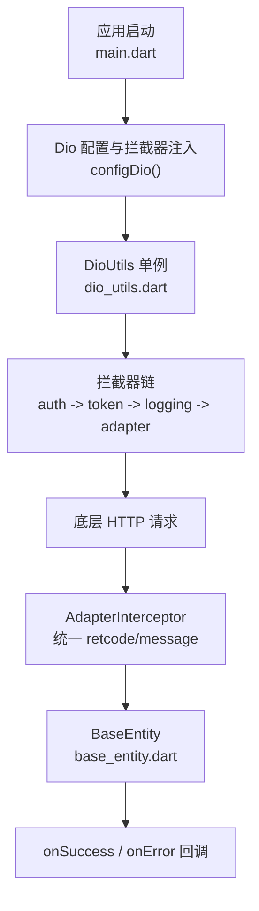
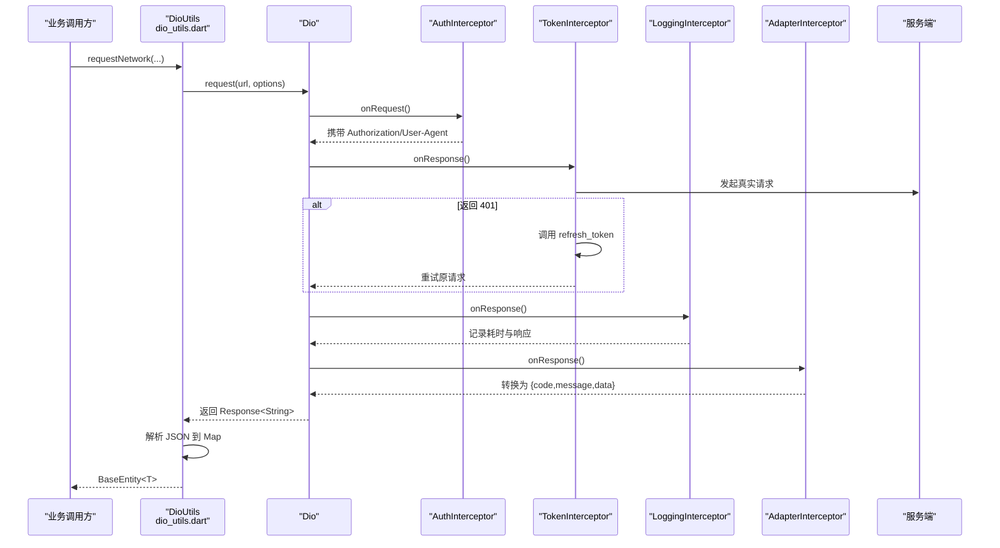
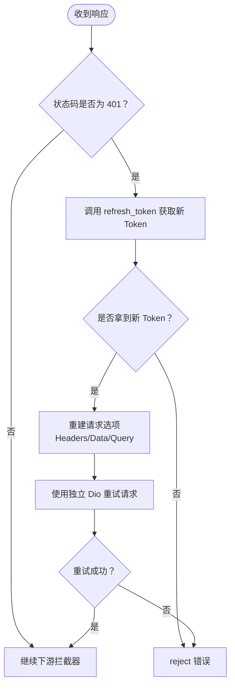
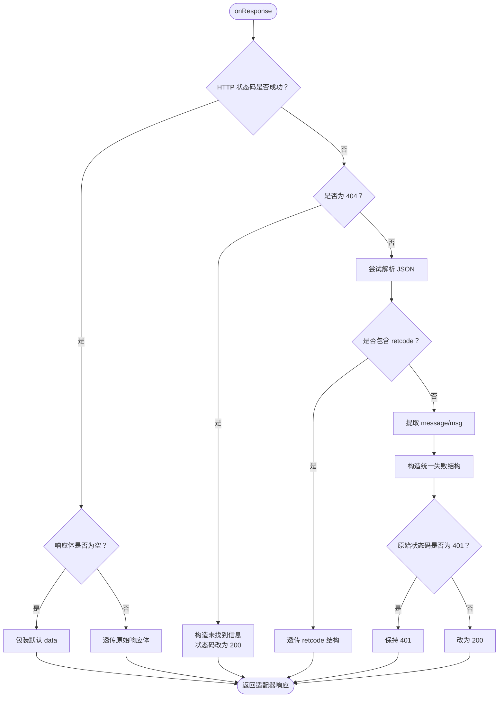
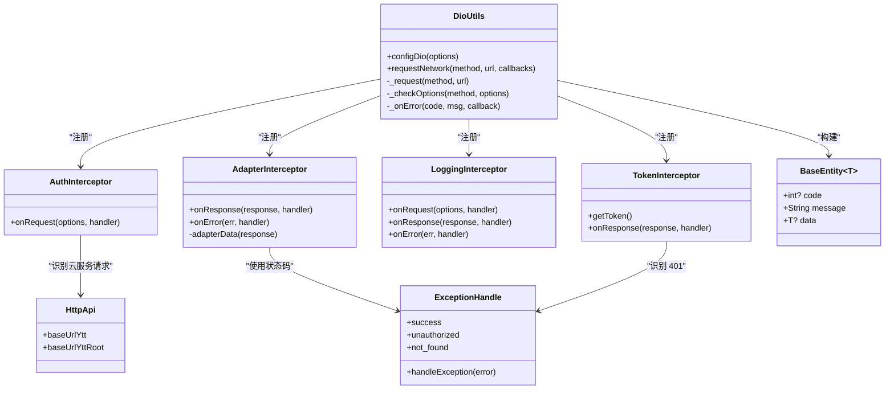

# 拦截器链设计

<cite>
**本文引用的文件**   
- [lib/main.dart](file://lib/main.dart)
- [lib/net/intercept.dart](file://lib/net/intercept.dart)
- [lib/net/dio_utils.dart](file://lib/net/dio_utils.dart)
- [lib/net/base_entity.dart](file://lib/net/base_entity.dart)
- [lib/net/error_handle.dart](file://lib/net/error_handle.dart)
- [lib/net/http_api.dart](file://lib/net/http_api.dart)
- [lib/net/connection_manager.dart](file://lib/net/connection_manager.dart)
</cite>

## 目录
1. [引言](#引言)
2. [项目结构](#项目结构)
3. [核心组件](#核心组件)
4. [架构总览](#架构总览)
5. [详细组件分析](#详细组件分析)
6. [依赖关系分析](#依赖关系分析)
7. [性能与可观测性](#性能与可观测性)
8. [配置示例与扩展指南](#配置示例与扩展指南)
9. [故障排查](#故障排查)
10. [结论](#结论)

## 引言
本技术文档围绕网络层拦截器链展开，聚焦四个核心拦截器：AuthInterceptor、TokenInterceptor、LoggingInterceptor、AdapterInterceptor。文档从执行顺序、职责边界、认证机制、自动刷新、日志记录和数据适配四个维度进行系统化说明，并结合 DioUtils 的统一请求入口、BaseEntity 的通用返回模型、ExceptionHandle 的错误码体系，给出完整的调用链路和排错建议。

## 项目结构
网络相关代码集中在 lib/net 下，主要文件如下：
- dio_utils.dart：Dio 初始化、超时、响应类型、拦截器注册、统一请求封装、错误回调。
- intercept.dart：四个核心拦截器的实现。
- base_entity.dart：业务通用的 BaseEntity<T> 数据模型。
- error_handle.dart：HTTP 状态码、网络异常映射与 NetError 封装。
- http_api.dart：云服务与主设备接口路径常量、基础域名。
- connection_manager.dart：连接模式管理（云服务 vs 主设备），辅助选路。
- main.dart：应用启动时组装拦截器链并调用 configDio 注入。

图表来源
- [lib/main.dart:75-92](file://lib/main.dart#L75-L92)
- [lib/net/dio_utils.dart:21-90](file://lib/net/dio_utils.dart#L21-L90)

章节来源
- [lib/main.dart:75-92](file://lib/main.dart#L75-L92)
- [lib/net/dio_utils.dart:1-90](file://lib/net/dio_utils.dart#L1-L90)

## 核心组件
- AuthInterceptor：负责为符合条件的请求添加 Authorization 头与 User-Agent，避免对直连主设备的请求误加云认证头。
- TokenInterceptor：在收到 401 时自动刷新 refresh_token，获得新 access_token 后重试原请求。
- LoggingInterceptor：记录请求 URL、方法、头、参数、正文及响应耗时；对成功与失败分别输出日志级别；使用 JSON 格式输出响应体。
- AdapterInterceptor：将服务端响应转换为统一的 code/message/data 结构，屏蔽不同后端差异，并保留 401 用于触发 Token 刷新。

章节来源
- [lib/net/intercept.dart:16-219](file://lib/net/intercept.dart#L16-L219)
- [lib/net/base_entity.dart:1-33](file://lib/net/base_entity.dart#L1-L33)
- [lib/net/error_handle.dart:1-82](file://lib/net/error_handle.dart#L1-L82)

## 架构总览
拦截器链由应用启动时按固定顺序注册：AuthInterceptor → TokenInterceptor → LoggingInterceptor → AdapterInterceptor。Dio 默认以纯文本 ResponseType.plain 接收响应，AdapterInterceptor 在链中完成数据适配，最终由 DioUtils._request 解析为 Map 并构建 BaseEntity<T>，再分发给 onSuccess/onError。

图表来源
- [lib/main.dart:75-92](file://lib/main.dart#L75-L92)
- [lib/net/intercept.dart:16-219](file://lib/net/intercept.dart#L16-L219)
- [lib/net/dio_utils.dart:52-90](file://lib/net/dio_utils.dart#L52-L90)
- [lib/net/dio_utils.dart:110-170](file://lib/net/dio_utils.dart#L110-L170)

## 详细组件分析

### AuthInterceptor：认证头与平台标识
- Authorization 头添加逻辑
  - 从本地存储读取 accessToken，仅当非空且为云服务请求时才设置 Authorization。
  - 云服务请求识别规则：路径以云服务基础域名开头，或路径不包含 /api/。
  - 主设备（直连 PC）路径通常以 /api/ 开头，因此不会添加 Authorization，与 smdcapp 行为对齐。
- User-Agent 设置
  - 在非 Web 平台下强制设置 User-Agent，满足部分服务端的 UA 校验要求。
- 执行时机
  - 位于请求阶段 onRequest，优先于其他拦截器。

优化点
- 当前通过字符串前缀判断云服务请求，若未来增加更多路由规则，可抽象为策略函数，便于扩展。

章节来源
- [lib/net/intercept.dart:16-34](file://lib/net/intercept.dart#L16-L34)
- [lib/net/http_api.dart:1-40](file://lib/net/http_api.dart#L1-L40)

### TokenInterceptor：自动刷新与重试
- 触发条件
  - 在 onResponse 阶段检测到 HTTP 401，认为 access_token 过期。
- 刷新流程
  - 通过独立的 Dio 实例（复用全局 BaseOptions）POST refresh_token 到 refreshToken 接口。
  - 成功后从响应中取出 access_token 并持久化。
- 重试机制
  - 使用 _tokenDio 直接发起请求，避免再次进入拦截器链造成循环。
  - 重新构造 Options，包含原 method、headers、data、queryParameters、cancelToken、进度回调等。
  - 成功则继续后续拦截器；失败则 reject 抛出 DioException。
- 注意事项
  - 401 分支中，Authorization 头使用了 Bearer 前缀，而 AuthInterceptor 添加的是 token 前缀。若服务端要求统一前缀，应保持一致。
  - 刷新接口本身也走拦截器链，需确保 refresh_token 接口不受 401 影响（例如白名单或绕过）。

图表来源
- [lib/net/intercept.dart:36-95](file://lib/net/intercept.dart#L36-L95)

章节来源
- [lib/net/intercept.dart:36-95](file://lib/net/intercept.dart#L36-L95)

### LoggingInterceptor：全链路日志与耗时统计
- 请求日志
  - 记录开始时间戳。
  - 拼接完整 URL（含 queryParameters）。
  - 记录 HTTP 方法、请求头、Content-Type、请求体。
- 响应日志
  - 记录结束时间戳并计算耗时毫秒数。
  - 根据 HTTP 状态码决定日志级别（成功/失败）。
  - 使用 Log.json 输出响应体，便于结构化检索。
- 错误日志
  - onError 阶段打印分隔线，便于区分错误链路。

注意
- 生产环境默认不启用 LoggingInterceptor，减少 I/O 与敏感信息泄露风险。
- 日志中包含原始请求头与 Body，请确保生产环境关闭或脱敏。

章节来源
- [lib/net/intercept.dart:96-138](file://lib/net/intercept.dart#L96-L138)
- [lib/main.dart:83-87](file://lib/main.dart#L83-L87)

### AdapterInterceptor：数据适配与错误码统一
- 目标
  - 将服务端返回体转换为统一结构：code、message、data。
  - 透传业务方的 retcode 格式，保持兼容。
- 成功分支
  - 若 HTTP 状态码为 200 或 204，视为业务成功。
  - 若响应体为空，填充默认值并包装为统一成功结构。
  - 否则透传原始响应体，由上层 DioUtils 继续解析。
- 失败分支
  - 若 404，构造“未找到查询信息”的 message，并将 HTTP 状态码改为 200，以便上层统一处理。
  - 若非 404，尝试解析 JSON，提取 message/msg 字段，构造统一失败结构。
  - 若解析失败，构造服务器异常的结构，保留原始 HTTP 状态码作为 code。
  - 特殊处理：若 JSON 已包含 retcode 键，直接透传，不做二次包装。
- 401 保留
  - 当原始状态码为 401 时，仍保持 401，以便 TokenInterceptor 识别并触发刷新。

图表来源
- [lib/net/intercept.dart:139-219](file://lib/net/intercept.dart#L139-L219)

章节来源
- [lib/net/intercept.dart:139-219](file://lib/net/intercept.dart#L139-L219)

## 依赖关系分析

图表来源
- [lib/net/dio_utils.dart:21-90](file://lib/net/dio_utils.dart#L21-L90)
- [lib/net/intercept.dart:16-219](file://lib/net/intercept.dart#L16-L219)
- [lib/net/base_entity.dart:1-33](file://lib/net/base_entity.dart#L1-L33)
- [lib/net/error_handle.dart:1-82](file://lib/net/error_handle.dart#L1-L82)
- [lib/net/http_api.dart:1-40](file://lib/net/http_api.dart#L1-L40)

章节来源
- [lib/net/dio_utils.dart:21-90](file://lib/net/dio_utils.dart#L21-L90)
- [lib/net/intercept.dart:16-219](file://lib/net/intercept.dart#L16-L219)

## 性能与可观测性
- 响应体解析
  - DioUtils 对大于 10KB 的响应体使用 compute 异步解析，避免阻塞 UI 线程。
  - 集成测试环境跳过 compute，保证稳定性。
- 日志开关
  - LoggingInterceptor 仅在非生产环境启用，降低 I/O 开销与隐私风险。
- 代理抓包
  - DioUtils 在非 Web 平台支持 Fiddler 代理配置，便于调试；通过用户标识控制是否启用。
- 取消请求
  - DioUtils 对 CancelToken.isCancel 进行专门日志输出，便于定位主动取消场景。

章节来源
- [lib/net/dio_utils.dart:52-90](file://lib/net/dio_utils.dart#L52-L90)
- [lib/net/dio_utils.dart:110-170](file://lib/net/dio_utils.dart#L110-L170)
- [lib/net/dio_utils.dart:170-222](file://lib/net/dio_utils.dart#L170-L222)

## 配置示例与扩展指南

### 拦截器链配置
应用启动时组装拦截器链并注入 Dio：
- 固定顺序：AuthInterceptor → TokenInterceptor → LoggingInterceptor（可选）→ AdapterInterceptor。
- 生产环境默认关闭 LoggingInterceptor。
- baseUrl 可在 configDio 中统一配置。

参考位置
- [lib/main.dart:75-92](file://lib/main.dart#L75-L92)

### 自定义拦截器开发指南
- 继承 Interceptor 或 QueuedInterceptor，按需重写 onRequest、onResponse、onError。
- 谨慎修改 response.data，尤其是 AdapterInterceptor 之后，避免破坏统一结构。
- 如需鉴权或重试，优先考虑放在 TokenInterceptor 之前，并确保不会形成死循环。
- 新增路由白名单或黑名单时，建议在 HttpApi 中集中维护，并在 AuthInterceptor 中引用。

### 调试技巧
- 开启 LoggingInterceptor：在非生产环境自动启用，查看 URL、方法、头、Body、耗时与响应体。
- 使用代理抓包：在非 Web 平台，通过 DioUtils 的 IOHttpClientAdapter 配置 Fiddler 代理。
- 401 调试：确认服务端返回 401 时，AdapterInterceptor 会保留 401，使 TokenInterceptor 能触发刷新。
- 云服务 vs 主设备：通过 HttpApi.baseUrlYtt 与 /api/ 路径区分；必要时借助 ConnectionManager 判定连接模式。

章节来源
- [lib/net/intercept.dart:96-138](file://lib/net/intercept.dart#L96-L138)
- [lib/net/dio_utils.dart:52-90](file://lib/net/dio_utils.dart#L52-L90)
- [lib/net/http_api.dart:1-40](file://lib/net/http_api.dart#L1-L40)
- [lib/net/connection_manager.dart:1-114](file://lib/net/connection_manager.dart#L1-L114)

## 故障排查
- 问题：登录成功后仍频繁 401
  - 检查 Authorization 头前缀是否与 TokenInterceptor 重试一致（token vs Bearer）。
  - 确认 refresh_token 接口未被拦截器链拦截导致二次 401。
- 问题：主设备请求报错
  - 检查路径是否以 /api/ 开头，AuthInterceptor 不会为其添加 Authorization。
  - 确认 ConnectionManager 的主设备地址与模式配置正确。
- 问题：业务端无法识别消息字段
  - 检查服务端返回是否包含 message 或 msg；AdapterInterceptor 会优先提取 message，其次 msg。
  - 若服务端返回 retcode 格式，AdapterInterceptor 会透传，上层需按 retcode 处理。
- 问题：大响应体卡顿
  - 确认响应体超过 10KB 时会走 compute 解析；检查集成测试环境是否禁用 compute。
- 问题：日志过多或泄露敏感信息
  - 在生产环境关闭 LoggingInterceptor；或在自定义拦截器中对敏感头与 Body 脱敏。

章节来源
- [lib/net/intercept.dart:36-95](file://lib/net/intercept.dart#L36-L95)
- [lib/net/intercept.dart:139-219](file://lib/net/intercept.dart#L139-L219)
- [lib/net/connection_manager.dart:1-114](file://lib/net/connection_manager.dart#L1-L114)
- [lib/net/dio_utils.dart:110-170](file://lib/net/dio_utils.dart#L110-L170)

## 结论
该拦截器链以清晰的分层职责与稳定的执行顺序，提供了认证、自动刷新、日志记录与数据适配的核心能力。AuthInterceptor 精准区分云服务与主设备请求，避免不必要的鉴权头；TokenInterceptor 在 401 场景下自动刷新并重试；LoggingInterceptor 提供可观测性；AdapterInterceptor 统一了多源响应的结构与错误码。结合 DioUtils 的异步解析与错误处理，整体具备良好的可扩展性与可维护性。建议在扩展路由、鉴权策略或日志规范时，遵循现有模式并在 HttpApi 与拦截器中集中管理。