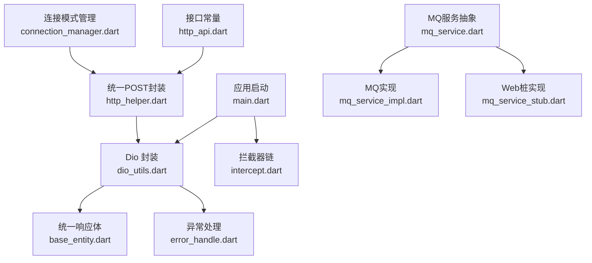
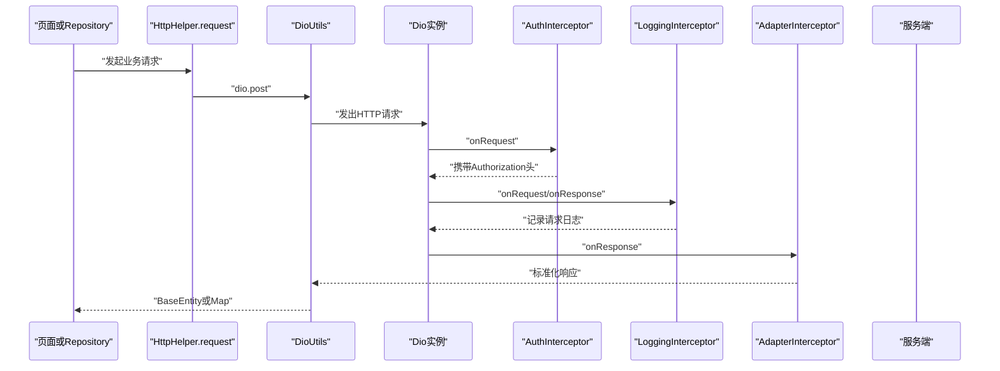
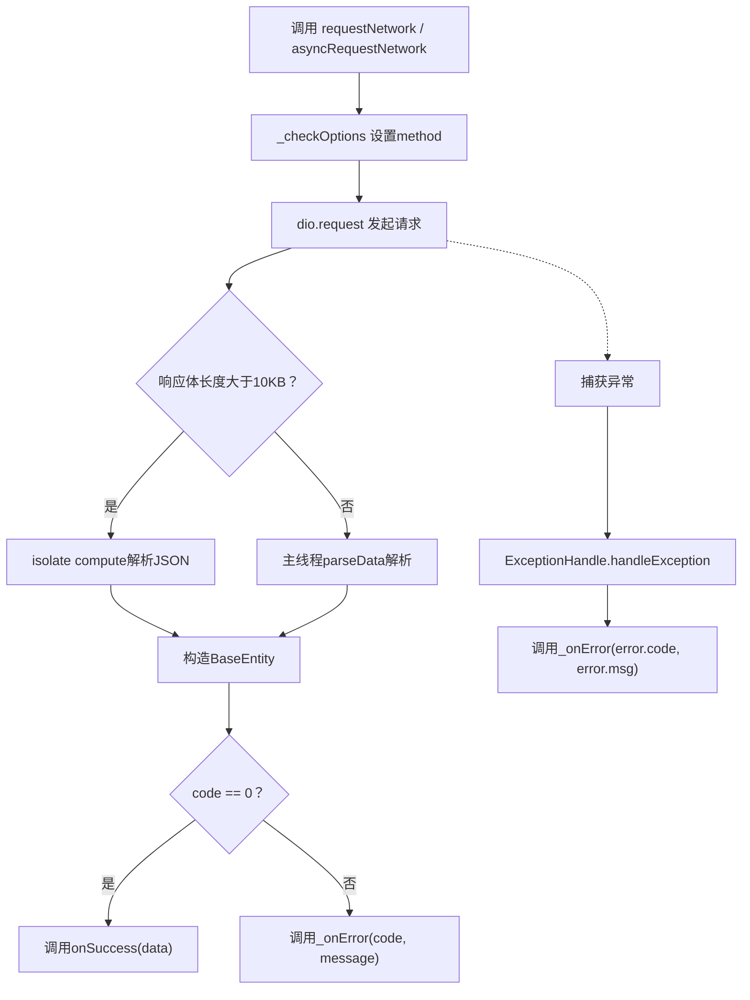
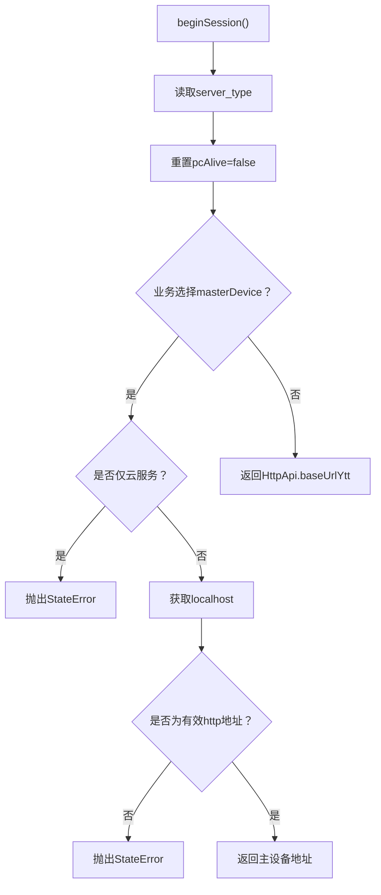
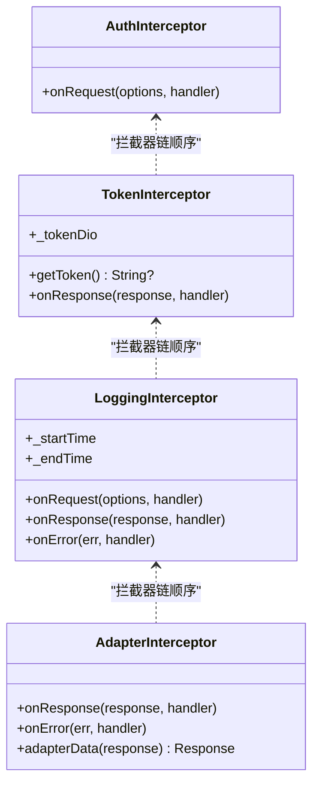
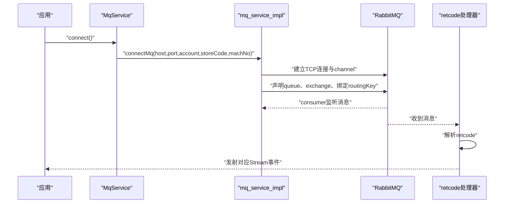
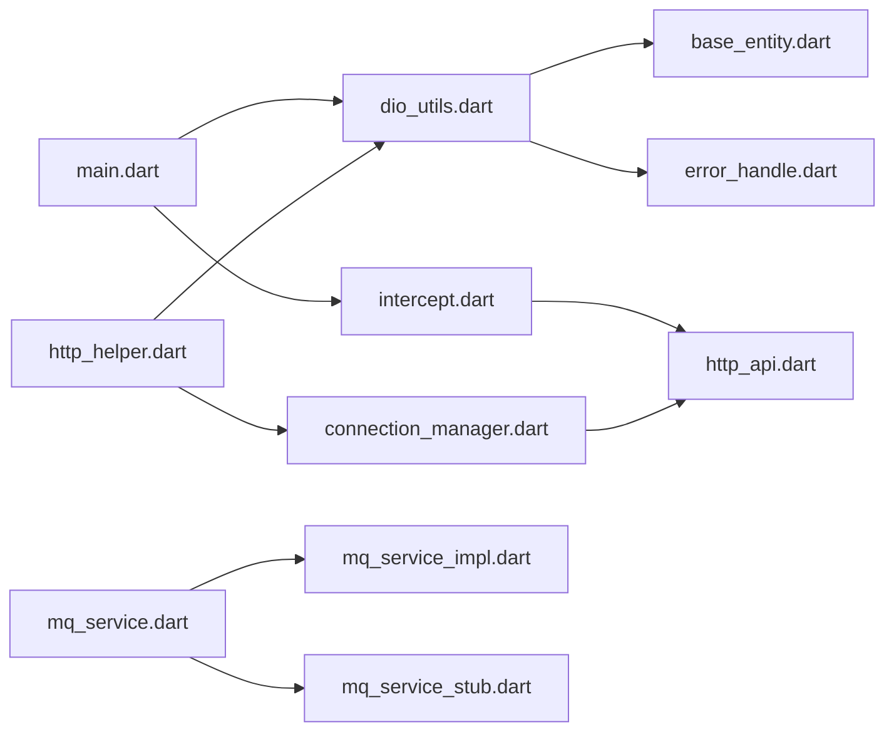

# 网络层设计

<cite>
**本文引用的文件**   
- [lib/net/dio_utils.dart](file://lib/net/dio_utils.dart)
- [lib/net/connection_manager.dart](file://lib/net/connection_manager.dart)
- [lib/net/intercept.dart](file://lib/net/intercept.dart)
- [lib/net/http_api.dart](file://lib/net/http_api.dart)
- [lib/net/mq_service.dart](file://lib/net/mq_service.dart)
- [lib/net/mq_service_impl.dart](file://lib/net/mq_service_impl.dart)
- [lib/net/mq_service_stub.dart](file://lib/net/mq_service_stub.dart)
- [lib/net/base_entity.dart](file://lib/net/base_entity.dart)
- [lib/net/error_handle.dart](file://lib/net/error_handle.dart)
- [lib/net/http_helper.dart](file://lib/net/http_helper.dart)
- [lib/net/net.dart](file://lib/net/net.dart)
- [lib/main.dart](file://lib/main.dart)
</cite>

## 目录
1. [引言](#引言)
2. [项目结构与职责边界](#项目结构与职责边界)
3. [核心组件总览](#核心组件总览)
4. [架构概览](#架构概览)
5. [详细组件分析](#详细组件分析)
6. [依赖关系分析](#依赖关系分析)
7. [性能与稳定性特征](#性能与稳定性特征)
8. [HTTP API 接口规范](#http-api-接口规范)
9. [最佳实践、优化建议与排查指南](#最佳实践优化建议与排查指南)
10. [结论](#结论)

## 引言
本文面向“聚客美滋滋”应用的网络层，系统性梳理 Dio 封装、双连接模式、拦截器链、MQ 实时推送以及 HTTP API 的统一约定。目标是让不熟悉底层实现的读者也能理解：
- 网络请求如何发起、认证、日志、适配和错误处理；
- 云服务与 PC 主设备直连两种模式如何切换；
- 桌台状态如何通过 RabbitMQ 实时推送；
- 业务调用应遵循哪些规范和注意事项。

## 项目结构与职责边界
网络层位于 `lib/net` 下，主要模块职责如下：
- `dio_utils.dart`：Dio 单例、超时配置、统一请求入口、基础响应体包装、取消请求日志。
- `connection_manager.dart`：连接模式管理，决定当前走云服务还是 PC 主设备。
- `intercept.dart`：拦截器链，包括鉴权、Token 刷新、日志、数据适配。
- `http_api.dart`：RESTful 接口路径常量、云服务与主设备端点分类。
- `mq_service.dart`、`mq_service_impl.dart`、`mq_service_stub.dart`：RabbitMQ 抽象、移动端实现、Web 桩实现。
- `base_entity.dart`：统一响应结构 `BaseEntity<T>`。
- `error_handle.dart`：异常类型映射、网络错误码定义。
- `http_helper.dart`：yxl-boss 风格统一 POST 请求封装、公共参数组装、API 流水日志。
- `net.dart`：对外导出部分网络能力。
- `main.dart`：应用启动时初始化拦截器和 Dio。

**图表来源**
- [lib/main.dart:40-100](file://lib/main.dart#L40-L100)
- [lib/net/dio_utils.dart:1-120](file://lib/net/dio_utils.dart#L1-L120)
- [lib/net/connection_manager.dart:1-114](file://lib/net/connection_manager.dart#L1-L114)
- [lib/net/intercept.dart:1-219](file://lib/net/intercept.dart#L1-L219)
- [lib/net/http_api.dart:1-200](file://lib/net/http_api.dart#L1-L200)
- [lib/net/mq_service.dart:1-112](file://lib/net/mq_service.dart#L1-L112)
- [lib/net/mq_service_impl.dart:1-200](file://lib/net/mq_service_impl.dart#L1-L200)
- [lib/net/mq_service_stub.dart:1-65](file://lib/net/mq_service_stub.dart#L1-L65)
- [lib/net/base_entity.dart:1-33](file://lib/net/base_entity.dart#L1-L33)
- [lib/net/error_handle.dart:1-82](file://lib/net/error_handle.dart#L1-L82)
- [lib/net/http_helper.dart:1-200](file://lib/net/http_helper.dart#L1-L200)

**章节来源**
- [lib/net/net.dart:1-3](file://lib/net/net.dart#L1-L3)
- [lib/main.dart:1-159](file://lib/main.dart#L1-L159)

## 核心组件总览
| 组件 | 职责 | 关键设计点 |
|---|---|---|
| `DioUtils` | 提供 Dio 单例、统一请求方法、响应解析、取消请求日志 | 工厂单例、`BaseOptions` 配置、响应类型设为字符串后自行解析、大响应用 isolate 解析 |
| `ConnectionManager` | 决定请求目标地址（云服务或 PC 主设备） | `server_type` 支持 0/1/2，`pcAlive` 综合可达性判断，调试可强制覆盖 localhost |
| `拦截器链` | 注入 Token、刷新过期 Token、记录日志、适配后端响应格式 | `AuthInterceptor`、`TokenInterceptor`、`LoggingInterceptor`、`AdapterInterceptor` |
| `HttpApi` | 集中维护 RESTful 接口路径 | 区分云服务 `/YttSvr/app` 与主设备 `/api/...` 两类端点 |
| `MqService` | RabbitMQ 连接、订阅、事件流暴露 | Web 平台跳过连接，移动端使用 `dart_amqp` |
| `BaseEntity` | 统一 JSON 响应模型 | 根据 `code`、`message`、`data` 反序列化为泛型 |
| `ExceptionHandle` | 网络异常到业务错误码映射 | Dio 类型、Socket、HTTP、Format 等异常分类 |
| `HttpHelper.request` | yxl-boss 风格统一 POST 封装 | 自动注入 sid、spid、token、sign、requestId、params |

**章节来源**
- [lib/net/dio_utils.dart:1-200](file://lib/net/dio_utils.dart#L1-L200)
- [lib/net/connection_manager.dart:1-114](file://lib/net/connection_manager.dart#L1-L114)
- [lib/net/intercept.dart:1-219](file://lib/net/intercept.dart#L1-L219)
- [lib/net/http_api.dart:1-200](file://lib/net/http_api.dart#L1-L200)
- [lib/net/mq_service.dart:1-112](file://lib/net/mq_service.dart#L1-L112)
- [lib/net/base_entity.dart:1-33](file://lib/net/base_entity.dart#L1-L33)
- [lib/net/error_handle.dart:1-82](file://lib/net/error_handle.dart#L1-L82)
- [lib/net/http_helper.dart:1-200](file://lib/net/http_helper.dart#L1-L200)

## 架构概览
整体网络层采用分层 + 策略 + 拦截器的组合方式：
- 调用层通过 `DioUtils` 或 `HttpHelper.request` 发起请求；
- 请求进入 Dio 拦截器链，依次执行鉴权、日志、Token 刷新、数据适配；
- 响应由 `BaseEntity` 统一封装，再由上层按业务字段处理；
- 连接模式由 `ConnectionManager` 控制，影响实际域名和是否允许直连 PC；
- 桌台变更通过 MQ 推送，Web 端降级为轮询兜底。

**图表来源**
- [lib/net/http_helper.dart:1-200](file://lib/net/http_helper.dart#L1-L200)
- [lib/net/dio_utils.dart:1-200](file://lib/net/dio_utils.dart#L1-L200)
- [lib/net/intercept.dart:1-219](file://lib/net/intercept.dart#L1-L219)

## 详细组件分析

### DioUtils：Dio 封装与统一请求入口
`DioUtils` 是网络层的入口对象，核心设计如下：
- **单例模式**：使用 Dart `factory` 返回静态实例，保证全局只有一个 Dio 配置。
- **默认配置**：
  - 连接超时、接收超时、发送超时以模块级变量保存，可通过 `configDio` 覆盖。
  - `responseType` 设置为 `plain`，先拿到原始字符串再解析，便于自定义解析逻辑。
  - `validateStatus` 始终返回 true，HTTP 状态码不直接决定成功失败，而是交给适配器与业务 code 判断。
  - `baseUrl` 可配置，但应用启动时传入 GitHub 示例 baseUrl，实际业务更多通过 `HttpHelper` 拼接完整 URL。
- **代理抓包**：非 Web 环境下，若处于 debug 模式且特定 spid，启用 Fiddler 代理并忽略证书校验。
- **统一请求流程**：
  - `_request` 返回 `Future<BaseEntity<T>>`，内部对大于 10KB 的响应体使用 `compute` 在 isolate 中解析，避免阻塞 UI。
  - `requestNetwork` 与 `asyncRequestNetwork` 分别提供 Future 回调与 Stream 广播式回调。
  - 统一将 Dio 异常转换为 `NetError`，并通过 `onError` 回调通知调用方。
- **取消请求日志**：当 `CancelToken` 触发取消时，打印取消请求的 URL。

**图表来源**
- [lib/net/dio_utils.dart:1-200](file://lib/net/dio_utils.dart#L1-L200)
- [lib/net/base_entity.dart:1-33](file://lib/net/base_entity.dart#L1-L33)
- [lib/net/error_handle.dart:1-82](file://lib/net/error_handle.dart#L1-L82)

**章节来源**
- [lib/net/dio_utils.dart:1-200](file://lib/net/dio_utils.dart#L1-L200)
- [lib/net/base_entity.dart:1-33](file://lib/net/base_entity.dart#L1-L33)
- [lib/net/error_handle.dart:1-82](file://lib/net/error_handle.dart#L1-L82)

### ConnectionManager：双连接模式与 server_type 机制
`ConnectionManager` 负责决定本次会话的网络目标：
- **连接模式语义**：
  - `server_type = 0`：不限，优先主设备，不可用时回退云服务。
  - `server_type = 1`：仅主设备直连。
  - `server_type = 2`：仅云服务。
- **可达性与会话状态**：
  - `beginSession` 初始化当前 `server_type` 并将主设备可达标记置为 false。
  - `pcAlive` 是业务选路依据：若为主设备专属模式，则必须走主设备；否则只要不是仅云服务且主设备可达，就走主设备。
  - `notifyMasterDeviceLost` 用于在网络层发现主设备不可达时广播丢失事件，供桌台页弹窗提示。
- **持久化与调试**：
  - `getServerType` 从 `ClientLinkModelValue` 或 `Constant.serverType` 读取，并做合法值校验。
  - `setServerType` 在非受管模式下写入本地存储。
  - `debugLocalhostOverride` 可在调试期强制指定主设备地址，方便联调。
- **URL 解析**：
  - `resolveBaseUrl(masterDevice: true)`：若仅限云服务则抛异常；否则返回登录返回的 localhost。
  - `resolveBaseUrl(masterDevice: false)`：返回云服务 `HttpApi.baseUrlYtt`。

**图表来源**
- [lib/net/connection_manager.dart:1-114](file://lib/net/connection_manager.dart#L1-L114)
- [lib/net/http_api.dart:1-200](file://lib/net/http_api.dart#L1-L200)

**章节来源**
- [lib/net/connection_manager.dart:1-114](file://lib/net/connection_manager.dart#L1-L114)
- [lib/net/http_api.dart:1-200](file://lib/net/http_api.dart#L1-L200)

### 拦截器链：Auth、Token、Logging、Adapter
拦截器链在应用启动时注册，顺序如下：
1. `AuthInterceptor`：为云服务请求添加 `Authorization: token $accessToken`，并为非 Web 环境添加 User-Agent。
2. `TokenInterceptor`：基于 `QueuedInterceptor`，当响应状态码为未授权时尝试刷新 Token，成功后重新发起原请求。
3. `LoggingInterceptor`：记录请求 URL、Method、Headers、Body、响应码、响应体及耗时。
4. `AdapterInterceptor`：将不同后端响应统一为标准格式，使 `BaseEntity` 能稳定解析。

#### AuthInterceptor
- 仅当请求路径属于云服务时添加 Authorization 头；主设备直连不需要该头。
- 非 Web 平台固定 User-Agent。

#### TokenInterceptor
- 使用独立 Dio 实例 `getToken()` 调用刷新接口。
- 刷新成功后更新本地 Token，并重试原请求。
- 重试时使用 `_tokenDio` 以避免再次进入 Token 刷新逻辑。

#### LoggingInterceptor
- 记录请求开始时间、URL、Method、Headers、ContentType、Body。
- 记录响应状态码、响应体、耗时。
- 错误分支也输出日志。

#### AdapterInterceptor
- 成功响应：
  - 空响应体补成标准成功结构。
  - 非空响应体保持原样，由上层解析。
  - 404 特殊处理为“未找到查询信息”，并转为成功状态码，交由上层按 retcode 判断。
- 失败响应：
  - 如果响应体包含 `retcode`，透传原结构。
  - 否则尝试解析消息字段 `message` 或 `msg`，构造统一失败结构。
  - 清理转义字符，兼容后端可能包裹引号的字符串。

**图表来源**
- [lib/net/intercept.dart:1-219](file://lib/net/intercept.dart#L1-L219)

**章节来源**
- [lib/main.dart:60-100](file://lib/main.dart#L60-L100)
- [lib/net/intercept.dart:1-219](file://lib/net/intercept.dart#L1-L219)

### MQ 消息队列服务：连接、订阅与桌台推送
`MqService` 是对 RabbitMQ 能力的抽象：
- **事件流**：
  - `onTableChanged`：桌台变更事件。
  - `onLockTable`：锁台事件。
  - `onScanOrder`：扫码点餐接单事件。
  - `onForceLogout`：强制下线。
  - `onPrintNotice`：打印通知。
  - `onCallNumberRefresh`：叫号刷新。
- **连接参数**：
  - host、port、account、storeCode、machNo 优先从本地存储读取。
  - 若个别字段缺失，尝试从完整登录数据中提取。
- **平台差异**：
  - Web 平台跳过连接，使用空桩实现，表状态靠轮询兜底。
  - 移动端使用 `dart_amqp` 建立 TCP 连接、声明 channel、绑定 queue 与 exchange。

`mq_service_impl.dart` 的核心流程：
- 连接参数缓存，防止重连丢失上下文。
- 防并发连接标志 `_connecting`。
- 连接失败后 10 秒定时重连。
- 队列名使用 `account-storeCode-machNo`，non-durable、autoDelete。
- 绑定三级 routing key：账户级、门店级、设备级。
- 消息处理器按 `retcode` 分发：心跳、日志上传、强制下线、桌台变更、扫码接单、叫号刷新、打印通知。

**图表来源**
- [lib/net/mq_service.dart:1-112](file://lib/net/mq_service.dart#L1-L112)
- [lib/net/mq_service_impl.dart:1-200](file://lib/net/mq_service_impl.dart#L1-L200)
- [lib/net/mq_service_stub.dart:1-65](file://lib/net/mq_service_stub.dart#L1-L65)

**章节来源**
- [lib/net/mq_service.dart:1-112](file://lib/net/mq_service.dart#L1-L112)
- [lib/net/mq_service_impl.dart:1-200](file://lib/net/mq_service_impl.dart#L1-L200)
- [lib/net/mq_service_stub.dart:1-65](file://lib/net/mq_service_stub.dart#L1-L65)

### BaseEntity 与 ExceptionHandle：统一响应与错误模型
`BaseEntity<T>` 将后端响应统一为三个字段：
- `code`：业务码。
- `message`：提示信息。
- `data`：泛型业务数据，支持 String、Map、List 或自定义实体。

`ExceptionHandle` 将底层异常映射为业务错误码：
- 成功状态：200、204、304。
- HTTP 状态：401、403、404。
- 网络错误：网络异常、解析错误、Socket 异常、HTTP 异常、连接超时、发送超时、接收超时、取消、未知错误。
- 扩展 `DioExceptionType` 到错误码映射，使 Dio 类型可直接转为业务错误码。

**章节来源**
- [lib/net/base_entity.dart:1-33](file://lib/net/base_entity.dart#L1-L33)
- [lib/net/error_handle.dart:1-82](file://lib/net/error_handle.dart#L1-L82)

### HttpHelper：yxl-boss 风格统一 POST 封装
`HttpHelper.request` 提供比 `DioUtils` 更贴近业务的统一 POST 方法：
- 自动读取 `sid`、`spid`、`userid`、`token`。
- 构造外层请求体：`sid`、`spid`、`client`、`token`、`sign`、`requestId`、`params`。
- 自动将 Map 类型的 data 合并为 params，并在 Map 上注入 `client`。
- 非 Map 类型 data 会作为 params 原始值透传，兼容老接口。
- 成功时记录 API 流水日志，失败时额外写入错误日志。
- 对频繁或大数据接口跳过成功日志，避免日志膨胀。

**章节来源**
- [lib/net/http_helper.dart:1-200](file://lib/net/http_helper.dart#L1-L200)

## 依赖关系分析
网络层内部依赖关系如下：
- `main.dart` 初始化拦截器并调用 `configDio`。
- `dio_utils.dart` 依赖 `base_entity.dart`、`error_handle.dart`、`log_utils.dart`、`user_helper.dart`。
- `intercept.dart` 依赖 `http_api.dart`、`constant.dart`、`device_utils.dart`、`log_utils.dart`、`other_utils.dart`、`sp_util`、`sprintf`。
- `connection_manager.dart` 依赖 `http_api.dart`、`constant.dart`、`sp_util`。
- `mq_service.dart` 依赖 `mq_service_impl.dart` 或 `mq_service_stub.dart`，并使用 `constant.dart`。
- `http_helper.dart` 依赖 `dio_utils.dart`、`connection_manager.dart`、`http_api.dart`、`constant.dart`、`sp_util`、`package_info_plus`、`crypto`、`file_log_writer.dart`。

**图表来源**
- [lib/main.dart:40-100](file://lib/main.dart#L40-L100)
- [lib/net/dio_utils.dart:1-200](file://lib/net/dio_utils.dart#L1-L200)
- [lib/net/intercept.dart:1-219](file://lib/net/intercept.dart#L1-L219)
- [lib/net/connection_manager.dart:1-114](file://lib/net/connection_manager.dart#L1-L114)
- [lib/net/http_helper.dart:1-200](file://lib/net/http_helper.dart#L1-L200)
- [lib/net/mq_service.dart:1-112](file://lib/net/mq_service.dart#L1-L112)

**章节来源**
- [lib/net/net.dart:1-3](file://lib/net/net.dart#L1-L3)
- [lib/main.dart:1-159](file://lib/main.dart#L1-L159)

## 性能与稳定性特征
- **响应体解析隔离**：大于 10KB 的响应体使用 `compute` 在 isolate 中解析，减少 UI 卡顿风险。
- **统一状态判断**：不使用 HTTP 状态码判定业务成功失败，降低后端非标准状态码带来的不确定性。
- **日志分级**：
  - `LoggingInterceptor` 适合调试阶段查看完整请求响应。
  - `FileLogWriter` 提供 API 流水与错误日志，生产环境仍保留关键失败信息。
  - 大数据或高频接口成功时跳过逐条日志，避免日志爆炸。
- **MQ 重连机制**：连接失败后 10 秒重试，避免瞬时网络抖动导致永久断连。
- **Token 刷新串行化**：通过 `QueuedInterceptor` 与独立 Dio 实例避免重复刷新和循环重试。
- **取消请求友好日志**：明确区分用户主动取消与真实网络异常。

[本节为通用性能讨论，不直接分析具体代码片段]

## HTTP API 接口规范
接口定义集中在 `HttpApi`，并按业务域分类：
- **云服务基础域名**：`baseUrlYttRoot` 为根路径，`baseUrlYtt` 为含 `/app` 前缀的完整域名。
- **登录与权限**：登录、多商户列表、版本检查、角色信息。
- **桌台接口**：
  - 云服务：区域列表、桌台信息列表、开台、消台、锁台、修改临时信息等。
  - 主设备：探活同步时间、区域列表、桌台信息列表、开台、消台、锁台等。
- **菜品相关**：分类、商品列表、规格做法、套餐详情，均走云服务。
- **下单与订单**：
  - 云服务：上传临时台、查询临时明细、结账、支付方式。
  - 主设备：保存未落单菜品、查询桌台详情、清台。
- **会员与结算**：会员列表、会员支付、交班相关接口。
- **系统辅助**：厨打列表、条码生成、备注原因、催菜挂起、沽清数量等。

### RESTful 设计风格
- 云服务路径以 `/YttSvr/app` 为基准，例如 `/table/area/getAreaList`、`/sale/beginTable`。
- 主设备路径以 `/api/` 开头，例如 `/api/table/TableCancel`、`/api/host/GetHostSyncTime`。
- 部分接口如交班相关直接拼接根路径 `$baseUrlYttRoot/cashrecon/...`，不走 `/app` 前缀。

### 请求头与请求体
- 云服务与主设备共用 HTTP 方法为 POST。
- 统一 POST 封装 `HttpHelper.request` 的请求体结构：
  - 外层：`sid`、`spid`、`client`、`token`、`sign`、`requestId`、`params`。
  - 内层 `params`：
    - 默认包含 `clientflag`、`sid`、`spid`、可选 `userid`。
    - Map 类型 data 会与默认字段合并。
    - 非 Map 类型 data 直接作为 params 原始值。
- 鉴权头：
  - `Authorization: token $accessToken` 仅在云服务请求时注入。
  - 主设备直连不携带 Authorization。

### 响应体结构
- 适配器层会将响应标准化，使 `BaseEntity` 能解析：
  - 成功：`code=0`，`message` 为空或提示，`data` 为业务数据。
  - 失败：根据后端返回结构提取 `message` 或 `msg`。
  - 404：转换为“未找到查询信息”，由上层按业务码判断。
  - 若后端返回本身包含 `retcode`，适配器透传原结构。
- `HttpHelper.request` 针对包含 `retcode` 的后端响应，直接返回完整 Map，便于上层判断业务码。

### 错误码定义
- HTTP 层错误码：200、204、304、401、403、404。
- 业务网络错误码：
  - 1000：网络异常。
  - 1001：解析错误。
  - 1002：Socket 异常。
  - 1003：HTTP 异常。
  - 1004：连接超时。
  - 1005：发送超时。
  - 1006：接收超时。
  - 1007：取消请求。
  - 9999：未知异常。

**章节来源**
- [lib/net/http_api.dart:1-200](file://lib/net/http_api.dart#L1-L200)
- [lib/net/http_helper.dart:1-200](file://lib/net/http_helper.dart#L1-L200)
- [lib/net/intercept.dart:1-219](file://lib/net/intercept.dart#L1-L219)
- [lib/net/base_entity.dart:1-33](file://lib/net/base_entity.dart#L1-L33)
- [lib/net/error_handle.dart:1-82](file://lib/net/error_handle.dart#L1-L82)

## 最佳实践、优化建议与排查指南

### 网络请求最佳实践
- 优先使用 `HttpHelper.request` 进行业务 POST 请求，确保公共参数自动注入。
- 需要细粒度控制 Dio 行为时，使用 `DioUtils.instance.dio`，但注意不要绕过统一封装的业务约定。
- 使用 `ConnectionManager.resolveBaseUrl` 选择目标地址，不要硬编码域名。
- 对大数据量响应，保持 `DioUtils` 的大响应隔离解析逻辑，避免手动在主线程解析大 JSON。
- 对频繁或大数据接口，接受“成功时不逐条记录日志”的设计，避免日志污染。

### 性能优化建议
- 合理设置超时时间，避免过短导致误判网络异常，过长导致用户体验差。
- 在 UI 层合理使用 `CancelToken` 取消不再需要的请求，减少资源浪费。
- 避免在拦截器中进行重型计算，所有重型解析尽量下沉到 `compute` 或业务层。
- MQ 连接失败场景下，依赖重连机制，不要在 UI 层频繁触发重连。

### 常见问题排查方法
- **Token 失效**：
  - 检查 `AuthInterceptor` 是否正确为云服务请求注入 Authorization。
  - 确认 `TokenInterceptor` 刷新接口路径与响应字段是否正确。
- **主设备不可达**：
  - 检查 `ConnectionManager.pcAlive` 与 `notifyMasterDeviceLost` 是否被正确调用。
  - 确认 `debugLocalhostOverride` 未在联调后残留。
- **日志过多或不足**：
  - 调试阶段开启 `LoggingInterceptor`。
  - 生产环境依赖 `FileLogWriter` 的 API 流水与错误日志。
  - 大数据接口成功时不会逐条记录，失败时仍会记录。
- **MQ 无推送**：
  - Web 平台正常无推送，需确认轮询兜底是否生效。
  - 移动端检查 RabbitMQ host、port、account、storeCode、machNo 是否正确。
  - 查看 `mq_service_impl.dart` 中的连接日志与消息处理日志。
- **接口报错但 HTTP 200**：
  - 确认后端返回结构是否包含 `retcode`，并由 `AdapterInterceptor` 或 `HttpHelper.request` 正确处理。
  - 检查 `BaseEntity.fromJson` 是否能解析后端字段。

**章节来源**
- [lib/net/dio_utils.dart:1-200](file://lib/net/dio_utils.dart#L1-L200)
- [lib/net/connection_manager.dart:1-114](file://lib/net/connection_manager.dart#L1-L114)
- [lib/net/intercept.dart:1-219](file://lib/net/intercept.dart#L1-L219)
- [lib/net/http_helper.dart:1-200](file://lib/net/http_helper.dart#L1-L200)
- [lib/net/mq_service_impl.dart:1-200](file://lib/net/mq_service_impl.dart#L1-L200)

## 结论
聚客美滋滋的网络层以 `DioUtils` 为基础，结合拦截器链、连接模式管理、统一响应体和错误处理，形成了清晰的分层架构。云服务与 PC 主设备直连通过 `ConnectionManager` 的策略机制解耦，MQ 推送为桌台状态提供实时能力，Web 端则以轮询兜底保障可用性。业务调用应遵循 `HttpApi` 的接口规范与 `HttpHelper.request` 的请求约定，以获得一致的鉴权、日志、错误处理和性能表现。后续扩展新接口时，建议优先复用现有封装，避免在各页面重复实现鉴权、日志和错误处理逻辑。