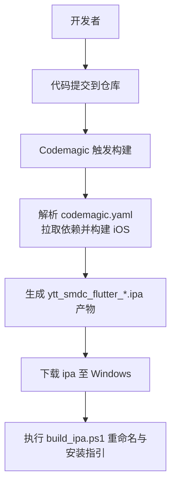
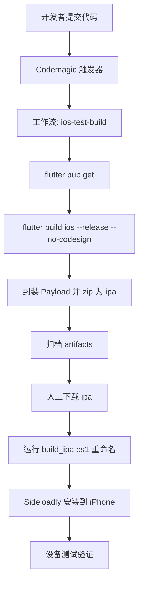
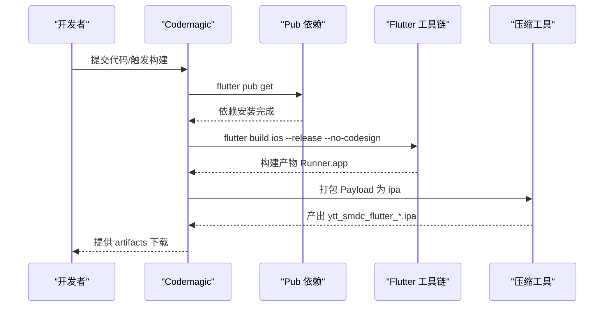
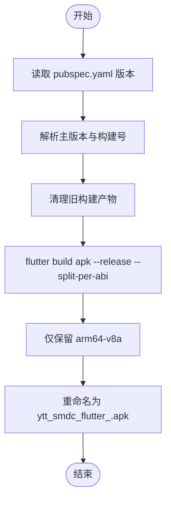
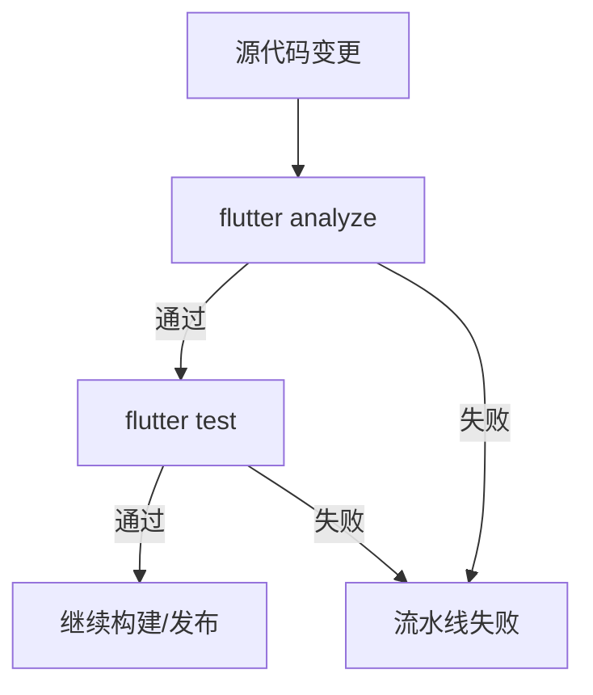
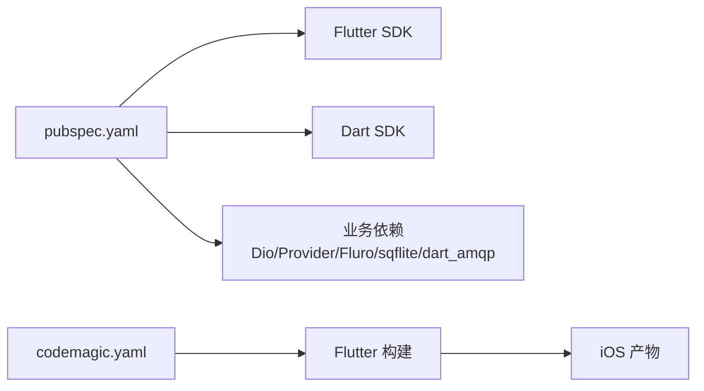

# CI/CD 流水线

<cite>
**本文引用的文件**   
- [codemagic.yaml](file://codemagic.yaml)
- [pubspec.yaml](file://pubspec.yaml)
- [build_apk.ps1](file://build_apk.ps1)
- [build_ipa.ps1](file://build_ipa.ps1)
- [analysis_options.yaml](file://analysis_options.yaml)
- [test/connection_mode_test.dart](file://test/connection_mode_test.dart)
- [README.md](file://README.md)
</cite>

## 目录
1. [引言](#引言)
2. [项目结构](#项目结构)
3. [核心组件](#核心组件)
4. [架构总览](#架构总览)
5. [详细组件分析](#详细组件分析)
6. [依赖关系分析](#依赖关系分析)
7. [性能与稳定性考虑](#性能与稳定性考虑)
8. [故障排除指南](#故障排除指南)
9. [结论](#结论)
10. [附录：流水线清单与检查项](#附录流水线清单与检查项)

## 引言
本文件为聚客美滋滋 Flutter 点餐应用（flutter_deer）的持续集成与持续交付流水线文档。项目当前已具备基于 Codemagic 的 iOS 无签名构建工作流，以及本地 PowerShell 辅助脚本用于 APK/IPA 重命名与安装指引；静态代码检查规则通过 analysis_options.yaml 定义，单元测试位于 test 目录。本文在现有基础上，给出完整的流水线设计、环境变量与密钥管理建议、自动化发布流程方案、GitHub Actions 集成思路、监控告警与故障排除方法，帮助团队从“可构建”演进到“可观测、可回滚、可灰度”的成熟 CI/CD。

## 项目结构
仓库根目录包含以下与 CI/CD 直接相关的配置和脚本：
- codemagic.yaml：Codemagic 工作流定义，负责 Flutter 版本选择、依赖安装、iOS Release 构建与 ipa 产物归档。
- pubspec.yaml：Flutter/Dart 版本约束、依赖声明与应用版本信息。
- build_apk.ps1：Windows 下 Android APK 构建与按 ABI 拆分、按版本号重命名的脚本。
- build_ipa.ps1：Windows 下对云端产出的 .ipa 进行重命名，并提供 Sideloadly 安装步骤说明。
- analysis_options.yaml：Dart 静态分析与 Lint 规则集合。
- test/connection_mode_test.dart：连接模式相关单元测试示例。
- README.md：技术栈、快速开始与模块注册方式说明。

图示来源
- [codemagic.yaml:1-34](file://codemagic.yaml#L1-L34)
- [build_ipa.ps1:1-69](file://build_ipa.ps1#L1-L69)

章节来源
- [README.md:1-50](file://README.md#L1-L50)
- [codemagic.yaml:1-34](file://codemagic.yaml#L1-L34)

## 核心组件
- Codemagic 工作流
  - 使用稳定版 Flutter 与默认 CocoaPods。
  - 执行 flutter pub get 安装依赖。
  - 执行 flutter build ios --release --no-codesign 输出未签名的 iOS Release 包。
  - 将 Runner.app 打包为 Payload，并以 pubspec.yaml 中的 version 字段作为 ipa 文件名后缀。
  - 将 ytt_smdc_flutter_*.ipa 标记为 artifacts，供下载。
- 本地构建脚本
  - build_apk.ps1：解析 pubspec.yaml 的版本号，清理旧产物，执行 flutter build apk --release --split-per-abi，仅保留 arm64-v8a，并重命名为 ytt_smdc_flutter_<version>.apk。
  - build_ipa.ps1：查找最新 .ipa，按版本号重命名为 ytt_smdc_flutter_<version>.ipa，并输出 Sideloadly 安装步骤。
- 静态分析
  - analysis_options.yaml 启用严格语言特性与大量 Lint 规则，排除部分自动生成或历史目录。
- 单元测试
  - test 目录下存在连接模式相关测试用例，覆盖连接策略、网络探测、参数注入等场景。

章节来源
- [codemagic.yaml:1-34](file://codemagic.yaml#L1-L34)
- [build_apk.ps1:1-53](file://build_apk.ps1#L1-L53)
- [build_ipa.ps1:1-69](file://build_ipa.ps1#L1-L69)
- [analysis_options.yaml:1-252](file://analysis_options.yaml#L1-L252)
- [test/connection_mode_test.dart:1-245](file://test/connection_mode_test.dart#L1-L245)

## 架构总览
下图展示“代码提交 → Codemagic 云构建 → 产物处理 → 测试机安装”的整体链路，以及与后续扩展（Android、GitHub Actions、发布平台）的关系。

图示来源
- [codemagic.yaml:1-34](file://codemagic.yaml#L1-L34)
- [build_ipa.ps1:1-69](file://build_ipa.ps1#L1-L69)

## 详细组件分析

### Codemagic 工作流分析
当前工作流名为 ios-test-build，主要职责如下：
- 环境
  - flutter: stable
  - cocoapods: default
- 脚本
  - 安装依赖：flutter pub get
  - 构建 iOS Release：flutter build ios --release --no-codesign
  - 封装 ipa：创建 Payload 目录，拷贝 Runner.app，读取 pubspec.yaml 中 version 字段，zip 为 ytt_smdc_flutter_*.ipa
- 产物
  - artifacts: ytt_smdc_flutter_*.ipa

该工作流适用于个人免费额度下的自签测试包流程，配合 Windows 上的 Sideloadly 完成 7 天有效期的免费签名安装。

图示来源
- [codemagic.yaml:1-34](file://codemagic.yaml#L1-L34)

章节来源
- [codemagic.yaml:1-34](file://codemagic.yaml#L1-L34)

### 本地脚本与版本命名
- build_apk.ps1
  - 从 pubspec.yaml 解析 version 字段，兼容 “主版本+构建号” 格式，组合成完整版本号。
  - 清理 build\app\outputs\flutter-apk 下旧产物。
  - 执行 flutter build apk --release --split-per-abi，并通过 dart-define 注入 FULL_VERSION。
  - 仅保留 arm64-v8a，删除其他 ABI 的 APK 与 sha1，并重命名为 ytt_smdc_flutter_<fullVersion>.apk。
- build_ipa.ps1
  - 自动搜索当前目录、build\ios、系统 Downloads 中最新的 .ipa。
  - 以 pubspec.yaml 的 version 字段计算 fullVersion，重命名为 ytt_smdc_flutter_<fullVersion>.ipa。
  - 输出 Sideloadly 安装步骤说明。

图示来源
- [build_apk.ps1:1-53](file://build_apk.ps1#L1-L53)

章节来源
- [build_apk.ps1:1-53](file://build_apk.ps1#L1-L53)
- [build_ipa.ps1:1-69](file://build_ipa.ps1#L1-L69)

### 静态代码检查与测试
- 静态检查
  - analysis_options.yaml 启用了严格类型推断、强制返回类型、避免 print、空安全相关规则等，并排除了 lib/generated/json/** 等自动生成目录。
  - 建议在 CI 中增加 flutter analyze 或 dart analyze 命令，将 Lint 错误视为失败。
- 单元测试
  - test/connection_mode_test.dart 覆盖了连接管理器在不同模式下的行为，包括本地/云服务切换、主设备可达性判断、参数注入与 UI 交互等。
  - 建议在 CI 中增加 flutter test 或 flutter test integration_test 等命令，确保单元与集成测试可回归。

图示来源
- [analysis_options.yaml:1-252](file://analysis_options.yaml#L1-L252)
- [test/connection_mode_test.dart:1-245](file://test/connection_mode_test.dart#L1-L245)

章节来源
- [analysis_options.yaml:1-252](file://analysis_options.yaml#L1-L252)
- [test/connection_mode_test.dart:1-245](file://test/connection_mode_test.dart#L1-L245)

### 环境变量与密钥管理建议
尽管当前工作流未显式声明环境变量，但建议引入以下变量以支持多环境与安全存储：
- Flutter 与平台凭据
  - FLUTTER_VERSION：固定 Flutter SDK 版本，避免上游更新影响构建。
  - APPLE_DEVELOPER_EMAIL、APPLE_TEAM_ID：Apple 开发者账号与团队标识。
  - KEYCHAIN_NAME、KEYCHAIN_PASSWORD：macOS Keychain 名称与解锁密码。
  - SIGNING_CERTIFICATE_P12_BASE64、SIGNING_CERTIFICATE_PASSWORD：签名证书与密码。
  - PROVISIONING_PROFILE_BASE64：描述文件内容。
- 第三方服务
  - GOOGLE_SERVICES_JSON_BASE64 / FIREBASE_APP_ID：Google Services 与 Firebase 配置。
  - MAPBOX_TOKEN、AMAP_KEY、WECHAT_APP_ID：地图与支付相关密钥。
  - API_BASE_URL、MQ_HOST、MQ_PORT：后端地址与消息队列地址。
- 发布平台
  - APP_STORE_CONNECT_ISSUER_ID、API_KEY_ID、PRIVATE_KEY_BASE64：App Store Connect API 凭据。
  - PLAY_STORE_SERVICE_ACCOUNT_JSON_BASE64：Google Play Service Account。
  - FASTLANE_USER、FASTLANE_PASSWORD、FASTLANE_ITC_TEAM_ID：Fastlane 发布凭据。

这些变量应通过 Codemagic 的 Secrets 与 Environment Variables 页面加密存储，并在 workflow 的 environment 或 scripts 中以明文形式注入到构建环境中。不要在日志中打印敏感值。

章节来源
- [codemagic.yaml:1-34](file://codemagic.yaml#L1-L34)

### 自动化构建流程细化
建议将现有单一 iOS 工作流拆分为多个任务，形成清晰的阶段：
- 阶段一：准备
  - 拉取代码、缓存 Flutter SDK 与 pub 包。
  - 校验 Dart 版本与 Flutter 版本一致性。
- 阶段二：静态检查
  - flutter analyze
  - dart format --set-exit-if-changed（可选）
- 阶段三：测试
  - flutter test
  - flutter test integration_test（若补充集成测试）
- 阶段四：构建
  - Android：flutter build apk / appbundle
  - iOS：flutter build ios --release（签名或无签名，视目标而定）
- 阶段五：产物归档
  - 上传 APK/AAB、IPA、测试报告、分析结果。
- 阶段六：发布
  - 内测分发：蒲公英、fir.im、TestFlight。
  - 正式商店：App Store Connect、Google Play。

章节来源
- [pubspec.yaml:1-111](file://pubspec.yaml#L1-L111)

### 自动化发布流程
- 应用商店自动上传
  - iOS：通过 App Store Connect API 或 Fastlane upload_to_app_store 上传 IPA，或使用 Codemagic 内置的 App Store Connect 集成。
  - Android：通过 Google Play Internal Testing、Alpha、Beta、Production 轨道发布 AAB/APK。
- 版本管理
  - 使用 pubspec.yaml 的 version 字段作为应用版本。
  - 构建号可由 Git 提交数、CI 构建号或时间戳生成，例如 $BUILD_NUMBER。
- 更新日志生成
  - 根据 Git 提交信息与 PR 标题自动生成 changelog，写入应用内更新日志或商店描述。
- 灰度发布策略
  - iOS：TestFlight 分阶段放量（内部测试组 → 外部测试组 → 全量）。
  - Android：Play Store 分渠道或分百分比灰度（Internal → Alpha → Beta → Production）。
  - 服务端：结合开关与用户标签控制功能可见性与流量比例。

章节来源
- [pubspec.yaml:1-111](file://pubspec.yaml#L1-L111)

### GitHub Actions 或其他 CI 工具集成方案
虽然仓库尚未提供 GitHub Actions 工作流，但可以按如下方式接入：
- 代码质量检查
  - flutter analyze
  - dart format --check
  - 可选：lint-staged + pre-commit 钩子
- 安全扫描
  - 依赖漏洞扫描：dart pub audit、flutter pub audit。
  - 代码安全扫描：Semgrep、CodeQL、SonarQube。
- 性能测试
  - flutter drive 或集成测试框架（如 integration_test）采集帧率、内存、启动时间。
- 构建与发布
  - 在 macOS 上执行 flutter build ios，Android 在 Linux 上执行 flutter build apk/aab。
  - 上传产物到制品库或发布平台。

章节来源
- [analysis_options.yaml:1-252](file://analysis_options.yaml#L1-L252)

### 流水线监控与告警
- 构建状态通知
  - Codemagic：配置邮件、Slack、钉钉、企业微信等通知渠道。
  - GitHub Actions：通过 actions/notify 或自定义 Webhook 发送通知。
- 失败重试机制
  - 针对网络超时、依赖拉取失败等临时问题，配置最多重试次数与退避策略。
- 构建产物管理
  - 使用 Codemagic artifacts、GitHub Actions artifacts 或对象存储（S3、OSS）保存 APK/IPA 与测试报告。
  - 设置产物保留天数与清理策略，避免存储膨胀。

章节来源
- [codemagic.yaml:1-34](file://codemagic.yaml#L1-L34)

## 依赖关系分析
- 构建依赖
  - Flutter SDK 与 Dart SDK 版本由 pubspec.yaml 的 environment 字段约束。
  - iOS 构建依赖 CocoaPods，Codemagic 工作流中启用默认版本。
- 运行时依赖
  - 网络层 Dio、状态管理 Provider、路由 Fluro、数据库 sqflite、RabbitMQ dart_amqp 等均在 pubspec.yaml 中声明。
- 开发依赖
  - flutter_test、test 用于单元测试。

图示来源
- [pubspec.yaml:1-111](file://pubspec.yaml#L1-L111)
- [codemagic.yaml:1-34](file://codemagic.yaml#L1-L34)

章节来源
- [pubspec.yaml:1-111](file://pubspec.yaml#L1-L111)
- [codemagic.yaml:1-34](file://codemagic.yaml#L1-L34)

## 性能与稳定性考虑
- 依赖缓存
  - 缓存 ~/.pub-cache、~/.gradle、~/Library/Caches/CocoaPods，减少重复下载。
- Flutter 版本锁定
  - 固定 Flutter SDK 版本，避免上游不稳定更新导致构建失败。
- 并行化
  - 将静态检查、测试、构建、发布任务并行执行，缩短流水线时长。
- 增量构建
  - 仅在变更模块运行测试与分析，降低整体耗时。
- 资源优化
  - 剥离无用图片与字体，按需加载资源，减小包体体积。

[本节为通用指导，不直接分析具体文件]

## 故障排除指南
- 云端构建失败
  - 现象：Codemagic 构建中断或报错。
  - 排查：确认 Flutter 版本与 pubspec.yaml 匹配；检查 CocoaPods 依赖是否成功安装；查看构建日志中的错误堆栈。
  - 解决：升级或固定 Flutter 版本；清理 Pods 后重新安装；必要时在本地复现。
- 网络超时
  - 现象：pub get、pod install 或下载依赖时超时。
  - 排查：检查代理与镜像源配置；确认网络连通性。
  - 解决：配置国内镜像；添加重试逻辑；使用缓存减少下载。
- 权限配置错误
  - 现象：iOS 签名失败、App Store Connect 上传失败。
  - 排查：确认 Apple Developer 账号、Team ID、证书、描述文件与 API Key 正确；检查 Keychain 解锁与权限。
  - 解决：在 Codemagic 中正确配置 Secrets；使用 Fastlane 简化签名与发布流程。
- 版本命名不一致
  - 现象：本地与云端产出的 APK/IPA 名称不同。
  - 排查：检查 pubspec.yaml 的 version 字段与脚本解析逻辑。
  - 解决：统一版本号生成规则；确保脚本与 CI 使用同一套命名策略。

章节来源
- [codemagic.yaml:1-34](file://codemagic.yaml#L1-L34)
- [build_apk.ps1:1-53](file://build_apk.ps1#L1-L53)
- [build_ipa.ps1:1-69](file://build_ipa.ps1#L1-L69)
- [pubspec.yaml:1-111](file://pubspec.yaml#L1-L111)

## 结论
当前项目已通过 codemagic.yaml 实现稳定的 iOS 无签名构建与 ipa 产物归档，并辅以本地 PowerShell 脚本完成重命名与安装指引。在此基础上，建议逐步完善静态检查、单元测试、Android 构建、自动化发布与监控告警能力，形成端到端的 CI/CD 流水线。通过环境变量与密钥管理、版本与更新日志规范、灰度发布策略，最终达到可观测、可回滚、可规模化的持续交付目标。

[本节为总结性内容，不直接分析具体文件]

## 附录：流水线清单与检查项
- 代码质量
  - [ ] flutter analyze 通过
  - [ ] dart format --check 通过（可选）
- 测试
  - [ ] flutter test 全部通过
  - [ ] 集成测试可用（待补充）
- 构建
  - [ ] Android：flutter build apk/aab 成功
  - [ ] iOS：flutter build ios 成功（签名或无签名）
- 产物
  - [ ] APK/AAB、IPA、测试报告、分析结果归档
- 发布
  - [ ] TestFlight 内测通过
  - [ ] Google Play 内部测试通过
  - [ ] App Store Connect 预发布通过
- 监控与告警
  - [ ] 构建成功/失败通知已配置
  - [ ] 失败重试与超时保护已启用
  - [ ] 产物保留策略已设定

[本节为通用清单，不直接分析具体文件]