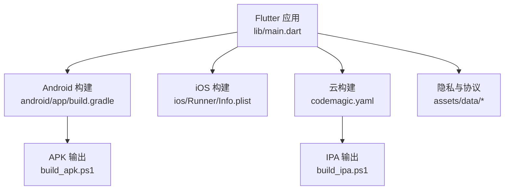
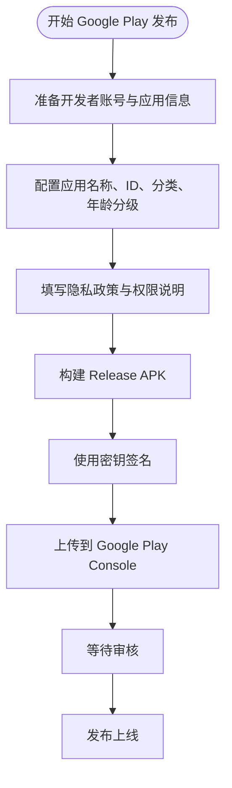
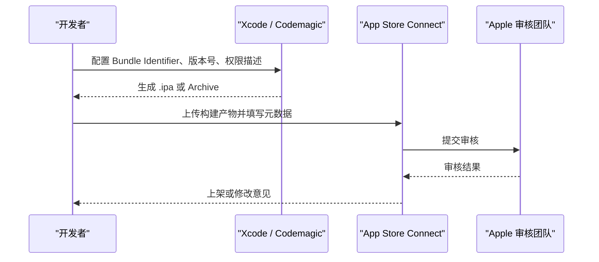
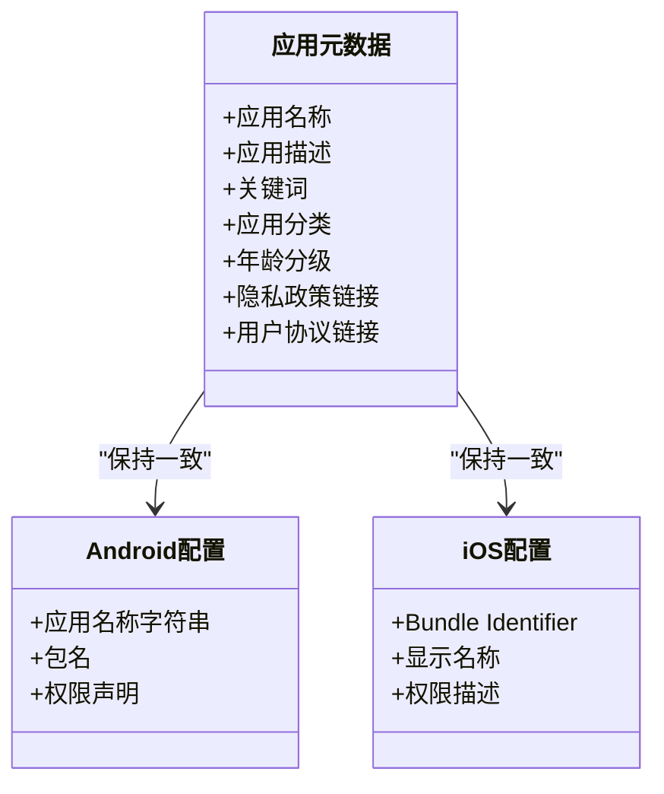
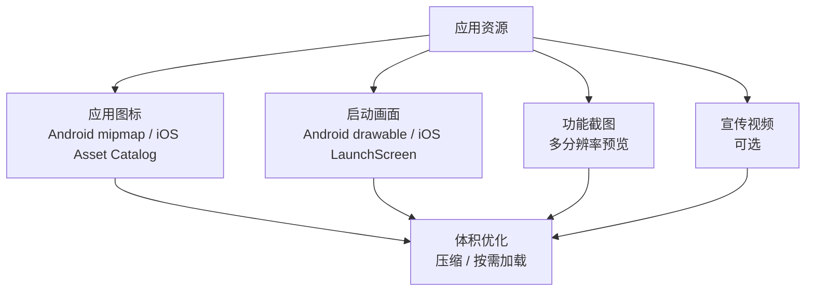
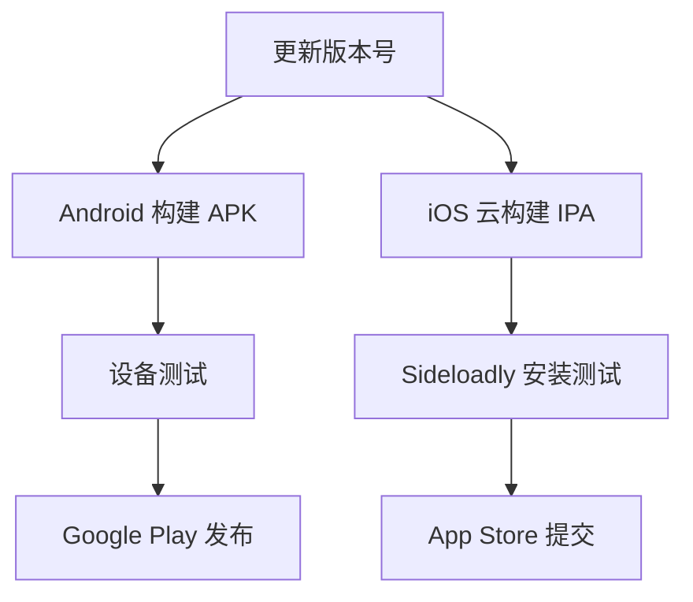
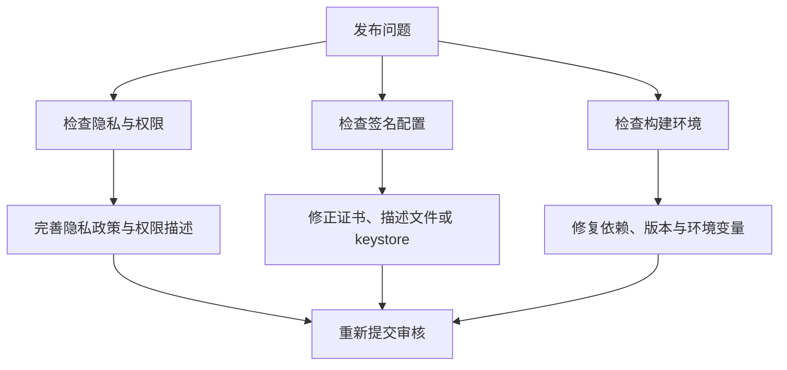

# 应用商店发布

<cite>
**本文引用的文件**   
- [README.md](file://README.md)
- [pubspec.yaml](file://pubspec.yaml)
- [android/app/build.gradle](file://android/app/build.gradle)
- [android/app/src/main/AndroidManifest.xml](file://android/app/src/main/AndroidManifest.xml)
- [ios/Runner/Info.plist](file://ios/Runner/Info.plist)
- [assets/data/privacy_policy.html](file://assets/data/privacy_policy.html)
- [assets/data/user_agreement.html](file://assets/data/user_agreement.html)
- [build_apk.ps1](file://build_apk.ps1)
- [build_ipa.ps1](file://build_ipa.ps1)
- [codemagic.yaml](file://codemagic.yaml)
</cite>

## 目录
1. [简介](#简介)
2. [项目结构与发布相关基础](#项目结构与发布相关基础)
3. [Google Play Store 提交流程](#google-play-store-提交流程)
4. [Apple App Store 提交流程](#apple-app-store-提交流程)
5. [应用元数据管理](#应用元数据管理)
6. [资源文件准备规范](#资源文件准备规范)
7. [审核注意事项](#审核注意事项)
8. [发布后维护指南](#发布后维护指南)
9. [常见发布问题与解决方案](#常见发布问题与解决方案)
10. [结论](#结论)

## 简介
本指南面向“聚客美滋滋”点餐应用的商店发布工作，覆盖 Google Play Store 与 Apple App Store 的账号准备、元数据配置、素材准备、隐私与权限合规、签名与打包流程、版本更新与发布后维护，以及常见问题排查。该项目为 Flutter 点餐应用，当前包名为 `com.bycloud.smdc`，应用名称在 Android 侧定义为“聚客美滋滋”，iOS 显示名也为“聚客美滋滋”。

## 项目结构与发布相关基础
- 技术栈：Flutter 3.19+、Dart 3.4+，状态管理使用 Provider，网络层基于 Dio，路由使用 Fluro，本地存储使用 sp_util。
- 入口与模块：应用入口位于 `lib/main.dart`；页面按业务划分，如首页、登录、订单等。
- 构建产物：
  - Android 通过 Gradle 构建 APK，启用代码混淆、资源压缩与 ZipAlign。
  - iOS 可通过 Codemagic 云构建生成不带签名的 `.ipa`，再由本地脚本重命名并引导安装测试。
- 关键配置位置：
  - Android 包名、应用名、最小系统版本、目标系统版本、签名配置位于 Gradle 与清单文件中。
  - iOS Bundle Identifier、显示名称、版本号、权限描述、网络策略位于 Info.plist。
  - 应用内隐私政策与用户协议以 HTML 形式放在 `assets/data` 中，由 Flutter 资源加载。

**图表来源**
- [README.md:1-50](file://README.md#L1-L50)
- [pubspec.yaml:1-111](file://pubspec.yaml#L1-L111)
- [android/app/build.gradle:1-85](file://android/app/build.gradle#L1-L85)
- [ios/Runner/Info.plist:1-76](file://ios/Runner/Info.plist#L1-L76)
- [build_apk.ps1:1-53](file://build_apk.ps1#L1-L53)
- [build_ipa.ps1:1-69](file://build_ipa.ps1#L1-L69)
- [codemagic.yaml:1-34](file://codemagic.yaml#L1-L34)

**章节来源**
- [README.md:1-50](file://README.md#L1-L50)
- [pubspec.yaml:1-111](file://pubspec.yaml#L1-L111)

## Google Play Store 提交流程
本节从开发者账号、应用信息、素材、隐私与权限、签名与发布五个方面说明。

### 一、开发者账号注册与准备
- 注册 Google Play Console 开发者账号，完成身份与企业信息认证。
- 创建新应用，填写应用基本信息，包括应用名称、简短描述、完整描述、分类、年龄分级、隐私政策链接等。
- 建议先提交内部测试或封闭测试，验证安装包、权限声明与隐私政策是否满足平台要求。

### 二、应用元数据配置
- 应用名称：与 Android 清单中的字符串值保持一致，当前值为“聚客美滋滋”。
- 应用 ID：应与应用包名一致，即 `com.bycloud.smdc`。
- 应用图标与截图：
  - 上传高质量应用图标（推荐 512×512 PNG）。
  - 准备功能截图与宣传视频，至少包含手机竖屏截图，建议覆盖主流分辨率。
- 分类与年龄分级：
  - 选择合适的应用类别，例如“商业”或“餐饮”相关分类。
  - 根据内容填写年龄分级问卷，确保无不当内容。

### 三、隐私政策与权限说明
- 应用必须提供可访问的隐私政策链接，建议使用项目内已准备好的隐私政策网页作为托管地址。
- Android 清单中声明的权限需与实际功能匹配：
  - 网络访问权限用于连接服务端接口。
  - 录音权限用于语音识别或语音播报等场景。
  - 安装相关权限用于安装或更新能力。
- 在 Google Play 隐私部分填写数据采集类型、用途及第三方共享情况，确保与运行时行为一致。

### 四、构建与签名
- Android 构建使用 Gradle，Release 构建启用代码混淆、资源压缩和 ZipAlign。
- 签名配置依赖外部 keystore 属性文件，包含密钥别名、密码、密钥库路径等信息。
- 建议使用自动化脚本生成带版本号的 APK，便于归档与发布记录。

**图表来源**
- [android/app/build.gradle:1-85](file://android/app/build.gradle#L1-L85)
- [android/app/src/main/AndroidManifest.xml:1-89](file://android/app/src/main/AndroidManifest.xml#L1-L89)
- [build_apk.ps1:1-53](file://build_apk.ps1#L1-L53)

**章节来源**
- [android/app/build.gradle:1-85](file://android/app/build.gradle#L1-L85)
- [android/app/src/main/AndroidManifest.xml:1-89](file://android/app/src/main/AndroidManifest.xml#L1-L89)
- [build_apk.ps1:1-53](file://build_apk.ps1#L1-L53)

## Apple App Store 提交流程
本节涵盖 Apple Developer 账号、App Store Connect、素材规格、隐私声明、签名与上架。

### 一、Apple Developer 账号与 App Store Connect
- 注册 Apple Developer 账号并完成付费订阅。
- 在 App Store Connect 中创建应用，设置 Bundle Identifier、显示名称、主要语言、价格与销售范围。
- 配置应用版本信息，确保与 Xcode 工程、Codemagic 构建产物一致。

### 二、应用元数据与隐私声明
- 应用名称与显示名称应与 iOS 工程配置一致，当前为“聚客美滋滋”。
- Bundle Identifier 应与 App Store Connect 中注册的 ID 一致。
- 隐私声明需要在 App Store Connect 中填写数据采集类型、用途及第三方 SDK 使用情况，同时应用需提供可访问的隐私政策链接。
- 若涉及加密功能，需在 App Store Connect 中声明加密出口合规情况；当前工程未启用非豁免加密。

### 三、应用图标与截图规格
- 应用图标：
  - 需要上传 1024×1024 PNG 图标。
  - 建议在 Xcode Asset Catalog 中为不同设备尺寸生成对应图标资源。
- 功能截图：
  - iPhone 与 iPad 分别上传对应尺寸的截图。
  - 截图应展示核心功能，避免纯启动页或空白界面。
- 宣传视频：可选上传 App Store 宣传视频，提升转化效果。

### 四、权限与隐私
- iOS 权限描述位于 Info.plist，当前包含相机、定位、相册、麦克风等使用说明。
- 若实际未使用某项权限，应从清单中移除，避免被拒。
- App Transport Security 允许任意 HTTP 明文请求，仅适用于局域网调试；上架前建议收紧为更安全的配置。

**图表来源**
- [ios/Runner/Info.plist:1-76](file://ios/Runner/Info.plist#L1-L76)
- [codemagic.yaml:1-34](file://codemagic.yaml#L1-L34)
- [build_ipa.ps1:1-69](file://build_ipa.ps1#L1-L69)

**章节来源**
- [ios/Runner/Info.plist:1-76](file://ios/Runner/Info.plist#L1-L76)
- [codemagic.yaml:1-34](file://codemagic.yaml#L1-L34)
- [build_ipa.ps1:1-69](file://build_ipa.ps1#L1-L69)

## 应用元数据管理
应用元数据是应用商店展示的核心信息，应统一维护并在多端保持一致。

### 一、应用名称与标识
- Android 应用名称由字符串资源定义，值为“聚客美滋滋”。
- iOS 应用名称与显示名称均配置在 Info.plist 中，值为“聚客美滋滋”。
- Android 包名与 iOS Bundle Identifier 应在各自平台保持一致的业务语义，当前 Android 包名为 `com.bycloud.smdc`。

### 二、描述与关键词
- 应用短描述与完整描述应突出点餐核心功能，如桌台管理、扫码点餐、订单结算、会员优惠券等。
- 关键词应围绕“点餐、餐厅、收银、桌台、外卖、促销、优惠券”等业务词组织。
- 避免堆砌无关关键词，以免被商店算法判定为低质量。

### 三、分类与年龄分级
- Android 与 iOS 均需选择最贴近业务的分类。
- 年龄分级应根据应用内容如实填写，本项目不涉及成人或暴力内容，应选低年龄分级。

### 四、隐私政策与用户协议
- 应用内已准备隐私政策与用户协议 HTML 文件，可在应用设置或关于页面打开。
- 商店隐私政策链接应指向可公开访问的地址，并确保内容与应用行为一致。

**图表来源**
- [pubspec.yaml:1-111](file://pubspec.yaml#L1-L111)
- [android/app/build.gradle:1-85](file://android/app/build.gradle#L1-L85)
- [android/app/src/main/AndroidManifest.xml:1-89](file://android/app/src/main/AndroidManifest.xml#L1-L89)
- [ios/Runner/Info.plist:1-76](file://ios/Runner/Info.plist#L1-L76)
- [assets/data/privacy_policy.html:1-142](file://assets/data/privacy_policy.html#L1-L142)
- [assets/data/user_agreement.html:1-131](file://assets/data/user_agreement.html#L1-L131)

**章节来源**
- [pubspec.yaml:1-111](file://pubspec.yaml#L1-L111)
- [android/app/build.gradle:1-85](file://android/app/build.gradle#L1-L85)
- [android/app/src/main/AndroidManifest.xml:1-89](file://android/app/src/main/AndroidManifest.xml#L1-L89)
- [ios/Runner/Info.plist:1-76](file://ios/Runner/Info.plist#L1-L76)
- [assets/data/privacy_policy.html:1-142](file://assets/data/privacy_policy.html#L1-L142)
- [assets/data/user_agreement.html:1-131](file://assets/data/user_agreement.html#L1-L131)

## 资源文件准备规范
### 一、应用图标
- Android：
  - 在 mipmap 各密度目录准备图标资源，确保在不同设备上清晰显示。
  - 保持图标简洁，符合品牌主色调。
- iOS：
  - 在 Asset Catalog 中配置 AppIcon，确保 1024×1024 源图能正确生成各尺寸图标。
  - 注意圆角适配与留白规范。

### 二、启动画面
- Android：
  - 启动背景与主题样式位于 drawable 与 values 资源中。
  - 应避免长时间白屏，合理设置启动动画或占位内容。
- iOS：
  - 启动画面使用 LaunchScreen.storyboard，确保首帧快速呈现。
  - 避免展示过多静态图片，减少冷启动时间。

### 三、功能截图与宣传视频
- 截图应覆盖应用核心流程，如登录、点餐、订单确认、支付、会员操作等。
- 截图文案应聚焦用户价值，避免纯技术术语。
- 宣传视频建议时长 15~30 秒，重点展示核心功能与使用场景。

### 四、资源管理与体积控制
- Android 构建启用资源压缩、代码混淆与 ZipAlign，有助于减小安装包体积。
- Flutter assets 中只保留必要图片与字体，避免冗余资源。
- 对大体积媒体资源考虑远程加载或按需下载。

**图表来源**
- [android/app/src/main/res/drawable/launch_background.xml](file://android/app/src/main/res/drawable/launch_background.xml)
- [android/app/src/main/res/values/styles.xml](file://android/app/src/main/res/values/styles.xml)
- [ios/Runner/Base.lproj/LaunchScreen.storyboard](file://ios/Runner/Base.lproj/LaunchScreen.storyboard)
- [ios/Runner/Assets.xcassets/AppIcon.appiconset/Contents.json](file://ios/Runner/Assets.xcassets/AppIcon.appiconset/Contents.json)
- [pubspec.yaml:80-111](file://pubspec.yaml#L80-L111)

**章节来源**
- [pubspec.yaml:80-111](file://pubspec.yaml#L80-L111)
- [android/app/build.gradle:1-85](file://android/app/build.gradle#L1-L85)
- [ios/Runner/Assets.xcassets/AppIcon.appiconset/Contents.json](file://ios/Runner/Assets.xcassets/AppIcon.appiconset/Contents.json)

## 审核注意事项
### 一、隐私权限使用
- Android 清单中声明的权限必须与实际功能匹配：
  - 网络权限用于服务端通信。
  - 录音权限用于语音识别或语音播报。
  - 安装相关权限用于安装或更新能力。
- iOS 权限描述必须真实准确，避免空描述或与实际不匹配的提示语。

### 二、内容审核标准
- 应用不得包含违规内容，包括但不限于色情、暴力、赌博、违法信息等。
- 用户协议与隐私政策应明确用户权利、责任与数据处理规则。
- 应用内外链跳转应合法合规，避免跳转到不可控或高风险网站。

### 三、技术审核要求
- Android：
  - 目标系统版本与最小系统版本需符合平台最新要求。
  - 关闭调试开关，禁用调试日志泄露敏感信息。
  - 确保网络配置安全，避免在生产环境开放不安全传输。
- iOS：
  - 检查 ATS 配置，生产环境不应随意放行所有 HTTP 明文请求。
  - 确保架构、Bitcode 或现代构建参数符合 App Store 要求。
  - 避免使用私有 API 或未授权第三方框架。

### 四、常见问题规避
- 不要为申请权限而声明不必要权限。
- 不要在应用内直接展示开发环境地址或密钥。
- 不要在截图或描述中使用虚假承诺或夸大功能。
- 不要在隐私政策中遗漏数据采集类型、第三方 SDK 共享情况。

**章节来源**
- [android/app/src/main/AndroidManifest.xml:1-89](file://android/app/src/main/AndroidManifest.xml#L1-L89)
- [ios/Runner/Info.plist:1-76](file://ios/Runner/Info.plist#L1-L76)
- [assets/data/privacy_policy.html:1-142](file://assets/data/privacy_policy.html#L1-L142)
- [assets/data/user_agreement.html:1-131](file://assets/data/user_agreement.html#L1-L131)

## 发布后维护指南
### 一、版本更新流程
- 更新 pubspec.yaml 中的版本号，格式为 `主版本.次版本.修订号+构建号`。
- Android：
  - 使用 Gradle 读取版本号并生成 Release APK。
  - 使用脚本自动清理旧产物、拆分架构并输出带版本名的 APK。
- iOS：
  - 通过 Codemagic 云构建生成不带签名的 IPA。
  - 使用本地脚本重命名并按指引安装测试。

**图表来源**
- [pubspec.yaml:1-111](file://pubspec.yaml#L1-L111)
- [build_apk.ps1:1-53](file://build_apk.ps1#L1-L53)
- [codemagic.yaml:1-34](file://codemagic.yaml#L1-L34)
- [build_ipa.ps1:1-69](file://build_ipa.ps1#L1-L69)

**章节来源**
- [pubspec.yaml:1-111](file://pubspec.yaml#L1-L111)
- [build_apk.ps1:1-53](file://build_apk.ps1#L1-L53)
- [codemagic.yaml:1-34](file://codemagic.yaml#L1-L34)
- [build_ipa.ps1:1-69](file://build_ipa.ps1#L1-L69)

### 二、用户反馈处理
- 建立用户反馈渠道，如应用内联系方式、客服邮箱或工单系统。
- 将高频问题整理为知识库，定期更新帮助文档。
- 对于严重问题，优先回滚或热修复，再安排稳定版本发布。

### 三、崩溃报告分析
- 接入崩溃上报工具，收集崩溃堆栈、设备型号、系统版本与应用版本。
- 对重复崩溃进行优先级排序，结合日志复现问题根因。
- 在下一个版本中修复关键崩溃，并在更新说明中告知用户。

### 四、性能监控优化
- 监控启动时间、页面渲染耗时、网络请求成功率与延迟。
- 针对大图、长列表、复杂计算进行优化，减少卡顿与内存占用。
- 定期清理无用日志与缓存，避免磁盘空间不足导致体验下降。

## 常见发布问题与解决方案
### 一、审核被拒
- 原因可能包括：
  - 隐私政策缺失或不完整。
  - 权限声明与实际功能不符。
  - 截图或描述存在误导。
  - 使用受限第三方 SDK 或未声明加密功能。
- 解决方式：
  - 完善隐私政策与用户协议。
  - 调整权限声明，删除不必要的权限。
  - 修正截图与描述，确保真实反映应用功能。
  - 补充加密出口合规声明或移除相关功能。

### 二、签名错误
- Android：
  - 检查 keystore 路径、别名、密码是否正确。
  - 确保 debug 与 release 签名一致，避免升级失败。
  - 检查 ProGuard 规则是否误删必要类。
- iOS：
  - 检查证书与描述文件是否有效。
  - 检查 Bundle Identifier 是否与 App Store Connect 一致。
  - 使用 Codemagic 时注意签名模式与 Sideloadly 自签流程。

### 三、权限配置问题
- Android：
  - 检查 AndroidManifest.xml 中权限声明是否多余。
  - 检查 network_security_config 是否过于宽松。
- iOS：
  - 检查 Info.plist 中权限描述是否准确。
  - 检查 ATS 配置是否在生产环境仍允许任意 HTTP 明文请求。

### 四、构建失败
- Android：
  - 检查 Gradle 插件、Java 版本、NDK 版本是否匹配。
  - 检查 local.properties 与 key.properties 是否存在且可读。
- iOS：
  - 检查 CocoaPods 依赖是否安装成功。
  - 检查 Codemagic 环境变量与 Flutter 版本是否稳定。

**图表来源**
- [android/app/build.gradle:1-85](file://android/app/build.gradle#L1-L85)
- [android/app/src/main/AndroidManifest.xml:1-89](file://android/app/src/main/AndroidManifest.xml#L1-L89)
- [ios/Runner/Info.plist:1-76](file://ios/Runner/Info.plist#L1-L76)
- [codemagic.yaml:1-34](file://codemagic.yaml#L1-L34)

**章节来源**
- [android/app/build.gradle:1-85](file://android/app/build.gradle#L1-L85)
- [android/app/src/main/AndroidManifest.xml:1-89](file://android/app/src/main/AndroidManifest.xml#L1-L89)
- [ios/Runner/Info.plist:1-76](file://ios/Runner/Info.plist#L1-L76)
- [codemagic.yaml:1-34](file://codemagic.yaml#L1-L34)

## 结论
“聚客美滋滋”应用商店发布需要跨平台协作：Android 侧关注包名、权限、签名与构建优化；iOS 侧关注 Bundle Identifier、权限描述、ATS 与签名流程。无论哪个平台，都应保证应用元数据真实、隐私政策完整、权限声明合理、素材规范、版本可控。发布后持续收集用户反馈、分析崩溃与性能数据，并通过小步快跑的方式迭代优化，才能稳定提升用户体验与商店评分。