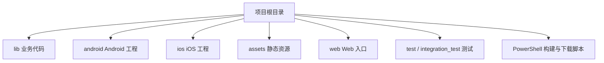
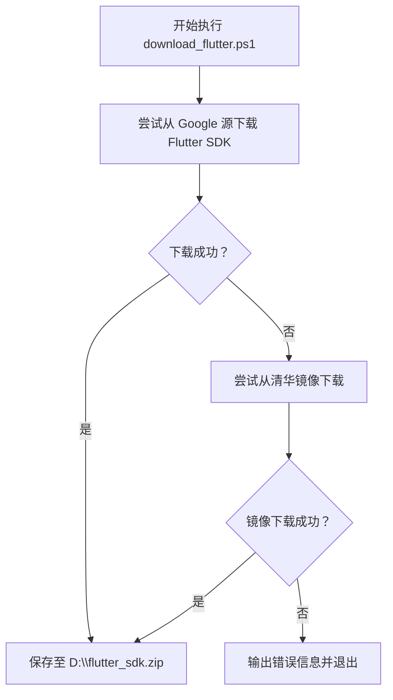
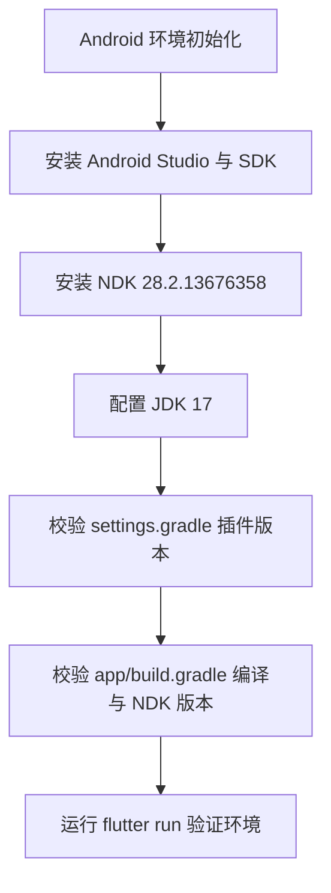
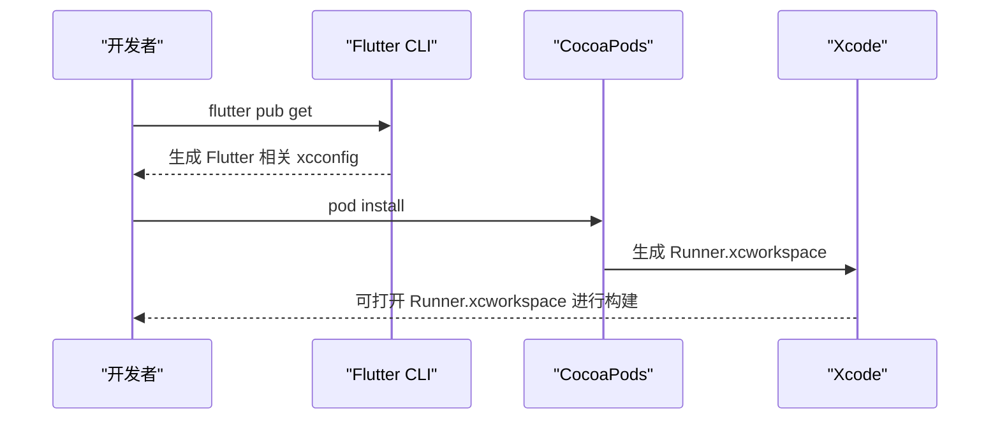
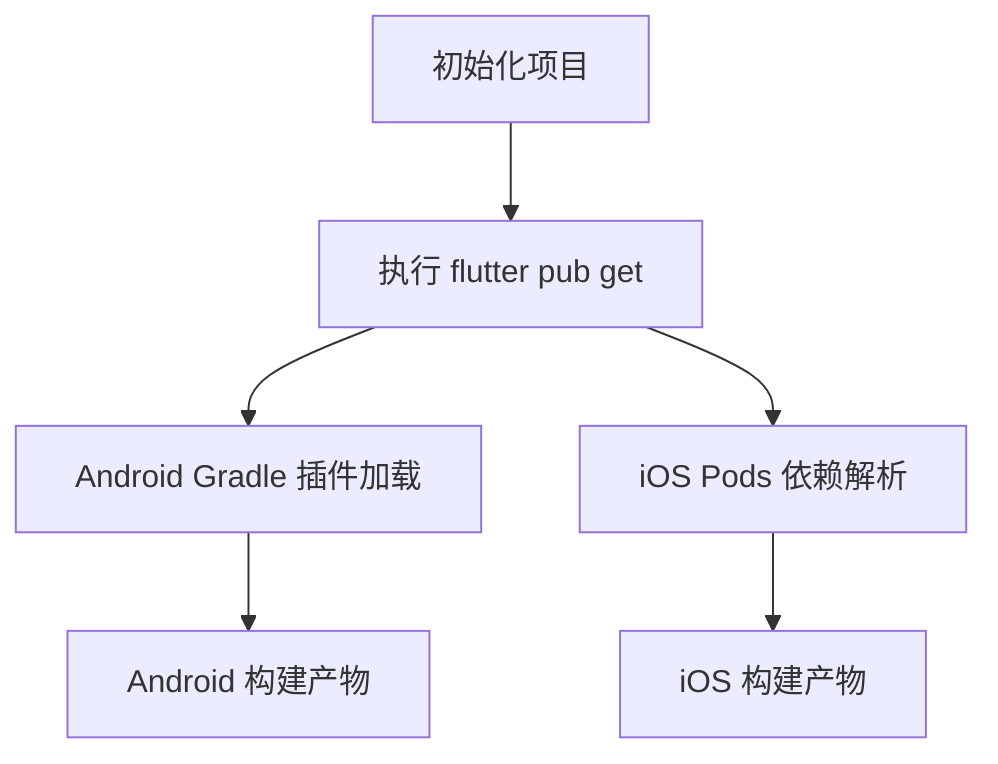
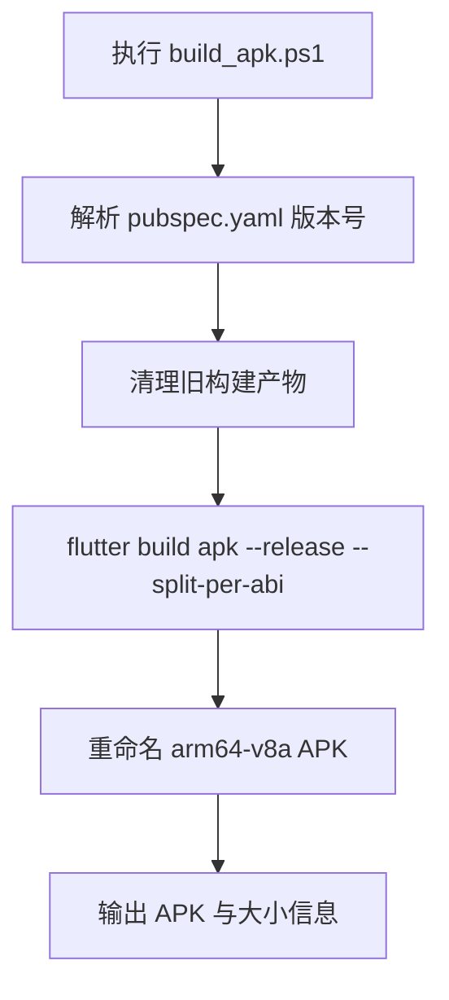
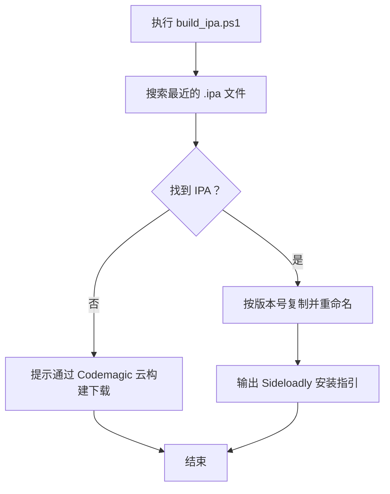
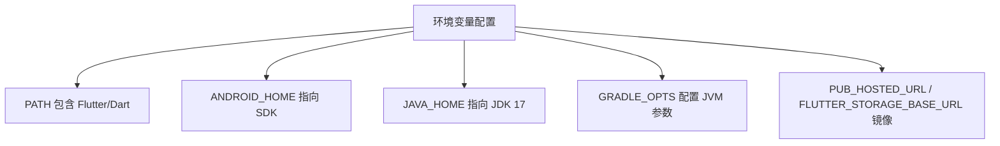

# 开发环境搭建

<cite>
**本文引用的文件**   
- [pubspec.yaml](file://pubspec.yaml)
- [README.md](file://README.md)
- [lib/main.dart](file://lib/main.dart)
- [android/gradle.properties](file://android/gradle.properties)
- [android/build.gradle](file://android/build.gradle)
- [android/app/build.gradle](file://android/app/build.gradle)
- [android/settings.gradle](file://android/settings.gradle)
- [android/app/src/main/AndroidManifest.xml](file://android/app/src/main/AndroidManifest.xml)
- [ios/Podfile](file://ios/Podfile)
- [ios/Runner/Info.plist](file://ios/Runner/Info.plist)
- [download_flutter.ps1](file://download_flutter.ps1)
- [build_apk.ps1](file://build_apk.ps1)
- [build_ipa.ps1](file://build_ipa.ps1)
- [docs/Android问题汇总.md](file://docs/Android问题汇总.md)
- [docs/iOS问题汇总.md](file://docs/iOS问题汇总.md)
</cite>

## 目录
1. [简介](#简介)
2. [项目结构概览](#项目结构概览)
3. [环境与版本要求](#环境与版本要求)
4. [Flutter 与 Dart 安装](#flutter-与-dart-安装)
5. [Android 开发环境配置](#android-开发环境配置)
6. [iOS 开发环境配置](#ios-开发环境配置)
7. [项目依赖安装与初始化](#项目依赖安装与初始化)
8. [关键配置文件说明](#关键配置文件说明)
9. [构建与调试流程](#构建与调试流程)
10. [常见环境问题与解决方案](#常见环境问题与解决方案)
11. [环境变量与环境优化建议](#环境变量与环境优化建议)
12. [结论](#结论)

## 简介
本指南面向“聚客美滋滋”点餐应用（Flutter 项目）的开发人员，目标是帮助你在 Windows、macOS、Linux 上快速完成本地开发环境搭建。文档会覆盖 Flutter SDK 与 Dart 版本要求、Android 和 iOS 平台环境配置、项目依赖安装、关键配置文件含义与修改方式，以及常见问题排查和环境优化建议。

该项目是一个基于 Flutter 的点餐应用，技术栈包含 Provider 状态管理、Dio 网络库、Fluro 路由、sqflite 本地数据库等；Android 端使用 Android Gradle 8.x、Java 17、NDK 指定版本；iOS 端最低部署目标为 iOS 15.5，并通过 CocoaPods 管理第三方依赖。

**章节来源**
- [README.md:1-50](file://README.md#L1-L50)
- [pubspec.yaml:1-20](file://pubspec.yaml#L1-L20)

## 项目结构概览
项目采用 Flutter 标准多端结构：
- `lib/`：业务代码，包括页面、网络层、工具类、MVP 基类、资源定义等。
- `android/`：Android 原生工程，包含 Gradle 配置、清单文件、签名配置、权限声明等。
- `ios/`：iOS 原生工程，包含 Xcode Runner、Podfile、Info.plist、启动页 Storyboard 等。
- `assets/`：图片、HTML、字体等资源。
- `web/`：Web 入口及图标。
- `integration_test/`、`test/`：集成测试与单元测试。
- 根目录脚本：Windows PowerShell 脚本用于下载 Flutter、构建 APK、处理云构建 IPA。

**图表来源**
- [README.md:20-50](file://README.md#L20-L50)
- [lib/main.dart:1-159](file://lib/main.dart#L1-L159)

**章节来源**
- [README.md:20-50](file://README.md#L20-L50)

## 环境与版本要求
本项目对开发环境的最低版本要求如下：
- Flutter SDK：≥ 3.19.0
- Dart SDK：≥ 3.4.0 且 < 4.0.0
- Android：
  - Android Studio 与 Android SDK
  - NDK：28.2.13676358
  - Java：17
  - Android Gradle Plugin：8.12.3（由 settings.gradle 统一管理）
  - Kotlin Gradle Plugin：2.2.20（由 settings.gradle 统一管理）
- iOS：
  - Xcode（建议使用较新版本以支持 iOS 15.5+）
  - CocoaPods
  - 最低部署目标：iOS 15.5

这些版本约束在项目文件中明确体现：
- pubspec.yaml 中声明 Flutter 与 Dart 的兼容范围。
- android/app/build.gradle 中声明 compileSdkVersion、targetSdkVersion、ndkVersion、Java 版本。
- android/settings.gradle 中声明 Android Gradle Plugin 与 Kotlin Gradle Plugin 版本。
- ios/Podfile 中声明最低 iOS 平台版本为 15.5。

**章节来源**
- [pubspec.yaml:1-10](file://pubspec.yaml#L1-L10)
- [android/app/build.gradle:1-40](file://android/app/build.gradle#L1-L40)
- [android/settings.gradle:1-27](file://android/settings.gradle#L1-L27)
- [ios/Podfile:1-20](file://ios/Podfile#L1-L20)

## Flutter 与 Dart 安装
### 推荐安装方式
- 通过官方渠道或国内镜像获取 Flutter SDK。
- 将 Flutter 的 bin 目录加入系统 PATH，使 flutter、dart 命令可用。
- 运行 flutter doctor 检查各平台组件是否安装完整。

### Windows 特定建议
项目提供了下载 Flutter SDK 的 PowerShell 脚本，默认从 Google 源下载稳定版 Flutter，失败时自动切换清华镜像源，便于在国内网络环境下获取安装包。

**图表来源**
- [download_flutter.ps1:1-17](file://download_flutter.ps1#L1-L17)

**章节来源**
- [download_flutter.ps1:1-17](file://download_flutter.ps1#L1-L17)

## Android 开发环境配置
### 必需组件
- Android Studio：用于编辑 Android 工程、查看日志、连接设备或模拟器。
- Android SDK：至少包含 targetSdkVersion 对应的 API Level。
- NDK：固定为 28.2.13676358。
- JDK：Java 17。
- Android Gradle Plugin：8.12.3。
- Kotlin Gradle Plugin：2.2.20。

### 安装步骤要点
1. 安装 Android Studio，并在 SDK Manager 中安装 Android SDK、SDK Tools 中的 NDK。
2. 确认 NDK 版本为 28.2.13676358。
3. 配置 JDK 17，确保 gradle.properties 中的 org.gradle.java.home 指向正确的 Java 17 路径。
4. 验证 flutter doctor 中 Android 环境是否就绪。

### 项目中 Android 环境的关键配置
- app/build.gradle 中设置 compileSdkVersion、targetSdkVersion、minSdkVersion、ndkVersion、Java 17 编译目标。
- settings.gradle 中统一 Android Gradle Plugin 8.12.3 与 Kotlin Gradle Plugin 2.2.20。
- gradle.properties 中开启并行构建、JVM 参数、缓存、禁用内置 Kotlin，避免与插件 Kotlin 元数据不兼容。

**图表来源**
- [android/app/build.gradle:1-40](file://android/app/build.gradle#L1-L40)
- [android/settings.gradle:1-27](file://android/settings.gradle#L1-L27)
- [android/gradle.properties:1-27](file://android/gradle.properties#L1-L27)

**章节来源**
- [android/app/build.gradle:1-40](file://android/app/build.gradle#L1-L40)
- [android/settings.gradle:1-27](file://android/settings.gradle#L1-L27)
- [android/gradle.properties:1-27](file://android/gradle.properties#L1-L27)

## iOS 开发环境配置
### 必需组件
- Xcode：建议使用较新版本以支持 iOS 15.5+ 构建。
- CocoaPods：用于安装 iOS 第三方依赖。
- 命令行工具：xcode-select --install。

### 安装步骤要点
1. 安装 Xcode，并通过 App Store 或命令行安装 Command Line Tools。
2. 安装 CocoaPods。
3. 在 ios/Podfile 中已声明最低部署目标为 iOS 15.5，并启用 use_frameworks! :linkage => :static。
4. 首次运行需先执行 flutter pub get，再执行 pod install，否则会提示 Generated.xcconfig 不存在。

**图表来源**
- [ios/Podfile:1-30](file://ios/Podfile#L1-L30)

**章节来源**
- [ios/Podfile:1-30](file://ios/Podfile#L1-L30)

## 项目依赖安装与初始化
### Flutter 依赖
在根目录执行以下命令：
- flutter pub get：解析 pubspec.yaml 并安装所有 Flutter/Dart 依赖。
- flutter run：选择设备后启动应用。

### Android 依赖
- Android Gradle 插件与 Kotlin 插件版本由 settings.gradle 统一管理。
- 仓库镜像地址已在 android/build.gradle 中配置阿里云 Maven 仓库，有助于提升依赖下载速度。
- 如需调整 Gradle 行为，可在 gradle.properties 中修改 JVM 参数、缓存开关、并行构建等。

### iOS 依赖
- 首次需在项目根目录执行 flutter pub get，生成 Flutter 所需的 xcconfig 文件。
- 然后进入 ios 目录执行 pod install，CocoaPods 会根据 Podfile 安装依赖。
- Podfile 中已关闭 CocoaPods 统计上报以减少构建延迟，并将最低部署目标设置为 15.5。

**图表来源**
- [pubspec.yaml:1-20](file://pubspec.yaml#L1-L20)
- [android/build.gradle:1-23](file://android/build.gradle#L1-L23)
- [ios/Podfile:1-30](file://ios/Podfile#L1-L30)

**章节来源**
- [pubspec.yaml:1-20](file://pubspec.yaml#L1-L20)
- [android/build.gradle:1-23](file://android/build.gradle#L1-L23)
- [ios/Podfile:1-30](file://ios/Podfile#L1-L30)

## 关键配置文件说明
### local.properties
作用：
- 指定 flutter.sdk 路径，settings.gradle 会读取该属性定位 Flutter SDK。
- 提供 flutter.versionCode 与 flutter.versionName，app/build.gradle 据此设置 Android 应用的版本号。

修改方法：
- 若手动管理 Flutter SDK，请确保 flutter.sdk 指向正确的 Flutter 安装目录。
- 根据需要设置 flutter.versionCode 与 flutter.versionName。

注意：
- 如果 settings.gradle 找不到 flutter.sdk，构建时会抛出断言错误。

**章节来源**
- [android/settings.gradle:1-15](file://android/settings.gradle#L1-L15)
- [android/app/build.gradle:1-25](file://android/app/build.gradle#L1-L25)

### key.properties
作用：
- 存储 Android 发布签名的 keyAlias、keyPassword、storeFile、storePassword。
- app/build.gradle 在 signingConfigs.release 中使用该文件进行签名配置。

修改方法：
- 在项目根目录创建 app/key.properties，填入签名信息。
- 注意不要将密钥提交到公开仓库，应在 .gitignore 中排除。

**章节来源**
- [android/app/build.gradle:15-40](file://android/app/build.gradle#L15-L40)

### AndroidManifest.xml
作用：
- 声明应用权限：安装未知来源包、网络访问、录音。
- 声明 application 与 MainActivity，配置主题、方向、软键盘行为等。
- 配置高德地图 API Key、Provider 文件路径、刘海屏与全面屏适配。
- 配置 networkSecurityConfig，用于网络请求安全策略。

修改方法：
- 添加或修改权限时使用 uses-permission。
- 更换高德地图 API Key 时修改对应 meta-data。
- 根据业务需要调整 queries 中的 intent-filter。

**章节来源**
- [android/app/src/main/AndroidManifest.xml:1-89](file://android/app/src/main/AndroidManifest.xml#L1-L89)

### Info.plist
作用：
- 配置应用名称、显示名称、Bundle Identifier、语言、最小帧率、界面方向等。
- 声明相机、相册、麦克风、定位等隐私权限描述。
- 配置 NSAppTransportSecurity，允许 HTTP 明文请求（局域网调试场景）。

修改方法：
- 修改 CFBundleName、CFBundleDisplayName 更改应用名称。
- 修改权限描述文案，确保符合平台审核要求。
- 上架前谨慎调整 NSAllowsArbitraryLoads，建议收紧为仅允许本地网络。

**章节来源**
- [ios/Runner/Info.plist:1-76](file://ios/Runner/Info.plist#L1-L76)

## 构建与调试流程
### Android 构建
推荐使用项目提供的 PowerShell 脚本 build_apk.ps1，它会自动：
- 从 pubspec.yaml 解析版本号。
- 清理旧构建产物。
- 执行 flutter build apk --release --split-per-abi。
- 重命名为 ytt_smdc_flutter_版本号.apk。

**图表来源**
- [build_apk.ps1:1-53](file://build_apk.ps1#L1-L53)

**章节来源**
- [build_apk.ps1:1-53](file://build_apk.ps1#L1-L53)

### iOS 构建与测试
项目提供 build_ipa.ps1，用于在 Windows 环境下对云构建产出的 IPA 进行重命名与安装指引：
- 自动查找最近生成的 IPA 文件。
- 按版本号重命名为 ytt_smdc_flutter_版本号.ipa。
- 给出 Sideloadly 安装步骤，无需 Mac 本机构建。

**图表来源**
- [build_ipa.ps1:1-69](file://build_ipa.ps1#L1-L69)

**章节来源**
- [build_ipa.ps1:1-69](file://build_ipa.ps1#L1-L69)

## 常见环境问题与解决方案
### Android 网络依赖无法解析
现象：
- Could not resolve io.flutter:flutter_embedding_xxx。

解决：
- 在 android/build.gradle 的 repositories 中添加 Flutter 的 Maven 仓库地址。
- 或在 flutter/packages/flutter_tools/gradle 下修改 flutter.gradle 中的 MAVEN_REPO。

参考：
- 项目 docs/Android问题汇总.md 中有具体说明。

**章节来源**
- [docs/Android问题汇总.md:1-30](file://docs/Android问题汇总.md#L1-L30)

### iOS CocoaPods CDN 更新失败
现象：
- CDN: trunk Repo update failed 或 URL couldn't be downloaded。

解决：
- 在 Podfile 中显式添加 source 为 GitHub Specs 或国内镜像。
- 移除默认的 trunk 源。
- 必要时修改 hosts 文件以解析 raw.githubusercontent.com。

参考：
- 项目 docs/iOS问题汇总.md 中有具体说明。

**章节来源**
- [docs/iOS问题汇总.md:1-30](file://docs/iOS问题汇总.md#L1-L30)

### Flutter 依赖下载缓慢或失败
解决：
- 使用国内镜像下载 Flutter SDK（项目提供 PowerShell 脚本）。
- 配置 Flutter 与 Dart 的镜像源（如 dart 的 PUB_HOSTED_URL 与 FLUTTER_STORAGE_BASE_URL）。
- 在网络受限环境中优先使用稳定版 Flutter SDK。

**章节来源**
- [download_flutter.ps1:1-17](file://download_flutter.ps1#L1-L17)

### Android Gradle 构建内存不足或速度慢
解决：
- 调整 gradle.properties 中的 org.gradle.jvmargs 增大堆内存。
- 开启 org.gradle.parallel、org.gradle.caching 提升并行与缓存效率。
- 保持 Kotlin 版本与插件一致，避免元数据不兼容。

**章节来源**
- [android/gradle.properties:1-27](file://android/gradle.properties#L1-L27)

### iOS 最低部署目标不匹配
现象：
- 第三方插件要求最低 iOS 版本高于当前配置。

解决：
- 在 Podfile 中将 platform :ios 设置为 15.5，并确保 post_install 中统一 IPHONEOS_DEPLOYMENT_TARGET。

**章节来源**
- [ios/Podfile:1-20](file://ios/Podfile#L1-L20)

## 环境变量与环境优化建议
### 建议配置的环境变量
- PATH：包含 Flutter 与 Dart 的 bin 目录，使 flutter、dart 命令全局可用。
- ANDROID_HOME：指向 Android SDK 根目录。
- JAVA_HOME：指向 Java 17 安装目录。
- GRADLE_OPTS：按需设置 JVM 参数，例如 -Xmx3072m 以避免 Gradle 构建内存不足。
- PUB_HOSTED_URL 与 FLUTTER_STORAGE_BASE_URL：配置 Dart 与 Flutter 的国内镜像源，提升依赖下载速度。

### 项目内环境优化
- android/gradle.properties：
  - 开启 org.gradle.parallel=true、org.gradle.caching=true。
  - 设置 org.gradle.jvmargs 增大堆内存。
  - 禁用内置 Kotlin，统一使用 settings.gradle 中的 Kotlin 2.2.20。
- ios/Podfile：
  - 关闭 CocoaPods 统计上报以减少构建延迟。
  - 使用 use_frameworks! :linkage => :static 提升框架链接稳定性。

**图表来源**
- [android/gradle.properties:1-27](file://android/gradle.properties#L1-L27)
- [ios/Podfile:1-20](file://ios/Podfile#L1-L20)

**章节来源**
- [android/gradle.properties:1-27](file://android/gradle.properties#L1-L27)
- [ios/Podfile:1-20](file://ios/Podfile#L1-L20)

## 结论
完成上述环境准备后，你可以：
- 在 Windows、macOS、Linux 上正确安装 Flutter SDK 与 Dart SDK。
- 配置 Android 与 iOS 开发环境，满足项目的 NDK、Java、Xcode、CocoaPods 要求。
- 通过 flutter pub get 安装依赖，并根据平台执行相应的构建命令。
- 理解并修改 local.properties、key.properties、AndroidManifest.xml、Info.plist 等关键配置文件。
- 遇到网络、权限、版本不兼容等问题时，参考常见问题与解决方案章节进行排查。
- 通过环境变量与项目内配置优化构建性能与稳定性。

最终，你可以在本地启动“聚客美滋滋”应用并进行开发与调试，同时借助项目提供的 PowerShell 脚本完成 APK 构建与 IPA 测试辅助工作。