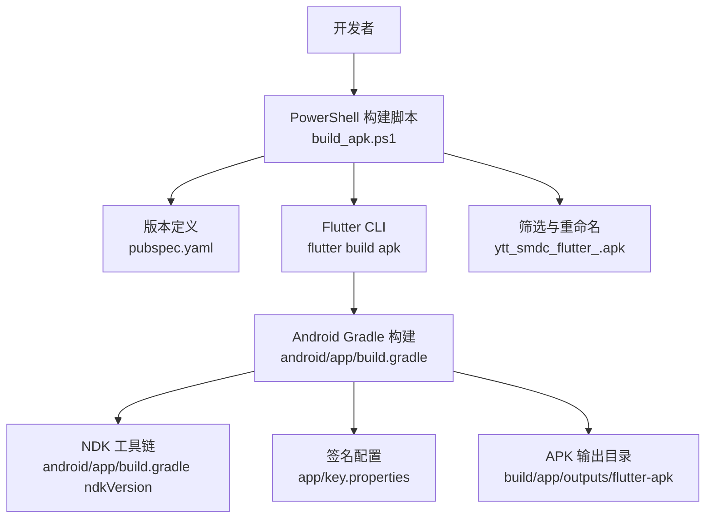
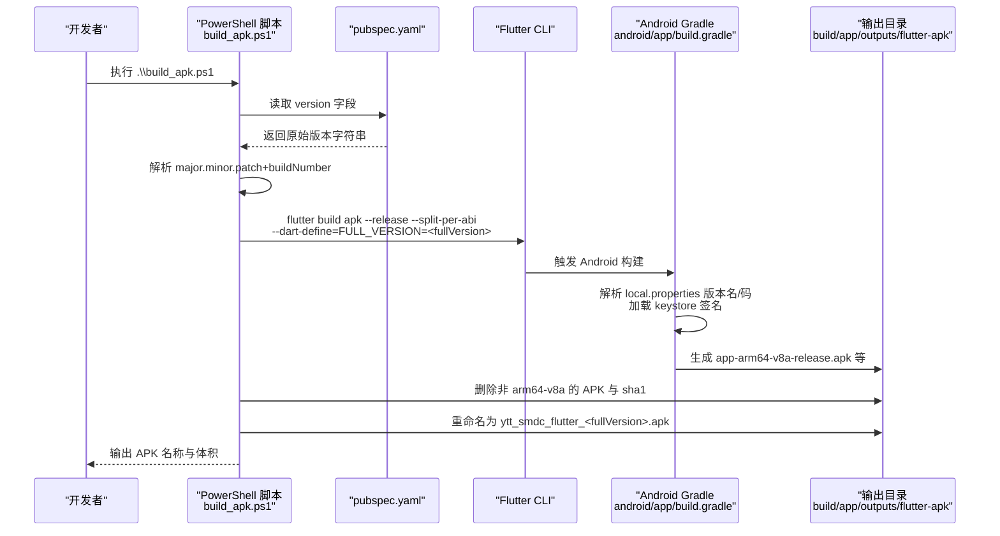
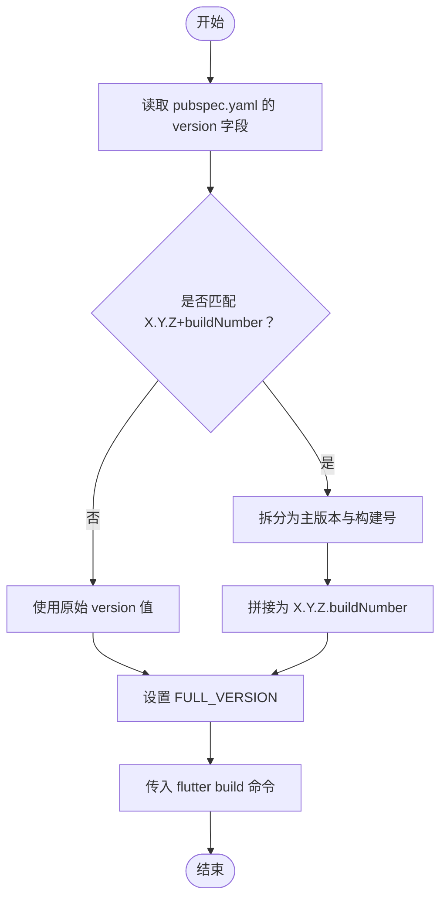
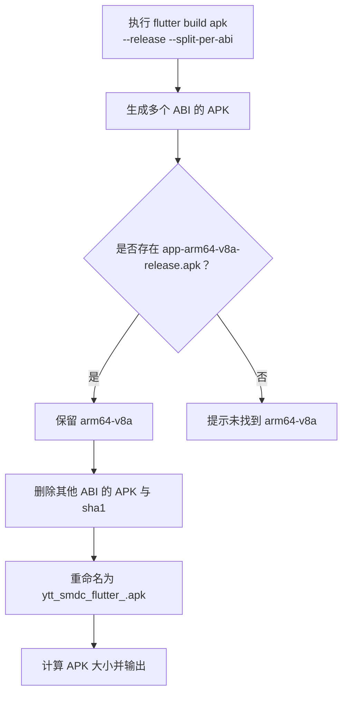
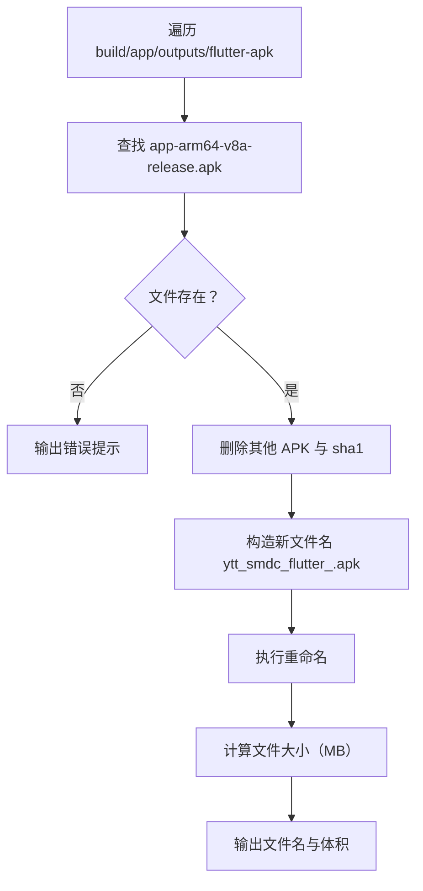
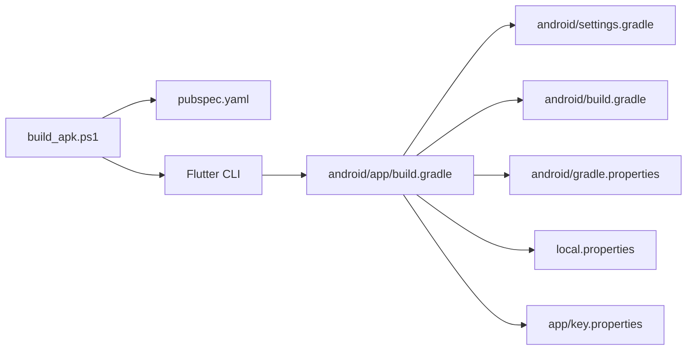

# APK 构建流程

<cite>
**本文引用的文件**   
- [build_apk.ps1](file://build_apk.ps1)
- [pubspec.yaml](file://pubspec.yaml)
- [android/app/build.gradle](file://android/app/build.gradle)
- [android/build.gradle](file://android/build.gradle)
- [android/gradle.properties](file://android/gradle.properties)
- [android/settings.gradle](file://android/settings.gradle)
</cite>

## 目录
1. [简介](#简介)
2. [项目结构与构建入口](#项目结构与构建入口)
3. [核心组件与职责](#核心组件与职责)
4. [架构总览](#架构总览)
5. [详细构建流程分析](#详细构建流程分析)
6. [依赖关系分析](#依赖关系分析)
7. [性能与优化建议](#性能与优化建议)
8. [常见构建错误排查](#常见构建错误排查)
9. [结论](#结论)

## 简介
本指南面向聚客美滋滋 Flutter Android 应用的 APK 发布构建。重点围绕 `build_apk.ps1` 脚本，说明版本号解析、`dart-define` 注入、多架构拆分与筛选、输出重命名和体积统计等完整流程，并补充 Android Gradle 配置、Flutter 构建命令以及环境要求、常见问题和优化建议，帮助开发者稳定复现可发布的 arm64-v8a APK。

## 项目结构与构建入口
仓库根目录包含 Flutter 工程结构，Android 相关配置位于 `android/` 子目录；APK 构建入口是根目录下的 PowerShell 脚本 `build_apk.ps1`。该脚本负责：
- 从 `pubspec.yaml` 解析应用版本。
- 清理旧 APK 产物。
- 执行 Flutter 构建命令，生成按架构拆分的 APK。
- 仅保留 `arm64-v8a` 包并重新命名。
- 输出最终 APK 文件名和大小。

**图表来源** 
- [build_apk.ps1:1-53](file://build_apk.ps1#L1-L53)
- [pubspec.yaml:1-10](file://pubspec.yaml#L1-L10)
- [android/app/build.gradle:1-85](file://android/app/build.gradle#L1-L85)

**章节来源**
- [build_apk.ps1:1-53](file://build_apk.ps1#L1-L53)
- [pubspec.yaml:1-10](file://pubspec.yaml#L1-L10)
- [android/app/build.gradle:1-85](file://android/app/build.gradle#L1-L85)

## 核心组件与职责
- **构建脚本**：`build_apk.ps1` 负责版本解析、清理旧产物、调用 Flutter 构建、筛选 `arm64-v8a`、重命名输出、打印体积信息。
- **版本定义**：`pubspec.yaml` 的 `version` 字段使用 `major.minor.patch+buildNumber` 形式（例如 `1.0.0+1`）。
- **Android 应用模块**：`android/app/build.gradle` 定义编译 SDK、NDK 版本、签名、混淆、资源压缩等。
- **Gradle 全局配置**：`android/build.gradle` 配置 Maven 仓库、构建目录、清理任务等。
- **Gradle 运行参数**：`android/gradle.properties` 配置 JVM 内存、并行、缓存、Java 路径、Kotlin 增量编译开关等。
- **插件管理**：`android/settings.gradle` 声明 Flutter Gradle 插件、Android Gradle Plugin、Kotlin Gradle Plugin 版本及 Kotlin 编译器对齐策略。

**章节来源**
- [build_apk.ps1:1-53](file://build_apk.ps1#L1-L53)
- [pubspec.yaml:1-10](file://pubspec.yaml#L1-L10)
- [android/app/build.gradle:1-85](file://android/app/build.gradle#L1-L85)
- [android/build.gradle:1-23](file://android/build.gradle#L1-L23)
- [android/gradle.properties:1-27](file://android/gradle.properties#L1-L27)
- [android/settings.gradle:1-27](file://android/settings.gradle#L1-L27)

## 架构总览
下图展示从脚本到最终 APK 输出的端到端流程，包括版本号解析、Flutter 构建、Gradle 编译与签名、输出筛选与重命名。

**图表来源**
- [build_apk.ps1:1-53](file://build_apk.ps1#L1-L53)
- [android/app/build.gradle:1-85](file://android/app/build.gradle#L1-L85)

## 详细构建流程分析

### 版本号解析与 FULL_VERSION 注入
- **输入来源**：`pubspec.yaml` 中的 `version` 字段采用 `X.Y.Z+buildNumber` 格式。
- **解析规则**：脚本通过正则匹配将 `+` 前的主版本号和 `+` 后的构建号拼接为 `X.Y.Z.buildNumber` 形式的 `fullVersion`。若未匹配成功，则直接使用原始值；若无法读取 `pubspec.yaml`，则回退为 `unknown`。
- **注入机制**：在 Flutter 构建命令中通过 `--dart-define=FULL_VERSION=$fullVersion` 将完整版本号以 Dart 定义的形式注入到构建环境中。该变量可在运行时通过 `package_info_plus` 或自定义逻辑获取，但本脚本本身只负责注入。

**图表来源**
- [build_apk.ps1:6-23](file://build_apk.ps1#L6-L23)
- [pubspec.yaml:1-5](file://pubspec.yaml#L1-L5)

**章节来源**
- [build_apk.ps1:6-23](file://build_apk.ps1#L6-L23)
- [pubspec.yaml:1-5](file://pubspec.yaml#L1-L5)

### 清理旧构建产物
脚本在执行 Flutter 构建前会清理 `build/app/outputs/flutter-apk` 目录下已有的 `.apk` 与 `.sha1` 文件，避免旧产物干扰本次构建结果。

**章节来源**
- [build_apk.ps1:25-32](file://build_apk.ps1#L25-L32)

### Flutter 构建命令与多架构 APK 生成原理
- **命令**：`flutter build apk --release --split-per-abi --dart-define=FULL_VERSION=$fullVersion`
- **参数含义**：
  - `--release`：启用发布模式，通常包含代码混淆和资源压缩。
  - `--split-per-abi`：按 ABI 拆分 APK，分别生成不同 CPU 架构的 APK 包。
  - `--dart-define`：向构建过程注入 Dart 定义键值对，供应用层访问。
- **多架构生成原理**：Flutter 根据目标设备支持的 ABI（如 `arm64-v8a`、`armeabi-v7a`、`x86_64`）分别打包 native 库，生成多个 APK。`--split-per-abi` 使每个 APK 只包含单一 ABI，有利于减小安装包体积。
- **arm64-v8a 优先策略**：脚本后续步骤仅保留 `app-arm64-v8a-release.apk`，删除其他 ABI 的 APK 和校验文件，从而确保最终输出为 `arm64-v8a` 包。

**图表来源**
- [build_apk.ps1:34-53](file://build_apk.ps1#L34-L53)

**章节来源**
- [build_apk.ps1:34-53](file://build_apk.ps1#L34-L53)

### 输出文件重命名与大小统计
- **筛选规则**：仅保留 `app-arm64-v8a-release.apk`，删除同目录下的其他 `app-*-release.apk` 与所有 `.sha1` 文件。
- **重命名规则**：将 `app-arm64-v8a-release.apk` 重命名为 `ytt_smdc_flutter_$fullVersion.apk`，其中 `$fullVersion` 为前面解析得到的完整版本号。
- **大小统计**：计算重命名后 APK 文件的字节数并转换为 MB，保留两位小数，打印输出文件名与体积。

**图表来源**
- [build_apk.ps1:38-53](file://build_apk.ps1#L38-L53)

**章节来源**
- [build_apk.ps1:38-53](file://build_apk.ps1#L38-L53)

### Android 应用模块与签名配置
- **编译与 NDK**：`compileSdkVersion` 设为 36，`ndkVersion` 固定为 `28.2.13676358`，用于保证构建一致性。
- **版本名与构建号**：`versionCode` 与 `versionName` 来自 `local.properties` 的 `flutter.versionCode` 与 `flutter.versionName`。注释明确说明 `versionName` 保持纯版本号，不拼接 `buildNumber`，以避免 `PackageInfo` 重复追加。
- **签名配置**：通过 `app/key.properties` 读取 `keyAlias`、`keyPassword`、`storeFile`、`storePassword`，并在 `debug` 与 `release` 构建类型中均启用 release 签名配置，便于本地调试发布包。
- **混淆与压缩**：Release 构建开启 `minifyEnabled`、`shrinkResources`、`zipAlignEnabled`，并使用 ProGuard 规则文件。

**章节来源**
- [android/app/build.gradle:1-85](file://android/app/build.gradle#L1-L85)

### Gradle 全局与运行参数
- **仓库源**：`android/build.gradle` 配置阿里云镜像、Google、Maven Central、JitPack 等仓库，提升依赖下载速度。
- **构建目录**：统一根构建目录与子项目构建目录，方便清理。
- **JVM 与并行**：`android/gradle.properties` 开启 Gradle 守护进程、按需配置、并行编译，并设置 JVM 堆内存、元空间、编码与 OOM 转储。
- **缓存**：启用 `org.gradle.caching=true`，加速重复构建。
- **Kotlin 编译器**：关闭内置 Kotlin，由 `settings.gradle` 统一使用 Kotlin Gradle Plugin 2.2.20，避免与插件依赖的 kotlin-stdlib 2.2.20 元数据不兼容。
- **Java 路径**：指定 JDK 17 路径，满足 compileOptions 要求的 Java 17 兼容性。
- **Kotlin 增量编译**：因跨盘符路径问题，关闭 Kotlin 增量编译以提升稳定性。

**章节来源**
- [android/build.gradle:1-23](file://android/build.gradle#L1-L23)
- [android/gradle.properties:1-27](file://android/gradle.properties#L1-L27)
- [android/settings.gradle:1-27](file://android/settings.gradle#L1-L27)

## 依赖关系分析
- **脚本依赖**：`build_apk.ps1` 依赖 `pubspec.yaml` 的版本字段、Flutter CLI、Android Gradle 构建系统。
- **Gradle 依赖**：`android/app/build.gradle` 依赖 Flutter Gradle 插件、Android Gradle Plugin、Kotlin Gradle Plugin；依赖 `local.properties` 提供版本信息与签名密钥。
- **外部工具链**：NDK、JDK、Flutter SDK、Gradle 缓存与远程仓库。

**图表来源**
- [build_apk.ps1:1-53](file://build_apk.ps1#L1-L53)
- [android/app/build.gradle:1-85](file://android/app/build.gradle#L1-L85)
- [android/settings.gradle:1-27](file://android/settings.gradle#L1-L27)
- [android/build.gradle:1-23](file://android/build.gradle#L1-L23)
- [android/gradle.properties:1-27](file://android/gradle.properties#L1-L27)

**章节来源**
- [build_apk.ps1:1-53](file://build_apk.ps1#L1-L53)
- [android/app/build.gradle:1-85](file://android/app/build.gradle#L1-L85)
- [android/settings.gradle:1-27](file://android/settings.gradle#L1-L27)
- [android/build.gradle:1-23](file://android/build.gradle#L1-L23)
- [android/gradle.properties:1-27](file://android/gradle.properties#L1-L27)

## 性能与优化建议
- **增量构建**：首次全量构建后，后续修改较少时可利用 Gradle 缓存与 Flutter 缓存减少编译时间。
- **并行编译**：已启用 `org.gradle.parallel=true`，在多核机器上可显著提升构建速度。
- **JVM 内存调优**：当前 `-Xmx3072m` 适合中等规模项目；若仍出现 OOM，可适当增大堆内存并检查元空间与 GC 参数。
- **仓库镜像**：已配置阿里云 Maven 镜像，建议保持网络连通以获得更稳定的依赖下载。
- **避免频繁清理**：仅在需要干净构建时执行清理任务；脚本已自动清理 APK 输出目录，无需额外删除整个 `build/`。
- **限制 ABI**：若仅需发布 arm64-v8a，可通过 Gradle 配置进一步限制 ABI，减少不必要 APK 生成；当前脚本已在构建后筛选，也可考虑在 Gradle 层提前裁剪。
- **ProGuard 规则**：保持现有混淆与资源压缩配置；如有第三方库特殊处理需求，及时更新 `proguard-rules.pro`。

[本节为通用优化建议，不直接分析具体文件]

## 常见构建错误排查

- **签名配置错误**
  - 现象：构建失败或安装时报签名无效。
  - 原因：`app/key.properties` 缺失或内容不正确；`keystoreFile`、`keyAlias`、`keyPassword`、`storePassword` 不匹配。
  - 解决：确认 `android/app/build.gradle` 中签名配置正确；确保 `app/key.properties` 存在且值有效；必要时重新生成 keystore 并更新配置。

  **章节来源**
  - [android/app/build.gradle:20-60](file://android/app/build.gradle#L20-L60)

- **NDK 版本不匹配**
  - 现象：构建报 NDK 版本缺失或不兼容。
  - 原因：`ndkVersion` 固定为 `28.2.13676358`，本地未安装对应版本。
  - 解决：通过 Android SDK Manager 安装指定 NDK 版本，或升级/降级 Flutter 与 Gradle 以匹配项目要求。

  **章节来源**
  - [android/app/build.gradle:14-20](file://android/app/build.gradle#L14-L20)

- **内存不足导致构建失败**
  - 现象：Gradle 构建过程中出现 OutOfMemoryError。
  - 原因：JVM 堆内存不足或元空间耗尽。
  - 解决：调整 `android/gradle.properties` 中的 `org.gradle.jvmargs`，适当增大 `-Xmx` 与 `MaxMetaspaceSize`；同时确保磁盘空间充足。

  **章节来源**
  - [android/gradle.properties:5-12](file://android/gradle.properties#L5-L12)

- **Kotlin 编译器元数据不兼容**
  - 现象：构建报 Kotlin stdlib 元数据读取失败。
  - 原因：内置 Kotlin 编译器版本过低，无法读取 kotlin-stdlib 2.2.20 元数据。
  - 解决：保持 `android.builtInKotlin=false`，并在 `settings.gradle` 中使用 Kotlin Gradle Plugin 2.2.20；不要手动覆盖为内置版本。

  **章节来源**
  - [android/gradle.properties:13-21](file://android/gradle.properties#L13-L21)
  - [android/settings.gradle:12-22](file://android/settings.gradle#L12-L22)

- **Flutter SDK 或环境变量未配置**
  - 现象：命令行找不到 `flutter` 命令或 `flutter doctor` 报错。
  - 解决：安装 Flutter SDK 并加入 PATH；执行 `flutter doctor` 检查 Android 工具链、JDK、SDK 平台等；确保 `local.properties` 中 `flutter.sdk` 指向正确路径。

  **章节来源**
  - [android/settings.gradle:1-10](file://android/settings.gradle#L1-L10)

- **Java 版本不匹配**
  - 现象：编译报 Java 版本不兼容。
  - 原因：`compileOptions` 要求 Java 17，而系统默认 JDK 版本较低。
  - 解决：安装 JDK 17，并通过 `org.gradle.java.home` 指定路径，或配置系统 JAVA_HOME。

  **章节来源**
  - [android/app/build.gradle:62-66](file://android/app/build.gradle#L62-L66)
  - [android/gradle.properties:22-27](file://android/gradle.properties#L22-L27)

- **版本号解析异常**
  - 现象：输出 APK 名为 `ytt_smdc_flutter_unknown.apk` 或版本号不符合预期。
  - 原因：`pubspec.yaml` 的 `version` 字段格式不正确或缺失。
  - 解决：确保 `version` 字段形如 `X.Y.Z+buildNumber`；如需自定义格式，需同步调整脚本解析逻辑。

  **章节来源**
  - [build_apk.ps1:6-23](file://build_apk.ps1#L6-L23)
  - [pubspec.yaml:1-5](file://pubspec.yaml#L1-L5)

## 结论
聚客美滋滋应用的 APK 构建流程以 `build_apk.ps1` 为核心入口，结合 `pubspec.yaml` 的版本定义与 Android Gradle 的配置，实现从版本解析、Flutter 构建、多架构 APK 生成到 arm64-v8a 筛选与重命名的完整链路。通过合理的 Gradle 缓存、并行编译、JVM 内存与 Kotlin 编译器配置，可以在保证一致性的前提下获得较快的构建体验。遇到签名、NDK、内存或 Kotlin 元数据等问题时，应优先对照上述配置文件进行排查与修正。