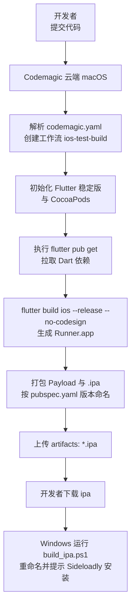
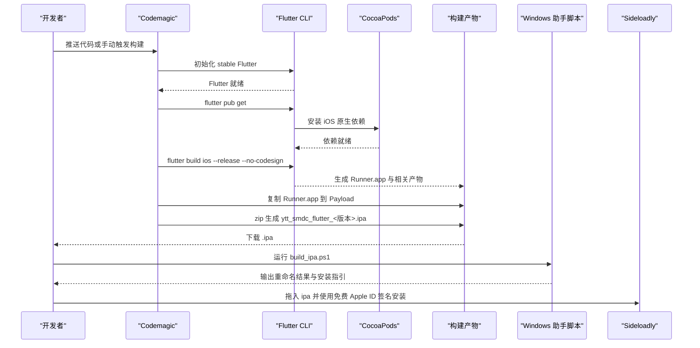
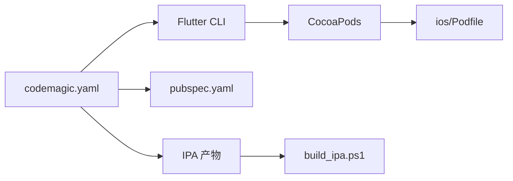

# Codemagic 云构建配置

<cite>
**本文引用的文件**   
- [codemagic.yaml](file://codemagic.yaml)
- [pubspec.yaml](file://pubspec.yaml)
- [ios/Podfile](file://ios/Podfile)
- [build_ipa.ps1](file://build_ipa.ps1)
</cite>

## 目录
1. [引言](#引言)
2. [项目结构](#项目结构)
3. [核心组件](#核心组件)
4. [架构总览](#架构总览)
5. [详细组件分析](#详细组件分析)
6. [依赖关系分析](#依赖关系分析)
7. [性能与缓存优化](#性能与缓存优化)
8. [常见问题排查](#常见问题排查)
9. [结论](#结论)
10. [附录：多环境构建示例](#附录多环境构建示例)

## 引言
本文件面向“聚客美滋滋”Flutter 点餐应用（iOS）在 Codemagic 云上的构建配置，围绕根目录的 `codemagic.yaml` 展开。该配置的目标是在没有本地 Mac 环境的条件下，通过云端 macOS 机器生成可用于 Sideloadly 自签安装的 `.ipa` 测试包。它不依赖 Apple Developer 账号签名，也不使用 Xcode Cloud；而是采用“免签名构建 + 客户端重签名安装”的方式，适合个人开发者或小型团队快速验证 iOS 端功能。

文档将解释触发条件、运行环境、依赖安装、构建脚本、产物处理逻辑，并给出证书与描述文件在 CI/CD 中的最佳实践、不同环境（开发、测试、生产）的配置思路、常见错误排查以及性能优化建议。

## 项目结构
Codemagic 云构建主要涉及以下文件与职责：
- `codemagic.yaml`：定义工作流、环境变量、脚本步骤和构建产物。
- `pubspec.yaml`：声明 Flutter/Dart 依赖与应用版本，构建脚本会读取版本号用于 IPA 命名。
- `ios/Podfile`：声明 iOS 平台最低版本、CocoaPods 行为与额外构建设置。
- `build_ipa.ps1`：Windows 辅助脚本，用于查找、重命名并提示如何把云构建产出的 `.ipa` 安装到 iPhone。

图表来源
- [codemagic.yaml:1-34](file://codemagic.yaml#L1-L34)
- [pubspec.yaml:1-10](file://pubspec.yaml#L1-L10)
- [build_ipa.ps1:1-69](file://build_ipa.ps1#L1-L69)

章节来源
- [codemagic.yaml:1-34](file://codemagic.yaml#L1-L34)
- [pubspec.yaml:1-10](file://pubspec.yaml#L1-L10)
- [build_ipa.ps1:1-69](file://build_ipa.ps1#L1-L69)

## 核心组件
本节聚焦 `codemagic.yaml` 的关键字段及其对构建流程的影响。

| 配置项 | 作用说明 | 当前值与影响 |
|---|---|---|
| `workflows` | 定义可运行的工作流集合 | 包含 `ios-test-build`，名称为“iOS 测试包（无签名，Sideloadly 自签安装）” |
| `name` | 工作流可读名称 | 用于 Codemagic UI 显示 |
| `max_build_duration` | 单次构建最大时长 | 设置为 60 分钟，避免长时间占用资源 |
| `environment.flutter` | 指定 Flutter SDK 渠道 | `stable`，对应 Flutter 稳定版 |
| `environment.cocoapods` | 指定 CocoaPods 版本策略 | `default`，使用 Codemagic 默认 CocoaPods |
| `scripts` | 构建执行的命令序列 | 依次执行依赖安装、Release 构建、封装 IPA |
| `artifacts` | 构建完成后保留的产物 | 匹配 `ytt_smdc_flutter_*.ipa` |

章节来源
- [codemagic.yaml:1-34](file://codemagic.yaml#L1-L34)

## 架构总览
下图展示从代码提交到 IPA 产物的端到端流程，以及与 Flutter、CocoaPods、Sideloadly 的关系。

图表来源
- [codemagic.yaml:1-34](file://codemagic.yaml#L1-L34)
- [pubspec.yaml:1-10](file://pubspec.yaml#L1-L10)
- [build_ipa.ps1:1-69](file://build_ipa.ps1#L1-L69)

## 详细组件分析

### 工作流与触发条件
当前工作流名为 `ios-test-build`，未显式声明触发器（如分支、标签、变更集）。这意味着：
- 可在 Codemagic 控制台手动触发构建；
- 若后续接入仓库 Webhook 或 GitHub Actions/GitLab CI，则可通过外部触发调用该工作流；
- 如需限制仅主分支或特定分支构建，应在 `workflows.ios-test-build.trigger.rules` 中补充规则。

建议：
- 开发分支开启自动构建以便快速反馈；
- 发布分支仅允许受保护分支或打 Tag 后触发；
- 使用变量区分环境，例如 `BUILD_ENV=dev/test/prod`。

章节来源
- [codemagic.yaml:1-34](file://codemagic.yaml#L1-L34)

### Flutter 与 CocoaPods 环境
- `flutter: stable`：确保每次构建使用稳定的 Flutter SDK，避免上游不稳定改动导致构建差异。
- `cocoapods: default`：使用 Codemagic 预置的 CocoaPods 版本，减少环境漂移。

注意事项：
- `ios/Podfile` 要求最低 iOS 版本为 `15.5`，并在 `post_install` 中将低于 `15.5` 的 `IPHONEOS_DEPLOYMENT_TARGET` 提升至 `15.5`。
- Podfile 还禁用了 CocoaPods 统计上报，以减少网络 IO 对构建延迟的影响。

章节来源
- [codemagic.yaml:1-34](file://codemagic.yaml#L1-L34)
- [ios/Podfile:1-53](file://ios/Podfile#L1-L53)

### 依赖安装流程
构建脚本首先执行 `flutter pub get`，完成 Dart 侧依赖解析与锁定。随后在执行 `flutter build ios` 时，Flutter 会触发 CocoaPods 安装原生依赖。

关键点：
- 如果 Podfile 修改过，建议在构建前增加一次 `pod install` 或 `pod repo update`，以确保镜像源与依赖索引最新。
- 对于大型项目，可将依赖安装阶段拆分为独立缓存步骤，以加速后续构建。

章节来源
- [codemagic.yaml:1-34](file://codemagic.yaml#L1-L34)
- [ios/Podfile:1-53](file://ios/Podfile#L1-L53)

### 构建脚本命令
构建脚本包含三个步骤：
1. 安装依赖：`flutter pub get`
2. 构建 iOS Release 且不签名：`flutter build ios --release --no-codesign`
3. 封装为 IPA：
   - 创建 `Payload` 目录；
   - 将 `build/ios/iphoneos/Runner.app` 复制到 `Payload`；
   - 从 `pubspec.yaml` 解析版本号，构造 `ytt_smdc_flutter_<版本>.ipa`；
   - 使用 `zip` 压缩生成 IPA；
   - 打印产物大小便于日志排查。

注意：
- 该流程假设 `flutter build ios` 已成功生成 `build/ios/iphoneos/Runner.app`。
- 版本号来源于 `pubspec.yaml` 的 `version` 字段，格式为 `major.minor.patch+build`；脚本将其转换为带点的完整版本字符串，避免 `+` 影响文件名。

章节来源
- [codemagic.yaml:1-34](file://codemagic.yaml#L1-L34)
- [pubspec.yaml:1-10](file://pubspec.yaml#L1-L10)

### 构建产物处理
Codemagic 将匹配 `ytt_smdc_flutter_*.ipa` 的文件作为 artifacts 保留，供构建页面下载。Windows 端的 `build_ipa.ps1` 提供以下能力：
- 从 `pubspec.yaml` 读取版本号；
- 自动在当前目录、`build\ios`、系统 Downloads 目录中寻找最新 `.ipa`；
- 按版本号重命名为 `ytt_smdc_flutter_<版本>.ipa`；
- 输出 Sideloadly 安装步骤与注意事项。

章节来源
- [codemagic.yaml:1-34](file://codemagic.yaml#L1-L34)
- [build_ipa.ps1:1-69](file://build_ipa.ps1#L1-L69)

### Apple ID 签名与描述文件管理
当前配置采用“免签名构建 + Sideloadly 自签安装”，因此不需要在 Codemagic 中配置 Apple Developer 证书与描述文件。这种方式的优势是：
- 无需企业或付费开发者账号即可安装测试；
- 适合个人或小团队快速验证；
- 签名有效期较短（通常 7 天），过期后可重新签名安装。

CI/CD 环境下证书与描述文件最佳实践（适用于需要正式签名发布的场景）：
- 使用 Codemagic 的 Keychain 机制存储 `.p12` 证书与密码；
- 将描述文件 `.mobileprovision` 以安全变量或密钥管理服务注入；
- 使用 `xcode-project` 集成方式或通过脚本调用 `xcrun altool` / `security` 管理证书；
- 严格区分开发、测试、生产三种环境的证书与 Bundle Identifier；
- 定期轮换证书，并在过期前预警；
- 禁止在日志中输出证书、私钥、密码等敏感信息。

说明：上述最佳实践为通用 CI/CD 规范，当前项目尚未启用正式签名流程，可在未来迁移至 Xcode Cloud 或 Codemagic 的 xcode-project 集成时参考。

章节来源
- [codemagic.yaml:1-34](file://codemagic.yaml#L1-L34)
- [build_ipa.ps1:1-69](file://build_ipa.ps1#L1-L69)

### 测试报告与通知
当前工作流未包含单元测试、UI 测试或覆盖率报告生成步骤，也未配置邮件、Slack、钉钉等通知渠道。建议：
- 在 `scripts` 中添加 `flutter test` 或 `xcodebuild test` 步骤；
- 将测试报告（如 `*.xml`、`*.json`）放入 `test_report` 或自定义 artifacts；
- 使用 Codemagic 的通知插件或 Webhook 将构建状态同步到协作工具；
- 根据分支与环境差异化执行测试范围，缩短构建时间。

章节来源
- [codemagic.yaml:1-34](file://codemagic.yaml#L1-L34)

## 依赖关系分析
下图展示关键配置文件之间的依赖关系。

图表来源
- [codemagic.yaml:1-34](file://codemagic.yaml#L1-L34)
- [pubspec.yaml:1-10](file://pubspec.yaml#L1-L10)
- [ios/Podfile:1-53](file://ios/Podfile#L1-L53)
- [build_ipa.ps1:1-69](file://build_ipa.ps1#L1-L69)

章节来源
- [codemagic.yaml:1-34](file://codemagic.yaml#L1-L34)
- [pubspec.yaml:1-10](file://pubspec.yaml#L1-L10)
- [ios/Podfile:1-53](file://ios/Podfile#L1-L53)
- [build_ipa.ps1:1-69](file://build_ipa.ps1#L1-L69)

## 性能与缓存优化
针对 Flutter + iOS 云构建，可从以下方面优化：

| 优化方向 | 具体做法 | 预期效果 |
|---|---|---|
| 缓存 Flutter SDK | 缓存 `~/.pub-cache`、`$HOME/.dart_tool`、`$HOME/.pub` | 减少依赖下载与编译时间 |
| 缓存 CocoaPods | 缓存 `~/Library/Caches/CocoaPods` 与工程级 `ios/Pods` | 加速原生依赖安装 |
| 增量构建 | 复用 `build/ios` 中不变部分，仅重建变更模块 | 缩短第二次构建时间 |
| 并行化 | 分离依赖安装、测试、构建、产物归档为多个步骤 | 提高流水线吞吐 |
| 缩小构建范围 | 仅在变更文件触发的分支上执行全量构建 | 降低无效构建成本 |
| 镜像源 | 配置 Pub、CocoaPods、npm/yarn 国内镜像 | 提升下载稳定性与速度 |
| 精简日志 | 只在失败时输出详细日志 | 降低 I/O 压力 |
| 分阶段构建 | 先跑轻量测试，再执行完整构建 | 尽早失败，减少浪费 |

说明：
- 上述缓存路径为 Flutter 与 CocoaPods 常用缓存位置；实际实现需结合 Codemagic 缓存 API。
- 若引入测试步骤，应单独缓存测试数据与模拟器快照，进一步提速。

章节来源
- [codemagic.yaml:1-34](file://codemagic.yaml#L1-L34)

## 常见问题排查

### CocoaPods 依赖解析失败
现象：
- `pod install` 报错；
- 依赖库无法找到或版本冲突；
- 构建缓慢或超时。

排查要点：
- 检查 `ios/Podfile` 的平台版本与依赖库最低版本是否兼容；
- 确认 CocoaPods 版本是否与 Flutter 要求一致；
- 清理缓存后重试：删除 `ios/Pods`、`Podfile.lock`，重新执行 `pod install`；
- 若使用镜像源，确认镜像地址可达且同步正常；
- 在 Codemagic 中固定 CocoaPods 版本，避免环境漂移。

章节来源
- [ios/Podfile:1-53](file://ios/Podfile#L1-L53)
- [codemagic.yaml:1-34](file://codemagic.yaml#L1-L34)

### 签名证书过期或未配置
现象：
- 正式签名构建失败；
- 安装时报签名错误；
- 设备信任失败。

处理建议：
- 如果是正式签名：更新 Apple Developer 证书与描述文件，并在 Codemagic 中重新导入；
- 如果使用 Sideloadly：确保证书未过期，过期后重新签名安装；
- 检查 Bundle Identifier、Team ID、Provisioning Profile 是否匹配；
- 避免在日志中泄露证书与密码。

章节来源
- [codemagic.yaml:1-34](file://codemagic.yaml#L1-L34)
- [build_ipa.ps1:1-69](file://build_ipa.ps1#L1-L69)

### 权限不足或目录不可写
现象：
- 无法写入 `Payload` 或 `build/ios`；
- 无法创建 `.ipa` 文件；
- 脚本因权限被拒绝退出。

处理方法：
- 确保构建用户有项目目录读写权限；
- 避免在受限目录执行脚本；
- 清理旧构建产物后重试；
- 检查是否存在只读文件或异常进程占用。

章节来源
- [codemagic.yaml:1-34](file://codemagic.yaml#L1-L34)

### IPA 未生成或命名不符合预期
现象：
- 构建成功但未产出 `.ipa`；
- 产物名称不含版本号；
- Windows 脚本找不到 `.ipa`。

排查步骤：
- 确认 `flutter build ios --release --no-codesign` 成功；
- 检查 `build/ios/iphoneos/Runner.app` 是否存在；
- 核对 `pubspec.yaml` 的 `version` 字段是否正确；
- 使用 `build_ipa.ps1` 自动搜索或传入 `-IpaPath` 指定路径。

章节来源
- [codemagic.yaml:1-34](file://codemagic.yaml#L1-L34)
- [pubspec.yaml:1-10](file://pubspec.yaml#L1-L10)
- [build_ipa.ps1:1-69](file://build_ipa.ps1#L1-L69)

## 结论
当前 `codemagic.yaml` 提供了简洁可靠的 iOS 测试包构建流程：通过 Flutter stable 与 CocoaPods 默认环境安装依赖，生成不带签名的 Release 包，再封装为 `.ipa`，最终由 Windows 辅助脚本提示使用 Sideloadly 进行自签安装。该方案适合个人与小团队快速迭代，但在正式分发、签名管理、测试报告与通知方面仍需完善。建议逐步引入缓存、测试、通知与多环境变量，以提升构建效率与可观测性。

## 附录：多环境构建示例
以下为基于现有工作流的扩展思路，实际实现需在 Codemagic 中使用变量与工作流模板。

| 环境 | 目标 | 关键配置差异 | 产物与用途 |
|---|---|---|---|
| 开发 | 快速验证功能 | 使用开发证书或继续无签名；Bundle Identifier 使用 dev 后缀；打开调试符号 | 开发用 `.ipa`，仅供内部测试 |
| 测试 | 模拟真实环境 | 使用测试证书与描述文件；连接测试服务器；关闭热重载 | 测试包，供 QA 验收 |
| 生产 | 正式发布 | 使用生产证书与 App Store Connect；开启 Bitcode 或相应选项；最小化日志 | 生产包，用于上架或企业分发 |

实施建议：
- 使用 `BUILD_ENV` 变量控制环境分支、服务器地址、Bundle Identifier、证书名称；
- 将敏感信息存储在 Codemagic 的安全变量或密钥管理服务；
- 对不同环境配置不同的触发规则与分支保护；
- 在生产构建中增加代码扫描、静态分析与安全审计步骤。

章节来源
- [codemagic.yaml:1-34](file://codemagic.yaml#L1-L34)