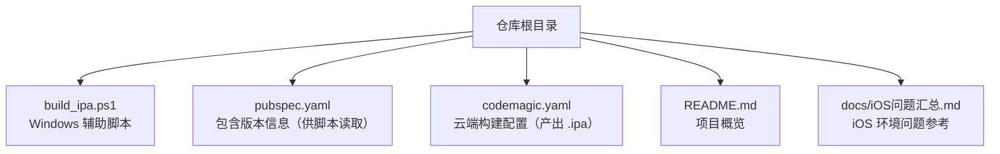
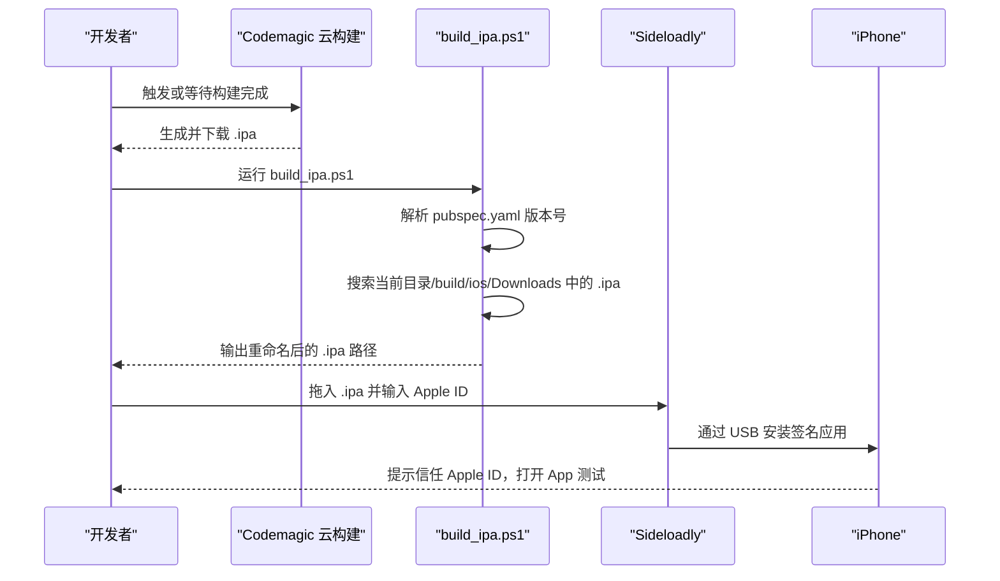
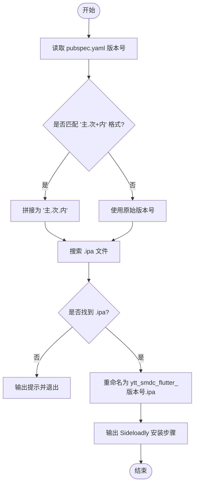
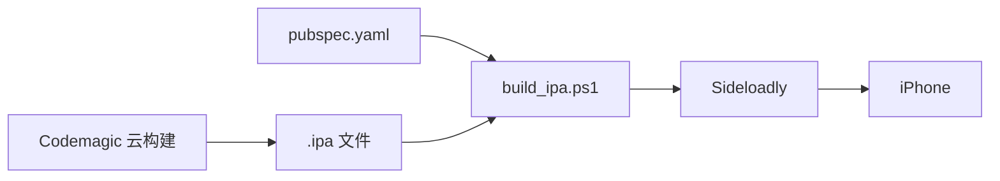

# Sideloadly 签名安装方案

<cite>
**本文引用的文件**   
- [build_ipa.ps1](file://build_ipa.ps1)
- [README.md](file://README.md)
- [iOS问题汇总.md](file://docs/iOS问题汇总.md)
</cite>

## 目录
1. [简介](#简介)
2. [项目结构](#项目结构)
3. [核心组件](#核心组件)
4. [架构总览](#架构总览)
5. [详细组件分析](#详细组件分析)
6. [依赖关系分析](#依赖关系分析)
7. [性能与可靠性考虑](#性能与可靠性考虑)
8. [故障排除指南](#故障排除指南)
9. [结论](#结论)
10. [附录：企业级分发替代方案](#附录企业级分发替代方案)

## 简介
本指南面向聚客美滋滋应用在 Windows 环境下的 iOS 测试安装场景，围绕 Sideloadly 签名安装展开。内容覆盖从云构建产出的 .ipa 到本机重命名、Sideloadly 导入、Apple ID 登录、应用信任与安装的完整流程；并重点说明免费 Apple ID 签名的 7 天过期机制、重新签名策略与数据保留注意事项。同时，深入解析辅助脚本 build_ipa.ps1 的行为逻辑，包括版本号解析、IPA 搜索算法、重命名规则与安装指引输出。文末提供自动化配置建议、常见问题排查与企业级分发替代方案对比。

## 项目结构
该项目为 Flutter 点餐应用，包含 Android、iOS、Web 多端工程。与 Sideloadly 签名安装最相关的文件是根目录的 PowerShell 辅助脚本 build_ipa.ps1，以及项目的 README 与 iOS 问题汇总文档。

图示来源
- [build_ipa.ps1:1-69](file://build_ipa.ps1#L1-L69)
- [README.md:1-50](file://README.md#L1-L50)

章节来源
- [README.md:1-50](file://README.md#L1-L50)
- [build_ipa.ps1:1-69](file://build_ipa.ps1#L1-L69)

## 核心组件
- Sideloadly：用于在 Windows 上通过 USB 连接 iPhone，使用个人 Apple ID 对 .ipa 进行签名并安装的工具。
- build_ipa.ps1：在 Windows 环境下自动查找最新 .ipa、按版本号重命名、输出安装步骤的辅助脚本。
- Codemagic 云构建：负责产出 .ipa 包，开发者下载后交由本地脚本处理。

章节来源
- [build_ipa.ps1:1-69](file://build_ipa.ps1#L1-L69)

## 架构总览
下图展示了“云构建 → 本地脚本 → Sideloadly 安装”的整体流程。

图示来源
- [build_ipa.ps1:1-69](file://build_ipa.ps1#L1-L69)

## 详细组件分析

### build_ipa.ps1 辅助脚本
该脚本的目标是在 Windows 下简化 .ipa 的安装前准备与指引输出。其关键行为如下：

- 参数与用途
  - 支持可选参数 IpaPath，传入指定 .ipa 文件路径；不传参时自动搜索。
  - 明确说明：iOS 包必须由云构建产出，本机 Windows 无法直接编译 iOS。

- 版本号解析逻辑
  - 从 pubspec.yaml 读取 version 行，去除空白字符。
  - 若匹配 “主版本.补丁号+内部号” 格式，则转换为 “主版本.补丁号.内部号”。
  - 未找到版本时降级为 unknown。

- IPA 文件搜索算法
  - 优先顺序：当前工作目录 → 项目目录下的 build\ios → 系统 Downloads 目录。
  - 每个目录中筛选 *.ipa，按最后修改时间降序取最新一个。
  - 如果未找到任何 .ipa，输出提示并退出。

- 文件重命名规则
  - 目标文件名固定为 ytt_smdc_flutter_版本号.ipa。
  - 仅当目标路径与原文件路径不同才复制并重命名；否则保持原文件名。
  - 输出重命名后的文件大小（MB）。

- 安装指引输出
  - 指导安装 Sideloadly、连接 iPhone、开启开发者模式、拖入 .ipa、输入 Apple ID、启动安装、信任 Apple ID、打开 App 测试。
  - 特别标注免费签名 7 天过期，过期后重复安装步骤即可。

图示来源
- [build_ipa.ps1:1-69](file://build_ipa.ps1#L1-L69)

章节来源
- [build_ipa.ps1:1-69](file://build_ipa.ps1#L1-L69)

### Sideloadly 签名与安装流程
结合脚本输出的指引，标准操作流程如下：

- 准备工作
  - 在 Windows 安装并打开 Sideloadly。
  - 用数据线连接 iPhone，解锁设备并点击“信任此电脑”。
  - 对于 iOS 16 及以上系统，需在设置中开启“开发者模式”，完成后重启设备。

- 签名与安装
  - 将重命名后的 .ipa 拖入 Sideloadly。
  - 输入 Apple ID 和密码（免费账号即可），点击“Start”开始签名与安装。
  - 安装完成后，在 iPhone 设置中进入“通用 → VPN 与设备管理”，信任对应的 Apple ID。

- 运行与验证
  - 打开应用进行测试，确认功能正常。

- 7 天过期与重新签名
  - 使用免费 Apple ID 签名的应用有效期通常为 7 天。
  - 过期后，再次通过 Sideloadly 重复第 4 步（拖入 .ipa、输入 Apple ID、Start），即可完成重新签名与安装。
  - 注意：重新安装可能影响本地数据，建议在重新签名前备份重要数据。

章节来源
- [build_ipa.ps1:1-69](file://build_ipa.ps1#L1-L69)

### 过期检测与自动重签名机制
- 过期检测
  - 当前仓库未提供自动过期检测逻辑。
  - 建议通过外部工具监控应用状态，或在用户界面中提示“已过期，请重新签名”。

- 自动重签名
  - 可基于 build_ipa.ps1 的逻辑扩展：定时任务检查应用签名有效期，若过期则调用 Sideloadly 命令行接口执行重签名。
  - 需确保 Sideloadly 以非交互方式运行，并安全存储 Apple ID 凭据。

- 数据保留注意事项
  - 重新签名过程中，卸载再安装可能导致应用数据丢失。
  - 建议在重签名前导出用户数据或迁移至云端，避免业务中断。

章节来源
- [build_ipa.ps1:1-69](file://build_ipa.ps1#L1-L69)

### 自动化签名流程配置
- 批处理脚本编写
  - 在现有 build_ipa.ps1 基础上增加：
    - 参数校验（Apple ID、密码、Sideloadly 路径）。
    - 调用 Sideloadly 命令行接口进行静默签名与安装。
    - 错误码捕获与重试机制。

- 定时任务设置
  - 使用 Windows 任务计划程序，定期执行批处理脚本。
  - 可结合网络状态、USB 连接状态与设备可达性进行前置判断。

- 批量安装
  - 针对多台设备，可在脚本中遍历设备列表，逐个执行签名与安装。
  - 建议加入并发控制与日志记录，便于定位失败原因。

[本节为概念性建议，不直接分析具体源码文件]

## 依赖关系分析
- 脚本依赖
  - PowerShell 运行时与文件系统访问权限。
  - pubspec.yaml 存在且可读。
  - 云构建产物 .ipa 存在于指定位置。
  - Sideloadly 已安装并可被用户手动调用。

- 构建依赖
  - Codemagic 云构建需正确配置以产出 .ipa。
  - Flutter 工程版本与平台要求满足脚本预期。

图示来源
- [build_ipa.ps1:1-69](file://build_ipa.ps1#L1-L69)

章节来源
- [build_ipa.ps1:1-69](file://build_ipa.ps1#L1-L69)

## 性能与可靠性考虑
- 性能
  - 脚本仅涉及本地文件操作与文本解析，开销极小。
  - Sideloadly 签名与传输过程受 USB 带宽与设备性能影响。

- 可靠性
  - 建议在脚本中加入健壮的错误处理：文件不存在、版本解析失败、Sideloadly 不可用等。
  - 对 Apple ID 凭据采用安全存储策略，避免明文保存。
  - 在网络不稳定或 USB 断开情况下，实现重试与回滚。

[本节为通用建议，不直接分析具体源码文件]

## 故障排除指南
- Apple ID 验证失败
  - 检查 Apple ID 是否正确、账户是否启用双重认证。
  - 尝试在浏览器中登录 Apple ID，确认账户状态正常。
  - 如仍失败，更换 Apple ID 或联系 Apple 支持。

- 签名证书问题
  - 确保使用正确的个人 Apple ID 进行签名。
  - 若出现证书失效或配额耗尽，切换可用 Apple ID。

- 存储空间不足
  - 清理 iPhone 存储空间，确保有足够空间安装应用。
  - 删除旧版本或无用应用，释放空间后再试。

- 找不到 .ipa 文件
  - 确认 Codemagic 已成功构建并下载了 .ipa。
  - 检查脚本搜索路径是否正确，必要时通过 IpaPath 参数指定路径。

- 开发者模式未开启
  - 在 iPhone 设置中开启“开发者模式”，并按提示重启设备。
  - 重新连接设备并信任电脑。

- CocoaPods 相关网络问题（参考 iOS 问题汇总）
  - 在 Podfile 中添加 source 源或配置国内镜像。
  - 在 hosts 文件中添加 GitHub 域名解析条目。

章节来源
- [iOS问题汇总.md:1-55](file://docs/iOS问题汇总.md#L1-L55)

## 结论
本方案利用 Sideloadly 与 build_ipa.ps1 辅助脚本，为聚客美滋滋应用在 Windows 环境下提供了便捷的 iOS 测试安装路径。通过云构建产出 .ipa、本地脚本自动重命名与指引输出，开发者可以快速完成签名、安装与测试。需要注意免费 Apple ID 签名的 7 天过期机制，并在生产环境中评估企业级分发替代方案，以确保稳定性与合规性。

[本节为总结性内容，不直接分析具体源码文件]

## 附录：企业级分发替代方案
- TestFlight
  - 优点：官方渠道、稳定可靠、易于管理测试人员。
  - 缺点：需要苹果审核、不适合频繁迭代的内测场景。

- 企业证书
  - 优点：无需审核、快速内部部署。
  - 缺点：成本高、合规风险大、苹果政策限制严格。

- 其他私有分发平台
  - 优点：灵活可控、支持企业内部管理。
  - 缺点：需要自建基础设施与维护成本。

[本节为概念性对比，不直接分析具体源码文件]