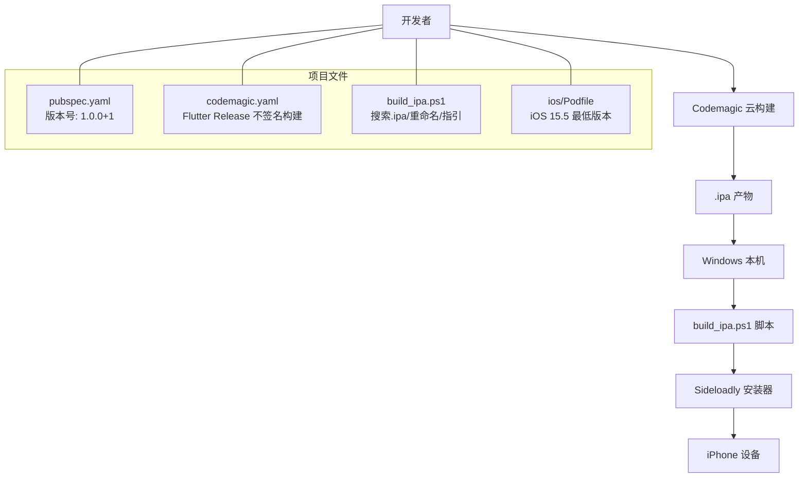
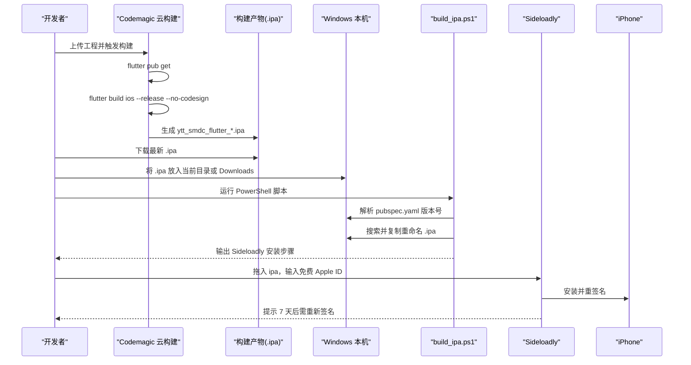
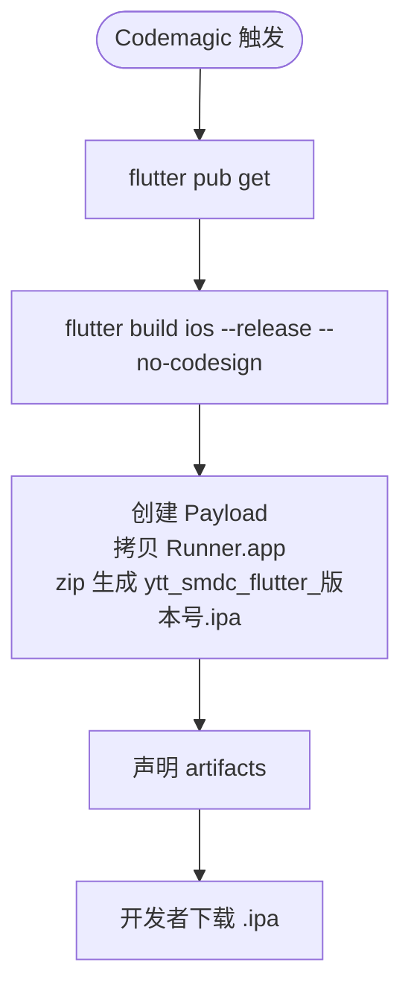
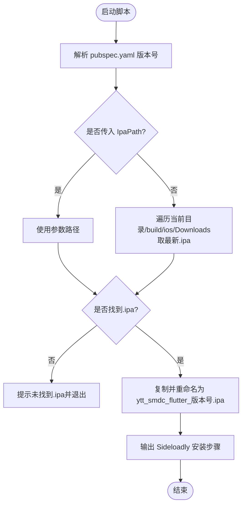
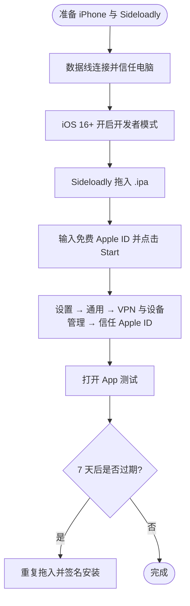
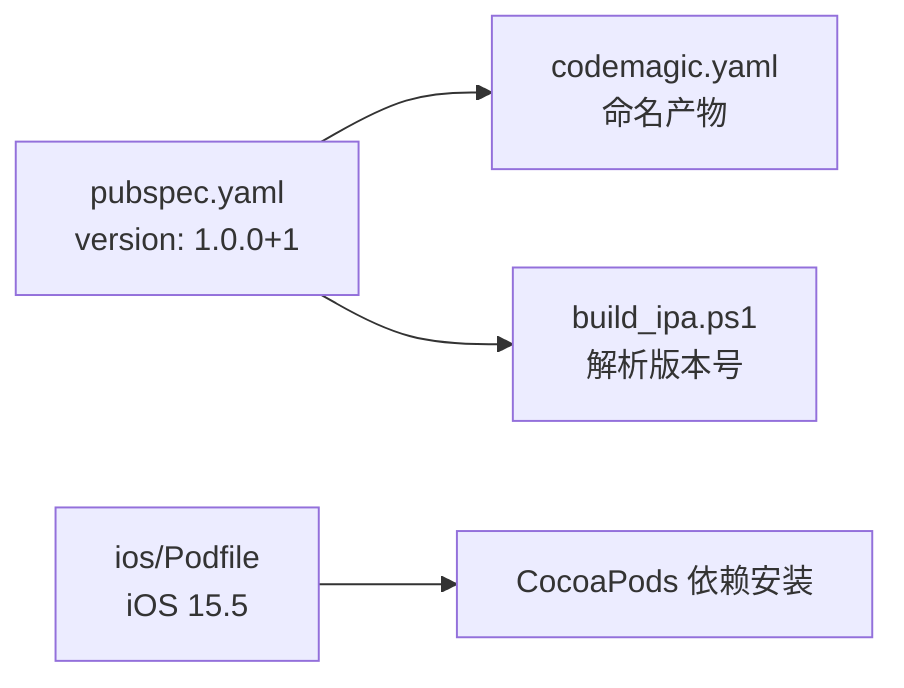

# iOS 构建流程

<cite>
**本文引用的文件**   
- [build_ipa.ps1](file://build_ipa.ps1)
- [codemagic.yaml](file://codemagic.yaml)
- [pubspec.yaml](file://pubspec.yaml)
- [ios/Podfile](file://ios/Podfile)
- [README.md](file://README.md)
- [iOS问题汇总.md](file://docs/iOS问题汇总.md)
</cite>

## 目录
1. [引言](#引言)
2. [项目结构](#项目结构)
3. [核心组件](#核心组件)
4. [架构总览](#架构总览)
5. [详细组件分析](#详细组件分析)
6. [依赖关系分析](#依赖关系分析)
7. [性能与效率建议](#性能与效率建议)
8. [故障排查指南](#故障排查指南)
9. [结论](#结论)
10. [附录：常用命令清单](#附录常用命令清单)

## 引言
本指南面向聚客美滋滋应用的 iOS 构建与测试发布流程，重点说明在无 Mac 环境下的完整方案。该方案以 Flutter + Codemagic 云构建为主，配合 Windows 侧的辅助脚本和 Sideloadly 工具完成 .ipa 下载、重命名与安装到 iPhone。文档同时覆盖本地 Mac 开发环境的构建方法，并给出签名失败、依赖缺失、构建超时等常见问题的排查思路。

## 项目结构
从构建视角看，与本指南最相关的文件包括：
- 项目元信息与版本定义：[pubspec.yaml](file://pubspec.yaml)
- 云构建配置：[codemagic.yaml](file://codemagic.yaml)
- Windows 端辅助脚本：[build_ipa.ps1](file://build_ipa.ps1)
- iOS 原生依赖与最低系统版本：[ios/Podfile](file://ios/Podfile)
- 应用说明与快速开始：[README.md](file://README.md)
- iOS 常见问题记录：[iOS问题汇总.md](file://docs/iOS问题汇总.md)

**图示来源**
- [pubspec.yaml:1-20](file://pubspec.yaml#L1-L20)
- [codemagic.yaml:1-34](file://codemagic.yaml#L1-L34)
- [build_ipa.ps1:1-69](file://build_ipa.ps1#L1-L69)
- [ios/Podfile:1-20](file://ios/Podfile#L1-L20)

**章节来源**
- [pubspec.yaml:1-20](file://pubspec.yaml#L1-L20)
- [codemagic.yaml:1-34](file://codemagic.yaml#L1-L34)
- [build_ipa.ps1:1-69](file://build_ipa.ps1#L1-L69)
- [ios/Podfile:1-20](file://ios/Podfile#L1-L20)
- [README.md:1-50](file://README.md#L1-L50)

## 核心组件
- 云构建工作流：在 Codemagic 上执行 Flutter 依赖获取、Release 构建（不签名）、打包为 .ipa，并将产物作为 artifacts 提供下载。
- Windows 辅助脚本：自动在当前目录、项目 build\ios 目录以及系统 Downloads 目录中查找最新的 .ipa，按 pubspec.yaml 的版本号重命名为 ytt_smdc_flutter_版本号.ipa，并输出 Sideloadly 安装步骤。
- 安装器：使用 Sideloadly 通过免费 Apple ID 对 .ipa 进行重新签名并安装到 iPhone；签名有效期为 7 天，过期后需重新签名安装。
- iOS 依赖管理：CocoaPods 负责第三方库安装，最低部署目标设置为 iOS 15.5，以适配 mobile_scanner 等依赖要求。

**章节来源**
- [codemagic.yaml:1-34](file://codemagic.yaml#L1-L34)
- [build_ipa.ps1:1-69](file://build_ipa.ps1#L1-L69)
- [ios/Podfile:1-20](file://ios/Podfile#L1-L20)

## 架构总览
下图展示无 Mac 环境下的端到端构建与安装流程。

**图示来源**
- [codemagic.yaml:10-34](file://codemagic.yaml#L10-L34)
- [build_ipa.ps1:10-69](file://build_ipa.ps1#L10-L69)

## 详细组件分析

### 一、Codemagic 云构建配置
- 工作流名称与用途：定义一个用于 iOS 测试包的工作流，强调“无签名”，由 Sideloadly 自行签名安装。
- 构建时长上限：设置最大构建时长，避免长时间挂起。
- 环境配置：指定 Flutter 稳定版与默认 CocoaPods。
- 构建步骤：
  - 安装依赖：flutter pub get。
  - 构建 Release：flutter build ios --release --no-codesign，跳过 Xcode 签名。
  - 封装为 .ipa：将 Runner.app 复制到 Payload，压缩为 zip 并命名为 ytt_smdc_flutter_版本号.ipa，版本号来自 pubspec.yaml。
- 产物声明：将生成的 .ipa 标记为 artifacts，供下载。

**图示来源**
- [codemagic.yaml:10-34](file://codemagic.yaml#L10-L34)

**章节来源**
- [codemagic.yaml:1-34](file://codemagic.yaml#L1-L34)

### 二、build_ipa.ps1 辅助脚本分析
脚本主要功能：
- 读取版本号：从 pubspec.yaml 的 version 字段解析主版本与构建号，格式化为“主版本.构建号”。若无法读取则回退为 unknown。
- 定位 .ipa：优先使用命令行参数指定的路径；否则依次搜索：
  - 当前工作目录
  - 项目 build\ios 目录
  - 系统 Downloads 目录
  取最近修改时间的 .ipa 文件。
- 重命名规则：复制原 .ipa 并重命名为 ytt_smdc_flutter_版本号.ipa，保留原始文件。
- 安装指引：输出 Sideloadly 安装步骤，包括连接 iPhone、开启开发者模式、拖入 ipa、输入免费 Apple ID、信任证书、7 天过期重装等注意事项。

**图示来源**
- [build_ipa.ps1:10-69](file://build_ipa.ps1#L10-L69)

**章节来源**
- [build_ipa.ps1:1-69](file://build_ipa.ps1#L1-L69)

### 三、Sideloadly 签名与安装方案
- 适用场景：Windows 环境下，无需 Mac 即可将云构建产出的 .ipa 安装到 iPhone。
- 前提条件：
  - 已安装 Sideloadly。
  - iPhone 数据线连接电脑，解锁并“信任此电脑”。
  - iOS 16+ 需在设置中开启“开发者模式”。
- 操作步骤：
  - 打开 Sideloadly，拖入 ytt_smdc_flutter_版本号.ipa。
  - 输入免费 Apple ID 和密码，点击 Start。
  - 安装完成后，前往“设置 → 通用 → VPN 与设备管理”信任对应 Apple ID。
  - 打开 App 进行测试。
- 有效期与续期：
  - 免费签名有效期为 7 天。
  - 过期后重复上述第 4 步重装即可重新签名。

**图示来源**
- [build_ipa.ps1:40-69](file://build_ipa.ps1#L40-L69)

**章节来源**
- [build_ipa.ps1:40-69](file://build_ipa.ps1#L40-L69)

### 四、iOS 依赖与环境要求
- 最低部署目标：Podfile 中将平台设为 iOS 15.5，并在 post_install 阶段确保所有 target 的 IPHONEOS_DEPLOYMENT_TARGET 不低于 15.5，以满足 mobile_scanner 等依赖的要求。
- CocoaPods 源：Podfile 注释提供了 GitHub 官方源与清华镜像源的示例；若遇到 CDN 更新失败，可参考常见问题中的解决方案。

**章节来源**
- [ios/Podfile:1-53](file://ios/Podfile#L1-L53)
- [iOS问题汇总.md:1-55](file://docs/iOS问题汇总.md#L1-L55)

### 五、本地 Mac 开发环境构建与调试
- 环境要求：Flutter >= 3.19.0，Dart SDK >= 3.4.0。
- 基础命令：
  - 获取依赖：flutter pub get
  - 运行调试：flutter run
- 模拟器调试：
  - 使用 Xcode 打开 ios/Runner.xcworkspace。
  - 选择模拟器设备，直接 Run。
- 真机部署（Mac）：
  - 连接 iPhone，Xcode 中选择你的 Apple Developer 账号并进行签名。
  - 选择真机设备，Run 完成安装与调试。

**章节来源**
- [pubspec.yaml:1-20](file://pubspec.yaml#L1-L20)
- [README.md:1-50](file://README.md#L1-L50)

## 依赖关系分析
- 版本与产物命名：
  - codemagic.yaml 中构建产物文件名来源于 pubspec.yaml 的 version 字段。
  - build_ipa.ps1 同样解析 pubspec.yaml 的版本字段，保证本地重命名与云构建产物命名一致。
- 平台与依赖：
  - ios/Podfile 锁定最低 iOS 版本为 15.5，影响 Pods 的安装与编译行为。
  - 网络层使用 Dio，路由使用 Fluro，状态管理使用 Provider，这些依赖会通过 CocoaPods 在 iOS 端集成。

**图示来源**
- [pubspec.yaml:1-20](file://pubspec.yaml#L1-L20)
- [codemagic.yaml:20-34](file://codemagic.yaml#L20-L34)
- [build_ipa.ps1:10-25](file://build_ipa.ps1#L10-L25)
- [ios/Podfile:1-20](file://ios/Podfile#L1-L20)

**章节来源**
- [pubspec.yaml:1-20](file://pubspec.yaml#L1-L20)
- [codemagic.yaml:20-34](file://codemagic.yaml#L20-L34)
- [build_ipa.ps1:10-25](file://build_ipa.ps1#L10-L25)
- [ios/Podfile:1-20](file://ios/Podfile#L1-L20)

## 性能与效率建议
- 控制构建时长：Codemagic 工作流设置了最大构建时长，建议在提交前尽量缩小增量变更范围，避免不必要的资源拉取。
- 缓存依赖：保持依赖稳定，减少 pod install 的频繁执行；必要时在 CI 中启用缓存策略（如 Flutter/CocoaPods 缓存）。
- 合理选择构建类型：日常测试可使用 Debug 构建；正式发布或预发布使用 Release 构建以提升性能与稳定性。
- 避免大目录上传：上传至 Codemagic 时排除 build/、.dart_tool/、android/、ios/Pods 等大目录，提高上传与构建效率。

[本节为通用建议，不涉及具体文件分析]

## 故障排查指南
- CocoaPods CDN 更新失败：
  - 现象：trunk Repo update failed 或 URL 无法下载。
  - 原因：CocoaPods 1.8 后默认使用 CDN spec repo。
  - 解决：在 Podfile 中添加 source 指向 GitHub 或国内镜像源；执行 pod repo remove trunk 移除旧源；或在 host 文件中添加 raw.githubusercontent.com 的映射。
- 构建超时或卡住：
  - 检查网络连接与镜像源可用性。
  - 确认 pubspec.yaml 与依赖版本兼容。
  - 在 Codemagic 中适当调整 max_build_duration。
- 签名相关错误：
  - 云构建使用 --no-codesign，因此不会报签名错误；安装阶段由 Sideloadly 处理。
  - 若 Sideloadly 安装失败，请检查 Apple ID 是否正确、iPhone 是否信任电脑与开发者模式是否开启。
- 依赖缺失或版本冲突：
  - 确保 ios/Podfile 的 platform 与最低部署目标满足依赖要求。
  - 删除 DerivedData 与 Pods 目录后重新执行 flutter pub get 与 pod install。

**章节来源**
- [iOS问题汇总.md:1-55](file://docs/iOS问题汇总.md#L1-L55)
- [ios/Podfile:1-53](file://ios/Podfile#L1-L53)
- [codemagic.yaml:10-34](file://codemagic.yaml#L10-L34)
- [build_ipa.ps1:40-69](file://build_ipa.ps1#L40-L69)

## 结论
本方案通过 Codemagic 云端构建 Flutter iOS Release 包并跳过签名，再由 Windows 端的 build_ipa.ps1 脚本自动识别与重命名 .ipa，最终借助 Sideloadly 用免费 Apple ID 完成安装与签名。整个流程避免了本地 Mac 环境限制，适合团队在 Windows 环境下完成 iOS 测试包的持续交付。结合 Podfile 的最低系统版本约束与常见问题排查，可有效提升构建成功率与迭代效率。

[本节为总结性内容，不涉及具体文件分析]

## 附录：常用命令清单
- 本地获取依赖：flutter pub get
- 本地运行调试：flutter run
- 云构建触发：在 Codemagic 上传工程并触发构建
- 下载产物：在 Codemagic 构建页面下载 artifacts 中的 .ipa
- Windows 端安装引导：.\build_ipa.ps1 -IpaPath <下载的ipa路径>
- iOS 依赖修复：pod repo remove trunk 并按需替换 Podfile source

**章节来源**
- [README.md:1-50](file://README.md#L1-L50)
- [build_ipa.ps1:1-69](file://build_ipa.ps1#L1-L69)
- [codemagic.yaml:1-34](file://codemagic.yaml#L1-L34)