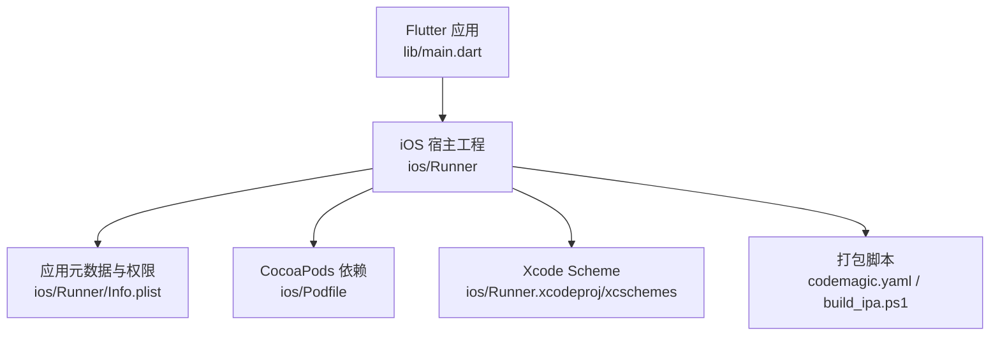
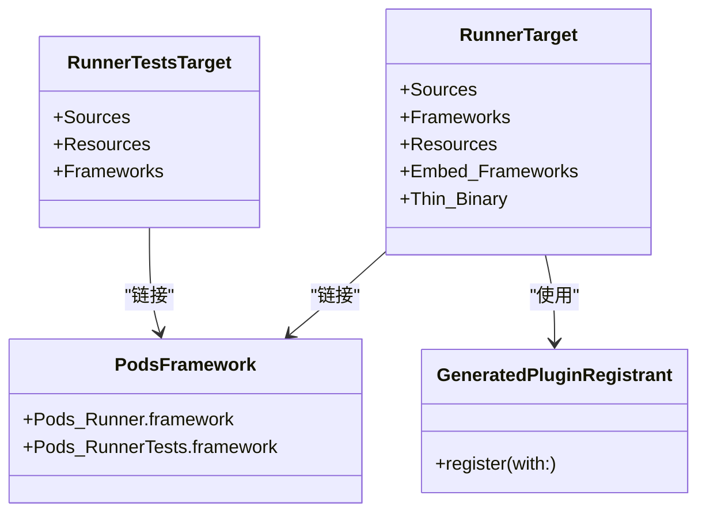
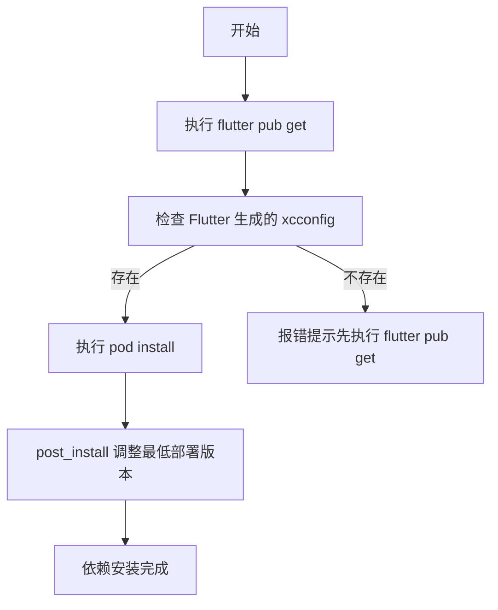
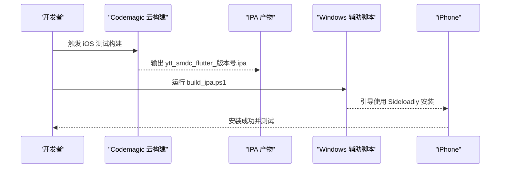
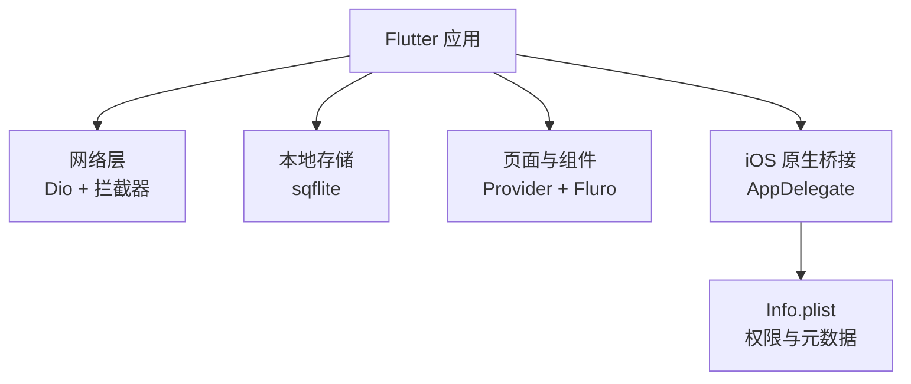

# 本地 Mac 构建与调试

<cite>
**本文引用的文件**   
- [README.md](file://README.md)
- [pubspec.yaml](file://pubspec.yaml)
- [ios/Podfile](file://ios/Podfile)
- [ios/Runner.xcodeproj/project.pbxproj](file://ios/Runner.xcodeproj/project.pbxproj)
- [ios/Runner/Info.plist](file://ios/Runner/Info.plist)
- [ios/Runner/AppDelegate.swift](file://ios/Runner/AppDelegate.swift)
- [build_ipa.ps1](file://build_ipa.ps1)
- [codemagic.yaml](file://codemagic.yaml)
- [docs/iOS问题汇总.md](file://docs/iOS问题汇总.md)
</cite>

## 目录
1. [简介](#简介)
2. [项目结构与入口](#项目结构与入口)
3. [Mac 开发环境准备](#mac-开发环境准备)
4. [Xcode 项目打开与配置](#xcode-项目打开与配置)
5. [CocoaPods 依赖管理](#cocoapods-依赖管理)
6. [模拟器调试](#模拟器调试)
7. [真机部署与分发](#真机部署与分发)
8. [开发环境与质量保障](#开发环境与质量保障)
9. [依赖分析与架构概览](#依赖分析与架构概览)
10. [常见问题排查](#常见问题排查)
11. [结论](#结论)

## 简介
本指南面向聚客美滋滋 Flutter 应用的本地 Mac 开发者，覆盖从 Xcode 工程打开、CocoaPods 依赖安装、模拟器调试、真机部署到常见问题的完整流程。该项目是“基于 Flutter 的点餐应用起始项目”，技术栈包括 Flutter 3.19+、Dart 3.4+、Provider 状态管理、Dio 网络库、Fluro 路由以及 sqflite 本地数据库等。

## 项目结构与入口
- Flutter 应用入口位于 `lib/main.dart`。
- iOS 原生宿主工程位于 `ios/Runner`，使用 Swift AppDelegate，并集成 Flutter 插件注册机制。
- iOS 应用信息（名称、权限、启动页、界面方向等）定义在 `ios/Runner/Info.plist`。
- iOS 平台依赖由 CocoaPods 管理，配置文件为 `ios/Podfile`。

**图示来源**  
- [README.md:1-50](file://README.md#L1-L50)
- [ios/Podfile:1-53](file://ios/Podfile#L1-L53)
- [ios/Runner/Info.plist:1-76](file://ios/Runner/Info.plist#L1-L76)
- [codemagic.yaml:1-34](file://codemagic.yaml#L1-L34)
- [build_ipa.ps1:1-69](file://build_ipa.ps1#L1-L69)

**章节来源**  
- [README.md:1-50](file://README.md#L1-L50)
- [pubspec.yaml:1-111](file://pubspec.yaml#L1-L111)

## Mac 开发环境准备
建议先确保以下基础工具可用：
- macOS 系统版本满足 Xcode 要求。
- 已安装 Xcode 和命令行工具。
- 已安装 Flutter SDK，并通过 `flutter doctor` 检查环境。
- 可联网访问 CocoaPods 仓库；如网络受限，需提前配置镜像或 hosts。

推荐执行顺序：
1. 运行 `flutter pub get`，获取 Dart 依赖并生成 Flutter 构建所需配置。
2. 进入 `ios` 目录后执行 `pod install`，完成 iOS 第三方依赖安装。
3. 使用 Xcode 打开 `ios/Runner.xcworkspace`，而不是 `.xcodeproj`。

## Xcode 项目打开与配置
### 打开工程
- 在 Finder 中进入项目的 `ios` 目录。
- 双击 `Runner.xcworkspace` 以打开工作区。
- 首次打开前必须执行 `flutter pub get` 和 `pod install`，否则 Xcode 可能找不到 Flutter 生成的 xcconfig 与 Pods 配置。

### 目标与方案
- 工作区包含两个主要目标：
  - `Runner`：应用主目标，用于构建、调试和安装。
  - `RunnerTests`：单元测试目标，对应 `ios/RunnerTests`。
- 默认方案为 `Runner`，可在顶部 Scheme 选择器中切换。

### 构建目标与签名
- Debug 构建适合日常调试。
- Profile 与 Release 构建适合性能分析或发布。
- 本机真机部署需要：
  - 登录 Apple ID。
  - 配置 Team 与 Bundle Identifier。
  - 对于企业分发或 App Store Connect 上传，还需相应证书与描述文件。

### 关键工程项
- `project.pbxproj` 中定义了 Runner 与 RunnerTests 目标、Sources、Frameworks、Resources 等构建阶段。
- Pod 生成的 `Pods_Runner.framework` 与 `Pods_RunnerTests.framework` 被注入 Frameworks 阶段。
- GeneratedPluginRegistrant 负责 Flutter 插件的自动注册。

**图示来源**  
- [ios/Runner.xcodeproj/project.pbxproj:1-200](file://ios/Runner.xcodeproj/project.pbxproj#L1-L200)

**章节来源**  
- [ios/Runner.xcodeproj/project.pbxproj:1-200](file://ios/Runner.xcodeproj/project.pbxproj#L1-L200)

## CocoaPods 依赖管理
### 平台与最低版本
- Podfile 指定 iOS 最低版本为 15.5，因为部分依赖（例如 mobile_scanner）要求更高平台版本。
- post_install 钩子会统一将低于 15.5 的目标最低版本提升到 15.5。

### 安装步骤
1. 在项目根目录执行 `flutter pub get`，生成 Flutter 构建设置。
2. 进入 `ios` 目录执行 `pod install`。
3. 如果后续新增 Flutter 插件或升级依赖，再次执行 `pod install` 或 `pod update`。

### 依赖更新策略
- `pod install`：根据 `Podfile.lock` 安装锁定版本，适合稳定分支。
- `pod update`：尝试升级到兼容的最新版本，可能引入不兼容变更，建议在测试分支上使用。
- 若遇到 CDN 或 Spec 源下载失败，参考下文“常见问题排查”。

**图示来源**  
- [ios/Podfile:1-53](file://ios/Podfile#L1-L53)

**章节来源**  
- [ios/Podfile:1-53](file://ios/Podfile#L1-L53)

## 模拟器调试
### 选择模拟器
- 在 Xcode 顶部设备选择器中选择 iPhone 或 iPad 模拟器。
- 如需特定机型或系统版本，可通过 Xcode 的 Devices and Simulators 添加。

### 启动与断点
- 直接点击 Xcode 的 Run 按钮即可编译并在模拟器中启动。
- 可在 Dart 代码中打断点，Xcode 同时支持 Objective‑C/Swift 断点。
- 若需要在 Flutter 层查看日志，可使用终端输出、DevTools 或项目中的日志工具类。

### 日志查看
- Xcode 底部 Debug Area 可查看控制台输出。
- 若应用内部有文件日志或网络日志，可在 Finder 中通过模拟器沙盒路径查找。
- 对于网络请求，可结合 Dio 拦截器与项目中的错误处理模块定位问题。

### 性能分析
- 使用 Xcode Instruments 进行 CPU、内存、磁盘和网络分析。
- 对 Flutter 侧性能分析可使用 `flutter profile` 或 DevTools 的 Performance 面板。

## 真机部署与分发
### 本机真机部署
- 用数据线连接 iPhone，并在设备上信任该电脑。
- 在 Xcode 中登录 Apple ID，选择你的 Team。
- 确保 Bundle Identifier、签名证书和描述文件有效。
- 选择真实设备后点击 Run，Xcode 会自动签名并安装应用。

### Ad-hoc 分发
- 在 Apple Developer Portal 创建 Ad-hoc 描述文件，并将设备 UDID 加入 Provisioning Profiles。
- 在 Xcode 中将签名设置为 Ad-hoc，并使用 Archive 导出 IPA。
- 将 IPA 分发给测试人员安装。

### App Store Connect 上传
- 使用 Xcode Organizer 或 Transporter 将 Release 包上传至 App Store Connect。
- 上传前需完成加密声明、审核信息等配置。
- 本项目 Info.plist 中包含非豁免加密声明字段，便于上架流程。

### 无 Mac 环境的替代方案
- 项目提供 Codemagic 云构建配置，可在云端构建 iOS Release 包并输出未签名的 IPA。
- Windows 用户可通过 `build_ipa.ps1` 脚本重命名 IPA，并按提示使用 Sideloadly 安装到 iPhone。

**图示来源**  
- [codemagic.yaml:1-34](file://codemagic.yaml#L1-L34)
- [build_ipa.ps1:1-69](file://build_ipa.ps1#L1-L69)

**章节来源**  
- [ios/Runner/Info.plist:1-76](file://ios/Runner/Info.plist#L1-L76)
- [codemagic.yaml:1-34](file://codemagic.yaml#L1-L34)
- [build_ipa.ps1:1-69](file://build_ipa.ps1#L1-L69)

## 开发环境与质量保障
### 代码格式化与静态分析
- 使用 Dart 提供的格式化命令进行代码格式统一。
- 使用 `dart analyze` 或 IDE 内置分析器检查潜在问题。
- 项目根目录包含 `analysis_options.yaml`，可据此规范分析规则。

### 单元测试
- Flutter 测试依赖在 `pubspec.yaml` 的 dev_dependencies 中声明。
- 可在 Xcode 中运行 `RunnerTests`，或在终端使用 `flutter test` 执行测试。
- 集成测试目录 `integration_test` 可用于端到端场景验证。

### 最佳实践
- 提交前运行静态分析和测试，确保代码质量。
- 使用独立分支开发新功能，合并前进行代码审查。
- 避免在生产环境开启过多调试日志，防止性能下降和信息泄露。

**章节来源**  
- [pubspec.yaml:1-111](file://pubspec.yaml#L1-L111)

## 依赖分析与架构概览
### Flutter 依赖
- 应用核心依赖包括 Dio、rxdart、provider、sqflite、mobile_scanner、webview_flutter 等。
- 开发依赖包括 flutter_test 和 test。

### iOS 原生依赖
- iOS 层通过 AppDelegate 初始化 FlutterViewController，并注册插件。
- Info.plist 定义了应用名称、权限说明、语言、界面方向、最低帧率禁用等属性。
- Network Security 允许 HTTP 明文请求，适用于局域网主设备模式；上架前应收紧策略。

**图示来源**  
- [pubspec.yaml:1-111](file://pubspec.yaml#L1-L111)
- [ios/Runner/AppDelegate.swift:1-31](file://ios/Runner/AppDelegate.swift#L1-L31)
- [ios/Runner/Info.plist:1-76](file://ios/Runner/Info.plist#L1-L76)

**章节来源**  
- [pubspec.yaml:1-111](file://pubspec.yaml#L1-L111)
- [ios/Runner/AppDelegate.swift:1-31](file://ios/Runner/AppDelegate.swift#L1-L31)
- [ios/Runner/Info.plist:1-76](file://ios/Runner/Info.plist#L1-L76)

## 常见问题排查
### CocoaPods CDN 与 Spec 源问题
- 现象：CDN trunk Repo update failed、CDN URL couldn't be downloaded。
- 原因：CocoaPods 1.8 后将 CDN 作为默认 spec repo 源，国内网络可能不稳定。
- 解决方法：
  - 在 Podfile 中显式添加 source，指向 GitHub 官方仓库或国内镜像。
  - 移除旧的 trunk 源。
  - 必要时修改 hosts 解析 raw.githubusercontent.com。

**章节来源**  
- [docs/iOS问题汇总.md:1-55](file://docs/iOS问题汇总.md#L1-L55)

### Flutter 构建缺少 Generated.xcconfig
- 现象：Podfile 提示找不到 Generated.xcconfig。
- 原因：未执行 `flutter pub get`。
- 解决方法：在项目根目录执行 `flutter pub get`，再执行 `pod install`。

**章节来源**  
- [ios/Podfile:1-53](file://ios/Podfile#L1-L53)

### 签名与证书错误
- 现象：Xcode 报签名失败、描述文件无效或证书过期。
- 排查要点：
  - 确认 Apple ID 已登录且 Team 正确。
  - 检查 Bundle Identifier 是否与证书匹配。
  - 对真机部署，确认设备已信任该电脑。
  - 对 App Store Connect 上传，确认证书、描述文件和 Entitlements 正确。

**章节来源**  
- [ios/Runner/Info.plist:1-76](file://ios/Runner/Info.plist#L1-L76)

### 模拟器无法启动或崩溃
- 排查要点：
  - 清理构建产物后重试。
  - 检查模拟器系统版本是否满足最低部署版本。
  - 查看 Xcode 控制台日志，定位具体崩溃原因。

### 真机权限弹窗未出现
- 排查要点：
  - 检查 Info.plist 中对应的权限描述是否填写。
  - 确认应用在运行时正确请求权限。
  - 在设备设置中查看应用权限开关。

**章节来源**  
- [ios/Runner/Info.plist:1-76](file://ios/Runner/Info.plist#L1-L76)

## 结论
聚客美滋滋应用的本地 Mac 构建与调试流程围绕 Flutter、Xcode 和 CocoaPods 展开。关键在于：
- 先执行 `flutter pub get`，再执行 `pod install`。
- 使用 `Runner.xcworkspace` 打开工程，并确保 Scheme、目标和签名配置正确。
- 模拟器用于快速迭代，真机用于权限、网络和硬件能力验证。
- 对网络和安全相关配置要区分开发与发布环境。
- 遇到问题时优先检查 CocoaPods 源、Flutter 生成配置、签名证书与 Info.plist 权限。