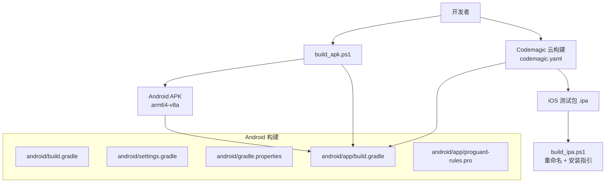
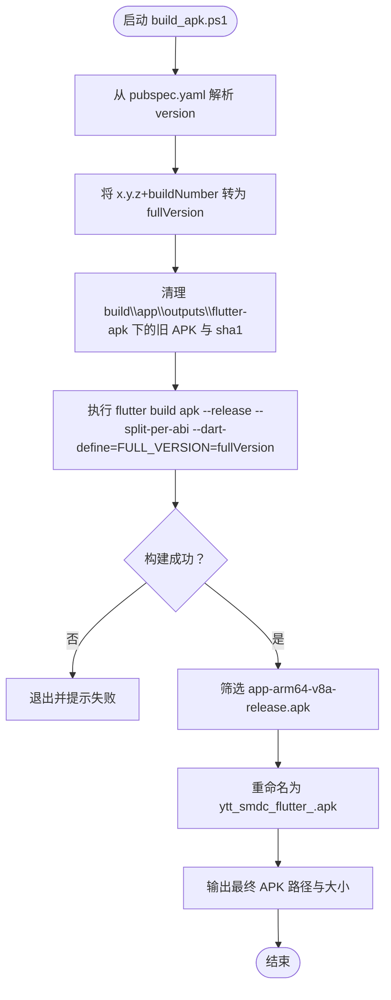
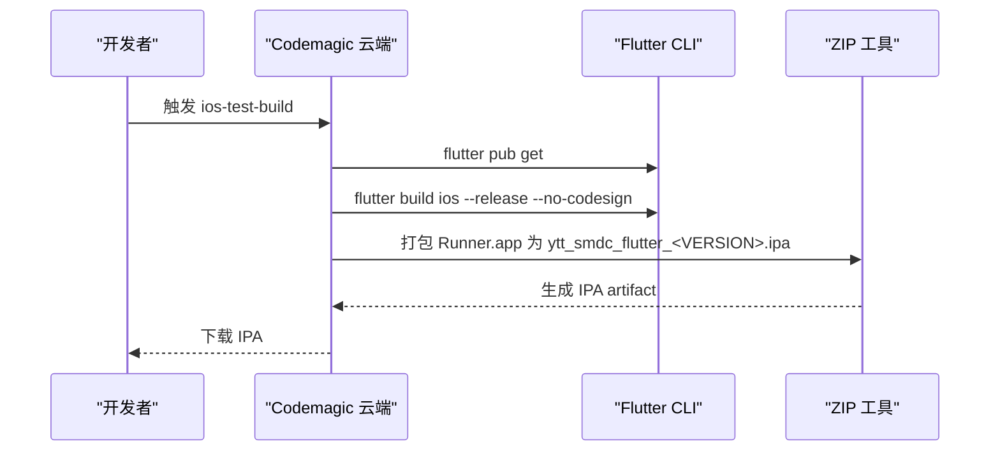

# 构建与打包

<cite>
**本文引用的文件**   
- [README.md](file://README.md)
- [pubspec.yaml](file://pubspec.yaml)
- [build_apk.ps1](file://build_apk.ps1)
- [build_ipa.ps1](file://build_ipa.ps1)
- [codemagic.yaml](file://codemagic.yaml)
- [android/build.gradle](file://android/build.gradle)
- [android/settings.gradle](file://android/settings.gradle)
- [android/gradle.properties](file://android/gradle.properties)
- [android/app/build.gradle](file://android/app/build.gradle)
- [android/app/proguard-rules.pro](file://android/app/proguard-rules.pro)
- [lib/main.dart](file://lib/main.dart)
- [lib/pages/login/page/login_page.dart](file://lib/pages/login/page/login_page.dart)
- [lib/net/connection_manager.dart](file://lib/net/connection_manager.dart)
- [lib/util/file_log_writer.dart](file://lib/util/file_log_writer.dart)
</cite>

## 目录
1. [简介](#简介)
2. [项目结构与构建入口](#项目结构与构建入口)
3. [Android APK 构建流程](#android-apk-构建流程)
4. [iOS 测试包构建流程](#ios-测试包构建流程)
5. [生产环境打包配置](#生产环境打包配置)
6. [多渠道与环境切换策略](#多渠道与环境切换策略)
7. [构建优化技巧](#构建优化技巧)
8. [常见构建错误排查](#常见构建错误排查)
9. [结论](#结论)

## 简介
本指南面向聚客美滋滋应用的开发与发布人员，聚焦 Android APK 与 iOS 测试包的构建、签名、版本管理、环境切换及性能优化。项目基于 Flutter，Android 使用 Gradle 构建系统，iOS 通过 Codemagic 云构建配合本地 Sideloadly 安装，Windows 侧提供 PowerShell 辅助脚本统一版本号解析与输出命名。

- 应用名称：点餐 APP（ytt-smdc-flutter）
- 技术栈：Flutter 3.19+、Dart 3.4+、Provider、Dio、Fluro、sp_util
- 快速开始：`flutter pub get`、`flutter run`

**章节来源**
- [README.md:1-50](file://README.md#L1-L50)

## 项目结构与构建入口
仓库根目录包含以下与构建相关的关键文件：

| 文件 | 作用 |
|---|---|
| `pubspec.yaml` | Dart 依赖与 Flutter 资源声明；定义应用版本字段 |
| `build_apk.ps1` | Windows 上执行 Flutter Release APK 构建、清理旧产物、按架构筛选并重命名 |
| `build_ipa.ps1` | Windows 上处理 Codemagic 产出的 .ipa，按版本号重命名并提供无 Mac 安装指引 |
| `codemagic.yaml` | Codemagic 工作流，云端构建 iOS Release 包并封装为 `.ipa` artifact |
| `android/build.gradle` | 根级 Gradle 仓库、构建目录与 clean 任务 |
| `android/settings.gradle` | Flutter SDK 路径、Gradle Plugin 与 Kotlin 版本 |
| `android/gradle.properties` | Gradle 并行、缓存、JVM 内存、Kotlin 增量编译等构建参数 |
| `android/app/build.gradle` | Android App 模块：SDK 版本、签名、混淆、压缩、命名空间 |
| `android/app/proguard-rules.pro` | ProGuard 混淆规则，保留高德地图相关类 |



**图表来源**
- [build_apk.ps1:1-53](file://build_apk.ps1#L1-L53)
- [build_ipa.ps1:1-69](file://build_ipa.ps1#L1-L69)
- [codemagic.yaml:1-34](file://codemagic.yaml#L1-L34)
- [android/build.gradle:1-23](file://android/build.gradle#L1-L23)
- [android/settings.gradle:1-27](file://android/settings.gradle#L1-L27)
- [android/gradle.properties:1-27](file://android/gradle.properties#L1-L27)
- [android/app/build.gradle:1-85](file://android/app/build.gradle#L1-L85)
- [android/app/proguard-rules.pro:1-34](file://android/app/proguard-rules.pro#L1-L34)

**章节来源**
- [README.md:1-50](file://README.md#L1-L50)
- [pubspec.yaml:1-111](file://pubspec.yaml#L1-L111)
- [android/build.gradle:1-23](file://android/build.gradle#L1-L23)
- [android/settings.gradle:1-27](file://android/settings.gradle#L1-L27)
- [android/gradle.properties:1-27](file://android/gradle.properties#L1-L27)
- [android/app/build.gradle:1-85](file://android/app/build.gradle#L1-L85)
- [android/app/proguard-rules.pro:1-34](file://android/app/proguard-rules.pro#L1-L34)

## Android APK 构建流程

### 脚本使用方法
运行 PowerShell 脚本即可在 Windows 环境中完成 Release APK 构建、产物清理、架构筛选与重命名：

- 基本用法：`.\build_apk.ps1`
- 适用场景：本地开发调试包、门店测试包、轻量分发包

脚本执行顺序如下：



**图表来源**
- [build_apk.ps1:1-53](file://build_apk.ps1#L1-L53)
- [pubspec.yaml:1-10](file://pubspec.yaml#L1-L10)

### 参数与行为说明
- 构建模式：Release
- 架构拆分：`--split-per-abi`
- 运行时注入：`--dart-define=FULL_VERSION=<fullVersion>`
- 仅保留：`arm64-v8a`
- 输出命名：`ytt_smdc_flutter_<fullVersion>.apk`

### 版本号解析逻辑
版本号以 `pubspec.yaml` 中的 `version` 字段为单一事实源。脚本正则匹配 `^version:` 行后，按以下规则处理：

| pubspec.yaml 版本格式 | 解析结果 | 文件名后缀 |
|---|---|---|
| `1.0.0` | `1.0.0` | `ytt_smdc_flutter_1.0.0.apk` |
| `1.0.0+1` | `1.0.0.1` | `ytt_smdc_flutter_1.0.0.1.apk` |
| `001` | `001` | `ytt_smdc_flutter_001.apk` |

该逻辑同时用于 Android APK 与 iOS 测试包，保证两个平台输出命名一致。

**章节来源**
- [build_apk.ps1:1-53](file://build_apk.ps1#L1-L53)
- [build_ipa.ps1:1-69](file://build_ipa.ps1#L1-L69)
- [pubspec.yaml:1-10](file://pubspec.yaml#L1-L10)

### arm64-v8a 架构优化
脚本执行 `--split-per-abi` 后，会删除除 `app-arm64-v8a-release.apk` 之外的其他架构 APK，并清理对应 `.sha1` 文件。这样做的优点是：

- 减小安装包体积
- 降低低端设备兼容负担
- 适配当前门店平板与安卓终端主流架构
- 便于版本命名与归档管理

注意：若未来需要支持 32 位设备，可在脚本中调整过滤逻辑，但需同步评估目标设备兼容性。

**章节来源**
- [build_apk.ps1:1-53](file://build_apk.ps1#L1-L53)

### 输出文件重命名规则
APK 输出目录固定为 `build\app\outputs\flutter-apk`，最终产物命名规则为：

```
ytt_smdc_flutter_<fullVersion>.apk
```

其中 `<fullVersion>` 由 `pubspec.yaml` 的 `version` 解析得到。例如：

- `pubspec.yaml` 版本为 `1.0.0+1`
- 最终 APK 为 `ytt_smdc_flutter_1.0.0.1.apk`

**章节来源**
- [build_apk.ps1:1-53](file://build_apk.ps1#L1-L53)

## iOS 测试包构建流程

### 为什么选择 Codemagic 云构建
仓库未提供 macOS 原生构建环境，因此 iOS 构建采用云端方案：

- 无需本地安装 Xcode
- 无需 Apple 开发者账号签名
- 由 Codemagic 云端 macOS runner 执行 `flutter build ios --release --no-codesign`
- 产出无签名的 `.ipa`，供本地 Sideloadly 重新签名安装

**章节来源**
- [codemagic.yaml:1-34](file://codemagic.yaml#L1-L34)
- [build_ipa.ps1:1-10](file://build_ipa.ps1#L1-L10)

### Codemagic 工作流说明
`codemagic.yaml` 定义了名为 `ios-test-build` 的工作流：

| 阶段 | 行为 |
|---|---|
| 环境准备 | 使用稳定版 Flutter 与默认 CocoaPods |
| 安装依赖 | `flutter pub get` |
| 构建 iOS | `flutter build ios --release --no-codesign` |
| 封装 ipa | 将 `Runner.app` 放入 Payload 目录并 zip 为 `ytt_smdc_flutter_<VERSION>.ipa` |
| 上传产物 | 将匹配的 `.ipa` 作为 artifacts 输出 |



**图表来源**
- [codemagic.yaml:1-34](file://codemagic.yaml#L1-L34)

### 本地安装到 iPhone（无需 Mac）
`build_ipa.ps1` 提供 Windows 端辅助流程：

1. 自动或手动指定 `.ipa` 路径
2. 从 `pubspec.yaml` 解析版本号
3. 复制并重命名为 `ytt_smdc_flutter_<fullVersion>.ipa`
4. 打印 Sideloadly 安装步骤

安装要点：

- 使用 Sideloadly 拖入 `.ipa`
- 输入 Apple ID 和密码进行免费签名
- 首次安装需在 iPhone 设置中信任该 Apple ID
- 免费签名有效期约 7 天，过期后重新安装即可

**章节来源**
- [build_ipa.ps1:1-69](file://build_ipa.ps1#L1-L69)
- [codemagic.yaml:1-34](file://codemagic.yaml#L1-L34)

### 无 Mac 环境的替代方案
如果无法使用 Codemagic，可考虑以下替代思路（概念性建议）：

- 使用第三方 CI 服务（如 GitHub Actions、Azure Pipelines）提供 macOS runner
- 使用本地 Mac 虚拟机或云 Mac 服务
- 使用企业自签证书进行内部测试分发

这些方案均属于通用实践，不改变本项目现有 Codemagic + Sideloadly 的主流程。

## 生产环境打包配置

### 签名密钥准备
Android 生产包签名通过 `android/app/build.gradle` 中的 `signingConfigs.release` 读取外部属性文件：

| key | 含义 |
|---|---|
| `keyAlias` | 密钥别名 |
| `keyPassword` | 密钥密码 |
| `storeFile` | keystore 文件路径 |
| `storePassword` | keystore 密码 |

建议在 `android/app/key.properties` 中保存上述信息，不要提交到代码仓库。

**章节来源**
- [android/app/build.gradle:27-48](file://android/app/build.gradle#L27-L48)

### keystore 文件配置
- keystore 应放置在 `android/app/key.properties` 指定的 `storeFile` 路径下
- 构建时 Gradle 会加载该属性文件并注入签名配置
- 若缺少 `key.properties` 或路径错误，构建会失败

### ProGuard 混淆规则
生产构建启用了资源压缩、ZipAlign、代码混淆与 ProGuard 规则：

- `shrinkResources true`
- `zipAlignEnabled true`
- `minifyEnabled true`
- `proguardFiles getDefaultProguardFile('proguard-android-optimize.txt'), 'proguard-rules.pro'`

当前 `proguard-rules.pro` 主要保留高德地图相关类，包括定位、搜索、2D 地图等。若业务后续接入更多第三方库，应在该文件中补充 keep 规则，避免运行时反射或动态加载失败。

**章节来源**
- [android/app/build.gradle:52-64](file://android/app/build.gradle#L52-L64)
- [android/app/proguard-rules.pro:1-34](file://android/app/proguard-rules.pro#L1-L34)

### 资源压缩优化
生产构建已启用资源压缩，有助于减少 APK 体积。建议：

- 移除未使用的图片资源
- 使用合适分辨率的图片
- 避免在 assets 中放置超大字体或视频
- 对 SVG 等资源评估是否必须打包进 Release 包

**章节来源**
- [android/app/build.gradle:52-64](file://android/app/build.gradle#L52-L64)
- [pubspec.yaml:70-111](file://pubspec.yaml#L70-L111)

## 多渠道与环境切换策略

### 当前实现现状
仓库未实现传统意义上的“多渠道打包”，而是通过以下方式控制环境与行为：

| 维度 | 当前实现 |
|---|---|
| 版本号 | `pubspec.yaml` 的 `version` 字段 |
| 运行时版本信息 | 使用 `package_info_plus` 获取 `version` 与 `buildNumber` |
| 调试开关 | Release 模式下关闭 `debugPrint` |
| API 地址 | 通过 `connection_manager.dart` 中的调试覆盖变量控制 |
| 日志输出 | 使用文件日志写入器记录运行时信息 |

### 调试开关控制
`lib/main.dart` 在 Release 环境下关闭了 `debugPrint`，以减少日志开销并避免敏感信息泄露。这使生产包更安静、更高效。

**章节来源**
- [lib/main.dart:23-29](file://lib/main.dart#L23-L29)

### API 地址切换
网络层通过 `connection_manager.dart` 提供调试覆盖地址：

- `debugLocalhostOverride` 为空时，使用默认后端地址
- 非空时优先返回该覆盖地址，便于联调内网或代理环境

该方式适合单环境调试，不适合大规模多环境自动化切换。

**章节来源**
- [lib/net/connection_manager.dart:21-22](file://lib/net/connection_manager.dart#L21-L22)
- [lib/net/connection_manager.dart:89-92](file://lib/net/connection_manager.dart#L89-L92)

### 版本信息注入
`build_apk.ps1` 通过 `--dart-define=FULL_VERSION` 注入完整版本号，而运行时版本展示和登录接口版本参数主要来自 `package_info_plus`：

- 登录页使用 `PackageInfo.fromPlatform()` 获取 `version` 与 `buildNumber`
- 设置页与日志写入器也使用 `PackageInfo` 显示或上报版本信息

这意味着：

- 文件名中的 `fullVersion` 主要用于归档识别
- 应用内展示的 `Vx.y.z` 与 `vcode` 来自平台版本元数据

**章节来源**
- [build_apk.ps1:1-20](file://build_apk.ps1#L1-L20)
- [lib/pages/login/page/login_page.dart:1014-1017](file://lib/pages/login/page/login_page.dart#L1014-L1017)
- [lib/util/file_log_writer.dart:371-372](file://lib/util/file_log_writer.dart#L371-L372)

### 推荐的多渠道扩展方式
若未来需要支持不同环境（开发、联调、预发、生产），建议引入以下机制：

| 环境 | 建议实现 |
|---|---|
| 开发 | 使用 `--dart-define=API_URL=...` 注入后端地址 |
| 联调 | 使用独立域名或网关前缀 |
| 预发 | 使用独立数据库或租户标识 |
| 生产 | 关闭调试日志、启用混淆与资源压缩 |

可通过 Flutter 的 `@TargetPlatform`、`kDebugMode`、`dart-define` 组合判断环境，从而在不同构建命令下注入不同常量。

[本节为概念性扩展建议，不直接分析具体源码]

## 构建优化技巧

### 增量构建
- Gradle 已开启 `org.gradle.caching=true`
- Flutter 本身也会缓存 Dart 依赖与编译产物
- 建议保持 `local.properties` 中的 `flutter.sdk` 不变，避免频繁切换 SDK 导致缓存失效

**章节来源**
- [android/gradle.properties:1-27](file://android/gradle.properties#L1-L27)
- [android/settings.gradle:1-27](file://android/settings.gradle#L1-L27)

### 并行编译
- `org.gradle.parallel=true` 启用 Gradle 并行构建
- `org.gradle.configureondemand=true` 按需配置子项目
- 适用于多模块或依赖较多的项目，可显著缩短冷构建时间

**章节来源**
- [android/gradle.properties:1-12](file://android/gradle.properties#L1-L12)

### JVM 内存配置
`android/gradle.properties` 中设置了 Gradle JVM 参数：

- `-Xmx3072m`：最大堆内存 3072MB
- `-XX:+UseParallelGC`：使用并行垃圾回收器
- `-XX:MaxMetaspaceSize=1024m`：元空间上限
- `-XX:+HeapDumpOnOutOfMemoryError`：OOM 时生成堆转储
- `-Dfile.encoding=UTF-8`：统一文件编码

若遇到内存不足，可适当调大 `-Xmx`，但需结合本机物理内存评估。

**章节来源**
- [android/gradle.properties:5-12](file://android/gradle.properties#L5-L12)

### Kotlin 版本与内置 Kotlin 禁用
`settings.gradle` 将 Kotlin Gradle Plugin 固定为 `2.2.20`，`gradle.properties` 关闭 `builtInKotlin`，以避免 Flutter 内置 Kotlin 2.0.0 无法读取插件依赖的 `kotlin-stdlib 2.2.20` 元数据。

**章节来源**
- [android/settings.gradle:18-23](file://android/settings.gradle#L18-L23)
- [android/gradle.properties:13-17](file://android/gradle.properties#L13-L17)

### 仓库加速
`android/build.gradle` 配置了阿里云 Maven 镜像、Google、Maven Central 与 JitPack，有助于提升依赖下载速度。

**章节来源**
- [android/build.gradle:1-12](file://android/build.gradle#L1-L12)

## 常见构建错误排查

### 签名失败
**现象：**  
构建 Release APK 时报签名相关错误，或找不到 keystore。

**可能原因：**
- `android/app/key.properties` 不存在
- `storeFile` 路径错误
- `keyAlias`、`keyPassword`、`storePassword` 填写错误
- keystore 文件被误删或权限不足

**处理方法：**
1. 检查 `android/app/build.gradle` 中 `keystorePropertiesFile` 指向的文件是否存在
2. 确认 `key.properties` 中的路径与密码正确
3. 在 Windows 上确保路径分隔符正确
4. 不要把 `key.properties` 提交到公开仓库

**章节来源**
- [android/app/build.gradle:27-48](file://android/app/build.gradle#L27-L48)

### 依赖冲突或 Kotlin 版本报错
**现象：**  
构建时报 Kotlin 元数据版本不一致，或插件依赖与内置 Kotlin 编译器不兼容。

**可能原因：**
- Flutter 内置 Kotlin 2.0.0 无法读取 `kotlin-stdlib 2.2.20`
- 插件要求更高版本的 Kotlin

**处理方法：**
- 保持 `android/settings.gradle` 中 Kotlin Gradle Plugin 为 `2.2.20`
- 保持 `android/gradle.properties` 中 `android.builtInKotlin=false`
- 清理 Gradle 缓存后重试

**章节来源**
- [android/settings.gradle:18-23](file://android/settings.gradle#L18-L23)
- [android/gradle.properties:13-17](file://android/gradle.properties#L13-L17)

### 内存不足
**现象：**  
Gradle 构建过程中出现 OutOfMemoryError 或 Java heap space 错误。

**可能原因：**
- 本机内存不足
- Gradle JVM 堆内存过小
- 并行构建占用过多资源

**处理方法：**
1. 增大 `org.gradle.jvmargs` 中的 `-Xmx`
2. 关闭不必要的后台进程
3. 临时关闭 `org.gradle.parallel=true`
4. 清理 `build/` 目录后重试

**章节来源**
- [android/gradle.properties:5-12](file://android/gradle.properties#L5-L12)

### 找不到 Flutter SDK
**现象：**  
Gradle 构建时提示 `flutter.sdk not set`。

**可能原因：**
- `local.properties` 中未配置 `flutter.sdk`
- Flutter SDK 路径变更

**处理方法：**
- 在 `local.properties` 中添加 `flutter.sdk=你的 Flutter SDK 路径`
- 确保路径存在且可读

**章节来源**
- [android/settings.gradle:1-13](file://android/settings.gradle#L1-L13)

### iOS 构建失败或找不到 .ipa
**现象：**  
运行 `build_ipa.ps1` 提示未找到 `.ipa` 文件。

**可能原因：**
- 未在 Codemagic 成功构建
- 未下载构建产物
- 指定路径错误

**处理方法：**
1. 先在 Codemagic 触发 `ios-test-build`
2. 下载 artifacts 中的 `.ipa`
3. 使用 `.\build_ipa.ps1 -IpaPath <路径>` 指定文件
4. 确认 Codemagic 工作流中 `flutter build ios --release --no-codesign` 成功

**章节来源**
- [build_ipa.ps1:1-69](file://build_ipa.ps1#L1-L69)
- [codemagic.yaml:1-34](file://codemagic.yaml#L1-L34)

### 构建产物名称不符合预期
**现象：**  
APK 或 IPA 名称不是 `ytt_smdc_flutter_<fullVersion>.apk/.ipa`。

**可能原因：**
- 修改了 `pubspec.yaml` 的 `version` 但未重新构建
- 手动改动了脚本逻辑
- 使用了自定义构建命令而非脚本

**处理方法：**
- 检查 `pubspec.yaml` 的 `version`
- 重新运行 `build_apk.ps1` 或 Codemagic 工作流
- 不要手动重命名构建产物后再归档

**章节来源**
- [build_apk.ps1:1-53](file://build_apk.ps1#L1-L53)
- [build_ipa.ps1:1-69](file://build_ipa.ps1#L1-L69)
- [codemagic.yaml:1-34](file://codemagic.yaml#L1-L34)

## 结论
聚客美滋滋应用的构建体系以 `pubspec.yaml` 的版本号为单一事实源，通过 PowerShell 脚本与 Codemagic 工作流统一 Android 与 iOS 的输出命名。Android 侧采用 Gradle Release 构建、R8/ProGuard 混淆与资源压缩；iOS 侧采用云端无签名构建，再由本地 Sideloadly 安装测试。

对于实际生产发布，建议完善以下事项：

- 安全保管 keystore 与 `key.properties`
- 根据业务接入情况补充 ProGuard keep 规则
- 使用 `--dart-define` 实现多环境 API 地址切换
- 在 CI 中固化构建命令，避免人工操作差异
- 针对低内存机器与弱网环境做构建与运行验证

通过以上流程，可以在 Windows 环境中高效完成 Android APK 构建，并在无 Mac 环境下完成 iOS 测试包的分发与安装。