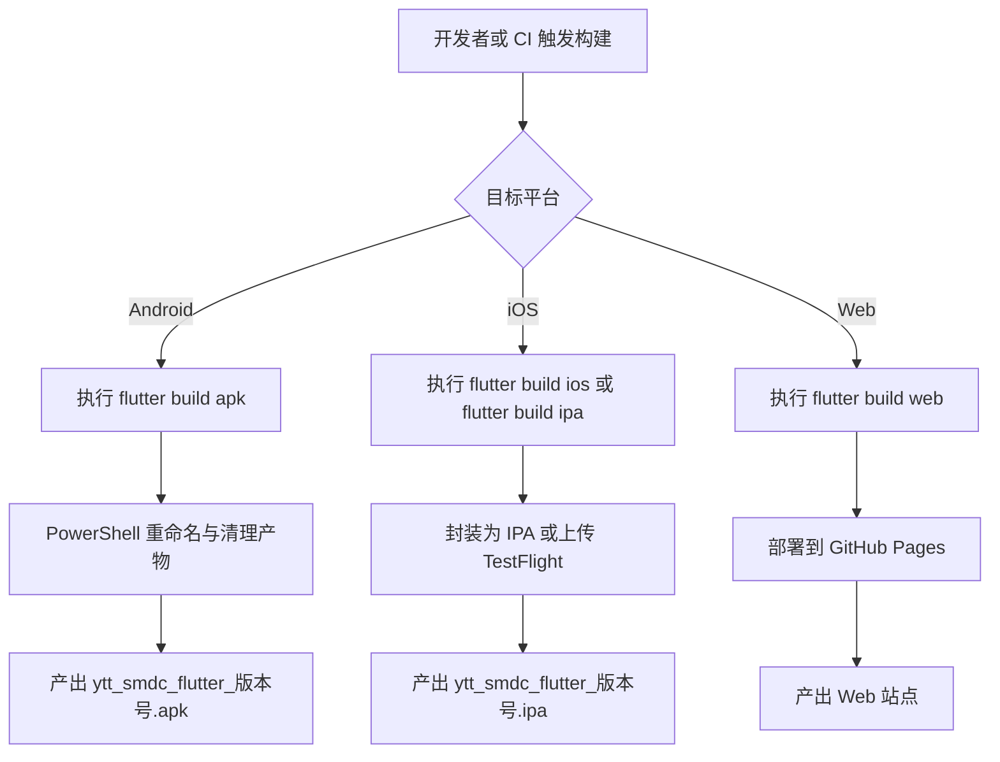
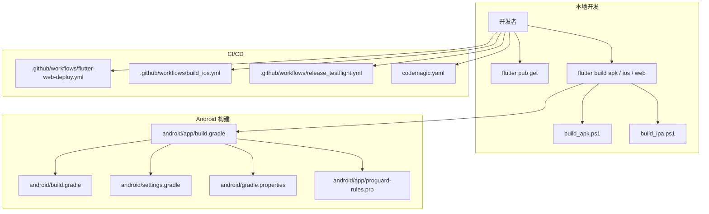
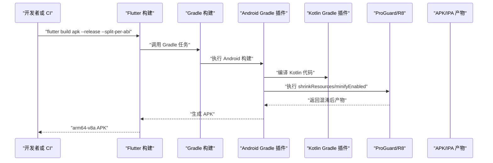
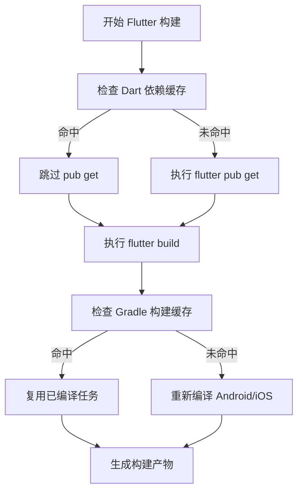
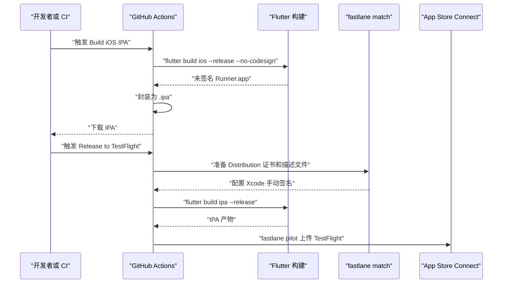
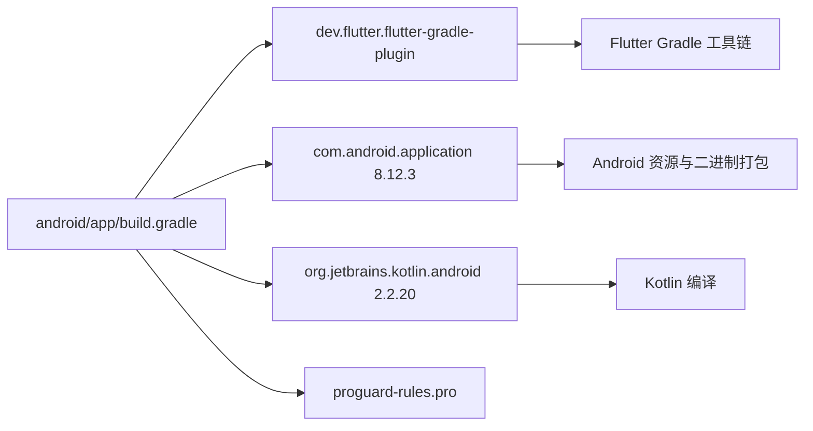
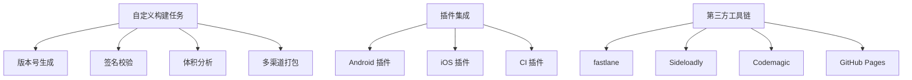

# 构建优化与故障排除

<cite>
**本文引用的文件**   
- [pubspec.yaml](file://pubspec.yaml)
- [android/build.gradle](file://android/build.gradle)
- [android/app/build.gradle](file://android/app/build.gradle)
- [android/gradle.properties](file://android/gradle.properties)
- [android/settings.gradle](file://android/settings.gradle)
- [android/app/proguard-rules.pro](file://android/app/proguard-rules.pro)
- [codemagic.yaml](file://codemagic.yaml)
- [.github/workflows/flutter-web-deploy.yml](file://.github/workflows/flutter-web-deploy.yml)
- [.github/workflows/build_ios.yml](file://.github/workflows/build_ios.yml)
- [.github/workflows/release_testflight.yml](file://.github/workflows/release_testflight.yml)
- [build_apk.ps1](file://build_apk.ps1)
- [build_ipa.ps1](file://build_ipa.ps1)
</cite>

## 目录

1. [引言](#引言)
2. [项目结构与构建入口](#项目结构与构建入口)
3. [核心构建组件分析](#核心构建组件分析)
4. [架构总览](#架构总览)
5. [详细组件分析与优化策略](#详细组件分析与优化策略)
6. [依赖关系分析](#依赖关系分析)
7. [性能优化指南](#性能优化指南)
8. [常见构建错误与故障排除](#常见构建错误与故障排除)
9. [CI/CD 流水线优化](#cicd-流水线优化)
10. [构建监控与诊断工具](#构建监控与诊断工具)
11. [环境变量与配置管理](#环境变量与配置管理)
12. [扩展性设计：自定义任务与插件集成](#扩展性设计自定义任务与插件集成)
13. [结论](#结论)

## 引言

本文面向聚客美滋滋应用的 Flutter + Android + iOS 构建系统，目标是提供一份兼顾可操作性和深入性的性能优化与故障排除指南。文档基于仓库中的 Gradle 配置、Flutter 依赖声明、CI/CD 工作流和 Windows 构建脚本进行分析，重点覆盖以下主题：

- Flutter 构建缓存与增量编译优化
- Gradle 并行编译、JVM 内存、Kotlin 版本对齐
- ProGuard 资源压缩、代码混淆与规则调优
- 签名失败、依赖冲突、内存不足等典型构建问题排查
- GitHub Actions 与 Codemagic 云构建加速策略
- 构建日志分析、性能瓶颈定位和资源占用监控
- 敏感信息、多环境配置与版本号自动化管理
- 自定义构建任务、插件集成与第三方工具链对接思路

## 项目结构与构建入口

该项目是一个 Flutter 应用，业务代码位于 `lib`，Android 原生层位于 `android`，iOS 工程位于 `ios`，Web 构建产物输出到 `web`。构建入口既包括命令行命令，也包括 PowerShell 脚本和 CI/CD 工作流。

| 入口 | 作用 | 关键行为 |
|---|---|---|
| `flutter build apk --release --split-per-abi` | 生成 Android Release APK | 通过 `build_apk.ps1` 拆分架构并只保留 arm64-v8a |
| `flutter build ios --release --no-codesign` | 生成未签名的 iOS Release | 由 `build_ios.yml` 或 `codemagic.yaml` 触发 |
| `flutter build ipa --release` | 生成带签名的 iOS IPA | 在 `release_testflight.yml` 中结合 fastlane match 使用 |
| `flutter build web` | 构建 Web 站点 | 由 `flutter-web-deploy.yml` 部署到 gh-pages |
| `./build_apk.ps1` | Windows 本地打包 APK | 解析 `pubspec.yaml` 版本号并重命名输出 |
| `./build_ipa.ps1` | Windows 本地辅助安装测试 IPA | 不直接编译 iOS，仅重命名和提示 Sideloadly 安装流程 |

**图表来源**   
- [build_apk.ps1:1-53](file://build_apk.ps1#L1-L53)
- [build_ipa.ps1:1-69](file://build_ipa.ps1#L1-L69)
- [.github/workflows/flutter-web-deploy.yml:1-30](file://.github/workflows/flutter-web-deploy.yml#L1-L30)
- [.github/workflows/build_ios.yml:1-50](file://.github/workflows/build_ios.yml#L1-L50)
- [.github/workflows/release_testflight.yml:1-134](file://.github/workflows/release_testflight.yml#L1-L134)

**章节来源**   
- [pubspec.yaml:1-111](file://pubspec.yaml#L1-L111)
- [build_apk.ps1:1-53](file://build_apk.ps1#L1-L53)
- [build_ipa.ps1:1-69](file://build_ipa.ps1#L1-L69)
- [.github/workflows/flutter-web-deploy.yml:1-30](file://.github/workflows/flutter-web-deploy.yml#L1-L30)
- [.github/workflows/build_ios.yml:1-50](file://.github/workflows/build_ios.yml#L1-L50)
- [.github/workflows/release_testflight.yml:1-134](file://.github/workflows/release_testflight.yml#L1-L134)

## 核心构建组件分析

### Flutter 依赖与应用元数据

`pubspec.yaml` 定义了应用名称、描述、版本、SDK 约束和 Flutter 相关依赖。它也是版本号自动管理的来源：Windows 脚本从该文件中解析 `version` 字段，用于 APK/IPA 文件名和 `dart-define` 注入。

关键点：

- 应用名称为“点餐 APP”，发布渠道关闭。
- Dart SDK 要求 `>=3.4.0 <4.0.0`，Flutter 要求 `>=3.19.0`。
- 网络层使用 Dio，状态管理使用 Provider，数据库使用 sqflite，扫码使用 mobile_scanner，TTS 使用 flutter_tts。
- assets 包含隐私政策、用户协议、图片资源和 SVG 图标。
- 字体部分声明了 RobotoThin，但实际字体路径指向 `assets/fonts/Roboto-Thin.ttf`，需要确保该文件存在，否则会影响构建或运行时字体加载。

**章节来源**   
- [pubspec.yaml:1-111](file://pubspec.yaml#L1-L111)

### Android 应用构建配置

`android/app/build.gradle` 是 Android 端的核心构建文件，负责：

- 引入 Android Application、Flutter Gradle 插件和 Kotlin Android 插件。
- 从 `local.properties` 读取 `flutter.versionCode` 和 `flutter.versionName`。
- 从 `app/key.properties` 读取 keystore 配置，用于 debug 和 release 签名。
- 设置 applicationId、minSdkVersion、targetSdkVersion、compileSdkVersion、NDK 版本。
- 启用资源压缩、ZipAlign、ProGuard 混淆。
- 指定 Java 17 兼容性。
- 定义 namespace 为 `com.bycloud.smdc`。

特别注意：debug 构建也使用了 release 的 signingConfig，这意味着本地调试时同样会进行代码混淆和资源压缩，这会显著影响调试体验。若仅需快速调试，可在开发分支上临时关闭 debug 的 minify。

**章节来源**   
- [android/app/build.gradle:1-85](file://android/app/build.gradle#L1-L85)

### Gradle 全局配置与 Kotlin 版本对齐

`android/build.gradle` 主要做了三件事：

1. 配置 Maven 源，优先使用阿里云镜像，同时保留 Google、Maven Central 和 JitPack。
2. 统一 `subprojects` 的 `buildDir`，避免每个子模块重复创建多层 build 目录。
3. 注册 `clean` 任务，删除根目录下的 `build`。

`android/settings.gradle` 则统一管理 Flutter Gradle 插件、Android Application 插件和 Kotlin Gradle Plugin 版本。注释明确说明：KGP 使用 `2.2.20`，以对齐 `flutter_tts` 和 `mobile_scanner` 对 `kotlin-stdlib 2.2.20` 的依赖，避免内置 Kotlin 2.0.0 无法读取更高元数据导致打包报错。

**章节来源**   
- [android/build.gradle:1-23](file://android/build.gradle#L1-L23)
- [android/settings.gradle:1-27](file://android/settings.gradle#L1-L27)

### Gradle 运行参数与缓存

`android/gradle.properties` 提供了构建性能相关的核心参数：

| 参数 | 含义 | 优化建议 |
|---|---|---|
| `android.useAndroidX=true` | 启用 AndroidX | 保持开启 |
| `android.enableJetifier=true` | 将旧库迁移到 AndroidX | 保持开启；若所有依赖都已是 AndroidX 可考虑关闭以提升速度 |
| `org.gradle.daemon=true` | 启用 Gradle Daemon | 保持开启 |
| `org.gradle.configureondemand=true` | 按需配置 | 保持开启 |
| `org.gradle.parallel=true` | 并行构建 | 保持开启 |
| `org.gradle.jvmargs=-Xmx3072m -XX:+UseParallelGC -XX:MaxMetaspaceSize=1024m -XX:+HeapDumpOnOutOfMemoryError -Dfile.encoding=UTF-8` | JVM 堆内存、元空间、OOM 转储、编码 | 低内存机器可下调 `-Xmx3072m`，高内存机器可调至 `4096m` |
| `org.gradle.caching=true` | 启用 Gradle 构建缓存 | 保持开启 |
| `android.builtInKotlin=false` | 不使用 Flutter 内置 Kotlin | 避免与插件 Kotlin 版本冲突 |
| `kotlin.incremental=false` | 关闭 Kotlin 增量编译 | 因跨盘符 JDK 路径异常而关闭，属于规避方案 |
| `org.gradle.java.home=E:\\\\.jdk\\\\jdk-17.0.19+10` | 固定 JDK 17 路径 | CI 应通过环境变量或 runner 管理，不应硬编码本机路径 |

**章节来源**   
- [android/gradle.properties:1-27](file://android/gradle.properties#L1-L27)

### ProGuard 混淆规则

`android/app/proguard-rules.pro` 当前保留了高德地图相关类的 keep 规则，包括定位、围栏、搜索、2D 地图和底层 mapcore 类。其余内容主要是注释示例，例如保留行号信息、隐藏源文件名等。

这意味着当前 release 构建不会做过度混淆导致地图功能失效，但也意味着混淆规则较保守。后续可根据实际反射调用、JSON 序列化、Retrofit/Dio 动态类名等情况进一步细化规则。

**章节来源**   
- [android/app/proguard-rules.pro:1-34](file://android/app/proguard-rules.pro#L1-L34)

## 架构总览

下图展示构建系统在本地开发、云构建和发布阶段的整体关系。

**图表来源**   
- [android/app/build.gradle:1-85](file://android/app/build.gradle#L1-L85)
- [android/build.gradle:1-23](file://android/build.gradle#L1-L23)
- [android/settings.gradle:1-27](file://android/settings.gradle#L1-L27)
- [android/gradle.properties:1-27](file://android/gradle.properties#L1-L27)
- [android/app/proguard-rules.pro:1-34](file://android/app/proguard-rules.pro#L1-L34)
- [.github/workflows/flutter-web-deploy.yml:1-30](file://.github/workflows/flutter-web-deploy.yml#L1-L30)
- [.github/workflows/build_ios.yml:1-50](file://.github/workflows/build_ios.yml#L1-L50)
- [.github/workflows/release_testflight.yml:1-134](file://.github/workflows/release_testflight.yml#L1-L134)
- [codemagic.yaml:1-34](file://codemagic.yaml#L1-L34)

## 详细组件分析与优化策略

### Android 构建流水线

Android 构建由 Flutter Gradle 插件驱动，最终委托给 AGP 和 Kotlin Gradle Plugin。关键链路如下：

**图表来源**   
- [android/app/build.gradle:1-85](file://android/app/build.gradle#L1-L85)
- [android/settings.gradle:1-27](file://android/settings.gradle#L1-L27)
- [android/gradle.properties:1-27](file://android/gradle.properties#L1-L27)

#### 构建性能优化要点

1. **并行构建已启用**：`org.gradle.parallel=true` 允许 Gradle 并行执行任务。
2. **按需配置已启用**：`org.gradle.configureondemand=true` 减少不必要的模块评估。
3. **构建缓存已启用**：`org.gradle.caching=true` 可复用之前的构建结果。
4. **JVM 内存充足**：默认堆内存为 `3072m`，适合多数现代开发机；CI 机器可提升到 `4096m`。
5. **Kotlin 版本对齐**：通过 `settings.gradle` 显式使用 `2.2.20`，避免 Flutter 内置 Kotlin 2.0.0 引发兼容性问题。
6. **Java 17 兼容**：`compileOptions` 指定源码和目标兼容级别为 Java 17，符合较新 Android Gradle Plugin 的要求。
7. **资源压缩已启用**：release 模式启用 `shrinkResources true`，可减少无用资源体积。
8. **代码混淆已启用**：release 模式启用 `minifyEnabled true`，配合 `proguard-android-optimize.txt` 和项目自定义规则。

#### 可改进项

| 当前状态 | 风险或成本 | 建议 |
|---|---|---|
| debug 也使用 release 签名和混淆 | 调试慢、崩溃栈难读 | 开发分支临时关闭 debug 的 `minifyEnabled`，或单独定义 debug signingConfig |
| `kotlin.incremental=false` | Kotlin 全量编译开销增加 | 修复跨盘符 JDK 路径问题后恢复增量编译 |
| `org.gradle.java.home` 硬编码本机路径 | CI 可能找不到 JDK | CI 中使用 runner 自带 JDK 或通过环境变量传入 |
| ProGuard 规则较少 | 未来反射或 JSON 反序列化可能出问题 | 按实际反射、第三方库要求逐步补充 keep 规则 |
| Maven 源顺序偏长 | 首次下载偶发缓慢 | CI 可优先使用官方源或内网镜像，本地保留阿里云加速 |

**章节来源**   
- [android/app/build.gradle:1-85](file://android/app/build.gradle#L1-L85)
- [android/settings.gradle:1-27](file://android/settings.gradle#L1-L27)
- [android/gradle.properties:1-27](file://android/gradle.properties#L1-L27)
- [android/app/proguard-rules.pro:1-34](file://android/app/proguard-rules.pro#L1-L34)

### Flutter 构建缓存与增量编译

Flutter 构建缓存主要依赖 `.dart_tool`、`pub cache` 和 Gradle 构建缓存。本项目已启用 Gradle 缓存，但 Flutter 侧没有额外缓存参数。

推荐策略：

- 本地开发：保持默认 `flutter pub get` 和 `flutter build`，依赖由 Dart Pub 缓存。
- CI 构建：缓存 `.dart_tool`、`$HOME/.pub-cache`、`~/.gradle/caches` 和 `~/.gradle/wrapper`。
- 避免每次全量清理：除非依赖大版本升级或出现脏缓存，不要盲目删除 `build/` 和 `.dart_tool/`。
- 区分构建类型：Debug 构建尽量关闭混淆和资源压缩，Release 构建再启用完整优化。

[本图为概念流程图，不对应具体源码文件]

### iOS 构建与签名流程

iOS 构建在本项目中存在两条路径：

1. **无签名测试 IPA**：GitHub Actions `build_ios.yml` 和 `codemagic.yaml` 均使用 `flutter build ios --release --no-codesign`，再由脚本封装为 `.ipa`，供 Sideloadly 安装。
2. **TestFlight 发行 IPA**：`release_testflight.yml` 使用 fastlane match 管理证书和描述文件，然后通过 `flutter build ipa --release` 构建并上传 TestFlight。

**图表来源**   
- [.github/workflows/build_ios.yml:1-50](file://.github/workflows/build_ios.yml#L1-L50)
- [.github/workflows/release_testflight.yml:1-134](file://.github/workflows/release_testflight.yml#L1-L134)
- [codemagic.yaml:1-34](file://codemagic.yaml#L1-L34)

#### iOS 构建优化要点

- 使用 `--no-codesign` 加速测试包构建，避免 CI 上证书校验失败。
- 使用 `--dart-define=FULL_VERSION=$VERSION` 注入版本号，便于产物命名和运行时识别。
- 使用 GitHub Actions 缓存 Flutter SDK，避免每次下载。
- TestFlight 构建使用 `--build-number=${{ github.run_number }}` 保证构建号唯一。
- Codemagic 作为备选云构建平台，适合本地无 Mac 环境时快速验证 iOS 构建。

**章节来源**   
- [.github/workflows/build_ios.yml:1-50](file://.github/workflows/build_ios.yml#L1-L50)
- [.github/workflows/release_testflight.yml:1-134](file://.github/workflows/release_testflight.yml#L1-L134)
- [codemagic.yaml:1-34](file://codemagic.yaml#L1-L34)

### Web 构建与部署

`flutter-web-deploy.yml` 在 `push` 修改 `pubspec1.yaml` 时触发 Web 构建，并将 `build/web` 部署到 `gh-pages`。注意：当前触发条件是 `pubspec1.yaml`，而不是 `pubspec.yaml`，这是有意避免每次提交都部署。

优化建议：

- 如需按业务分支部署不同 Web 环境，可增加条件判断。
- 可缓存 Flutter SDK 和 `pub cache`。
- 如需构建产物质量报告，可在构建后加入静态分析或体积统计步骤。

**章节来源**   
- [.github/workflows/flutter-web-deploy.yml:1-30](file://.github/workflows/flutter-web-deploy.yml#L1-L30)

## 依赖关系分析

### Gradle 与插件依赖

**图表来源**   
- [android/app/build.gradle:1-85](file://android/app/build.gradle#L1-L85)
- [android/settings.gradle:1-27](file://android/settings.gradle#L1-L27)

### Flutter 依赖与构建阶段

| 依赖类别 | 代表依赖 | 对构建的影响 |
|---|---|---|
| 网络与异步 | dio、rxdart | 影响 Dart AOT 编译时间 |
| UI 与路由 | provider、fluro、webview_flutter | 资源与 JS/Wasm 构建体积相关 |
| 硬件能力 | mobile_scanner、flutter_tts | Android/iOS 原生桥接可能影响 native 编译 |
| 本地存储 | sqflite、path_provider | 可能引入原生库，增大 APK/IPA |
| 工具类 | common_utils、sp_util、crypto | 通常对构建性能影响较小 |

**章节来源**   
- [pubspec.yaml:1-111](file://pubspec.yaml#L1-L111)

## 性能优化指南

### Gradle 并行与缓存优化

当前项目已经启用并行、Daemon、按需配置和构建缓存，这已经是较好的基础配置。进一步优化方向包括：

1. **提升 JVM 堆内存**：若构建频繁出现 GC 停顿或 OOM，可将 `-Xmx3072m` 提升到 `4096m`，CI 机器建议至少 `4096m`。
2. **启用 Gradle 配置缓存**：可添加 `org.gradle.configuration-cache=true`，但需确认插件是否支持。
3. **避免全量清理**：只在依赖大版本变更时清理 `build/`，不要每次构建前删除。
4. **合理选择 Maven 源**：本地可使用阿里云加速，CI 建议使用稳定内网镜像或官方源，避免 DNS 抖动。
5. **修复 Kotlin 增量编译开关**：当前因跨盘符 JDK 路径关闭增量编译，修复后可恢复 `kotlin.incremental=true`。

### Flutter 构建缓存优化

- 本地开发：优先复用 `.dart_tool` 和 `~/.pub-cache`。
- CI 构建：缓存 Flutter SDK、Pub 缓存、Gradle 缓存和 Pods（iOS）。
- 分阶段构建：先 `flutter pub get`，再 `flutter build`，避免重复拉取依赖。
- 区分 Debug 与 Release：Debug 关闭混淆，Release 才启用资源压缩和代码混淆。

### ProGuard 优化选项调优

当前 release 已启用 `shrinkResources true`、`zipAlignEnabled true`、`minifyEnabled true`，并使用 `proguard-android-optimize.txt` 和项目规则。建议：

1. **保留必要反射类**：如果业务使用 JSON 序列化、动态类名、WebView JS 接口，应补充 keep 规则。
2. **缩小混淆范围**：只对业务包和第三方库中确实需要混淆的部分保留规则，避免误删。
3. **保留调试信息可选**：可通过保留 `SourceFile,LineNumberTable` 生成映射文件，用于线上崩溃定位。
4. **分模块混淆**：若未来拆分为多个 module，可为核心模块开启更强混淆，测试模块关闭混淆。
5. **定期回归测试**：混淆变更后必须跑一次完整 Release 构建和关键流程测试。

### 资源与体积优化

- 移除未使用的图片和重复资源。
- 对大图使用压缩格式或懒加载。
- 使用 `--split-per-abi` 生成多架构 APK，减小单包体积。
- 使用 `shrinkResources` 清理未引用资源。
- 对非关键字体和资源延迟加载。

## 常见构建错误与故障排除

### 签名失败

#### 现象

- APK 构建时报 keystore 不存在。
- 报 keyAlias、keyPassword、storeFile、storePassword 无效。
- 本地 debug 构建也走 release 签名，导致签名不一致。

#### 原因

`android/app/build.gradle` 中 debug 和 release 都使用同一个 release signingConfig，且 keystore 属性来自 `app/key.properties`。若该文件缺失或字段错误，就会失败。

#### 解决方案

1. 确认 `android/app/key.properties` 存在且包含 `keyAlias`、`keyPassword`、`storeFile`、`storePassword`。
2. 确认 `storeFile` 是相对于项目根目录的路径。
3. 若本地只需调试，可临时为 debug 使用 debug signingConfig，或关闭 debug 的 minify。
4. CI 构建时应通过环境变量注入 keystore 信息，而不是提交明文密钥。
5. 若签名证书过期，需重新生成 keystore 或在应用商店账号中更新证书。

**章节来源**   
- [android/app/build.gradle:1-85](file://android/app/build.gradle#L1-L85)

### 依赖冲突

#### 现象

- 构建时报 Kotlin 版本不兼容。
- 报无法读取 kotlin-stdlib 元数据。
- 报 Android Gradle Plugin 与 Kotlin 版本不匹配。

#### 原因

`settings.gradle` 已将 Kotlin Gradle Plugin 设置为 `2.2.20`，并在注释中说明要避免 Flutter 内置 Kotlin 2.0.0 无法读取 `kotlin-stdlib 2.2.20`。若开发者手动覆盖 Kotlin 版本或启用内置 Kotlin，就可能复现冲突。

#### 解决方案

1. 不要手动在 `build.gradle` 中覆盖 KGP 版本。
2. 保持 `android.builtInKotlin=false`。
3. 若升级 Flutter 或插件，检查是否需要同步升级 AGP、KGP 和 Kotlin stdlib。
4. 遇到依赖冲突时，使用 `./gradlew :app:dependencies` 查看冲突树。
5. 必要时在 `build.gradle` 中强制统一 Kotlin 版本。

**章节来源**   
- [android/settings.gradle:1-27](file://android/settings.gradle#L1-L27)
- [android/gradle.properties:1-27](file://android/gradle.properties#L1-L27)

### 内存不足与频繁 GC

#### 现象

- 构建速度慢，控制台频繁出现 GC 日志。
- 长时间构建后出现 OutOfMemoryError。
- CI 构建偶尔失败，本地却成功。

#### 原因

Gradle JVM 堆内存由 `org.gradle.jvmargs` 控制，当前为 `3072m`。CI 机器若资源紧张，可能不够用；反之本地机器内存充足时可适当提升。

#### 解决方案

1. 本地调试频繁 GC 时，将 `-Xmx3072m` 调整为 `-Xmx4096m`。
2. CI 构建节点若只有 2 核 4G，可降低并行度，避免同时运行多个 Gradle 进程。
3. 保留 `-XX:+HeapDumpOnOutOfMemoryError`，在 OOM 时导出堆快照分析。
4. 避免同时运行 IDE、模拟器、浏览器和 CI 构建。
5. 如仍不稳定，可暂时关闭 `org.gradle.parallel=true`，先定位是否因并发导致资源竞争。

**章节来源**   
- [android/gradle.properties:1-27](file://android/gradle.properties#L1-L27)

### 版本号与构建号问题

#### 现象

- APK 或 IPA 文件名不含 buildNumber。
- TestFlight 拒绝同版本号重复上传。
- 应用内显示版本号不完整。

#### 原因

- `pubspec.yaml` 使用 `version: 1.0.0+1`，PowerShell 脚本将其转换为 `1.0.0.1` 形式的文件名。
- Android `versionCode` 和 `versionName` 从 `local.properties` 读取，若未配置会回退到 `1` 和 `1.0`。
- TestFlight 构建使用 `--build-number=${{ github.run_number }}` 保证构建号唯一。

#### 解决方案

1. 本地构建前确保 `local.properties` 中存在 `flutter.versionCode` 和 `flutter.versionName`。
2. CI 构建时使用 GitHub 运行序号作为构建号。
3. 应用内版本号若需显示完整 `version.buildNumber`，应通过 `--dart-define=FULL_VERSION` 注入。
4. 避免手动修改 `pubspec.yaml` 后忘记同步 `local.properties`。

**章节来源**   
- [pubspec.yaml:1-111](file://pubspec.yaml#L1-L111)
- [android/app/build.gradle:1-85](file://android/app/build.gradle#L1-L85)
- [build_apk.ps1:1-53](file://build_apk.ps1#L1-L53)
- [.github/workflows/release_testflight.yml:1-134](file://.github/workflows/release_testflight.yml#L1-L134)

### 资源压缩与混淆导致的运行时问题

#### 现象

- Release 包崩溃，Debug 正常。
- 地图定位或搜索功能不可用。
- JSON 反序列化失败。

#### 原因

ProGuard 可能误删反射类、内部类或 WebView JS 接口。当前规则主要保留高德地图相关类，其他场景需根据实际使用情况补充。

#### 解决方案

1. 优先复现 Release 构建，不要只依赖 Debug。
2. 保留 `SourceFile,LineNumberTable` 以便分析线上崩溃。
3. 对使用反射、动态类名、JSON 反序列化的类添加 keep 规则。
4. 对 WebView JS 接口类添加 keep 规则。
5. 逐步收紧规则，避免一开始就过度混淆。

**章节来源**   
- [android/app/proguard-rules.pro:1-34](file://android/app/proguard-rules.pro#L1-L34)

## CI/CD 流水线优化

### GitHub Actions 工作流优化

| 工作流 | 触发方式 | 用途 | 优化建议 |
|---|---|---|---|
| `flutter-web-deploy.yml` | push 修改 `pubspec1.yaml` | 构建并部署 Web | 增加 Flutter SDK 缓存；可按分支控制部署 |
| `build_ios.yml` | 手动触发或推送 `v*` tag | 构建未签名 iOS IPA | 已启用 Flutter 缓存；可缓存 CocoaPods |
| `release_testflight.yml` | 手动触发 | 使用 fastlane match 签名并上传 TestFlight | 已使用 Secrets 管理证书和 API Key；可缓存 fastlane 依赖 |

#### 通用优化建议

1. **缓存 Flutter SDK**：所有 iOS/macOS 工作流已使用 `cache: true`。
2. **缓存 Pub 依赖**：可缓存 `~/.pub-cache`。
3. **缓存 Gradle 缓存**：Android 构建可缓存 `~/.gradle/caches`。
4. **缓存 CocoaPods**：iOS 构建可缓存 `~/Library/Caches/CocoaPods`。
5. **并行 Job**：将 Android、iOS、Web 构建拆分为独立 Job，减少串行等待。
6. **失败重试**：对网络下载类步骤增加重试逻辑。
7. **产物清理**：设置 artifact 保留天数，避免仓库空间耗尽。

**章节来源**   
- [.github/workflows/flutter-web-deploy.yml:1-30](file://.github/workflows/flutter-web-deploy.yml#L1-L30)
- [.github/workflows/build_ios.yml:1-50](file://.github/workflows/build_ios.yml#L1-L50)
- [.github/workflows/release_testflight.yml:1-134](file://.github/workflows/release_testflight.yml#L1-L134)

### Codemagic 云构建加速

`codemagic.yaml` 提供了一个无需 Apple 开发者账号的 iOS 测试包构建流程：

1. 在 Codemagic 上传项目压缩包。
2. 执行 `flutter pub get`。
3. 执行 `flutter build ios --release --no-codesign`。
4. 将 `Runner.app` 封装为 `.ipa`。
5. 下载产物后使用 `build_ipa.ps1` 重命名并通过 Sideloadly 安装。

优化建议：

- 使用 Codemagic 缓存 `pub cache` 和 `Pods`。
- 使用环境变量注入版本号。
- 将测试 IPA 作为 artifact 保留一段时间。
- 与 GitHub Actions 分工：GitHub Actions 负责正式 TestFlight，Codemagic 负责快速测试 IPA。

**章节来源**   
- [codemagic.yaml:1-34](file://codemagic.yaml#L1-L34)
- [build_ipa.ps1:1-69](file://build_ipa.ps1#L1-L69)

## 构建监控与诊断工具

### 构建日志分析

| 问题类型 | 日志关键词 | 排查方向 |
|---|---|---|
| 依赖下载失败 | `Could not resolve`、`Timeout` | 检查 Maven 源、代理、网络 |
| Kotlin 版本冲突 | `kotlin-stdlib`、`metadata` | 检查 KGP 版本和 `builtInKotlin` |
| 签名失败 | `keystore`、`password`、`alias` | 检查 `key.properties` 和证书有效期 |
| 内存不足 | `OutOfMemoryError`、`GC overhead` | 调整 `org.gradle.jvmargs` |
| 混淆崩溃 | `ClassNotFoundException`、`NoSuchMethodError` | 检查 ProGuard 规则 |
| 资源缺失 | `Missing resource` | 检查 assets 和 Android manifest |

### 性能瓶颈定位

1. **Gradle 构建耗时过长**：使用 `--profile-build` 或 Gradle 构建扫描分析任务耗时。
2. **Flutter 依赖拉取慢**：检查 Pub 源、代理和本地缓存。
3. **Android 原生编译慢**：检查 NDK、CMake、Kotlin 编译是否全量执行。
4. **iOS 构建慢**：检查 CocoaPods 安装、Swift 编译和签名流程。
5. **ProGuard 过慢**：减少不必要的 keep 规则，避免过大项目被保留。

### 资源占用监控

- 监控 Gradle JVM 内存占用，确认是否接近 `-Xmx` 上限。
- 监控 CPU 使用率，判断是否受限于单核性能。
- 监控磁盘 IO，避免同时写入大量构建产物。
- CI 环境中监控 runner 内存和磁盘空间，防止 OOM 或磁盘满导致构建中断。

[本节为通用指导，不直接分析特定源码文件]

## 环境变量与配置管理

### 敏感信息管理

当前 Android keystore 配置来自 `app/key.properties`，该文件不应提交到版本库。CI 中应通过 Secrets 注入：

- Android：keystore、keyAlias、keyPassword、storePassword。
- iOS：ASC_KEY_ID、ASC_ISSUER_ID、ASC_KEY_P8、APPLE_TEAM_ID、MATCH_PASSWORD、CERT_REPO_SSH_KEY。

`release_testflight.yml` 已经使用 GitHub Actions Secrets 管理 App Store Connect API 密钥、Team ID 和证书仓库 SSH 私钥，这是正确做法。

**章节来源**   
- [.github/workflows/release_testflight.yml:1-134](file://.github/workflows/release_testflight.yml#L1-L134)

### 多环境配置切换

当前项目通过以下方式区分环境和配置：

- AndroidManifest 和 res 资源可用于多环境。
- `dart-define` 可注入 FULL_VERSION 等构建期常量。
- CI 工作流通过不同 workflow 区分测试包和发行包。
- Android `buildTypes` 可扩展 debug、release、staging 等构建类型。

建议：

- 将后端接口地址、MQ 地址、日志上报地址放入环境变量或 dart-define。
- 使用 `--dart-define=API_ENV=dev/staging/prod` 控制环境。
- 将敏感配置放在 CI Secrets 或远端安全配置中心。

### 版本号自动化管理

| 位置 | 作用 | 管理方式 |
|---|---|---|
| `pubspec.yaml` | Dart/Flutter 应用主版本 | 人工或 CI 自动递增 |
| `local.properties` | Android versionCode/versionName | 本地开发维护，CI 可注入 |
| `build_apk.ps1` | 解析 pubspec 版本号并重命名 APK | 保持与 pubspec 一致 |
| `build_ipa.ps1` | 解析 pubspec 版本号并重命名 IPA | 保持与 pubspec 一致 |
| `release_testflight.yml` | 使用 GitHub run_number 作为构建号 | 保证 TestFlight 构建号唯一 |

**章节来源**   
- [pubspec.yaml:1-111](file://pubspec.yaml#L1-L111)
- [android/app/build.gradle:1-85](file://android/app/build.gradle#L1-L85)
- [build_apk.ps1:1-53](file://build_apk.ps1#L1-L53)
- [build_ipa.ps1:1-69](file://build_ipa.ps1#L1-L69)
- [.github/workflows/release_testflight.yml:1-134](file://.github/workflows/release_testflight.yml#L1-L134)

## 扩展性设计：自定义任务与插件集成

### 自定义构建任务

当前 `android/build.gradle` 已注册 `clean` 任务删除根目录 `build`。可扩展方向：

1. **自定义版本生成任务**：根据 Git tag、分支、提交哈希自动生成版本号。
2. **产物重命名任务**：统一 APK/IPA/Web 产物命名规范。
3. **签名校验任务**：构建前校验 keystore 是否存在、证书是否过期。
4. **体积分析任务**：构建后分析 APK/IPA 体积，超阈值告警。
5. **多渠道打包任务**：按渠道生成不同 applicationId 或资源包。

### 插件集成

- Android 插件：当前已集成 Flutter Gradle 插件、AGP 和 Kotlin Gradle Plugin。
- iOS 插件：通过 Podfile 和 fastlane match 管理证书和描述文件。
- CI 插件：GitHub Actions 使用 `actions/checkout`、`subosito/flutter-action`、`actions/upload-artifact`。

### 第三方工具链对接

- **fastlane**：用于 iOS 证书管理和 TestFlight 上传。
- **Sideloadly**：用于免费 Apple ID 自签安装测试 IPA。
- **Codemagic**：用于无 Mac 环境下的 iOS 测试构建。
- **GitHub Pages**：用于 Web 部署。

[本图为概念架构图，不对应具体源码文件]

**章节来源**   
- [android/build.gradle:1-23](file://android/build.gradle#L1-L23)
- [.github/workflows/release_testflight.yml:1-134](file://.github/workflows/release_testflight.yml#L1-L134)
- [codemagic.yaml:1-34](file://codemagic.yaml#L1-L34)

## 结论

聚客美滋滋应用的构建系统已经具备较完整的 Flutter、Android、iOS 和 Web 构建能力，并在 CI/CD 层面实现了测试 IPA 构建、TestFlight 发行和 Web 部署。当前主要优化空间集中在：

- 将 Gradle 并行、缓存、JVM 内存配置与 CI 环境更好对齐。
- 修复 Kotlin 增量编译关闭带来的性能损失。
- 完善 ProGuard 规则，确保 Release 构建稳定。
- 统一版本号管理，避免本地与 CI 行为不一致。
- 强化敏感信息安全管理，避免 keystore 和证书泄露。
- 扩展自定义构建任务，提升构建可观测性和可维护性。

按照本文的优化策略和故障排除方法，团队可以在保证构建稳定性的前提下，显著降低本地和 CI 构建时间，并更快定位和解决构建期问题。