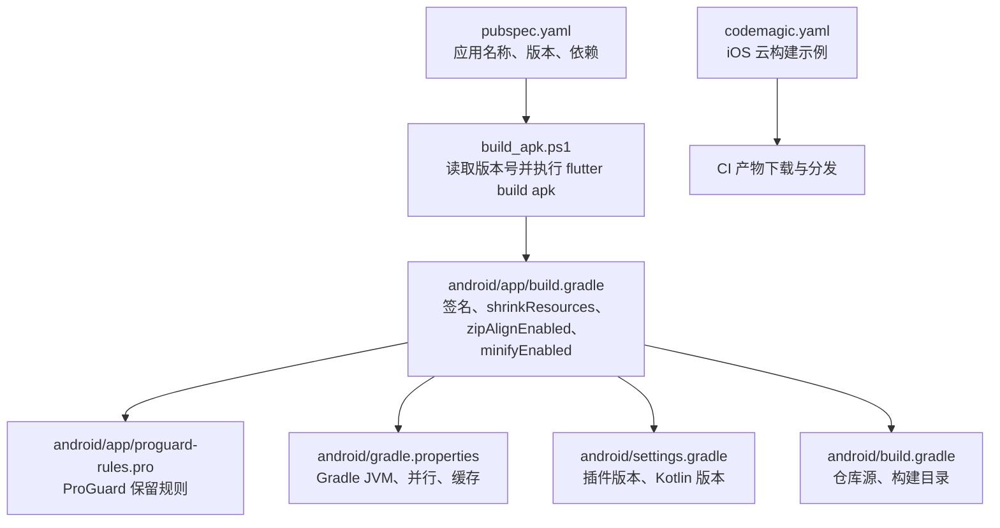
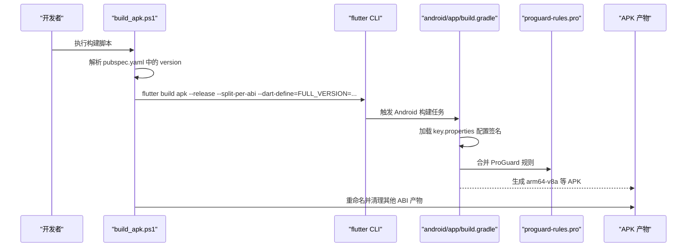
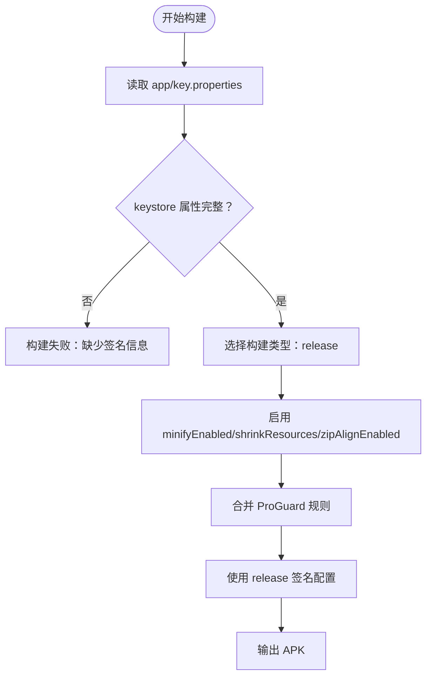
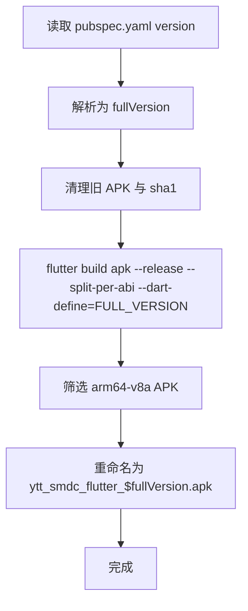
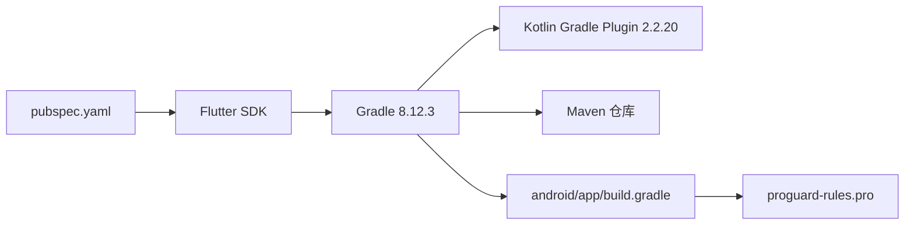
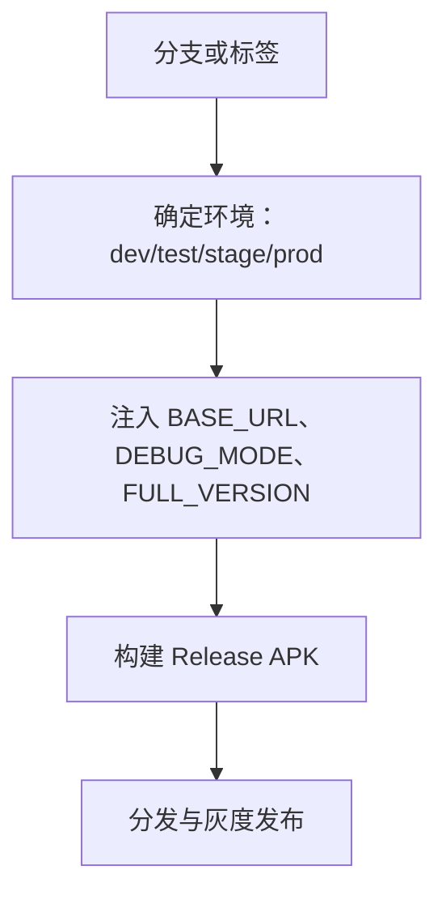

# 生产环境打包

<cite>
**本文引用的文件列表**   
- [android/app/build.gradle](file://android/app/build.gradle)
- [android/app/proguard-rules.pro](file://android/app/proguard-rules.pro)
- [android/build.gradle](file://android/build.gradle)
- [android/gradle.properties](file://android/gradle.properties)
- [android/settings.gradle](file://android/settings.gradle)
- [build_apk.ps1](file://build_apk.ps1)
- [codemagic.yaml](file://codemagic.yaml)
- [pubspec.yaml](file://pubspec.yaml)
- [lib/main.dart](file://lib/main.dart)
- [lib/net/connection_manager.dart](file://lib/net/connection_manager.dart)
</cite>

## 目录
1. [简介](#简介)
2. [项目结构](#项目结构)
3. [核心构建组件](#核心构建组件)
4. [架构总览](#架构总览)
5. [详细组件分析](#详细组件分析)
6. [依赖关系分析](#依赖关系分析)
7. [性能与体积优化](#性能与体积优化)
8. [多渠道与环境切换方案](#多渠道与环境切换方案)
9. [安全加固建议](#安全加固建议)
10. [生产部署最佳实践](#生产部署最佳实践)
11. [故障排查指南](#故障排查指南)
12. [结论](#结论)

## 简介
本文面向聚客美滋滋 Flutter 应用的生产环境打包，聚焦 Android Release 构建的安全、可重复、可回滚和可观测。内容覆盖：
- Keystore 密钥准备与 key.properties 敏感信息保护
- Release 构建类型签名配置
- ProGuard 混淆规则与第三方库适配
- 资源压缩与代码最小化参数
- 多渠道与环境切换的实现思路
- CI/CD 自动化脚本与版本注入
- 安全加固与生产部署最佳实践

## 项目结构
Android 侧的构建配置集中在 Gradle 文件中；Flutter 侧的版本定义在 pubspec.yaml；Windows 侧提供一键 APK 构建脚本；CI 侧提供 Codemagic iOS 测试包构建示例。

**图表来源**
- [pubspec.yaml:1-15](file://pubspec.yaml#L1-L15)
- [build_apk.ps1:1-53](file://build_apk.ps1#L1-L53)
- [android/app/build.gradle:1-85](file://android/app/build.gradle#L1-L85)
- [android/app/proguard-rules.pro:1-34](file://android/app/proguard-rules.pro#L1-L34)
- [android/gradle.properties:1-27](file://android/gradle.properties#L1-L27)
- [android/settings.gradle:1-27](file://android/settings.gradle#L1-L27)
- [android/build.gradle:1-23](file://android/build.gradle#L1-L23)
- [codemagic.yaml:1-34](file://codemagic.yaml#L1-L34)

**章节来源**
- [pubspec.yaml:1-15](file://pubspec.yaml#L1-L15)
- [build_apk.ps1:1-53](file://build_apk.ps1#L1-L53)
- [android/app/build.gradle:1-85](file://android/app/build.gradle#L1-L85)
- [android/app/proguard-rules.pro:1-34](file://android/app/proguard-rules.pro#L1-L34)
- [android/gradle.properties:1-27](file://android/gradle.properties#L1-L27)
- [android/settings.gradle:1-27](file://android/settings.gradle#L1-L27)
- [android/build.gradle:1-23](file://android/build.gradle#L1-L23)
- [codemagic.yaml:1-34](file://codemagic.yaml#L1-L34)

## 核心构建组件
- 应用元信息与依赖：pubspec.yaml 定义应用名、描述、Flutter/Dart SDK 范围、依赖与 assets。
- Android 应用构建脚本：android/app/build.gradle 定义编译目标、签名配置、构建类型（debug/release）、代码混淆与资源压缩。
- ProGuard 规则：android/app/proguard-rules.pro 声明需要保留的类，当前以高德地图相关包为主。
- Gradle 全局设置：android/gradle.properties 配置 Java 版本、并行构建、内存与 Kotlin 编译器开关；android/settings.gradle 声明 Android Gradle Plugin 与 Kotlin 版本；android/build.gradle 声明 Maven 仓库。
- Windows 构建脚本：build_apk.ps1 从 pubspec.yaml 解析版本，调用 flutter build apk --release --split-per-abi，并通过 dart-define 注入 FULL_VERSION。
- CI 示例：codemagic.yaml 提供 iOS 无签名构建与 ipa 封装流程，可作为 Android CI 配置的参考模板。

**章节来源**
- [pubspec.yaml:1-15](file://pubspec.yaml#L1-L15)
- [android/app/build.gradle:1-85](file://android/app/build.gradle#L1-L85)
- [android/app/proguard-rules.pro:1-34](file://android/app/proguard-rules.pro#L1-L34)
- [android/gradle.properties:1-27](file://android/gradle.properties#L1-L27)
- [android/settings.gradle:1-27](file://android/settings.gradle#L1-L27)
- [android/build.gradle:1-23](file://android/build.gradle#L1-L23)
- [build_apk.ps1:1-53](file://build_apk.ps1#L1-L53)
- [codemagic.yaml:1-34](file://codemagic.yaml#L1-L34)

## 架构总览
下图展示一次生产 APK 构建的关键路径：PowerShell 脚本读取 Flutter 版本、触发 Gradle 构建，Gradle 加载 keystore 属性，启用代码混淆与资源压缩，输出按 ABI 拆分的 APK。

**图表来源**
- [build_apk.ps1:1-53](file://build_apk.ps1#L1-L53)
- [pubspec.yaml:1-15](file://pubspec.yaml#L1-L15)
- [android/app/build.gradle:1-85](file://android/app/build.gradle#L1-L85)
- [android/app/proguard-rules.pro:1-34](file://android/app/proguard-rules.pro#L1-L34)

## 详细组件分析

### Android 签名与 Release 构建类型
- 签名配置位于 android/app/build.gradle 的 signingConfigs.release，通过 app/key.properties 动态读取 keyAlias、keyPassword、storeFile、storePassword。
- debug 与 release 构建类型均使用 release 签名配置，便于本地调试 Release 行为。
- Release 构建启用了 shrinkResources、zipAlignEnabled、minifyEnabled，并引入 proguard-android-optimize.txt 与 proguard-rules.pro。
- 应用 ID、版本号与名称由 local.properties 中的 flutter.versionCode 与 flutter.versionName 提供。

关键要点：
- 必须确保 app/key.properties 存在且包含完整签名信息，否则 Release 构建失败。
- 如果本地没有 Release 密钥，可在 CI 中通过环境变量或密钥管理服务注入 key.properties。
- debug 也使用 release 签名意味着本地调试更接近线上行为，但会暴露签名信息到本地环境，应谨慎处理。

**图表来源**
- [android/app/build.gradle:27-65](file://android/app/build.gradle#L27-L65)

**章节来源**
- [android/app/build.gradle:15-21](file://android/app/build.gradle#L15-L21)
- [android/app/build.gradle:27-65](file://android/app/build.gradle#L27-L65)

### ProGuard 混淆规则
当前 proguard-rules.pro 主要保留了高德地图相关的定位、搜索与地图渲染类，以避免运行时反射或动态加载失败。

现状评估：
- 保留范围较窄，仅针对高德地图相关包。
- 未显式保留 Flutter 插件可能需要的类、JSON 序列化类、RabbitMQ 客户端类等。
- 未开启 SourceFile、LineNumberTable 以便线上堆栈可读性提升。

建议补充方向（不直接修改代码）：
- 根据实际崩溃与日志，逐步添加 -keep class ... 与 -keepclassmembers class ... 规则。
- 对 JSON 序列化、反射调用、JNI 接口进行专项保留。
- 若需线上堆栈可读，可考虑开启行号保留并在发布前脱敏文件名。

**章节来源**
- [android/app/proguard-rules.pro:1-34](file://android/app/proguard-rules.pro#L1-L34)

### 资源压缩与代码最小化
- shrinkResources true：移除未使用的资源，减少 APK 体积。
- zipAlignEnabled true：对齐 Zip 文件，提升运行时内存占用效率。
- minifyEnabled true：启用代码压缩与混淆，结合 proguard-android-optimize.txt 与自定义规则。

注意事项：
- 资源压缩可能导致部分动态资源被误删，需在构建后验证图片、字体、协议页等资源是否可用。
- 代码最小化需配合正确的 ProGuard 规则，否则可能出现空方法、反射异常、插件初始化失败等问题。

**章节来源**
- [android/app/build.gradle:52-65](file://android/app/build.gradle#L52-L65)

### 版本管理与 Flutter 版本注入
- pubspec.yaml 定义 version: 1.0.0+1。
- build_apk.ps1 解析该版本，将 “1.0.0+1” 转换为 “1.0.0.1”，并通过 dart-define=FULL_VERSION 注入给 Flutter 层。
- 构建完成后只保留 arm64-v8a 的 APK，删除其余 ABI 产物并重命名为 ytt_smdc_flutter_$fullVersion.apk。

**图表来源**
- [pubspec.yaml:1-5](file://pubspec.yaml#L1-L5)
- [build_apk.ps1:1-53](file://build_apk.ps1#L1-L53)

**章节来源**
- [pubspec.yaml:1-5](file://pubspec.yaml#L1-L5)
- [build_apk.ps1:1-53](file://build_apk.ps1#L1-L53)

### CI 与云端构建参考
- codemagic.yaml 提供 iOS 无签名构建流程，用于在 macOS 云主机上生成 ipa，再在 Windows 上使用 Sideloadly 安装测试。
- Android 侧可参照该模式，将 key.properties、签名证书与构建参数注入 CI 环境变量，实现无人值守构建。

**章节来源**
- [codemagic.yaml:1-34](file://codemagic.yaml#L1-L34)

## 依赖关系分析
Android 构建链依赖如下：
- Gradle 插件与 Kotlin 版本由 settings.gradle 管理。
- Maven 仓库由 build.gradle 统一管理，确保插件与依赖稳定拉取。
- Gradle 运行参数由 gradle.properties 控制，包括 JVM 参数、并行构建、缓存开关。
- Flutter 版本约束由 pubspec.yaml environment.flutter 指定。

**图表来源**
- [android/settings.gradle:1-27](file://android/settings.gradle#L1-L27)
- [android/build.gradle:1-23](file://android/build.gradle#L1-L23)
- [android/gradle.properties:1-27](file://android/gradle.properties#L1-L27)
- [pubspec.yaml:1-15](file://pubspec.yaml#L1-L15)

**章节来源**
- [android/settings.gradle:1-27](file://android/settings.gradle#L1-L27)
- [android/build.gradle:1-23](file://android/build.gradle#L1-L23)
- [android/gradle.properties:1-27](file://android/gradle.properties#L1-L27)
- [pubspec.yaml:1-15](file://pubspec.yaml#L1-L15)

## 性能与体积优化
- 已启用 minifyEnabled、shrinkResources、zipAlignEnabled，有助于减少 APK 体积并提升运行效率。
- 建议在发布前进行基线对比：记录 APK 大小、启动时间、内存占用，并与历史版本比较。
- 若出现功能异常，优先缩小 ProGuard 规则范围，定位具体保留项，避免过度保留导致体积膨胀。
- 对于高频调用的网络、数据库与 UI 路径，结合日志与埋点数据进行性能回归。

[本节为通用指导，不直接分析具体文件]

## 多渠道与环境切换方案
当前代码库未定义 Android flavor 或多渠道配置，也没有在 Gradle 中定义不同环境的 API 地址变量。现有环境切换能力主要集中在 Dart 层：
- lib/net/connection_manager.dart 中存在一个静态调试覆盖地址字段，当非空时优先返回该地址。
- lib/main.dart 在 Release 环境下关闭了 debugPrint 的输出，以减少日志开销。
- build_apk.ps1 支持通过 dart-define 注入 FULL_VERSION，可用于前端显示与灰度策略。

推荐实现思路（不改变现有实现的前提下提出方案）：
- 在 Gradle 中定义 buildConfigField 或 resValue，将 BASE_URL、API_BASE_URL、DEBUG_MODE 等常量注入到 Android 侧；Dart 侧继续使用 dart-define 注入对应值。
- 通过 Flutter 的 define 或环境变量区分 dev/test/stage/prod 环境，集中管理 API 地址、功能开关与日志级别。
- 在多分支或 CI 流水线中，根据分支或标签决定注入的环境变量，从而形成稳定的多渠道/多环境构建策略。

[本图为概念流程，不对应具体源码文件]

**章节来源**
- [lib/net/connection_manager.dart:21-92](file://lib/net/connection_manager.dart#L21-L92)
- [lib/main.dart:23-29](file://lib/main.dart#L23-L29)
- [build_apk.ps1:1-53](file://build_apk.ps1#L1-L53)

## 安全加固建议
- 密钥管理：
  - 不要将 key.properties 提交到版本库；在 CI 中使用受保护的 Secret 注入。
  - 建议使用更安全的密钥存储方式，如 Android Keystore、CI 平台的密钥管理服务或外部签名服务。
- 代码混淆强度：
  - 保持 minifyEnabled 与 shrinkResources 开启。
  - 根据实际报错补充 ProGuard 保留规则，避免过度保留。
  - 对敏感逻辑尽量下沉到原生层或加密库，减少 Dart 侧明文逻辑暴露。
- 敏感信息防护：
  - 不在代码中硬编码 API Key、Token、商户信息等；统一通过环境变量或安全配置中心注入。
  - 对日志中的敏感字段进行脱敏处理，避免泄露用户数据与业务信息。
- 防逆向措施：
  - 结合系统级加固方案（如厂商加固平台），但需注意加固可能影响 ProGuard 与插件兼容性。
  - 对关键二进制与配置文件增加完整性校验，防止二次篡改。

[本节为通用安全建议，不直接分析具体文件]

## 生产部署最佳实践
- 版本管理策略：
  - 使用 pubspec.yaml 的 version 作为主版本，结合 Git Tag 或分支策略管理发布流。
  - 通过 build_apk.ps1 生成的 FULL_VERSION 与 APK 文件名保持一致，便于追溯。
- 灰度发布方案：
  - 通过环境变量注入 DEBUG_MODE 或灰度标识，控制功能开关与限流策略。
  - 先在内部设备或小比例商户中灰度，观察错误率、订单成功率、支付成功率等指标。
- 回滚机制：
  - 保留最近 N 个版本的 APK 与签名摘要，确保可快速回滚。
  - 服务端具备按版本兼容的能力，避免因版本升级导致接口不兼容。
- 监控与日志：
  - Release 下关闭 debugPrint，改用文件日志或远程日志上报。
  - 记录版本、设备型号、操作系统、网络状态与关键业务事件，便于问题定位。

[本节为通用部署建议，不直接分析具体文件]

## 故障排查指南
常见问题与处理建议：
- 构建失败：缺少 keystore 或 key.properties 属性不完整
  - 检查 app/key.properties 是否存在且包含 keyAlias、keyPassword、storeFile、storePassword。
  - 确认 storeFile 路径在 CI 环境中正确指向证书文件。
- 构建失败：Kotlin 或 Gradle 版本不匹配
  - 确认 settings.gradle 中 Kotlin 版本与插件版本满足依赖要求。
  - 若出现内置 Kotlin 与插件 kotlin-stdlib 版本冲突，保持 android.builtInKotlin=false。
- 运行时崩溃：反射或动态加载失败
  - 检查 proguard-rules.pro 是否保留了对应的类与方法。
  - 逐步缩小混淆范围，定位具体缺失的保留规则。
- 资源缺失：图片、字体或 HTML 协议页不可用
  - 检查 shrinkResources 是否误删了动态或引用不明显的资源。
  - 在构建后验证 assets/data 与 assets/images 下的关键资源。
- 日志为空：Release 下无法看到控制台日志
  - 这是预期行为，main.dart 在 Release 下清空了 debugPrint。
  - 应依赖文件日志或远程日志系统进行问题追踪。

**章节来源**
- [android/app/build.gradle:27-65](file://android/app/build.gradle#L27-L65)
- [android/settings.gradle:1-27](file://android/settings.gradle#L1-L27)
- [android/gradle.properties:1-27](file://android/gradle.properties#L1-L27)
- [android/app/proguard-rules.pro:1-34](file://android/app/proguard-rules.pro#L1-L34)
- [lib/main.dart:23-29](file://lib/main.dart#L23-L29)

## 结论
当前项目的 Android 生产构建已经具备基础签名、代码混淆与资源压缩能力，并通过 PowerShell 脚本实现了基于 pubspec.yaml 的版本注入与 APK 命名。为了达到企业级生产标准，建议：
- 完善 keystore 安全管理与 CI 注入机制。
- 扩展 ProGuard 规则，覆盖插件、反射与 JSON 序列化场景。
- 建立多渠道/多环境构建体系，集中管理 API 地址与调试开关。
- 结合灰度发布、监控日志与回滚策略，提升生产稳定性与可观测性。

[本节为总结性内容，不直接分析具体文件]