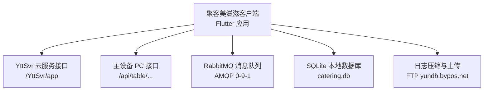
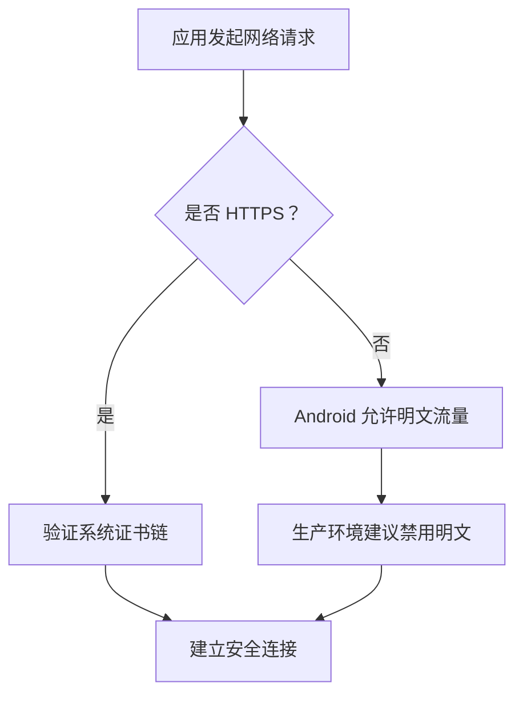

# 生产环境部署

<cite>
**本文引用的文件**   
- [README.md](file://README.md)
- [pubspec.yaml](file://pubspec.yaml)
- [lib/main.dart](file://lib/main.dart)
- [lib/res/constant.dart](file://lib/res/constant.dart)
- [lib/net/dio_utils.dart](file://lib/net/dio_utils.dart)
- [lib/net/http_api.dart](file://lib/net/http_api.dart)
- [lib/net/connection_manager.dart](file://lib/net/connection_manager.dart)
- [lib/net/mq_service_impl.dart](file://lib/net/mq_service_impl.dart)
- [lib/db/app_database.dart](file://lib/db/app_database.dart)
- [lib/util/file_log_writer.dart](file://lib/util/file_log_writer.dart)
- [lib/util/log_upload_utils.dart](file://lib/util/log_upload_utils.dart)
- [android/app/src/main/AndroidManifest.xml](file://android/app/src/main/AndroidManifest.xml)
- [android/app/src/main/res/xml/network_security_config.xml](file://android/app/src/main/res/xml/network_security_config.xml)
- [ios/Runner/Info.plist](file://ios/Runner/Info.plist)
</cite>

## 目录

1. [简介](#简介)
2. [项目结构与定位](#项目结构与定位)
3. [服务器与外部依赖环境要求](#服务器与外部依赖环境要求)
4. [应用配置管理](#应用配置管理)
5. [网络安全与传输策略](#网络安全与传输策略)
6. [数据持久化与数据库配置](#数据持久化与数据库配置)
7. [日志、监控与问题排查](#日志监控与问题排查)
8. [部署最佳实践](#部署最佳实践)
9. [常见问题排查](#常见问题排查)
10. [结论](#结论)

## 简介

聚客美滋滋是一个基于 Flutter 的餐饮点餐客户端，面向门店桌台终端使用。它通过云服务接口与 YttSvr 后端交互，同时支持直连主设备模式；本地使用 SQLite 存储业务数据，并通过 RabbitMQ 接收桌台状态、扫码接单、强制下线等实时事件。该项目不是传统意义上的服务端部署工程，而是**客户端应用的生产部署指南**：重点说明如何在门店设备上正确运行、如何对接 YttSvr、RabbitMQ、日志上传服务，以及如何配置网络、证书、权限和连接模式。

从仓库信息看，应用名称为“聚客美滋滋”，版本 `1.0.0+1`，技术栈包括 Flutter 3.19+、Dart 3.4+、Provider 状态管理、Dio 网络层、Fluro 路由、sp_util 本地存储，以及 sqflite 本地数据库和 dart_amqp RabbitMQ 客户端。

**章节来源**
- [README.md:1-50](file://README.md#L1-L50)
- [pubspec.yaml:1-20](file://pubspec.yaml#L1-L20)

## 项目结构与定位

该仓库是一个 Flutter 移动端应用，而不是后端服务。因此，“生产环境部署”的核心对象是**门店设备上的客户端安装包**，以及它所依赖的外部系统：

| 组件 | 角色 | 是否由本仓库直接提供 |
|---|---|---|
| YttSvr 云服务 | 订单、桌台、菜品、会员、交班等业务接口 | 否，由后端系统提供 |
| 主设备 PC 程序 | 直连模式下提供 `/api/...` 表操作接口 | 否，由门店主设备程序提供 |
| RabbitMQ | 推送桌台变更、扫码接单、强制下线等消息 | 否，需单独部署或接入云服务侧队列 |
| SQLite | 设备本地数据库 `catering.db` | 是，客户端内置 |
| 日志 FTP 服务 | 接收压缩日志包 | 否，代码中指向固定 FTP 地址 |
| Android/iOS 系统能力 | 网络、文件、权限、摄像头、麦克风等 | 是，由操作系统提供 |

**图表来源**
- [lib/net/http_api.dart:1-80](file://lib/net/http_api.dart#L1-L80)
- [lib/net/mq_service_impl.dart:1-120](file://lib/net/mq_service_impl.dart#L1-L120)
- [lib/db/app_database.dart:1-60](file://lib/db/app_database.dart#L1-L60)
- [lib/util/log_upload_utils.dart:1-60](file://lib/util/log_upload_utils.dart#L1-L60)

**章节来源**
- [README.md:20-50](file://README.md#L20-L50)
- [pubspec.yaml:21-111](file://pubspec.yaml#L21-L111)

## 服务器与外部依赖环境要求

### YttSvr 云服务配置

客户端通过 `HttpApi.baseUrlYttRoot` 指定 YttSvr 根路径，默认值为开发环境地址；生产环境应改为正式域名。代码注释明确列出三种场景：

| 环境 | 根路径 | 说明 |
|---|---|---|
| 本地联调 | `http://192.168.8.52:9096/YttSvr` | 局域网测试 |
| 测试环境 | `http://dev.bypos.net/YttSvr` | 当前代码默认值 |
| 生产环境 | `https://yun.bypos.net/YttSvr` | 建议上线时使用 HTTPS |

YttSvr 需要暴露以下关键路径（仅列举核心）：

| 模块 | 接口路径 | 用途 |
|---|---|---|
| 登录 | `/YttSvr/app/yttlogin` | 获取 token、商户号、门店编码、机号、主设备地址等 |
| 桌台区域 | `/YttSvr/app/table/area/getAreaList` | 查询桌台区域 |
| 桌台信息 | `/YttSvr/app/table/info/getTableInfoList` | 查询桌台状态 |
| 开台 | `/YttSvr/app/sale/beginTable` | 创建临时桌台 |
| 下单 | `/YttSvr/app/sale/upSaleMasterTmp` | 上传临时台桌数据 |
| 结账 | `/YttSvr/app/sale/saleflow` | 提交结账流水 |
| 清台 | `/YttSvr/app/sale/clearTable` | 清空桌台 |
| 商品分类 | `/YttSvr/app/bi/type/getTypeListandCode` | 加载菜品分类 |
| 商品列表 | `/YttSvr/app/bi/product/getProductList` | 加载商品 |
| 支付方式 | `/YttSvr/app/payinfo/getPayInfoList` | 加载支付渠道 |
| 会员 | `/YttSvr/app/vip/getList` | 查询会员 |
| 参数设置 | `/YttSvr/app/set/setParams` | 功能开关参数 |
| 交接班 | `/YttSvr/cashrecon/*` | 交班上报与查询 |

注意：交接班相关接口位于根路径 `/YttSvr/cashrecon/...`，不附加 `/app` 前缀。

**章节来源**
- [lib/net/http_api.dart:1-160](file://lib/net/http_api.dart#L1-L160)

### 数据库初始化

本项目客户端侧没有 SQL 建库脚本，也没有服务端迁移工具。SQLite 由客户端在首次打开时根据版本初始化表结构。数据库文件名为 `catering.db`，当前版本为 `3`。

| 项目 | 值 |
|---|---|
| 数据库文件名 | `catering.db` |
| 初始版本号 | `2` |
| 当前版本号 | `3` |
| 本地业务表 | 订单主单、明细、支付、做法、押金流水等 |
| 后端同步表 | 由后台下载机制填充 |
| Web 平台 | 不执行 sqflite，调用方按 `kIsWeb` 分流 |

客户端升级逻辑包含：

- v1 → v2：为 `t_must_product` 补充 `specid`、`specname`、`mustqty` 字段。
- v2 → v3：补建 `t_table_type`，解决开台弹窗附加费选项为空的问题。

生产环境不应手动修改该数据库文件，除非由官方维护脚本生成。

**章节来源**
- [lib/db/app_database.dart:1-120](file://lib/db/app_database.dart#L1-L120)

### Redis 缓存配置

在当前仓库源码中，未发现 Redis 客户端或 Redis 配置。客户端本地缓存主要依赖 `sp_util` 共享偏好和本地 SQLite 数据库。若业务需要 Redis，应在后端 YttSvr 中实现，客户端无需直接配置。

部署时确认：

- 客户端不直接连接 Redis。
- 后端缓存策略属于 YttSvr 运维范围。
- 客户端性能优化应关注网络超时、本地数据库批量写入、日志文件大小等。

### RabbitMQ 消息队列部署

客户端使用 `dart_amqp` 实现 AMQP 0-9-1 协议，用于接收桌台变更、扫码接单、强制下线、打印通知、叫号刷新等消息。

| 项目 | 默认值或规则 |
|---|---|
| 协议 | AMQP 0-9-1 |
| Exchange | `ytt`，Topic 类型 |
| Queue 命名 | `{account}-{storeCode}-{machNo}` |
| Routing Key | `ytt.{account}`、`ytt.{account}.{storeCode}`、`ytt.{account}.{storeCode}.{machNo}` |
| 默认端口 | 5672 |
| 认证方式 | PlainAuthenticator，用户名和密码在代码中使用硬编码示例 |
| 自动删除 | 队列非持久化且自动删除 |
| 重连间隔 | 约 10 秒 |
| 最大连接尝试 | 3 次 |

生产环境 RabbitMQ 必须满足：

1. 存在名为 `ytt` 的 Topic Exchange。
2. 允许客户端以账号、门店编码、机号组合声明队列。
3. 允许绑定上述三条 routing key。
4. 对客户端 IP 开放 5672 端口。
5. 认证账号具备声明 queue、bind exchange、consume 的权限。
6. 不建议把代码中的示例凭证直接用于生产；应替换为独立运维账号。

**章节来源**
- [lib/net/mq_service_impl.dart:1-200](file://lib/net/mq_service_impl.dart#L1-L200)
- [lib/res/constant.dart:40-60](file://lib/res/constant.dart#L40-L60)

## 应用配置管理

### API 地址与环境区分

应用存在明确的“开发/测试/生产”切换点：

| 配置项 | 位置 | 作用 |
|---|---|---|
| `baseUrlYttRoot` | `lib/net/http_api.dart` | YttSvr 根路径 |
| `baseUrlYtt` | `lib/net/http_api.dart` | 拼接后的 `/YttSvr/app` 基础路径 |
| `Constant.inProduction` | `lib/res/constant.dart` | Release 模式标志 |
| Dio 基础地址 | `lib/main.dart` | 当前示例写死 GitHub，实际应指向 YttSvr |
| 连接模式 | `lib/net/connection_manager.dart` | 主设备或云服务 |

推荐生产部署时：

- 将 `baseUrlYttRoot` 设置为 `https://yun.bypos.net/YttSvr`。
- 确保所有云接口走 HTTPS。
- 构建 Release 包后启用生产行为，例如关闭调试日志。

注意：`lib/main.dart` 中 `initDio()` 目前示例使用了 GitHub 地址。生产打包前应确认是否被 CI/CD 或自定义入口覆盖。若未覆盖，则正式发布包可能仍然请求 GitHub，导致业务接口不可用。

**章节来源**
- [lib/net/http_api.dart:1-30](file://lib/net/http_api.dart#L1-L30)
- [lib/main.dart:50-90](file://lib/main.dart#L50-L90)
- [lib/res/constant.dart:1-20](file://lib/res/constant.dart#L1-L20)

### 功能开关控制

功能开关主要通过以下方式控制：

1. **运行环境标志**：`Constant.inProduction` 决定 Release 下是否输出 `debugPrint`。
2. **登录返回的业务标志**：如 `pstore_vipflag`、`pstore_takeoutflag`、`pstore_miniverflag`、`mastermachstopflag`。
3. **连接模式**：`server_type` 支持不限、仅主设备、仅云服务。
4. **后端参数接口**：`/YttSvr/app/set/setParams` 可下发功能开关，如桌台点击开关、二次确认开关等。
5. **客户端本地开关**：如 `SETTLE_DY`、`SETTLE_ZJ`、`SETTLE_YJ` 控制结账打印、暂结、押金打印等行为。

生产环境建议：

- 优先使用后端下发的 `setParams` 控制灰度功能。
- 敏感开关不要硬编码在客户端。
- 对于线上只读或限流功能，结合后端响应中的标志位判断。

**章节来源**
- [lib/res/constant.dart:1-93](file://lib/res/constant.dart#L1-L93)
- [lib/net/http_api.dart:120-180](file://lib/net/http_api.dart#L120-L180)

### 安全证书与令牌

客户端网络层使用 Dio，并添加以下拦截器：

- `AuthInterceptor`：为云服务请求添加 `Authorization: token {accessToken}`。
- `TokenInterceptor`：处理 401 时刷新 token。
- `LoggingInterceptor`：开发时打印请求日志。
- `AdapterInterceptor`：统一适配响应结构。

认证流程要点：

- Token 存储在 `Constant.token`。
- Refresh token 存储在 `Constant.refreshToken`。
- Access token 存储在 `Constant.accessToken`。
- 仅当路径匹配 YttSvr 基础路径或不包含 `/api/` 时才添加 Authorization。
- 主设备直连接口不需要 Authorization。

生产环境建议：

- 始终使用 HTTPS。
- 不要把 token 明文写入日志。
- 刷新 token 失败后应提示重新登录。
- 避免在代理抓包环境中导出真实用户凭据。

**章节来源**
- [lib/net/intercept.dart:1-120](file://lib/net/intercept.dart#L1-L120)
- [lib/net/dio_utils.dart:1-60](file://lib/net/dio_utils.dart#L1-L60)

## 网络安全与传输策略

### Android 网络与安全配置

Android Manifest 中声明了以下权限：

| 权限 | 用途 |
|---|---|
| `INTERNET` | 访问网络 |
| `REQUEST_INSTALL_PACKAGES` | 安装更新包 |
| `RECORD_AUDIO` | 语音录入或扫描语音 |

Android 网络安全性配置允许明文 HTTP 流量，并信任系统和用户证书。这意味着：

- 开发时可访问内网 HTTP 服务。
- 生产环境应限制明文访问，仅允许 HTTPS。
- 若后端使用自签证书，需在证书托管方案中明确是否允许用户证书注入。

**图表来源**
- [android/app/src/main/AndroidManifest.xml:1-40](file://android/app/src/main/AndroidManifest.xml#L1-L40)
- [android/app/src/main/res/xml/network_security_config.xml:1-9](file://android/app/src/main/res/xml/network_security_config.xml#L1-L9)

### iOS 网络与安全配置

iOS Info.plist 中启用了 `NSAllowsArbitraryLoads`，即允许任意 HTTP 请求。这便于局域网主设备调试，但不符合严格的安全生产策略。

生产环境建议：

- 移除或收紧 `NSAllowsArbitraryLoads`。
- 仅允许后端域名使用 HTTPS。
- 若必须访问局域网主设备，可使用 `NSAllowsLocalNetworking` 而非全局放行。
- 配合后端证书校验，避免中间人攻击。

**章节来源**
- [ios/Runner/Info.plist:1-40](file://ios/Runner/Info.plist#L1-L40)

### TLS 版本与跨域访问

客户端代码未显式设置 TLS 最低版本，因此遵循平台默认行为：

- Android 通常支持 TLS 1.2 及以上。
- iOS 通常支持 TLS 1.2 及以上。
- Web 端受浏览器限制。

由于仓库未实现前端跨域预检逻辑，也不存在同源策略典型的前端反向代理需求，跨域问题更可能是：

- 后端未返回正确的 CORS 响应头。
- 防火墙或网关拦截了 WebSocket、AMQP 或 FTP 端口。
- 客户端误把主设备地址当作云服务域名。

生产环境应检查：

- YttSvr 是否允许来自门店网络段的请求。
- 网关是否透传必要请求头。
- RabbitMQ 和 FTP 是否在防火墙白名单中。

**章节来源**
- [lib/net/dio_utils.dart:60-120](file://lib/net/dio_utils.dart#L60-L120)
- [lib/net/connection_manager.dart:1-114](file://lib/net/connection_manager.dart#L1-L114)

## 数据持久化与数据库配置

### SQLite 文件路径与生命周期

客户端本地数据库文件位于系统数据库目录下的 `catering.db`。其生命周期如下：

- 应用启动时懒加载数据库。
- 首次打开根据版本创建表。
- 升级时执行增量迁移。
- 退出登录时清空全部业务表。
- 日志上传前执行 WAL checkpoint，保证拷贝完整。

| 阶段 | 行为 |
|---|---|
| 冷启动 | 异步初始化数据库连接 |
| 登录成功 | 可记录设备信息到日志 |
| 数据交换 | 批量插入后端表 |
| 退出登录 | 清空本地业务表 |
| 日志上传 | 先 checkpoint，再打包数据库目录 |

**章节来源**
- [lib/db/app_database.dart:1-120](file://lib/db/app_database.dart#L1-L120)

### 备份恢复策略

客户端没有内置自动备份定时任务，但提供了可用于恢复的数据源：

1. 本地 SQLite 数据库文件。
2. 本地日志目录。
3. 日志上传后远端 FTP 压缩包。

建议生产备份策略：

| 数据类型 | 备份方式 | 频率 |
|---|---|---|
| 本地数据库 | 拷贝 `catering.db` 及其 WAL 文件 | 每日或交班后 |
| 日志文件 | 保留最近 10~20 天 | 自动清理 + 人工归档 |
| 上传日志包 | 运维 FTP 归档 | 按需保留 |
| 业务数据 | 由 YttSvr 后端数据库负责 | 按后端 SLA |

注意：WAL 模式下的 `.db-wal` 和 `.db-shm` 可能与主数据库文件共同影响一致性，备份时应优先使用客户端提供的 checkpoint 后再拷贝。

**章节来源**
- [lib/db/app_database.dart:90-120](file://lib/db/app_database.dart#L90-L120)
- [lib/util/log_upload_utils.dart:1-120](file://lib/util/log_upload_utils.dart#L1-L120)

### 数据迁移方案

客户端数据迁移集中在 `_onUpgrade`：

- v1 → v2：补齐必选菜字段。
- v2 → v3：补建桌台类型表。

生产环境迁移原则：

- 不要直接修改已发布包的数据库结构。
- 新版本通过 `dbVersion` 递增触发迁移。
- 新增字段优先兼容旧数据。
- 新增表应与数据交换流程一致，避免本地写入与云端不一致。
- 回滚旧版本时，应评估高版本字段是否会被低版本破坏。

**章节来源**
- [lib/db/app_database.dart:60-120](file://lib/db/app_database.dart#L60-L120)

## 日志、监控与问题排查

### 本地日志体系

`FileLogWriter` 提供异步批量日志写入，按日期分目录，分类包括：

| 分类 | 用途 |
|---|---|
| `json_writer` | 通用运行日志 |
| `api_log` | 接口流水 |
| `crash_log` | 崩溃与错误日志 |
| `mq_log` | RabbitMQ 连接与消息日志 |
| `sql_log` | SQL 相关日志 |
| `print_log` | 打印相关日志 |
| `wm_log` | 外卖相关日志 |
| `pool_log` | 池相关日志 |

日志格式包含时间、连接模式、标签、正文，并支持截断超长日志。

**章节来源**
- [lib/util/file_log_writer.dart:1-120](file://lib/util/file_log_writer.dart#L1-L120)

### 崩溃日志收集

崩溃日志通过 `writeCrashLog` 立即落盘，避免进程退出后丢失关键堆栈。应用启动时还注册了统一异常处理器，并在 Release 模式下关闭 `debugPrint`。

生产建议：

- 定期收集设备本地日志目录。
- 开启日志上传触发条件，例如网络异常、登录失败、MQ 断开。
- 不要将崩溃堆栈中的敏感信息发送到公网分析平台。
- 将崩溃日志归类为独立告警通道。

**章节来源**
- [lib/main.dart:1-60](file://lib/main.dart#L1-L60)
- [lib/util/file_log_writer.dart:120-200](file://lib/util/file_log_writer.dart#L120-L200)

### 用户行为分析与错误上报

当前仓库没有集成第三方用户行为分析 SDK（如埋点统计平台）。可用的“用户行为”线索主要来自：

- 接口流水日志。
- MQ 消息消费日志。
- 登录、桌台操作、结账、交班等业务日志。
- 错误上报通过 MQ retcode=5 触发日志上传。

如果需要用户行为分析，建议在 YttSvr 后端集中采集，而不是在客户端引入额外统计 SDK。

### 日志上传服务

`LogUploadUtils` 会：

1. 收集本地日志目录。
2. 可选打包本地数据库目录。
3. 压缩为 zip。
4. 通过 FTP 上传到 `yundb.bypos.net:15671`。
5. 上传成功后删除本地 zip。

| 项目 | 值 |
|---|---|
| FTP 主机 | `yundb.bypos.net` |
| FTP 端口 | `15671` |
| 远程目录 | `YunPosDB/ANDROID/CY/` |
| 客户端标识 | `SMDC_APP` |
| 保留天数 | 1~2月 20 天，其他月份 10 天 |

生产环境需注意：

- FTP 服务应具备身份鉴权。
- 日志包可能包含数据库文件和敏感业务信息。
- 应限制上传目录权限。
- 应定期归档和清理历史日志。

**章节来源**
- [lib/util/log_upload_utils.dart:1-160](file://lib/util/log_upload_utils.dart#L1-L160)
- [lib/net/mq_service_impl.dart:120-200](file://lib/net/mq_service_impl.dart#L120-L200)

### 监控指标建议

虽然客户端未内置 APM SDK，生产环境仍应关注以下指标：

| 指标 | 来源 |
|---|---|
| 登录成功率 | 接口日志 |
| 云接口平均耗时 | 接口日志 |
| MQ 连接状态 | MQ 日志 |
| 数据库写入失败率 | SQL 日志 |
| 日志上传成功率 | 日志上传日志 |
| 主设备连接可用性 | 连接管理器状态 |
| 崩溃次数 | 崩溃日志 |

**章节来源**
- [lib/net/connection_manager.dart:1-114](file://lib/net/connection_manager.dart#L1-L114)
- [lib/util/file_log_writer.dart:1-200](file://lib/util/file_log_writer.dart#L1-L200)

## 部署最佳实践

### 灰度发布策略

客户端灰度建议采用分层策略：

| 层级 | 方式 | 目的 |
|---|---|---|
| 版本灰度 | 小比例门店安装新包 | 观察稳定性 |
| 功能灰度 | 后端下发开关 | 控制新功能可见性 |
| 连接模式灰度 | 限定部分门店为主设备模式 | 验证主设备链路 |
| 接口灰度 | 后端按门店编码分流 | 验证后端兼容性 |

客户端支持通过 `server_type` 控制连接模式：

- `0`：不限。
- `1`：仅主设备。
- `2`：仅云服务。

此外，连接管理器还提供运行时主设备断线广播，适合在 UI 层提示用户。

**章节来源**
- [lib/res/constant.dart:40-60](file://lib/res/constant.dart#L40-L60)
- [lib/net/connection_manager.dart:40-114](file://lib/net/connection_manager.dart#L40-L114)

### 回滚机制

客户端回滚应满足：

1. 新包版本不能破坏旧包可读取的数据库结构。
2. 新增字段应有默认值或兼容逻辑。
3. 新增表必须有数据交换或初始化流程。
4. 若发现严重问题，可退回上一稳定版本包。
5. 日志上传保留足够历史，便于对比回归问题。

**章节来源**
- [lib/db/app_database.dart:60-120](file://lib/db/app_database.dart#L60-L120)

### 容量规划

客户端容量规划重点不在 CPU 峰值，而在：

- 门店设备 I/O 能力。
- 本地数据库大小增长。
- 日志文件体积。
- 网络带宽稳定性。
- RabbitMQ 消息堆积。

建议：

- 每台门店设备保留至少 500MB 可用空间。
- 日志保留 10~20 天。
- 数据库超过一定大小时触发全量数据交换或清理。
- MQ 消费者应能处理突发消息。

### 负载均衡配置

客户端本身不提供服务，不存在传统负载均衡。但以下环节需要考虑负载：

| 环节 | 建议 |
|---|---|
| YttSvr | 多实例部署，数据库读写分离 |
| RabbitMQ | 集群节点 + 队列分区 |
| FTP 日志上传 | 单点写入，建议加 CDN 或对象存储网关 |
| 主设备 | 每台门店一台主设备，无横向扩展 |

**章节来源**
- [lib/net/mq_service_impl.dart:1-120](file://lib/net/mq_service_impl.dart#L1-L120)
- [lib/util/log_upload_utils.dart:160-240](file://lib/util/log_upload_utils.dart#L160-L240)

## 常见问题排查

### 网络连接问题

现象：

- 登录失败。
- 桌台数据无法加载。
- 云接口返回空或解析错误。

排查步骤：

1. 检查 `baseUrlYttRoot` 是否指向生产域名。
2. 检查 HTTPS 证书是否有效。
3. 检查 Android/iOS 是否允许访问目标域名。
4. 检查防火墙是否放行 443 或后端端口。
5. 查看接口流水日志和错误日志。
6. 确认是否误进入主设备模式。

**章节来源**
- [lib/net/http_api.dart:1-60](file://lib/net/http_api.dart#L1-L60)
- [lib/net/dio_utils.dart:1-120](file://lib/net/dio_utils.dart#L1-L120)
- [lib/util/file_log_writer.dart:80-160](file://lib/util/file_log_writer.dart#L80-L160)

### 数据库连接失败

现象：

- 本地数据无法写入。
- 开台弹窗异常。
- 数据交换时报表不存在。

排查步骤：

1. 检查 `catering.db` 是否存在。
2. 检查是否有写入权限。
3. 检查数据库版本是否与代码一致。
4. 检查是否缺少 `t_table_type` 等新增表。
5. 检查 WAL 文件是否损坏。
6. 必要时执行一次完整数据交换重建本地数据。

**章节来源**
- [lib/db/app_database.dart:1-120](file://lib/db/app_database.dart#L1-L120)

### 权限配置错误

现象：

- 无法安装更新包。
- 无法录音。
- iOS 上 HTTP 请求被拒绝。
- Android 上证书验证失败。

排查步骤：

1. Android 确认已声明 `INTERNET`、`REQUEST_INSTALL_PACKAGES`、`RECORD_AUDIO`。
2. iOS 确认隐私权限描述合理。
3. iOS 若仍需局域网 HTTP，谨慎评估 `NSAllowsArbitraryLoads`。
4. Android 若使用自签证书，确认用户证书是否可信。
5. 生产环境收紧网络策略，避免明文流量。

**章节来源**
- [android/app/src/main/AndroidManifest.xml:1-40](file://android/app/src/main/AndroidManifest.xml#L1-L40)
- [ios/Runner/Info.plist:1-40](file://ios/Runner/Info.plist#L1-L40)
- [android/app/src/main/res/xml/network_security_config.xml:1-9](file://android/app/src/main/res/xml/network_security_config.xml#L1-L9)

### RabbitMQ 连接失败

现象：

- 桌台状态不同步。
- 扫码接单不推送。
- MQ 日志显示连接失败。
- 客户端反复重试连接。

排查步骤：

1. 确认 RabbitMQ 存在 `ytt` exchange。
2. 确认账号、门店编码、机号正确。
3. 确认 5672 端口可达。
4. 确认队列命名规则与后端一致。
5. 检查认证账号权限。
6. 查看 MQ 日志中的 host、port、queue、routing key。

**章节来源**
- [lib/net/mq_service_impl.dart:1-200](file://lib/net/mq_service_impl.dart#L1-L200)

### 日志上传失败

现象：

- 收到上传日志指令但未上传成功。
- FTP 连接超时。
- 本地压缩包未删除。

排查步骤：

1. 检查 DNS 是否能解析 `yundb.bypos.net`。
2. 检查 15671 端口是否通。
3. 检查 FTP 账号密码是否有效。
4. 检查远程目录权限。
5. 检查本地磁盘空间。
6. 查看日志上传分类日志。

**章节来源**
- [lib/util/log_upload_utils.dart:1-200](file://lib/util/log_upload_utils.dart#L1-L200)

## 结论

聚客美滋滋的生产环境部署核心在于：**客户端包正确构建、YttSvr 云服务可用、RabbitMQ 消息队列就绪、本地 SQLite 数据库正常、日志上传链路畅通**。仓库本身不包含后端服务，因此部署文档的重点是客户端侧的配置边界、环境变量、网络策略、权限和安全注意事项。

生产上线前建议完成以下检查清单：

1. 将 YttSvr 基础地址切换到正式 HTTPS 域名。
2. 关闭开发模式下的调试日志和网络抓包代理。
3. 收紧 Android 明文流量和 iOS 任意 HTTP 配置。
4. 配置 RabbitMQ exchange、队列、路由和认证账号。
5. 验证 SQLite 数据库初始化与升级路径。
6. 验证日志压缩、FTP 上传和过期清理。
7. 制定回滚、灰度和容量规划策略。
8. 建立基于本地日志和后端接口的监控与告警。