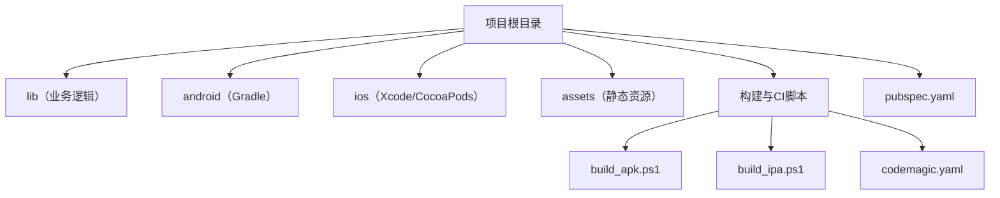
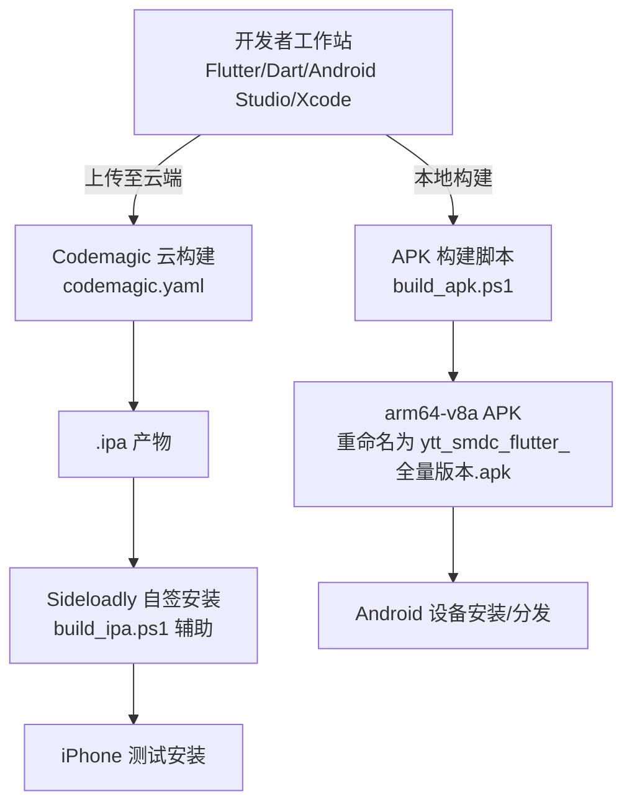
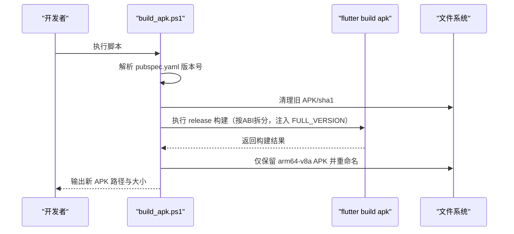
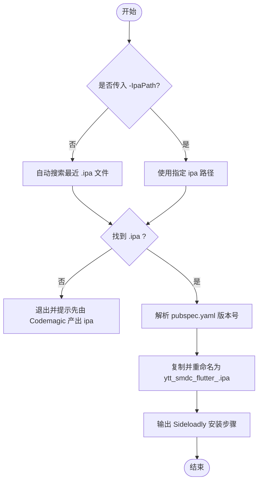
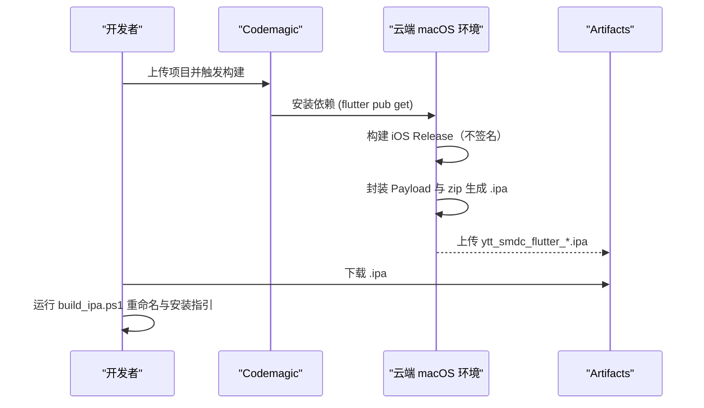
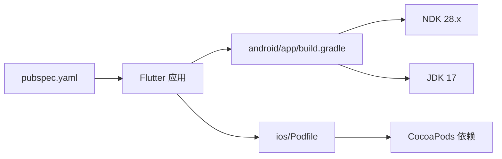

# 部署与发布

<cite>
**本文引用的文件**   
- [README.md](file://README.md)
- [pubspec.yaml](file://pubspec.yaml)
- [build_apk.ps1](file://build_apk.ps1)
- [build_ipa.ps1](file://build_ipa.ps1)
- [codemagic.yaml](file://codemagic.yaml)
- [download_flutter.ps1](file://download_flutter.ps1)
- [android/app/build.gradle](file://android/app/build.gradle)
- [android/gradle.properties](file://android/gradle.properties)
- [ios/Podfile](file://ios/Podfile)
- [docs/Android问题汇总.md](file://docs/Android问题汇总.md)
- [docs/iOS问题汇总.md](file://docs/iOS问题汇总.md)
</cite>

## 目录
1. [引言](#引言)
2. [项目结构](#项目结构)
3. [核心组件](#核心组件)
4. [架构总览](#架构总览)
5. [详细组件分析](#详细组件分析)
6. [依赖关系分析](#依赖关系分析)
7. [性能考虑](#性能考虑)
8. [故障排除指南](#故障排除指南)
9. [结论](#结论)
10. [附录](#附录)

## 引言
本操作指南面向“聚客美滋滋”Flutter 点餐应用的开发与发布人员，覆盖以下主题：
- 开发环境搭建要求：Flutter SDK、Android Studio/Xcode、依赖安装。
- 构建脚本使用：APK 构建与 IPA 测试包处理、版本号注入、输出命名。
- CI/CD 流水线：Codemagic 自动化构建流程说明。
- 生产环境部署配置：服务器环境、数据库初始化、配置文件与安全证书管理。
- 应用商店提交流程：Google Play Store 与 Apple App Store 的审核要求、元数据与截图准备。
- 故障排除：常见构建错误、签名问题、权限配置错误的解决方案。
- 运行期可观测性：性能监控、崩溃收集与日志收集的集成建议。

本项目为基于 Flutter 的点餐应用，技术栈包含 Provider、Dio、Fluro、sqflite 等基础设施。

**章节来源**
- [README.md:1-50](file://README.md#L1-L50)
- [pubspec.yaml:1-111](file://pubspec.yaml#L1-L111)

## 项目结构
仓库采用标准 Flutter 工程布局：
- lib：业务代码（页面、网络、MVP、工具、资源、路由）。
- android：Android 原生工程与 Gradle 构建配置。
- ios：iOS 原生工程与 CocoaPods 配置。
- assets：静态资源（图片、HTML、字体等）。
- test/integration_test：单元与集成测试入口。
- 根目录脚本：Windows PowerShell 构建辅助脚本与 Codemagic 配置。

**图表来源**
- [pubspec.yaml:1-111](file://pubspec.yaml#L1-L111)
- [build_apk.ps1:1-53](file://build_apk.ps1#L1-L53)
- [build_ipa.ps1:1-69](file://build_ipa.ps1#L1-L69)
- [codemagic.yaml:1-34](file://codemagic.yaml#L1-L34)

**章节来源**
- [README.md:1-50](file://README.md#L1-L50)
- [pubspec.yaml:1-111](file://pubspec.yaml#L1-L111)

## 核心组件
本节从“部署与发布”视角梳理关键要素：

- 环境与版本约束
  - Flutter SDK：>=3.19.0
  - Dart SDK：>=3.4.0 <4.0.0
  - Android：compileSdkVersion=36，targetSdkVersion=35，NDK 28.2.13676358，Java 17
  - iOS：最低平台 15.5（CocoaPods 源与插件兼容要求）

- 构建产物
  - Android：arm64-v8a APK，文件名带 FULL_VERSION 注入的版本号。
  - iOS：通过 Codemagic 构建无签名的 .ipa，本地可用 Sideloadly 自签安装。

- 版本与渠道
  - 应用版本号由 pubspec.yaml 的 version 字段驱动，构建脚本自动解析并注入 FULL_VERSION。
  - Android applicationId 固定为 com.bycloud.smdc；可通过 buildTypes 与 signingConfigs 切换调试/发布签名。

- 安全与隐私
  - Android 启用资源压缩、ZipAlign、代码混淆（ProGuard），可结合 --split-debug-info 定位线上堆栈。
  - 网络与文件访问需遵循 AndroidManifest 与 Info.plist 中的权限声明。

**章节来源**
- [pubspec.yaml:1-111](file://pubspec.yaml#L1-L111)
- [android/app/build.gradle:1-85](file://android/app/build.gradle#L1-L85)
- [android/gradle.properties:1-27](file://android/gradle.properties#L1-L27)
- [ios/Podfile:1-53](file://ios/Podfile#L1-L53)

## 架构总览
下图展示“本地开发 → 云构建 → 产物分发”的整体流程：

**图表来源**
- [build_apk.ps1:1-53](file://build_apk.ps1#L1-L53)
- [build_ipa.ps1:1-69](file://build_ipa.ps1#L1-L69)
- [codemagic.yaml:1-34](file://codemagic.yaml#L1-L34)

## 详细组件分析

### 开发环境搭建
- Flutter 与 Dart
  - 确保 Flutter >=3.19.0，Dart >=3.4.0。
  - Windows 可使用 download_flutter.ps1 下载指定稳定版 Flutter SDK（含清华镜像回退）。
- Android 环境
  - Android Studio 已安装 Android SDK、NDK（与 gradle.properties 中 NDK 版本一致）、JDK 17（gradle.properties 中 Java 路径）。
  - 在 android/local.properties 中设置 flutter.versionCode 与 flutter.versionName（由 app/build.gradle 读取）。
  - 如需签名打包，需在 android/app/key.properties 中提供 keystore 信息。
- iOS 环境
  - macOS + Xcode（用于 Pod install 与生成构建配置）。
  - CocoaPods 平台最低 15.5，Podfile 中已统一设置最低部署目标。
  - iOS 测试包通过 Codemagic 构建，无需本地 Mac 签名。

**章节来源**
- [download_flutter.ps1:1-17](file://download_flutter.ps1#L1-L17)
- [android/app/build.gradle:1-85](file://android/app/build.gradle#L1-L85)
- [android/gradle.properties:1-27](file://android/gradle.properties#L1-L27)
- [ios/Podfile:1-53](file://ios/Podfile#L1-L53)

### 构建脚本使用方法

#### Android APK 构建（build_apk.ps1）
- 作用
  - 从 pubspec.yaml 解析完整版本号（如 x.y.z+buildNumber -> x.y.z.buildNumber）。
  - 清理旧 APK 与 sha1 文件。
  - 执行 release 构建并按 ABI 拆分，仅保留 arm64-v8a APK。
  - 通过 dart-define 注入 FULL_VERSION，并重命名输出 APK。
- 典型用法
  - 在项目根目录执行：.\build_apk.ps1
- 输出
  - build/app/outputs/flutter-apk/ytt_smdc_flutter_<FULL_VERSION>.apk

**图表来源**
- [build_apk.ps1:1-53](file://build_apk.ps1#L1-L53)
- [pubspec.yaml:1-111](file://pubspec.yaml#L1-L111)

**章节来源**
- [build_apk.ps1:1-53](file://build_apk.ps1#L1-L53)
- [pubspec.yaml:1-111](file://pubspec.yaml#L1-L111)

#### iOS 测试包处理（build_ipa.ps1）
- 适用场景
  - 本机无 Mac 环境时，从 Codemagic 下载的 .ipa 进行版本化重命名与安装指引。
- 参数
  - -IpaPath：可选，显式指定 ipa 路径；不传则自动搜索当前目录、build\ios、Downloads。
- 行为
  - 解析 pubspec.yaml 版本号，复制并重命名为 ytt_smdc_flutter_<VERSION>.ipa。
  - 打印通过 Sideloadly 将 ipa 安装到 iPhone 的步骤（免费 Apple ID 自签，7 天有效期）。

**图表来源**
- [build_ipa.ps1:1-69](file://build_ipa.ps1#L1-L69)
- [pubspec.yaml:1-111](file://pubspec.yaml#L1-L111)

**章节来源**
- [build_ipa.ps1:1-69](file://build_ipa.ps1#L1-L69)

### CI/CD 流水线（Codemagic）
- 工作流
  - 名称：iOS 测试包（无签名，Sideloadly 自签安装）
  - 环境：Flutter stable，CocoaPods default
  - 步骤：
    1) flutter pub get
    2) flutter build ios --release --no-codesign
    3) 将 Runner.app 打包为 Payload，zip 生成 ytt_smdc_flutter_<version>.ipa
  - 产物：ytt_smdc_flutter_*.ipa
- 使用说明
  - 将项目打包上传至 Codemagic（排除大目录）。
  - 构建完成后下载 artifacts 中的 .ipa。
  - 本地使用 build_ipa.ps1 进行版本化重命名与安装指引。

**图表来源**
- [codemagic.yaml:1-34](file://codemagic.yaml#L1-L34)
- [build_ipa.ps1:1-69](file://build_ipa.ps1#L1-L69)

**章节来源**
- [codemagic.yaml:1-34](file://codemagic.yaml#L1-L34)
- [build_ipa.ps1:1-69](file://build_ipa.ps1#L1-L69)

### 生产环境部署配置
由于本仓库未提供后端服务或服务器部署脚本，以下为通用建议，请结合企业实际环境落地：

- 服务器环境
  - 操作系统：Linux（推荐 Ubuntu/Debian 或 RHEL 系）
  - 运行时：Node.js（若存在 Web 端）、API 网关、消息队列（RabbitMQ，项目中引用 dart_amqp 客户端）
  - 反向代理：Nginx/Traefik
- 数据库初始化
  - 应用使用 sqflite 作为本地数据库；服务端数据库类型与初始化脚本需由后端团队提供。
  - 首次上线需提供数据库 schema 与初始数据脚本。
- 配置文件管理
  - 前端动态配置通过 API 下发；如需编译期常量，可在构建命令中使用 dart-define 注入（参考 APK 构建脚本对 FULL_VERSION 的处理方式）。
  - 敏感配置建议使用密钥管理服务（如 Vault、AWS Secrets Manager）。
- 安全证书部署
  - TLS：申请并部署域名证书（Let's Encrypt 或 CA 签发），配置反向代理与上游服务。
  - 移动端：Android Keystore 与 iOS 签名证书/描述文件由发布流程管理（见下节）。

[本节为通用指导，不涉及具体源码文件]

### 应用商店提交流程

#### Google Play Store（Android）
- 准备
  - 创建 Google Play 开发者账号。
  - 生成并妥善保管 Keystore 与 key.properties（位于 android/app/key.properties）。
  - 确认 applicationId、versionCode、versionName 符合发布规范。
- 构建
  - 使用 build_apk.ps1 或 flutter build apk --release 构建签名 APK/AAB（Play 推荐使用 AAB）。
  - 建议在 release 模式下开启混淆与资源压缩（已在 app/build.gradle 中启用）。
- 提交
  - 上传产物至 Google Play Console，填写元数据（标题、描述、分类、隐私政策链接等）。
  - 上传宣传图与截图（不同屏幕密度与尺寸）。
  - 填写内容分级、隐私与安全信息。
- 审核
  - 遵循 Play 政策（广告、权限、内容、数据安全等）。
  - 注意最小 SDK 与目标 SDK 要求。

**章节来源**
- [android/app/build.gradle:1-85](file://android/app/build.gradle#L1-L85)
- [pubspec.yaml:1-111](file://pubspec.yaml#L1-L111)

#### Apple App Store（iOS）
- 准备
  - Apple Developer 账号与 Team ID。
  - 在 Xcode 中配置签名与 Provisioning Profile（或使用 Codemagic 云签名）。
  - 更新 Info.plist 元数据（Bundle Name、Bundle ID、版本、隐私声明等）。
- 构建
  - 本地使用 Xcode 或通过 Codemagic 构建签名 .ipa/.app。
  - 若使用 Codemagic 无签名构建，请使用 Sideloadly 进行自签测试（非 App Store 上架）。
- 提交
  - 通过 App Store Connect 上传二进制。
  - 填写元数据、定价、分类、截图与预览视频。
  - 完成应用审核问卷与隐私标签。
- 审核
  - 遵循 App Store 审核指南（隐私、权限、用户内容、支付等）。

[本节为通用指导，不涉及具体源码文件]

## 依赖关系分析
- Flutter/Dart 依赖
  - 通过 pubspec.yaml 声明，包含 Dio、Provider、Fluro、sqflite、mobile_scanner、dart_amqp 等。
- Android 依赖
  - Gradle 插件、Kotlin、Flutter Gradle 插件；NDK、Java 17 版本与缓存配置。
- iOS 依赖
  - CocoaPods 管理第三方库；Podfile 统一最低部署目标与静态框架链接。

**图表来源**
- [pubspec.yaml:1-111](file://pubspec.yaml#L1-L111)
- [android/app/build.gradle:1-85](file://android/app/build.gradle#L1-L85)
- [android/gradle.properties:1-27](file://android/gradle.properties#L1-L27)
- [ios/Podfile:1-53](file://ios/Podfile#L1-L53)

**章节来源**
- [pubspec.yaml:1-111](file://pubspec.yaml#L1-L111)
- [android/app/build.gradle:1-85](file://android/app/build.gradle#L1-L85)
- [android/gradle.properties:1-27](file://android/gradle.properties#L1-L27)
- [ios/Podfile:1-53](file://ios/Podfile#L1-L53)

## 性能考虑
- 构建优化
  - Android：启用 shrinkResources、zipAlignEnabled、minifyEnabled（已在 release 配置中启用）。
  - 可按需使用 --split-per-abi 减少安装包体积（build_apk.ps1 已启用）。
  - 可使用 --split-debug-info 与混淆映射文件还原线上堆栈。
- 运行时优化
  - 图片与网络：合理缓存策略（cached_network_image、Dio 拦截器）。
  - 数据库：sqflite 查询优化与索引设计。
  - 多线程：Dart isolate 与异步 IO 避免主线程阻塞。
- 可观测性建议
  - 崩溃收集：接入第三方 SDK（如 Sentry、Firebase Crashlytics）。
  - 性能监控：接入性能监控 SDK（如 Firebase Performance Monitoring、Sentry Performance）。
  - 日志收集：将应用日志上报至服务端或对象存储（仓库中已有日志相关工具类，可按需扩展）。

[本节为通用指导，不涉及具体源码文件]

## 故障排除指南

### Android 常见问题
- Flutter embedding 依赖无法解析
  - 现象：构建时报错 io.flutter:flutter_embedding_xxx 无法解析。
  - 解决：在 Android 仓库中添加 Flutter Maven 源或修改 flutter_tools gradle 文件中的 MAVEN_REPO。
- 打包与体积
  - 建议通过 --target-platform android-arm64 与 --split-debug-info 减小体积并便于定位堆栈。
- 已知问题历史
  - 文档记录了多个 Flutter 版本的已知问题与临时方案，遇到问题时可对照排查。

**章节来源**
- [docs/Android问题汇总.md:1-56](file://docs/Android问题汇总.md#L1-L56)

### iOS 常见问题
- CocoaPods CDN 更新失败
  - 现象：CDN: trunk Repo update failed。
  - 原因：CocoaPods 1.8 后默认使用 CDN spec repo。
  - 解决：在 Podfile 中指定 source 为 GitHub 或国内镜像；移除 trunk 源。
- CDN URL 无法下载
  - 解决：配置 hosts 或使用镜像源。

**章节来源**
- [docs/iOS问题汇总.md:1-55](file://docs/iOS问题汇总.md#L1-L55)

### 构建与签名问题
- Android 签名缺失或无效
  - 检查 android/app/key.properties 是否正确配置 storeFile、keyAlias、storePassword、keyPassword。
  - 确保 release 构建使用 signingConfigs.release。
- iOS 签名与描述文件
  - 在 Xcode 或 Codemagic 中正确配置 Team、证书与 Provisioning Profile。
- 权限配置错误
  - Android：检查 AndroidManifest.xml 中权限声明与 targetSdkVersion 匹配。
  - iOS：检查 Info.plist 中权限键值与用途描述。

**章节来源**
- [android/app/build.gradle:1-85](file://android/app/build.gradle#L1-L85)

### 环境变量与路径
- Gradle JVM 内存不足
  - 调整 org.gradle.jvmargs（已在 gradle.properties 中配置）。
- Kotlin 编译器版本冲突
  - 已关闭内置 Kotlin，使用外部 KGP 2.2.20；若仍报错，检查插件依赖版本。
- 跨盘符 JDK 路径
  - 通过 org.gradle.java.home 指向 JDK 17 目录。

**章节来源**
- [android/gradle.properties:1-27](file://android/gradle.properties#L1-L27)

## 结论
本指南围绕“聚客美滋滋”应用的开发与发布提供了端到端的说明：从 Flutter 与原生环境的搭建，到本地与云端的构建脚本使用，再到 CI/CD 流水线的组织与应用商店的提交流程。对于生产环境部署，应结合企业实际的后端与运维体系完善数据库初始化、配置管理与证书部署。在运行期，建议引入崩溃收集与性能监控能力，提升线上稳定性与可观测性。

[本节为总结性内容，不涉及具体源码文件]

## 附录

### 快速上手
- 安装 Flutter 与 Dart（>=3.19.0 / >=3.4.0）。
- 克隆仓库，执行 flutter pub get。
- Android 本地构建：.\build_apk.ps1。
- iOS 测试包：通过 Codemagic 构建 .ipa，本地用 build_ipa.ps1 重命名并安装。

**章节来源**
- [README.md:1-50](file://README.md#L1-L50)
- [build_apk.ps1:1-53](file://build_apk.ps1#L1-L53)
- [build_ipa.ps1:1-69](file://build_ipa.ps1#L1-L69)
- [codemagic.yaml:1-34](file://codemagic.yaml#L1-L34)