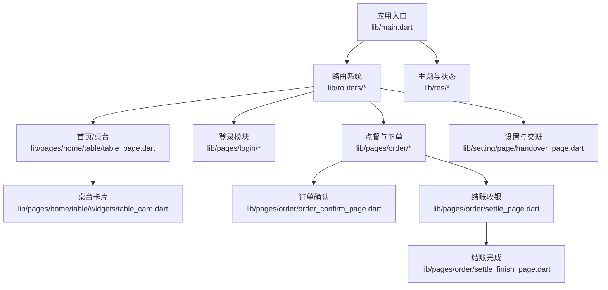
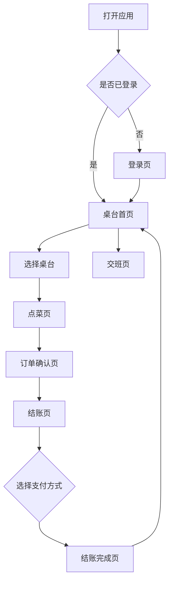
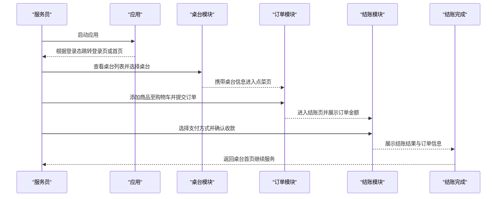

# 应用简介

<cite>
**本文引用的文件**   
- [README.md](file://README.md)
- [pubspec.yaml](file://pubspec.yaml)
- [lib/main.dart](file://lib/main.dart)
- [lib/pages/home/home_page.dart](file://lib/pages/home/home_page.dart)
- [lib/pages/home/table/table_page.dart](file://lib/pages/home/table/table_page.dart)
- [lib/pages/home/table/widgets/table_card.dart](file://lib/pages/home/table/widgets/table_card.dart)
- [lib/pages/home/takeout/takeout_page.dart](file://lib/pages/home/takeout/takeout_page.dart)
- [lib/pages/order/order_page.dart](file://lib/pages/order/order_page.dart)
- [lib/pages/order/order_confirm_page.dart](file://lib/pages/order/order_confirm_page.dart)
- [lib/pages/order/settle_page.dart](file://lib/pages/order/settle_page.dart)
- [lib/pages/order/settle_finish_page.dart](file://lib/pages/order/settle_finish_page.dart)
- [lib/setting/page/handover_page.dart](file://lib/setting/page/handover_page.dart)
</cite>

## 目录
1. [引言](#引言)
2. [项目结构](#项目结构)
3. [核心业务场景](#核心业务场景)
4. [目标用户与使用场景](#目标用户与使用场景)
5. [核心价值](#核心价值)
6. [部署形态与终端支持](#部署形态与终端支持)
7. [关键业务流程概览](#关键业务流程概览)
8. [版本规划与发展历程](#版本规划与发展历程)
9. [给新用户的快速认知建议](#给新用户的快速认知建议)
10. [结语](#结语)

## 引言
聚客美滋滋（ytt-smdc-flutter）是一款面向餐饮门店的服务员端点餐应用。它以 Flutter 为跨平台基础，围绕“桌台管理—点菜下单—结账收银—交班对账”的完整线下餐饮流程构建，同时覆盖堂食、外卖及扫码点餐等常见营业模式。应用通过本地桌台状态展示、购物车下单、促销与会员计算、多种支付方式结算以及交班汇总打印，帮助门店提高点餐效率、减少人工错误、统一收银口径，并支持桌台状态的实时同步。

## 项目结构
仓库是一个标准的 Flutter 移动应用工程，包含 Android、iOS、Web 三个平台的构建配置，业务代码集中在 `lib` 目录中：

- `lib/main.dart`：应用入口、全局初始化、主题、路由与登录态判断。
- `lib/pages`：按业务模块组织页面，包括首页、登录、订单、设置等。
- `lib/components`：可复用的弹窗、底部抽屉、选择器等业务组件。
- `lib/net`：网络层封装、连接管理、MQ 推送、支付网关等基础设施。
- `lib/db`：基于 SQLite 的实体与 DAO，用于交班、押金、会员、商品等数据持久化。
- `lib/routers`：Fluro 路由注册与跳转工具。
- `lib/util`：金额计算、设备信息、权限、打印、语音播报等通用工具。
- `android/`、`ios/`、`web/`：各平台原生配置与资源。

**图表来源**
- [lib/main.dart:1-159](file://lib/main.dart#L1-L159)
- [lib/pages/home/table/table_page.dart:1-200](file://lib/pages/home/table/table_page.dart#L1-L200)
- [lib/pages/order/order_confirm_page.dart:1-200](file://lib/pages/order/order_confirm_page.dart#L1-L200)
- [lib/pages/order/settle_page.dart:1-200](file://lib/pages/order/settle_page.dart#L1-L200)
- [lib/pages/order/settle_finish_page.dart:1-150](file://lib/pages/order/settle_finish_page.dart#L1-L150)
- [lib/setting/page/handover_page.dart:1-200](file://lib/setting/page/handover_page.dart#L1-L200)

**章节来源**
- [README.md:1-50](file://README.md#L1-L50)
- [pubspec.yaml:1-111](file://pubspec.yaml#L1-L111)
- [lib/main.dart:1-159](file://lib/main.dart#L1-L159)

## 核心业务场景
聚客美滋滋的核心业务是“服务员在门店现场完成从开台到结账再到交班的闭环服务”。主要业务场景包括：

| 业务场景 | 说明 | 对应界面或模块 |
|---|---|---|
| 登录与身份校验 | 支持普通登录和快捷登录，登录后进入首页；已登录时直接打开桌台页。 | 登录页、应用入口 |
| 桌台管理 | 展示区域与桌台网格，显示空闲、占用、锁台、挂单、预打等状态；支持筛选、搜索、轮询刷新与 MQ 实时推送。 | 首页桌台页、桌台卡片 |
| 点菜下单 | 左侧分类、右侧商品列表；购物车加购、规格、套餐、必点菜、促销、低消计算；提交订单。 | 点菜页、订单确认页 |
| 结账收银 | 查看订单明细、选择支付方式、会员优惠券、抹零、暂结、打印凭条、提交流水。 | 结账页、支付扫描页、结账完成页 |
| 外卖与扫码点餐 | 处理外卖平台订单与扫码点餐新单推送，支持接单、拒单、退单等操作。 | 外卖订单页 |
| 交班对账 | 统计销售、支付方式、菜品与分类、押金等，提交交班记录并可打印交班单。 | 交班页、现金对账服务 |

这些场景共同构成一套完整的餐饮服务操作流，覆盖堂食正餐、快餐、外卖与扫码点餐等多种门店运营方式。

**章节来源**
- [lib/pages/home/home_page.dart:1-15](file://lib/pages/home/home_page.dart#L1-L15)
- [lib/pages/home/table/table_page.dart:1-200](file://lib/pages/home/table/table_page.dart#L1-L200)
- [lib/pages/home/table/widgets/table_card.dart:1-200](file://lib/pages/home/table/widgets/table_card.dart#L1-L200)
- [lib/pages/order/order_page.dart:1-200](file://lib/pages/order/order_page.dart#L1-L200)
- [lib/pages/order/order_confirm_page.dart:1-200](file://lib/pages/order/order_confirm_page.dart#L1-L200)
- [lib/pages/order/settle_page.dart:1-200](file://lib/pages/order/settle_page.dart#L1-L200)
- [lib/pages/order/settle_finish_page.dart:1-150](file://lib/pages/order/settle_finish_page.dart#L1-L150)
- [lib/pages/home/takeout/takeout_page.dart:1-150](file://lib/pages/home/takeout/takeout_page.dart#L1-L150)
- [lib/setting/page/handover_page.dart:1-200](file://lib/setting/page/handover_page.dart#L1-L200)

## 目标用户与使用场景
### 服务员
服务员是应用的主要使用者。典型流程为：

1. 打开应用后自动登录或手动登录。
2. 在桌台页查看门店桌台状态，找到空闲桌台并点击进入点菜页。
3. 根据顾客需求选择分类、商品、规格、套餐、必点菜，加入购物车。
4. 在订单确认页核对待下单与已下单菜品，确认促销、低消、备注等信息。
5. 进入结账页选择支付方式，完成收款、打印凭条或暂结。
6. 返回桌台页更新桌台状态，继续服务下一桌顾客。

该流程强调“少步骤、少输入、多提示”，适合餐厅高峰期频繁切换桌台的操作节奏。

### 店长
店长更关注整体营收、支付方式明细、菜品销量、交班差异与异常订单。交班页提供销售汇总、支付方式明细、菜品与分类统计、押金统计等数据，并支持交班打印，便于门店日结与复盘。

### 店员
店员可能负责外卖接单、扫码点餐订单处理或辅助收银。外卖订单页支持接单、拒单、退单、催单回复等操作；扫码点餐订单会通过消息推送提醒，店员可快速响应新订单。

**图表来源**
- [lib/pages/login/page/login_page.dart:1-150](file://lib/pages/login/page/login_page.dart#L1-L150)
- [lib/pages/home/table/table_page.dart:1-200](file://lib/pages/home/table/table_page.dart#L1-L200)
- [lib/pages/order/order_page.dart:1-200](file://lib/pages/order/order_page.dart#L1-L200)
- [lib/pages/order/order_confirm_page.dart:1-200](file://lib/pages/order/order_confirm_page.dart#L1-L200)
- [lib/pages/order/settle_page.dart:1-200](file://lib/pages/order/settle_page.dart#L1-L200)
- [lib/pages/order/settle_finish_page.dart:1-150](file://lib/pages/order/settle_finish_page.dart#L1-L150)
- [lib/setting/page/handover_page.dart:1-200](file://lib/setting/page/handover_page.dart#L1-L200)

## 核心价值
聚客美滋滋为餐饮门店带来的核心价值可以归纳为以下四点：

1. **提高点餐效率**  
   桌台网格直观展示状态，分类与商品联动滚动，购物车加购便捷，订单确认页聚合待下单与已下单明细，减少重复操作与沟通成本。

2. **减少人工错误**  
   通过促销引擎、会员优惠、低消差额、抹零、支付方式组合等方式统一计算应收与实收，降低手工算错价格的风险。

3. **支持多种支付方式**  
   结账页加载支付方式列表，支持现金、扫码、会员卡、优惠券、暂结等模式，满足不同门店收银习惯。

4. **实现实时桌台状态同步**  
   桌台页支持轮询刷新、本地事件总线与 MQ 推送，主设备连接变化时弹出检查提示，保证多端协同时的桌台状态一致。

这些价值直接对应服务员日常高频操作，也服务于店长对经营数据的掌控需求。

**章节来源**
- [lib/pages/home/table/table_page.dart:1-200](file://lib/pages/home/table/table_page.dart#L1-L200)
- [lib/pages/order/order_confirm_page.dart:1-200](file://lib/pages/order/order_confirm_page.dart#L1-L200)
- [lib/pages/order/settle_page.dart:1-200](file://lib/pages/order/settle_page.dart#L1-L200)

## 部署形态与终端支持
聚客美滋滋采用 Flutter 跨平台开发，主要部署形态如下：

| 部署形态 | 说明 |
|---|---|
| Android 应用 | 通过 Android 平台配置打包为 APK，适用于手机与平板 PDA 设备，满足餐厅前台与移动点餐场景。 |
| iOS 应用 | 通过 iOS 平台配置打包为 IPA，适用于苹果设备。 |
| Web 应用 | 支持浏览器运行，主要用于云端联调与演示，部分能力以平台分流方式适配。 |
| Android 平板 PDA 设备 | 结合硬件扫码、打印、条码扫描等插件，支撑扫码点餐、外卖接单、库存盘点等扩展场景。 |

仓库中的 Android 与 iOS 原生目录表明应用具备完整的双端构建能力；依赖项中包含设备信息、二维码扫描、TTS 语音播报、RabbitMQ AMQP、SQLite 等能力，进一步说明应用面向真实门店终端环境设计。

**章节来源**
- [pubspec.yaml:1-111](file://pubspec.yaml#L1-L111)
- [README.md:1-50](file://README.md#L1-L50)

## 关键业务流程概览
下面以“点餐—下单—结账—完成”为主线，梳理服务员端的关键交互流程。

**图表来源**
- [lib/main.dart:1-159](file://lib/main.dart#L1-L159)
- [lib/pages/home/table/table_page.dart:1-200](file://lib/pages/home/table/table_page.dart#L1-L200)
- [lib/pages/order/order_page.dart:1-200](file://lib/pages/order/order_page.dart#L1-L200)
- [lib/pages/order/order_confirm_page.dart:1-200](file://lib/pages/order/order_confirm_page.dart#L1-L200)
- [lib/pages/order/settle_page.dart:1-200](file://lib/pages/order/settle_page.dart#L1-L200)
- [lib/pages/order/settle_finish_page.dart:1-150](file://lib/pages/order/settle_finish_page.dart#L1-L150)

## 版本规划与发展历程
从仓库可见信息看，聚客美滋滋当前是一个以 Flutter 为核心的移动端点餐应用起始项目。README 明确列出技术栈包括 Flutter、Dart、Provider、Dio、Fluro、sp_util 等；pubspec 定义应用名称为“点餐APP”，版本为 `1.0.0+1`。这说明项目在起步阶段已经搭建起网络层、路由层、MVP 基类、主题系统与页面骨架，并在后续迭代中逐步补齐桌台、点菜、结账、外卖、交班等核心功能。

结合近期提交信息与当前代码结构，项目发展历程可概括为：

- **初始阶段**：搭建 Flutter 工程、路由、网络、MVP、主题、登录与首页基础能力。
- **业务扩展阶段**：补充桌台管理、点菜下单、促销与会员、结账收银、外卖订单、交班对账等模块。
- **体验优化阶段**：完善桌台卡片样式、弹窗与底部抽屉组件、键盘避让、日志与打印、设备与权限适配。
- **持续演进方向**：围绕 POS 点餐核心流程，继续增强促销、会员、支付、打印、设备集成与稳定性。

由于 README 未给出详细版本发布计划，建议以“业务模块上线 + 体验优化 + 性能稳定”作为长期演进主线，而不是单纯追求版本号提升。

**章节来源**
- [README.md:1-50](file://README.md#L1-L50)
- [pubspec.yaml:1-111](file://pubspec.yaml#L1-L111)

## 给新用户的快速认知建议
对于刚接触聚客美滋滋的新用户，可以从以下顺序建立产品认知：

1. **先理解角色**：服务员负责现场点餐与结账；店长关注营收与交班；店员可能负责外卖与扫码点餐。
2. **再理解流程**：登录 → 桌台 → 点菜 → 确认 → 结账 → 完成 → 交班。
3. **重点看界面**：桌台页是入口，订单确认页是下单关键节点，结账页是资金落盘关键节点，交班页是门店日结关键节点。
4. **注意状态变化**：桌台空闲、占用、锁台、挂单、预打等状态直接影响服务员下一步操作。
5. **关注支付差异**：不同支付方式会影响实收、找零、打印内容和对账明细。
6. **熟悉异常提示**：主设备连接失败、登录失效、接口异常、权限不足等都会影响正常点餐，应优先排查网络与设备连接。

## 结语
聚客美滋滋（ytt-smdc-flutter）是一个围绕餐饮门店服务员工作流构建的 Flutter 点餐应用。它以桌台为中心、以订单为主线、以结账与交班为收尾，覆盖堂食、外卖与扫码点餐等常见营业模式。对于新用户而言，掌握“桌台—点菜—结账—交班”这一主线，就能快速理解产品的业务价值与使用方法。随着项目持续迭代，它将继续在服务效率、收银准确性、设备适配与数据一致性方面深化，成为门店数字化运营的重要工具。