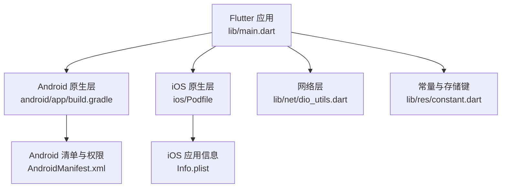

# 快速开始指南

<cite>
**本文引用的文件**   
- [pubspec.yaml](file://pubspec.yaml)
- [README.md](file://README.md)
- [lib/main.dart](file://lib/main.dart)
- [lib/res/constant.dart](file://lib/res/constant.dart)
- [lib/net/dio_utils.dart](file://lib/net/dio_utils.dart)
- [android/app/build.gradle](file://android/app/build.gradle)
- [android/gradle.properties](file://android/gradle.properties)
- [android/app/src/main/AndroidManifest.xml](file://android/app/src/main/AndroidManifest.xml)
- [ios/Podfile](file://ios/Podfile)
- [ios/Runner/Info.plist](file://ios/Runner/Info.plist)
- [docs/Android问题汇总.md](file://docs/Android问题汇总.md)
- [docs/iOS问题汇总.md](file://docs/iOS问题汇总.md)
</cite>

## 目录
1. [引言](#引言)
2. [项目结构概览](#项目结构概览)
3. [环境准备](#环境准备)
4. [克隆与依赖安装](#克隆与依赖安装)
5. [平台配置](#平台配置)
6. [首次运行](#首次运行)
7. [基础配置说明](#基础配置说明)
8. [常见问题排查](#常见问题排查)
9. [最佳实践与建议](#最佳实践与建议)
10. [结语](#结语)

## 引言
本指南面向首次接触“聚客美滋滋”点餐应用的开发者，帮助你在本地完成 Flutter 开发环境搭建、项目克隆、依赖安装、Android/iOS 平台配置，并最终成功运行第一个版本。文档中的命令和配置均以仓库中的 `pubspec.yaml`、`android/app/build.gradle`、`android/gradle.properties`、`ios/Podfile`、`ios/Runner/Info.plist` 以及应用入口 `lib/main.dart` 为依据。

## 项目结构概览
本项目是一个基于 Flutter 的跨平台点餐应用，主要目录职责如下：
- `lib/`：Flutter 业务代码，包括页面、网络层、MVP 基类、路由、设置、工具类和通用组件。
- `android/`：Android 原生工程，包含 Gradle 构建脚本、清单文件和权限声明。
- `ios/`：iOS 原生工程，包含 Xcode 项目、CocoaPods 配置和应用信息。
- `assets/`：静态资源，如图片、SVG、隐私协议和用户协议等。
- `docs/`：Android 与 iOS 的问题汇总文档。
- `pubspec.yaml`：Dart 包描述文件，定义 SDK 约束、依赖、资源和字体。



图表来源
- [lib/main.dart:1-159](file://lib/main.dart#L1-L159)
- [android/app/build.gradle:1-85](file://android/app/build.gradle#L1-L85)
- [ios/Podfile:1-53](file://ios/Podfile#L1-L53)
- [lib/net/dio_utils.dart:1-222](file://lib/net/dio_utils.dart#L1-L222)
- [lib/res/constant.dart:1-93](file://lib/res/constant.dart#L1-L93)
- [android/app/src/main/AndroidManifest.xml:1-89](file://android/app/src/main/AndroidManifest.xml#L1-L89)
- [ios/Runner/Info.plist:1-76](file://ios/Runner/Info.plist#L1-L76)

章节来源
- [README.md:1-50](file://README.md#L1-L50)
- [pubspec.yaml:1-111](file://pubspec.yaml#L1-L111)

## 环境准备
在开始之前，请确保你的计算机已安装以下工具：
- Git
- Flutter SDK（版本需满足 `>=3.19.0`）
- Dart SDK（版本需满足 `>=3.4.0 <4.0.0`）
- Android Studio（用于 Android 开发）
- Xcode（仅 iOS 开发需要）

Flutter 与 Dart 的版本约束来自 `pubspec.yaml`，因此请先通过命令行确认当前 Flutter 和 Dart 版本是否符合要求。若版本不匹配，请先升级或切换至符合要求的 Flutter/Dart 版本。

章节来源
- [pubspec.yaml:5-12](file://pubspec.yaml#L5-L12)

## 克隆与依赖安装
### 克隆项目
使用 Git 将项目克隆到本地：
```bash
git clone https://github.com/your-repo/flutter_deer.git
cd flutter_deer
```

### 安装依赖
进入项目根目录后，执行：
```bash
flutter pub get
```
该命令会读取 `pubspec.yaml` 并安装所有 Dart 依赖。项目还声明了多个第三方库，例如 Dio、Provider、Fluro、sqflite、mobile_scanner 等；这些依赖会在首次 `flutter pub get` 时自动拉取。

章节来源
- [README.md:14-20](file://README.md#L14-L20)
- [pubspec.yaml:13-67](file://pubspec.yaml#L13-L67)

## 平台配置
### Android 配置
#### SDK 与 Java 环境
- `compileSdkVersion` 为 36，`targetSdkVersion` 为 35。
- `ndkVersion` 为 `28.2.13676358`。
- Java 编译兼容性与目标兼容性均为 Java 17。
- `gradle.properties` 中启用了 AndroidX、Jetifier、Gradle 并行、缓存等优化选项。
- Kotlin 增量编译被显式关闭，以避免跨盘符路径异常；同时内置 Kotlin 编译器被关闭，由统一 KGP 2.2.20 编译。

常见注意事项：
- 确保 Android SDK 安装了 API 36 与对应平台工具。
- 确保 JDK 17 可用，且 `org.gradle.java.home` 指向正确 JDK 路径。
- 如果项目位于不同磁盘分区，注意 `gradle.properties` 中已禁用 Kotlin 增量编译以规避路径异常。

#### 应用标识与签名
- 应用包名为 `com.bycloud.smdc`。
- 应用名称显示为“聚客美滋滋”。
- Release 构建会读取 `app/key.properties` 进行签名；Debug 构建默认复用 Release 签名配置。
- 生产构建启用资源压缩、ZipAlign、代码混淆与 ProGuard 规则。

#### 权限与网络
- 清单中声明了网络访问、录音、安装应用等权限。
- 应用启用了网络安全性配置文件，允许调试模式下的明文网络请求。
- 清单中包含高德地图相关元数据及文件提供者配置。

章节来源
- [android/app/build.gradle:1-85](file://android/app/build.gradle#L1-L85)
- [android/gradle.properties:1-27](file://android/gradle.properties#L1-L27)
- [android/app/src/main/AndroidManifest.xml:1-89](file://android/app/src/main/AndroidManifest.xml#L1-L89)

### iOS 配置
#### CocoaPods 与最低系统版本
- Podfile 将最低 iOS 版本设置为 15.5，这是为了满足 mobile_scanner 的要求。
- 构建 Runner 时会自动调用 Flutter 提供的 podhelper 安装插件。
- post_install 阶段会将部署目标低于 15.5 的目标统一提升到 15.5。

#### 应用信息与权限
- Info.plist 中设置了中文与英文本地化。
- 相机、相册、麦克风、定位等权限说明均已配置。
- 应用标题和展示名称为“聚客美滋滋”。
- 应用传输安全策略允许任意 HTTP 请求，便于连接局域网主设备接口；上架前建议收紧为仅允许本地网络。

章节来源
- [ios/Podfile:1-53](file://ios/Podfile#L1-L53)
- [ios/Runner/Info.plist:1-76](file://ios/Runner/Info.plist#L1-L76)

## 首次运行
### 启动 Android 模拟器或连接真机
1. 打开 Android Studio。
2. 使用 AVD Manager 创建一个 Android 模拟器，或使用 USB 连接支持调试的真机。
3. 在终端执行：
   ```bash
   flutter devices
   ```
   确认设备列表中包含你的模拟器或真机。

### 运行应用
在项目根目录执行：
```bash
flutter run
```
若只想指定平台，可使用：
```bash
flutter run -d android
flutter run -d ios
```

### 验证应用是否正常启动
应用启动后会依据本地存储的登录状态决定初始页面：
- 未登录时进入登录页。
- 已登录时进入首页。

此外，应用会在启动时初始化日志、设备信息、Dio 网络层与路由，并隐藏系统状态栏与导航栏以提升全屏体验。

章节来源
- [lib/main.dart:1-159](file://lib/main.dart#L1-L159)

## 基础配置说明
### 后端服务器地址
应用入口在初始化 Dio 时设置基础 URL，当前默认值为 GitHub API：
```
https://api.github.com/
```
如果你要联调自己的后端服务，可在 `MyApp.initDio()` 中修改 `baseUrl`。由于项目使用了拦截器链，修改后仍会保留身份认证、Token 刷新、日志打印和数据适配逻辑。

章节来源
- [lib/main.dart:62-91](file://lib/main.dart#L62-L91)
- [lib/net/dio_utils.dart:1-222](file://lib/net/dio_utils.dart#L1-L222)

### 网络连接配置
- Android 清单中声明了 `INTERNET` 权限。
- 应用启用了网络安全性配置文件，可支持调试模式的明文网络请求。
- iOS 的 Info.plist 中开启了 `NSAllowsArbitraryLoads`，允许 HTTP 明文请求，适合连接局域网主设备。

如需更严格的网络策略：
- Android 端可在网络安全性配置文件中限制允许的域名或明文网络。
- iOS 端可将 `NSAllowsArbitraryLoads` 替换为 `NSAllowsLocalNetworking`，仅允许本地局域网访问。

章节来源
- [android/app/src/main/AndroidManifest.xml:1-89](file://android/app/src/main/AndroidManifest.xml#L1-L89)
- [ios/Runner/Info.plist:1-76](file://ios/Runner/Info.plist#L1-L76)

### 调试开关与日志
- 生产模式下会屏蔽 `debugPrint` 输出。
- Dio 拦截器在非生产模式下会添加日志拦截器。
- 应用入口会初始化文件日志与订单日志，便于排查问题。

章节来源
- [lib/res/constant.dart:1-15](file://lib/res/constant.dart#L1-L15)
- [lib/main.dart:17-60](file://lib/main.dart#L17-L60)
- [lib/net/dio_utils.dart:1-222](file://lib/net/dio_utils.dart#L1-L222)

## 常见问题排查
### 端口冲突
症状：
- `flutter run` 时报端口占用错误。
- 热重载失败或无法监听调试端口。

处理建议：
- 关闭其他正在占用 Flutter 调试端口的进程。
- 重启 Android Studio 或终端。
- 若持续出现端口问题，尝试重启设备或重新创建模拟器。

### 证书与签名问题
Android：
- Release 构建依赖 `app/key.properties`，请确保该文件存在且包含正确的 keystore 路径、别名和密码。
- Debug 构建默认复用 Release 签名配置，若缺少签名信息会导致构建失败。

iOS：
- 若出现证书、描述文件或 Bundle Identifier 相关错误，请在 Xcode 中检查 Signing & Capabilities。
- 若 Pod 安装失败，优先执行 `pod repo remove trunk` 并按问题汇总文档更换源。

章节来源
- [android/app/build.gradle:24-63](file://android/app/build.gradle#L24-L63)
- [docs/iOS问题汇总.md:1-55](file://docs/iOS问题汇总.md#L1-L55)

### 依赖版本不兼容
- Flutter 与 Dart 版本不匹配：请确保 Flutter 版本 `>=3.19.0`，Dart 版本 `>=3.4.0 <4.0.0`。
- Android NDK 或 Java 版本不匹配：当前工程使用 NDK `28.2.13676358` 与 Java 17。
- Kotlin 编译问题：项目已关闭内置 Kotlin 编译器并禁用增量编译，避免与插件依赖的 kotlin-stdlib 版本冲突。
- iOS 最低版本过低：Podfile 已将最低版本设为 15.5，若 Xcode 或模拟器版本过旧可能导致安装失败。

章节来源
- [pubspec.yaml:5-12](file://pubspec.yaml#L5-L12)
- [android/app/build.gradle:12-35](file://android/app/build.gradle#L12-L35)
- [android/gradle.properties:9-21](file://android/gradle.properties#L9-L21)
- [ios/Podfile:1-12](file://ios/Podfile#L1-L12)

### Android 构建解析失败
症状：
- 构建时报错提示无法解析 Flutter embedding 依赖。

处理建议：
- 参考 Android 问题汇总文档，在 Gradle 仓库中添加 Flutter Maven 源。
- 或修改 Flutter 工具中的 Gradle 配置，将仓库地址替换为国内可用地址。

章节来源
- [docs/Android问题汇总.md:1-28](file://docs/Android问题汇总.md#L1-L28)

### iOS CocoaPods 源问题
症状：
- CocoaPods 更新 spec repo 失败或 CDN 下载失败。

处理建议：
- 在 Podfile 中显式指定 source 源，或移除 trunk 源。
- 必要时在 hosts 文件中添加 GitHub raw 内容的 IP 映射。

章节来源
- [docs/iOS问题汇总.md:1-30](file://docs/iOS问题汇总.md#L1-L30)

## 最佳实践与建议
- 首次运行前先执行 `flutter doctor`，检查 Flutter 环境完整性。
- 若网络较慢，可考虑配置 Flutter 与 Dart 镜像源。
- 修改后端地址后，建议清理缓存并重新运行：
  ```bash
  flutter clean
  flutter pub get
  flutter run
  ```
- 在生产构建前，务必审查网络策略、日志输出与敏感配置。
- 若遇到平台相关问题，优先查看 `docs/Android问题汇总.md` 与 `docs/iOS问题汇总.md`。

## 结语
通过以上步骤，你应该已经完成了“聚客美滋滋”应用的环境搭建、依赖安装与首次运行。后续你可以基于现有 MVP 架构、Dio 网络层、Fluro 路由与 Provider 状态管理继续扩展功能。若在运行过程中遇到问题，可结合本文档的排查建议与仓库中的问题汇总文档逐步定位。