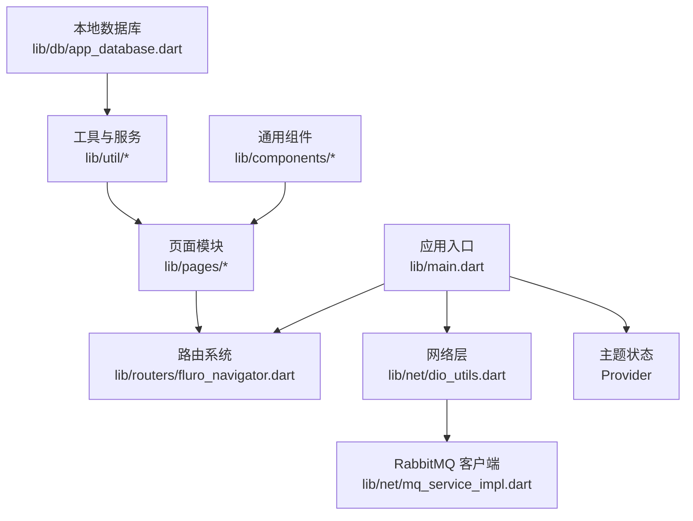
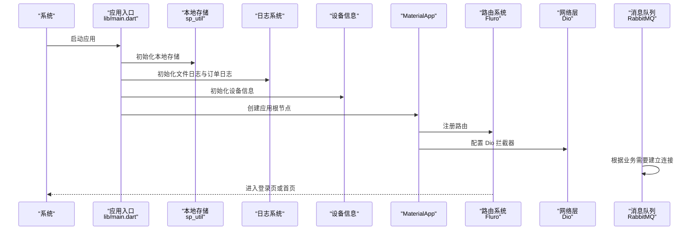
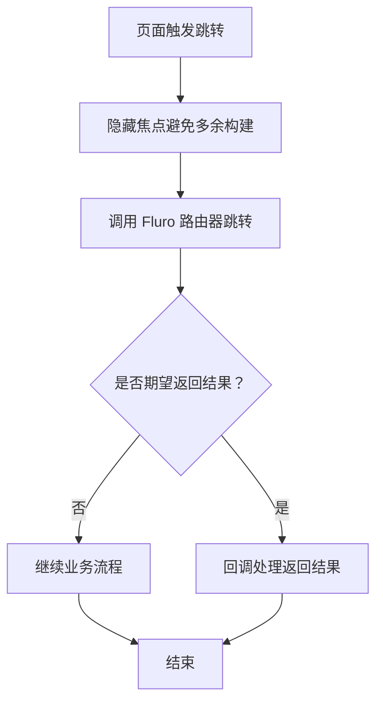
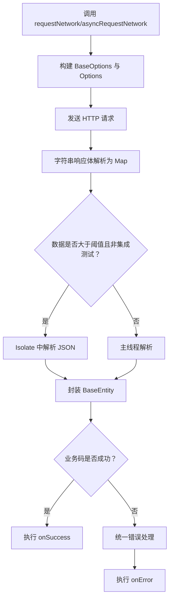
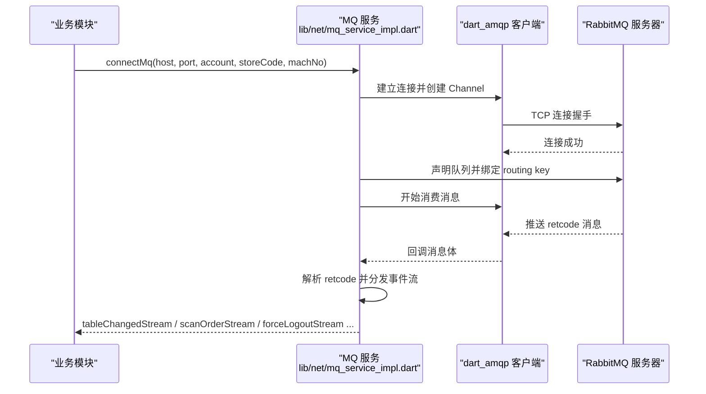
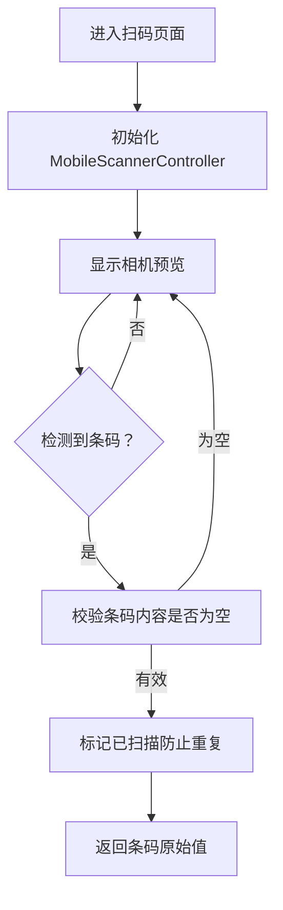
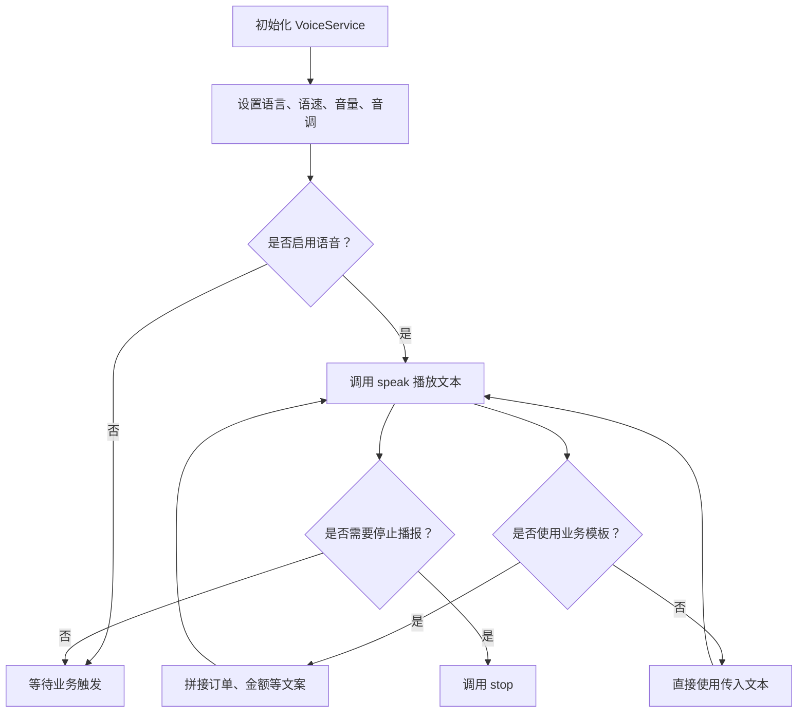
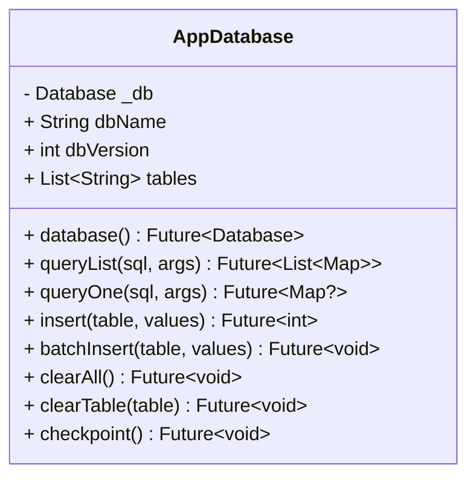
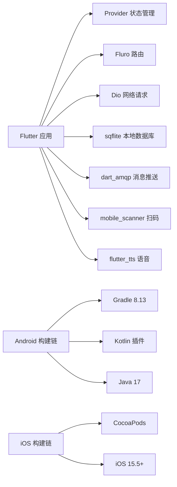

# 技术栈总览

<cite>
**本文引用的文件**   
- [pubspec.yaml](file://pubspec.yaml)
- [README.md](file://README.md)
- [lib/main.dart](file://lib/main.dart)
- [android/app/build.gradle](file://android/app/build.gradle)
- [android/gradle.properties](file://android/gradle.properties)
- [android/gradle/wrapper/gradle-wrapper.properties](file://android/gradle/wrapper/gradle-wrapper.properties)
- [ios/Podfile](file://ios/Podfile)
- [lib/routers/fluro_navigator.dart](file://lib/routers/fluro_navigator.dart)
- [lib/net/dio_utils.dart](file://lib/net/dio_utils.dart)
- [lib/net/mq_service_impl.dart](file://lib/net/mq_service_impl.dart)
- [lib/widgets/barcode_scanner_page.dart](file://lib/widgets/barcode_scanner_page.dart)
- [lib/util/voice_service.dart](file://lib/util/voice_service.dart)
- [lib/db/app_database.dart](file://lib/db/app_database.dart)
</cite>

## 目录
1. [引言](#引言)
2. [项目结构](#项目结构)
3. [核心依赖与选型说明](#核心依赖与选型说明)
4. [架构总览](#架构总览)
5. [关键组件分析](#关键组件分析)
6. [平台与工具链要求](#平台与工具链要求)
7. [依赖关系分析](#依赖关系分析)
8. [性能与稳定性考量](#性能与稳定性考量)
9. [常见问题排查](#常见问题排查)
10. [结论](#结论)

## 引言
本技术栈总览面向聚客美滋滋点餐应用，目标是帮助初学者理解 Flutter 端技术选型背景，同时为有经验的开发者提供可落地的架构决策细节。项目以 Flutter 作为跨平台 UI 框架，使用 Provider 管理状态、Fluro 实现模块化路由、Dio 处理网络请求、sqflite 提供 SQLite 本地存储、dart_amqp 实现 RabbitMQ 消息推送、mobile_scanner 完成条码二维码扫描、flutter_tts 提供语音播报能力。

## 项目结构
从入口和应用初始化可以看出，项目采用“页面 + 网络层 + 路由 + 资源 + 工具 + 组件”的横向分层组织方式：
- `lib/main.dart` 负责应用启动、全局异常处理、主题 Provider 注入、Dio 拦截器配置和路由初始化。
- `lib/pages` 按业务模块划分页面。
- `lib/net` 封装 Dio、拦截器、错误处理和 MQ 服务。
- `lib/routers` 基于 Fluro 提供统一路由跳转能力。
- `lib/util` 提供设备、日志、权限、打印、TTS 等通用工具。
- `lib/components` 提供弹窗、表单、底部抽屉等可复用组件。
- `lib/db` 封装 sqflite 数据库访问逻辑。

**图表来源**  
- [lib/main.dart:1-159](file://lib/main.dart#L1-L159)  
- [lib/routers/fluro_navigator.dart:1-72](file://lib/routers/fluro_navigator.dart#L1-L72)  
- [lib/net/dio_utils.dart:1-222](file://lib/net/dio_utils.dart#L1-L222)  
- [lib/net/mq_service_impl.dart:1-315](file://lib/net/mq_service_impl.dart#L1-L315)  
- [lib/db/app_database.dart:1-200](file://lib/db/app_database.dart#L1-L200)

**章节来源**  
- [README.md:1-50](file://README.md#L1-L50)  
- [lib/main.dart:1-159](file://lib/main.dart#L1-L159)

## 核心依赖与选型说明
以下依赖均声明在项目的依赖清单中，并配合 README 的技术栈摘要形成完整选型依据。

| 类别 | 依赖或版本 | 作用与选型理由 | 关键实现位置 |
|---|---|---|---|
| Flutter SDK | `>=3.19.0` | 跨平台 UI 框架基座，满足 Android/iOS/Web 统一开发需求 | [pubspec.yaml](file://pubspec.yaml) |
| Dart SDK | `>=3.4.0 <4.0.0` | 语言特性支持现代 Dart 语法、空安全及异步优化 | [pubspec.yaml](file://pubspec.yaml) |
| Provider | `^6.1.2` | 轻量级响应式状态管理，适合主题切换、简单全局状态 | [pubspec.yaml](file://pubspec.yaml), [lib/main.dart](file://lib/main.dart) |
| Fluro | `^2.0.5` | 模块化路由，通过统一导航工具封装 push/pop/result 流程 | [pubspec.yaml](file://pubspec.yaml), [lib/routers/fluro_navigator.dart](file://lib/routers/fluro_navigator.dart) |
| Dio | `^5.9.0` | 高性能 HTTP 客户端，支持拦截器、超时、代理、Isolate JSON 解析 | [pubspec.yaml](file://pubspec.yaml), [lib/net/dio_utils.dart](file://lib/net/dio_utils.dart) |
| sqflite | `^2.3.0` | SQLite 本地数据库，用于交班数据、订单相关表和本地缓存 | [pubspec.yaml](file://pubspec.yaml), [lib/db/app_database.dart](file://lib/db/app_database.dart) |
| dart_amqp | `^0.3.0` | AMQP 0-9-1 客户端，用于桌台状态、扫码接单、强制下线等实时推送 | [pubspec.yaml](file://pubspec.yaml), [lib/net/mq_service_impl.dart](file://lib/net/mq_service_impl.dart) |
| mobile_scanner | `^6.0.2` | 条码与二维码扫描，结合相机预览实现扫码点餐、商品扫码 | [pubspec.yaml](file://pubspec.yaml), [lib/widgets/barcode_scanner_page.dart](file://lib/widgets/barcode_scanner_page.dart) |
| flutter_tts | `^4.0.2` | 文字转语音，用于外卖新单、扫码点餐、退单等语音提醒 | [pubspec.yaml](file://pubspec.yaml), [lib/util/voice_service.dart](file://lib/util/voice_service.dart) |
| sp_util | `2.0.3` | 轻量本地键值存储，用于 Token、用户偏好等简单配置 | [pubspec.yaml](file://pubspec.yaml), [lib/main.dart](file://lib/main.dart) |
| oktoast | `^3.4.0` | 全局 Toast 提示，统一交互反馈体验 | [pubspec.yaml](file://pubspec.yaml), [lib/main.dart](file://lib/main.dart) |
| webview_flutter | `4.13.0` | WebView 承载协议页、活动页、H5 页面 | [pubspec.yaml](file://pubspec.yaml) |
| device_info_plus | `11.5.0` | 获取设备信息，用于公共参数和设备标识 | [pubspec.yaml](file://pubspec.yaml), [lib/main.dart](file://lib/main.dart) |
| crypto | `^3.0.6` | MD5 等加密能力，常用于签名、密码处理 | [pubspec.yaml](file://pubspec.yaml) |
| archive | `^4.0.0` | Zip 压缩，用于日志打包上传 | [pubspec.yaml](file://pubspec.yaml) |

**章节来源**  
- [pubspec.yaml:1-111](file://pubspec.yaml#L1-L111)  
- [README.md:1-50](file://README.md#L1-L50)  
- [lib/main.dart:1-159](file://lib/main.dart#L1-L159)

## 架构总览
应用启动后，先完成全局异常捕获、URL 策略、本地存储、日志系统、设备信息初始化，再创建 Material App；App 内部注入 Provider 主题状态，配置 Dio 拦截器，并注册 Fluro 路由。页面通过统一导航工具进行跳转，网络请求由 DioUtils 统一发起，MQ 服务通过 dart_amqp 建立连接并分发事件流。

**图表来源**  
- [lib/main.dart:1-159](file://lib/main.dart#L1-L159)  
- [lib/net/dio_utils.dart:1-222](file://lib/net/dio_utils.dart#L1-L222)  
- [lib/net/mq_service_impl.dart:1-315](file://lib/net/mq_service_impl.dart#L1-L315)

## 关键组件分析

### 路由组件：Fluro 模块化导航
路由层通过统一的 NavigatorUtils 封装 push、带结果返回、返回、WebView 跳转等方法，底层调用 Fluro 路由器，并使用原生过渡动画。未匹配路由时由 MaterialApp 的未知路由处理器跳转到 NotFoundPage。

**图表来源**  
- [lib/routers/fluro_navigator.dart:1-72](file://lib/routers/fluro_navigator.dart#L1-L72)  
- [lib/main.dart:1-159](file://lib/main.dart#L1-L159)

**章节来源**  
- [lib/routers/fluro_navigator.dart:1-72](file://lib/routers/fluro_navigator.dart#L1-L72)  
- [lib/main.dart:1-159](file://lib/main.dart#L1-L159)

### 网络组件：Dio 统一请求与拦截器
DioUtils 提供单例实例，封装 GET/POST 等请求方法，统一超时、BaseOptions、响应体类型和错误处理。大体积响应通过 compute 在 Isolate 中解析 JSON，降低主线程压力；非 Web 环境可按调试条件配置代理抓包。

**图表来源**  
- [lib/net/dio_utils.dart:1-222](file://lib/net/dio_utils.dart#L1-L222)

**章节来源**  
- [lib/net/dio_utils.dart:1-222](file://lib/net/dio_utils.dart#L1-L222)  
- [lib/main.dart:1-159](file://lib/main.dart#L1-L159)

### 消息推送组件：RabbitMQ 连接与事件分发
MqService 实现基于 dart_amqp 的连接管理，包含连接参数缓存、断线重连、队列声明、topic exchange 绑定、消费确认和事件流分发。retcode 对应不同业务事件：心跳、日志上传、强制下线、桌台变更、扫码点餐接单、叫号刷新、打印通知等。

**图表来源**  
- [lib/net/mq_service_impl.dart:1-315](file://lib/net/mq_service_impl.dart#L1-L315)

**章节来源**  
- [lib/net/mq_service_impl.dart:1-315](file://lib/net/mq_service_impl.dart#L1-L315)

### 扫码组件：mobile_scanner 条码二维码扫描
BarcodeScannerPage 使用 MobileScannerController 控制相机预览、检测速度、摄像头方向和闪光灯；检测到条码后只取第一个有效结果并返回给上一页。UI 上叠加半透明遮罩、扫描框和四角边线。

**图表来源**  
- [lib/widgets/barcode_scanner_page.dart:1-177](file://lib/widgets/barcode_scanner_page.dart#L1-L177)

**章节来源**  
- [lib/widgets/barcode_scanner_page.dart:1-177](file://lib/widgets/barcode_scanner_page.dart#L1-L177)

### 语音组件：flutter_tts 文字转语音播报
VoiceService 提供 TTS 初始化、播放、停止和业务模板方法，包括外卖新单、扫码点餐、退单、催单、收款播报和金额中文大写转换。Web 环境下跳过初始化以避免原生 TTS 不可用问题。

**图表来源**  
- [lib/util/voice_service.dart:1-134](file://lib/util/voice_service.dart#L1-L134)

**章节来源**  
- [lib/util/voice_service.dart:1-134](file://lib/util/voice_service.dart#L1-L134)

### 本地数据库组件：sqflite 表结构与操作封装
AppDatabase 封装 SQLite 数据库打开、建表、升级、批量插入、清空表和 WAL checkpoint 等操作。表结构分为后端下载表和本地业务表，Web 平台不执行数据库操作但保留 import 以兼容编译期引用。

**图表来源**  
- [lib/db/app_database.dart:1-200](file://lib/db/app_database.dart#L1-L200)

**章节来源**  
- [lib/db/app_database.dart:1-200](file://lib/db/app_database.dart#L1-L200)

## 平台与工具链要求

### Android 平台要求
- Gradle 版本：项目使用 Gradle Wrapper 指定 `gradle-8.13-bin.zip`。
- Kotlin：启用 `org.jetbrains.kotlin.android` 插件，并通过 `android.builtInKotlin=false` 交由外部 KGP 编译，避免 Flutter 内置 Kotlin 编译器与插件依赖版本冲突。
- Java 兼容性：`compileSdkVersion` 为 36，Java/Kotlin 源和目标兼容性设置为 17。
- NDK：NDK 版本固定为 `28.2.13676358`。
- 目标系统：minSdk 使用 Flutter 配置的最低版本，targetSdk 为 35。
- 构建优化：开启并行构建、Gradle Daemon、缓存、资源压缩、ZipAlign 和代码混淆。

| 项目 | 值或说明 |
|---|---|
| Gradle Wrapper | `gradle-8.13-bin.zip` |
| Kotlin 插件 | `org.jetbrains.kotlin.android` |
| 内置 Kotlin 行为 | `android.builtInKotlin=false` |
| Java 版本 | 源与目标均为 `VERSION_17` |
| compileSdkVersion | `36` |
| targetSdkVersion | `35` |
| minSdkVersion | 使用 Flutter 配置 |
| NDK 版本 | `28.2.13676358` |

**章节来源**  
- [android/gradle/wrapper/gradle-wrapper.properties:1-6](file://android/gradle/wrapper/gradle-wrapper.properties#L1-L6)  
- [android/app/build.gradle:1-85](file://android/app/build.gradle#L1-L85)  
- [android/gradle.properties:1-27](file://android/gradle.properties#L1-L27)

### iOS 平台要求
- 最低部署版本：Podfile 将 iOS 平台版本提升至 `15.5`，以满足 mobile_scanner 对系统版本的依赖。
- CocoaPods：启用静态框架链接，并在 post_install 中将低版本目标的部署目标统一到 15.5。
- Flutter 集成：通过 `flutter_ios_podfile_setup` 自动注入 Flutter 所需的 Pod 配置。

| 项目 | 值或说明 |
|---|---|
| 最低 iOS 版本 | `15.5` |
| 框架链接模式 | `use_frameworks! :linkage => :static` |
| 构建目标调整 | post_install 统一不低于 15.5 |
| Flutter Pod 集成 | 使用 Flutter 工具生成的 xcconfig 和 podhelper |

**章节来源**  
- [ios/Podfile:1-53](file://ios/Podfile#L1-L53)

### 开发工具链建议
- Flutter SDK：至少 `3.19.0`，推荐安装与项目一致的稳定版。
- Dart SDK：至少 `3.4.0`，低于该版本无法满足项目环境约束。
- Android 开发：Android Studio 或 VS Code 配合 Android SDK、JDK 17、Gradle 8.13 和 NDK 28.2.13676358。
- iOS 开发：Xcode 需支持 iOS 15.5+，CocoaPods 需能正确解析 Podfile 中的静态框架和 Flutter Pod 配置。
- 命令行基础命令：`flutter pub get` 获取依赖，`flutter run` 启动运行。

**章节来源**  
- [pubspec.yaml:1-111](file://pubspec.yaml#L1-L111)  
- [README.md:1-50](file://README.md#L1-L50)

## 依赖关系分析
Flutter 层依赖 Provider、Fluro、Dio、sqflite、dart_amqp、mobile_scanner、flutter_tts 等库；Android 层依赖 Kotlin 插件和 Gradle 生态；iOS 层依赖 CocoaPods 和 mobile_scanner 的系统能力。各组件职责清晰，耦合点主要集中在入口初始化、路由、网络和平台配置。

**图表来源**  
- [pubspec.yaml:1-111](file://pubspec.yaml#L1-L111)  
- [android/gradle/wrapper/gradle-wrapper.properties:1-6](file://android/gradle/wrapper/gradle-wrapper.properties#L1-L6)  
- [android/app/build.gradle:1-85](file://android/app/build.gradle#L1-L85)  
- [android/gradle.properties:1-27](file://android/gradle.properties#L1-L27)  
- [ios/Podfile:1-53](file://ios/Podfile#L1-L53)

**章节来源**  
- [pubspec.yaml:1-111](file://pubspec.yaml#L1-L111)  
- [android/app/build.gradle:1-85](file://android/app/build.gradle#L1-L85)  
- [ios/Podfile:1-53](file://ios/Podfile#L1-L53)

## 性能与稳定性考量
- 网络解析性能：DioUtils 对大于阈值的响应体使用 Isolate 解析，减少主线程阻塞风险。
- 日志与监控：文件日志和订单日志分离，MQ 连接与消息处理也写入独立日志，便于 Release 环境回溯。
- 数据库写入：批量插入使用 Batch 提交，避免逐条插入带来的事务开销。
- 连接可靠性：MQ 连接具备断线重连、防并发连接和手动消息确认机制。
- 构建优化：Android 开启资源压缩、ZipAlign、代码混淆和并行构建，有助于减小包体和提升构建速度。

[本节为通用指导，不直接分析具体源码行]

## 常见问题排查
- 扫码无法启动或权限不足：检查 mobile_scanner 所需相机权限，确认 iOS 最低版本满足 15.5。
- TTS 无声音或初始化失败：Web 环境会跳过初始化；确认设备语言支持中文，且未禁用语音功能。
- MQ 连接失败或频繁重连：检查 host、port、账号、门店编码和设备编号是否正确；确认服务端 exchange 和 queue 已存在。
- Android 构建报 Kotlin 版本冲突：确保关闭内置 Kotlin，并使用与插件匹配的 KGP 版本。
- iOS 构建报部署版本过低：检查 Podfile 中 iOS 版本是否被 post_install 提升到 15.5。

**章节来源**  
- [lib/widgets/barcode_scanner_page.dart:1-177](file://lib/widgets/barcode_scanner_page.dart#L1-L177)  
- [lib/util/voice_service.dart:1-134](file://lib/util/voice_service.dart#L1-L134)  
- [lib/net/mq_service_impl.dart:1-315](file://lib/net/mq_service_impl.dart#L1-L315)  
- [android/gradle.properties:1-27](file://android/gradle.properties#L1-L27)  
- [ios/Podfile:1-53](file://ios/Podfile#L1-L53)

## 结论
聚客美滋滋应用以 Flutter 3.19+ 和 Dart 3.4+ 为基础，选择 Provider、Fluro、Dio、sqflite、dart_amqp、mobile_scanner、flutter_tts 等成熟库，形成“状态管理 + 路由 + 网络 + 本地存储 + 消息推送 + 硬件能力 + 语音”的完整技术栈。Android 侧要求 Gradle 8.13、Kotlin 插件、Java 17 和指定 NDK 版本；iOS 侧要求 iOS 15.5 以上并通过 CocoaPods 静态框架集成。对于初学者，该架构提供了清晰的职责边界；对于有经验的开发者，可在拦截器、MQ 事件、数据库迁移和构建优化层面进一步扩展。