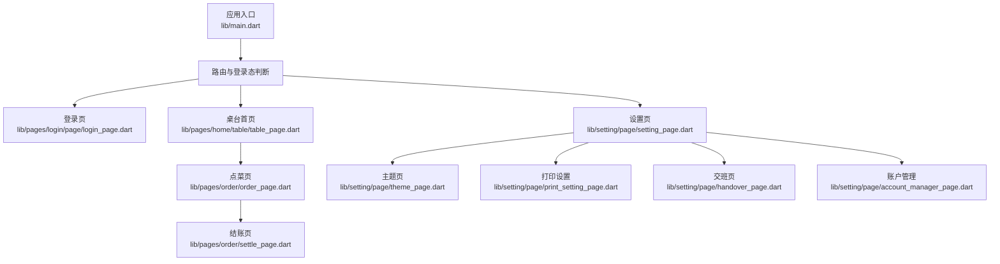
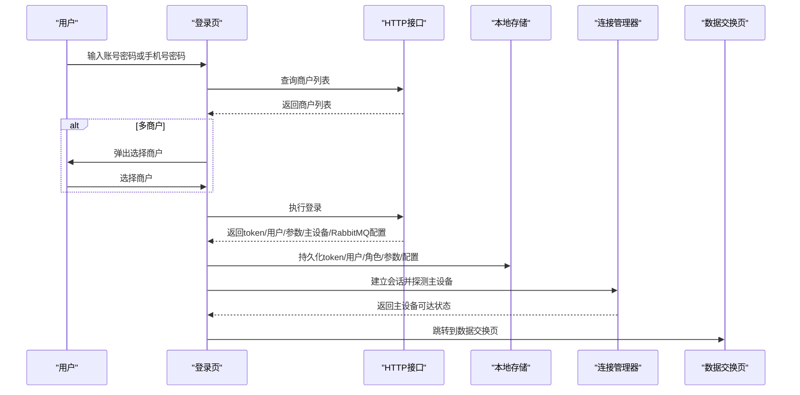
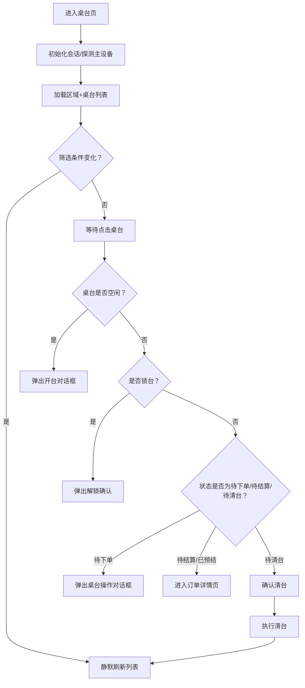
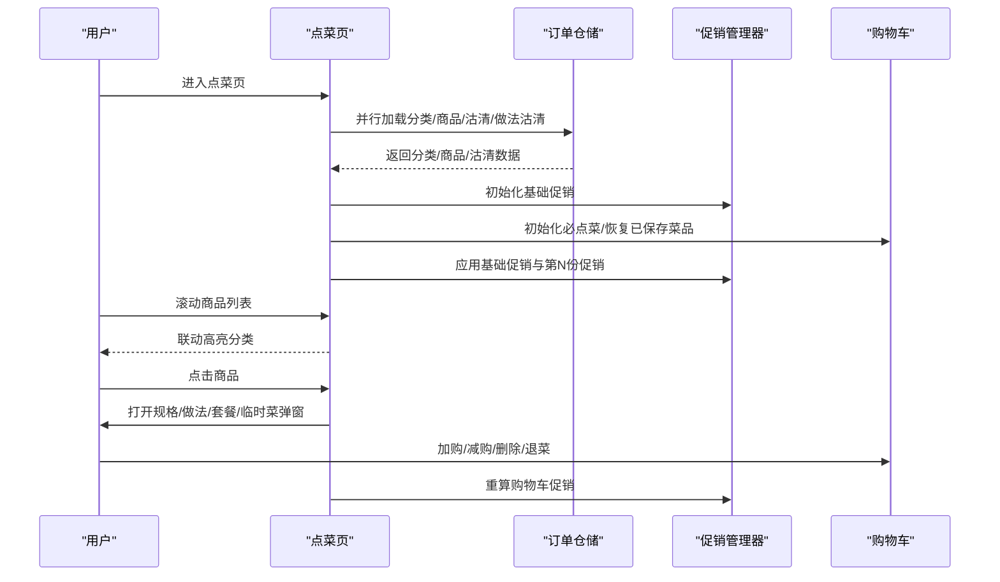
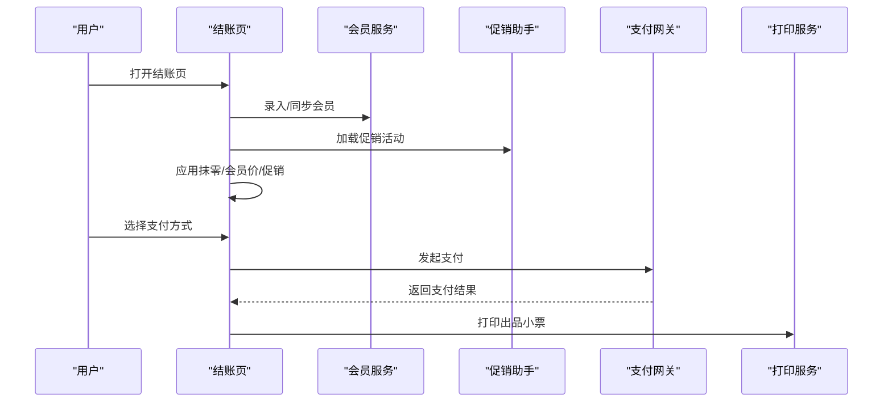
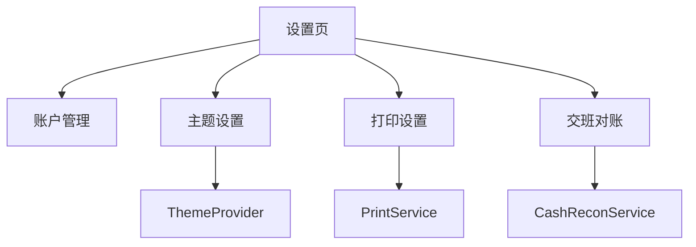
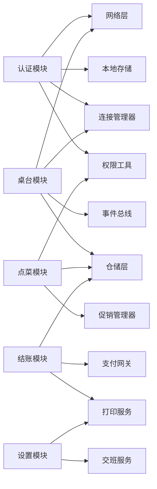

# 核心功能介绍

<cite>
**本文引用的文件**   
- [lib/main.dart](file://lib/main.dart)
- [lib/pages/login/page/login_page.dart](file://lib/pages/login/page/login_page.dart)
- [lib/pages/login/page/sms_login_page.dart](file://lib/pages/login/page/sms_login_page.dart)
- [lib/pages/home/table/table_page.dart](file://lib/pages/home/table/table_page.dart)
- [lib/pages/order/order_page.dart](file://lib/pages/order/order_page.dart)
- [lib/pages/order/settle_page.dart](file://lib/pages/order/settle_page.dart)
- [lib/setting/page/setting_page.dart](file://lib/setting/page/setting_page.dart)
- [lib/setting/page/account_manager_page.dart](file://lib/setting/page/account_manager_page.dart)
- [lib/setting/page/handover_page.dart](file://lib/setting/page/handover_page.dart)
- [lib/setting/page/theme_page.dart](file://lib/setting/page/theme_page.dart)
- [lib/setting/page/print_setting_page.dart](file://lib/setting/page/print_setting_page.dart)
</cite>

## 目录
1. [引言](#引言)
2. [项目结构概览](#项目结构概览)
3. [五大核心功能总览](#五大核心功能总览)
4. [用户认证模块](#用户认证模块)
5. [桌台管理模块](#桌台管理模块)
6. [点菜下单模块](#点菜下单模块)
7. [结账收银模块](#结账收银模块)
8. [设置管理模块](#设置管理模块)
9. [依赖与交互分析](#依赖与交互分析)
10. [性能与可靠性要点](#性能与可靠性要点)
11. [常见问题排查](#常见问题排查)
12. [结语](#结语)

## 引言
聚客美滋滋是一个面向餐饮门店的移动端点餐、收银与运营工具。应用围绕“登录认证 → 桌台管理 → 点菜下单 → 结账收银 → 设置管理”这一条主线，实现从开台到出票的全流程闭环。本文基于仓库中的实际页面与组件，按业务术语说明五个核心功能的流程、交互和技术要点，帮助读者快速理解应用的业务逻辑和模块关系。

## 项目结构概览
应用采用 Flutter 编写，入口 `main.dart` 负责全局异常处理、本地存储初始化、日志系统初始化、主题 Provider 注册、路由初始化以及登录态判断；登录后进入首页，再根据当前模式进入正餐或快餐业务流。主要功能分布在以下目录：
- `lib/pages/login`：账号密码登录、短信验证码登录、数据交换与基础表同步入口。
- `lib/pages/home/table`：区域列表、桌台卡片网格、开台锁台消台、预打筛选、搜索模式、实时状态同步。
- `lib/pages/order`：分类侧边栏导航、商品列表滚动联动、购物车操作、规格做法套餐选择、临时菜必点菜、促销计算。
- `lib/pages/order`：结账收银、促销核销、会员价、多种支付方式、打印出品小票。
- `lib/setting`：主题切换、参数配置、交班对账、账户管理、打印设置等。

**图示来源**  
- [lib/main.dart:1-159](file://lib/main.dart#L1-L159)  
- [lib/pages/login/page/login_page.dart:1-520](file://lib/pages/login/page/login_page.dart#L1-L520)  
- [lib/pages/home/table/table_page.dart:1-620](file://lib/pages/home/table/table_page.dart#L1-L620)  
- [lib/pages/order/order_page.dart:1-560](file://lib/pages/order/order_page.dart#L1-L560)  
- [lib/pages/order/settle_page.dart:1-611](file://lib/pages/order/settle_page.dart#L1-L611)  
- [lib/setting/page/setting_page.dart:1-145](file://lib/setting/page/setting_page.dart#L1-L145)

**章节来源**  
- [lib/main.dart:1-159](file://lib/main.dart#L1-L159)

## 五大核心功能总览
| 功能 | 业务作用 | 关键交互 | 技术要点 |
|---|---|---|---|
| 用户认证 | 完成商户身份校验、权限初始化、多商户选择与主设备连接检测 | 账号密码登录、手机号快捷登录、短信验证码登录、商户弹窗选择、登录成功后跳转数据交换页 | 统一拦截器、Token 保存、角色折扣权限持久化、RabbitMQ 地址与主设备地址保存 |
| 桌台管理 | 展示区域与桌台状态，支持开台、锁台、解锁、清台、待结算跳转订单详情 | 区域 Tab、状态筛选、预打筛选、搜索模式、点击桌台触发对应操作 | 定时轮询、MQ 推送、事件总线、并发锁、连接模式（主设备/云服务）自动切换 |
| 点菜下单 | 加载分类与商品、滚动联动、购物车增删改查、规格做法套餐、临时菜必点菜 | 左侧分类、右侧商品、底部购物车、规格做法弹窗、临时菜弹窗 | 分类归并、推荐菜虚拟分类、沽清快照、促销基础规则、第 N 份促销 |
| 结账收银 | 汇总金额、促销核销、会员价、优惠券、多种支付、打印小票 | 选择促销、录入会员、选择支付方式、扫码支付、打印开关 | 基准明细恢复、抹零减免、整单优惠与单品优惠互斥、支付网关调用 |
| 设置管理 | 主题、打印、参数、交班对账、账户管理 | 夜间模式、打印方式、交班数据查看与提交、账户修改密码 | Provider 主题、打印服务、CashReconService 交班、本地 SQLite 统计与云端双写 |

## 用户认证模块
### 业务流程
1. 启动应用时读取本地 Token，未登录显示登录页，已登录进入首页。
2. 支持两种普通登录：
   - 普通登录：输入商户号、员工工号、密码。
   - 快捷登录：输入手机号、密码。
3. 先获取商户列表，若绑定多个商户则弹出“选择商户”弹窗，选择后继续登录。
4. 登录成功后保存 Token、用户信息、角色折扣权限上限、参数配置、主设备地址、RabbitMQ 推送配置、商业模式、设备字段等。
5. 检测主设备可达性；主设备不可达且要求直连时提示并重试，失败则清空 Token。
6. 登录成功后记录设备信息，异步同步基础数据，然后进入数据交换页下载全部基础表数据。

**图示来源**  
- [lib/main.dart:1-159](file://lib/main.dart#L1-L159)  
- [lib/pages/login/page/login_page.dart:1-520](file://lib/pages/login/page/login_page.dart#L1-L520)

### 用户交互要点
- 表单校验：手机号长度、必填字段、勾选协议。
- 记住密码与登录类型记忆：首次启动恢复上次登录类型与凭证。
- 多商户弹窗：显示商户名、用户名、工号，选择后携带 userid 再次登录。
- 权限控制机制：登录后只保存 rolemap，不直接拒绝登录；各操作入口通过权限检查拦截无权限场景。

### 技术实现要点
- 统一网络拦截器：鉴权头、Token 刷新、日志、适配器。
- 登录响应持久化：Token、user、rolemap、store、sysStoreAccount、verservicelist、mastermachstopflag、role 折扣权限、billno、localhost、rabbitaddress/rabbitport、mach、store code/businessNumber/spid/sid、pstore 标志、终端字段。
- 主设备与云服务模式：根据 localhost 与 masterDeviceReachable 决定后续请求路径。
- 登录成功后同步基础数据，避免交班页查询基础表为空。

**章节来源**  
- [lib/main.dart:1-159](file://lib/main.dart#L1-L159)  
- [lib/pages/login/page/login_page.dart:1-520](file://lib/pages/login/page/login_page.dart#L1-L520)

### 短信验证码登录
短信验证码登录提供手机号与验证码输入框，具备最小可用性 UI，当前按钮仅提示“去登录”，可作为扩展入口对接短信登录流程。

**章节来源**  
- [lib/pages/login/page/sms_login_page.dart:1-141](file://lib/pages/login/page/sms_login_page.dart#L1-L141)

## 桌台管理模块
### 业务流程
1. 页面初始化时确保会话已建立，非云模式则探测主设备可达性。
2. 订阅 MQ 推送与本地事件总线，收到桌台变更事件后进行静默刷新。
3. 默认正餐模式，必要时提示主设备连接失败弹窗，可选择切换连接模式。
4. 加载区域列表与桌台列表，支持区域筛选、状态筛选、预打筛选、搜索模式。
5. 点击空闲桌台：弹出开台对话框；点击待下单桌台：弹出操作对话框；点击待结算/已预结：进入订单详情页；点击待清台：确认清台。
6. 后台生命周期变化时停止或恢复轮询，前台恢复时静默刷新。

**图示来源**  
- [lib/pages/home/table/table_page.dart:1-620](file://lib/pages/home/table/table_page.dart#L1-L620)

### 用户交互要点
- 区域列表与状态数量：顶部区域 Tab，底部状态数量统计，“全部”区域聚合所有区域统计。
- 预打筛选：只看预打桌台，与状态筛选互斥。
- 搜索模式：点击搜索图标进入搜索模式，本地按桌台名称过滤。
- 连接状态图标：主设备可达显示 PC 成功图标；主设备不可达但走云服务显示云服务图标；直连失败显示错误图标。
- 模式切换：正餐模式与快餐模式切换，快餐模式直接进入快餐点菜。

### 技术实现要点
- 定时轮询：每 5 秒静默刷新一次，避免频繁 loading。
- MQ 推送：监听 retcode=8 等桌台变更事件，立即静默刷新。
- 事件总线：本地事件触发后立即刷新，保证多端一致性。
- 并发锁：点击桌台前取最新状态，防止重复操作与状态不一致。
- 主设备连接丢失：ConnectionManager 上报事件，弹窗引导用户重新连接或切换云服务。

**章节来源**  
- [lib/pages/home/table/table_page.dart:1-620](file://lib/pages/home/table/table_page.dart#L1-L620)

## 点菜下单模块
### 业务流程
1. 进入点菜页前进行权限检查，无点菜权限则退出。
2. 自动锁台：正餐模式且桌台未锁定时申请锁台，防止多人同时编辑同一桌台。
3. 并行加载分类、商品、沽清数据与做法沽清代码，初始化基础促销。
4. 分类向上归并到一级分类，推荐菜生成虚拟分类“推荐菜”。
5. 初始化购物车：先加固定必点菜，再恢复已保存菜品，随后套用基础促销与第 N 份促销。
6. 左侧分类高亮与右侧列表滚动联动，分类角标显示购物车数量。
7. 点击商品打开规格做法套餐弹窗，支持加购、减购、删除、退菜；支持临时菜与必点菜选择。
8. 退出点菜页自动解锁桌台，若被其他设备锁住则返回首页并刷新桌台。

**图示来源**  
- [lib/pages/order/order_page.dart:1-560](file://lib/pages/order/order_page.dart#L1-L560)

### 用户交互要点
- 分类侧边栏导航：点击分类滚动到对应区块，右侧滚动联动左侧高亮。
- 购物车面板：底部显示购物车，支持展开查看明细、调整数量、删除。
- 规格做法套餐：分别打开规格选择、做法选择、套餐选择弹窗。
- 临时菜与必点菜：支持添加临时菜，必点菜根据人数与规则自动补足差额。

### 技术实现要点
- 分类归并与推荐菜虚拟分类：二级分类向上归并，推荐菜独立展示并保留原分类。
- 沽清快照：缓存每个分类的最新商品状态与价格，2 秒内复用，减少重复请求。
- 必点菜规则：固定必点自动加购，可选必点下单时校验；每人必点与每单必点数量计算。
- 促销计算：基础促销在下单阶段处理，第 N 份促销随购物车变化重算。
- 并发锁：监听锁台事件，被他人锁定则退出并刷新桌台。

**章节来源**  
- [lib/pages/order/order_page.dart:1-560](file://lib/pages/order/order_page.dart#L1-L560)

## 结账收银模块
### 业务流程
1. 从订单详情页“去结账”进入，传入订单明细与金额。
2. 初始化会员信息与基准金额，检查结账权限。
3. 加载支付方式与可用促销活动。
4. 应用币种抹零，将抹零作为“06”减免支付方式。
5. 选择会员：可录入会员、查看余额与挂账信息，会员价更优时更新明细。
6. 选择促销活动：整单优惠与单品优惠互斥，满赠活动不可叠加整单优惠。
7. 选择支付方式：现金、会员、扫码等多种方式，支持暂结与打印开关。
8. 提交结账流水：校验桌台仍为待结算且订单未变化，调用支付网关，完成后打印小票。

**图示来源**  
- [lib/pages/order/settle_page.dart:1-611](file://lib/pages/order/settle_page.dart#L1-L611)

### 用户交互要点
- 会员录入：提示“录入会员后促销活动可能失效”，确认后打开会员搜索弹窗。
- 促销活动：选择整单优惠后，显示优惠金额与适用明细；已参加满赠活动不能再享受整单优惠。
- 支付方式：支持现金、会员、扫码等，已使用会员卡支付时禁止切换会员。
- 打印开关：支持打印出品小票，打印方式受打印设置影响。

### 技术实现要点
- 基准明细恢复：切换促销/会员时恢复基准明细，避免多次叠加。
- 抹零减免：SmallChangeType=1 时计算抹零金额，作为“06”减免支付方式。
- 促销计算：单品级促销由下单阶段处理；结账页主要处理整单满减/满折等。
- 桌台校验：支付前校验桌台仍为待结算且 saleid 未变化，避免虚假单号。
- 权限控制：结账与查看促销需对应权限，否则直接退出或隐藏选项。

**章节来源**  
- [lib/pages/order/settle_page.dart:1-611](file://lib/pages/order/settle_page.dart#L1-L611)

## 设置管理模块
### 业务流程
1. 设置页提供账号管理、打印设置、夜间模式、检查更新、上传日志、关于我们、退出当前账号等入口。
2. 主题切换通过 Provider 管理，支持跟随系统、开启、关闭三种模式。
3. 打印设置支持选择打印方式（PC打印/云打印/蓝牙打印/接口打印）、纸规格、票尾走纸行数、云打印机管理。
4. 交班对账加载营业门店、开始结束时间、销售汇总、支付方式明细、押金统计、菜品/分类统计，支持提交并打印交班单。
5. 账户管理支持店铺 logo、修改密码、绑定账号。

**图示来源**  
- [lib/setting/page/setting_page.dart:1-145](file://lib/setting/page/setting_page.dart#L1-L145)  
- [lib/setting/page/theme_page.dart:1-72](file://lib/setting/page/theme_page.dart#L1-L72)  
- [lib/setting/page/print_setting_page.dart:1-200](file://lib/setting/page/print_setting_page.dart#L1-L200)  
- [lib/setting/page/handover_page.dart:1-200](file://lib/setting/page/handover_page.dart#L1-L200)  
- [lib/setting/page/account_manager_page.dart:1-54](file://lib/setting/page/account_manager_page.dart#L1-L54)

### 用户交互要点
- 夜间模式：选择跟随系统、开启、关闭，界面即时切换。
- 打印设置：更换打印方式时提示确认，不同打印方式显示不同配置项。
- 交班对账：查看统计数据、选择统计范围、提交交班并打印交班单。
- 账户管理：修改密码用于密码登录，绑定账号展示当前绑定手机号。

### 技术实现要点
- 主题 Provider：跨页面共享主题模式，持久化到本地存储。
- 打印服务：统一管理打印方式、设备描述、纸规格、票尾走纸行数、云打印机名称。
- 交班数据：Web 走云端接口，iOS/Android 优先本地 SQLite 统计，提交时云端双写。
- 日志上传：先上传敏感操作日志，再 FTP 上传运行日志压缩包。

**章节来源**  
- [lib/setting/page/setting_page.dart:1-145](file://lib/setting/page/setting_page.dart#L1-L145)  
- [lib/setting/page/theme_page.dart:1-72](file://lib/setting/page/theme_page.dart#L1-L72)  
- [lib/setting/page/print_setting_page.dart:1-200](file://lib/setting/page/print_setting_page.dart#L1-L200)  
- [lib/setting/page/handover_page.dart:1-200](file://lib/setting/page/handover_page.dart#L1-L200)  
- [lib/setting/page/account_manager_page.dart:1-54](file://lib/setting/page/account_manager_page.dart#L1-L54)

## 依赖与交互分析
### 模块依赖关系
- 登录模块依赖 HTTP 接口、本地存储、连接管理器、权限工具、日志写入、数据交换与基础表同步。
- 桌台模块依赖连接管理器、HTTP 接口、MQ 服务、事件总线、仓储层、并发锁、主题工具。
- 点菜模块依赖仓储层、促销管理器、权限工具、并发锁、设备工具、用户辅助、图片缓存。
- 结账模块依赖订单仓储、支付网关、会员 DAO、促销助手、金额计算、打印服务、权限工具。
- 设置模块依赖 Provider、打印服务、CashReconService、本地存储、日志上传。

**图示来源**  
- [lib/pages/login/page/login_page.dart:1-520](file://lib/pages/login/page/login_page.dart#L1-L520)  
- [lib/pages/home/table/table_page.dart:1-620](file://lib/pages/home/table/table_page.dart#L1-L620)  
- [lib/pages/order/order_page.dart:1-560](file://lib/pages/order/order_page.dart#L1-L560)  
- [lib/pages/order/settle_page.dart:1-611](file://lib/pages/order/settle_page.dart#L1-L611)  
- [lib/setting/page/setting_page.dart:1-145](file://lib/setting/page/setting_page.dart#L1-L145)

### 数据流向
- 登录成功 → 持久化 Token/用户/角色/参数/主设备/RabbitMQ → 建立会话 → 同步基础数据 → 进入数据交换页。
- 桌台变更 → MQ 推送/事件总线 → 静默刷新 → 列表状态更新。
- 点菜购物车变化 → 重算促销 → 更新角标与金额。
- 结账促销/会员变化 → 恢复基准明细 → 重算总金额 → 选择支付方式 → 提交流水 → 打印小票。
- 设置变更 → Provider/本地存储 → 界面与行为生效。

## 性能与可靠性要点
- 登录与初始化：Release 环境关闭 debugPrint，延迟初始化耗时任务，保证冷启动流畅。
- 桌台刷新：5 秒轮询 + MQ 推送 + 事件总线，避免 UI 卡顿与重复请求。
- 点菜数据：分类/商品/沽清/做法沽清并行加载，分类归并减少渲染压力；推荐菜虚拟分类避免分类缺失。
- 购物车优化：产品数量反查 Map、分类角标 Map、回调缓存、节流滚动计算。
- 结账金额：基准明细深拷贝与增量重算，避免多次促销叠加导致偏差。
- 权限控制：各操作入口统一权限检查，避免越权访问。
- 打印与日志：打印方式可配置，日志上传分两步，避免单次失败影响整体体验。

[本节为通用性能建议，不直接分析具体文件]

## 常见问题排查
- 登录失败：检查 Token 是否保存、主设备连接是否可达、RabbitMQ 地址是否正确、服务器接口是否返回有效 data。
- 桌台状态不同步：检查 MQ 推送是否正常、事件总线是否触发、轮询是否被暂停（后台状态）。
- 点菜商品不显示：检查分类归并是否正确、推荐菜是否存在、沽清快照是否过期、权限是否允许进入点菜页。
- 结账金额异常：检查抹零设置、会员价是否覆盖、促销是否重复应用、桌台状态是否变化。
- 打印失败：检查打印方式、纸规格、票尾走纸行数、云打印机是否已选择。
- 交班数据为空：检查平台分流（Web 走云端、iOS/Android 本地 SQLite），确认基础表是否同步完成。

**章节来源**  
- [lib/pages/login/page/login_page.dart:1-520](file://lib/pages/login/page/login_page.dart#L1-L520)  
- [lib/pages/home/table/table_page.dart:1-620](file://lib/pages/home/table/table_page.dart#L1-L620)  
- [lib/pages/order/order_page.dart:1-560](file://lib/pages/order/order_page.dart#L1-L560)  
- [lib/pages/order/settle_page.dart:1-611](file://lib/pages/order/settle_page.dart#L1-L611)  
- [lib/setting/page/print_setting_page.dart:1-200](file://lib/setting/page/print_setting_page.dart#L1-L200)  
- [lib/setting/page/handover_page.dart:1-200](file://lib/setting/page/handover_page.dart#L1-L200)

## 结语
聚客美滋滋通过清晰的五大核心功能，构建了完整的餐饮门店运营闭环。用户认证确保身份与权限安全，桌台管理提供实时可视化的桌台状态，点菜下单实现灵活的菜单与购物车操作，结账收银完成促销与支付闭环，设置管理保障主题、打印与交班对账。各模块之间通过统一的网络层、本地存储、事件总线与权限工具协作，形成稳定可靠的应用架构。开发者可在现有基础上扩展更多营销玩法与硬件集成能力，持续优化用户体验与门店效率。