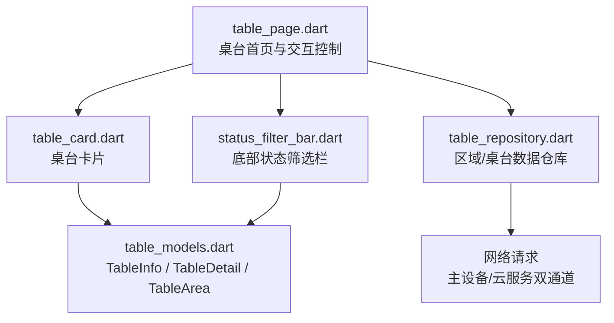
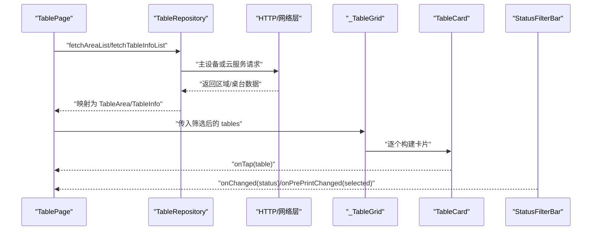
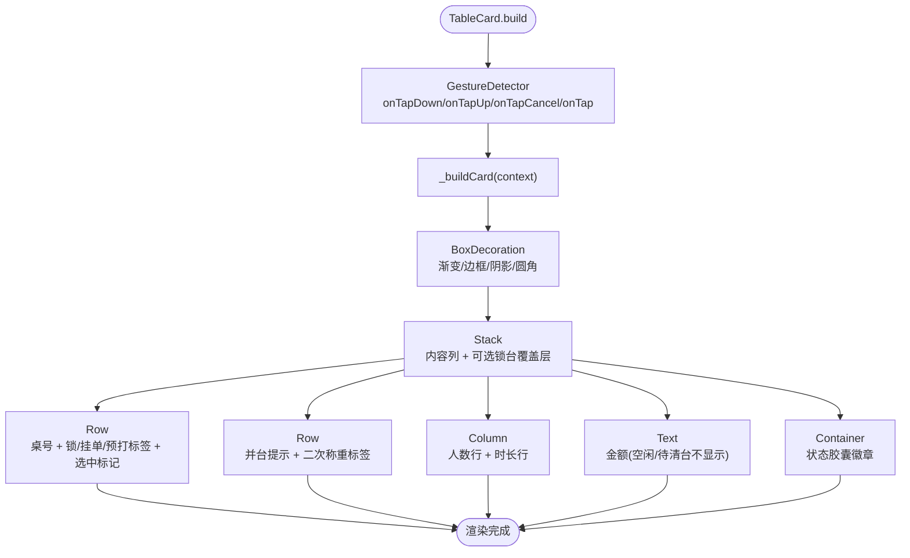
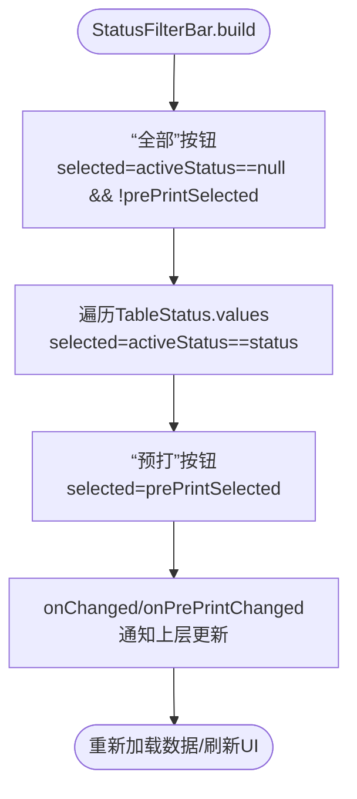
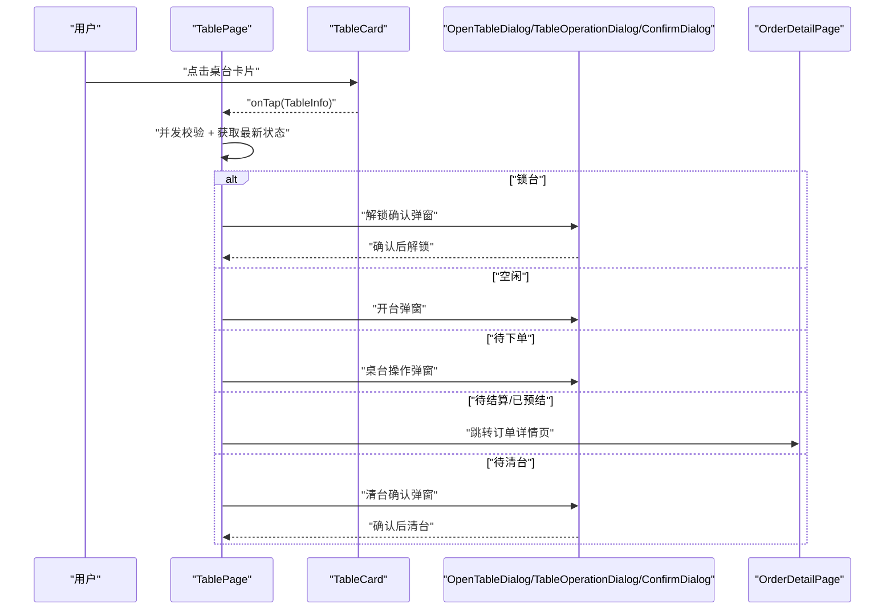
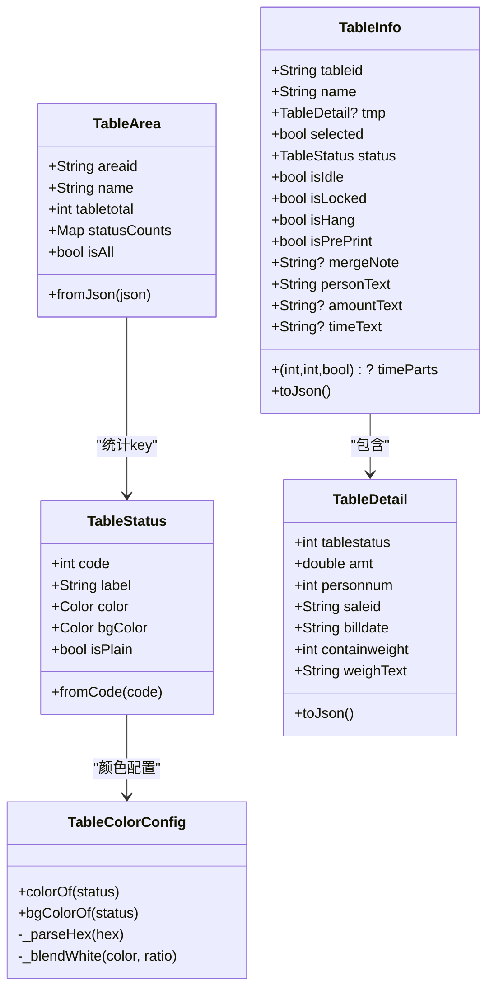
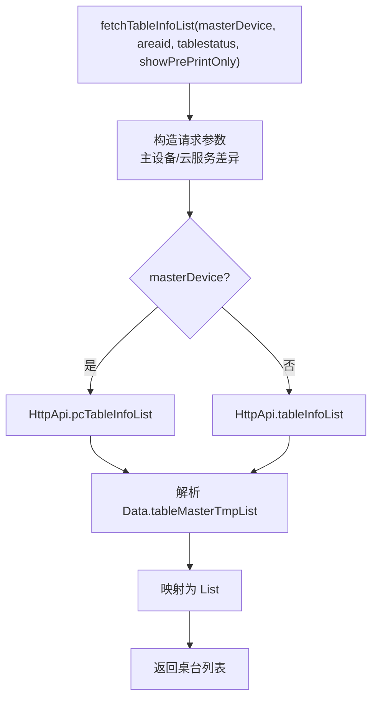
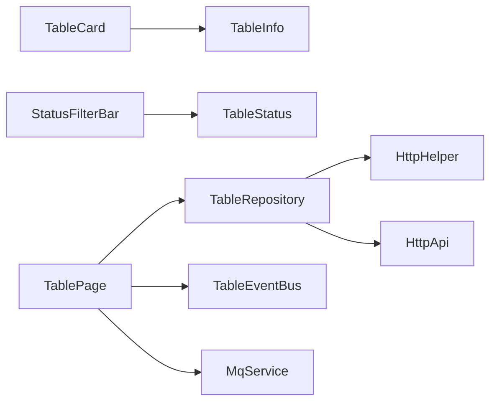

# 桌台卡片UI组件

<cite>
**本文引用的文件**   
- [lib/pages/home/table/widgets/table_card.dart](file://lib/pages/home/table/widgets/table_card.dart)
- [lib/pages/home/table/widgets/status_filter_bar.dart](file://lib/pages/home/table/widgets/status_filter_bar.dart)
- [lib/pages/home/table/table_page.dart](file://lib/pages/home/table/table_page.dart)
- [lib/pages/home/table/table_models.dart](file://lib/pages/home/table/table_models.dart)
- [lib/pages/home/table/table_repository.dart](file://lib/pages/home/table/table_repository.dart)
</cite>

## 目录
1. [简介](#简介)
2. [项目结构定位](#项目结构定位)
3. [核心组件总览](#核心组件总览)
4. [架构总览](#架构总览)
5. [详细组件分析](#详细组件分析)
6. [依赖关系分析](#依赖关系分析)
7. [性能与可访问性建议](#性能与可访问性建议)
8. [常见问题排查](#常见问题排查)
9. [结论](#结论)

## 简介
本文聚焦桌台卡片 UI 组件，围绕 `TableCard`、`StatusFilterBar`、`TablePage`、`TableInfo`/`TableDetail`/`TableArea` 数据模型以及 `TableRepository` 数据仓库展开，系统说明：
- 桌台卡片的视觉呈现：状态色、渐变背景、圆角阴影、胶囊状态徽章、锁台覆盖层、预打标识等。
- 交互行为：点击路径、长按（当前未实现）、选中反馈、入场动画。
- 不同桌台状态的显示样式：空闲、待下单、待结算、已预结、待清台，及其颜色来源和“无底色”空闲样式。
- 预打桌台的特殊标识：卡片标签与底部筛选按钮。
- 状态过滤栏逻辑：全部与各状态计数、互斥的预打筛选、动态更新与界面响应。
- Widget 树结构、样式定制选项、动画效果实现。
- 与其他 UI 组件的集成方式与事件传递机制。
- 布局适配、性能优化与可访问性最佳实践。

## 项目结构定位
桌台卡片相关代码集中在 Flutter 项目的桌台业务模块中，关键位置如下：
- 页面容器与交互控制：`lib/pages/home/table/table_page.dart`
- 桌台卡片 UI：`lib/pages/home/table/widgets/table_card.dart`
- 底部状态筛选栏：`lib/pages/home/table/widgets/status_filter_bar.dart`
- 桌台数据模型：`lib/pages/home/table/table_models.dart`
- 桌台数据仓库：`lib/pages/home/table/table_repository.dart`

**图表来源**
- [lib/pages/home/table/table_page.dart:1-120](file://lib/pages/home/table/table_page.dart#L1-L120)
- [lib/pages/home/table/widgets/table_card.dart:1-60](file://lib/pages/home/table/widgets/table_card.dart#L1-L60)
- [lib/pages/home/table/widgets/status_filter_bar.dart:1-40](file://lib/pages/home/table/widgets/status_filter_bar.dart#L1-L40)
- [lib/pages/home/table/table_repository.dart:1-40](file://lib/pages/home/table/table_repository.dart#L1-L40)
- [lib/pages/home/table/table_models.dart:1-40](file://lib/pages/home/table/table_models.dart#L1-L40)

**章节来源**
- [lib/pages/home/table/table_page.dart:1-120](file://lib/pages/home/table/table_page.dart#L1-L120)
- [lib/pages/home/table/widgets/table_card.dart:1-60](file://lib/pages/home/table/widgets/table_card.dart#L1-L60)
- [lib/pages/home/table/widgets/status_filter_bar.dart:1-40](file://lib/pages/home/table/widgets/status_filter_bar.dart#L1-L40)
- [lib/pages/home/table/table_repository.dart:1-40](file://lib/pages/home/table/table_repository.dart#L1-L40)
- [lib/pages/home/table/table_models.dart:1-40](file://lib/pages/home/table/table_models.dart#L1-L40)

## 核心组件总览
- `TableCard`：展示单个桌台的名称、金额、人数、时长、状态徽章及锁台/挂单/预打等角标；处理按压缩放、选中标记、入场淡入上移动画。
- `StatusFilterBar`：底部筛选栏，提供“全部”、各状态筛选、预打筛选；展示数量并支持再次点击取消筛选。
- `TablePage`：桌面卡片页面的控制器，负责区域切换、搜索、连接模式、MQ/EventBus 刷新、点击桌台后的业务路由。
- `TableInfo`/`TableDetail`/`TableArea`：描述桌台、开台详情、区域的结构化数据，并提供展示用字段与方法。
- `TableRepository`：根据主设备或云服务选择接口路径与参数，统一提取返回数据并映射为模型。

**章节来源**
- [lib/pages/home/table/widgets/table_card.dart:1-120](file://lib/pages/home/table/widgets/table_card.dart#L1-L120)
- [lib/pages/home/table/widgets/status_filter_bar.dart:1-60](file://lib/pages/home/table/widgets/status_filter_bar.dart#L1-L60)
- [lib/pages/home/table/table_page.dart:1-120](file://lib/pages/home/table/table_page.dart#L1-L120)
- [lib/pages/home/table/table_models.dart:1-80](file://lib/pages/home/table/table_models.dart#L1-L80)
- [lib/pages/home/table/table_repository.dart:1-60](file://lib/pages/home/table/table_repository.dart#L1-L60)

## 架构总览
桌台卡片处于“页面控制器 + 展示组件 + 数据模型 + 数据仓库”的分层结构中：
- 页面控制器监听 MQ 推送与本地事件总线，触发静默刷新或加载数据。
- 数据仓库根据连接模式调用对应 HTTP 接口，解析区域列表与桌台列表。
- 表格网格渲染多个 `TableCard`，每个卡片根据 `TableInfo` 计算视觉属性。
- 底部 `StatusFilterBar` 通过回调改变页面状态，进而重新加载数据。

**图表来源**
- [lib/pages/home/table/table_page.dart:250-380](file://lib/pages/home/table/table_page.dart#L250-L380)
- [lib/pages/home/table/table_repository.dart:20-120](file://lib/pages/home/table/table_repository.dart#L20-L120)
- [lib/pages/home/table/widgets/table_card.dart:180-260](file://lib/pages/home/table/widgets/table_card.dart#L180-L260)
- [lib/pages/home/table/widgets/status_filter_bar.dart:20-120](file://lib/pages/home/table/widgets/status_filter_bar.dart#L20-L120)

## 详细组件分析

### TableCard：视觉呈现、交互与动画
`TableCard` 是单个桌台的卡片组件，职责包括：
- 根据 `TableInfo.status` 决定名称颜色、边框颜色、阴影颜色与背景渐变。
- 非空闲且浅色主题下使用状态色渐变背景；空闲使用纯白背景。
- 展示锁台覆盖层、挂单与预打角标、二次称重标签、并台提示。
- 显示人数行、开台时长行、金额行与状态胶囊徽章。
- 按压时缩小卡片尺寸，点击时调用外层传入的 `onTap`。
- 当存在外部 `animation` 时，叠加淡入与轻微上移的入场动画。

#### 状态与样式规则
- 空闲：名称使用默认文字色；状态徽章浅绿底+绿色字；卡片白色背景；边框较淡。
- 非空闲：名称使用状态主题色；卡片带状态色渐变；边框与阴影采用状态色半透明版本；状态徽章使用状态色白字。
- 锁台：在卡片中央覆盖红色锁图标。
- 预打：显示“预打”小标签；底部筛选栏提供“预打”筛选。
- 挂单：显示“挂单”标签，文案取自配置项。
- 二次称重：仅在二次称重功能开启时展示“未称/已称”标签，颜色区分。

#### Widget 树结构

**图表来源**
- [lib/pages/home/table/widgets/table_card.dart:60-120](file://lib/pages/home/table/widgets/table_card.dart#L60-L120)
- [lib/pages/home/table/widgets/table_card.dart:120-200](file://lib/pages/home/table/widgets/table_card.dart#L120-L200)
- [lib/pages/home/table/widgets/table_card.dart:201-406](file://lib/pages/home/table/widgets/table_card.dart#L201-L406)

#### 动画与交互
- 按压缩放：使用 `AnimatedScale`，按下时缩放到 0.94，持续 120ms，曲线缓出。
- 入场动画：当外部传入 `Animation<double>` 时，使用 `FadeTransition` 与 `SlideTransition`，从下方轻微上移并淡入。
- 点击操作：将 `TableInfo` 传给上层 `_onTableTap`，由页面决定后续流程。

#### 用户操作反馈
- 按压反馈：缩放动画 + 可能触发的 `onTap`。
- 选中反馈：右上角绿色圆形对勾，表示多选选中。
- 锁台反馈：红色大锁图标覆盖在卡片中央。
- 预打/挂单反馈：顶部角标提示。
- 二次称重反馈：红/绿标签提示“未称/已称”。

**章节来源**
- [lib/pages/home/table/widgets/table_card.dart:1-60](file://lib/pages/home/table/widgets/table_card.dart#L1-L60)
- [lib/pages/home/table/widgets/table_card.dart:60-120](file://lib/pages/home/table/widgets/table_card.dart#L60-L120)
- [lib/pages/home/table/widgets/table_card.dart:120-200](file://lib/pages/home/table/widgets/table_card.dart#L120-L200)
- [lib/pages/home/table/widgets/table_card.dart:201-406](file://lib/pages/home/table/widgets/table_card.dart#L201-L406)

### StatusFilterBar：状态过滤栏与动态更新
`StatusFilterBar` 提供底部筛选能力：
- “全部”按钮：点击时清空状态筛选。
- 各状态按钮：点击切换该状态；再次点击则取消筛选。
- “预打”按钮：独立筛选只看预打桌台；与状态筛选互斥。
- 每个按钮显示状态色块、标签与数量。

#### 筛选逻辑
- `activeStatus == null && !prePrintSelected` 表示“全部”。
- 点击某状态时，若当前已是该状态则清空筛选，否则设置为该状态。
- 点击“预打”时，切换布尔值并调用上层回调；选中预打时自动清空状态筛选。

#### 界面响应
- 选中态：文本加粗、颜色变化；“全部”按钮保持白底样式。
- 数量展示：实时反映各状态统计结果。
- 主题适配：深色模式下调整文字与背景颜色。

**图表来源**
- [lib/pages/home/table/widgets/status_filter_bar.dart:1-120](file://lib/pages/home/table/widgets/status_filter_bar.dart#L1-L120)

**章节来源**
- [lib/pages/home/table/widgets/status_filter_bar.dart:1-120](file://lib/pages/home/table/widgets/status_filter_bar.dart#L1-L120)

### TablePage：页面控制与事件流
`TablePage` 负责：
- 初始化连接、探活主设备、订阅 MQ 与本地事件总线。
- 定时轮询（注释掉）与静默刷新。
- 区域 Tab 切换、搜索框切换与关键词过滤。
- 点击桌台后的业务路由：解锁确认、开台弹窗、订单详情跳转、清台确认。
- 渲染头部导航、区域 Tabs、下拉刷新、状态筛选栏。

#### 关键交互流程

**图表来源**
- [lib/pages/home/table/table_page.dart:450-620](file://lib/pages/home/table/table_page.dart#L450-L620)

**章节来源**
- [lib/pages/home/table/table_page.dart:1-200](file://lib/pages/home/table/table_page.dart#L1-L200)
- [lib/pages/home/table/table_page.dart:201-600](file://lib/pages/home/table/table_page.dart#L201-L600)
- [lib/pages/home/table/table_page.dart:601-1059](file://lib/pages/home/table/table_page.dart#L601-L1059)

### TableInfo、TableDetail、TableArea：数据模型与展示字段
- `TableStatus`：定义后端状态码与展示标签，提供颜色与背景色配置。
- `TableColorConfig`：读取本地存储的主题颜色，回退到默认色，并计算卡片背景混合色。
- `TableArea`：区域信息，含总数与各状态统计，支持“全部”合成项。
- `TableDetail`：开台详情，含金额、人数、服务器、备注、二次称重等。
- `TableInfo`：桌台基础信息与展示方法：
  - `status`：根据 `tmp.tablestatus` 解析。
  - `isIdle`、`isLocked`、`isHang`、`isPrePrint`：状态判断。
  - `personText`：空闲显示容量，其它显示就餐人数/容量。
  - `amountText`：空闲与待清台不显示金额。
  - `timeText`/`timeParts`：开台时长格式化与单位徽章。

**图表来源**
- [lib/pages/home/table/table_models.dart:1-120](file://lib/pages/home/table/table_models.dart#L1-L120)
- [lib/pages/home/table/table_models.dart:120-240](file://lib/pages/home/table/table_models.dart#L120-L240)
- [lib/pages/home/table/table_models.dart:241-471](file://lib/pages/home/table/table_models.dart#L241-L471)

**章节来源**
- [lib/pages/home/table/table_models.dart:1-120](file://lib/pages/home/table/table_models.dart#L1-L120)
- [lib/pages/home/table/table_models.dart:120-240](file://lib/pages/home/table/table_models.dart#L120-L240)
- [lib/pages/home/table/table_models.dart:241-471](file://lib/pages/home/table/table_models.dart#L241-L471)

### TableRepository：数据仓库与双通道分发
`TableRepository` 负责：
- 根据 `masterDevice` 决定使用主设备还是云服务接口。
- 查询区域列表与桌台列表，统一解析响应结构。
- 主设备模式使用 `/api/table/*`，云服务模式使用 `/table/*`。
- 主设备模式支持 `showpreprintonly` 参数；云服务模式使用 `preprintflag` 参数。

**图表来源**
- [lib/pages/home/table/table_repository.dart:20-120](file://lib/pages/home/table/table_repository.dart#L20-L120)

**章节来源**
- [lib/pages/home/table/table_repository.dart:1-137](file://lib/pages/home/table/table_repository.dart#L1-L137)

## 依赖关系分析
- `TableCard` 依赖 `TableInfo` 提供的状态、名称、金额、人数、时长、锁台/挂单/预打标志。
- `StatusFilterBar` 依赖 `TableStatus` 的枚举、标签与颜色，并通过回调与 `TablePage` 通信。
- `TablePage` 依赖 `TableRepository` 获取区域与桌台数据，依赖 `TableEventBus` 与 `MqService` 触发刷新。
- `TableRepository` 依赖 HTTP 工具类与 API 常量，按连接模式分发请求。

**图表来源**
- [lib/pages/home/table/widgets/table_card.dart:1-20](file://lib/pages/home/table/widgets/table_card.dart#L1-L20)
- [lib/pages/home/table/widgets/status_filter_bar.dart:1-20](file://lib/pages/home/table/widgets/status_filter_bar.dart#L1-L20)
- [lib/pages/home/table/table_page.dart:1-40](file://lib/pages/home/table/table_page.dart#L1-L40)
- [lib/pages/home/table/table_repository.dart:1-20](file://lib/pages/home/table/table_repository.dart#L1-L20)

**章节来源**
- [lib/pages/home/table/widgets/table_card.dart:1-20](file://lib/pages/home/table/widgets/table_card.dart#L1-L20)
- [lib/pages/home/table/widgets/status_filter_bar.dart:1-20](file://lib/pages/home/table/widgets/status_filter_bar.dart#L1-L20)
- [lib/pages/home/table/table_page.dart:1-40](file://lib/pages/home/table/table_page.dart#L1-L40)
- [lib/pages/home/table/table_repository.dart:1-20](file://lib/pages/home/table/table_repository.dart#L1-L20)

## 性能与可访问性建议

### 性能优化
- 避免整屏重绘：`_TableGrid` 仅当桌台 ID 序列变化时重置入场动画，防止选中状态变更导致全量重排。
- 静默刷新：`_silentRefresh` 使用并发保护与待刷新标记，避免重复请求与竞态。
- 按需渲染：卡片中的时间、金额、人数等字段通过条件渲染减少无效布局。
- 主题计算缓存：`TableColorConfig` 的颜色与背景色计算基于本地存储与默认值，避免频繁解析。

### 可访问性支持
- 当前卡片使用 `GestureDetector` 处理点击，但未提供无障碍语义；建议为卡片添加 `Semantics` 包裹，标注桌号、状态、金额等信息。
- 状态筛选按钮可通过 `Tooltip` 或 `AccessibilityHint` 增强说明，尤其“预打”筛选。
- 锁台覆盖层可结合屏幕阅读器提示，告知用户该桌台被锁定。

### 布局适配
- 卡片内使用 `Flexible`、`maxLines`、`TextOverflow.ellipsis` 保证长文本在窄卡片中可读。
- 人数与时长分两行展示，提升小屏幕可读性。
- 状态筛选栏使用 `FittedBox` 自适应空间，避免溢出。

### 动画与体验
- 卡片按压缩放使用短持续时间与缓出曲线，反馈自然。
- 入场动画仅在数据源变化时触发，避免频繁闪烁。
- 下拉刷新与空态提示提升整体交互一致性。

[本节为通用建议，不直接分析具体源码文件]

## 常见问题排查

### 点击桌台后状态不一致
- 现象：点击桌台时，由于其他设备操作导致状态变化，卡片显示旧状态。
- 原因：点击前未拉取最新状态。
- 解决：`_onTableTap` 中先通过 `TableConcurrencyGuard.fetchLatest` 获取最新桌台信息，再同步到列表并执行相应操作。

**章节来源**
- [lib/pages/home/table/table_page.dart:520-620](file://lib/pages/home/table/table_page.dart#L520-L620)

### 预打筛选与状态筛选冲突
- 现象：同时设置状态筛选与预打筛选导致查询异常。
- 原因：参数互斥。
- 解决：`_onStatusChanged` 中取消预打筛选；`_onPrePrintChanged` 中清空状态筛选。

**章节来源**
- [lib/pages/home/table/table_page.dart:560-600](file://lib/pages/home/table/table_page.dart#L560-L600)

### 主设备连接失败
- 现象：主设备不可达时页面弹出连接检查弹窗。
- 原因：`ConnectionManager.onMasterDeviceLost` 事件触发。
- 解决：弹窗关闭后刷新连接状态并按新模式重载数据。

**章节来源**
- [lib/pages/home/table/table_page.dart:120-200](file://lib/pages/home/table/table_page.dart#L120-L200)

### 桌台列表为空或搜索无结果
- 现象：筛选后无桌台显示。
- 原因：筛选条件过严或网络请求失败。
- 解决：检查状态筛选、预打筛选、区域选择；查看网络请求是否成功；使用空态提示引导用户。

**章节来源**
- [lib/pages/home/table/table_page.dart:800-950](file://lib/pages/home/table/table_page.dart#L800-L950)

## 结论
桌台卡片 UI 组件以 `TableCard` 为核心，配合 `StatusFilterBar` 与 `TablePage` 完成完整的桌台展示与交互流程。其设计特点包括：
- 清晰的状态视觉表达：空闲与非空闲样式分离，状态色贯穿名称、边框、阴影与徽章。
- 丰富的业务标识：锁台、挂单、预打、二次称重、并台提示，便于快速识别桌台特征。
- 稳定的交互链路：点击后按状态路由到开台、操作弹窗、订单详情或清台确认。
- 可靠的刷新机制：MQ 与事件总线驱动静默刷新，保障多设备协作下的状态一致性。
- 可扩展的数据模型：`TableInfo`/`TableDetail`/`TableArea` 提供展示方法与序列化能力。

建议在现有基础上补充无障碍语义、完善长按操作与更细粒度的卡片样式定制选项，以提升用户体验与可维护性。

[本节为总结性内容，不直接分析具体源码文件]