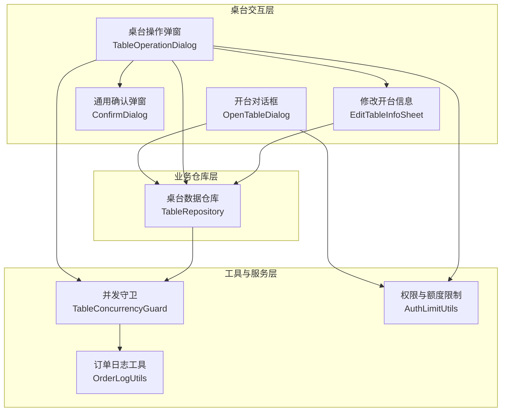
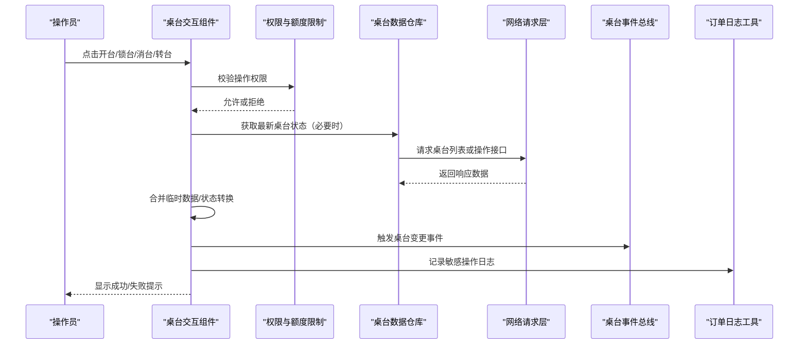
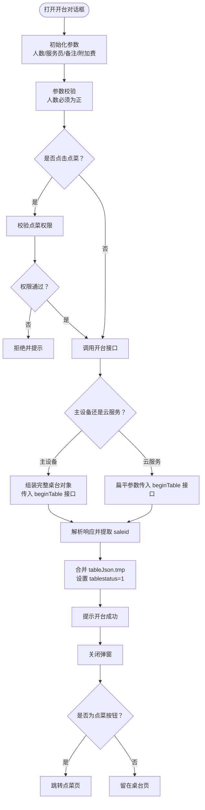
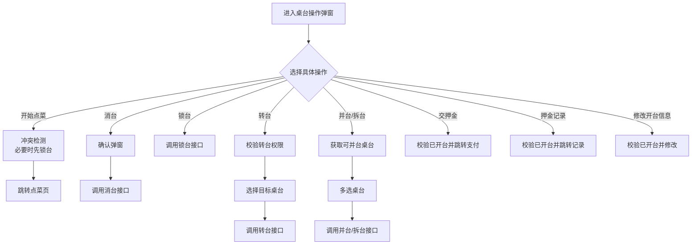
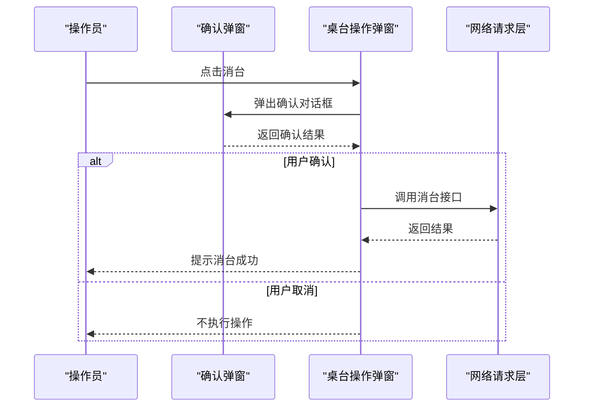
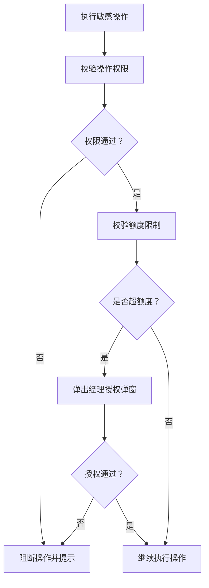
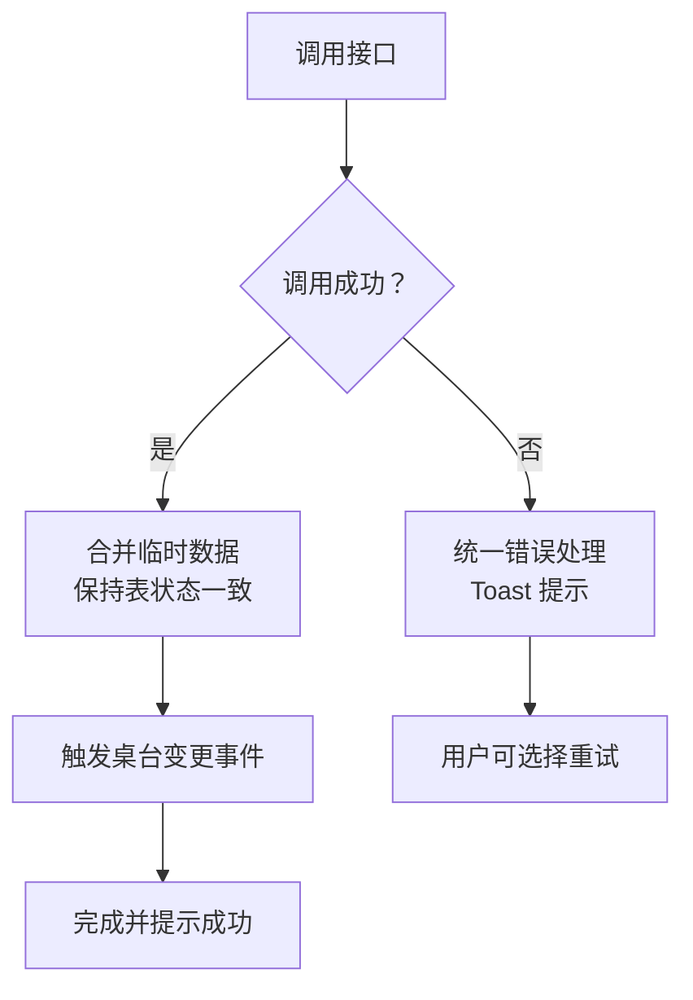
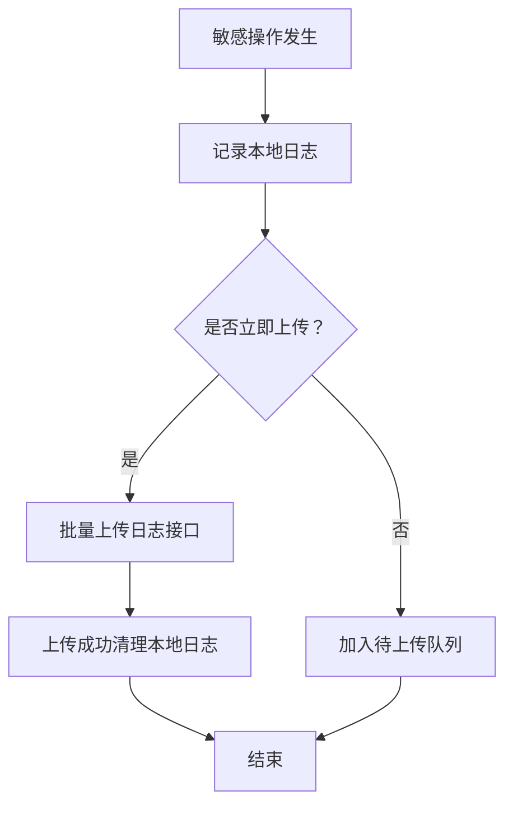
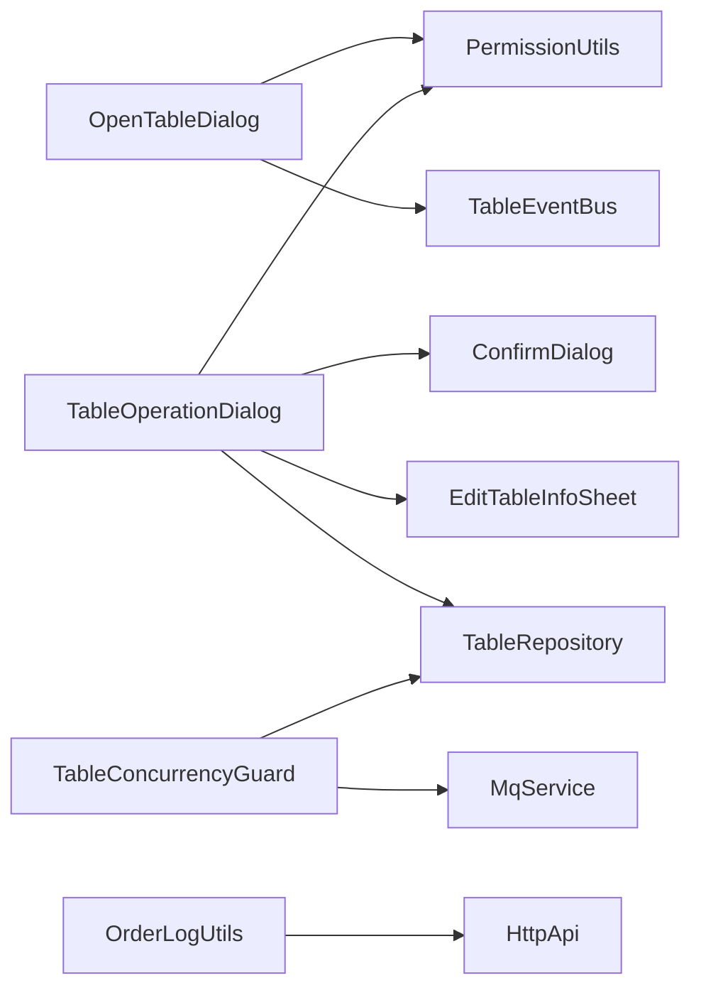

# 桌台操作流程

<cite>
**本文引用的文件**   
- [open_table_dialog.dart](file://lib/pages/home/table/widgets/open_table_dialog.dart)
- [table_operation_dialog.dart](file://lib/pages/home/table/widgets/table_operation_dialog.dart)
- [table_repository.dart](file://lib/pages/home/table/table_repository.dart)
- [table_concurrency_guard.dart](file://lib/util/table_concurrency_guard.dart)
- [auth_limit_utils.dart](file://lib/util/auth_limit_utils.dart)
- [confirm_dialog.dart](file://lib/components/confirm_dialog.dart)
- [edit_table_info_sheet.dart](file://lib/components/edit_table_info_sheet.dart)
- [order_log_utils.dart](file://lib/util/order_log_utils.dart)
</cite>

## 目录
1. [引言](#引言)
2. [项目结构定位](#项目结构定位)
3. [核心组件](#核心组件)
4. [架构总览](#架构总览)
5. [详细组件分析](#详细组件分析)
6. [依赖关系分析](#依赖关系分析)
7. [性能与并发特性](#性能与并发特性)
8. [故障排查指南](#故障排查指南)
9. [结论](#结论)

## 引言
本文面向“桌台操作流程”的业务实现，围绕开台对话框、锁台、消台、转台、并台/拆台、修改开台信息、交押金等关键操作展开。文档重点说明：
- 开台对话框的参数校验、权限控制、主设备/云服务双通道调用、开台成功后数据合并与跳转；
- 各桌台操作的确认弹窗、权限检查、状态冲突检测；
- 并发保护、数据一致性、错误恢复与用户反馈；
- 操作日志记录与审计追踪；
- 与订单模块、库存模块的数据同步边界和业务规则约束。

## 项目结构定位
桌台流程相关代码集中在 Flutter 应用的 `lib` 目录下，采用“页面 + 组件 + 工具类 + 仓库”的分层组织方式：
- 页面交互入口：桌台主页及子页面（如点菜页）通过路由进入；
- 表格交互组件：开台对话框、桌台操作弹窗、确认弹窗、修改开台信息抽屉；
- 业务仓库：统一封装区域与桌台列表查询，屏蔽主设备/云服务差异；
- 工具类：并发守卫、权限与额度限制、订单日志、桌台数据构造等。

**图表来源**
- [open_table_dialog.dart:1-696](file://lib/pages/home/table/widgets/open_table_dialog.dart#L1-L696)
- [table_operation_dialog.dart:1-1010](file://lib/pages/home/table/widgets/table_operation_dialog.dart#L1-L1010)
- [table_repository.dart:1-137](file://lib/pages/home/table/table_repository.dart#L1-L137)
- [table_concurrency_guard.dart:1-235](file://lib/util/table_concurrency_guard.dart#L1-L235)
- [auth_limit_utils.dart:1-98](file://lib/util/auth_limit_utils.dart#L1-L98)
- [confirm_dialog.dart:1-537](file://lib/components/confirm_dialog.dart#L1-L537)
- [edit_table_info_sheet.dart:1-429](file://lib/components/edit_table_info_sheet.dart#L1-L429)
- [order_log_utils.dart:1-199](file://lib/util/order_log_utils.dart#L1-L199)

**章节来源**
- [open_table_dialog.dart:1-696](file://lib/pages/home/table/widgets/open_table_dialog.dart#L1-L696)
- [table_operation_dialog.dart:1-1010](file://lib/pages/home/table/widgets/table_operation_dialog.dart#L1-L1010)
- [table_repository.dart:1-137](file://lib/pages/home/table/table_repository.dart#L1-L137)
- [table_concurrency_guard.dart:1-235](file://lib/util/table_concurrency_guard.dart#L1-L235)
- [auth_limit_utils.dart:1-98](file://lib/util/auth_limit_utils.dart#L1-L98)
- [confirm_dialog.dart:1-537](file://lib/components/confirm_dialog.dart#L1-L537)
- [edit_table_info_sheet.dart:1-429](file://lib/components/edit_table_info_sheet.dart#L1-L429)
- [order_log_utils.dart:1-199](file://lib/util/order_log_utils.dart#L1-L199)

## 核心组件
- 开台对话框：负责人数、服务员、备注、附加费输入，权限校验，调用开台接口，返回 saleid 并合并桌台临时数据，最终跳转点菜或停留在桌台页。
- 桌台操作弹窗：提供转台、并台/拆台、消台、锁台、交押金、押金记录、修改开台信息、开始点菜等操作入口，包含权限校验、状态冲突检测、二次确认。
- 通用确认弹窗：统一确认交互样式，支持单按钮和双按钮模式，用于消台等危险操作确认。
- 修改开台信息抽屉：在已开台状态下修改人数、服务员、备注，保留会员绑定信息。
- 并发守卫：拉取最新桌台状态、锁台/解锁封装、订阅其他设备锁台事件并提示自动返回。
- 权限与额度限制：检查点菜、转台等权限，以及打折、赠送等免密额度超限后的经理授权流程。
- 订单日志工具：本地持久化敏感操作日志，支持批量上传至服务端。

**章节来源**
- [open_table_dialog.dart:1-696](file://lib/pages/home/table/widgets/open_table_dialog.dart#L1-L696)
- [table_operation_dialog.dart:1-1010](file://lib/pages/home/table/widgets/table_operation_dialog.dart#L1-L1010)
- [confirm_dialog.dart:1-537](file://lib/components/confirm_dialog.dart#L1-L537)
- [edit_table_info_sheet.dart:1-429](file://lib/components/edit_table_info_sheet.dart#L1-L429)
- [table_concurrency_guard.dart:1-235](file://lib/util/table_concurrency_guard.dart#L1-L235)
- [auth_limit_utils.dart:1-98](file://lib/util/auth_limit_utils.dart#L1-L98)
- [order_log_utils.dart:1-199](file://lib/util/order_log_utils.dart#L1-L199)

## 架构总览
桌台操作的核心流程遵循“前端交互 → 权限校验 → 状态冲突检测 → 请求分发（主设备/云服务）→ 结果处理 → 事件广播 → 日志记录”。

**图表来源**
- [open_table_dialog.dart:201-350](file://lib/pages/home/table/widgets/open_table_dialog.dart#L201-L350)
- [table_operation_dialog.dart:1-250](file://lib/pages/home/table/widgets/table_operation_dialog.dart#L1-L250)
- [table_repository.dart:1-137](file://lib/pages/home/table/table_repository.dart#L1-L137)
- [table_concurrency_guard.dart:1-150](file://lib/util/table_concurrency_guard.dart#L1-L150)
- [order_log_utils.dart:1-199](file://lib/util/order_log_utils.dart#L1-L199)

## 详细组件分析

### 开台对话框业务流程
开台对话框是“空闲桌台”到“待下单桌台”的入口。其流程包括：
- 参数初始化：默认人数为桌台容量或固定值，默认服务员为当前登录用户，加载附加费选项；
- 参数校验：人数必须为正数，服务员可选，备注可选，附加费可配置展示；
- 权限校验：点击“点菜”前先校验点菜权限；
- 调用开台接口：根据主设备/云服务分别组装参数，生成唯一账单号；
- 结果处理：从响应中提取 saleid，合并 tableJson.tmp 并将 tablestatus 置为“已开台”，弹出成功提示，关闭弹窗；
- 跳转逻辑：若为“点菜”按钮则跳转点菜页，否则留在桌台页。

**图表来源**
- [open_table_dialog.dart:201-350](file://lib/pages/home/table/widgets/open_table_dialog.dart#L201-L350)

**章节来源**
- [open_table_dialog.dart:1-696](file://lib/pages/home/table/widgets/open_table_dialog.dart#L1-L696)

### 桌台操作弹窗与各操作确认
桌台操作弹窗为“待下单桌台”的操作中心，主要操作如下：
- 开始点菜：先检测桌台冲突，再按配置决定是否先锁台，最后跳转点菜页；
- 消台：弹出确认弹窗，确认后调用消台接口；
- 锁台：直接调用锁台接口；
- 转台：需具备转台权限，选择空闲目标桌台后调用转台接口；
- 并台/拆台：查询可并台桌台，多选后调用并台/拆台接口；
- 交押金/押金记录：要求已开台；
- 修改开台信息：在已开台状态下调用修改接口，保留会员绑定。

**图表来源**
- [table_operation_dialog.dart:1-609](file://lib/pages/home/table/widgets/table_operation_dialog.dart#L1-L609)
- [confirm_dialog.dart:1-200](file://lib/components/confirm_dialog.dart#L1-L200)
- [edit_table_info_sheet.dart:1-200](file://lib/components/edit_table_info_sheet.dart#L1-L200)

**章节来源**
- [table_operation_dialog.dart:1-1010](file://lib/pages/home/table/widgets/table_operation_dialog.dart#L1-L1010)
- [confirm_dialog.dart:1-537](file://lib/components/confirm_dialog.dart#L1-L537)
- [edit_table_info_sheet.dart:1-429](file://lib/components/edit_table_info_sheet.dart#L1-L429)

### 锁台、消台、转台的确认对话框实现
- 消台使用通用确认弹窗进行二次确认，防止误操作；
- 锁台在部分场景下需要结合“开始点菜”的流程，依据配置决定是否前置锁台；
- 转台除权限校验外，还需选择目标桌台，避免转到自身；
- 所有确认弹窗均遵循统一 UI 风格，支持键盘避让、暗色主题适配。

**图表来源**
- [table_operation_dialog.dart:120-220](file://lib/pages/home/table/widgets/table_operation_dialog.dart#L120-L220)
- [confirm_dialog.dart:1-200](file://lib/components/confirm_dialog.dart#L1-L200)

**章节来源**
- [table_operation_dialog.dart:1-250](file://lib/pages/home/table/widgets/table_operation_dialog.dart#L1-L250)
- [confirm_dialog.dart:1-200](file://lib/components/confirm_dialog.dart#L1-L200)

### 操作权限控制与额度限制
- 点菜权限：开台对话框点击“点菜”前进行权限校验；
- 转台权限：桌台操作弹窗在执行转台前校验权限；
- 折扣与赠送额度：超过免密额度时触发经理授权弹窗；
- 权限校验失败时直接阻止后续操作，避免无效开台或错误数据写入。

**图表来源**
- [open_table_dialog.dart:180-220](file://lib/pages/home/table/widgets/open_table_dialog.dart#L180-L220)
- [table_operation_dialog.dart:520-600](file://lib/pages/home/table/widgets/table_operation_dialog.dart#L520-L600)
- [auth_limit_utils.dart:1-98](file://lib/util/auth_limit_utils.dart#L1-L98)

**章节来源**
- [open_table_dialog.dart:180-220](file://lib/pages/home/table/widgets/open_table_dialog.dart#L180-L220)
- [table_operation_dialog.dart:520-600](file://lib/pages/home/table/widgets/table_operation_dialog.dart#L520-L600)
- [auth_limit_utils.dart:1-98](file://lib/util/auth_limit_utils.dart#L1-L98)

### 并发操作保护与状态一致性
- 并发守卫在点菜前拉取最新桌台状态，若发现已被其他设备锁定或状态不一致，则提示刷新并重试；
- 当其他设备对当前桌台执行解锁操作时，会推送 MQ 事件，当前页面弹出提示并在倒计时结束后自动返回桌台页；
- 锁台/解锁接口统一封装，区分主设备与云服务两种调用方式；
- 桌台列表查询由仓库统一处理，屏蔽主设备/云服务数据结构差异。

```mermaid
stateDiagram-v2
    [*] --> Idle
    Idle --> Checking : "进入点菜/操作前"
    Checking --> Conflict : "检测到状态变化或已锁"
    Checking --> Ready : "状态一致且未锁"
    Conflict --> Refreshed : "提示刷新后重试"
    Refreshed --> Checking
    Ready --> Operating : "执行操作"
    Operating --> Success : "操作成功"
    Operating --> Failed : "操作失败"
    Success --> Idle
    Failed --> Idle
```

**图表来源**
- [table_concurrency_guard.dart:1-150](file://lib/util/table_concurrency_guard.dart#L1-L150)
- [table_operation_dialog.dart:40-120](file://lib/pages/home/table/widgets/table_operation_dialog.dart#L40-L120)
- [table_repository.dart:1-137](file://lib/pages/home/table/table_repository.dart#L1-L137)

**章节来源**
- [table_concurrency_guard.dart:1-235](file://lib/util/table_concurrency_guard.dart#L1-L235)
- [table_operation_dialog.dart:1-120](file://lib/pages/home/table/widgets/table_operation_dialog.dart#L1-L120)
- [table_repository.dart:1-137](file://lib/pages/home/table/table_repository.dart#L1-L137)

### 数据一致性与错误恢复
- 开台成功后，将服务端返回的 tmp 数据合并到本地 tableJson，确保前端状态与服务端一致；
- 所有网络请求失败时统一 Toast 提示，避免静默失败；
- 修改开台信息时保留会员绑定字段，防止覆盖重要数据；
- 操作完成后触发桌台事件总线，通知列表刷新。

**图表来源**
- [open_table_dialog.dart:250-350](file://lib/pages/home/table/widgets/open_table_dialog.dart#L250-L350)
- [edit_table_info_sheet.dart:350-429](file://lib/components/edit_table_info_sheet.dart#L350-L429)

**章节来源**
- [open_table_dialog.dart:250-350](file://lib/pages/home/table/widgets/open_table_dialog.dart#L250-L350)
- [edit_table_info_sheet.dart:350-429](file://lib/components/edit_table_info_sheet.dart#L350-L429)

### 操作日志记录与审计追踪
- 敏感操作（开台、消台、退菜、打折等）通过订单日志工具记录本地 JSON；
- 日志包含门店、操作员、设备编号、操作时间等审计字段；
- 支持批量上传至服务端，上传成功后清理本地缓存；
- 上传失败时保留本地日志，便于后续重试。

**图表来源**
- [order_log_utils.dart:1-199](file://lib/util/order_log_utils.dart#L1-L199)

**章节来源**
- [order_log_utils.dart:1-199](file://lib/util/order_log_utils.dart#L1-L199)

### 与订单模块、库存模块的数据同步机制与业务规则约束
- 与订单模块：
  - 开台成功后返回 saleid，用于点菜、结账等订单流程；
  - 修改开台信息时调用订单模块接口，同时保留会员绑定信息；
  - 转台时更新订单关联的桌台信息，保证订单归属正确。
- 与库存模块：
  - 本仓库未直接实现库存扣减逻辑，但桌台操作（如点菜、退菜）会间接影响库存；
  - 业务规则约束：库存扣减应在订单提交或出菜环节执行，而非仅因开台或转台；
  - 建议在订单模块中增加库存预占与释放机制，避免多桌台并发导致超卖。

[本节为概念性说明，不直接分析具体源码文件]

## 依赖关系分析
桌台流程组件之间的依赖关系如下：
- 开台对话框依赖权限工具、网络请求、桌台事件总线；
- 桌台操作弹窗依赖确认弹窗、修改开台信息抽屉、桌台仓库、权限工具；
- 并发守卫依赖仓库、MQ 服务、权限工具；
- 订单日志工具独立于交互层，但在敏感操作路径中被调用。

**图表来源**
- [open_table_dialog.dart:1-696](file://lib/pages/home/table/widgets/open_table_dialog.dart#L1-L696)
- [table_operation_dialog.dart:1-1010](file://lib/pages/home/table/widgets/table_operation_dialog.dart#L1-L1010)
- [table_repository.dart:1-137](file://lib/pages/home/table/table_repository.dart#L1-L137)
- [table_concurrency_guard.dart:1-235](file://lib/util/table_concurrency_guard.dart#L1-L235)
- [order_log_utils.dart:1-199](file://lib/util/order_log_utils.dart#L1-L199)

**章节来源**
- [open_table_dialog.dart:1-696](file://lib/pages/home/table/widgets/open_table_dialog.dart#L1-L696)
- [table_operation_dialog.dart:1-1010](file://lib/pages/home/table/widgets/table_operation_dialog.dart#L1-L1010)
- [table_repository.dart:1-137](file://lib/pages/home/table/table_repository.dart#L1-L137)
- [table_concurrency_guard.dart:1-235](file://lib/util/table_concurrency_guard.dart#L1-L235)
- [order_log_utils.dart:1-199](file://lib/util/order_log_utils.dart#L1-L199)

## 性能与并发特性
- 并发保护：点菜前拉取最新桌台状态，避免基于陈旧缓存的状态误判；
- 事件驱动：通过桌台事件总线广播状态变更，减少重复轮询；
- 网络优化：仓库层统一封装请求参数与响应解析，降低调用方复杂度；
- 界面优化：确认弹窗与输入弹窗支持键盘避让，提升移动端输入体验；
- 日志异步：敏感操作日志本地持久化，支持批量上传，避免阻塞主流程。

[本节为通用性能指导，不直接分析具体源码文件]

## 故障排查指南
- 开台失败：
  - 检查点菜权限是否通过；
  - 确认主设备/云服务网络连通性；
  - 查看 Toast 提示信息与本地日志。
- 锁台冲突：
  - 检查是否被其他设备锁定；
  - 等待其他设备解锁或刷新桌台列表；
  - 观察并发守卫提示与自动返回行为。
- 转台失败：
  - 确认是否具有转台权限；
  - 检查目标桌台是否空闲；
  - 查看转台接口返回码与错误消息。
- 修改开台信息失败：
  - 确认人数输入合法；
  - 检查会员绑定信息是否被覆盖；
  - 查看网络请求与 Toast 提示。
- 日志上传失败：
  - 检查网络连接与服务端接口可用性；
  - 查看本地待上传日志数量；
  - 手动触发上传或等待自动重试。

**章节来源**
- [open_table_dialog.dart:200-350](file://lib/pages/home/table/widgets/open_table_dialog.dart#L200-L350)
- [table_operation_dialog.dart:100-250](file://lib/pages/home/table/widgets/table_operation_dialog.dart#L100-L250)
- [table_concurrency_guard.dart:100-235](file://lib/util/table_concurrency_guard.dart#L100-L235)
- [order_log_utils.dart:100-199](file://lib/util/order_log_utils.dart#L100-L199)

## 结论
桌台操作流程通过分层组件与工具类实现了清晰的职责分离：交互层专注用户引导与反馈，仓库层屏蔽后端差异，工具层提供并发、权限、日志等横切能力。整体设计强调权限控制、状态一致性、并发保护与可观测性，能够支撑多设备协同下的稳定桌台管理。未来可在库存预占、订单事务补偿等方面进一步增强数据一致性保障。