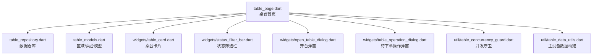
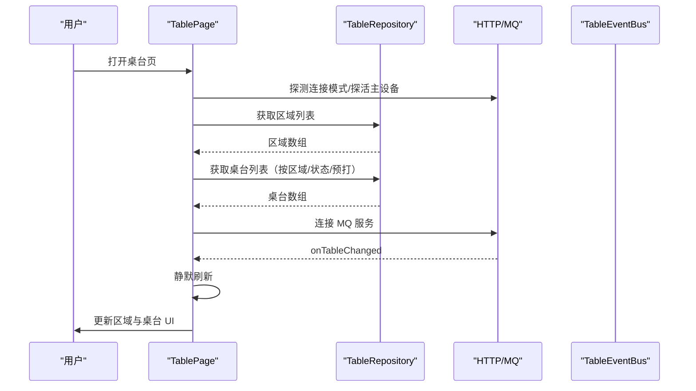
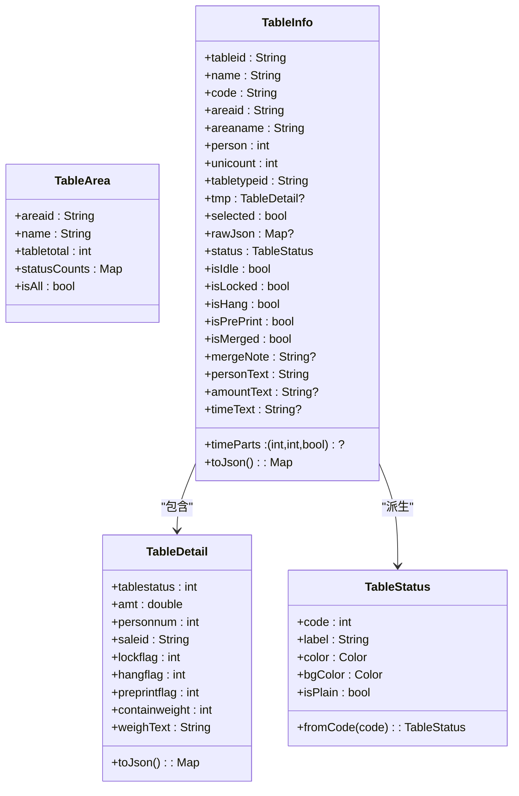
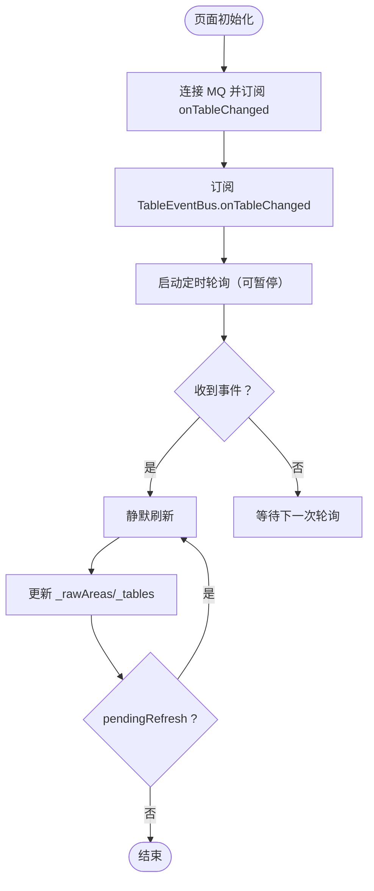
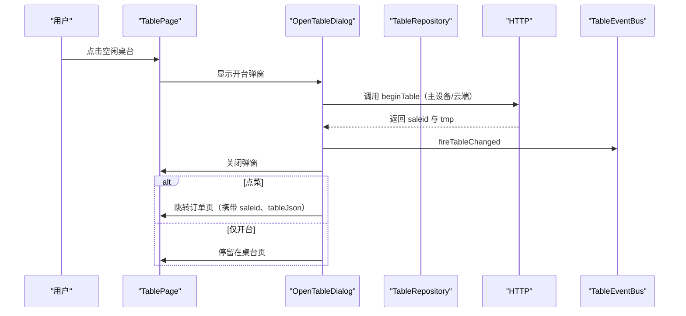
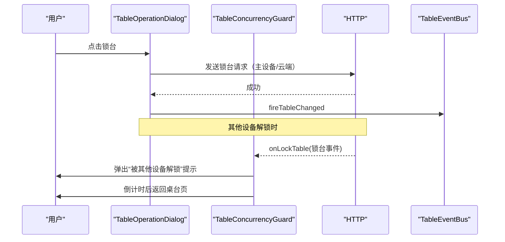
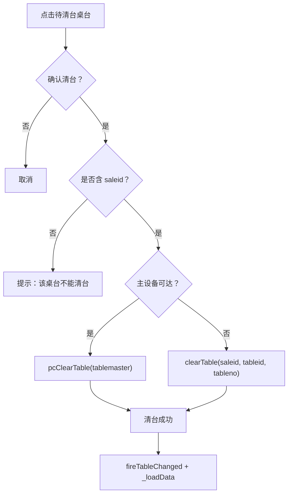
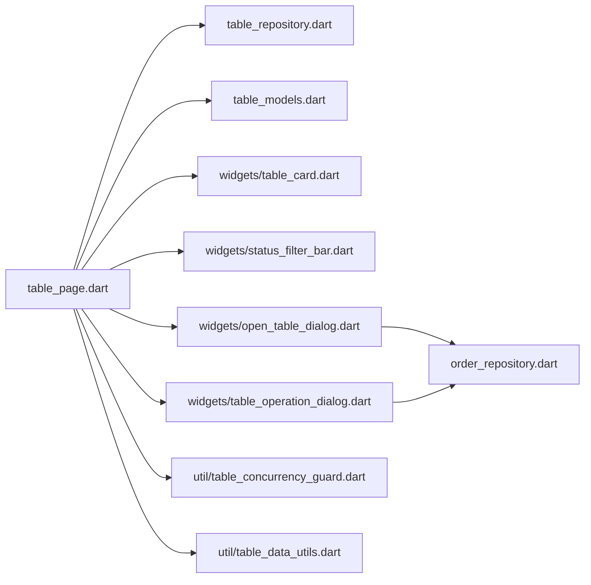

# 桌台管理模块

<cite>
**本文引用的文件**   
- [lib/pages/home/table/table_page.dart](file://lib/pages/home/table/table_page.dart)
- [lib/pages/home/table/table_repository.dart](file://lib/pages/home/table/table_repository.dart)
- [lib/pages/home/table/table_models.dart](file://lib/pages/home/table/table_models.dart)
- [lib/pages/home/table/widgets/table_card.dart](file://lib/pages/home/table/widgets/table_card.dart)
- [lib/pages/home/table/widgets/status_filter_bar.dart](file://lib/pages/home/table/widgets/status_filter_bar.dart)
- [lib/pages/home/table/widgets/open_table_dialog.dart](file://lib/pages/home/table/widgets/open_table_dialog.dart)
- [lib/pages/home/table/widgets/table_operation_dialog.dart](file://lib/pages/home/table/widgets/table_operation_dialog.dart)
- [lib/util/table_concurrency_guard.dart](file://lib/util/table_concurrency_guard.dart)
- [lib/util/table_data_utils.dart](file://lib/util/table_data_utils.dart)
</cite>

## 目录
1. [简介](#简介)
2. [项目结构](#项目结构)
3. [核心组件](#核心组件)
4. [架构总览](#架构总览)
5. [详细组件分析](#详细组件分析)
6. [依赖关系分析](#依赖关系分析)
7. [性能与并发特性](#性能与并发特性)
8. [故障排查指南](#故障排查指南)
9. [结论](#结论)
10. [附录：配置与示例参考](#附录配置与示例参考)

## 简介
本模块实现聚客美滋滋应用的桌台管理功能，覆盖区域列表展示、桌台卡片网格布局、开台/锁台/消台/清台/转台/并台等完整业务流程。数据同步采用轮询与消息队列推送相结合的模式；连接模式支持云服务、主设备、混合三种，直接影响接口路径与请求参数结构。模块还提供预打桌台筛选、状态过滤、搜索模式，以及针对多设备并发操作的保护机制。

## 项目结构
桌台管理模块以页面为入口，结合仓库、模型、UI 组件和工具类共同实现业务逻辑：

图表来源
- [lib/pages/home/table/table_page.dart:1-120](file://lib/pages/home/table/table_page.dart#L1-L120)
- [lib/pages/home/table/table_repository.dart:1-137](file://lib/pages/home/table/table_repository.dart#L1-L137)
- [lib/pages/home/table/table_models.dart:1-200](file://lib/pages/home/table/table_models.dart#L1-L200)

章节来源
- [lib/pages/home/table/table_page.dart:1-120](file://lib/pages/home/table/table_page.dart#L1-L120)
- [lib/pages/home/table/table_repository.dart:1-137](file://lib/pages/home/table/table_repository.dart#L1-L137)

## 核心组件
- 桌台首页：负责连接模式探测、区域与桌台加载、状态与预打筛选、搜索、轮询与事件订阅、点击路由分发。
- 数据仓库：根据连接模式选择云服务或主设备接口，统一解析不同响应结构。
- 数据模型：定义桌台状态枚举、颜色配置、区域对象、桌台详情、桌台信息及其展示属性。
- 桌台卡片：渲染桌号、人数、金额、时长、锁台/挂单/预打标识、并台提示、状态徽章。
- 状态筛选栏：全部、各状态、预打三个维度筛选，展示数量标签。
- 开台弹窗：人数、服务员、附加费、备注，调用 beginTable 后关闭弹窗并可跳转点菜页。
- 待下单操作弹窗：开始点菜、转台、并台/拆台、消台、锁台、押金、修改台桌信息。
- 并发守卫：拉取最新桌台、锁台/解锁封装、监听其他设备锁台事件并提示返回。
- 数据工具：为主设备接口构建完整桌台 Bean，提供默认结构、深度合并与字段白名单过滤。

章节来源
- [lib/pages/home/table/table_page.dart:1-120](file://lib/pages/home/table/table_page.dart#L1-L120)
- [lib/pages/home/table/table_repository.dart:1-137](file://lib/pages/home/table/table_repository.dart#L1-L137)
- [lib/pages/home/table/table_models.dart:1-200](file://lib/pages/home/table/table_models.dart#L1-L200)
- [lib/pages/home/table/widgets/table_card.dart:1-200](file://lib/pages/home/table/widgets/table_card.dart#L1-L200)
- [lib/pages/home/table/widgets/status_filter_bar.dart:1-186](file://lib/pages/home/table/widgets/status_filter_bar.dart#L1-L186)
- [lib/pages/home/table/widgets/open_table_dialog.dart:1-200](file://lib/pages/home/table/widgets/open_table_dialog.dart#L1-L200)
- [lib/pages/home/table/widgets/table_operation_dialog.dart:1-200](file://lib/pages/home/table/widgets/table_operation_dialog.dart#L1-L200)
- [lib/util/table_concurrency_guard.dart:1-200](file://lib/util/table_concurrency_guard.dart#L1-L200)
- [lib/util/table_data_utils.dart:1-200](file://lib/util/table_data_utils.dart#L1-L200)

## 架构总览
桌台模块采用分层设计：页面层处理交互与路由，仓库层封装网络请求与响应解析，模型层定义领域对象与展示属性，工具层提供并发保护与主设备数据结构构造。

图表来源
- [lib/pages/home/table/table_page.dart:60-120](file://lib/pages/home/table/table_page.dart#L60-L120)
- [lib/pages/home/table/table_repository.dart:20-120](file://lib/pages/home/table/table_repository.dart#L20-L120)

## 详细组件分析

### 区域列表与桌台网格
- 区域列表：通过仓库按 stopflag=0、is_page=2、infototalflag=1 获取区域及状态统计，并在首页合成“全部”项聚合各区域数量。
- 桌台列表：按 areastatus=1、stopflag=0、infototalflag=1 获取启用区域下的桌台；云端额外携带排序字段，主设备则按 tableMasterTmpList 解析。
- 网格布局：使用 GridView 展示 TableCard，每个卡片根据 TableInfo 的 status、tmp 字段渲染人数、金额、时长、锁台/挂单/预打、并台提示与状态徽章。

章节来源
- [lib/pages/home/table/table_repository.dart:20-120](file://lib/pages/home/table/table_repository.dart#L20-L120)
- [lib/pages/home/table/table_models.dart:201-471](file://lib/pages/home/table/table_models.dart#L201-L471)
- [lib/pages/home/table/widgets/table_card.dart:1-200](file://lib/pages/home/table/widgets/table_card.dart#L1-L200)
- [lib/pages/home/table/widgets/table_card.dart:201-406](file://lib/pages/home/table/widgets/table_card.dart#L201-L406)

### 状态管理与颜色配置
- 状态枚举：空闲、待下单、待结算、已预结、待清台，对应后端 tablestatus 值。
- 颜色配置：从本地存储读取各状态主题色，未配置时回退默认值；背景色为主题色与白色按比例混合，空闲状态为无底色样式。
- 展示属性：TableInfo 暴露 isIdle、isLocked、isHang、isPrePrint、isMerged、mergeNote、personText、amountText、timeParts/timeText 等便于 UI 渲染。

图表来源
- [lib/pages/home/table/table_models.dart:1-200](file://lib/pages/home/table/table_models.dart#L1-L200)
- [lib/pages/home/table/table_models.dart:201-471](file://lib/pages/home/table/table_models.dart#L201-L471)

### 实时同步机制（轮询+MQ推送）
- 轮询：页面定义固定间隔定时器执行静默刷新，进入前台恢复轮询，后台停止轮询；当前正在刷新时设置 pending 标记，结束后再刷一次以避免漏刷新。
- MQ 推送：订阅 MqService.onTableChanged，收到事件后触发静默刷新；同时订阅 ConnectionManager.onMasterDeviceLost 弹出主设备检查对话框。
- 本地事件总线：TableEventBus.onTableChanged 在开台、消台、转台等操作成功后触发，确保 UI 立即刷新。

图表来源
- [lib/pages/home/table/table_page.dart:60-120](file://lib/pages/home/table/table_page.dart#L60-L120)
- [lib/pages/home/table/table_page.dart:201-340](file://lib/pages/home/table/table_page.dart#L201-L340)

### 预打桌台筛选与搜索模式
- 预打筛选：当选中“只看预打桌台”时，将 _statusFilter 清空，避免查询参数冲突；服务端主设备走 showpreprintonly，云端走 preprintflag。
- 搜索模式：切换搜索模式后，按名称本地过滤表格列表；退出搜索模式清空关键词并隐藏搜索栏。
- 底部筛选：StatusFilterBar 提供全部、各状态、预打三个按钮，点击当前状态会取消筛选。

章节来源
- [lib/pages/home/table/table_page.dart:340-520](file://lib/pages/home/table/table_page.dart#L340-L520)
- [lib/pages/home/table/widgets/status_filter_bar.dart:1-186](file://lib/pages/home/table/widgets/status_filter_bar.dart#L1-L186)

### 连接模式对桌台数据的影响
- 云服务：区域与桌台接口路径不带 /api 前缀，返回 data.list；云端额外携带 field/type/cond/preprintflag。
- 主设备：接口路径带 /api 前缀，返回 Data.tableMasterTmpList；主设备开台/锁台/消台/清台等需要完整 tablemaster Bean。
- 混合模式：页面先探活主设备，若不可达则自动回退云服务；连接丢失时弹出主设备检查对话框，用户可选择切换模式并重载数据。

章节来源
- [lib/pages/home/table/table_repository.dart:20-120](file://lib/pages/home/table/table_repository.dart#L20-L120)
- [lib/pages/home/table/table_page.dart:120-200](file://lib/pages/home/table/table_page.dart#L120-L200)

### 开台流程
点击空闲桌台后弹出 OpenTableDialog，填写人数、服务员、附加费、备注，点击“点菜”或“开台”均先调用 beginTable。成功关闭弹窗，“点菜”继续跳转订单页，传入 saleid 与更新后的 tableJson.tmp。

图表来源
- [lib/pages/home/table/widgets/open_table_dialog.dart:1-200](file://lib/pages/home/table/widgets/open_table_dialog.dart#L1-L200)
- [lib/pages/home/table/widgets/open_table_dialog.dart:201-634](file://lib/pages/home/table/widgets/open_table_dialog.dart#L201-L634)

### 锁台/解锁流程
- 锁台：待下单桌台的操作弹窗中执行 _doLockTable，主设备传完整 tableBean 并设置 lockflag=1，云端传 tableid/lockflag/autoflag。
- 解锁：点击锁台桌台时弹出确认框，确认后执行解锁；解锁会强制退出其它设备上的该桌台操作。
- 并发保护：TableConcurrencyGuard.listenLockEvent 在其他设备解锁本桌台时弹提示并引导返回桌台页。

图表来源
- [lib/pages/home/table/widgets/table_operation_dialog.dart:201-350](file://lib/pages/home/table/widgets/table_operation_dialog.dart#L201-L350)
- [lib/util/table_concurrency_guard.dart:1-200](file://lib/util/table_concurrency_guard.dart#L1-L200)

### 消台/清台流程
- 消台：待下单桌台操作弹窗中执行 _onCancelTable，主设备传完整 tablemaster Bean，云端传 tableid。
- 清台：待清台桌台点击后弹出确认框，_clearTable 根据连接模式调用 pcClearTable 或 clearTable，成功后触发事件并刷新列表。

图表来源
- [lib/pages/home/table/table_page.dart:520-684](file://lib/pages/home/table/table_page.dart#L520-L684)
- [lib/pages/home/table/widgets/table_operation_dialog.dart:1-200](file://lib/pages/home/table/widgets/table_operation_dialog.dart#L1-L200)

### 转台与并台/拆台
- 转台：先校验权限，拉取空闲桌台（排除自身），用户选择目标桌后调用 pcTableChange 或 updateMasterTmp，成功后触发事件并刷新。
- 并台/拆台：拉取可并台列表，多选后根据 unitableid 判断加台或拆台，调用 pcUniTable 或 uniTable，成功后触发事件并刷新。

章节来源
- [lib/pages/home/table/widgets/table_operation_dialog.dart:350-609](file://lib/pages/home/table/widgets/table_operation_dialog.dart#L350-L609)

### 错误恢复策略
- 静默刷新失败保留旧数据，不阻断 UI；区域加载失败不阻断桌台加载。
- 主设备连接丢失弹出检查对话框，用户可切换模式并重载数据。
- 开台/消台/清台/转台/并台等操作捕获异常并 Toast 提示，finally 重置操作状态。
- 并发守卫在锁台事件到达时弹提示并自动返回桌台页，防止数据不一致。

章节来源
- [lib/pages/home/table/table_page.dart:201-340](file://lib/pages/home/table/table_page.dart#L201-L340)
- [lib/pages/home/table/widgets/open_table_dialog.dart:201-634](file://lib/pages/home/table/widgets/open_table_dialog.dart#L201-L634)
- [lib/pages/home/table/widgets/table_operation_dialog.dart:201-609](file://lib/pages/home/table/widgets/table_operation_dialog.dart#L201-L609)
- [lib/util/table_concurrency_guard.dart:1-200](file://lib/util/table_concurrency_guard.dart#L1-L200)

## 依赖关系分析

图表来源
- [lib/pages/home/table/table_page.dart:1-120](file://lib/pages/home/table/table_page.dart#L1-L120)
- [lib/pages/home/table/widgets/open_table_dialog.dart:1-200](file://lib/pages/home/table/widgets/open_table_dialog.dart#L1-L200)
- [lib/pages/home/table/widgets/table_operation_dialog.dart:1-200](file://lib/pages/home/table/widgets/table_operation_dialog.dart#L1-L200)

章节来源
- [lib/pages/home/table/table_page.dart:1-120](file://lib/pages/home/table/table_page.dart#L1-L120)
- [lib/pages/home/table/widgets/open_table_dialog.dart:1-200](file://lib/pages/home/table/widgets/open_table_dialog.dart#L1-L200)
- [lib/pages/home/table/widgets/table_operation_dialog.dart:1-200](file://lib/pages/home/table/widgets/table_operation_dialog.dart#L1-L200)

## 性能与并发特性
- 轮询间隔：5 秒一次静默刷新，后台停止轮询以减少无效请求。
- 并发刷新保护：_silentRefreshing 标志防止重复刷新；_pendingRefresh 确保事件到达后立即补刷一次。
- 点击防抖：_checkingTableTap 防止连点导致重复拉取最新状态。
- 主设备连接变化动态回退：在静默刷新内部重新读取 ConnectionManager.pcAlive，避免以主设备路径请求云端地址。
- 主设备 Bean 构建：TableDataUtils 提供默认结构与字段白名单过滤，减少多余字段导致的序列化问题。

章节来源
- [lib/pages/home/table/table_page.dart:201-340](file://lib/pages/home/table/table_page.dart#L201-L340)
- [lib/util/table_data_utils.dart:201-314](file://lib/util/table_data_utils.dart#L201-L314)

## 故障排查指南
- 主设备连接失败：
  - 现象：顶部状态图标显示主设备错误，弹窗提示主设备检查。
  - 处理：用户可在弹窗中选择云服务或重连，完成后重载数据。
- 轮询失效：
  - 现象：桌台状态长时间不更新。
  - 处理：检查后台是否停止轮询，确认 onTableChanged 是否触发，查看 _silentRefreshing 与 _pendingRefresh 状态。
- 开台失败：
  - 现象：Toast 提示失败。
  - 处理：检查 beginTable 参数是否正确（主设备需完整 tablemaster Bean），确认 saleid 是否返回。
- 锁台冲突：
  - 现象：其他设备解锁提示并自动返回桌台页。
  - 处理：刷新桌台列表，确认锁台状态一致后再操作。

章节来源
- [lib/pages/home/table/table_page.dart:120-200](file://lib/pages/home/table/table_page.dart#L120-L200)
- [lib/pages/home/table/widgets/open_table_dialog.dart:201-634](file://lib/pages/home/table/widgets/open_table_dialog.dart#L201-L634)
- [lib/util/table_concurrency_guard.dart:1-200](file://lib/util/table_concurrency_guard.dart#L1-L200)

## 结论
桌台管理模块通过清晰的分层设计与双通道同步机制（轮询+MQ），实现了高可靠性的区域与桌台数据展示，以及开台、锁台、消台、清台、转台、并台等复杂操作流程。连接模式抽象使得云服务与主设备的数据差异被仓库与工具类屏蔽，提升了代码复用性与可维护性。并发守卫与静默刷新机制有效避免了多设备操作带来的数据不一致问题。

## 附录：配置与示例参考

### 桌台卡片自定义
- 卡片视觉：非空闲卡片使用状态色渐变背景，空闲卡片纯白；状态徽章为胶囊形，空闲态为浅绿底+绿字。
- 角标与标签：锁台、挂单、预打、并台提示分别以小标签形式展示。
- 时间单位徽章：小时/分钟数字与单位分别着色，保证可读性。
- 二次称重标识：仅在开启二次称重时显示“未称/已称”。

参考位置
- [lib/pages/home/table/widgets/table_card.dart:1-200](file://lib/pages/home/table/widgets/table_card.dart#L1-L200)
- [lib/pages/home/table/widgets/table_card.dart:201-406](file://lib/pages/home/table/widgets/table_card.dart#L201-L406)

### 状态过滤条件配置
- 底部筛选栏提供“全部”与各状态按钮，点击当前状态取消筛选。
- “预打”筛选与状态筛选互斥；选中预打时清空状态筛选。
- 数量标签来源于区域 statusCounts 与当前列表 isPrePrint 统计。

参考位置
- [lib/pages/home/table/widgets/status_filter_bar.dart:1-186](file://lib/pages/home/table/widgets/status_filter_bar.dart#L1-L186)
- [lib/pages/home/table/table_page.dart:340-520](file://lib/pages/home/table/table_page.dart#L340-L520)

### 与点菜下单模块的数据交互
- 开台成功后，OpenTableDialog 将 saleid 与更新后的 tableJson.tmp 传递给订单页。
- 待下单桌台点击“开始点菜”，TableOperationDialog 在必要时先锁台，再跳转订单页并传递 tableId、tableName、tableCode、persons、serverId、serverName、remark、saleid、tableJson。
- 订单页与桌台页通过 TableEventBus 与 MqService 保持状态同步，避免数据不一致。

参考位置
- [lib/pages/home/table/widgets/open_table_dialog.dart:201-634](file://lib/pages/home/table/widgets/open_table_dialog.dart#L201-L634)
- [lib/pages/home/table/widgets/table_operation_dialog.dart:1-200](file://lib/pages/home/table/widgets/table_operation_dialog.dart#L1-L200)