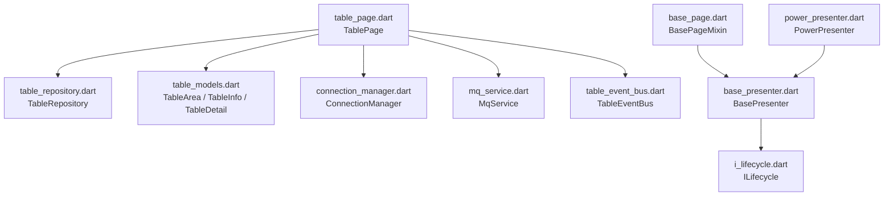
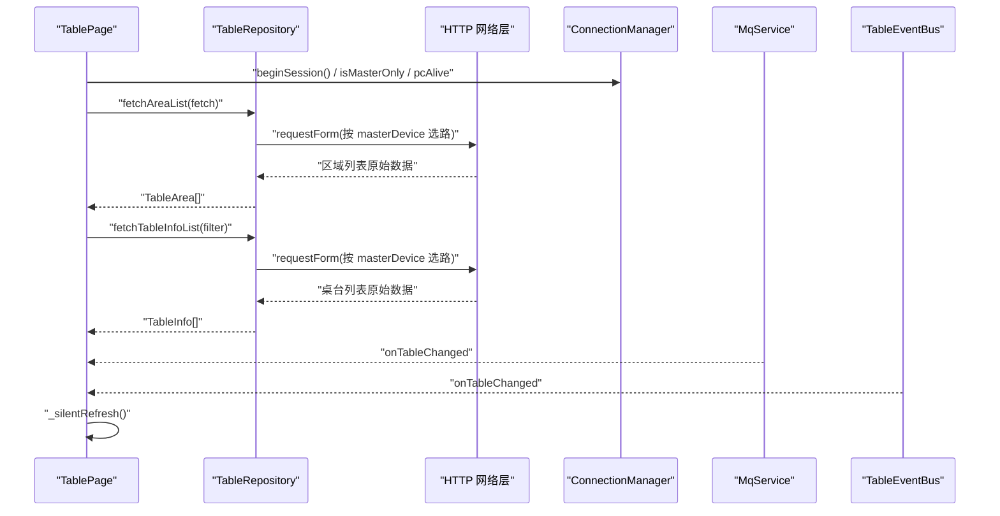
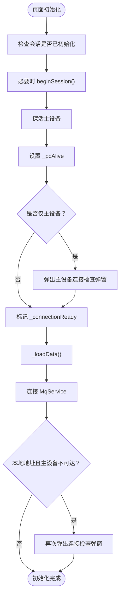
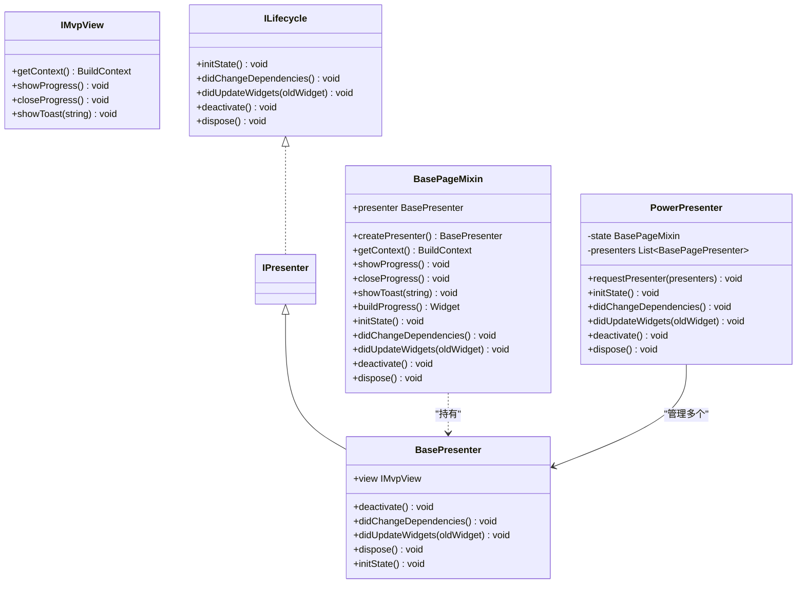
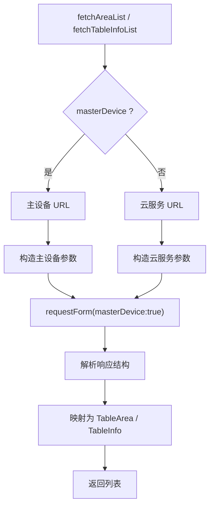
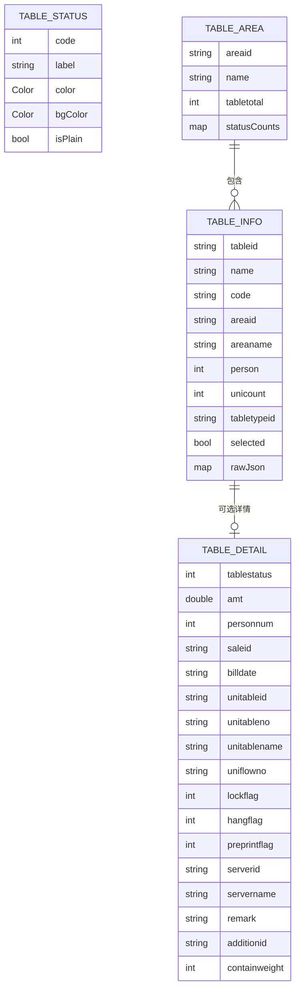
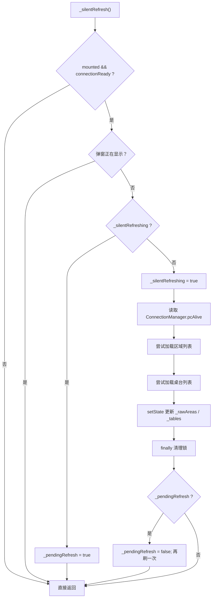
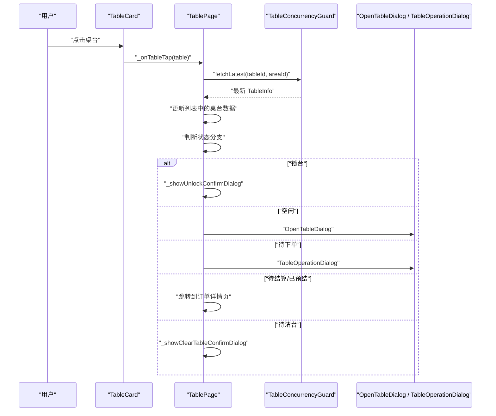

# 桌台页面架构

<cite>
**本文引用的文件**   
- [table_page.dart](file://lib/pages/home/table/table_page.dart)
- [table_repository.dart](file://lib/pages/home/table/table_repository.dart)
- [table_models.dart](file://lib/pages/home/table/table_models.dart)
- [base_page.dart](file://lib/mvp/base_page.dart)
- [base_presenter.dart](file://lib/mvp/base_presenter.dart)
- [power_presenter.dart](file://lib/mvp/power_presenter.dart)
- [i_lifecycle.dart](file://lib/mvp/i_lifecycle.dart)
- [mvps.dart](file://lib/mvp/mvps.dart)
- [connection_manager.dart](file://lib/net/connection_manager.dart)
- [mq_service.dart](file://lib/net/mq_service.dart)
- [table_event_bus.dart](file://lib/net/table_event_bus.dart)
</cite>

## 目录
1. [引言](#引言)
2. [项目结构定位](#项目结构定位)
3. [核心组件总览](#核心组件总览)
4. [架构总览与数据流](#架构总览与数据流)
5. [TablePage 主控逻辑详解](#tablepage-主控逻辑详解)
6. [MVP 架构与生命周期](#mvp-架构与生命周期)
7. [数据仓库与数据模型](#数据仓库与数据模型)
8. [网络层、数据库层与事件集成](#网络层数据库层与事件集成)
9. [状态管理与刷新策略](#状态管理与刷新策略)
10. [错误处理机制](#错误处理机制)
11. [子组件通信与交互流程](#子组件通信与交互流程)
12. [扩展点与自定义配置](#扩展点与自定义配置)
13. [性能与并发特性](#性能与并发特性)
14. [故障排查指南](#故障排查指南)
15. [结论](#结论)

## 引言
本文件面向桌台管理模块的核心页面架构，重点说明 `TablePage` 的主控逻辑、页面生命周期、初始化流程、数据加载策略、状态管理机制，以及其与网络层、消息推送、本地事件总线、连接模式管理器的协作方式。文档同时梳理 `TableRepository` 的数据访问层设计和 `TableModels` 的数据模型定义，并通过类图、时序图和流程图展示关键调用关系。

该页面采用 Flutter 原生 StatefulWidget 实现，并未直接继承项目中的 MVP 基类；但项目中存在通用 MVP 基础设施，适合未来将业务 Presenter 解耦到独立类中复用。

## 项目结构定位
桌台页面位于首页模块的桌台分支下，核心文件包括：

- 页面控制器：`lib/pages/home/table/table_page.dart`
- 数据仓库：`lib/pages/home/table/table_repository.dart`
- 数据模型：`lib/pages/home/table/table_models.dart`
- 子组件：桌台卡片、开台弹窗、操作弹窗、连接状态弹窗等
- 网络与事件：`lib/net/connection_manager.dart`、`lib/net/mq_service.dart`、`lib/net/table_event_bus.dart`
- 通用 MVP 基础设施：`lib/mvp/base_page.dart`、`lib/mvp/base_presenter.dart`、`lib/mvp/power_presenter.dart`、`lib/mvp/i_lifecycle.dart`、`lib/mvp/mvps.dart`

**图表来源**
- [table_page.dart:1-60](file://lib/pages/home/table/table_page.dart#L1-L60)
- [table_repository.dart:1-30](file://lib/pages/home/table/table_repository.dart#L1-L30)
- [table_models.dart:1-40](file://lib/pages/home/table/table_models.dart#L1-L40)
- [connection_manager.dart:1-30](file://lib/net/connection_manager.dart#L1-L30)
- [mq_service.dart:1-30](file://lib/net/mq_service.dart#L1-L30)
- [table_event_bus.dart:1-23](file://lib/net/table_event_bus.dart#L1-L23)
- [base_page.dart:1-30](file://lib/mvp/base_page.dart#L1-L30)
- [base_presenter.dart:1-21](file://lib/mvp/base_presenter.dart#L1-L21)
- [power_presenter.dart:1-20](file://lib/mvp/power_presenter.dart#L1-L20)
- [i_lifecycle.dart:1-13](file://lib/mvp/i_lifecycle.dart#L1-L13)

**章节来源**
- [table_page.dart:1-60](file://lib/pages/home/table/table_page.dart#L1-L60)
- [table_repository.dart:1-30](file://lib/pages/home/table/table_repository.dart#L1-L30)
- [table_models.dart:1-40](file://lib/pages/home/table/table_models.dart#L1-L40)

## 核心组件总览
- **TablePage**：桌台首页的状态容器，负责 UI 状态、筛选条件、轮询控制、事件订阅、主设备连接检查、用户交互路由。
- **TableRepository**：统一的数据访问入口，根据连接模式选择云服务或主设备接口，并解析不同响应结构。
- **TableModels**：描述区域、桌台、桌台详情、状态枚举和颜色配置的可序列化数据结构。
- **ConnectionManager**：连接模式管理，决定请求走云服务还是主设备，并提供主设备断线事件。
- **MqService**：RabbitMQ 推送服务，监听桌台变更消息并触发刷新。
- **TableEventBus**：应用内本地事件总线，用于内部操作成功后立即刷新。
- **MVP 基础设施**：提供 `IMvpView`、`IPresenter`、`ILifecycle`、`BasePageMixin`、`BasePresenter`、`PowerPresenter`，当前 `TablePage` 未直接使用，但可作为未来 Presenter 解耦的基础。

**章节来源**
- [table_page.dart:1-60](file://lib/pages/home/table/table_page.dart#L1-L60)
- [table_repository.dart:1-30](file://lib/pages/home/table/table_repository.dart#L1-L30)
- [table_models.dart:1-40](file://lib/pages/home/table/table_models.dart#L1-L40)
- [connection_manager.dart:1-30](file://lib/net/connection_manager.dart#L1-L30)
- [mq_service.dart:1-30](file://lib/net/mq_service.dart#L1-L30)
- [table_event_bus.dart:1-23](file://lib/net/table_event_bus.dart#L1-L23)
- [base_page.dart:1-30](file://lib/mvp/base_page.dart#L1-L30)
- [base_presenter.dart:1-21](file://lib/mvp/base_presenter.dart#L1-L21)
- [power_presenter.dart:1-20](file://lib/mvp/power_presenter.dart#L1-L20)
- [i_lifecycle.dart:1-13](file://lib/mvp/i_lifecycle.dart#L1-L13)
- [mvps.dart:1-19](file://lib/mvp/mvps.dart#L1-L19)

## 架构总览与数据流
TablePage 处于视图层，通过 TableRepository 访问数据源；数据源通过 HTTP 请求云服务或主设备；实时变化由 MqService 和 TableEventBus 通知；连接模式由 ConnectionManager 统一管理。

**图表来源**
- [table_page.dart:1-60](file://lib/pages/home/table/table_page.dart#L1-L60)
- [table_repository.dart:1-60](file://lib/pages/home/table/table_repository.dart#L1-L60)
- [connection_manager.dart:1-60](file://lib/net/connection_manager.dart#L1-L60)
- [mq_service.dart:1-60](file://lib/net/mq_service.dart#L1-L60)
- [table_event_bus.dart:1-23](file://lib/net/table_event_bus.dart#L1-L23)

**章节来源**
- [table_page.dart:1-120](file://lib/pages/home/table/table_page.dart#L1-L120)
- [table_repository.dart:1-60](file://lib/pages/home/table/table_repository.dart#L1-L60)
- [connection_manager.dart:1-60](file://lib/net/connection_manager.dart#L1-L60)
- [mq_service.dart:1-60](file://lib/net/mq_service.dart#L1-L60)
- [table_event_bus.dart:1-23](file://lib/net/table_event_bus.dart#L1-L23)

## TablePage 主控逻辑详解

### 页面职责
TablePage 是桌台首页的状态管理中心，主要职责包括：
- 维护区域列表 `_rawAreas` 与桌台列表 `_tables`。
- 维护区域索引 `_areaIndex`、状态筛选 `_statusFilter`、预打桌台开关 `_prePrintOnly`。
- 维护搜索模式 `_searchMode` 与搜索关键词 `_searchKeyword`。
- 维护主设备可达性 `_pcAlive`、加载状态 `_loading`、连接就绪 `_connectionReady`。
- 控制定时轮询 `_pollTimer`、静默刷新锁 `_silentRefreshing`、待刷新标记 `_pendingRefresh`。
- 管理 MQ 推送订阅、本地事件总线订阅、主设备丢失事件订阅。
- 处理用户交互：区域切换、状态筛选、预打筛选、搜索、点击桌台、连接状态弹窗、模式切换弹窗。

### 生命周期管理
TablePage 使用 `WidgetsBindingObserver` 观察应用生命周期：
- `initState`：确保默认正餐模式，注册观察者，订阅 MQ 和事件总线，订阅主设备丢失事件，延迟执行 `_initPage`。
- `didChangeAppLifecycleState`：回到前台时静默刷新，进入后台停止轮询。
- `dispose`：停止轮询、取消所有订阅、释放搜索控制器、移除观察者。

**章节来源**
- [table_page.dart:1-120](file://lib/pages/home/table/table_page.dart#L1-L120)

### 初始化流程
`_initPage` 是页面初始化核心：
1. 若会话未初始化，则调用 `ConnectionManager.beginSession()`。
2. 非仅云服务模式时，探活主设备。
3. 设置 `_pcAlive`，并根据 `isMasterOnly` 决定是否弹出主设备连接检查弹窗。
4. 标记 `_connectionReady = true`，调用 `_loadData()`。
5. 连接 MQ 服务。
6. 若为本地地址且主设备不可达，再次弹出连接检查弹窗。

**图表来源**
- [table_page.dart:60-120](file://lib/pages/home/table/table_page.dart#L60-L120)
- [connection_manager.dart:30-80](file://lib/net/connection_manager.dart#L30-L80)

**章节来源**
- [table_page.dart:60-120](file://lib/pages/home/table/table_page.dart#L60-L120)
- [connection_manager.dart:30-80](file://lib/net/connection_manager.dart#L30-L80)

### 数据加载策略
TablePage 支持两种数据加载：
- 初始加载 `_loadData`：显示 loading，分别加载区域列表和桌台列表，失败时保留旧数据或提示错误。
- 静默刷新 `_silentRefresh`：不显示 loading，用于轮询和后台恢复；具备并发控制和待刷新重试机制。

两者均依据 `ConnectionManager.pcAlive` 选择数据源，并在请求前重新读取最新连接状态，避免主设备断线后仍使用主设备路径请求云端。

**章节来源**
- [table_page.dart:200-360](file://lib/pages/home/table/table_page.dart#L200-L360)

### 筛选与搜索
- 区域筛选：通过 `_onAreaChanged` 更新 `_areaIndex` 并重新加载数据。
- 状态筛选：通过 `_onStatusChanged` 更新 `_statusFilter`，并与预打筛选互斥。
- 预打筛选：通过 `_onPrePrintChanged` 切换 `_prePrintOnly`，清空状态筛选。
- 搜索：通过 `_filteredTables` 对 `_tables` 做名称本地过滤，支持搜索模式切换。

**章节来源**
- [table_page.dart:360-520](file://lib/pages/home/table/table_page.dart#L360-L520)

## MVP 架构与生命周期
项目提供了通用 MVP 基础设施：
- `IMvpView`：定义视图能力，如获取上下文、显示进度、关闭进度、显示 Toast。
- `IPresenter`：基于 `ILifecycle` 的 Presenter 抽象。
- `ILifecycle`：定义 `initState`、`didChangeDependencies`、`didUpdateWidgets`、`deactivate`、`dispose`。
- `BasePageMixin`：混入 State，自动创建 Presenter、绑定 view、转发生命周期、提供默认 Progress 和 Toast。
- `BasePresenter`：实现空生命周期回调。
- `PowerPresenter`：管理多个 Presenter，统一转发生命周期。

虽然 `TablePage` 没有直接使用 `BasePageMixin`，但该架构可被引入以解耦业务逻辑，例如将数据加载、错误处理、事件订阅封装到 `TablePresenter`，再由 `TablePage` 只负责 UI 渲染和用户交互。

**图表来源**
- [mvps.dart:1-19](file://lib/mvp/mvps.dart#L1-L19)
- [i_lifecycle.dart:1-13](file://lib/mvp/i_lifecycle.dart#L1-L13)
- [base_presenter.dart:1-21](file://lib/mvp/base_presenter.dart#L1-L21)
- [base_page.dart:1-103](file://lib/mvp/base_page.dart#L1-L103)
- [power_presenter.dart:1-69](file://lib/mvp/power_presenter.dart#L1-L69)

**章节来源**
- [mvps.dart:1-19](file://lib/mvp/mvps.dart#L1-L19)
- [i_lifecycle.dart:1-13](file://lib/mvp/i_lifecycle.dart#L1-L13)
- [base_presenter.dart:1-21](file://lib/mvp/base_presenter.dart#L1-L21)
- [base_page.dart:1-103](file://lib/mvp/base_page.dart#L1-L103)
- [power_presenter.dart:1-69](file://lib/mvp/power_presenter.dart#L1-L69)

## 数据仓库与数据模型

### TableRepository 设计
`TableRepository` 是桌台数据的统一访问层，核心特点：
- 根据 `masterDevice` 参数选择云服务或主设备 URL。
- 区域列表和桌台列表使用不同的参数构造。
- 响应结构不同：
  - 主设备：`{Success, Message, Data}`，区域 `Data` 为数组，桌台 `Data.tableMasterTmpList`。
  - 云服务：`{retcode, retmsg, data:{list:[]}}`，区域和桌台均为 `data.list`。
- 提供 `_extractAreaList` 和 `_extractTableList` 两个私有方法适配两种响应结构。
- 调用 `requestForm` 时关闭错误提示，便于上层自行处理。

**图表来源**
- [table_repository.dart:1-137](file://lib/pages/home/table/table_repository.dart#L1-L137)

**章节来源**
- [table_repository.dart:1-137](file://lib/pages/home/table/table_repository.dart#L1-L137)

### TableModels 数据模型
`TableModels` 定义了以下核心类型：
- `TableStatus`：后端状态码枚举，包含空闲、待下单、待结算、已预结、待清台，并提供 `fromCode`、`label`、`color`、`bgColor`、`isPlain`。
- `TableColorConfig`：从本地存储读取状态主题色，未配置时回退默认值，并计算卡片背景色。
- `TableArea`：区域信息，包含区域 ID、名称、桌台总数、各状态数量统计，支持 JSON 反序列化和“全部”项判断。
- `TableDetail`：桌台开台详情，包含状态、金额、人数、订单号、时间、并台信息、锁台标志、挂单标志、预打印标志、服务员信息、备注、附加费、二次称重等字段，并提供 `toJson`。
- `TableInfo`：桌台基本信息，包含 ID、名称、编码、区域信息、容量、并台数量、桌台类型、详情对象、选中状态、原始 JSON，并提供状态派生属性、人数/金额/时长展示逻辑、`toJson`。

**图表来源**
- [table_models.dart:1-200](file://lib/pages/home/table/table_models.dart#L1-L200)
- [table_models.dart:201-471](file://lib/pages/home/table/table_models.dart#L201-L471)

**章节来源**
- [table_models.dart:1-200](file://lib/pages/home/table/table_models.dart#L1-L200)
- [table_models.dart:201-471](file://lib/pages/home/table/table_models.dart#L201-L471)

## 网络层、数据库层与事件集成

### 连接模式管理
`ConnectionManager` 提供：
- `pcAlive`：业务侧判断是否走主设备的综合标志。
- `masterDeviceReachable`：主设备实际可达性。
- `isMasterOnly`、`isCloudOnly`：强制模式。
- `sessionInitialized`：会话是否初始化。
- `beginSession()`：初始化会话并重置可达性。
- `notifyMasterDeviceLost()`：主设备断线时广播事件。
- `getServerType()`、`setServerType()`：读取和设置连接模式。
- `getLocalhost()`、`saveLocalhost()`：主设备地址管理。
- `resolveBaseUrl()`：根据 `masterDevice` 返回基础地址。

**章节来源**
- [connection_manager.dart:1-114](file://lib/net/connection_manager.dart#L1-L114)

### 消息推送服务
`MqService` 提供 RabbitMQ 推送能力：
- `onTableChanged`：桌台变更事件流。
- `connect()`：登录成功后连接 MQ，提取 host、port、account、storeCode、machNo。
- Web 平台跳过连接，依赖轮询兜底。
- `disconnect()`：退出登录时断开连接。

**章节来源**
- [mq_service.dart:1-112](file://lib/net/mq_service.dart#L1-L112)

### 本地事件总线
`TableEventBus` 提供应用内桌台变更事件：
- `onTableChanged`：桌台变更事件流。
- `fireTableChanged()`：操作成功后触发刷新。

**章节来源**
- [table_event_bus.dart:1-23](file://lib/net/table_event_bus.dart#L1-L23)

## 状态管理与刷新策略

### 状态字段
TablePage 管理的状态包括：
- 数据状态：`_rawAreas`、`_tables`
- 筛选状态：`_areaIndex`、`_statusFilter`、`_prePrintOnly`
- 搜索状态：`_searchMode`、`_searchKeyword`
- 连接状态：`_pcAlive`、`_loading`、`_connectionReady`
- 控制状态：`_pcCheckDialogShowing`、`_checkingTableTap`、`_pollTimer`、`_silentRefreshing`、`_pendingRefresh`
- 订阅：`_mqSubscription`、`_eventSubscription`、`_masterLostSubscription`

### 刷新策略
- 初始加载 `_loadData`：显示 loading，分别加载区域和桌台，失败时保留旧数据或提示错误。
- 静默刷新 `_silentRefresh`：不显示 loading，用于轮询和后台恢复；具备：
  - 挂载检查
  - 连接就绪检查
  - 弹窗检查
  - 并发锁 `_silentRefreshing`
  - 待刷新标记 `_pendingRefresh`
  - 重新读取连接状态
  - 分别 try-catch 区域和桌台加载
  - setState 后修正区域索引
  - finally 中触发待刷新

**图表来源**
- [table_page.dart:200-360](file://lib/pages/home/table/table_page.dart#L200-L360)

**章节来源**
- [table_page.dart:200-360](file://lib/pages/home/table/table_page.dart#L200-L360)

## 错误处理机制
TablePage 的错误处理策略：
- 区域加载失败：保留旧数据，不阻断桌台加载。
- 桌台加载失败：显示 Toast 提示。
- 静默刷新失败：捕获异常但不影响 UI，保留旧数据。
- 主设备连接丢失：订阅 `ConnectionManager.onMasterDeviceLost`，弹出连接检查弹窗。
- 主设备检查弹窗关闭后：若未连接，跳转登录页；否则刷新数据。
- 并发防护：`_checkingTableTap` 防止重复点击桌台；`_silentRefreshing` 防止重复刷新；`_pcCheckDialogShowing` 防止重复弹窗。

**章节来源**
- [table_page.dart:200-420](file://lib/pages/home/table/table_page.dart#L200-L420)

## 子组件通信与交互流程

### 桌台点击流程
TablePage 在桌台点击时执行以下逻辑：
1. 并发保护 `_checkingTableTap`。
2. 通过 `TableConcurrencyGuard.fetchLatest` 获取最新桌台信息。
3. 同步列表中的桌台数据。
4. 根据状态分支：
   - 锁台：弹出解锁确认弹窗。
   - 空闲：弹出开台底部抽屉。
   - 待下单：弹出操作弹窗。
   - 待结算/已预结：跳转到订单详情页。
   - 待清台：弹出清台确认弹窗。

**图表来源**
- [table_page.dart:520-600](file://lib/pages/home/table/table_page.dart#L520-L600)

**章节来源**
- [table_page.dart:520-600](file://lib/pages/home/table/table_page.dart#L520-L600)

### 连接状态与模式切换
- 连接状态弹窗：非云/主设备强制模式时弹出 `ConnectionStatusSheet`，关闭后更新 `_pcAlive`。
- 模式切换弹窗：根据选择的正餐/快餐模式执行不同逻辑，快餐模式跳转到订单页并携带 fastMode 参数。

**章节来源**
- [table_page.dart:420-520](file://lib/pages/home/table/table_page.dart#L420-L520)

## 扩展点与自定义配置

### 页面扩展点
- 自定义 Progress：通过 `BasePageMixin.buildProgress()` 可替换默认进度对话框。
- 多 Presenter 管理：通过 `PowerPresenter.requestPresenter()` 可注入多个 Presenter，统一生命周期。
- 状态颜色配置：通过 `TableColorConfig` 从本地存储读取状态主题色，未配置时回退默认值。
- 连接模式管理：通过 `ConnectionManager.setServerType()` 可设置连接模式（受托管模式限制）。
- 主设备地址覆盖：`ConnectionManager.debugLocalhostOverride` 可用于调试覆盖主设备地址。

### 自定义配置案例
- 自定义状态颜色：在本地存储中写入对应 key 的颜色字符串，例如空闲、待下单、待结算、已预结、待清台对应的 key。
- 自定义连接模式：在非调试模式下，通过 `ClientLinkModel` 和 `ClientLinkModelValue` 托管连接模式；调试模式下可直接修改 `Constant.serverType`。
- 自定义主设备地址：设置 `debugLocalhostOverride` 为非空值，强制使用指定 IP。

**章节来源**
- [base_page.dart:1-103](file://lib/mvp/base_page.dart#L1-L103)
- [power_presenter.dart:1-69](file://lib/mvp/power_presenter.dart#L1-L69)
- [table_models.dart:1-120](file://lib/pages/home/table/table_models.dart#L1-L120)
- [connection_manager.dart:1-114](file://lib/net/connection_manager.dart#L1-L114)

## 性能与并发特性
- 轮询间隔：5 秒一次，对齐 smdcapp 桌台页定时刷新。
- 后台优化：进入后台停止轮询，避免无意义请求。
- 静默刷新：不显示 loading，不影响用户体验。
- 并发控制：`_silentRefreshing` 防止重复刷新；`_pendingRefresh` 保证刷新期间有新事件到达时再刷一次；`_checkingTableTap` 防止连点重复请求；`_pcCheckDialogShowing` 防止重复弹窗。
- 数据容错：区域和桌台加载分别 try-catch，失败时保留旧数据，避免页面崩溃。

**章节来源**
- [table_page.dart:200-360](file://lib/pages/home/table/table_page.dart#L200-L360)

## 故障排查指南
常见问题及排查建议：
- 主设备连接失败：检查 `ConnectionManager.masterDeviceReachable`、`ConnectionManager.isMasterOnly`、`ConnectionManager.getLocalhost()`；确认主设备地址是否正确；查看是否弹出连接检查弹窗。
- 数据不刷新：检查 MQ 连接是否正常；检查本地事件总线是否触发；检查 `_silentRefreshing` 是否卡住；检查 `_pendingRefresh` 是否被标记。
- 状态颜色异常：检查本地存储中对应 key 的颜色格式；确认正则匹配是否成功；确认默认色是否生效。
- 连接模式异常：检查 `ClientLinkModel` 是否托管；检查 `serverType` 是否为 0、1、2；检查 `isCloudOnly`、`isMasterOnly` 是否符合预期。

**章节来源**
- [connection_manager.dart:1-114](file://lib/net/connection_manager.dart#L1-L114)
- [table_page.dart:200-420](file://lib/pages/home/table/table_page.dart#L200-L420)
- [table_models.dart:1-120](file://lib/pages/home/table/table_models.dart#L1-L120)

## 结论
TablePage 作为桌台管理模块的核心页面，承担了 UI 状态管理、生命周期控制、数据加载、事件订阅、用户交互路由等重要职责。其架构清晰、职责明确，通过 TableRepository 统一数据访问，通过 ConnectionManager 统一管理连接模式，通过 MqService 和 TableEventBus 实现实时刷新。虽然当前未直接使用 MVP 基础设施，但现有 MVP 架构为未来解耦业务逻辑提供了良好基础。

在实际扩展中，建议：
- 将业务逻辑迁移至 `BasePresenter` 或 `PowerPresenter`，进一步解耦 UI 与业务。
- 继续使用 TableRepository 的双模式分发逻辑，保持云服务与主设备接口的兼容性。
- 完善错误处理和日志记录，提升可观测性。
- 优化轮询策略，结合 MQ 推送减少无效请求。
- 扩展自定义配置，支持更多业务场景下的颜色和连接模式定制。