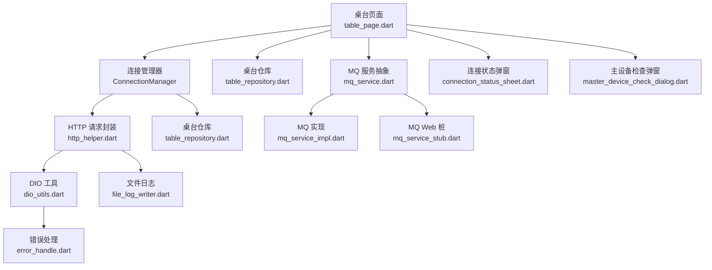
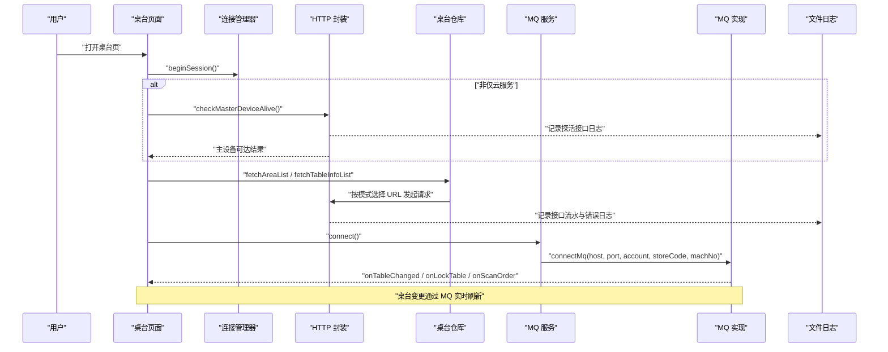
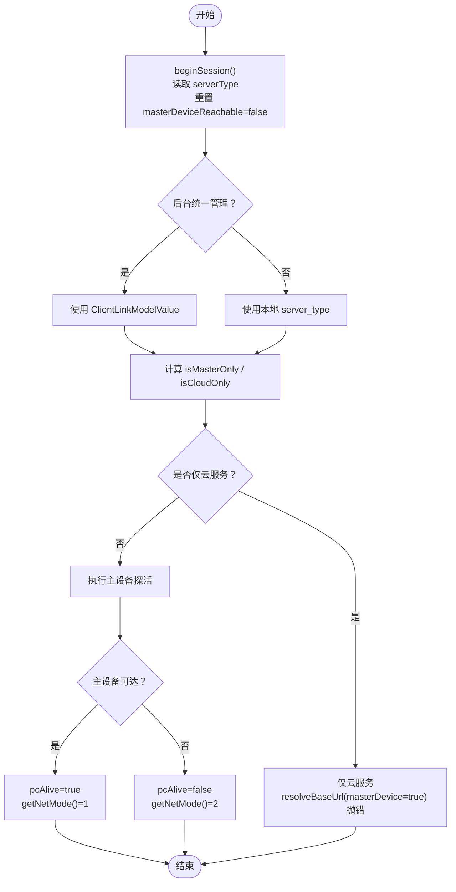
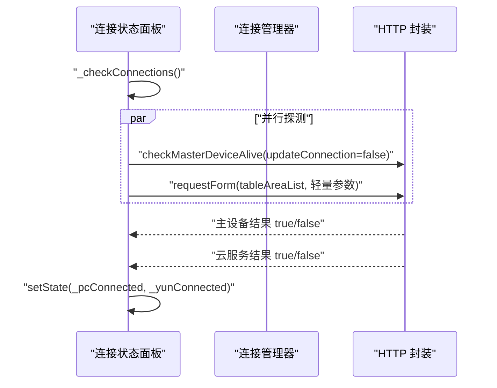
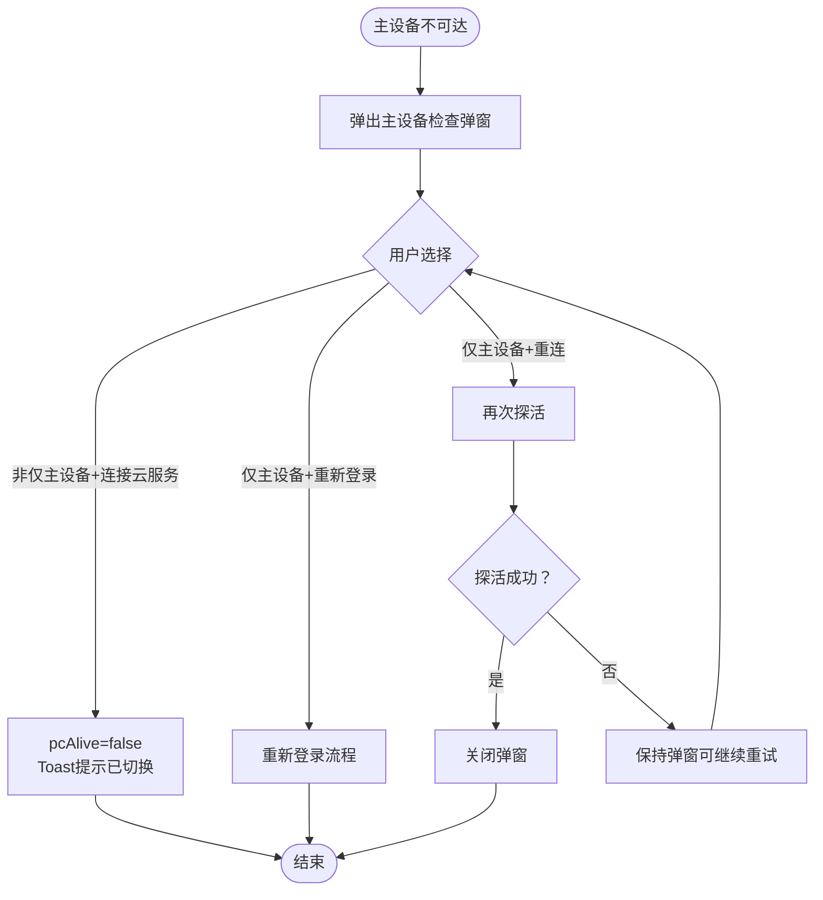
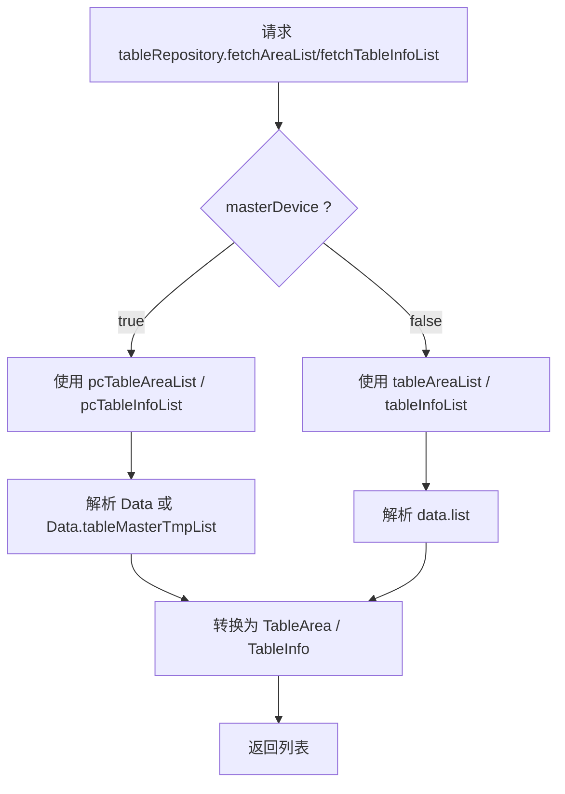
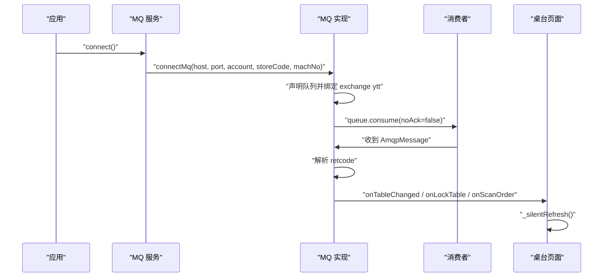
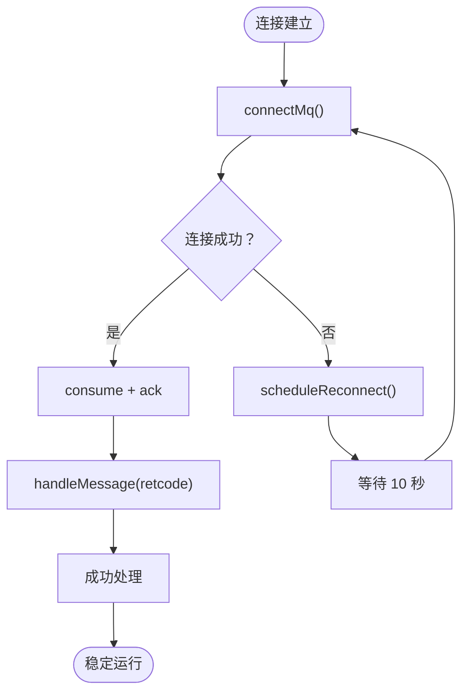
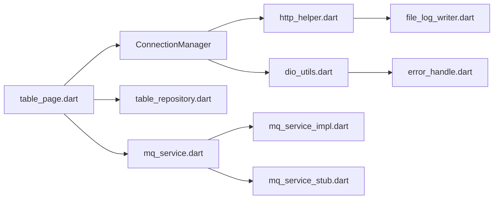

# 连接状态管理

<cite>
**本文引用的文件**   
- [lib/net/connection_manager.dart](file://lib/net/connection_manager.dart)
- [lib/pages/home/table/widgets/connection_status_sheet.dart](file://lib/pages/home/table/widgets/connection_status_sheet.dart)
- [lib/pages/home/table/widgets/master_device_check_dialog.dart](file://lib/pages/home/table/widgets/master_device_check_dialog.dart)
- [lib/pages/home/table/table_repository.dart](file://lib/pages/home/table/table_repository.dart)
- [lib/pages/home/table/table_page.dart](file://lib/pages/home/table/table_page.dart)
- [lib/net/mq_service.dart](file://lib/net/mq_service.dart)
- [lib/net/mq_service_impl.dart](file://lib/net/mq_service_impl.dart)
- [lib/net/mq_service_stub.dart](file://lib/net/mq_service_stub.dart)
- [lib/net/http_helper.dart](file://lib/net/http_helper.dart)
- [lib/net/dio_utils.dart](file://lib/net/dio_utils.dart)
- [lib/net/error_handle.dart](file://lib/net/error_handle.dart)
- [lib/setting/page/param_setting_page.dart](file://lib/setting/page/param_setting_page.dart)
- [lib/util/file_log_writer.dart](file://lib/util/file_log_writer.dart)
- [lib/res/constant.dart](file://lib/res/constant.dart)
- [test/connection_mode_test.dart](file://test/connection_mode_test.dart)
</cite>

## 目录
1. [引言](#引言)
2. [项目结构与职责划分](#项目结构与职责划分)
3. [核心组件总览](#核心组件总览)
4. [架构与数据流](#架构与数据流)
5. [详细组件分析](#详细组件分析)
6. [依赖关系分析](#依赖关系分析)
7. [性能与监控指标](#性能与监控指标)
8. [故障排查指南](#故障排查指南)
9. [结论](#结论)

## 引言
本文件面向桌台管理中的“连接状态管理”，围绕三种连接模式展开：云服务、主设备直连和混合模式。文档重点说明以下内容：
- 连接状态指示器的实现逻辑与可视化展示；
- 不同连接模式的切换机制、权限控制与状态同步策略；
- 云服务、主设备直连、混合模式下桌台数据的获取方式；
- 连接质量检测、自动重连机制、超时处理与故障转移策略；
- 连接状态流转图、错误码定义与重试算法；
- 连接监控指标、性能统计与调试工具使用；
- 与 RabbitMQ 消息推送的协同工作机制，以及数据冲突解决策略。

该能力对齐本地端 smdcapp 的双模式架构，同时通过 Flutter 侧的状态管理、HTTP 封装与 MQ 订阅，形成端到端的桌台连接治理方案。

## 项目结构与职责划分
| 模块 | 主要职责 | 关键文件 |
|---|---|---|
| 连接模式决策 | 维护当前会话的连接模式、主设备可达性、服务器地址解析 | [lib/net/connection_manager.dart](file://lib/net/connection_manager.dart) |
| 连接状态展示 | 弹出连接状态面板，并行检测主设备与云服务可达性 | [lib/pages/home/table/widgets/connection_status_sheet.dart](file://lib/pages/home/table/widgets/connection_status_sheet.dart) |
| 主设备断线引导 | 无法连接主设备时提供排查指引与操作入口 | [lib/pages/home/table/widgets/master_device_check_dialog.dart](file://lib/pages/home/table/widgets/master_device_check_dialog.dart) |
| 桌台数据仓库 | 根据连接模式选择接口路径并解析响应结构 | [lib/pages/home/table/table_repository.dart](file://lib/pages/home/table/table_repository.dart) |
| 桌台页面 | 初始化连接模式、加载数据、订阅 MQ 与事件总线、轮询兜底 | [lib/pages/home/table/table_page.dart](file://lib/pages/home/table/table_page.dart) |
| MQ 服务抽象 | 暴露 MQ 连接、断开与各业务事件流 | [lib/net/mq_service.dart](file://lib/net/mq_service.dart) |
| MQ 实际实现 | AMQP 0-9-1 连接、队列绑定、消息分发与自动重连 | [lib/net/mq_service_impl.dart](file://lib/net/mq_service_impl.dart) |
| MQ Web 桩实现 | Web 平台空实现，由定时轮询兜底 | [lib/net/mq_service_stub.dart](file://lib/net/mq_service_stub.dart) |
| HTTP 请求封装 | 统一 POST、签名、登录态失效处理、接口日志 | [lib/net/http_helper.dart](file://lib/net/http_helper.dart) |
| 网络基础层 | Dio 配置、超时、代理、异常映射 | [lib/net/dio_utils.dart](file://lib/net/dio_utils.dart) |
| 错误码与错误对象 | 统一网络错误分类与提示文案 | [lib/net/error_handle.dart](file://lib/net/error_handle.dart) |
| 参数设置页 | 修改连接模式（受后台统一管理限制） | [lib/setting/page/param_setting_page.dart](file://lib/setting/page/param_setting_page.dart) |
| 日志系统 | 接口流水、错误日志、MQ 日志、过期清理 | [lib/util/file_log_writer.dart](file://lib/util/file_log_writer.dart) |
| 常量定义 | 存储键、环境标志、RabbitMQ 相关 key | [lib/res/constant.dart](file://lib/res/constant.dart) |
| 连接模式测试 | 验证仅云服务、仅主设备、不限模式、探活校验等场景 | [test/connection_mode_test.dart](file://test/connection_mode_test.dart) |

**图表来源** 
- [lib/net/connection_manager.dart:1-114](file://lib/net/connection_manager.dart#L1-L114)
- [lib/pages/home/table/table_repository.dart:1-137](file://lib/pages/home/table/table_repository.dart#L1-L137)
- [lib/pages/home/table/table_page.dart:1-200](file://lib/pages/home/table/table_page.dart#L1-L200)
- [lib/net/mq_service.dart:1-112](file://lib/net/mq_service.dart#L1-L112)
- [lib/net/mq_service_impl.dart:1-200](file://lib/net/mq_service_impl.dart#L1-L200)
- [lib/net/mq_service_stub.dart:1-65](file://lib/net/mq_service_stub.dart#L1-L65)
- [lib/net/http_helper.dart:1-200](file://lib/net/http_helper.dart#L1-L200)
- [lib/net/dio_utils.dart:1-200](file://lib/net/dio_utils.dart#L1-L200)
- [lib/net/error_handle.dart:1-82](file://lib/net/error_handle.dart#L1-L82)
- [lib/util/file_log_writer.dart:1-200](file://lib/util/file_log_writer.dart#L1-L200)

**章节来源**
- [lib/net/connection_manager.dart:1-114](file://lib/net/connection_manager.dart#L1-L114)
- [lib/pages/home/table/table_repository.dart:1-137](file://lib/pages/home/table/table_repository.dart#L1-L137)
- [lib/pages/home/table/table_page.dart:1-200](file://lib/pages/home/table/table_page.dart#L1-L200)
- [lib/net/mq_service.dart:1-112](file://lib/net/mq_service.dart#L1-L112)
- [lib/net/mq_service_impl.dart:1-200](file://lib/net/mq_service_impl.dart#L1-L200)
- [lib/net/mq_service_stub.dart:1-65](file://lib/net/mq_service_stub.dart#L1-L65)
- [lib/net/http_helper.dart:1-200](file://lib/net/http_helper.dart#L1-L200)
- [lib/net/dio_utils.dart:1-200](file://lib/net/dio_utils.dart#L1-L200)
- [lib/net/error_handle.dart:1-82](file://lib/net/error_handle.dart#L1-L82)
- [lib/util/file_log_writer.dart:1-200](file://lib/util/file_log_writer.dart#L1-L200)

## 核心组件总览
- **连接管理器**：集中维护连接模式（不限、仅主设备、仅云服务）、主设备可达性、是否处于已初始化会话、主设备地址及基址解析规则。对外暴露主设备丢失事件流，供 UI 层触发引导交互。
- **连接状态面板**：并行探测主设备与云服务，分别返回成功、失败或检测中，并在 UI 上标注“当前连接”。
- **主设备检查弹窗**：在无法连接主设备时强制用户做出选择；若为仅主设备模式，则阻断关闭并引导重新登录或重连；若非仅主设备模式，可切换到云服务。
- **桌台仓库**：按连接模式决定调用云服务还是主设备接口，并对两类响应结构进行解析。
- **桌台页面**：负责整体生命周期：先确定连接模式、再加载数据、订阅 MQ 与本地事件总线，并在必要时弹主设备检查弹窗。
- **MQ 服务**：抽象出连接、断开与各业务事件流；实际实现基于 dart_amqp，Web 平台走桩实现。
- **HTTP 与 DIO**：统一 POST 请求、签名、登录态失效跳转、接口日志记录；DIO 提供超时、代理与异常映射。
- **错误处理**：将底层 DioException、SocketException、HttpException 等映射为统一错误码与提示文案。
- **日志系统**：异步批量写入接口流水、错误日志、MQ 日志，支持按日期分目录与过期清理。

**章节来源**
- [lib/net/connection_manager.dart:1-114](file://lib/net/connection_manager.dart#L1-L114)
- [lib/pages/home/table/widgets/connection_status_sheet.dart:1-200](file://lib/pages/home/table/widgets/connection_status_sheet.dart#L1-L200)
- [lib/pages/home/table/widgets/master_device_check_dialog.dart:1-200](file://lib/pages/home/table/widgets/master_device_check_dialog.dart#L1-L200)
- [lib/pages/home/table/table_repository.dart:1-137](file://lib/pages/home/table/table_repository.dart#L1-L137)
- [lib/pages/home/table/table_page.dart:1-200](file://lib/pages/home/table/table_page.dart#L1-L200)
- [lib/net/mq_service.dart:1-112](file://lib/net/mq_service.dart#L1-L112)
- [lib/net/mq_service_impl.dart:1-200](file://lib/net/mq_service_impl.dart#L1-L200)
- [lib/net/http_helper.dart:1-200](file://lib/net/http_helper.dart#L1-L200)
- [lib/net/dio_utils.dart:1-200](file://lib/net/dio_utils.dart#L1-L200)
- [lib/net/error_handle.dart:1-82](file://lib/net/error_handle.dart#L1-L82)
- [lib/util/file_log_writer.dart:1-200](file://lib/util/file_log_writer.dart#L1-L200)

## 架构与数据流
连接状态管理贯穿“UI 展示—连接决策—数据获取—消息推送—日志记录”全链路：

**图表来源**
- [lib/pages/home/table/table_page.dart:1-200](file://lib/pages/home/table/table_page.dart#L1-L200)
- [lib/net/connection_manager.dart:1-114](file://lib/net/connection_manager.dart#L1-L114)
- [lib/pages/home/table/table_repository.dart:1-137](file://lib/pages/home/table/table_repository.dart#L1-L137)
- [lib/net/mq_service.dart:1-112](file://lib/net/mq_service.dart#L1-L112)
- [lib/net/mq_service_impl.dart:1-200](file://lib/net/mq_service_impl.dart#L1-L200)
- [lib/net/http_helper.dart:1-200](file://lib/net/http_helper.dart#L1-L200)
- [lib/util/file_log_writer.dart:1-200](file://lib/util/file_log_writer.dart#L1-L200)

## 详细组件分析

### 连接模式与状态决策
连接模式由三类值表示：
- 不限：优先尝试主设备，不可达时回退到云服务；
- 仅主设备：必须走主设备，断线不降级到云服务；
- 仅云服务：只走云服务，禁止连接主设备。

核心决策点包括：
- 会话初始化：`beginSession()` 重置活跃模式与主设备可达性；
- 模式读取：优先使用后台统一控制的 `ClientLinkModel`，否则使用本地 `server_type`；
- 主设备可达性：通过探活接口判断，并在主设备断线时广播 `onMasterDeviceLost`；
- 基址解析：仅云服务时拒绝主设备地址解析，仅主设备时若缺少 localhost 则抛出状态错误。

**图表来源**
- [lib/net/connection_manager.dart:1-114](file://lib/net/connection_manager.dart#L1-L114)
- [lib/net/dio_utils.dart:1-200](file://lib/net/dio_utils.dart#L1-L200)
- [lib/net/http_helper.dart:1-200](file://lib/net/http_helper.dart#L1-L200)
- [lib/res/constant.dart:1-93](file://lib/res/constant.dart#L1-L93)

**章节来源**
- [lib/net/connection_manager.dart:1-114](file://lib/net/connection_manager.dart#L1-L114)
- [lib/res/constant.dart:1-93](file://lib/res/constant.dart#L1-L93)

### 连接状态指示器实现
连接状态面板通过并行探测主设备与云服务来更新状态：
- 主设备探测：调用主设备探活接口，捕获异常即视为失败；
- 云服务探测：调用云服务区域列表接口，捕获异常即视为失败；
- UI 显示：根据 `ConnectionManager.getNetMode()` 显示“当前连接”标记。

**图表来源**
- [lib/pages/home/table/widgets/connection_status_sheet.dart:1-200](file://lib/pages/home/table/widgets/connection_status_sheet.dart#L1-L200)
- [lib/net/connection_manager.dart:1-114](file://lib/net/connection_manager.dart#L1-L114)
- [lib/net/http_helper.dart:1-200](file://lib/net/http_helper.dart#L1-L200)

**章节来源**
- [lib/pages/home/table/widgets/connection_status_sheet.dart:1-200](file://lib/pages/home/table/widgets/connection_status_sheet.dart#L1-L200)

### 主设备断线引导与切换
当主设备不可用时，桌台页面会弹出主设备检查弹窗：
- 仅主设备模式：不允许直接关闭，只能“重新登录”或继续“重连主设备”；
- 非仅主设备模式：可选择“连接云服务”，此时设置 `ConnectionManager.pcAlive = false` 并提示已切换；
- 重连主设备：再次探活，成功则关闭弹窗，失败则保留弹窗以便继续重试。

**图表来源**
- [lib/pages/home/table/widgets/master_device_check_dialog.dart:1-200](file://lib/pages/home/table/widgets/master_device_check_dialog.dart#L1-L200)
- [lib/pages/home/table/table_page.dart:1-200](file://lib/pages/home/table/table_page.dart#L1-L200)
- [lib/net/connection_manager.dart:1-114](file://lib/net/connection_manager.dart#L1-L114)

**章节来源**
- [lib/pages/home/table/widgets/master_device_check_dialog.dart:1-200](file://lib/pages/home/table/widgets/master_device_check_dialog.dart#L1-L200)
- [lib/pages/home/table/table_page.dart:1-200](file://lib/pages/home/table/table_page.dart#L1-L200)

### 桌台数据获取方式
桌台仓库根据 `masterDevice` 参数选择不同接口与响应解析逻辑：
- 云服务：路径 `/table/xxx`，响应包含 `data.list`；
- 主设备：路径 `/api/table/xxx`，响应包含 `Data.tableMasterTmpList`；
- 区域列表与桌台列表均封装参数，如分页、排序、筛选条件。

**图表来源**
- [lib/pages/home/table/table_repository.dart:1-137](file://lib/pages/home/table/table_repository.dart#L1-L137)
- [lib/net/http_helper.dart:1-200](file://lib/net/http_helper.dart#L1-L200)

**章节来源**
- [lib/pages/home/table/table_repository.dart:1-137](file://lib/pages/home/table/table_repository.dart#L1-L137)

### MQ 推送与桌台刷新
MQ 服务负责连接 RabbitMQ 并监听桌台变更消息：
- 连接参数从登录数据中提取 host、port、account、storeCode、machNo；
- 声明 queue `{account}-{storeCode}-{machNo}`，绑定三级 routing keys；
- 消费消息后按 retcode 分发到不同事件流；
- Web 平台跳过 MQ 连接，依靠定时轮询兜底。

**图表来源**
- [lib/net/mq_service.dart:1-112](file://lib/net/mq_service.dart#L1-L112)
- [lib/net/mq_service_impl.dart:1-200](file://lib/net/mq_service_impl.dart#L1-L200)
- [lib/pages/home/table/table_page.dart:1-200](file://lib/pages/home/table/table_page.dart#L1-L200)

**章节来源**
- [lib/net/mq_service.dart:1-112](file://lib/net/mq_service.dart#L1-L112)
- [lib/net/mq_service_impl.dart:1-200](file://lib/net/mq_service_impl.dart#L1-L200)
- [lib/pages/home/table/table_page.dart:1-200](file://lib/pages/home/table/table_page.dart#L1-L200)

### 连接质量检测、自动重连与超时处理
- 连接质量检测：
  - 主设备探活：调用主设备探活接口；
  - 云服务检测：调用云服务轻量接口；
  - 连接状态面板并行探测，避免串行阻塞。
- 自动重连：
  - MQ 实现使用 dart_amqp 的重连配置，并在连接失败后 10 秒后重试；
  - 防止并发重连：`_connecting` 标志位；
  - 重连参数缓存：host、port、account、storeCode、machNo。
- 超时处理：
  - DIO 默认连接超时 15 秒、接收超时 15 秒、发送超时 10 秒；
  - HTTP 封装记录耗时并区分成功与失败日志；
  - 错误处理将底层异常映射为统一错误码。

**图表来源**
- [lib/net/mq_service_impl.dart:1-200](file://lib/net/mq_service_impl.dart#L1-L200)
- [lib/net/dio_utils.dart:1-200](file://lib/net/dio_utils.dart#L1-L200)
- [lib/net/http_helper.dart:1-200](file://lib/net/http_helper.dart#L1-L200)

**章节来源**
- [lib/net/mq_service_impl.dart:1-200](file://lib/net/mq_service_impl.dart#L1-L200)
- [lib/net/dio_utils.dart:1-200](file://lib/net/dio_utils.dart#L1-L200)
- [lib/net/http_helper.dart:1-200](file://lib/net/http_helper.dart#L1-L200)

### 故障转移策略
- 不限模式：主设备不可达时降级为云服务；
- 仅主设备：断线不降级，继续尝试重连或要求重新登录；
- 仅云服务：禁止主设备访问，主设备探活直接返回失败；
- 缺失主设备地址：解析主设备基址时抛出状态错误，避免误发到云端。

这些行为在单元测试中有覆盖，确保边界情况符合预期。

**章节来源**
- [test/connection_mode_test.dart:1-200](file://test/connection_mode_test.dart#L1-L200)
- [lib/net/connection_manager.dart:1-114](file://lib/net/connection_manager.dart#L1-L114)

### 错误码定义
网络层统一错误码如下：
| 错误码 | 含义 | 典型来源 |
|---|---|---|
| 1000 | 网络异常 | SocketException、连接失败 |
| 1001 | 数据解析错误 | JSON 解析异常 |
| 1002 | Socket 异常 | 底层 Socket 错误 |
| 1003 | HTTP 异常 | HttpException |
| 1004 | 连接超时 | connectTimeout |
| 1005 | 发送超时 | sendTimeout |
| 1006 | 接收超时 | receiveTimeout |
| 1007 | 取消请求 | CancelToken.isCancel |
| 9999 | 未知异常 | 未分类异常 |

这些错误码用于上层 Toast、日志与业务分支处理。

**章节来源**
- [lib/net/error_handle.dart:1-82](file://lib/net/error_handle.dart#L1-L82)
- [lib/net/dio_utils.dart:1-200](file://lib/net/dio_utils.dart#L1-L200)

### 重试算法实现
MQ 自动重连的关键实现要点：
- 使用 dart_amqp 的 `maxConnectionAttempts` 与 `reconnectWaitTime`；
- 连接失败时 `_connected=false` 并调度 10 秒后重试；
- 通过 `_connecting` 防止并发连接；
- 连接成功后声明 queue、绑定 exchange、启动 consumer 并手动 ack；
- 所有连接与消息处理过程写入 mq_log，便于发布环境下回溯。

**章节来源**
- [lib/net/mq_service_impl.dart:1-200](file://lib/net/mq_service_impl.dart#L1-L200)
- [lib/util/file_log_writer.dart:1-200](file://lib/util/file_log_writer.dart#L1-L200)

### 与 MQ 的消息协同与数据冲突解决
- 桌台变更消息 retcode 8/10/11 触发桌台刷新；
- 扫码接单 retcode 9 触发订单相关刷新；
- 强制下线 retcode 6 清空数据并跳转登录；
- 打印通知 retcode 66 触发打印相关刷新；
- 叫号刷新 retcode 13 触发叫号列表刷新；
- 心跳 retcode 1 忽略。

数据冲突解决策略：
- MQ 推送优先：桌面端通过 onTableChanged 立即静默刷新，减少 UI 抖动；
- 本地事件总线兜底：开台、锁台等操作后立即刷新；
- 定时轮询兜底：在 MQ 不稳定或 Web 平台下，通过轮询保证最终一致性；
- 去抖与防并发：静默刷新期间标记 pendingRefresh，避免频繁重复请求。

**章节来源**
- [lib/net/mq_service.dart:1-112](file://lib/net/mq_service.dart#L1-L112)
- [lib/net/mq_service_impl.dart:1-200](file://lib/net/mq_service_impl.dart#L1-L200)
- [lib/pages/home/table/table_page.dart:1-200](file://lib/pages/home/table/table_page.dart#L1-L200)

## 依赖关系分析
连接状态管理的依赖关系呈现“低耦合、高内聚”特征：
- 连接管理器独立于 UI，仅提供状态与事件；
- 桌台仓库独立于连接模式细节，仅接收布尔参数；
- MQ 服务抽象屏蔽底层实现差异，Web 与移动端一致暴露；
- HTTP 封装统一日志与错误处理，降低各模块重复代码；
- 日志系统跨模块共享，便于问题定位。

**图表来源**
- [lib/net/connection_manager.dart:1-114](file://lib/net/connection_manager.dart#L1-L114)
- [lib/pages/home/table/table_page.dart:1-200](file://lib/pages/home/table/table_page.dart#L1-L200)
- [lib/pages/home/table/table_repository.dart:1-137](file://lib/pages/home/table/table_repository.dart#L1-L137)
- [lib/net/mq_service.dart:1-112](file://lib/net/mq_service.dart#L1-L112)
- [lib/net/mq_service_impl.dart:1-200](file://lib/net/mq_service_impl.dart#L1-L200)
- [lib/net/mq_service_stub.dart:1-65](file://lib/net/mq_service_stub.dart#L1-L65)
- [lib/net/http_helper.dart:1-200](file://lib/net/http_helper.dart#L1-L200)
- [lib/net/dio_utils.dart:1-200](file://lib/net/dio_utils.dart#L1-L200)
- [lib/net/error_handle.dart:1-82](file://lib/net/error_handle.dart#L1-L82)
- [lib/util/file_log_writer.dart:1-200](file://lib/util/file_log_writer.dart#L1-L200)

**章节来源**
- [lib/net/connection_manager.dart:1-114](file://lib/net/connection_manager.dart#L1-L114)
- [lib/pages/home/table/table_page.dart:1-200](file://lib/pages/home/table/table_page.dart#L1-L200)
- [lib/pages/home/table/table_repository.dart:1-137](file://lib/pages/home/table/table_repository.dart#L1-L137)
- [lib/net/mq_service.dart:1-112](file://lib/net/mq_service.dart#L1-L112)
- [lib/net/mq_service_impl.dart:1-200](file://lib/net/mq_service_impl.dart#L1-L200)
- [lib/net/mq_service_stub.dart:1-65](file://lib/net/mq_service_stub.dart#L1-L65)
- [lib/net/http_helper.dart:1-200](file://lib/net/http_helper.dart#L1-L200)
- [lib/net/dio_utils.dart:1-200](file://lib/net/dio_utils.dart#L1-L200)
- [lib/net/error_handle.dart:1-82](file://lib/net/error_handle.dart#L1-L82)
- [lib/util/file_log_writer.dart:1-200](file://lib/util/file_log_writer.dart#L1-L200)

## 性能与监控指标
建议关注以下指标以评估连接状态管理与桌台数据获取的性能：
- 连接成功率：主设备探活成功率、云服务轻量接口成功率；
- 重连延迟：MQ 连接失败到成功重连的平均时间；
- 消息处理延迟：retcode 消息到达至 UI 刷新的时间差；
- 接口耗时：探活接口、区域列表、桌台列表的请求耗时分布；
- 错误率：各类错误码占比，尤其是超时、连接失败与解析错误；
- 日志量：接口流水与错误日志增长速率，避免因高频成功日志膨胀。

现有日志系统已提供：
- 接口流水：方法、路径、成功/失败、耗时、参数与响应摘要；
- 错误日志：异常堆栈、URL、参数、错误提示与连接模式；
- MQ 日志：连接、队列、routing keys、消息类型与处理结果；
- 批量写入：每批最多 10 条或 500ms 刷新一次，降低 IO 压力。

**章节来源**
- [lib/util/file_log_writer.dart:1-200](file://lib/util/file_log_writer.dart#L1-L200)
- [lib/net/http_helper.dart:1-200](file://lib/net/http_helper.dart#L1-L200)
- [lib/net/mq_service_impl.dart:1-200](file://lib/net/mq_service_impl.dart#L1-L200)

## 故障排查指南
常见故障与排查步骤：
- 主设备不可达：
  - 检查 PC 主设备是否开启并登录；
  - 检查当前设备是否连接同一局域网 WiFi；
  - 查看连接状态面板中主设备行是否红色；
  - 在仅主设备模式下，弹窗不允许关闭，需重新登录或继续重连；
  - 查看文件日志中的接口流水与错误日志，确认探活接口是否失败。
- 云服务不可达：
  - 检查网络连接与域名解析；
  - 查看云服务轻量接口请求是否成功；
  - 注意登录态失效 retcode -2/-3 时会跳转登录页；
  - 查看错误日志中的 retmsg 与 URL。
- MQ 连接失败：
  - 检查 host、port、account、storeCode、machNo 是否正确；
  - 查看 mq_log 文件中的连接与重连日志；
  - 在 Web 平台下 MQ 为空实现，需依赖轮询兜底；
  - 观察 reconnection timer 是否按 10 秒间隔触发。
- 数据不一致：
  - 检查 onTableChanged 是否触发；
  - 检查本地事件总线是否触发；
  - 检查 pendingRefresh 与 silentRefreshing 是否阻止了重复刷新；
  - 在 MQ 不稳定时启用轮询兜底。

**章节来源**
- [lib/pages/home/table/widgets/master_device_check_dialog.dart:1-200](file://lib/pages/home/table/widgets/master_device_check_dialog.dart#L1-L200)
- [lib/pages/home/table/widgets/connection_status_sheet.dart:1-200](file://lib/pages/home/table/widgets/connection_status_sheet.dart#L1-L200)
- [lib/net/mq_service_impl.dart:1-200](file://lib/net/mq_service_impl.dart#L1-L200)
- [lib/net/http_helper.dart:1-200](file://lib/net/http_helper.dart#L1-L200)
- [lib/util/file_log_writer.dart:1-200](file://lib/util/file_log_writer.dart#L1-L200)

## 结论
连接状态管理通过连接管理器、HTTP 封装、MQ 服务与桌台仓库的协作，实现了云服务、主设备直连与混合模式下的统一连接治理。其优势在于：
- 明确的连接模式决策与故障转移；
- 并行连接质量检测与直观的 UI 指示；
- MQ 推送为主、轮询兜底的实时刷新机制；
- 统一的错误码、日志与调试信息；
- 完善的单元测试覆盖边界行为。

未来可进一步扩展的方向包括：
- 增加连接质量监控指标上报；
- 对主设备探活与 MQ 重连策略进行可配置化；
- 提供更丰富的调试视图，展示连接状态、MQ 连接信息与最近接口耗时；
- 在主设备与云服务数据冲突时引入版本号或时间戳合并策略。