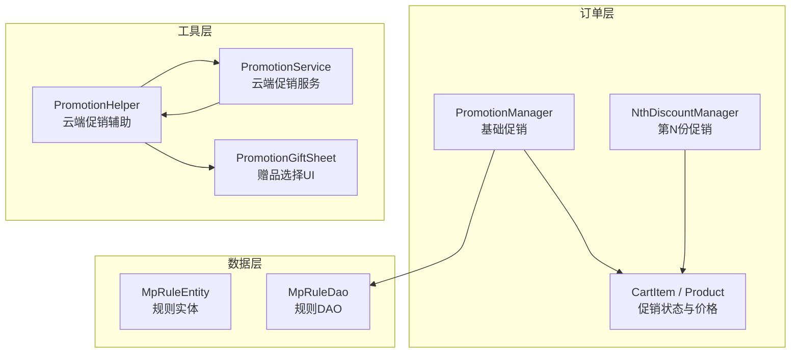
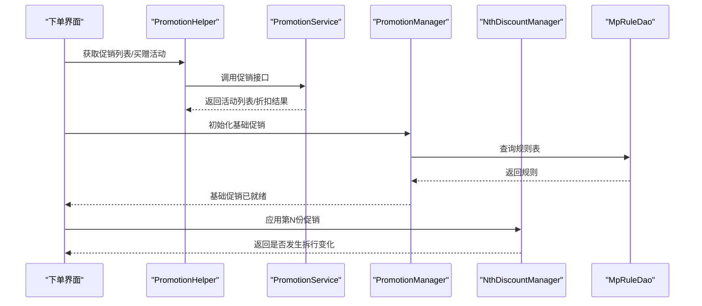
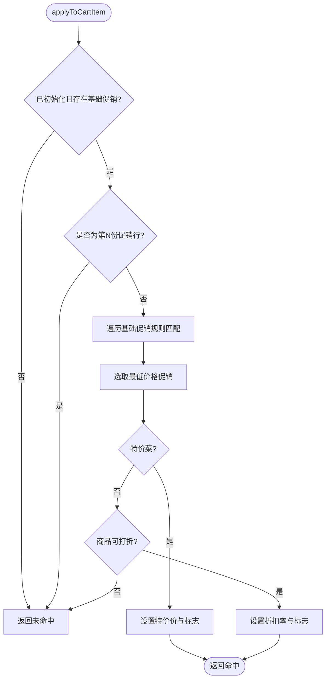
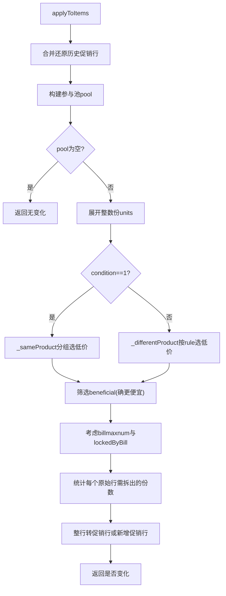
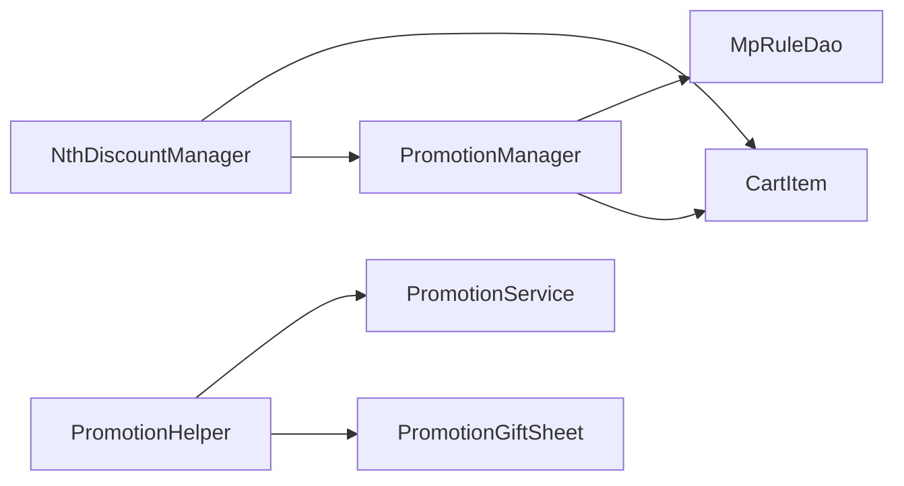

# 促销计算引擎

<cite>
**本文引用的文件**   
- [promotion_manager.dart](file://lib/pages/order/promotion_manager.dart)
- [nth_discount_manager.dart](file://lib/pages/order/nth_discount_manager.dart)
- [order_models.dart](file://lib/pages/order/order_models.dart)
- [promotion_helper.dart](file://lib/util/promotion_helper.dart)
- [promotion_service.dart](file://lib/util/promotion_service.dart)
- [mp_rule_entity.dart](file://lib/db/entity/mp_rule_entity.dart)
- [mp_rule_dao.dart](file://lib/db/dao/mp_rule_dao.dart)
- [promotion_gift_sheet.dart](file://lib/pages/order/widgets/promotion_gift_sheet.dart)
</cite>

## 目录
1. [简介](#简介)
2. [项目结构](#项目结构)
3. [核心组件](#核心组件)
4. [架构总览](#架构总览)
5. [详细组件分析](#详细组件分析)
6. [依赖关系分析](#依赖关系分析)
7. [性能与优化](#性能与优化)
8. [错误处理与排障](#错误处理与排障)
9. [结论](#结论)
10. [附录：配置、扩展与预览](#附录配置扩展与预览)

## 简介
本文件围绕“促销计算引擎”进行系统化文档说明，聚焦以下目标：
- 解释促销规则系统的设计架构，包括基础促销管理器、第N份促销管理器与促销规则解析。
- 梳理各类促销类型的计算算法：分类折扣、菜品折扣、特价菜、买赠、满量、满减、满赠、满折，以及第N份特价。
- 明确促销优先级、叠加规则与冲突处理机制。
- 给出促销活动配置、自定义促销规则、促销效果预览的实现路径。
- 总结促销计算的性能优化策略与错误处理方式。

## 项目结构
促销相关代码分布在订单页面、工具层、数据访问层和实体层：
- 订单页内实现基础促销管理与第N份促销管理，并定义购物车模型中的促销状态字段。
- 工具层提供云端促销服务与辅助类，负责拉取活动列表、计算折扣及赠品选择交互。
- 数据层通过 DAO 与实体映射促销规则表，用于本地（或 Web 缓存）查询。

图表来源
- [promotion_manager.dart:1-200](file://lib/pages/order/promotion_manager.dart#L1-L200)
- [nth_discount_manager.dart:1-200](file://lib/pages/order/nth_discount_manager.dart#L1-L200)
- [order_models.dart:201-669](file://lib/pages/order/order_models.dart#L201-L669)
- [promotion_helper.dart:1-200](file://lib/util/promotion_helper.dart#L1-L200)
- [promotion_service.dart:1-200](file://lib/util/promotion_service.dart#L1-L200)
- [mp_rule_entity.dart:1-54](file://lib/db/entity/mp_rule_entity.dart#L1-L54)
- [mp_rule_dao.dart:1-118](file://lib/db/dao/mp_rule_dao.dart#L1-L118)
- [promotion_gift_sheet.dart:1-200](file://lib/pages/order/widgets/promotion_gift_sheet.dart#L1-L200)

章节来源
- [promotion_manager.dart:1-200](file://lib/pages/order/promotion_manager.dart#L1-L200)
- [promotion_helper.dart:1-200](file://lib/util/promotion_helper.dart#L1-L200)
- [promotion_service.dart:1-200](file://lib/util/promotion_service.dart#L1-L200)
- [mp_rule_entity.dart:1-54](file://lib/db/entity/mp_rule_entity.dart#L1-L54)
- [mp_rule_dao.dart:1-118](file://lib/db/dao/mp_rule_dao.dart#L1-L118)
- [order_models.dart:201-669](file://lib/pages/order/order_models.dart#L201-L669)

## 核心组件
- PromotionManager：基础促销管理器，负责加载分类折扣、菜品折扣、特价菜与第N份促销元数据，并对购物车条目应用最优基础促销。
- NthDiscountManager：第N份促销管理器，按相同商品或不同商品规则拆分行，计算每N份的优惠份数。
- PromotionInfo / PromotionGiftActivity / PromotionGift：云端促销模型，用于展示与服务端计算结果。
- PromotionHelper：云端促销辅助，封装活动列表获取、买赠/满赠校验、折扣金额计算等。
- PromotionService：云端促销服务，封装促销接口调用与类型判断。
- MpRuleEntity / MpRuleDao：促销规则实体与DAO，提供按金额、数量、billid 的规则查询。
- CartItem：购物车条目，承载基础促销与第N份促销的状态字段与价格计算逻辑。
- PromotionGiftSheet：买赠/满赠赠品选择弹窗，控制赠品数量与提交。

章节来源
- [promotion_manager.dart:1-200](file://lib/pages/order/promotion_manager.dart#L1-L200)
- [nth_discount_manager.dart:1-200](file://lib/pages/order/nth_discount_manager.dart#L1-L200)
- [promotion_helper.dart:1-200](file://lib/util/promotion_helper.dart#L1-L200)
- [promotion_service.dart:1-200](file://lib/util/promotion_service.dart#L1-L200)
- [mp_rule_entity.dart:1-54](file://lib/db/entity/mp_rule_entity.dart#L1-L54)
- [mp_rule_dao.dart:1-118](file://lib/db/dao/mp_rule_dao.dart#L1-L118)
- [order_models.dart:201-669](file://lib/pages/order/order_models.dart#L201-L669)
- [promotion_gift_sheet.dart:1-200](file://lib/pages/order/widgets/promotion_gift_sheet.dart#L1-L200)

## 架构总览
促销体系采用“本地基础促销 + 云端复杂促销”的双轨架构：
- 本地基础促销：由 PromotionManager 从 tabledown 同步的基础促销表读取分类折扣、菜品折扣、特价菜与第N份促销元数据，并在客户端对购物车明细进行匹配与应用。
- 云端复杂促销：由 PromotionHelper / PromotionService 调用服务端接口，返回可用活动列表、买赠/满赠赠品与折扣金额；客户端主要负责参数组装、结果展示与交互。

图表来源
- [promotion_helper.dart:201-440](file://lib/util/promotion_helper.dart#L201-L440)
- [promotion_service.dart:1-242](file://lib/util/promotion_service.dart#L1-L242)
- [promotion_manager.dart:1-200](file://lib/pages/order/promotion_manager.dart#L1-L200)
- [mp_rule_dao.dart:1-118](file://lib/db/dao/mp_rule_dao.dart#L1-L118)
- [nth_discount_manager.dart:1-200](file://lib/pages/order/nth_discount_manager.dart#L1-L200)

## 详细组件分析

### 基础促销管理器 PromotionManager
职责
- 初始化时从 tabledown 同步促销主表、产品或分类明细与规则表，构建 BasicPromotion 与 NthPromotion 集合。
- 为购物车条目应用最优基础促销（分类折扣、菜品折扣、特价菜），并写入 CartItem 的促销状态字段。
- 为已下单明细补套基础促销，避免覆盖服务端定价或重复叠加。

关键行为
- 分类匹配支持同级或层级前缀包含关系；商品匹配要求 productid 一致。
- 若促销限定规格但客户端无法比对 specid，则跳过该促销。
- 特价菜不受 dscflag 限制；分类/菜品折扣受 dscflag 限制。
- 第N份促销单独走 NthDiscountManager，不与基础促销叠加。

复杂度
- 单次 applyToCartItem 遍历所有基础促销，时间复杂度 O(P)，P 为基础促销条数。
- revalidateAll 对所有购物车条目重算，时间复杂度 O(N*P)。

图表来源
- [promotion_manager.dart:201-455](file://lib/pages/order/promotion_manager.dart#L201-L455)

章节来源
- [promotion_manager.dart:1-200](file://lib/pages/order/promotion_manager.dart#L1-L200)
- [promotion_manager.dart:201-455](file://lib/pages/order/promotion_manager.dart#L201-L455)

### 第N份促销管理器 NthDiscountManager
职责
- 对购物车整体重算所有第N份促销，返回是否发生拆行变化。
- 将符合条件的份数拆出为促销行，标记 specpriceflag=7 并写入 nthPrice。

算法要点
- 合并还原历史促销行，恢复普通行后再重新分配。
- 参与池过滤：排除赠品、团购、称重菜、改价行、已有促销行等。
- 条件分支：
  - condition=1（同商品）：按 productid+规格分组，组内每N份取价格最低的一份优惠。
  - condition=2（不同商品）：
    - rule=1：价格降序分组，每组最低价享受优惠。
    - rule=2：价格降序排序后从最低价开始优惠，数量为总份数除以N。
- 仅保留优惠后确实更便宜的份，避免“促”标但不降价的拆分行。
- 单笔订单最大享受次数 billmaxnum 扣除已下单占用份数，相同商品规则下优先保护上一轮已优惠的份。

复杂度
- 展开 units 的时间复杂度 O(Q)，Q 为参与池总份数。
- 分组与排序的时间复杂度取决于分组键与排序比较，通常为 O(Q log Q)。

图表来源
- [nth_discount_manager.dart:1-200](file://lib/pages/order/nth_discount_manager.dart#L1-L200)
- [nth_discount_manager.dart:201-267](file://lib/pages/order/nth_discount_manager.dart#L201-L267)

章节来源
- [nth_discount_manager.dart:1-200](file://lib/pages/order/nth_discount_manager.dart#L1-L200)
- [nth_discount_manager.dart:201-267](file://lib/pages/order/nth_discount_manager.dart#L201-L267)

### 购物车模型与价格计算 CartItem
关键字段与行为
- specpriceflag：记录基础促销与第N份促销标识（1/2/3/7）。
- jcmbillid：记录命中的基础促销活动ID。
- promoPrice：特价菜单价。
- nthPrice：第N份促销单价。
- discountedUnitPrice：折扣后单价，考虑 customPrice、memberUnitPrice、基础价与规格加价。
- totalPrice：总价，赠送商品不计入合计金额，称重菜按重量计价。

价格优先级
- 第N份促销 > 特价菜 > 原价。
- 改价 > 会员价 > 基础价+规格加价。

章节来源
- [order_models.dart:201-669](file://lib/pages/order/order_models.dart#L201-L669)

### 云端促销服务 PromotionService 与辅助 PromotionHelper
职责
- PromotionService：封装促销接口调用，返回活动列表与折扣结果，并提供促销类型判断方法。
- PromotionHelper：封装促销列表获取、买赠/满赠校验、折扣金额计算与结果解析。

主要能力
- getSalesPromotionList：根据订单明细与会员信息获取可用促销列表。
- amountAfterDiscount：根据 billid、details、amt 返回折扣后明细与总金额。
- fetchGiftActivities：获取买赠/满赠活动及赠品清单。
- calcPromotion：统一入口，返回 PromotionApplyResult，包含 totalDiscount 与明细折扣。

章节来源
- [promotion_service.dart:1-242](file://lib/util/promotion_service.dart#L1-L242)
- [promotion_helper.dart:1-200](file://lib/util/promotion_helper.dart#L1-L200)
- [promotion_helper.dart:201-440](file://lib/util/promotion_helper.dart#L201-L440)

### 促销规则实体与DAO MpRuleEntity / MpRuleDao
职责
- MpRuleEntity：表示促销规则表的字段，包括 discount、qty、giveqty、reduceamt、amt、billid、productid、typeid、specid、saletype 等。
- MpRuleDao：提供 selectAmt、selectQty、byBillids 等方法，支持按金额、数量与 billid 批量查询规则。

用途
- 在 PromotionManager 初始化阶段，结合主表与明细表构建基础促销与第N份促销。
- 在 Web 环境下，规则读自 tabledown 内存缓存；非 Web 环境读 SQLite。

章节来源
- [mp_rule_entity.dart:1-54](file://lib/db/entity/mp_rule_entity.dart#L1-L54)
- [mp_rule_dao.dart:1-118](file://lib/db/dao/mp_rule_dao.dart#L1-L118)

### 买赠/满赠赠品选择 PromotionGiftSheet
职责
- 展示买赠/满赠活动及其赠品清单，限制赠品数量不超过剩余可赠额度。
- 返回选中赠品列表供下单流程并入待下单明细。

交互流程
- 用户增减赠品数量，超过上限时提示。
- 点击确定返回选中项，跳过返回空列表，取消返回 null。

章节来源
- [promotion_gift_sheet.dart:1-200](file://lib/pages/order/widgets/promotion_gift_sheet.dart#L1-L200)
- [promotion_gift_sheet.dart:201-318](file://lib/pages/order/widgets/promotion_gift_sheet.dart#L201-L318)

## 依赖关系分析
组件耦合与依赖
- PromotionManager 依赖 Db 层 DAO 与 entity，同时依赖 TableDownloadManager 进行 Web 缓存补齐。
- NthDiscountManager 依赖 PromotionManager 提供的 nthPromotions 与 CartItem 的状态方法。
- PromotionHelper 与 PromotionService 依赖网络请求封装与日志输出。
- PromotionGiftSheet 依赖 PromotionGiftActivity 模型。

外部依赖
- 网络层：HttpApi、requestForm。
- 存储层：TableDownloadManager、SQLite（非Web）。
- 日志：FileLogWriter。

潜在循环依赖
- 当前未发现直接循环导入；PromotionManager 与 NthDiscountManager 单向依赖。

图表来源
- [promotion_manager.dart:1-200](file://lib/pages/order/promotion_manager.dart#L1-L200)
- [nth_discount_manager.dart:1-200](file://lib/pages/order/nth_discount_manager.dart#L1-L200)
- [mp_rule_dao.dart:1-118](file://lib/db/dao/mp_rule_dao.dart#L1-L118)
- [promotion_helper.dart:201-440](file://lib/util/promotion_helper.dart#L201-L440)
- [promotion_service.dart:1-242](file://lib/util/promotion_service.dart#L1-L242)
- [promotion_gift_sheet.dart:1-200](file://lib/pages/order/widgets/promotion_gift_sheet.dart#L1-L200)

## 性能与优化
- 初始化去重与按需同步：PromotionManager 在 Web 环境首次初始化时检测 tabledown 缓存为空再全量同步促销表，避免重复下载。
- 规则聚合优化：对菜品折扣取规则表最小值，减少后续比较开销。
- 参与池过滤：NthDiscountManager 在进入计算前严格过滤赠品、团购、称重菜、改价行等不参与场景，降低后续展开与排序成本。
- 稳定排序与分批选取：_stableSort 保证稳定性，减少多次重算时的抖动。
- 局部重算：revalidateAll 仅在订单确认页进入时触发，避免频繁全单重算。
- 数据库批量查询：MpRuleDao.byBillids 使用 IN 批量查询，减少往返次数。

[本节为通用性能建议，不直接分析具体代码片段]

## 错误处理与排障
常见异常与降级
- 促销初始化失败：当促销表缺失或查询异常时，PromotionManager 记录日志并降级为无促销；Web 环境保留未初始化状态以便重试。
- 云端促销接口异常：PromotionHelper 与 PromotionService 捕获异常并返回空列表或空结果，不阻塞下单流程。
- 未知规则处理：NthDiscountManager 遇到未知 rule 时记录日志，避免崩溃。
- 规格限制无法比对：当促销限定规格但客户端无法比对 specid 时，记录日志并跳过该促销。

排障建议
- 检查 spid/sid 是否正确加载；若为 0 会跳过促销初始化。
- 在 Web 环境确认 tabledown 已成功同步 tMpPtMaster/tMpPtRule 等表。
- 查看 FileLogWriter 的“促销”标签日志，定位未命中原因与活动详情。

章节来源
- [promotion_manager.dart:1-200](file://lib/pages/order/promotion_manager.dart#L1-L200)
- [promotion_manager.dart:201-455](file://lib/pages/order/promotion_manager.dart#L201-L455)
- [nth_discount_manager.dart:201-267](file://lib/pages/order/nth_discount_manager.dart#L201-L267)
- [promotion_helper.dart:201-440](file://lib/util/promotion_helper.dart#L201-L440)
- [promotion_service.dart:201-242](file://lib/util/promotion_service.dart#L201-L242)

## 结论
该促销计算引擎采用“本地基础促销 + 云端复杂促销”的分层设计：
- 基础促销由 PromotionManager 在客户端完成匹配与应用，适合快速反馈与离线可用性。
- 复杂促销（买赠、满减、满赠、满折等）交由服务端计算，客户端负责参数组装与结果展示。
- 第N份促销由 NthDiscountManager 独立处理，通过拆行机制保证价格准确性与用户体验一致性。
- 通过严格的参与池过滤、稳定排序与批量查询等手段，系统在正确性与性能之间取得平衡。

[本节为总结性内容，不直接分析具体代码片段]

## 附录：配置、扩展与预览

### 促销活动配置
- 基础促销配置来源于 tabledown 同步的主表与明细表，PromotionManager 在 init 阶段加载并构建 BasicPromotion/NthPromotion。
- 规则表 MpRuleEntity 提供 discount、qty、giveqty、reduceamt、amt 等字段，用于服务端或客户端规则判定。
- 推荐在业务侧维护 billtype 与活动名称，便于前端展示与日志追踪。

章节来源
- [promotion_manager.dart:1-200](file://lib/pages/order/promotion_manager.dart#L1-L200)
- [mp_rule_entity.dart:1-54](file://lib/db/entity/mp_rule_entity.dart#L1-L54)

### 自定义促销规则
- 可通过扩展 PromotionInfo/PromotionGiftActivity 模型，增加新的促销属性或展示字段。
- 在 PromotionHelper 中增加新的请求参数与响应解析逻辑，以适配新规则类型。
- 如需本地规则引擎扩展，可在 PromotionManager 中添加新的匹配分支与价格计算逻辑，并确保与现有优先级与叠加规则兼容。

章节来源
- [promotion_helper.dart:1-200](file://lib/util/promotion_helper.dart#L1-L200)
- [promotion_service.dart:1-200](file://lib/util/promotion_service.dart#L1-L200)

### 促销效果预览
- 使用 PromotionHelper.calcPromotion 传入 details、billid、amt、qty 等参数，获取 totalDiscount 与明细折扣，用于预览优惠金额。
- 对于买赠/满赠，使用 PromotionHelper.fetchGiftActivities 获取活动与赠品清单，配合 PromotionGiftSheet 进行交互式预览与选择。
- 对于基础促销与第N份促销，可在订单确认页调用 PromotionManager.revalidateAll 与 NthDiscountManager.apply 后，根据 CartItem.discountedUnitPrice 与 totalPrice 显示最终价格。

章节来源
- [promotion_helper.dart:201-440](file://lib/util/promotion_helper.dart#L201-L440)
- [promotion_gift_sheet.dart:1-200](file://lib/pages/order/widgets/promotion_gift_sheet.dart#L1-L200)
- [promotion_manager.dart:201-455](file://lib/pages/order/promotion_manager.dart#L201-L455)
- [nth_discount_manager.dart:1-200](file://lib/pages/order/nth_discount_manager.dart#L1-L200)