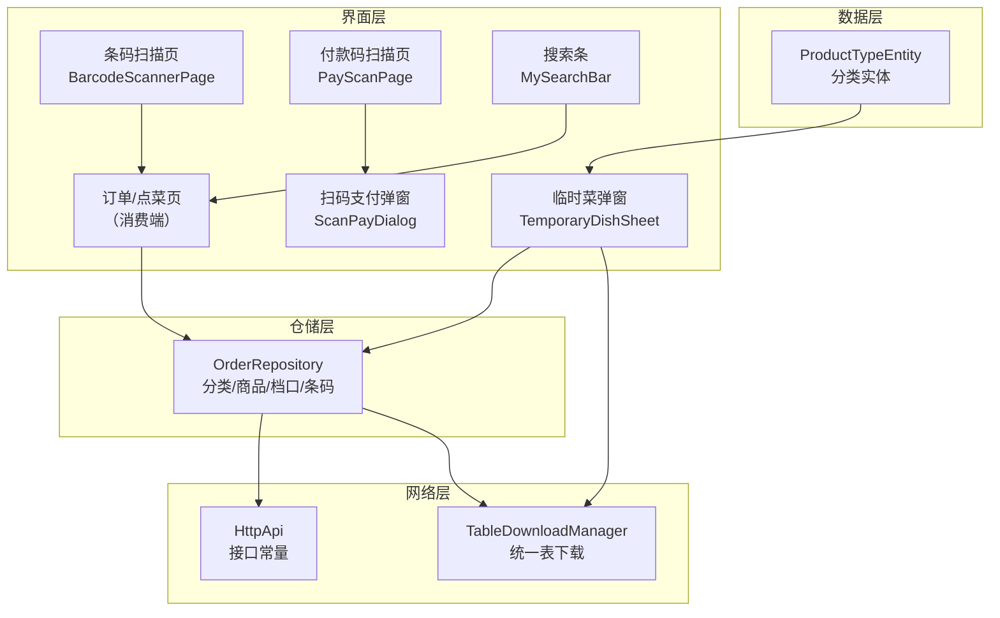
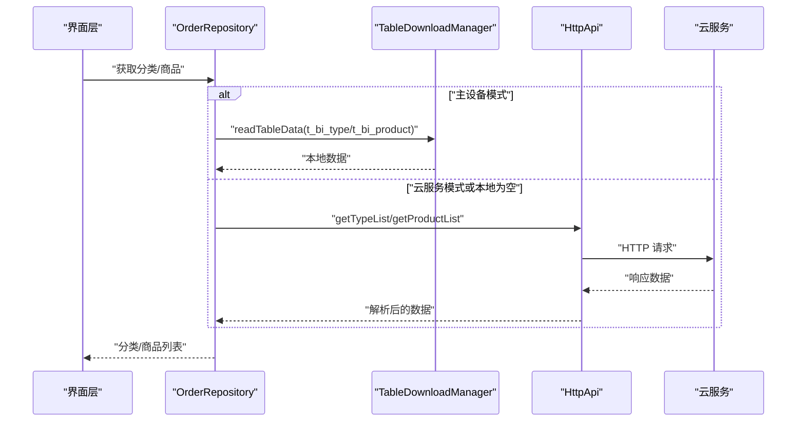
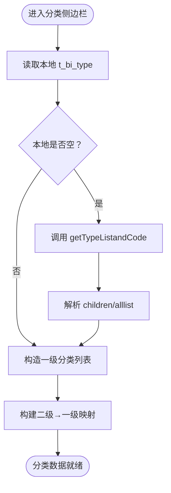
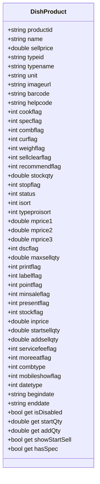
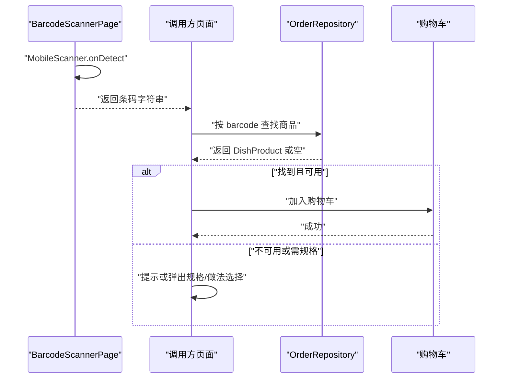
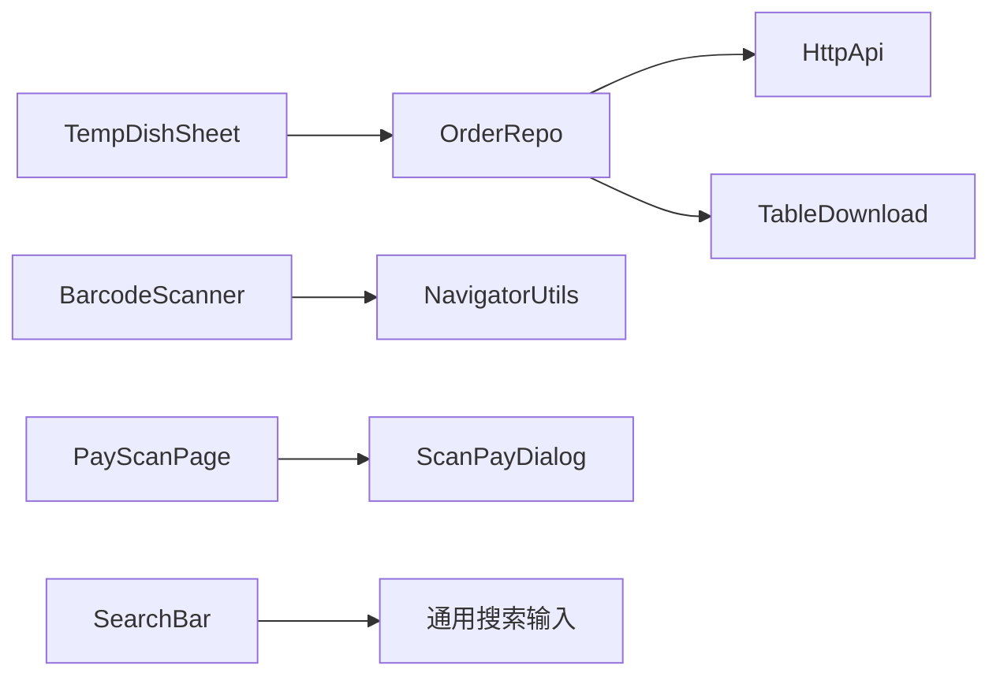
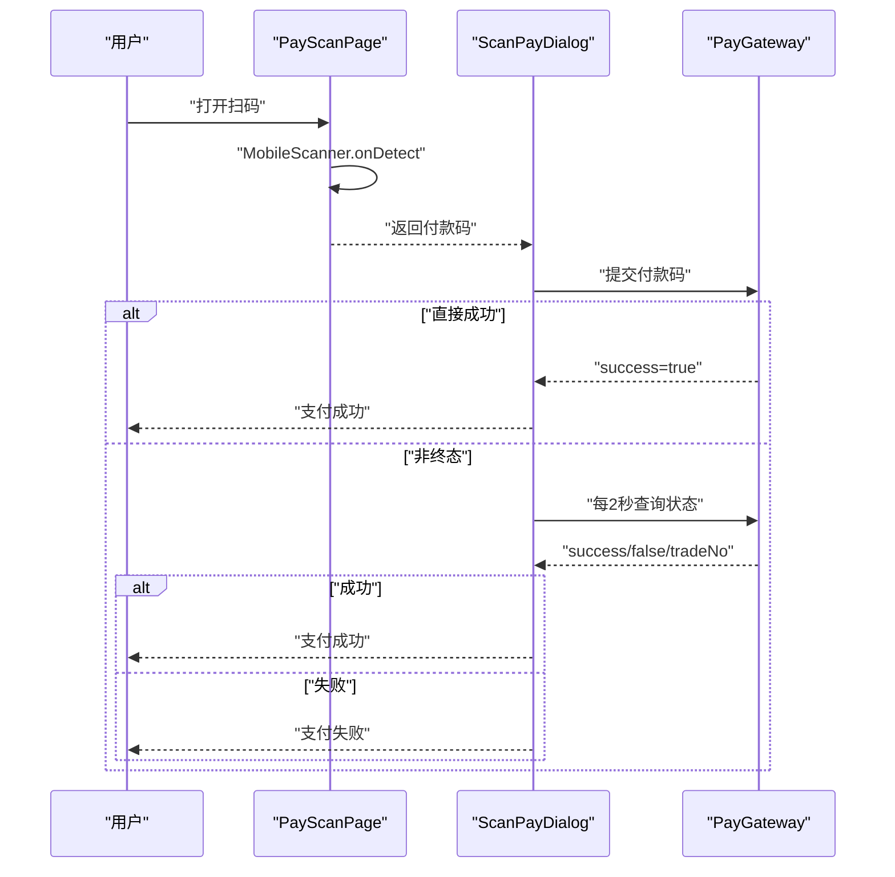

# 商品浏览与分类导航

<cite>
**本文引用的文件**   
- [lib/pages/order/order_repository.dart](file://lib/pages/order/order_repository.dart)
- [lib/net/http_api.dart](file://lib/net/http_api.dart)
- [lib/net/table_download_manager.dart](file://lib/net/table_download_manager.dart)
- [lib/db/entity/product_type_entity.dart](file://lib/db/entity/product_type_entity.dart)
- [lib/components/temporary_dish_sheet.dart](file://lib/components/temporary_dish_sheet.dart)
- [lib/widgets/barcode_scanner_page.dart](file://lib/widgets/barcode_scanner_page.dart)
- [lib/pages/order/pay_scan_page.dart](file://lib/pages/order/pay_scan_page.dart)
- [lib/pages/order/scan_pay_dialog.dart](file://lib/pages/order/scan_pay_dialog.dart)
- [lib/widgets/my_search_bar.dart](file://lib/widgets/my_search_bar.dart)
</cite>

## 目录
1. [引言](#引言)
2. [项目结构](#项目结构)
3. [核心组件](#核心组件)
4. [架构总览](#架构总览)
5. [详细组件分析](#详细组件分析)
6. [依赖关系分析](#依赖关系分析)
7. [性能与缓存策略](#性能与缓存策略)
8. [扫码点菜实现说明](#扫码点菜实现说明)
9. [自定义分类、搜索过滤与分页加载示例](#自定义分类搜索过滤与分页加载示例)
10. [故障排查指南](#故障排查指南)
11. [结论](#结论)

## 引言
本文面向商品浏览与分类导航功能，覆盖以下重点：
- 分类侧边栏数据加载、滚动联动、选中状态管理。
- 商品列表展示逻辑：卡片布局、图片加载、价格显示、库存与沽清状态。
- 扫码点菜流程：条码扫描、商品匹配、自动加购物车。
- 自定义分类配置、商品搜索过滤、分页加载的实现要点。
- 商品数据缓存策略与离线同步机制。

本仓库以 Flutter 为主，业务数据通过云服务接口获取，并通过“统一表下载”将分类、商品等基础数据落地为本地 JSON 或 SQLite，供主设备模式与离线场景使用。

## 项目结构
商品浏览与分类导航相关代码主要分布在以下几处：
- 订单仓储层：`lib/pages/order/order_repository.dart`，封装分类与商品数据源、过滤规则与网络调用。
- 网络接口常量：`lib/net/http_api.dart`，定义商品分类、商品列表、临时菜资料等云接口路径。
- 表下载管理器：`lib/net/table_download_manager.dart`，负责统一表下载、并发控制、失败记录与读取。
- 商品分类实体：`lib/db/entity/product_type_entity.dart`，描述分类字段及序列化方法。
- 临时菜弹窗：`lib/components/temporary_dish_sheet.dart`，演示分类选择、做法/规格、保存资料、生成条码。
- 扫码页面：`lib/widgets/barcode_scanner_page.dart`、`lib/pages/order/pay_scan_page.dart`、`lib/pages/order/scan_pay_dialog.dart`，分别处理通用条码扫描、付款码扫描与支付结果轮询。
- 搜索条：`lib/widgets/my_search_bar.dart`，提供搜索输入控件。

**图表来源**
- [lib/pages/order/order_repository.dart:840-1210](file://lib/pages/order/order_repository.dart#L840-L1210)
- [lib/net/http_api.dart:1-220](file://lib/net/http_api.dart#L1-L220)
- [lib/net/table_download_manager.dart:1-200](file://lib/net/table_download_manager.dart#L1-L200)
- [lib/db/entity/product_type_entity.dart:1-93](file://lib/db/entity/product_type_entity.dart#L1-L93)
- [lib/components/temporary_dish_sheet.dart:1-200](file://lib/components/temporary_dish_sheet.dart#L1-L200)
- [lib/widgets/barcode_scanner_page.dart:1-177](file://lib/widgets/barcode_scanner_page.dart#L1-L177)
- [lib/pages/order/pay_scan_page.dart:1-120](file://lib/pages/order/pay_scan_page.dart#L1-L120)
- [lib/pages/order/scan_pay_dialog.dart:1-200](file://lib/pages/order/scan_pay_dialog.dart#L1-L200)
- [lib/widgets/my_search_bar.dart:1-184](file://lib/widgets/my_search_bar.dart#L1-L184)

**章节来源**
- [lib/pages/order/order_repository.dart:840-1210](file://lib/pages/order/order_repository.dart#L840-L1210)
- [lib/net/http_api.dart:1-220](file://lib/net/http_api.dart#L1-L220)
- [lib/net/table_download_manager.dart:1-200](file://lib/net/table_download_manager.dart#L1-L200)
- [lib/db/entity/product_type_entity.dart:1-93](file://lib/db/entity/product_type_entity.dart#L1-L93)

## 核心组件
- `OrderRepository`：聚合分类与商品的数据访问逻辑，包含本地缓存优先、云端回退、售卖时间校验、分类映射、档口与做法数据获取、临时菜资料保存、条码生成等方法。
- `HttpApi`：集中声明云接口路径，如获取分类、商品列表、厨打档口、条码生成、临时菜资料新增等。
- `TableDownloadManager`：统一管理基础数据表下载，支持全量/增量、并发控制、失败表记录、按表名读取；可写 JSON 或 SQLite。
- `ProductTypeEntity`：分类实体，含分类 ID、名称、排序、启用状态、移动端可见标志等字段。
- `TemporaryDishSheet`：临时菜录入弹窗，演示分类选择、单位/档口/做法选择、保存资料与返回结果。
- `BarcodeScannerPage`、`PayScanPage`、`ScanPayDialog`：分别负责通用条码扫描、付款码扫描与支付结果轮询。
- `MySearchBar`：通用搜索输入组件，提供搜索回调。

**章节来源**
- [lib/pages/order/order_repository.dart:840-1540](file://lib/pages/order/order_repository.dart#L840-L1540)
- [lib/net/http_api.dart:1-220](file://lib/net/http_api.dart#L1-L220)
- [lib/net/table_download_manager.dart:1-200](file://lib/net/table_download_manager.dart#L1-L200)
- [lib/db/entity/product_type_entity.dart:1-93](file://lib/db/entity/product_type_entity.dart#L1-L93)
- [lib/components/temporary_dish_sheet.dart:1-200](file://lib/components/temporary_dish_sheet.dart#L1-L200)
- [lib/widgets/barcode_scanner_page.dart:1-177](file://lib/widgets/barcode_scanner_page.dart#L1-L177)
- [lib/pages/order/pay_scan_page.dart:1-120](file://lib/pages/order/pay_scan_page.dart#L1-L120)
- [lib/pages/order/scan_pay_dialog.dart:1-200](file://lib/pages/order/scan_pay_dialog.dart#L1-L200)
- [lib/widgets/my_search_bar.dart:1-184](file://lib/widgets/my_search_bar.dart#L1-L184)

## 架构总览
商品浏览与分类导航的整体数据流如下：
1. 界面层发起请求（分类、商品、档口、做法、条码）。
2. 仓储层根据当前模式决定数据源：
   - 主设备模式优先读本地表（t_bi_type、t_bi_product 等）。
   - 云服务模式直接调云接口（getTypeList、getProductList）。
3. 本地数据来自 `TableDownloadManager` 的统一表下载任务，结果以 JSON 或 SQLite 形式存储。
4. 分类与商品数据在仓储层完成过滤、排序与映射后返回给界面层。

**图表来源**
- [lib/pages/order/order_repository.dart:840-1210](file://lib/pages/order/order_repository.dart#L840-L1210)
- [lib/net/http_api.dart:1-220](file://lib/net/http_api.dart#L1-L220)
- [lib/net/table_download_manager.dart:1-200](file://lib/net/table_download_manager.dart#L1-L200)

**章节来源**
- [lib/pages/order/order_repository.dart:840-1210](file://lib/pages/order/order_repository.dart#L840-L1210)
- [lib/net/http_api.dart:1-220](file://lib/net/http_api.dart#L1-L220)
- [lib/net/table_download_manager.dart:1-200](file://lib/net/table_download_manager.dart#L1-L200)

## 详细组件分析

### 分类侧边栏实现原理
- 分类数据加载：
  - 优先从本地表 `t_bi_type` 中取一级分类（level=1、stopflag=0、status=1、mobileshowflag=1），按 isort 升序。
  - 若本地为空，则回退到云接口 `getTypeListandCode`。
  - 同时构建二级分类到一级父分类的映射，避免二级分类下的商品无法归属到左侧栏的一级分类。
- 滚动联动机制：
  - 商品数据自带 typeid 字段，前端按 typeid 分组，左侧栏展示一级分类，右侧商品列表按 typeproisort 排序。
  - 点击左侧分类时，滚动右侧商品列表到对应分组位置。
- 选中状态管理：
  - 维护当前选中分类 ID，渲染时高亮对应项；切换分类时更新状态并触发右侧列表定位。

**图表来源**
- [lib/pages/order/order_repository.dart:840-930](file://lib/pages/order/order_repository.dart#L840-L930)
- [lib/pages/order/order_repository.dart:1091-1125](file://lib/pages/order/order_repository.dart#L1091-L1125)

**章节来源**
- [lib/pages/order/order_repository.dart:840-930](file://lib/pages/order/order_repository.dart#L840-L930)
- [lib/pages/order/order_repository.dart:1091-1125](file://lib/pages/order/order_repository.dart#L1091-L1125)

### 商品列表展示逻辑
- 商品数据加载：
  - 主设备模式优先读本地 `t_bi_product`，并按售卖时间窗口过滤；本地为空则回退云接口 `getProductList`。
  - 云接口参数中包含 stopflag、mobileshowflag、sellclearflag、typeproisort 排序等，保证商品列表顺序与可见性。
- 商品卡片布局：
  - 每个商品包含 productid、name、sellprice、imageurl、barcode、helpcode、unit、cookflag、specflag、combflag、curflag、weighflag、sellclearflag、stockqty、status、stopflag 等字段。
  - 图片使用 imageurl 展示，若无图则用占位图。
- 价格显示：
  - sellprice 作为售价显示；会员价 mprice1~mprice3 用于会员折扣计算；startQty/addQty 控制起售/增售数量按钮显示。
- 库存与沽清状态：
  - stockflag 表示是否管库存；stockqty 为沽清库存数量；sellclearflag 表示已沽清。
  - hasSpec 表示是否有规格或做法，需要弹窗选择；combflag 标识套餐。
  - isDisabled 表示商品是否停用或下架。

**图表来源**
- [lib/pages/order/order_repository.dart:20-120](file://lib/pages/order/order_repository.dart#L20-L120)

**章节来源**
- [lib/pages/order/order_repository.dart:20-120](file://lib/pages/order/order_repository.dart#L20-L120)
- [lib/pages/order/order_repository.dart:960-1090](file://lib/pages/order/order_repository.dart#L960-L1090)
- [lib/pages/order/order_repository.dart:1125-1210](file://lib/pages/order/order_repository.dart#L1125-L1210)

### 扫码点菜功能实现
- 条码扫描：
  - `BarcodeScannerPage` 使用 MobileScanner 打开相机预览，检测条码并返回 rawValue。
  - 扫描成功后通过 NavigatorUtils.goBackWithParams 返回扫码字符串。
- 商品匹配：
  - 扫码结果通常为商品 barcode 或 typeid；仓储层可根据 barcode 在本地商品库或云接口返回的商品列表中匹配商品。
  - 匹配成功后，将商品加入购物车或直接去下单页（由调用方决定）。
- 自动添加购物车：
  - 在扫码回调中，根据商品是否存在、是否可用（isDisabled）、是否需规格/做法选择来决定加购行为。
  - 如需规格/做法，弹出 `SpecCookSheet` 或相关弹窗，用户选择后再加购。

**图表来源**
- [lib/widgets/barcode_scanner_page.dart:1-177](file://lib/widgets/barcode_scanner_page.dart#L1-L177)
- [lib/pages/order/order_repository.dart:20-120](file://lib/pages/order/order_repository.dart#L20-L120)

**章节来源**
- [lib/widgets/barcode_scanner_page.dart:1-177](file://lib/widgets/barcode_scanner_page.dart#L1-L177)
- [lib/pages/order/order_repository.dart:20-120](file://lib/pages/order/order_repository.dart#L20-L120)

### 自定义分类配置
- 分类字段：
  - ProductTypeEntity 包含 typeid、name、isort、stopflag、status、mobileshowflag、scanshowflag 等字段，可用于控制分类在移动端与扫码端的显示。
- 配置建议：
  - 确保一级分类 level=1，stopflag=0，status=1，mobileshowflag=1。
  - 二级分类 parenttypeid 指向有效的一级分类，以便构建映射。
  - 商品必须绑定有效的 typeid，否则不会出现在分类下。

**章节来源**
- [lib/db/entity/product_type_entity.dart:1-93](file://lib/db/entity/product_type_entity.dart#L1-L93)
- [lib/pages/order/order_repository.dart:840-930](file://lib/pages/order/order_repository.dart#L840-L930)

### 商品搜索过滤
- 搜索条：
  - `MySearchBar` 提供文本输入与搜索按钮，支持清空、回车搜索等交互。
- 过滤逻辑：
  - 可在调用方对商品列表进行内存过滤（name/helpcode/barcode 模糊匹配）。
  - 也可在云接口侧增加搜索参数（如 keyword），但当前代码未显式暴露该参数。

**章节来源**
- [lib/widgets/my_search_bar.dart:1-184](file://lib/widgets/my_search_bar.dart#L1-L184)
- [lib/pages/order/order_repository.dart:20-120](file://lib/pages/order/order_repository.dart#L20-L120)

### 分页加载
- 当前实现：
  - `fetchAllProducts` 使用 page=1、pagesize=9999 一次性拉取全部商品，适合门店规模较小的场景。
  - 若商品数量较大，建议在调用方实现分页加载或增量刷新。
- 建议扩展：
  - 增加 hasNextPage 判断与下一页加载逻辑。
  - 结合滚动监听实现无限滚动。

**章节来源**
- [lib/pages/order/order_repository.dart:1125-1210](file://lib/pages/order/order_repository.dart#L1125-L1210)

## 依赖关系分析
- `OrderRepository` 依赖 `HttpApi` 和 `TableDownloadManager`。
- `TemporaryDishSheet` 依赖 `OrderRepository` 获取分类、档口、做法、条码等数据。
- 扫码页面依赖 `MobileScanner` 与导航工具返回扫码结果。
- 搜索条为通用 UI 组件，被搜索页或商品页复用。

**图表来源**
- [lib/pages/order/order_repository.dart:840-1540](file://lib/pages/order/order_repository.dart#L840-L1540)
- [lib/components/temporary_dish_sheet.dart:1-200](file://lib/components/temporary_dish_sheet.dart#L1-L200)
- [lib/widgets/barcode_scanner_page.dart:1-177](file://lib/widgets/barcode_scanner_page.dart#L1-L177)
- [lib/pages/order/pay_scan_page.dart:1-120](file://lib/pages/order/pay_scan_page.dart#L1-L120)
- [lib/widgets/my_search_bar.dart:1-184](file://lib/widgets/my_search_bar.dart#L1-L184)

**章节来源**
- [lib/pages/order/order_repository.dart:840-1540](file://lib/pages/order/order_repository.dart#L840-L1540)
- [lib/components/temporary_dish_sheet.dart:1-200](file://lib/components/temporary_dish_sheet.dart#L1-L200)
- [lib/widgets/barcode_scanner_page.dart:1-177](file://lib/widgets/barcode_scanner_page.dart#L1-L177)
- [lib/pages/order/pay_scan_page.dart:1-120](file://lib/pages/order/pay_scan_page.dart#L1-L120)
- [lib/widgets/my_search_bar.dart:1-184](file://lib/widgets/my_search_bar.dart#L1-L184)

## 性能与缓存策略
- 本地缓存优先：
  - 主设备模式下优先读本地 t_bi_type 与 t_bi_product，减少网络开销。
  - 本地为空时回退云接口，保证可用性。
- 统一表下载：
  - 通过 `TableDownloadManager.downTableFlow` 并发拉取所有注册表，支持全量/增量更新。
  - 失败表会被记录，便于重试与用户提示。
- 售卖时间校验：
  - 本地商品列表会过滤不在售卖周期、日期区间或时段内的商品，提升列表准确性。
- 建议优化：
  - 对热点分类做局部刷新。
  - 对大图资源启用缓存与懒加载。
  - 对搜索词做防抖处理。

**章节来源**
- [lib/pages/order/order_repository.dart:960-1090](file://lib/pages/order/order_repository.dart#L960-L1090)
- [lib/net/table_download_manager.dart:1-200](file://lib/net/table_download_manager.dart#L1-L200)

## 扫码点菜实现说明
- 通用条码扫描：
  - `BarcodeScannerPage` 打开后置摄像头，检测条码并返回 rawValue。
  - 适用于商品条码、二维码等场景。
- 付款码扫描：
  - `PayScanPage` 用于微信/支付宝/云闪付付款码扫描，支持连续扫描模式。
  - 扫描结果传给 `ScanPayDialog` 进行支付处理。
- 支付结果轮询：
  - `ScanPayDialog` 发起支付后，若未立即成功，则每 2 秒轮询一次，60 秒超时。
  - 支持直接成功、明确失败、轮询成功等多种终态。

**图表来源**
- [lib/pages/order/pay_scan_page.dart:1-120](file://lib/pages/order/pay_scan_page.dart#L1-L120)
- [lib/pages/order/scan_pay_dialog.dart:1-200](file://lib/pages/order/scan_pay_dialog.dart#L1-L200)

**章节来源**
- [lib/widgets/barcode_scanner_page.dart:1-177](file://lib/widgets/barcode_scanner_page.dart#L1-L177)
- [lib/pages/order/pay_scan_page.dart:1-120](file://lib/pages/order/pay_scan_page.dart#L1-L120)
- [lib/pages/order/scan_pay_dialog.dart:1-200](file://lib/pages/order/scan_pay_dialog.dart#L1-L200)

## 自定义分类、搜索过滤与分页加载示例
- 自定义分类配置：
  - 在后台设置一级分类 level=1、stopflag=0、status=1、mobileshowflag=1。
  - 二级分类 parenttypeid 指向一级分类，确保映射正确。
  - 商品绑定 typeid，并确保 mobileshowflag=1、status=1、stopflag=0。
- 商品搜索过滤：
  - 使用 `MySearchBar` 收集关键词，对商品列表进行内存过滤（name/helpcode/barcode）。
  - 如需服务端搜索，可扩展 `getProductList` 参数。
- 分页加载：
  - 当前 `fetchAllProducts` 使用 pagesize=9999 一次性加载。
  - 建议根据后端返回的 total、hasNextPage 实现分页加载。

**章节来源**
- [lib/pages/order/order_repository.dart:1125-1210](file://lib/pages/order/order_repository.dart#L1125-L1210)
- [lib/widgets/my_search_bar.dart:1-184](file://lib/widgets/my_search_bar.dart#L1-L184)

## 故障排查指南
- 分类为空：
  - 检查本地 t_bi_type 是否为空；若为空，确认是否执行了数据交换。
  - 检查云接口 getTypeListandCode 是否返回 children/alllist。
- 商品不显示：
  - 检查商品 stopflag、status、mobileshowflag 是否正确。
  - 检查售卖时间是否满足条件（周期、日期、时段）。
- 扫码无结果：
  - 确认相机权限与 MobileScanner 初始化是否正常。
  - 检查条码格式是否被识别。
- 支付超时：
  - 检查网关 pay/query/close 接口是否正常。
  - 关注轮询次数与超时时间（60 秒）。

**章节来源**
- [lib/pages/order/order_repository.dart:840-1210](file://lib/pages/order/order_repository.dart#L840-L1210)
- [lib/widgets/barcode_scanner_page.dart:1-177](file://lib/widgets/barcode_scanner_page.dart#L1-L177)
- [lib/pages/order/scan_pay_dialog.dart:1-200](file://lib/pages/order/scan_pay_dialog.dart#L1-L200)

## 结论
本项目在商品浏览与分类导航方面，通过仓储层统一封装分类与商品数据源，结合本地缓存与云端回退，保证了主设备模式与云服务模式的稳定性。分类侧边栏通过一级分类与二级映射实现联动，商品列表按 typeproisort 排序并结合售卖时间过滤。扫码点菜通过 MobileScanner 实现条码与付款码扫描，并与支付网关协同完成支付流程。未来可进一步优化分页加载、搜索性能与图片缓存策略。